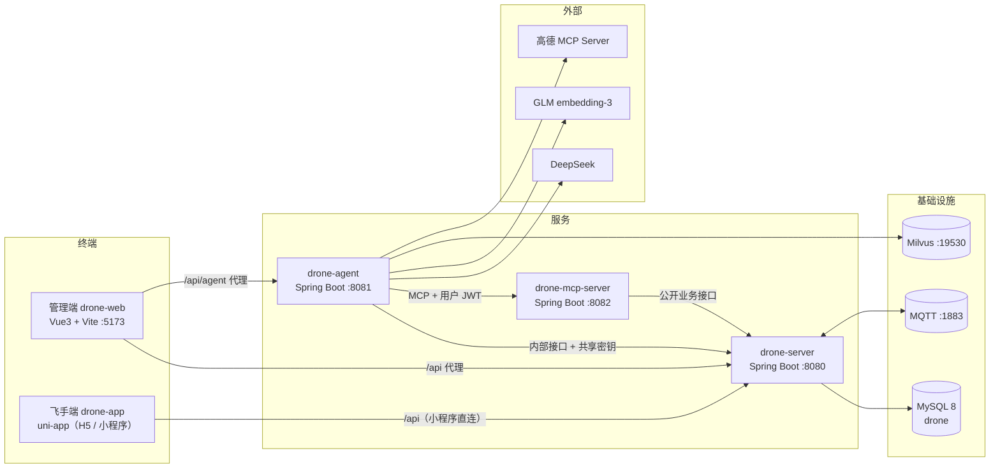

# 无人机管理平台（drone）

一个面向无人机作业队的**设备 / 任务 / 航线 / 告警**管理平台，外带一个能查内部资料、
查天气、规划路线的**智能助手**。仓库由五个独立工程组成，各自构建、各自部署。

> 想先看“系统怎么分层、请求怎么走、改东西该动哪里”，直接读
> **[架构 Wiki](./docs/wiki/README.md)**（[drone-server](./docs/wiki/drone-server-架构.md) /
> [drone-agent](./docs/wiki/drone-agent-架构.md)）。
>
> 开发规范与流程见 [`AGENTS.md`](./AGENTS.md) 与 [`docs/sdd/README.md`](./docs/sdd/README.md)。

---

## 1. 系统架构



- **权限不在 JWT 里**：Token 只装用户 ID 与用户名，角色/权限每次请求查库补全。
- **`drone-agent` 没有自己的登录**：用同一把密钥、同一个 issuer 验 `drone-server` 签发的 Token。
- **后端没有配 CORS**：两个前端都必须走 devServer 代理（小程序除外）。

---

## 2. 工程一览

| 目录 | 是什么 | 端口 / 包名 |
|---|---|---|
| `drone-server` | 后端主服务（Spring Boot 3.3.3 + Java 17 + Maven + MyBatis + MySQL） | 8080 / `cn.tedu.drone` |
| `drone-agent` | 智能助手服务（同栈；工具调用、Plan / SubAgent、Skill、记忆、RAG、MCP） | 8081 / `cn.tedu.droneagent` |
| `drone-mcp-server` | 把 `drone-server` 的现有接口暴露为 MCP 工具（供助手操作业务） | 8082 / `cn.tedu.drone.mcp` |
| `drone-web` | 管理端（Vue 3 + Vite + TS + Element Plus + Pinia） | 5173 |
| `drone-app` | 飞手端（uni-app，H5 + 微信小程序） | H5 :5174（走 `/api` 代理） |
| `tools/drone-simulator` | 设备模拟器，扮演厂商侧往 MQTT 发遥测 | — |

---

## 3. 快速开始

### 3.1 环境要求

| 依赖 | 版本 |
|---|---|
| JDK | 17 |
| Maven | 3.8+（项目**没有** `mvnw`，用系统 `mvn`） |
| MySQL | 8.x |
| Node.js | `drone-web` 要求 `^22.18` 或 `>=24.12`（`.nvmrc` 为 24） |
| Docker | 可选：Milvus（内部资料检索）、MQTT Broker |

### 3.2 建库

```bash
mysql -uroot -proot -e "CREATE DATABASE IF NOT EXISTS drone DEFAULT CHARACTER SET utf8mb4;"
mysql -uroot -proot drone < drone-server/docs/sql/schema.sql   # ① 建全部表
mysql -uroot -proot drone < drone-server/docs/sql/data.sql     # ② 初始化账号/角色/设备

# ③ 智能助手权限点（全新库也必须执行，否则 /chat 会 403）
mysql -uroot -proot drone < drone-server/docs/sql/migration/agent_permission.sql
mysql -uroot -proot drone < drone-server/docs/sql/migration/agent_permission_roles.sql
```

> `migration/*.sql` 大多是**存量库的结构/数据增量**，全新环境通常不用全跑；
> 但 `agent_permission*.sql` 是新增权限点，`data.sql` 里还没有，必须补执行。
> 每个文件头部写了自己的前提与顺序，改表结构时新增文件，不要改老文件。

### 3.3 环境变量

```bash
# 两个服务必须一致
export JWT_SECRET="请换成随机长串"
export DRONE_INTERNAL_TOKEN="请换成随机长串"

# 智能助手
export DEEPSEEK_API_KEY="sk-..."          # 不配也能启动，/chat 会提示未配置
export EMBEDDING_API_KEY="..."            # GLM embedding-3；也接受 ZHIPU_API_KEY
export AMAP_MCP_KEY="..."                 # 高德 MCP 的 Key（天气/地图/路线工具）
export DRONE_MCP_URL="http://127.0.0.1:8082/mcp"   # 平台业务工具（默认值即此）
export DRONE_SERVER_URL="http://localhost:8080"
export MQTT_ENABLED=false                 # 不关心设备时关掉，免去连本地 broker 的噪音
export DRONE_UPLOAD_ROOT="./data/upload"  # 附件目录（已在 .gitignore）
export MILVUS_HOST="localhost"            # 内部资料检索用的向量库（可选）
export MILVUS_PORT="19530"
```

### 3.4 启动顺序

```bash
# 1) 后端主服务
cd drone-server && mvn spring-boot:run      # :8080

# 2) 平台业务 MCP 服务（不依赖 drone-server 是否已起）
cd drone-mcp-server && mvn spring-boot:run  # :8082

# 3) 智能助手（依赖 drone-server 的内部接口）
cd drone-agent  && mvn spring-boot:run      # :8081

# 4) 管理端
cd drone-web    && npm install && npm run dev   # :5173

# 5) 飞手端（H5）
cd drone-app    && npm install && npm run dev:h5
```

---

## 4. 账号信息

> 以下均为**开发/演示环境**的初始数据，来自 `drone-server/docs/sql/data.sql`。

### 4.1 平台登录账号

登录接口：`POST /user/login`，请求体 `{"username":"...","password":"..."}`。
管理端地址：<http://localhost:5173/login>。

| 账号（手机号） | 姓名 | 角色 | 账号状态 | 能否登录 |
|---|---|---|---|---|
| `13800001001` | 张伟 | 飞手 `pilot` | 启用 | 可登录 |
| `13800001002` | 李明 | 飞手 `pilot` | **禁用** | 不可登录 |
| `13800001003` | 王芳 | 飞手 `pilot` | 启用 | 可登录 |
| `13800001004` | 赵强 | 机务 `maintainer` | 启用 | 可登录 |
| `13800001005` | 刘洋 | 管理员 `admin` | 启用 | 可登录 |
| `13800001006` | 陈静 | 飞手 `pilot` | **禁用** | 不可登录 |

**统一密码：`123456`**（演示用，见下方安全提醒）。

> 角色决定能看什么：`admin` 全部；`maintainer` 员工查看、设备档案、任务/告警列表、点位/航线/禁飞区；
> `pilot` 设备查看 + 任务执行（助手对话框还需 `agent_permission_roles.sql` 授予的 `agent:chat`）。
> 另有 `screen`（大屏只读）角色，初始数据里没有账号，需要在「员工管理」里自己建。

### 4.2 数据库

| 项 | 值 | 配置位置 |
|---|---|---|
| 地址 | `localhost:3306` | `drone-server/src/main/resources/application.yml` |
| 库名 | `drone` | 同上 |
| 账号 / 密码 | `root` / `root` | 同上（开发默认值） |

### 4.3 服务间与安全密钥

| 项 | 开发默认值 | 说明 |
|---|---|---|
| `JWT_SECRET` | `drone-dev-secret-key-please-change-in-production-2026` | `drone-server` 与 `drone-agent` 的 `drone.jwt.secret` **必须一致**，否则互相 401 |
| `DRONE_INTERNAL_TOKEN` | `drone-dev-internal-token-change-me` | `/internal/**` 的共享密钥，两边必须一致；**不得暴露到网关之外** |
| `MQTT_USERNAME` / `MQTT_PASSWORD` | 空 | 本地 broker 默认不鉴权 |

### 4.4 第三方 Key

| 变量 | 用途 | 不配的后果 |
|---|---|---|
| `DEEPSEEK_API_KEY` | 助手对话 | 服务能启动，`/chat` 返回「未配置」提示 |
| `EMBEDDING_API_KEY`（或 `ZHIPU_API_KEY`） | 内部资料向量化 | 知识库不入库、检索不可用 |
| `AMAP_MCP_KEY` | 高德 MCP 天气/地图/路线工具 | 启动日志 WARN 跳过该服务器，本地工具照常可用 |

### 4.5 安全提醒（上生产前必做）

1. **密码是明文存储与比对**（`UserServiceImpl` 注释已写明「仅开发阶段」）。上线前必须改为 BCrypt。
2. **默认密钥必须替换**：`JWT_SECRET`、`DRONE_INTERNAL_TOKEN` 都不要用仓库里的默认值。
3. **数据库不要用 root**：建一个最小权限的业务账号。
4. **第三方 Key 只走环境变量**，不要写进 `application.yml`，更不要提交。
5. 演示账号的密码 `123456` 只用于本地，生产环境不得保留。

---

## 5. 目录结构

```text
drone/
├── drone-server/          # 主服务：用户/RBAC、设备、任务、航线、告警、分析、大屏
│   ├── docs/sql/          # schema.sql + data.sql + migration/*.sql
│   └── docs/              # 业务与设计说明（任务、告警、RBAC、大屏……）
├── drone-agent/           # 智能助手：对话、工具调用、Plan/SubAgent、记忆、RAG、MCP
│   ├── src/main/resources/prompts/     # 提示词（改文案改这里，不用改代码）
│   ├── src/main/resources/skills/      # 业务流程 Skill（日报 / 派发检查 / 告警分诊 / 交接班）
│   ├── src/main/resources/plans/       # 内置固定计划（如日报）
│   ├── src/main/resources/subagents/   # 子 Agent 定义（只读运营分析）
│   └── docs/              # 大模型 / 提示词 / 上下文 / 工具 / MCP / Skill / RAG / 记忆 / Plan / SubAgent 等手册
├── drone-mcp-server/      # 平台业务 MCP 服务（快照生成工具目录，转发用户身份）
├── drone-web/             # 管理端
├── drone-app/             # 飞手端（uni-app）
├── docs/wiki/             # 架构 Wiki（系统全貌 + 两个后端的模块/链路/扩展点）
├── docs/sdd/              # SDD：宪法、编码规范、specs/plans/tasks、ADR
├── docs/business/         # 业务文档（操作手册、保险方案）
├── docs/tests/            # 端到端回归记录
├── docs/reviews/          # 代码评审报告
└── tools/drone-simulator/ # 设备模拟器
```

---

## 6. 常用命令

```bash
cd drone-server && mvn compile            # 编译
cd drone-server && mvn test               # 主服务测试
cd drone-agent  && mvn test               # 助手全量单测
cd drone-mcp-server && mvn test           # MCP 服务单测（工具目录/协议/转发）
cd drone-web    && npm run type-check     # 类型检查
cd drone-web    && npm run lint           # oxlint + eslint
cd drone-web    && npm run test           # Vitest
cd drone-app    && npm run type-check
```

---

## 7. 文档索引

| 文档 | 内容 |
|---|---|
| [`AGENTS.md`](./AGENTS.md) | 仓库约定：架构、命令、Git 规范、环境变量 |
| [`docs/sdd/constitution.md`](./docs/sdd/constitution.md) | 项目宪法（最高约束） |
| [`docs/sdd/java-standards.md`](./docs/sdd/java-standards.md) | Java 编码规范 |
| [`docs/sdd/frontend-standards.md`](./docs/sdd/frontend-standards.md) | 前端编码规范 |
| [`docs/sdd/specs`](./docs/sdd/specs) / [`plans`](./docs/sdd/plans) / [`tasks`](./docs/sdd/tasks) | 需求 → 方案 → 任务 |
| [`docs/sdd/decisions`](./docs/sdd/decisions) | 架构决策记录（ADR） |
| [`docs/wiki`](./docs/wiki/README.md) | 架构 Wiki 首页：系统全貌、五条约定、三条主链路 |
| [`docs/wiki/drone-server-架构.md`](./docs/wiki/drone-server-架构.md) | 主服务：分层、RBAC、任务/证据、MQTT、告警、分析、大屏 |
| [`docs/wiki/drone-agent-架构.md`](./docs/wiki/drone-agent-架构.md) | 助手：对话流程、TaskRouter、ReAct/Plan/SubAgent、工具/记忆/RAG/MCP |
| [`drone-server/docs`](./drone-server/docs) | 业务设计：任务、告警、MQTT、RBAC、大屏、业务分析…… |
| [`drone-agent/docs/大模型基础-初级工程师手册.md`](./drone-agent/docs/大模型基础-初级工程师手册.md) | Token、上下文、温度、幻觉…… |
| [`drone-agent/docs/提示词工程-初级工程师手册.md`](./drone-agent/docs/提示词工程-初级工程师手册.md) | 提示词管理与写作 |
| [`drone-agent/docs/上下文工程-初级工程师手册.md`](./drone-agent/docs/上下文工程-初级工程师手册.md) | 上下文窗口、上下文组装与压缩 |
| [`drone-agent/docs/工具调用-初级工程师手册.md`](./drone-agent/docs/工具调用-初级工程师手册.md) | 工具框架与编排循环（0004–0007） |
| [`drone-agent/docs/Harness工程-初级工程师手册.md`](./drone-agent/docs/Harness工程-初级工程师手册.md) | Harness 的八个关注面与本项目实现 |
| [`drone-agent/docs/Agent框架对比-Harness视角-初级工程师手册.md`](./drone-agent/docs/Agent框架对比-Harness视角-初级工程师手册.md) | Spring AI / LangChain / LangGraph / AgentScope 对比与本项目落地 |
| [`drone-agent/docs/Jev与AgentHarness-初级工程师手册.md`](./drone-agent/docs/Jev与AgentHarness-初级工程师手册.md) | Jev（System One）来龙去脉、用法与无人机业务场景 |
| [`drone-agent/docs/MCP接入-初级工程师手册.md`](./drone-agent/docs/MCP接入-初级工程师手册.md) | MCP 协议与本项目接入 |
| [`drone-agent/docs/业务流程Skill-初级工程师手册.md`](./drone-agent/docs/业务流程Skill-初级工程师手册.md) | 业务流程 Skill：渐进式加载、按权限裁剪、如何新增流程 |
| [`drone-agent/docs/Plan模式-初级工程师手册.md`](./drone-agent/docs/Plan模式-初级工程师手册.md) | 内置计划 / 运行时生成计划、审批与执行 |
| [`drone-agent/docs/SubAgent-初级工程师手册.md`](./drone-agent/docs/SubAgent-初级工程师手册.md) | 子 Agent、任务路由与技术演进 |
| [`drone-agent/docs/知识库检索-初级工程师手册.md`](./drone-agent/docs/知识库检索-初级工程师手册.md) | RAG：切块、向量、权限过滤 |
| [`drone-agent/docs/记忆子系统-初级工程师手册.md`](./drone-agent/docs/记忆子系统-初级工程师手册.md) | 短期/长期记忆 |
| [`drone-agent/docs/软件工程常用图鉴.md`](./drone-agent/docs/软件工程常用图鉴.md) | 架构图/流程图/时序图的画法 |

---

## 8. 开发流程（SDD，强制）

1. 动手前读 `docs/sdd/constitution.md` 与当前需求的 `specs/`、`plans/`、`tasks/`。
2. **一次只做一条任务**；规格有缺口就停下来问，不要自行假设。
3. 新需求先补 spec → plan → tasks，评审通过再写代码。
4. 提交信息用中文「动作：细节」并带需求 ID；运行 `AGENTS.md` 中列出的检查命令后再提交。
5. 不提交 `target/`、`node_modules/`、`data/`、任何真实密钥。
