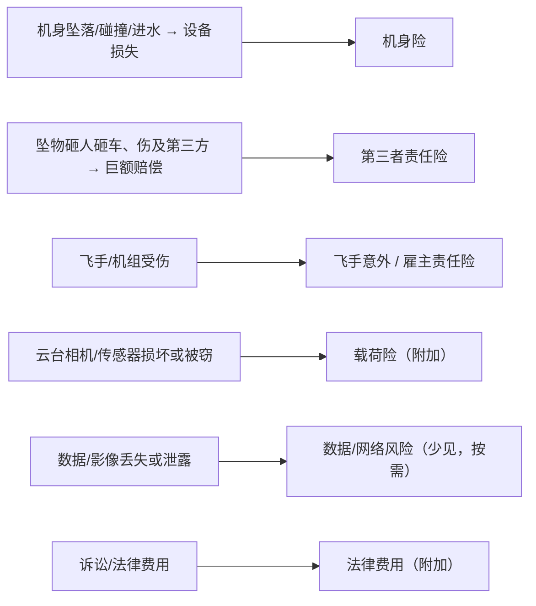

# 无人机作业保险方案（投保决策框架）

> **读者**：运营负责人、财务、机务（用于投保决策与预算）。
> **文档性质**：**决策框架 / 需求说明**，不是报价单，也不构成保险合同。
> **最终以保险公司的《保险条款》与保单为准**——【事实】以条款文字为唯一依据。
>
> 【记号】**【依据】**＝法规/常识性事实；**【建议】**＝根据行业常见做法给出的推荐区间，**须结合机型与预算核价**；**【待确认】**＝需要你补的信息；**【待询价】**＝需向承保公司问价。

## 0. 待确认（先补这几项，方案才能落到数字）

| 项 | 影响 |
|---|---|
| 机队规模与机型 | 决定机身险保额与费率档 |
| 作业区域 | 城市/野外/跨境，影响三者责任风险与承保条件 |
| 是否载人载物 / 是否超视距 | 直接决定可保性与附加条款 |
| 飞行架次 / 年作业量 | 影响费率与免赔设置 |
| 是否已有保单 / 历史赔付 | 影响续保与核保 |
| 预算区间 | 决定方案档次（基础/标准/尊享） |
| 合同要求 | 甲方合同常要求最低三者责任保额与附加被保险人 |

---

## 1. 背景与目标

无人机作业的风险特点是：**损失集中、单次事故可能赔偿巨大**（掉落砸人砸物/伤及第三方），
而机身本身是**高价值、易损**资产。目标是用**可预算的保费**，把**不可承受的巨额风险**转移出去。

**目标**：
1. **转移巨额责任**：第三者人身/财产损失（最不可承受的一项）；
2. **覆盖资产损失**：机身、载荷（云台相机/传感器）；
3. **覆盖人员风险**：飞手/机组的意外伤害；
4. **满足合规与合同**：实名登记、作业资质之外，满足甲方对保险的要求。

---

## 2. 风险识别 → 对应险种

| 风险 | 后果 | 建议险种 | 优先级 |
|---|---|---|---|
| 机身坠落/碰撞/进水 | 设备报废、维修贵 | **机身险** | 高 |
| 坠物伤人或损物 | 赔偿可能远超机身价值 | **第三者责任险** | **最高** |
| 飞手受伤 | 医疗 + 误工 + 责任 | 飞手意外 / 雇主责任 | 高 |
| 载荷（相机/传感器）损坏/被窃 | 载荷常比机身还贵 | 载荷险（附加） | 中高 |
| 数据/影像丢失泄露 | 违约、声誉 | 数据/网络险 | 低（按需） |
| 诉讼费用 | 额外支出 | 法律费用（附加） | 中 |

> **核心观点**：**第三者责任险**是最不该省的一项——机身损失是「赔得起」的，
> 砸伤人的赔偿可能是「赔不起」的。**【建议】**优先把三者责任做足，再谈机身。

---

## 3. 险种设计（每个险种要看什么）

### 3.1 机身险（机身损失险）
- **保什么**：坠落、碰撞、进水、失控等造成的**机身及随机设备**损失。
- **保额怎么定**：按**重置价值**（同型号新车价）或**约定价值**投保；**【待确认】**机型与购置价。
- **关键条款**：**免赔额**（每次事故自付部分）、是否含**自然磨损/机械故障**、**是否指定驾驶员**。

### 3.2 第三者责任险（最重要）
- **保什么**：飞行中造成**第三方人身伤亡 / 财产损失**的赔偿责任。
- **保额怎么定**：**【依据】**无人机三者险常见保额档为**几十万～数百万元**；
  **【建议】**作业环境越复杂（城市、有人区）保额越高；有甲方合同要求的按其**最低要求**上浮。
- **关键条款**：**责任限额**（每次事故/累计）、是否含**人身伤亡**、**免赔额**。

### 3.3 飞手意外 / 雇主责任险
- **保什么**：飞手及机组人员在作业中受伤的医疗与身故伤残赔付。
- **怎么选**：走**雇主责任险**（企业为员工投保）比个人意外更贴合用工关系；
  有社保的补充医疗与工伤覆盖，注意**不重复投保**。

### 3.4 载荷险 / 附加险
- **载荷险**：云台相机、激光雷达、多光谱传感器等高价值载荷单独投保。
- **附加险**：法律费用、**扩展作业区域**（跨境/特定城市）、**转运与运输**期间风险。

---

## 4. 保额建议（**【建议】，最终按核价与合同定**）

| 险种 | 保额建议 | 说明 |
|---|---|---|
| 机身险 | 按机型**重置价值** | 贵机型可设**自留额**（小损自付）以压低保费 |
| 第三者责任险 | **建议不低于 100 万元**；城市作业或合同要求下 **200～500 万元** | 最不可省的项 |
| 飞手意外/雇主责任 | 每人 **50～100 万元** 身故伤残 + 医疗 | 按人数与用工方式定 |
| 载荷险 | 按载荷重置价值 | 高价值载荷单独列 |
| 免赔额 | 机身每次事故自付**【建议】**保额的 5%～10% 或固定金额 | 免赔越高、保费越低（自担小损换低保费） |

> **保费**：【待询价】。**【依据】**费率与**机型价值、作业风险、年架次、历史赔付、免赔设置**强相关，
> 不存在「统一价」。请让承保公司按第 0 节的待确认信息**出正式报价**。

---

## 5. 方案对比（按预算选档）

| 项 | 基础档 | 标准档（推荐） | 尊享档 |
|---|---|---|---|
| 机身险 | ✅（高免赔） | ✅ | ✅（低免赔） |
| 第三者责任险 | 100 万 | 200 万 | 500 万 |
| 飞手意外/雇主责任 | 基础意外 | 每人 50 万 | 每人 100 万 + 医疗 |
| 载荷险 | ❌ | ✅ | ✅（含运输） |
| 法律费用 | ❌ | ✅ | ✅ |
| 适用场景 | 单一机型、低风险区域 | 常规多机作业 | 城市/高风险/合同强制 |

> **选择建议**：**先保三者、再保机身、最后排载荷**。预算紧时，宁可**机身免赔高一点**，
> 也不要把**三者责任做低**。

---

## 6. 投保与理赔流程

**理赔要点（容易吃亏的地方）：**
- **及时报案**：条款通常规定**出险后限时报案**，超时可能影响赔付。
- **证据**：现场照片/视频、**平台飞行日志与轨迹**（这正是无人机管理平台的用处）、目击者信息。
- **飞行合法性**：**【事实】**若事故发生在**禁飞区、超限高、无资质**等违规状态下，**大概率被拒赔**——
  合规飞行本身就是理赔的前提。
- **记录留痕**：保单、登记证、**每次飞行的平台记录**都要能调出。

---

## 7. 责任免除与注意事项（重点看这里）

常见**不赔 / 除外**情形（**【依据】**一般条款，具体以保单为准）：
1. **违规飞行**：禁飞区、超限高、无资质、酒后飞行；
2. **未按要求申报/未实名登记**；
3. **自然磨损、机械故障、老化**（属维护责任，非保险范围）；
4. **战乱、核辐射**等不可抗力；
5. **故意行为、违法行为**；
6. **超出承保区域/用途**（如约定仅作业用，却用于其他）；
7. 未按条款**指定驾驶员/载重/加装设备**。

> **一句提醒**：保险**不是免责工具**。**违规飞行 = 大概率拒赔**，
> 合规（登记、资质、空域、记录）才是保险真正生效的前提。

---

## 8. 成本与预算（框架，数字【待询价】）

- **保费构成**：机身险 + 三者责任 + 人员险（+ 附加）；常按**年**投保，可议**按机/按队**。
- **降本手段**：
  - 提高**免赔额**（自担小损）；
  - 提高**飞行安全与合规**（历史无赔付 → 续保更便宜）；
  - **集中投保**（机队越大，议价空间越大）；
  - 用**平台飞行记录**证明安全作业，作为核保材料。
- **【建议】**先要**正式报价单**，再做「保费 vs 自担风险」的对比决策。

---

## 9. 实施建议（下一步）

1. **补齐第 0 节信息**（机型、规模、区域、合同要求、预算）。
2. **向 2～3 家承保公司询价**，用**同一套需求口径**比对（否则不可比）。
3. **重点比对三者责任**的**责任限额、人身伤亡是否含、免赔**。
4. 把**保单、登记证、免赔、报案电话**登记进**台账**，并让一线飞手知道**出险怎么办**（第 6 节）。
5. 把**飞行日志与轨迹**（平台能力）与理赔流程打通，出事时能**一键取证**。

---

## 附录 · 术语

| 术语 | 含义 |
|---|---|
| 保额 / 责任限额 | 保险最多赔的金额 |
| 免赔额 | 每次事故自己先承担的部分 |
| 重置价值 | 重新购买同型号的价格 |
| 责任免除 | 条款写明「不赔」的情形 |
| 附加险 | 在主险上额外购买的扩展保障 |
