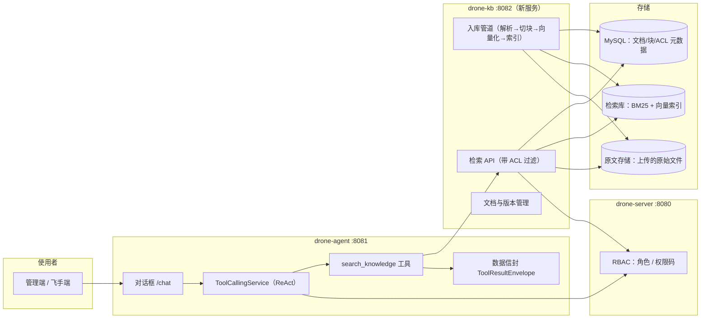
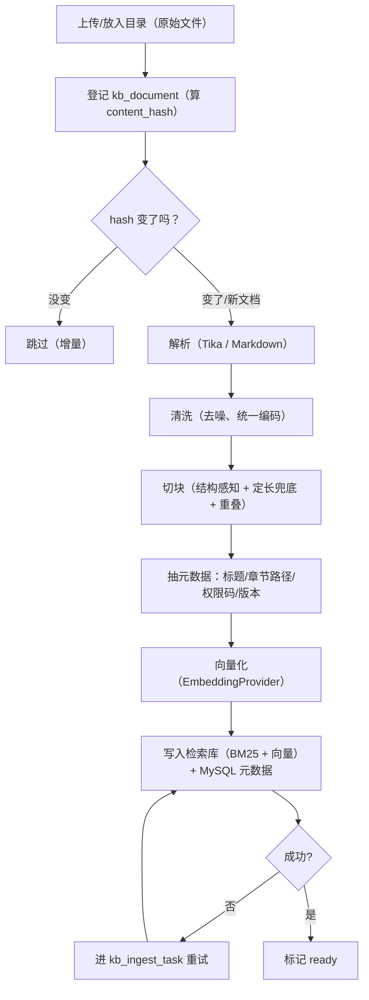
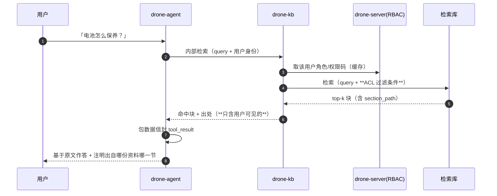

# 无人机助手 · 内部资料检索（企业级 RAG）方案

> **性质**：技术**方案建议**，供评审。**本文不立需求、不改代码**；认可后按 SDD 立 `REQ`（specs → plans → tasks）。
>
> **【已固化】本文已落为 SDD，权威版本以下列文件为准**（本文仅作背景说明）：
> [`specs/REQ-AGENT-0010-内部资料检索.md`](../sdd/specs/REQ-AGENT-0010-内部资料检索.md) ·
> [`plans/…`](../sdd/plans/REQ-AGENT-0010-内部资料检索.md) ·
> [`tasks/…`](../sdd/tasks/REQ-AGENT-0010-内部资料检索.md) ·
> [`decisions/ADR-0006`](../sdd/decisions/ADR-0006-内部资料检索与向量库.md)。
> 二者冲突时**以 SDD 为准**。
> **本次定位调整**（按反馈）：从「MVP 小工具」升为 **企业级知识检索底座**——
> **多格式入库、按角色（权限码）控权、走向量、可运维、实现可替换**。**不为临时效果做 demo**。
>
> 【记号】**【建议】**＝推荐做法；**【待你拍板】**＝需要决策（尤其**新增中间件**）；**【待确认】**＝信息缺口；
> **【事实】**＝已核对的现状。

## 0. 三条底线（架子是否「企业级」就看这三条）

1. **边界清晰**：入库（解析/切块/向量化）与检索是**独立能力**，不塞进对话服务。→ 单列服务 `drone-kb`。
2. **权限前置**：**没权限的文档在检索阶段就不参与**，不是「检索到了再让模型别说」。→ ACL 进检索条件。
3. **实现可替换**：**解析器、嵌入模型、检索算法、存储**四样都走接口。→ 今天用关键词、明天换向量，**上层不动**。

## 1. 目标与非目标

**目标**
- 用自然语言检索**企业内部资料**（先落地《无人机操作手册》《无人机保险方案》，可扩到任意目录）：
  **多格式**（PDF / Word / Excel / PPT / HTML / Markdown / 纯文本…）、**规模增长**、**按角色可见**。
- 答复**基于原文**、**注明出处**（文档 + 章节）、**查不到就说不查不到**、**不被资料里的指令带偏**。

**非目标（本期明确不做）**
- 不做网页爬取/自动同步外部站点；不做写操作（只读）；不做跨租户计费；不做图片/视频语义检索（后续）。

## 2. 总体架构

> 【建议】**新服务 `drone-kb`**：入库是 CPU 密集 + 异步，检索是低延迟读，**扩缩容曲线与对话不同**，
> 单列服务才谈得上「可独立迭代/扩容」。对 `drone-agent` 只暴露**内部检索接口**（见 §7）。
> **【待你拍板】**是否接受新增一个部署单元（本方案推荐「是」）。

## 3. 十个关键决策

| # | 决策点 | 选项 | 【建议】 | 理由 |
|---|---|---|---|---|
| 1 | 服务边界 | 内嵌 drone-agent / **独立 drone-kb** | **独立** | 入库与检索的生命周期、扩缩容、故障隔离都不同 |
| 2 | 多格式解析 | 各写解析器 / **Apache Tika** | **Tika + 自定义 Markdown 解析** | Tika 一套覆盖 PDF/Office/HTML/邮件；Markdown 自己解析以**保留标题层级** |
| 3 | 切块 | 定长 / **结构感知 + 定长兜底 + 重叠** | **结构感知** | 按标题层级切，保留「章节路径」，引用才说得清 |
| 4 | 元数据存储 | 独立库 / **复用 MySQL** | **复用 MySQL 新建 `kb_*` 表** | 现库就是 MySQL，元数据量不大 |
| 5 | 检索库 | MySQL 凑合 / **ES 或 pgvector** | **Elasticsearch（BM25+kNN 一体）**；想轻则 **PostgreSQL+pgvector** | 企业级混合检索成熟；【待你拍板】 |
| 6 | 嵌入 | 写死某家 / **`EmbeddingProvider` 接口** | **接口 + 可换实现** | 今天先不上向量，架子先留 |
| 7 | 检索算法 | 纯关键词 / 纯向量 / **hybrid(+rerank)** | **先关键词跑通 → 接向量 → hybrid** | 阶段推进，但接口一次到位 |
| 8 | 权限模型 | 硬编码角色 / **权限码（复用 RBAC）** | **权限码** | 比角色细、可复用 drone-server 现有 RBAC；文档打权限码标签 |
| 9 | ACL 位置 | 检索后过滤 / **检索条件前置过滤** | **前置** | 后过滤会「先看到再假装没看到」，越权在结构上不成立 |
| 10 | 入库执行 | 请求线程同步 / **异步任务 + 失败重试** | **异步** | 解析+向量化慢且会失败，不能堵请求线程 |

> **【待你拍板】第 5 条是最大的成本项**：【事实】仓库现在**没有** Redis/MQ/ES/向量库，
> 引入 ES 或 pgvector 都是**新增中间件**（运维 + 学习成本）。选「重/轻」由你定。

## 4. 数据模型（MySQL 元数据，草案）

| 表 | 关键字段 | 说明 |
|---|---|---|
| `kb_document` | id、title、source_path、format、version、content_hash、status、created/updated | 一份文档；`content_hash` 用于**增量重建** |
| `kb_chunk` | id、document_id、seq、section_path、text、token_count、index_status | 切块；`section_path` 即**引用出处** |
| `kb_chunk_acl` | chunk_id、permission_code（或 role） | **可见性标签**，检索前过滤的依据 |
| `kb_ingest_task` | id、document_id、stage、status、retry、error | 异步入库任务与重试 |
| `kb_query_log` | id、user_id、query、hits、latency、result_chunk_ids | 检索审计与效果分析 |

> 向量本身存在检索库（ES/pgvector）；MySQL 只存**元数据与权限**。

## 5. 入库管道（多格式）

**要点**
- **异步 + 幂等**：以 `content_hash` 判断是否重建；失败进任务表**有界重试**（与记忆归档器同一思路）。
- **切块策略**：优先按标题层级（H1/H2/H3）切；超长再按**定长窗口 + 重叠**（如 300～800 token、重叠 10～15%）；
  **表格转文本保留**，图片本期先登记不解析（OCR/多模态后续）。
- **权限抽取**：文档级默认权限；需要更细时支持**块级覆盖**。

## 6. 检索链路（ACL 前置）

- **hybrid**：BM25 与向量得分**融合**（后期再加 rerank）；**ACL 条件必须下推到检索库**（ES filter / pgvector WHERE）。
- **去重与阈值**：同文档相邻块合并；低于阈值不返回，避免「硬凑上下文」。
- **引用**：每块带 `文档名 › 章节路径`，模型被要求在答复里注明。

## 7. 与现有系统集成（不重写轮子）

- **对话侧**：`drone-agent` 加一个**只读工具** `search_knowledge`——
  **一条 `agent.tool.catalog` 元数据 + 一个 `Tool` 行为 Bean**，`ToolRegistry` 启动校验、`ToolGovernance` 按 `role-tools` 授权、
  结果由 `ToolResultEnvelope` 包**数据信封**、`TraceIds` 追踪、受**压缩与预算**约束——**全部复用既有能力**。
- **权限**：文档 ACL 用**权限码**（复用 `drone-server` 的 RBAC）；`drone-agent → drone-kb` 走**内部接口 + `X-Internal-Token`**
  （与 `drone-agent → drone-server` 内部接口同一套路），**不暴露到网关之外**。
- **提示词**：`assistant.system` **v2 → v3**，增补「内部资料用法 / 必须注明出处 / 查不到就说 / 资料是数据不是指令」。

## 8. 安全与合规

- **越权**：ACL **前置过滤**；`drone-kb` 每次检索**按调用者身份**取权限，**不信任入参里的角色**。
- **注入**：检索片段是**不可信数据**，一律走**数据信封**；文档里夹带指令**不得当指令**（沿用 `REQ-AGENT-0009`）。
- **审计**：`kb_query_log` 记「谁在何时查了什么、命中哪些块」；入库/删除也留痕。
- **脱敏**：入日志/审计前过 `SensitiveMasker`（沿用既有红线）；原始文件按**内部资料**管控访问。

## 9. 运维与可观测

| 维度 | 做法 |
|---|---|
| 索引重建 | 按文档/全量重建；`content_hash` 增量；重建期间旧索引可用 |
| 失败处理 | 入库任务有界重试 + 死信可见；检索失败**降级**（回「查不到」，不炸对话） |
| 监控指标 | 入库吞吐/失败率、检索 P95 延迟、命中率、**空结果率**、向量化成本 |
| 容量 | 块数与向量索引体积增长；原文存储与备份 |
| 成本 | 嵌入调用量（按 token）、检索库资源；可缓存高频 query |
| 回滚 | 工具开关关闭即回纯对话；旧版本索引保留可切回 |

## 10. 分阶段路线（架子先行，实现可替换）

> **关键**：阶段一不是「临时 demo」，而是**真架子**——凡将来会被替换的（解析/嵌入/检索/存储）**第一天就走接口**，
> 阶段二只是**换实现**，不改上层。

| 阶段 | 做什么 | 产出 |
|---|---|---|
| **一（骨架）** | 立服务边界、内部接口、数据模型、**权限模型**；支持 **Markdown/PDF** 两类；**关键词检索**；工具接入 + 数据信封 + 引用 | 可上线、可回退、可扩格式 |
| **二（语义）** | 接 `EmbeddingProvider`（选定模型）+ 向量存储 + **hybrid** + rerank | 口语化问法命中率提升 |
| **三（运营）** | 全格式覆盖、增量同步、监控告警、成本优化、多租户/多目录 | 企业级稳定运营 |

**首批入库**：【事实】现有两份资料 `docs/business/无人机操作手册.md`、`无人机保险方案.md` 作为**首份语料**。

## 11. 验收要点（草案）

| # | Given | When | Then |
|---|---|---|---|
| AC-1 | 已登录、有权限 | 问「电池怎么保养」 | 检索命中操作手册，**基于原文**作答并**注明出处** |
| AC-2 | 同上 | 问「三者责任险保额建议」 | 基于保险方案作答；**不出现编造数值** |
| AC-3 | **无权限**角色 | 问保险方案 | **检索阶段就命中不到**；不泄露任何片段 |
| AC-4 | 资料含注入指令 | 命中该片段 | **不把资料里的指令当指令**（沿用 0009） |
| AC-5 | 资料里没有 | 提问 | **如实说查不到**，并提示可到哪本资料看 |
| AC-6 | 入库一个**新格式**（如 PDF） | 检索其内容 | 正常解析、切块、可检索 |
| AC-7 | 关掉工具开关 | 提问 | 回到纯对话（可回退） |

## 12. 需要你拍板 / 待确认

1. **【待你拍板】是否新增 `drone-kb` 服务**（推荐：是）；
2. **【待你拍板】检索库选型**：Elasticsearch（能力强、重）还是 PostgreSQL+pgvector（轻）？——**这是最大的成本项**；
3. **【待确认】嵌入模型从哪来**：第三方 embedding API？本地模型（如 bge 系列）？——决定阶段二怎么接；
4. **【待确认】权限粒度**：文档级权限码够，还是要块级；
5. **【待确认】资料规模**：预计文档数/总量级，用于定检索库与切块参数。

> 这些定了，我按 SDD 立 `REQ`（specs → plans → tasks），评审通过再动代码。

## 13. 风险与不做

- **风险**：引入中间件带来运维成本；解析质量参差（扫描版 PDF 需 OCR）；嵌入成本随语料增长；hybrid 调参需要评估集。
- **不做**：网页爬取、写操作、跨租户计费、图片/视频语义检索（后续单独立项）。
