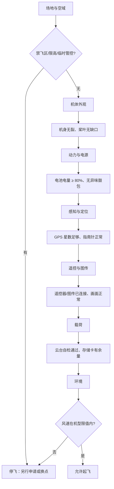
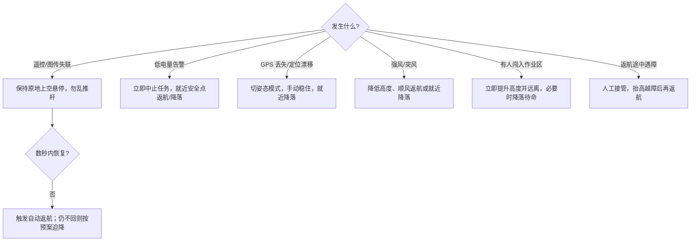

# 无人机操作手册（飞行作业 SOP）

> **读者**：飞手（一线作业人员）、机务、带教。
> **适用范围**：无人机管理平台日常作业的**行业级多旋翼**（含航线任务、现场采集）。
> **文档性质**：作业规程（SOP）。安全要求以**现行民航法规 + 机型官方手册**为准，本手册是**平台视角的作业流程补充**。
>
> 【记号】**【事实】**＝可核对的规定/参数；**【建议】**＝经验做法，可按机型与场景调整；**【待确认】**＝需要你补的具体信息。

## 0. 待确认（先补这几项，手册才能落到机型）

| 项 | 说明 |
|---|---|
| 机型 / 型号 | 本手册正文按「行业级多旋翼」写；请填实际机型（如某型号） |
| 最大起飞重量 / 分类 | 决定属于**微型/轻型/小型**哪一类，直接影响法规要求 |
| 是否载人 / 载物 | 影响资质与保险要求 |
| 作业区域 | 常在哪些城市/空域（城市、野外、厂区） |
| 机组构成 | 单人单机，还是「飞手 + 观察员」 |

---

## 1. 法规与资质（硬性前提）

> 【事实】本节依据中国民用航空局现行法规；**以最新正式发布版本为准**，飞行前请核对。
> 主要依据：《无人驾驶航空器飞行管理暂行条例》（2024-01-01 施行）；《民用无人驾驶航空器实名制登记管理规定》。

- **实名登记**：民用无人机须完成**实名登记**，机身贴登记码。
- **操控员资质**：**【事实】**按无人机的**分类**（微型 / 轻型 / 小型…）决定是否需要**操控员执照**；
  轻型无人机的常规适飞空域飞行与超视距、超高等情形要求不同。**【待确认】**本机型及作业场景所需的执照等级。
- **适飞空域**：**【事实】**真高 **120 米**以下的适飞空域内，常规飞行免于申请；
  进入**管制空域 / 机场净空 / 军事区域**等，须**提前申请并获批**。
- **禁飞 / 限飞区**：机场、军事、政府机关、重点设施等区域**禁飞或限飞**。
- **作业前查空域**：起飞前必须核对**禁飞区、限高、临时管控**（重大活动期间常临时管控）。

> **安全红线（违反即停飞）**：
> 1. 不进禁飞区、不超限高、不加装未申报设备；
> 2. 不做**超视距**飞行（除非已获批且有专项方案）；
> 3. 不在**人群上方**、不能**酒驾/疲劳**飞行；
> 4. 不留足返航电量不起飞。

---

## 2. 设备清单（出发前）

| 类别 | 项 |
|---|---|
| 飞行器 | 机身 × N、桨叶（含备用）、电池（含备用） |
| 控制 | 遥控器、平板/手机（装好 App）、数据线 |
| 电源 | 充电管家/充电器、车充、移动电源 |
| 载荷 | 云台相机/传感器及其配件 |
| 安全 | 起降垫、警示锥、反光背心 |
| 备份 | 备用桨、螺丝刀、胶带 |
| 平台 | 账号可登录（管理端/飞手端），任务与航线已同步 |

---

## 3. 飞行前检查（每次必做）



**逐项打钩（建议印成纸质/电子检查单）：**
- [ ] 空域已核对：不在禁飞区、不超限高、无临时管控
- [ ] 天气满足：风速/降水/能见度在机型允许范围
- [ ] 电池：电量 ≥ 80%，外观正常，温度正常（低温需预热）
- [ ] 桨叶：无缺口、无裂纹，已拧紧
- [ ] 机身/云台：外观完好，相机镜头清洁
- [ ] 定位：GPS 星数与定位精度正常，指南针已校准
- [ ] 遥控/图传：连接正常，画面无卡顿
- [ ] 起降点：平整、无人、远离遮挡与高压线
- [ ] 平台：任务已领取、航线已同步、账号已登录

---

## 4. 开机与起飞

1. **开机顺序**：先开**遥控器**，再开**飞行器**（关机相反）。
2. **设备自检**：等待自检完成，确认无异常告警。
3. **校准**（首次到新场地或提示时）：磁罗盘校准、IMU 校准按机型指引执行。
4. **设置返航点**：确认起飞点已记录为**返航点**；必要时设置**返航高度**（高于周边最高障碍物）。
5. **解锁起飞**：确认周围无人后解锁；起飞后**先悬停 5～10 秒**观察姿态是否稳定，再执行任务。
6. **首段观察**：起飞后先在低空小范围移动，确认操控与图传正常。

---

## 5. 任务执行（与平台衔接）


- **航线执行**：优先按平台同步的航线与点位飞行；**临时改动**需在任务里备注。
- **打卡/上报**：按任务要求的**节点**打卡，确保平台轨迹与执行记录完整。
- **告警处置**：一旦平台弹出**限高 / 越界 / 低电量**告警，**立即按第 6 节处置**，不得忽略。
- **采集规范**：按任务要求的分辨率、重叠率、命名规则采集；**存储卡满前**及时更换或回传。

---

## 6. 应急处理



**原则：**
- **人优先**：任何情况下**不冒险从人群上方通过**。
- **先降后查**：异常时**优先就近安全降落**，落地后再排查。
- **如实上报**：发生失联、失控、坠落、伤人损物，**立即上报**并按预案配合处置（涉及事故需保全现场与记录）。

---

## 7. 降落后与收尾

1. **降落**：优先在起飞点或平整无人区降落；降落后先停桨。
2. **关机顺序**：先关**飞行器**，再关**遥控器**。
3. **数据**：回传/导出采集数据，按命名规则归档。
4. **平台收尾**：在飞手端**提交执行报告**、上传**现场附件**，完成本次任务闭环。
5. **设备收纳**：桨叶取下、电池取出单独运输（**严禁满电长时间存放**）。

---

## 8. 电池与日常保养

| 项 | 【建议】做法 |
|---|---|
| 电池存放 | 长期存放电量约 **50%～60%**；阴凉干燥；**不鼓包、不摔** |
| 充放电 | 不满电空运、不满电久放；低温作业前**预热** |
| 桨叶 | 每次飞行前检查，有缺口/裂纹**立即更换** |
| 机身 | 定期清尘、检查电机异响、螺丝紧固 |
| 云台 | 运输装保护罩，避免磕碰 |
| 记录 | 飞行架次/异常**计入平台档案**，作为保养依据 |
| 周期 | 按机型官方手册的**保养周期**执行（如每 N 架次/小时检查） |

---

## 9. 常见故障排查

| 现象 | 可能原因 | 处置 |
|---|---|---|
| 无法解锁 | 未定位 / 电池未插紧 / 指南针异常 | 换开阔处等定位、重插电池、重新校准 |
| 图传卡顿/花屏 | 干扰 / 距离远 / 天线朝向 | 换信道、靠近、调整天线，必要时返航 |
| 姿态漂移 | 指南针/IMU 异常 | 校准；仍漂移则降落后再查 |
| 电量掉得快 | 低温 / 电池老化 | 预热、换新电池并记档 |
| 起飞即告警限高 | 在管制区 / 设了限高 | 核对空域，另行申请或换点 |
| 返航点不对 | 未等定位就起飞 | 等定位完成、确认返航点后再起飞 |

---

## 10. 安全红线（背下来）

1. 不闯**禁飞区**、不超**限高**、不进**管制空域**（未获批）。
2. 不在**人群上方**、**酒精/疲劳**状态飞行。
3. 电量**留足返航**（建议预留 ≥ 30%）。
4. **人比机重要**：任何冲突下优先保人、保公共安全。
5. 异常**先降后查**；事故**立即上报**。

---

## 附录 A · 起飞前检查单（可打印）

```
□ 空域：禁飞区/限高/临时管控 已核对
□ 天气：风速/降水/能见度 在机型限值内
□ 电池：≥80%、无鼓包、温度正常
□ 桨叶：无缺口裂纹、已拧紧
□ 机身/云台：完好、镜头清洁
□ 定位：GPS 足够、指南针已校准
□ 遥控/图传：连接正常、画面正常
□ 场地：平整、无人、远离障碍与高压线
□ 平台：任务已领、航线已同步、账号已登录
```

## 附录 B · 术语

| 术语 | 含义 |
|---|---|
| 真高 | 相对地面的实际高度 |
| 适飞空域 | 法规允许常规飞行、免于申请的空域 |
| 返航点/返航高度 | 自动返航的定点与途经高度 |
| 视距内/超视距 | 能否始终目视看到飞行器 |
| 姿态模式 | 失去定位辅助后，仅靠人工操控的模式 |
