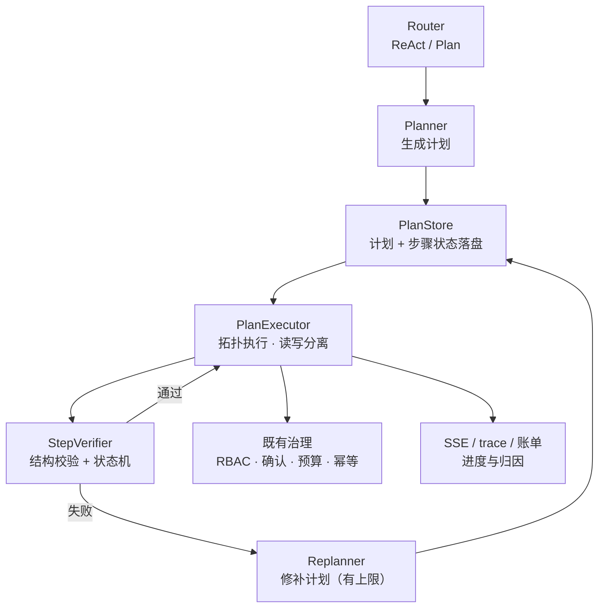
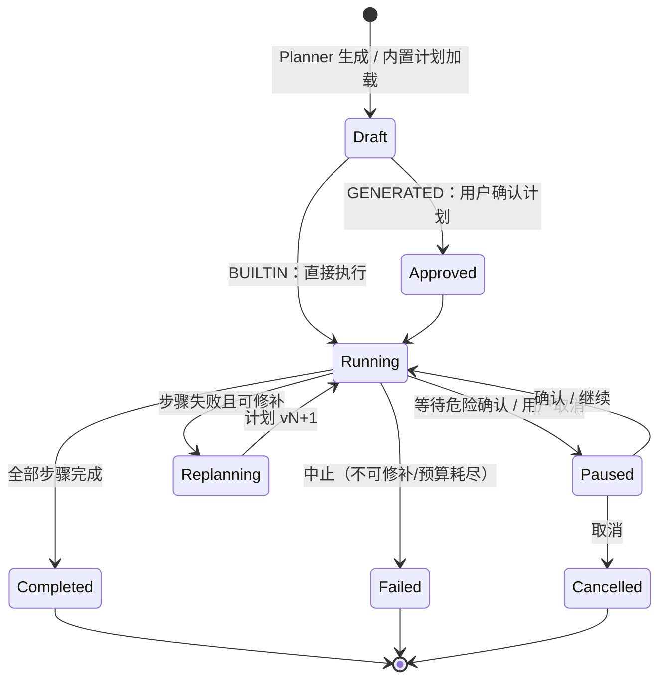
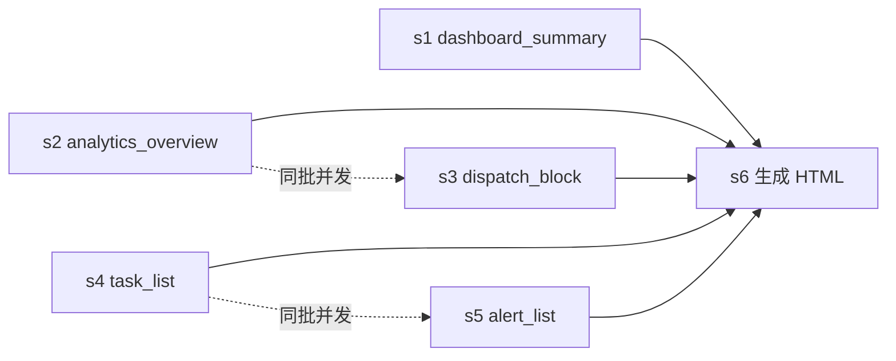

# ADR-0012 引入可选 Plan 模式：先规划、再执行、可验证、可恢复

- **状态**：已接受
- **日期**：2026-10-27
- **决策人**：项目负责人
- **记录人**：AI（按规范登记）
- **关联**：
  [`REQ-AGENT-0031 Plan 模式`](../specs/REQ-AGENT-0031-Plan模式.md)、
  [`ADR-0009 Skill 采用指令式 SOP`](./ADR-0009-Skill指令式与按权限裁剪.md)、
  [`ADR-0011 工具循环改为流式`](./ADR-0011-工具循环改为流式.md)、
  [`REQ-AGENT-0014 业务流程 Skill`](../specs/REQ-AGENT-0014-业务流程Skill.md)、
  [`REQ-AGENT-0029 工具 Harness`](../specs/REQ-AGENT-0029-工具Harness-可取消与待确认持久化.md)、
  [`REQ-AGENT-0023 上下文质量评估集`](../specs/REQ-AGENT-0023-上下文质量评估集.md)
- **本决策部分修订**：ADR-0009 的「不新增第二套执行器」结论——**仅对显式 Plan 模式**引入轻量步骤执行器，
  不引入通用工作流 DSL。

## 结论先行

- **P0**：运营日报 + 交接班——**内置计划，不审批**，严格按 JSON 执行；步骤固定、最贴近 8 轮上限；
- **P1**：复杂任务生成计划 + **一律审批**；首个只读演示为**跨周期运营对比分析**，
  写入演示为**临时多实体配置**（需测试数据）；
- **P2**：重规划、批量配置、撤销补偿——高风险或高复杂度，等执行器稳定后再接；
- **审批只看来源**：BUILTIN 不审批，GENERATED 必须审批；只读不是免审批理由；
- **不替换 ReAct**：Plan 是可选策略，简单查询/闲聊/开放式探索继续走 ReAct；
- **不引入通用工作流 DSL**：Plan 是运行时生成的结构化计划，不是手写业务流程引擎。

---

## 一、先说清楚：Plan 是什么

### 1.1 一句话

**Plan 模式 = 把「边想边做」拆成「先产出显式计划，再按计划执行，执行中校验，失败可重规划」。**

它不是一个新模型，而是一种控制流：

```text
目标 → Planner（拆步骤）→ Plan（步骤 + 依赖 + 验收）
     → Executor（按依赖执行，读写分离，可并行）
     → Verifier（每步校验；偏差记录）
     → Replanner（失败时修补计划，有次数上限）
     → 完成 / 暂停等确认 / 失败报告
```

### 1.2 与 ReAct 的区别

ReAct 的循环是 **Thought → Action → Observation**，每一步都让模型重新决定“下一步做什么”。
Plan-and-Execute 把“决定做什么”提前到规划阶段，执行阶段更多是“按计划做、校验结果”。

| 维度 | ReAct | Plan-and-Execute |
|---|---|---|
| 决策时机 | 边做边想 | 先想后做，执行中只处理偏差 |
| 适合任务 | 探索性、步骤未知、工具少、单轮查询 | 多步骤、依赖明确、流程可复用、写操作多 |
| 模型调用 | 每步一次（含工具结果回填） | 一次规划 + 每步执行（执行可用更便宜模型/确定性执行） |
| 失败恢复 | 重新进入循环，容易重复前面的步骤 | 从失败步骤重规划/重试，已完成步骤可复用 |
| 可观测 | 轨迹（trajectory） | 计划 + 每步状态，天然有进度条 |
| 主要风险 | 跑偏、超轮次、重复调用 | 计划错误、计划僵化、声明与执行不一致 |
| 本项目现状 | **当前唯一模式** | **建议作为可选策略** |

> 关键认知：**Plan 不是“把步骤写死”**。计划由模型生成，参数可引用前一步结果，失败可修补；
> 它和“工作流 DSL”不是一回事。

### 1.3 2026 年的相关方向

- **Plan-and-Execute** 仍是单 Agent 多步任务的主流架构之一：Planner 产出计划，Executor 逐步执行，
  必要时 Replanner 修补（LangChain 2024 的系统化总结；2026 年的架构综述仍把它列为独立模式）。
- **Plan-and-Act（ICML 2025）** 进一步把 Planner 与 Executor 分离，Planner 产出结构化高层计划，
  Executor 负责落地；说明“规划”本身值得作为独立组件优化。
- **ReWOO / Reflexion** 代表两个极端：前者把工具调用计划一次性列完、减少模型往返；
  后者在执行后反思、用失败经验重试。
- **2026 年的一篇重要提醒**：《Do LLM Agents Execute the Plans They Declare?》指出——
  **模型“声明”的计划与实际执行的动作可能不一致**。所以 Plan 模式不能只靠提示词，
  必须有执行器约束、偏差记录与结果校验。
- **交互式 Plan Mode** 在编码 Agent 中已成常见产品形态：先给出计划、用户确认，再进入执行；
  适合高风险、多文件、不可逆操作。

**结论**：Plan 模式的收益主要来自三件事——**减少无效往返、让步骤可验证、让失败可恢复**；
不是“让模型更聪明”。

### 1.4 三种“plan”的边界

讨论 Plan 时最容易混的是三个不同层的东西。先把它们分开：

```text
人机对齐层    交互式 Plan Mode（如 Qoder Plan）
              计划文档 + 用户批准（保证“先对齐再动手”）

运行时编排层  本 ADR 的 Plan
              结构化计划 + 执行器 + 校验 + 恢复（保证“按步骤跑完”）

模型执行层     AgentLoop 中的 plan
              模型在一次循环里的“打算”（保证“下一步做什么”）
```

#### （1）AgentLoop 中的 plan：模型脑子里的“打算”

- 在 ReAct 里表现为 `Thought`：模型想“先查设备、再查告警”，然后调工具；
- 在 Plan-and-Execute 里是 Planner 输出的一段计划，交给 Executor 消费；
- **通常不是对象、不落盘、不强制**；下一轮模型可以改主意，没人校验它是否照做。

**本项目现状**：`ToolCallingService` 的循环里只有 `ModelTurn`、`toolCalls` 与工具结果，
**没有显式的计划对象**；所谓计划只存在于模型 reasoning/正文的文字里。
本 ADR 要新增的，正是这个缺失的运行时对象。

#### （2）交互式 Plan Mode：人机之间的“审批状态”

以 Qoder Plan 为代表的产品形态：

- 进入后只读探索，限制写入；
- 模型产出一份 Markdown 计划；
- 用户批准后才退出状态、恢复写权限；
- 批准后仍是同一个 Agent 在跑，**不保证逐步执行**，没有步骤状态与逐步校验。

它解决的是“**别急着动手，先让我看看你打算怎么做**”，
不是“多步业务怎么确定性执行”。

#### （3）本 ADR 的 Plan：运行时的“施工单 + 调度器”

- 计划是结构化 JSON：步骤、参数、`dependsOn`、读写属性、验收条件、状态；
- Executor 按依赖调度，独立只读步骤并发、写步骤串行；
- Verifier 校验每步结果与状态机；
- PlanStore 落盘，支持取消/重启后从断点继续；
- Replanner 有次数上限地修补计划；
- 仍复用既有治理：危险确认、RBAC、预算、幂等、审计。

它解决的是“**多步流程怎么跑完、跑错怎么停、重启怎么续**”。

#### （4）三者对比

| 维度 | AgentLoop 中的 plan | 交互式 Plan Mode | 本 ADR 的 Plan |
|---|---|---|---|
| 层次 | 模型推理 | 人机交互 | 运行时编排 |
| 产物 | 文本/思考，通常在上下文里 | Markdown 文档 | 结构化 JSON |
| 谁产生 | 模型在循环中 | 模型在只读阶段 | Planner（模型 + Skill 模板） |
| 持久化 | 一般不 | 文件；随 Goal 恢复 | PlanStore；按步骤恢复 |
| 强制力 | 无，可随时改主意 | 计划期间限制写入；批准后不强制逐步 | 执行器强制步骤、依赖、门禁 |
| 校验 | 无 | 无内置逐步校验 | Verifier：字段、状态机、对象存在性 |
| 失败处理 | 下一轮再想 | 人改计划 | 有界 Replanner |
| 生命周期 | 单次运行/单轮 | 计划 → 批准 → 执行 | Draft → Approved → Running → Paused/Completed/Failed |
| 本项目 | ReAct 的隐式思考 | 未使用 | 提议中，未实现 |

#### （5）三者是叠加关系，不是替代关系

以「运营日报」为例：

1. **交互层**：先把计划给用户看——“查 5 个数据源，最后生成 HTML”，用户批准；
2. **运行时层**：计划变成 `s1~s6`，执行器让 `s2/s3`、`s4/s5` 真正并发，`s6` 等汇合，
   某步失败停在具体步骤；
3. **模型层**：每个步骤内部仍可用 ReAct 决定参数、处理异常；最后的 HTML 生成仍由模型完成。

以「创建用户 + 配设备」为例：

- AgentLoop 的 plan：模型想“先建用户，再建设备”，取消后重来可能又建一个用户；
- 交互式 Plan Mode：用户先批准“建用户 → 配设备”这个方案，但不解决重复创建；
- 本 ADR 的 Plan：`s2` 参数引用 `${s1.id}`，取消后从 `s2` 续跑，`s1` 靠 operationId 幂等，
  撤销按 `s2 → s1` 逆序。

#### （6）场景选择：什么时候用哪一层

| 任务 | 需要的层 |
|---|---|
| 单次查询、知识问答、闲聊 | 只需 AgentLoop（ReAct） |
| 改代码/改配置，想先对齐方案 | 交互式 Plan Mode + AgentLoop |
| 运营日报、交接班 | 内置计划（BUILTIN，不审批） |
| 派发前检查、告警分诊（已内置） | 内置计划（不审批）+ 危险步骤逐次确认 |
| 派发前检查、告警分诊（未内置，临时任务） | 生成计划（GENERATED，必须审批） |
| 创建用户 + 配设备等复杂任务 | 生成计划（GENERATED，必须审批） |
| 撤销/补偿（高风险） | 生成计划（审批）+ 逐次危险确认 |
| 开放式分析（步骤取决于发现） | AgentLoop（ReAct），不强行 Plan |

> 同一类任务可能走两条路：**已沉淀为内置计划的，不审批；运行时临时生成的，必须审批**。
> 区别不在“读还是写”，而在“计划是不是事先定好的”。

#### （7）对本决策的含义

- 本 ADR 只负责**运行时编排层**：计划对象、执行、校验、恢复；
- 不重复实现交互式 Plan Mode：P1 新增**计划审批**；危险步骤仍复用现有的待确认票据；
- 不替代 AgentLoop：步骤内部仍走现有 ReAct/工具执行，Plan 只是上层的调度与验收。

---

## 二、当前项目的编排现状

### 2.1 现在是怎么跑的

`drone-agent` 的控制流集中在 `service/ToolCallingService`：

```text
ContextAssembler 组装上下文
→ 模型（流式）返回 tool_calls
→ 危险工具？暂停，生成待确认票据
→ 只读工具并发（最多 4 线程）/ 写工具串行
→ 结果回填 → 再问模型
→ 最多 8 轮；超限不再给工具，逼模型收尾
```

已有边界：

| 维度 | 现状 |
|---|---|
| 轮次 | 最多 8 轮（配置在 `agent.tool.max-rounds`） |
| 单工具超时 | 15s |
| 重试 | 失败轮数上限 1 |
| 并发 | 仅只读工具，最多 4 线程 |
| 写操作 | 串行；operationId 幂等；台账 + 对象 ID |
| 取消 | 按会话置位；轮次/模型返回/每个工具前检查；读工具立即放弃等待，写工具等结算 |
| 待确认 | 票据落盘、重启可确认、最多执行一次、取消作废 |
| 续跑 | `resumeToken` 按“工具 + 参数摘要”复用 operationId |
| 预算/限流 | 单请求 60k、日 500k；用户 2 QPS/2 并发，全局 20/20 |

### 2.2 现成的“计划”在哪里

项目里其实已经有**人写的计划**：4 个业务流程 Skill。

| Skill | 步骤 | 特点 |
|---|---|---|
| `daily-operations-report` | 7 步 | 5 个数据源；第 2/3 步可并发、第 4/5 步可并发；第 6 步按需读口径；第 7 步读模板生成 HTML |
| `dispatch-readiness` | 5 步 | 3 项检查 + 结论 + 派发；第 5 步必须用户确认；状态机约束强 |
| `alert-triage` | 4 步 | 拉列表 + 按告警补详情；状态机 `pending → handling → resolved/ignored`；每次最多处置一条 |
| `shift-handover` | 4 步 | 对每个执行中任务 fan-out 查告警/详情/轨迹；只读；固定交接单模板 |

但它们目前是 **Markdown 指令**（ADR-0009 的“指令式 SOP”），执行时：

- 模型先 `use_skill` 读正文；
- 再靠 ReAct 一轮轮调工具；
- **是否按顺序、是否漏步、是否真的并发，取决于模型**；
- 代码层没有“当前第几步、哪步完成、哪步失败”的状态。

这就是 Plan 模式最自然的切入点：**把 Skill 从“读给人看的步骤”升级为“可执行的计划对象”**。

### 2.3 现有实现已经具备的“Plan 地基”

Plan 模式不需要从零造轮子，以下能力可以直接复用：

| 能力 | 现有实现 | 在 Plan 中的用途 |
|---|---|---|
| 取消信号 | `CancellationRegistry` / `CancellationSignal` | 计划执行中随时停；在途写结算 |
| 待确认票据 | `PendingActionStore` | 计划中的危险步骤暂停、重启后继续 |
| 写台账 | `WriteJournal` | 每步写操作的状态与对象 ID |
| 幂等 | `operationId` + MCP 幂等层 | 重试/续跑不重复创建 |
| 续跑令牌 | `ResumeToken` | 从已完成步骤继续 |
| 预算/限流 | `BudgetService` / `RateLimiter` | 计划级与步骤级成本上限 |
| 流式事件 | SSE `reasoning/content/status/done` | 增加 `plan` 事件即可展示进度 |
| 追踪/账单 | `TraceRecorder` / `BillStore` | 计划、步骤、模型调用都能归因 |
| 评估集 | `tools/context-eval` | 对比 Plan 与 ReAct 的成功率/成本/延迟 |

**缺的不是地基，是“计划对象 + 执行器 + 校验器”这一层。**

### 2.4 当前模式暴露出的具体问题

| 现象 | 现在的表现 | 根因 |
|---|---|---|
| 日报贴近轮次上限 | 配置注释写明“标准化流程实测会用到 7–8 轮”，上限正好 8 | 每步都靠模型重新决策，没有批量执行 |
| 可并行的步骤未必并行 | Skill 写了“第 2/3 步可并发”，但模型可能分两轮调 | 并发只发生在“同一轮 tool_calls”，是否同轮由模型决定 |
| 顺序约束靠自觉 | ADR-0009 已登记“无法在代码层强制顺序” | 没有步骤状态与执行器 |
| 告警状态机可能被跳过 | Skill 写明“pending 不能直接 resolve”，但只靠提示词 | 没有 per-step 校验 |
| 长任务不可恢复 | 取消后只能靠 `resumeToken` + 自然语言“继续” | 没有计划级断点 |
| 进度不可见 | 只有“正在执行 N 个工具” | 没有步骤级状态 |
| 失败后重复劳动 | 重新进入 ReAct，可能重复已完成的读/写 | 没有“已完成步骤”复用 |

---

## 三、哪些问题适合 Plan 模式

### 3.1 评估标准

用六个维度打分（1~5，越高越适合）：

| 维度 | 含义 |
|---|---|
| 步骤数 | 步骤越多，越需要显式计划 |
| 依赖强度 | 步骤间有数据依赖/顺序约束 |
| 写/危险 | 有写操作、不可逆操作，越需要结果校验与逐次确认（与计划审批无关） |
| 可并行 | 独立只读步骤多，计划可显式并发 |
| 流程固定性 | 流程稳定、可复用，计划可沉淀 |
| 现状痛点 | 当前 ReAct 已经出现轮次/顺序/恢复问题 |

### 3.2 候选场景矩阵

| 场景 | 步骤 | 依赖 | 写/危险 | 可并行 | 固定性 | 现状痛点 | 结论 |
|---|---:|---:|---:|---:|---:|---:|---|
| **运营日报** | 5 | 4 | 1 | 5 | 5 | 5 | **P0 首选** |
| **告警分诊** | 4 | 3 | 5 | 4 | 4 | 4 | **P1** |
| **派发前检查** | 5 | 4 | 5 | 3 | 5 | 4 | **P1** |
| **创建用户 + 配设备** | 3 | 5 | 5 | 1 | 4 | 5 | **P1（依赖/恢复型）** |
| **撤销/补偿** | 3 | 5 | 5 | 1 | 4 | 5 | **P2（高风险）** |
| **交接班** | 4 | 3 | 1 | 5 | 4 | 4 | **P0（只读，低风险）** |
| 批量配置（N 台设备/航线） | 4 | 2 | 5 | 2 | 4 | 3 | P2 |
| 开放式分析（“为什么完成率下降”） | 3 | 3 | 2 | 2 | 1 | 3 | 暂不适合 |
| 单次查询/知识问答/闲聊 | 1 | 1 | 1 | 1 | 1 | 1 | 不适合 |

### 3.3 逐个说清楚

#### （1）运营日报：最适合先做

- **现状**：7 步、5 个数据源；其中第 2/3 步、第 4/5 步本身可并行；实测接近 8 轮上限，
  C05 用例用了 8 次工具、48.7s、22.4k token。
- **Plan 能解决什么**：
  - 把 5 个数据源变成计划里的 5 个只读步骤，**代码决定并发批次**，不依赖模型是否同轮调用；
  - 第 6 步“口径核对”变成条件步骤（只有口径不确定才执行）；
  - 第 7 步“读模板 + 生成 HTML”变成依赖所有数据步骤的汇合节点；
  - 进度可见：用户能看到“已取任务数据、正在取告警”；
  - 失败可恢复：某个数据源失败，停在具体步骤，不用从头再来。
- **为什么是 P0**：**纯只读**，不涉及写操作与确认，风险最低；步骤最固定；收益最直观。

#### （2）交接班：与日报同类的只读 fan-out

- **现状**：第 2/3 步要对每个执行中任务 fan-out 查告警/详情/轨迹，任务多时轮次迅速膨胀。
- **Plan 能解决什么**：把“每个任务”展开成子步骤，限制并发数，汇总后生成固定模板。
- **为什么是 P0**：只读；输出结构固定；适合验证 fan-out 执行器。

#### （3）告警分诊：需要“状态机校验”的写流程

- **现状**：拉列表 → 按告警补详情 → 给建议 → 用户确认后逐条处置；`pending` 不能直接 `resolve`。
- **Plan 能解决什么**：
  - 每条 critical/warning 告警展开为“查任务 / 查详情”子步骤，可并行；
  - 处置步骤进入计划后，执行器校验状态机（`pending → handling → resolved/ignored`），
    **不满足就拒绝执行**，而不是靠提示词；
  - 每条处置都可挂确认票据；部分完成时有明确报告。
- **为什么是 P1**：有写操作、有状态机，价值高但风险也高；需要先有只读 Plan 的执行器与校验器。

#### （4）派发前检查：需要“门禁”的写流程

- **现状**：任务状态、禁飞区、可用资源三项检查，任一不通过必须停；派发必须用户确认。
- **Plan 能解决什么**：
  - 计划里显式写“前置条件”：`status == pending`、`zone == empty or acknowledged`、`pilot/device 可用`；
  - 执行器在派发步骤前校验前置条件，**不通过直接终止计划**；
  - 禁飞区确认、飞手/设备选择变成步骤级暂停；计划可保存为“待确认”。
- **为什么是 P1**：安全收益大，但涉及真实派发；要先在只读流程上验证执行器。

#### （5）创建用户 + 配设备：依赖型写流程

- **现状**：REQ-0029 的典型场景；两步写有数据依赖（设备 owner = 新用户 ID），取消后有部分报告、
  resumeToken、补偿计划。
- **Plan 能解决什么**：
  - 步骤 1 `user_add` → 输出 `userId`；步骤 2 `device_add` 的参数引用 `${step1.id}`；
  - 取消/重启后从步骤 2 继续，步骤 1 用 operationId 幂等，不重复创建；
  - 撤销时按计划逆序补偿，每步先查后改。
- **为什么是 P1**：现有 Harness 已经为它铺好路（台账/幂等/续跑/补偿），Plan 只是把它们串成显式步骤。

#### （6）撤销/补偿：把现有补偿计划变成可执行计划

- **现状**：`CompensationPlanner` 已经能按完成顺序生成逆序补偿计划，但执行仍靠模型按提示词做。
- **Plan 能解决什么**：把补偿计划变成真正可执行的步骤列表，每步校验对象存在、每步走危险确认、
  失败即停并报告残留。
- **为什么是 P2**：高风险、不可逆；必须先有确定性校验与人工确认，不能急着自动化。

#### （7）不建议的场景

- **单次查询/知识问答/闲聊**：Plan 只增加一次规划调用与等待，没有收益。
- **开放式分析**（“为什么完成率下降”）：步骤本身取决于发现，先规划容易“计划得很漂亮但没用”；
  继续用 ReAct，必要时先产出“分析提纲”（不是执行计划）。
- **工具未知/能力边界不清**：计划会编造不存在的步骤；应先让 ReAct 探索，再总结成计划。

### 3.4 GENERATED 计划的演示场景（不为技术而技术）

GENERATED 计划只有在**真实业务上确实需要“先出方案、再执行”**时才做。
如果一个任务已经固定，应该沉淀为 BUILTIN；如果一两步就能完成，应该继续 ReAct。
判定标准（全部满足才做 GENERATED）：

| # | 标准 | 不满足时的处理 |
|---|---|---|
| 1 | **不是固定 SOP** | 做成 BUILTIN |
| 2 | 输入有真实变化（时间窗、对象、维度、假设） | 做成 BUILTIN |
| 3 | 多步骤，且有依赖或可并行 | 继续 ReAct |
| 4 | 现有工具能完成，不需要新造能力 | 先补工具或不做 |
| 5 | 结果可验收（有明确产出/指标） | 不做 |
| 6 | 演示安全（优先只读；写操作需测试数据） | 换场景或降级为只读 |

**如果找不到同时满足的场景，就明确记录“暂不引入 GENERATED”，不硬做。**

#### 候选评估

| 场景 | 固定 SOP？ | 输入变化 | 多步/依赖 | 风险 | 演示价值 | 结论 |
|---|---|---|---|---|---|---|
| **跨周期运营对比分析** | 否 | 高（时间窗/维度） | 6~10 步，有并行 | 只读 | 高 | **首选（P1 演示）** |
| **设备异常诊断** | 否 | 中（设备/时间） | 4~7 步，有下钻 | 只读 | 高 | 备选（第二个只读演示） |
| **临时多实体配置** | 否 | 高（对象组合） | 5 步，强依赖 | 写 | 高 | **写入演示（P1/P2，用测试数据）** |
| 批量告警处置 | 半固定 | 中（告警集合） | N 步，写 | 高 | 中 | P2 |
| 新站点开通 | 否 | 高 | 8+ 步，写 | 很高 | 中 | 暂不做 |
| 开放式根因分析 | 否 | 很高 | 不确定 | 只读 | 低 | 不做（继续 ReAct） |
| 日报 / 交接班 | 是 | 低 | 固定 | 低 | — | BUILTIN，不做 GENERATED |

#### 首选场景：跨周期运营对比分析（只读）

**用户请求示例**：

> “帮我对比 10 月 20–26 日和前一周的运营情况，看看完成率、按时率、派发积压和告警哪里变差了，给 3 条建议。”

**为什么需要 GENERATED**：

- 时间窗、对比维度、下钻深度都由用户临时指定，不是固定日报；
- 不同请求会生成不同步骤（比如用户只问告警，就不查设备效率）；
- 需要先让用户看到“我准备比哪些指标、查哪些数据”，批准后再花 token 执行；
- 全程只读，演示安全，结果可验收。

**计划示例**：

```text
s1 本周 overview          ┐
s2 上周 overview          ┘ 并发
s3 本周 dispatch-block    ┐
s4 上周 dispatch-block    ┘ 并发
s5 本周 efficiency        ┐
s6 上周 efficiency        ┘ 并发
s7 本周 pending 告警      ┐
s8 本周失败/超期任务      ┘ 并发
s9 对比 + 归因 + 3 条建议（synthesize，依赖 s1–s8）
```

**演示价值**：

- 展示“生成计划 → 用户批准 → 并行取数 → 汇合分析”的完整链路；
- 与 ReAct 对比：轮次、P95、token、缓存命中；
- 计划卡片本身就是教学素材：用户能看到“Agent 准备怎么做”。

**验收**：

- 未批准时零执行；批准后按计划步骤执行；
- 独立只读步骤确实并发；
- 结果包含本周/上周对比、变差项、3 条可执行建议；
- 与 ReAct 基线相比，轮次下降且成功率不降。

#### 写入演示：临时多实体配置（需测试数据）

**用户请求示例**：

> “新建一个临时运维账号，配一台备用机，再建一条巡检航线，明天派一条任务。”

**为什么需要 GENERATED**：

- 不是固定 SOP，实体组合与参数由用户临时给出；
- 有强依赖：用户 ID → 设备 owner → 航线/任务参数；
- 写操作必须让用户先看计划再批准；取消后要能续跑/撤销；
- 正好复用 REQ-0029 的票据、台账、幂等、补偿能力。

**演示价值**：审批、依赖传参、部分完成、续跑、撤销。
**前提**：使用测试账号/测试设备；每一步危险操作仍单独确认。

#### 沉淀路径：GENERATED → BUILTIN

一个 GENERATED 场景如果反复出现、步骤稳定，应该**下沉为 BUILTIN**：

```text
临时需求 → GENERATED（先验证价值）
        → 反复出现且步骤稳定 → BUILTIN（免审批、强执行）
```

这能避免“把所有任务都做成生成计划”，也避免“为了演示硬造场景”。

#### 结论

- **首选只读演示**：跨周期运营对比分析；
- **写入演示**：临时多实体配置（测试数据）；
- 其余场景按上表处理；**找不到合格场景就记录“暂不引入 GENERATED”**，不为了技术而技术。

---

## 四、推荐方案：可选 Plan 模式，不替代 ReAct

### 4.1 总体原则

1. **Plan 是可选策略，不是默认**：简单任务继续 ReAct；复杂/固定/高风险任务才走 Plan。
2. **Plan 不能绕过治理**：危险确认、RBAC、预算、限流、幂等、审计全部照旧。
3. **执行器约束计划，而不是提示词约束**：计划步骤必须引用已注册工具；偏差要记录。
4. **审批看计划来源，不看读写**：内置计划不审批；运行时生成的计划**一律**先展示、经用户批准后执行。
   读写只影响执行方式（并发/串行、危险工具确认），不影响是否需要计划审批。
5. **与 ADR-0009 兼容**：不引入通用工作流 DSL；Plan 是运行时产物，不是手写业务流程引擎。

### 4.2 两种形态

| 形态 | 谁触发 | 用户看到什么 | 适用 |
|---|---|---|---|
| **内置计划（BUILTIN）** | 命中内置计划资产（如日报关键词/入口） | 展示步骤与进度，**没有批准按钮** | 日报、交接班等固定强流程 |
| **生成计划（GENERATED）** | 用户说“先给方案”，或复杂度路由命中 | 展示完整计划，**用户批准后**才执行 | 复杂多步任务，**无论只读还是写** |

> 审批规则只看计划来源：**BUILTIN 不审批，GENERATED 一律审批**。
> “只读”不是免审批的理由——只读计划也可能选错数据源、漏步骤、成本失控，同样需要用户确认方案。

### 4.3 计划选择（Router）

优先级从高到低：

1. 命中**内置计划**（`plans/*.json` 的触发词/入口）→ BUILTIN，直接执行，不审批；
2. 用户显式要求：“先给计划/方案”“plan” → GENERATED；
3. 复杂度路由命中（预计步骤 ≥ 4、或需要多个工具、或任务描述呈多步结构）→ GENERATED；
4. 兜底：ReAct。

> 路由器只决定“用哪种编排、计划从哪来”，**不决定是否审批**：
> BUILTIN 不审批；GENERATED 无论读写都必须审批。
> 具体步骤由 Planner 生成，并受 Schema 校验。

### 4.4 计划的数据模型

```json
{
  "planId": "plan-20261027-001",
  "conversationId": "conv-abc",
  "goal": "生成今日运营日报",
  "version": 1,
  "status": "draft|approved|running|paused|completed|failed|cancelled",
  "steps": [
    {
      "id": "s1",
      "title": "总览",
      "kind": "tool",
      "tool": "drone__dashboard_summary",
      "args": {},
      "dependsOn": [],
      "readOnly": true,
      "status": "pending|running|done|failed|skipped",
      "resultRef": "step:s1",
      "acceptance": ["state=200", "包含 tasks/alerts/devices"]
    },
    {
      "id": "s6",
      "title": "生成 HTML",
      "kind": "synthesize",
      "dependsOn": ["s1", "s2", "s3", "s4", "s5"],
      "status": "pending"
    }
  ],
  "budget": {"maxSteps": 12, "maxReplans": 2}
}
```

关键约定：

- `dependsOn` 表达依赖；执行器按拓扑排序，**独立只读步骤可并发**；
- `args` 支持 `${s1.data.id}` 这类引用，避免“把上一步结果再喂给模型转述”；
- `readOnly` 由工具元数据决定，不由模型自报；
- `acceptance` 是**可执行断言**（字段存在、状态合法），不是自然语言口号。

### 4.5 组件划分



| 组件 | 职责 | 复用/新增 |
|---|---|---|
| `PlanRouter` | 选择 ReAct 或 Plan | 新增（规则 + 可选模型） |
| `PlanPlanner` | 调模型生成 JSON 计划；Schema 校验；工具名必须在注册表 | 新增 |
| `PlanStore` | 计划与步骤状态落盘，支持恢复 | 新增（可参考 `PendingActionStore`） |
| `PlanExecutor` | 拓扑执行、并发只读、串行写、取消/预算检查 | 新增（复用工具执行与治理） |
| `StepVerifier` | 结构校验、状态机、验收条件 | 新增 |
| `PlanReplanner` | 失败时修补计划，限制次数 | 新增 |
| 工具/治理/取消/台账 | 原有能力 | **复用，不改语义** |

### 4.6 计划生命周期



> `Approved` 只针对 GENERATED；BUILTIN 不经过计划审批，直接进入 Running。
> 两条路径的**危险工具确认**都仍然独立存在。

### 4.7 一个日报计划长什么样



执行器可以一次并发 `s2/s3`，再一次并发 `s4/s5`，最后 `s6` 汇合；
不再依赖“模型是否把两个工具放进同一轮”。

### 4.8 与既有 Harness 的结合点

| 既有能力 | Plan 中如何用 |
|---|---|
| 取消 | 每个步骤开始前检查；读步骤放弃等待，写步骤等结算 |
| 待确认 | 写/危险步骤生成票据；计划暂停；确认后从该步骤继续 |
| 幂等 | 每个写步骤有 operationId；重试/恢复复用 |
| 台账 | 每步写操作记录 started/终态/对象 ID |
| 续跑 | 计划级 resume：从 `status != done` 的最小步骤继续 |
| 预算 | 计划级预算 + 步骤级预估；超限停止 |
| 流式 | 新增 `plan` SSE 事件：计划创建/步骤状态/计划更新/完成 |
| 追踪 | `plan`、`plan.step` span；失败步骤可直接定位 |

### 4.9 与 ADR-0009 的关系（必须正面回答）

ADR-0009 的结论是：**Skill 做指令式 SOP，不做通用工作流引擎，也不新增第二套执行器**；并写明
“若出现必须逐字执行、不能由模型决定的流程，再单独引入引擎”。

本次提议不是推翻它，而是补一个**受限的运行时执行器**：

- **仍然不做手写业务流程 DSL**：BUILTIN 计划是受控的 JSON 资产，GENERATED 计划由模型在运行时生成；
- **只对显式 Plan 模式生效**：默认 ReAct 不变；
- **执行器只做“步骤调度 + 校验 + 恢复”**，不重写业务规则、不做 BPMN；
- **生成计划一律审批；写/危险步骤另需逐次确认**，执行器不能替代治理。

换句话说：ADR-0009 拒绝的是“为 4 条流程造一个通用引擎”；
本次要解决的是“这几条流程已经贴近轮次上限、顺序与恢复无法保证”，
用**最小执行器**补上确定性，而不是把整个编排改成工作流。

---

## 五、分期落地

### P0：内置计划（日报 + 交接班，不审批）

- 新增 `Plan` / `PlanStep` 数据模型、`PlanCatalog`、`PlanExecutor`（只读）、`PlanStore`；
- 内置计划写成 `resources/plans/*.json`：日报、交接班各一份；
- 命中内置计划后**严格按 JSON 执行，不经过计划审批**；
- SSE 增加 `plan` 事件；前端展示步骤与进度，不显示批准按钮；
- 评估：对比 ReAct 与 Plan 的通过率、轮次、P95、token、缓存。

**验收**：

- 日报：计划步骤与内置 JSON 一致；独立步骤确实并发；不再触及 8 轮上限；
- 交接班：fan-out 任务数可配并发上限；结果完整；
- 取消：任一读步骤取消后 1s 内停止；计划状态落盘可查。

### P1：生成计划 + 审批 + 恢复

- 新增 `PlanPlanner`：复杂任务生成 JSON 计划；
- **首个只读演示场景：跨周期运营对比分析**（时间窗/维度可变，6~10 步，独立查询可并行）；
- **写入演示场景：临时多实体配置**（用户+设备+航线+任务，使用测试数据）；
- **所有 GENERATED 计划一律展示给用户、批准后执行**（只读与写一视同仁）；
- 新增 `POST /chat/plan/confirm`；前端计划卡片：步骤 + 批准/拒绝；
- 写/危险步骤仍逐个走原有待确认票据，**计划批准不等于危险操作批准**；
- 计划状态落盘；取消/重启后从失败步骤恢复；
- 每步 Verifier：状态机、必填字段、对象存在性；
- 派发前检查、告警分诊、创建用户+配设备先作为 GENERATED 计划接入；稳定后再沉淀为 BUILTIN。

**验收**：

- 生成计划未批准时不执行任何步骤；拒绝后计划作废；
- 只读计划同样必须审批（防止选错数据源、漏步骤、成本失控）；
- 派发：`status != pending` 时执行器拒绝进入派发步骤（单测 + 评估）；
- 告警：`pending` 直接 `resolve` 被拒绝；每次只处置一条；
- 创建用户+设备：取消后继续不重复创建；撤销按逆序执行。

### P2：重规划 + 批量 + 补偿

- `PlanReplanner`：失败分类（可重试/需换工具/需用户决策），最多 2 次；
- 批量配置：N 条写操作分批执行，进度与失败清单；
- 补偿计划接入执行器：每步危险确认、失败即停、残留报告；
- Router 启发式：按步骤数/写数/危险工具自动选择 Plan。

**验收**：

- 重规划不重跑已完成写操作；
- 批量任务部分失败时，报告“已完成/失败/未开始”；
- 补偿失败时列出残留对象，不继续后续步骤。

---

## 六、评估方案

### 6.1 对比实验

同一批用例分别跑 ReAct 与 Plan：

| 指标 | 说明 |
|---|---|
| 任务成功率 | 最终结果满足验收 |
| 步骤完成率 | 计划步骤完成/总数 |
| 偏离率 | 实际工具调用与计划的差异（工具/参数/顺序） |
| 轮次/模型调用次数 | 是否减少无效往返 |
| 延迟 P50/P95 | 规划开销 vs 执行收益 |
| token/请求 | 规划 + 执行总成本 |
| 恢复成功率 | 取消/重启后从断点继续 |
| 违规次数 | 越权、跳过确认、状态机违规（必须为 0） |

### 6.2 首批用例

- 日报（C05 同类，heavy）；
- 交接班（多任务 fan-out）；
- 派发检查（可派/不可派/禁飞区命中）；
- 告警分诊（pending / handling / resolved 三种前置状态）；
- 创建用户+配设备（成功、取消、续跑、撤销）。

### 6.3 通过门槛（建议）

- 日报：成功率不低于 ReAct；P95 下降 ≥ 20%；不触达 8 轮上限；
- 派发/告警：状态机违规 **0**；跳过确认 **0**；
- 恢复：重复写操作 **0**；断点续跑成功率 100%（测试集）；
- 成本：规划额外 token 不超过总成本 15%，否则只对复杂任务启用。

---

## 七、风险与不做什么

### 7.1 风险

| 风险 | 应对 |
|---|---|
| 计划幻觉（编造工具/参数） | Schema 校验；工具名必须在注册表；参数引用必须可解析 |
| 声明与执行不一致 | 执行器只执行计划步骤；偏差记录并告警；不信任模型自述“已完成” |
| 计划僵化（环境变了） | 失败分类 + 有上限的 Replanner；允许转为“询问用户” |
| 额外延迟/成本 | 只对复杂任务启用；Planner 可用更便宜模型；评估成本门槛 |
| 与 ReAct 双路径分叉 | 共用工具执行、治理、取消、台账；Plan 只是上层调度 |
| 写操作风险放大 | P1 才接入写；每步确认；operationId 幂等；失败即停 |
| 计划状态膨胀 | 计划 TTL、步骤结果引用而非全文、完成后归档 |

### 7.2 明确不做

- **不替换 ReAct**：简单查询、闲聊、开放式探索继续 ReAct；
- **不做通用工作流 DSL/BPMN**：不引入第二套业务规则引擎；
- **不让计划绕过治理**：危险确认、RBAC、预算、限流、审计一个都不能少；
- **不自动执行危险步骤**：计划批准 ≠ 危险操作批准，后者仍逐次确认；
- **不把提示词里的“默认建议”当强制边界**：Planner 的“危险工具默认不引入”“写操作以必需为限”
  都是引导性规则，不是验收条件；真正的强制边界在 RBAC、计划审批、危险确认与预算；
- **不做多 Agent 编排**：本期是单 Agent 的“规划—执行—校验”，不是多角色协作。

---

## 八、决策建议

**建议接受**：引入“可选 Plan 模式”，按 P0（内置日报/交接班，不审批）→
P1（复杂任务生成计划 + 一律审批，含派发/告警/创建用户+配设备）→
P2（重规划/批量/补偿）推进；默认仍走 ReAct。

**本轮已决 / 实现**：

1. Planner 暂用主模型（`ChatService`），后续可换成更便宜的规划模型；
2. 已接受**跨周期运营对比分析**作为首个 GENERATED 只读演示场景；
3. 已接受**临时多实体配置**作为写入演示场景（使用测试数据）；
4. 内置计划的进度在 `done.plan` 中汇总展示（未逐步骤实时推送）；
5. 内置计划 JSON 放在 `resources/plans/*.json`；
6. 生成计划本期只支持**批准 / 拒绝**，不支持编辑后批准；
7. 生成计划保存 30 分钟（`agent.plan.ttl`）。

**仍待确认**：Planner 是否换便宜模型、是否支持编辑计划后再批准、是否做逐步骤实时进度。

---

## 九、参考资料

- LangChain, *Plan-and-Execute Agents*（2024） — <https://www.langchain.com/blog/planning-agents>
- Erdogan et al., *Plan-and-Act: Improving Planning of Agents for Long-Horizon Tasks*（ICML 2025） — <https://arxiv.org/html/2503.09572v2>
- *Do LLM Agents Execute the Plans They Declare?*（2026） — <https://arxiv.org/html/2609.38108v1>
- *ReAct vs Plan-and-Execute vs ReWOO vs Reflexion* — <https://theaiengineer.substack.com/p/the-4-single-agent-patterns>
- *AI Agent Architecture Patterns: ReAct, Plan-and-Execute, Multi-Agent*（2026） — <https://openclaw-ai.net/en/blog/ai-agent-architecture-patterns-2026>
- *Agent Architecture Patterns: 2026 Taxonomy Guide* — <https://www.digitalapplied.com/blog/agent-architecture-patterns-taxonomy-2026>
- *An Introduction to Plan Mode*（2026） — <https://www.aihero.dev/plan-mode-introduction>
- 项目内：[ADR-0009 Skill 指令式 SOP](./ADR-0009-Skill指令式与按权限裁剪.md)、
  [REQ-AGENT-0014 业务流程 Skill](../specs/REQ-AGENT-0014-业务流程Skill.md)、
  [REQ-AGENT-0029 工具 Harness](../specs/REQ-AGENT-0029-工具Harness-可取消与待确认持久化.md)

---

## 十、实施状态（2026-10-27）

> **功能状态：已实现，功能未测试。** 已完成单测、前端类型检查与一次手工冒烟
> （8083 + 真实 MCP + 真实 DeepSeek）；尚未沉淀为可重复的自动化 E2E，不能视为“功能已验证”。

- **P0 内置计划**：`resources/plans/daily-operations-report.json` + `PlanCatalog` + `PlanExecutor`，
  日报命中后直接执行、不审批；
- **P1 生成计划**：`PlanPlanner` 生成 JSON → `PlanStore` 落盘 → `PENDING_APPROVAL` →
  `POST /chat/plan/confirm` 批准执行 / 拒绝作废；
- **前端**：`done.plan` 展示步骤与状态，生成计划支持批准/拒绝；
- **验证**：`drone-agent` 407 条单测通过；前端 type-check/lint 通过；两种流程各做一次手工冒烟；
- **未实现**：计划中途自动重规划、流式审批、危险工具逐次确认、执行中断点恢复。
