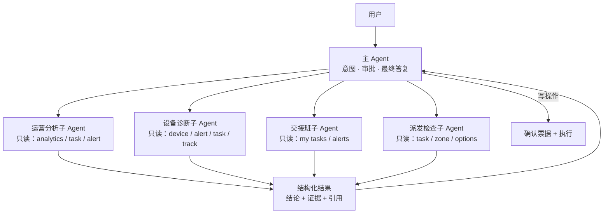

# ADR-0013 引入 SubAgent 编排与无人机业务场景评估（MultiAgent 暂缓）

- **状态**：已接受（SubAgent 先做；MultiAgent 暂缓）
- **日期**：2026-10-28
- **决策人**：项目负责人
- **记录人**：AI（按规范登记）
- **关联**：
  [`REQ-AGENT-0032 只读运营分析子 Agent`](../specs/REQ-AGENT-0032-只读运营分析子Agent.md)、
  [`ADR-0012 Plan 模式`](./ADR-0012-Plan模式引入评估.md)、
  [`REQ-AGENT-0031 Plan 模式`](../specs/REQ-AGENT-0031-Plan模式.md)、
  [`REQ-AGENT-0029 工具 Harness`](../specs/REQ-AGENT-0029-工具Harness-可取消与待确认持久化.md)、
  [`REQ-AGENT-0018 工具按角色与权限裁剪`](../specs/REQ-AGENT-0018-工具按角色与权限裁剪.md)

---

## 一、背景

当前 `drone-agent` 是**单 Agent**：一个系统提示词 + 74 个工具（70 个 MCP 业务工具 + 4 个本地工具；
`REQ-AGENT-0033` 起由 `TaskRouter` 直连子 Agent，不再新增委派工具），
ReAct 循环负责所有任务；Plan 模式也只是同一 Agent 上的可选编排，不是多个 Agent。

需求方希望评估：**是否引入 SubAgent / MultiAgent，哪些无人机业务场景真正适合？**
同时希望给初级工程师做一个项目向导（`drone-guide`），帮助其理解业务、技术实现与面试要点。

本 ADR 只回答**产品侧编排**（无人机系统用户）；`drone-guide` 是开发者侧的 Qoder Agent，单独落地，不混入产品架构。

---

## 二、概念边界

### 2.1 一句话

| 概念 | 定义 | 关键特征 |
|---|---|---|
| **SubAgent** | 主 Agent 把**一个有界任务**委托给子 Agent，子 Agent 在**独立上下文窗口**中执行，只把结果/摘要返回 | 上下文隔离、工具白名单、返回摘要；主 Agent 仍是唯一决策与对用户负责者 |
| **MultiAgent** | 多个 Agent 以**角色/对等/层级**协作，共同完成一个目标 | 有编排层、角色分工、交接（handoff）、共享状态/消息；协调成本高 |

SubAgent 是“**委派一个任务**”；MultiAgent 是“**组织一个团队**”。

### 2.2 2026 年的工程共识

- **SubAgent 的主要收益是上下文隔离**：子 Agent 只带相关上下文，主 Agent 不被长文档/大量工具结果污染；
  2026 年 LangChain 的对比文章提到，SubAgent 相比把所有内容塞进主上下文，整体 token 可少约 67%
  （具体数字取决于任务，不宜当定论）。
- **SubAgent 适合“读多、写少、边界清楚”的任务**：调研、诊断、汇总、并行取证。
- **MultiAgent 适合“角色差异明显、需要独立审核/并行工作流”的任务**；但协调失败往往比单 Agent 更常见
  （2026 年多篇综述与工程文章都强调编排层是主要风险）。
- 工程实现上，Claude Code / Spring AI 等都在把 SubAgent 作为“独立上下文 + 工具白名单 + 结果返回”的模式，
  而不是让多个 Agent 自由对话。

### 2.3 两者对比

| 维度 | SubAgent | MultiAgent |
|---|---|---|
| 拓扑 | 主 Agent → 子 Agent（可并行） | 编排者 + 多个 worker / 对等协作 |
| 上下文 | 子 Agent 独立窗口，只返回摘要 | 各 Agent 独立窗口 + 共享消息/状态 |
| 决策权 | 主 Agent 决策，子 Agent 执行有界任务 | 可能分散决策，需要协调协议 |
| 写操作 | 默认只读；写回主 Agent 确认 | 需要明确谁有权写 |
| 成本 | 低~中；隔离减少主上下文 token | 中~高；多轮协调 |
| 主要风险 | 子 Agent 结论不可靠、信息丢失 | 协调失败、重复劳动、状态不一致 |
| 本项目建议 | **先做** | **暂缓** |

---

## 三、当前项目现状

### 3.1 系统用户与权限

| 角色 | 业务视角 | 主要能力 |
|---|---|---|
| `admin` | 管理员/运营 | 全量查看与管理；日报、派发、告警处置、用户/角色 |
| `maintainer` | 机务 | 设备档案、维护相关；员工查看 |
| `pilot` | 飞手 | 自己的任务、执行、打卡、上报、交接班 |
| `screen` | 大屏只读 | 只读看板 |

### 3.2 现有能力

- 单 Agent + ReAct + Plan 模式（内置/生成）；
- 74 个工具，按角色 + 权限裁剪；
- 危险工具逐次确认、写操作幂等/台账、取消/续跑；
- 上下文账单、traceId、限流、预算；
- 业务流程 Skill：日报、派发检查、告警分诊、交接班。

### 3.3 为什么现在适合评估 SubAgent

- 工具与角色边界已经清楚，适合做**工具白名单**；
- Plan 模式已经能表达有界步骤，SubAgent 可以看作“把一段计划委托出去”；
- 上下文账单与 trace 已具备，能度量 SubAgent 的收益与成本；
- 单 Agent 在长文档/多数据源场景下，主上下文容易被工具结果挤占。

---

## 四、无人机业务场景评估

### 4.1 评估标准

| 标准 | 说明 |
|---|---|
| 任务有界 | 输入/输出清楚，不需要频繁与用户来回 |
| 读多写少 | 以查询、诊断、汇总为主；写操作留给主 Agent |
| 上下文重 | 需要读多份数据/文档，放主上下文会挤占 |
| 可并行 | 多个独立子任务可同时做 |
| 结果可验收 | 返回证据、结论、引用，主 Agent 能复核 |
| 延迟可接受 | 不是实时飞行控制 |

### 4.2 场景矩阵（面向无人机系统用户）

| 场景 | 用户 | 主要动作 | 适配 SubAgent？ | 理由 |
|---|---|---|---|---|
| **运营日报 / 周报** | admin | 多数据源查询 + 对比 + 报告 | ✅ 强适合 | 读多、可并行、上下文重；子 Agent 返回数据摘要与风险点，主 Agent 出最终报告 |
| **跨周期运营对比** | admin | 两周/两月指标对比 | ✅ 强适合 | 每个周期一个子任务，并行取证；主 Agent 汇总 |
| **设备异常诊断** | maintainer / admin | 设备详情 + 告警 + 任务 + 轨迹 | ✅ 强适合 | 证据链长、只读、边界清楚；子 Agent 返回“证据 + 可能原因 + 建议” |
| **告警分诊** | admin | 拉告警 + 查任务上下文 + 建议处置 | ✅ 适合（只读部分） | 子 Agent 只做“查 + 建议”；`claim/resolve/ignore` 由主 Agent 确认后执行 |
| **派发前检查** | admin | 任务状态 + 禁飞区 + 可用人机 | ✅ 适合（只读部分） | 子 Agent 出检查表；派发动作仍由主 Agent 确认 |
| **飞手交接班** | pilot | 我的任务 + 告警 + 证据缺口 | ✅ 强适合 | 只读、按任务 fan-out、输出固定交接单 |
| **制度/操作手册问答** | 全角色 | 检索内部资料 | ⚠️ 可用但不是必须 | 现有 `search_knowledge` + RAG 已够；只有“长文档多轮研读”才值得子 Agent |
| **撤销/补偿** | admin | 逆序停用/删除 | ❌ 不适合子 Agent 执行 | 高风险写操作；子 Agent 最多做“只读核对对象是否存在”，执行必须主 Agent + 确认 |
| **实时飞行控制** | pilot | 起飞/返航/避障 | ❌ 不适合 | 安全与延迟要求高，不应由 LLM 闭环控制 |
| **单次查询**（“有多少设备”） | 全角色 | 一次列表查询 | ❌ 不适合 | 子 Agent 只增加一次调用与上下文开销 |

### 4.3 推荐的 SubAgent 划分

**共同约束**：

- 子 Agent **默认只读**，工具白名单；
- 写操作、危险操作留在主 Agent，走既有确认与幂等；
- 子 Agent 返回 `summary + evidence + citations`，不返回大段原始数据；
- 主 Agent 对最终答复负责，不能把子 Agent 的结论直接当事实。

### 4.4 为什么暂不做 MultiAgent

- 当前业务大多是“一个用户问、一个主 Agent 答”，没有需要多个角色长期协作的目标；
- 写操作的安全边界已经在主 Agent 上，拆成多个 Agent 只会增加“谁有权写”的协调问题；
- 没有共享状态/消息总线的工程基础，强行做 MultiAgent 会引入分布式一致性、重复执行、审计归因等新问题；
- 先在 SubAgent 上验证“上下文隔离 + 结果可复核”的收益，再考虑 Plan/Reviewer 双 Agent 等更重的形态。

**未来可考虑 MultiAgent 的场景**：长流程日报（分析 Agent + 审核 Agent）、派发（检查 Agent + 安全 Agent + 调度 Agent），
但前提是 SubAgent 的上下文隔离、审计与成本收益已经被数据证明。

---

## 五、如果落地 SubAgent，建议的工程形态

### 5.1 组件

| 组件 | 职责 |
|---|---|
| `SubAgentDefinition` | 名称、描述、工具白名单、最大轮次/超时、只读标记、输出 Schema |
| `SubAgentRunner` | 独立上下文执行；复用工具执行、治理、取消、预算；返回结构化结果 |
| `SubAgentResult` | `summary` + `evidence[]` + `citations[]` + `tokens/latency` |
| 主 Agent | 选择是否委派、合并结果、最终审批与答复 |

### 5.2 约束

- **隔离**：子 Agent 不继承主对话全文，只接收任务说明 + 必要上下文；
- **白名单**：只允许该场景需要的工具；默认只读；
- **预算**：子 Agent 有独立 token/时间上限，不能无限递归；
- **不可写**：默认禁止写工具；写操作回到主 Agent；
- **可观测**：子 Agent 有独立 span，token/延迟计入总账单；
- **可失败**：子 Agent 失败/超时，主 Agent 降级为直接 ReAct 或如实说明。

### 5.3 分期

| 阶段 | 内容 |
|---|---|
| P0 | 只读运营分析子 Agent；对比主 Agent 直接执行的 token/延迟/成功率 |
| P1 | 设备诊断 + 交接班子 Agent；并行取证与结果复核 |
| P2 | 派发检查/告警分诊的只读子 Agent + 主 Agent 确认写操作 |
| 暂缓 | MultiAgent 编排、子 Agent 执行写操作、实时飞行控制 |

---

## 六、开发者侧：`drone-guide`

本 ADR 的产品侧 SubAgent 与开发者侧的 `drone-guide` 是两件事：

- **产品侧**：无人机系统用户 → 主 Agent → 只读子 Agent；
- **开发者侧**：初级工程师 → `drone-guide` Agent → 基于仓库文档/代码解释业务与技术、辅助面试。

`drone-guide` 已作为项目级 Qoder Agent 落地：`.qoder/agents/drone-guide.md`。

---

## 七、决策建议

**建议接受**：

1. 引入 **SubAgent 模式**，先做只读、上下文重、可并行的场景（运营分析、设备诊断、交接班、派发/告警的只读检查）；
2. 写操作与危险操作**不交给子 Agent**，仍由主 Agent 确认执行；
3. **MultiAgent 暂缓**，用数据证明 SubAgent 收益后再评估。

**待确认**：

- 子 Agent 用同一模型还是更便宜的模型？
- 子 Agent 结果是否需要用户可见（还是只在主 Agent 内部）？
- 首批落地“运营分析”还是“设备诊断”？
- `drone-guide` 是只做项目问答，还是也承担代码审查/落地指导？

---

## 八、实施状态（2026-10-28）

- **P0 已落地**：`SubAgentDefinition` / `SubAgentCatalog` / `SubAgentRunner` / `SubAgentService`，
  场景 `ops-analyst`（只读运营分析）；
- 主 Agent 不新增委派工具：`TaskRouter` 直接路由到 `SubAgentService`；
- 真实冒烟：4 轮 / 8 次工具 / 15.2s，主 Agent 正常拿到摘要；
- 冒烟发现并修复：主循环 15s 全局超时 < 子 Agent 实际耗时，新增工具级 `timeout-ms`，
  委派工具放宽到 90s；
- 单测：`drone-agent` 419 条通过；
- **REQ-AGENT-0033**：新增 `TaskRouter`，按用户问题直接路由 REACT / PLAN / SUBAGENT；
  复杂只读任务不再依赖模型自行决定是否委派；
- **未实现**：取消穿透、子 Agent 写操作、自动路由、MultiAgent；尚未沉淀自动化 E2E。

## 九、参考资料
- LangChain, *Choosing the Right Multi-Agent Architecture*（2026） — <https://www.langchain.com/blog/choosing-the-right-multi-agent-architecture>
- Spring AI, *Subagent Orchestration*（2026） — <https://spring.io/blog/2026/01/27/spring-ai-agentic-patterns-4-task-subagents>
- *LLM-Based Multi-Agent Orchestration: A Survey*（2026） — <https://www.preprints.org/manuscript/202604.2147>
- *The Orchestration of Multi-Agent Systems: Architectures, …*（2026） — <https://arxiv.org/html/2601.13671v1>
- *6 Multi-Agent Orchestration Patterns for Production*（2026） — <https://beam.ai/agentic-insights/multi-agent-orchestration-patterns-production>
- Claude Code Subagents — <https://academy.claude.com/courses/claude-code-101/subagents>
