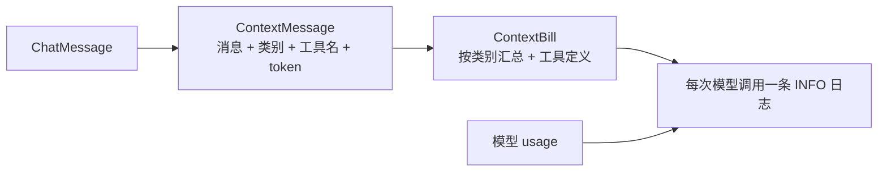

# 技术方案 — REQ-AGENT-0017 上下文账单（按消息计量）

- **需求 ID**：`REQ-AGENT-0017`
- **前置**：`REQ-AGENT-0016` 已落地；本需求只加「计量」，不改编排行为

## 1. 方案概述

在「记忆消息」与「线格式消息」之间加一层**带计量的消息包装**：



- `ContextMessage` 是**唯一**进入模型请求的消息形态；
- `ContextBill` 在构造请求体时算出（纯内存，不调模型）；
- 模型返回后，把 `usage.prompt_tokens` 与账单估算并列打印，形成「估算 / 实际」对账。

## 2. 影响面

| 维度 | 影响 | 说明 |
|---|---|---|
| 接口 | 无变化 | `/chat`、`/chat/stream` 的入参出参不变 |
| 内部类型 | 修改 | `ContextAssembler` / `ToolCallingService` / `ChatService` 的消息列表改为 `List<ContextMessage>` |
| 数据模型 | 无 | 会话仍只存 `user` / `assistant` 正文；账单不入库 |
| 性能 | 可忽略 | 账单是 O(消息数) 的字符扫描 |
| 兼容性 | 兼容 | 提交给模型的 JSON 除流式多一个 `stream_options` 外完全一致 |

## 3. 新增类型（`cn.tedu.droneagent.context`）

| 类型 | 职责 |
|---|---|
| `MessageKind` | 系统 / 长期记忆 / 会话 / 工具调用 / 工具结果 / 续跑，带中文名 |
| `TokenEstimator` | 纯函数估算：中文 0.62/字、其他 0.22/字符、每条消息 +4、请求模板 +22 |
| `ContextMessage` | `ModelMessage` + `kind` + `toolName`，`tokens()` 现算 |
| `ContextBill` | 收集消息与工具定义，按类别汇总，渲染日志文本 |

## 4. 关键设计决策

| 决策点 | 备选 | 结论 | 理由 |
|---|---|---|---|
| 计量载体 | 给 `ChatMessage` 加字段 / 新建包装 | **新建 `ContextMessage`** | 会话 DTO 要落盘，不应携带运行时计量字段 |
| 估算方式 | 第三方 tokenizer / 实测系数 | **实测系数** | DeepSeek 无公开 tokenizer；系数已用真实接口标定，且账单同时打印实际值 |
| 对账方式 | 只打印估算 | **估算 + 实际** | 只有实际值才知道准不准；流式用 `include_usage` 取最后一帧 |
| 工具定义是否算消息 | 算 / 不算 | **不算消息，单独一行** | 它不是对话内容，但确实是每次请求的最大固定成本 |
| 续跑上下文类别 | 精确还原 / 统一标注 | **统一 `RESUME`** | 续跑只在确认后发生，消息来源信息价值低，没必要为它扩展存储 |

## 5. 改造点

| 位置 | 改动 |
|---|---|
| `ContextAssembler` | 返回 `List<ContextMessage>`，长期记忆标 `LONG_TERM`、会话标 `SESSION` |
| `ToolCallingService` | 循环持有 `List<ContextMessage>`；工具调用帧标 `TOOL_CALL`、结果标 `TOOL_RESULT` 并带工具名；`pause` 存 `ModelMessage`（不变），`resume` 复原为 `RESUME` |
| `ChatService` | 构造请求时前置 `SYSTEM`、附加工具定义账单；`streamStep`/`streamChat` 增加 `stream_options.include_usage`；解析 `usage` 后打账单 |
| `ConversationService` | 上下文类型跟随；无工具路径同样传入 `ContextMessage` |
| `StreamAssembler` | 捕获流里的 `usage` 节点 |
| `ChatConfirmService` | 续跑路径适配 `ContextMessage` |

## 6. 日志格式

```text
【上下文账单】traceId=xxxx，第 1 次调用，合计≈11230 token
（模板 22 / 系统 1856×1 / 长期记忆 2104×8 / 会话 987×12 / 工具结果 640×3 / 工具定义 5621×73）；
模型实际 prompt_tokens=10980，缓存命中=0，估算偏差 +2.3%
```

- 只打数量与 token，不打正文；
- 没有实际值时（如客户端中途断开、响应无 usage），打「实际值不可用」而不是编一个。

## 7. 测试策略

| 验收条件 | 层级 | 位置 |
|---|---|---|
| AC-1 / AC-2 / AC-3 | 单元 | `ContextBillTest`、`ToolCallingServiceTest` |
| AC-4 | 单元 + 手工 | `ChatService` 请求体断言 + 真机 SSE 日志 |
| AC-5 | 单元 | `TokenEstimatorTest` |
| AC-6 | 单元 | 全部单测不联网 |

## 8. 风险与回滚

| 风险 | 触发 | 影响 | 应对 |
|---|---|---|---|
| 估算偏差大 | 分词器变化 / 大量代码类文本 | 账单失真 | 每次打印实际值与偏差；后续可替换估算器 |
| `stream_options` 不被支持 | 供应商兼容性差 | 流式 400 | 供应商已实测支持；如遇不支持，回退为不传该字段（账单实际值置为不可用） |
| 工具帧/结果漏标 | 改造遗漏 | 分类不准 | 循环内只保留两处追加点，均由测试钉住 |
| 日志噪音 | 每轮一条 | 日志变长 | 只打一条 INFO，且不含正文；DEBUG 才打逐条明细 |
