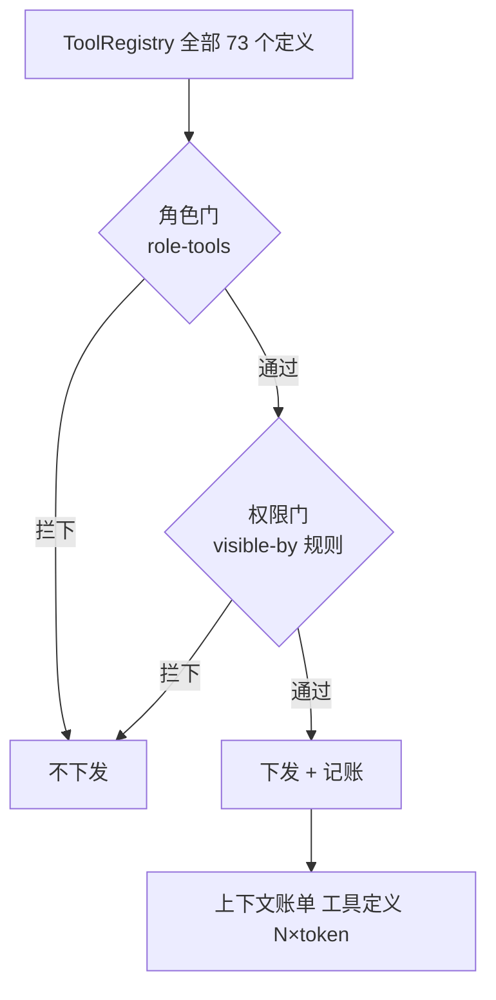

# 技术方案 — REQ-AGENT-0018 工具按角色与权限裁剪

- **需求 ID**：`REQ-AGENT-0018`
- **前置**：`REQ-AGENT-0017`；本需求只改「下发哪些工具定义」，不改执行

## 1. 方案概述



- **角色门**：复用 `ToolGovernance.allows(name, roles)`——被 `role-tools` 限制的工具（目前是危险工具），只有名单内角色可见；
- **权限门**：新增配置 `agent.tool.visible-by`，工具名模式 → 需要的权限码（任一满足）；
- 两门都通过才下发；**未匹配规则 = 默认可见**。

## 2. 影响面

| 维度 | 影响 | 说明 |
|---|---|---|
| 接口 | 无变化 | `/chat`、`/chat/stream` 入参出参不变 |
| 配置 | 新增 | `agent.tool.visible-by` 规则列表 |
| 上下文 | 大幅减少 | 按角色裁剪工具定义，账单里的工具 token 随之下降 |
| 执行授权 | 不变 | `runTool` 仍先判 `governance.allows` |
| 兼容性 | 兼容 | 规则为空时行为与之前完全一致 |

## 3. 关键设计决策

| 决策点 | 备选 | 结论 | 理由 |
|---|---|---|---|
| 规则维度 | 只按角色 / 只按权限 | **角色 + 权限（AND）** | 角色管「能不能用」，权限管「能看哪块数据」，两者不可互相替代 |
| 匹配顺序 | 全部匹配累加 / 先匹配先用 | **先匹配先用** | 允许「特例规则」排在通用规则之前（如 `user_me` 先于 `user_*`） |
| 未匹配工具 | 默认隐藏 / 默认可见 | **默认可见** | 地图、知识库、Skill 元工具没有权限码；隐藏它们会直接砍掉功能 |
| 执行侧 | 只靠裁剪 / 裁剪 + 复核 | **裁剪 + 复核** | 裁剪是成本优化，复核才是安全边界（模型可能被诱导） |
| 规则载体 | 代码硬编码 / 配置 | **配置** | 权限码随 drone-server 演进，改配置不用发版 |

## 4. 配置形态

```yaml
agent:
  tool:
    visible-by:
      - pattern: "drone__user_me"
        any-of: []                # 空 = 不要求权限码，登录即可见
      - pattern: "drone__user_add"
        any-of: [staff:add]
      - pattern: "drone__user_*"
        any-of: [staff:list]
      - pattern: "drone__system_*"
        any-of: [system:rbac:list]
      ...
```

- `pattern` 支持 `*` 通配（任意长度）；
- `any-of` 为空表示**无权限要求**；
- 规则按声明顺序匹配，第一条命中即定。

## 5. 改造点

| 位置 | 改动 |
|---|---|
| `config/ToolVisibilityRule` | 新增规则记录：`pattern` + `anyOf` |
| `config/ToolProperties` | 新增 `List<ToolVisibilityRule> visibleBy` |
| `tool/ToolVisibility` | 模式编译（`*` → `.*`）、按顺序匹配、权限判定 |
| `service/ToolCallingService` | 每轮请求计算可见定义；打印 `【工具裁剪】`；记账自动生效 |
| `application.yml` | 补齐 70 个业务工具的规则 |

## 6. 日志格式

```text
【工具裁剪】traceId=xxxx，可见 52/73：角色拦下 0、权限拦下 21；隐藏=[drone__user_list、drone__system_role_save、…]
```

- 仅在有隐藏时打 INFO；全部可见时打 DEBUG，避免 admin 的每次请求都刷屏；
- 隐藏名单最多列 20 个，超出打「…」。

## 7. 测试策略

| 验收条件 | 层级 | 位置 |
|---|---|---|
| AC-1 / AC-2 / AC-3 | 单元 | `ToolVisibilityTest`、`ToolCallingServiceTest`（按角色/权限构造） |
| AC-4 | 单元 | 未匹配工具默认可见 |
| AC-5 | 单元 + 手工 | 可见列表 + 真机日志 |
| AC-6 | 单元 | 执行侧 `governance.allows` 用例保持通过 |
| 账单联动 | 单元 | `ChatServiceToolTest` 断言工具数与 token 随列表变化 |

## 8. 风险与回滚

| 风险 | 触发 | 影响 | 应对 |
|---|---|---|---|
| 规则写错导致工具消失 | 权限码拼写错误 | 模型「不会」某项操作 | 未匹配默认可见只能兜住「没写规则」；写错需靠日志里的可见数对比发现 |
| 角色门把管理员也拦下 | role-tools 未授予 | 管理员缺工具 | 启动期已有「清单必须在 catalog 中」校验；本次增加可见数日志 |
| 裁剪与执行不一致 | 规则与后端权限漂移 | 看得到但执行 403 | 执行侧如实转述权限不足；规则以 drone-server 的 `permission` 表为准 |
| 回滚 | — | — | 清空 `visible-by` 即恢复全量下发 |
