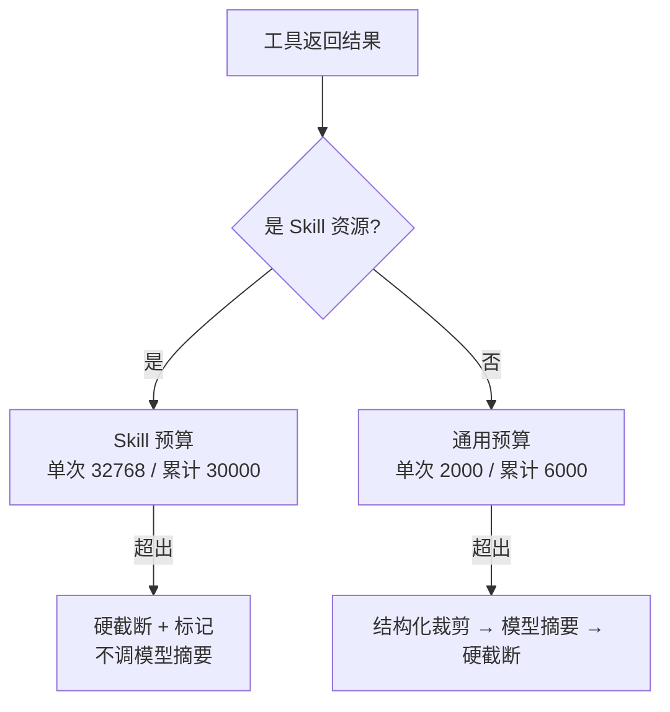

# 技术方案 — REQ-AGENT-0019 Skill 资源纳入独立预算

- **需求 ID**：`REQ-AGENT-0019`
- **前置**：`REQ-AGENT-0017` / `REQ-AGENT-0018`

## 1. 方案概述

把 `fit` 从「Skill 工具直接放行」改成**两条独立预算**：



- 两条预算各自累计，互不挤占；
- Skill 资源超出时**只截断**，不交给模型摘要——模板必须原样；
- 截断标记明确告诉模型「后面还有，请分段读取」。

## 2. 影响面

| 维度 | 影响 | 说明 |
|---|---|---|
| 接口 | 无变化 | `/chat`、`/chat/stream` 不变 |
| 配置 | 新增 2 项 | `max-skill-result-chars`、`max-total-skill-chars` |
| 上下文 | 有上限 | 单请求 Skill 资源最多 30,000 字符 |
| 兼容性 | 兼容 | 日报模板 12.3KB 仍完整返回；普通工具不变 |
| 记账 | 修正 | 工具结果 / 工具调用帧改用结构化文本系数（0.34）；日报场景偏差从 −14.5% 收敛到 −4% |

## 3. 关键设计决策

| 决策点 | 备选 | 结论 | 理由 |
|---|---|---|---|
| Skill 资源的预算 | 并入通用总预算 / 独立预算 | **独立** | 并入后第一次读模板就会挤掉后续工具结果；独立才能两者都保 |
| 超限处理 | 模型摘要 / 硬截断 | **硬截断 + 标记** | 模板里的 `{{占位符}}` 与样式不能被改写 |
| 单次上限 | 沿用 skill 配置 / 新增 | **新增但取同值 32768** | 工具层显式可见；文件级限制仍由 skill 配置负责 |
| 累计上限 | 无 / 30000 | **30000** | 足够一次完整日报（约 20KB），最坏约 1.5 万 token |
| 预算用尽 | 空串 / 占位 | **占位** | 空串会让模型以为「资源是空的」，与「预算用尽」混淆 |

## 4. 代码改造

| 位置 | 改动 |
|---|---|
| `config/ToolProperties` | 新增 `maxSkillResultChars`、`maxTotalSkillChars` |
| `ToolCallingService` | 新增两个字段与 `usedSkillChars`；`fit` 增加 Skill 分支；完成日志带 Skill 用量 |
| `application.yml` | 新增两项配置与说明 |

### 截断实现

```java
String marker = "（技能资料超出预算，已截断；如需后续内容，请分段读取）";
int keep = Math.max(0, cap - marker.length());
return content.substring(0, keep) + marker;
```

- 保证返回长度 ≤ cap；
- 按 `charAt` 边界截断后，若落在代理对中间则回退一位（避免半个 emoji）。

## 5. 测试策略

| 验收条件 | 层级 | 位置 |
|---|---|---|
| AC-1 | 单元 | 12.3KB 模板原样返回 |
| AC-2 / AC-3 / AC-4 | 单元 | `ToolCallingServiceTest`：单次截断、累计剩余、用尽占位 |
| AC-5 | 单元 | 既有预算用例保持通过 |
| AC-6 | 单元 + 手工 | 日志字段 + 日报真机账单 |

## 6. 风险与回滚

| 风险 | 触发 | 影响 | 应对 |
|---|---|---|---|
| 模板刚好超限被截断 | 模板继续变大 | HTML 损坏 | 30,000 总量给单模板留了 17KB 余量；超限时日志会记截断 |
| 多资源流程被截断 | 一次读很多参考资料 | 模型信息不全 | 标记提示分段读取；后续再做按章节读取 |
| 回滚 | — | — | 把两个上限调大即可恢复原行为 |
