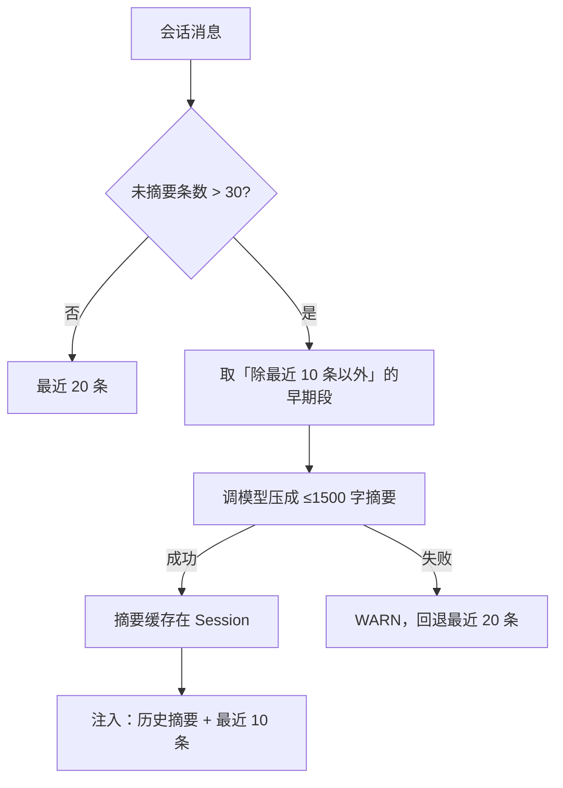

# 技术方案 — REQ-AGENT-0020 会话内压缩（Compaction）

- **需求 ID**：`REQ-AGENT-0020`
- **前置**：`REQ-AGENT-0003` / `REQ-AGENT-0017`

## 1. 方案概述



- 压缩在 `ContextAssembler.assemble` 里做，**请求线程、会话锁内**，同会话不会并发压缩；
- 摘要缓存在 `Session` 上（`summary` + `summarizedUpTo`），后续轮次直接复用；
- 摘要作为 `system` 消息注入（类别 `历史摘要`），排在系统提示词之后、最近消息之前。

## 2. 影响面

| 维度 | 影响 | 说明 |
|---|---|---|
| 接口 | 无变化 | `/chat`、`/chat/stream` 不变 |
| 配置 | 新增 4 项 | 触发条数、保留条数、摘要字数、输入上限 |
| 上下文 | 更连贯 | 长会话从「丢最早的」变为「摘要最早的」 |
| 延迟 | 偶发增加 | 只有跨阈值那一轮多一次摘要调用（约 1–3s），其余轮次无感 |
| 账单 | 新增分类 | `历史摘要` |
| 数据 | 不落盘 | 原文仍完整归档；重启后摘要重算 |

## 3. 关键设计决策

| 决策点 | 备选 | 结论 | 理由 |
|---|---|---|---|
| 摘要存哪 | 入库 / 内存 | **内存** | 落盘要改会话文件格式；原文已在长期记忆，摘要丢了可重算 |
| 触发口径 | 条数 / token | **条数** | 与现有 20 条上限一致；token 预算后续再做 |
| 同步还是异步 | 异步预生成 / 同步 | **同步** | 异步会让「这一轮该看到的摘要」缺位；偶发延迟可接受 |
| 失败策略 | 抛错 / 回退 | **回退最近 20 条** | 摘要只是增强，不能影响主流程 |
| 摘要角色 | user / system | **system** | 明确是「背景」，不伪装成用户发言 |
| 超长摘要 | 原样 / 截断 | **硬截断** | 预算是硬的，提示词不一定听话 |

## 4. 配置

```yaml
agent:
  memory:
    compact-trigger-messages: 30   # 未摘要消息超过它才压缩
    compact-keep-messages: 10      # 压缩后保留最近多少条原文
    compact-summary-chars: 1500    # 摘要长度上限
    compact-input-chars: 12000     # 送去摘要的原文长度上限
```

## 5. 代码改造

| 位置 | 改动 |
|---|---|
| `memory/Session` | 新增 `summary` / `summarizedUpTo` 与 `compact()` |
| `memory/ConversationCompactor` | 新增函数式接口：`compact(transcript, maxChars)` |
| `memory/ContextAssembler` | 触发压缩、注入摘要、失败回退；旧构造器保留（不压缩） |
| `service/ChatService` | 实现 `ConversationCompactor`，使用新提示词 `memory.compaction` |
| `prompts/memory/compaction.md` | 新增摘要提示词 |
| `config/MemoryProperties` | 新增 4 个配置项 |
| `config/MemoryConfig` | 注入 `ConversationCompactor` |
| `context/MessageKind` | 新增 `COMPACTION("历史摘要")` |

### 边界处理

- `upTo = 总条数 - keep`；若 `upTo <= 已摘要位置` 则跳过；
- 摘要段内只取 `user` / `assistant`；全为非白名单消息时直接推进游标，不调模型；
- 摘要为空/空白视为失败，不推进游标（下轮可重试）；
- 注入前对摘要做硬截断（`compact-summary-chars`）；
- 摘要输入超限时保留**更接近当前时间**的后半段，并在前缀注明「更早内容已省略」。

## 6. 测试策略

| 验收条件 | 层级 | 位置 |
|---|---|---|
| AC-1 / AC-2 | 单元 | `ContextAssemblerTest`：触发一次、复用、第二次不重复调用 |
| AC-3 | 单元 | 桩抛异常 → 回退最近 20 条 |
| AC-4 | 单元 | 摘要超长被截断 |
| AC-5 | 单元 | 账单分类包含 `历史摘要` |
| AC-6 | 单元 | 旧构造器（无 compactor）行为不变 |

## 7. 风险与回滚

| 风险 | 触发 | 影响 | 应对 |
|---|---|---|---|
| 摘要调用拖慢当轮 | 20 条消息摘要 | 偶发 1–3s | 只跨阈值时发生；关闭 `compact-trigger` 或调大即可 |
| 摘要丢信息 | 模型概括 | 早期细节丢失 | 保留最近 10 条原文；摘要提示词要求保留决定与数字 |
| 摘要成本 | 每次压缩一次模型调用 | 小额 | 输入上限 12,000 字符；阈值 30 条摊薄 |
| 重启后重算 | 摘要不落盘 | 一次额外调用 | 已知取舍，原文不丢 |
