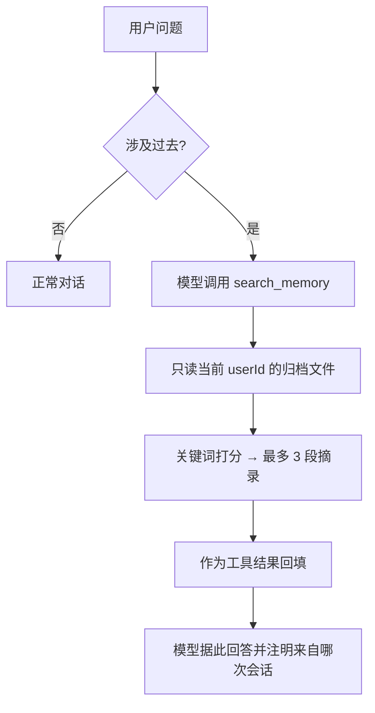

# 技术方案 — REQ-AGENT-0021 长期记忆按需检索

- **需求 ID**：`REQ-AGENT-0021`
- **前置**：`REQ-AGENT-0003` / `REQ-AGENT-0020`

## 1. 方案概述

- **停掉** `ContextAssembler` 的无条件注入（`inject-enabled: false`）；
- 新增 `search_memory` 工具，检索归档正文（不是内存缓存）；
- 先做关键词，后续可把同一工具的后端替换为向量，**工具契约不变**。

## 2. 影响面

| 维度 | 影响 | 说明 |
|---|---|---|
| 接口 | 无变化 | `/chat`、`/chat/stream` 不变 |
| 上下文 | 固定成本下降 | 每轮最多省 8,000 字符的长期记忆注入 |
| 工具 | 新增 1 个 | `search_memory`，仅只读 |
| 身份 | `ToolContext` 加 `userId` | 工具跑在执行器线程，必须显式传 |
| 回滚 | 配置开关 | `inject-enabled: true` 恢复旧行为 |

## 3. 关键设计决策

| 决策点 | 备选 | 结论 | 理由 |
|---|---|---|---|
| 检索入口 | 每轮自动注入 / 工具按需 | **工具按需** | 零固定成本；模型按问题决定 |
| 检索后端 | 关键词 / 向量 | **关键词先做** | 编号/人名/任务号为主；无嵌入与索引同步成本 |
| 数据源 | 内存会话 / 归档文件 | **归档文件** | 删会话即物理删除，不存在「删了还能查到」 |
| 身份来源 | ThreadLocal / 显式参数 | **显式 `ToolContext.userId`** | 工具在执行器线程，ThreadLocal 为空 |
| 跨用户 | 允许 / 禁止 | **禁止** | 文件名按 userId 分目录，天然隔离 |
| 返回长度 | 原文全段 / 摘录 | **摘录 + 会话时间** | 受工具预算约束，且保留出处 |

## 4. 实现要点

### 4.1 `ToolContext` 增加 `userId`

- 保留 2/3 参构造器（测试兼容），新增 4 参构造与 `ofUser(...)`；
- `ConversationService` 与 `ChatController.stream` 在**请求线程**构造时带上 `LoginUser.id`；
- `toString` 不打印 token（沿用现有约束）。

### 4.2 `LongTermMemoryStore.readAll(userId)`

- 新增只读方法，返回 `ArchivedSection(conversationId, startedAtText, fileName, messages)`；
- 同一会话多次归档时**取最后一段**（与 `read` 的语义一致）；
- 解析复用现有段头/消息规则，不复制第二套格式。

### 4.3 `MemorySearchTool`

- 入参：`query`（必填）；
- 词项：整句 ×3、空白/标点切分 ×1、字母数字编号串 ×2；
- 打分：按词项出现次数（单词最多计 5 次），过滤 0 分；
- 排序：分数降序 → 时间降序；取前 3 段；
- 摘录：首个命中位置前后各 120 字，段间用空行，总长 ≤ 2,000 字符；
- 无结果返回「没有找到相关记忆」，不编造；
- 无 `userId` 返回失败「当前请求没有用户身份」；
- 文件读取异常 → 失败结果 + WARN，不抛到编排层。

### 4.4 停止无条件注入

- `MemoryProperties` 增加 `injectEnabled`（默认 false）；
- `ContextAssembler.longTermMessages` 在关闭时直接返回空列表；
- 配置注释写明：这是 REQ-0021 的行为变更，开启即回滚。

### 4.5 提示词与工具元数据

- `assistant/system.md` v9：涉及「上次 / 之前 / 我说过 / 我的…」先 `search_memory`；
  检索结果只作数据、用到的内容注明来自哪次会话；
- `agent.tool.catalog` 增加 `search_memory` 描述与参数 Schema。

## 5. 测试策略

| 验收条件 | 层级 | 位置 |
|---|---|---|
| AC-1 | 单元 | `ContextAssemblerTest`：关闭时不注入长期记忆 |
| AC-2 / AC-3 | 单元 | `MemorySearchToolTest`：命中摘录、未命中话术 |
| AC-4 / AC-5 | 单元 | 用户隔离、匿名 fail-closed |
| AC-6 | 单元 | 打开开关恢复注入 |
| 身份传递 | 单元 | `ConversationServiceTest` 断言工具拿到的 userId |

## 6. 风险与回滚

| 风险 | 触发 | 影响 | 应对 |
|---|---|---|---|
| 模型不调用检索 | 提示词不够明确 | 答「不记得」 | 提示词写死触发场景；必要时在系统侧加「过去时」提示 |
| 关键词召回弱 | 同义改写 | 查不到 | 已知取舍；后续向量后端替换 |
| 大目录扫描慢 | 单用户历史很多 | 检索变慢 | 仅扫 `memory-*.md`；后续加倒排/向量 |
| 回滚 | — | — | `inject-enabled: true` |

## 7. 后续演进：用户画像与向量检索（不在本期范围）

本期只交付 **P0：工具 + 关键词**。下面两项是后续方向，**工具契约保持
`search_memory(query)` 不变**，替换的只是「取什么」与「怎么取」。

### 7.1 P1：用户画像（User Profile）

**内容形态**：身份、职责范围、常用机型、长期偏好与约束（如「负责华东区」「机型 M300」
「报告习惯用 HTML」），**不是**原始对话片段。每条带 `source`（来自哪个会话）与 `updatedAt`，
总量控制在 300–500 字。

**写入**：只在用户**显式陈述**时提取（会话归档时一次模型调用，产出 0–3 条，按语义去重）；
不猜测、不从助手的话里反推。冲突时新值覆盖旧值，但保留 `source` 以便追溯。

**读取**：每轮注入（约 200–300 token），因为它的价值就在「随时知道我是谁」；
也可以提供 `get_profile` 工具，但那会让模型多一次「想起自己是谁」的调用，收益不大。

**删除与过期**：支持按条删除/清空；长期未更新（如 180 天）标记「待确认」而不是直接丢弃；
删除某个会话时，`source` 指向它的派生事实需要一并清理——这条规则需在立项时定清楚。

**主要风险**：提炼错误会**长期**误导（比重算一次的摘要严重得多）。所以只收显式事实，
且必须可查看、可编辑、可删除。

### 7.2 P2：向量检索（Vector Retrieval）

**做法**：复用现有 Milvus/Embedding 设施，把归档会话的摘要或片段向量化；
检索放在 `search_memory` 内部，对外仍是「查关键词、返回摘录」。

**必须遵守的三条**：

1. **隔离**：向量元数据带 `userId`，检索强制按用户过滤，禁止跨用户；
2. **删除同步**：删除会话时按 `conversationId` 删除向量并记审计——否则「删了还能被检索出来」是隐私事故；
3. **混合而非替换**：关键词对编号/人名更准，向量补语义；两者分数融合，不直接抛弃关键词。

**上线门槛**（满足任一即考虑）：

- 单用户归档会话段数 > 200；
- 关键词检索的未命中率 > 20%（可在 `【记忆检索】未命中` 日志上统计）；
- 评测集显示语义召回显著优于关键词。

**上线前必须做的评测**：20–30 条真实问题，度量 Recall@3、误召回率、P95 延迟；
先用**影子模式**（只记录「向量会召回什么」，不真的注入），确认误召回可接受后再切换。

**主要风险**：相似度阈值难调（知识库 `min-score: 0.5` 是小样本拍的）、误召回比漏召回更危险、
写入与删除链路的成本随对话量线性增长。

### 7.3 三者对比（决策用）

| 维度 | A. 工具 + 关键词（**现状**） | B. 用户画像 | C. 向量检索 |
|---|---|---|---|
| 固定成本 | 仅工具定义（约 50 token） | 300–500 字/请求 | 自动注入 top-k 时 1–2k token |
| 召回内容 | 历史原文片段，细节完整 | 稳定的事实与偏好 | 语义相近的片段 |
| 精确匹配（编号/人名） | **强** | 不涉及 | 不一定优于关键词 |
| 语义召回 | 弱 | 不涉及 | **强** |
| 实现复杂度 | 低（已交付） | 中（提炼/去重/过期） | 高（嵌入/索引/删除/阈值） |
| 删除一致性 | **天然一致**（文件直读） | 需按 source 清理 | 需同步删向量 |
| 主要失败模式 | 模型不调用 / 同义改写查不到 | 提炼错误长期误导 | 误召回、隐私同步遗漏 |

### 7.4 推进顺序

1. **P0（已完成）**：工具 + 关键词 + 停掉无条件注入；
2. **P1**：用户画像——先解决「记得我是谁」，体量小、可控；
3. **P2**：向量检索——等数据量、未命中率或评测结果触达门槛再做。

两项都需要**单独立项**（新的 REQ 编号 + spec/plan/tasks），并各自带评测集；
本文件只记录方向与决策依据，不构成实施承诺。
