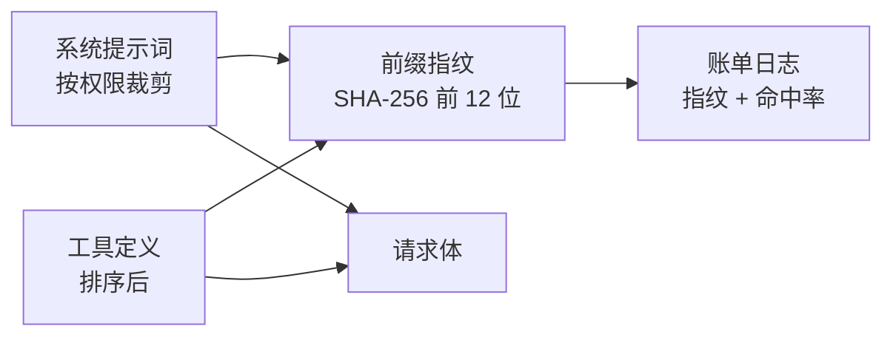

# 技术方案 — REQ-AGENT-0022 前缀缓存与稳定性

- **需求 ID**：`REQ-AGENT-0022`
- **前置**：`REQ-AGENT-0017` / `REQ-AGENT-0018` / `REQ-AGENT-0021`

## 1. 方案概述

- 工具定义顺序**确定化**（MCP 按暴露名排序）；
- 每次请求算一次前缀指纹，打在账单日志里；
- 用「指纹相同但命中率低」区分「内容变了」与「供应商缓存过期」。

## 2. 影响面

| 维度 | 影响 | 说明 |
|---|---|---|
| 接口 | 无变化 | 仍是 `/chat`、`/chat/stream` |
| 工具顺序 | 变化 | MCP 工具从「服务端返回顺序」改为「按名字排序」 |
| 日志 | 增加字段 | `前缀指纹`、`缓存命中率` |
| 行为 | 无 | 工具集合、系统提示词内容都不变 |

## 3. 关键设计决策

| 决策点 | 备选 | 结论 | 理由 |
|---|---|---|---|
| 排序范围 | 全部工具 / 仅 MCP | **仅 MCP** | 本地工具顺序由 catalog 决定，本就稳定且有语义（检索类在前） |
| 指纹算法 | MD5 / SHA-256 | **SHA-256 前 12 位** | 抗碰撞足够，12 位十六进制便于日志阅读 |
| 指纹内容 | 含消息 / 不含 | **不含** | 消息是后缀，变化是正常行为；含进去会让指纹失去「前缀」意义 |
| 命中率口径 | 命中/总 prompt | **同左** | 与供应商 `prompt_cache_hit_tokens` 对齐 |

## 4. 代码改造

| 位置 | 改动 |
|---|---|
| `mcp/McpToolset` | 新增 `sortedByName`，行为与元数据同步排序 |
| `service/ChatService` | `BuiltRequest` 增加 `prefixFingerprint`；`logBill` 打印指纹与命中率 |
| `service/ChatService` | `prefixFingerprint(systemPrompt, toolsJson)`：SHA-256 前 12 位 |

### 指纹为什么只取「系统提示词 + 工具」

这两部分是**每次请求都重发且应当不变**的内容。会话消息、摘要、工具结果都在其后，
它们变化不应该被当成「前缀抖动」。如果指纹包含消息，就无法区分「消息增长」与
「工具顺序变了」这两种完全不同的原因。

## 5. 测试策略

| 验收条件 | 层级 | 位置 |
|---|---|---|
| AC-1 / AC-2 | 手工 | 同一实例两轮、重启一轮，对比账单 |
| AC-3 | 单元 | `ChatServiceToolTest`：追加消息指纹不变 |
| AC-4 | 单元 | `ChatServiceSkillTest`：不同权限指纹不同（可选） |
| AC-5 | 单元 + 手工 | 日志字段 |
| 排序 | 单元 | `McpToolsetOrderTest`、`McpToolsetTest` |

## 6. 风险与回滚

| 风险 | 触发 | 影响 | 应对 |
|---|---|---|---|
| 排序改变模型选工具偏好 | 前缀顺序变化 | 选择略有差异 | 只排序、不改描述；上线后观察工具调用成功率 |
| 指纹误导 | 供应商改变模板 | 指纹相同但命中率低 | 日志同时打印实际命中率，可区分 |
| 命中率下降 | 供应商缓存过期 | 成本上升 | 属于供应商行为；可调整请求频率或忽略 |
