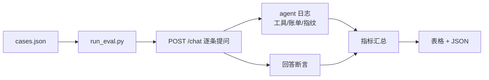

# 技术方案 — REQ-AGENT-0023 上下文质量评估集

- **需求 ID**：`REQ-AGENT-0023`
- **前置**：`REQ-AGENT-0017` ~ `REQ-AGENT-0022`

## 1. 方案概述

- 走真实 HTTP，不 mock 模型；
- 工具与 token 指标来自 agent 日志（账单已有这些字段），避免改接口；
- 脚本用唯一 `conversationId` 把「一次请求」与「日志里的 trace」对上。

## 2. 影响面

| 维度 | 影响 | 说明 |
|---|---|---|
| 生产代码 | 无 | 纯工具脚本 + 文档 |
| 接口 | 无 | 复用 `/user/login`、`/chat` |
| 运行环境 | 需要日志 | 不传 `--log` 仍可评估回答，工具/token 显示未取到 |
| 费用 | 有 | 每次运行会真实调用模型 |

## 3. 关键设计决策

| 决策点 | 备选 | 结论 | 理由 |
|---|---|---|---|
| 运行方式 | JUnit / 独立脚本 | **独立脚本** | 需要真实模型与运行中的服务；脚本更容易手工对比 |
| 指标来源 | 改接口返回 usage / 解析日志 | **解析日志** | 账单日志已含 token、缓存、指纹，避免改契约 |
| 断言方式 | LLM 判分 / 关键词 | **关键词** | 零额外成本、可重复；语义正确性仍靠人工 |
| 用例规模 | 大而全 / 小而精 | **9 条 + 1 重用例** | 控制费用与时长；先覆盖关键路径 |
| 记忆用例 | 依赖真实历史 / 临时夹具 | **临时夹具** | 可重复，不污染真实记忆；跑完删除 |

## 4. 用例设计

| ID | 类别 | 期望工具 | 断言要点 |
|---|---|---|---|
| C01 | 设备 | `drone__device_list` | 回答含「台」 |
| C02 | 设备 | `device_list` / `device_detail` | 含 `UAV-001` |
| C03 | 任务 | `drone__task_list` | 含 `TK-` |
| C04 | 告警 | `drone__alert_list` | 含「告警」 |
| C05 | 统计 | `dashboard_summary` / `analytics_overview` | — |
| C06 | 统计 | `analytics_dispatch_block` | 含「积压」 |
| C07 | 知识 | `search_knowledge` | 含「电池」 |
| C08 | 拒答 | 无工具；禁止业务工具 | 含「抱歉」 |
| C09 | 记忆 | `search_memory` | 含「张伟」；需夹具 |
| C10 | 技能 | `use_skill` | 默认跳过（重） |

## 5. 指标定义

- **通过率**：工具与回答断言全部满足的用例数 / 执行数；
- **上下文 token**：该用例最后一轮请求的 `prompt_tokens`（反映当前上下文大小）；
- **累计 prompt**：所有轮次 `prompt_tokens` 之和（反映一次问答的真实输入成本）；
- **缓存命中率**：`Σ命中 / Σprompt`；
- **前缀指纹**：同一配置下应只有 1 个；多个说明工具顺序、提示词或权限发生了变化；
- **长期记忆注入**：账单里出现「长期记忆」的次数，REQ-0021 后应为 0。

## 6. 风险与回滚

| 风险 | 触发 | 影响 | 应对 |
|---|---|---|---|
| 误对生产实例运行 | 人工执行 | 写入会话、产生费用 | README 明确要求用隔离实例与独立 memory root |
| 日志格式变更 | 改日志措辞 | 指标缺失 | 脚本对匹配失败给出「未取到工具日志」；同步维护正则 |
| 数据变化 | 演示库被改 | 断言失败 | 断言尽量用结构特征（`TK-`、`UAV-001`），不写死数量 |
| 用例过时 | 业务变化 | 通过率下降 | 评估集本身就是回归信号；按需更新用例 |
