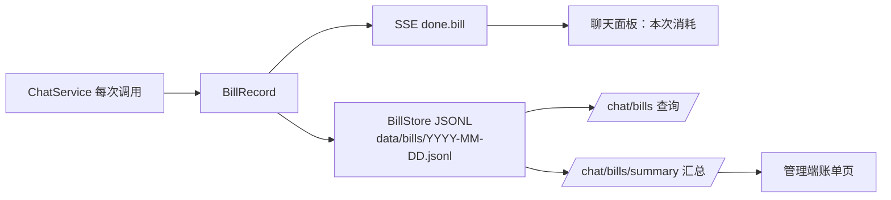

# 技术方案 — REQ-AGENT-0025 上下文账单可视化

- **需求 ID**：`REQ-AGENT-0025`
- **前置**：`REQ-AGENT-0017` / `REQ-AGENT-0022`

## 1. 总体结构



- **落盘**与**推送**是两条路：落盘给历史与汇总，推送给当前消息即时展示；
- 财报/计费类数据不依赖日志解析，直接来自 `ContextBill` 对象。

## 2. 数据模型

```json
{
  "ts": "2026-10-23T17:00:00+08:00",
  "traceId": "4e816198",
  "userId": 5,
  "conversationId": "conv-1",
  "round": 2,
  "model": "deepseek-flash",
  "fingerprint": "4b41a4976a6c",
  "estimateTotal": 12646,
  "kindTokens": {"SYSTEM": 2002, "SESSION": 10, "TOOL_CALL": 38, "TOOL_RESULT": 52},
  "toolsTokens": 10612,
  "toolCount": 74,
  "promptTokens": 12716,
  "cachedTokens": 12544,
  "hitRate": 98.6,
  "latencyMs": 1300,
  "toolNames": ["drone__device_list"]
}
```

- `round` 由 `BillStore` 按 traceId 递增（同一 trace 的多次调用）；
- 不记录消息正文、工具参数、工具结果、token；
- `kindTokens` 只保留非零类别，减少体积。

## 3. 后端改动

| 位置 | 改动 |
|---|---|
| `context/BillRecord` | 新增记录（不可变 record） |
| `context/BillStore` | 追加写 JSONL、按日文件、30 天清理、内存索引（最近 N 条） |
| `service/ChatService` | `logBill` 同处构造 `BillRecord` 并写入；SSE `done` 带本次摘要 |
| `controller/ChatBillController` | `GET /chat/bills`、`GET /chat/bills/summary` |
| `service/BillSummaryService` | 读取区间 JSONL，按天/类别/工具聚合 |

### 3.1 写路径

- `ChatService` 每次调用成功后写一条（失败也写：actual 为空、估算仍保留）；
- 写失败只记 WARN，不抛异常；
- 文件名 `bills-YYYY-MM-DD.jsonl`，追加写，单条一行。

### 3.2 接口

```text
GET /chat/bills?conversationId=&from=&to=&limit=50
  → 当前用户自己的记录（admin 可加 scope=all）

GET /chat/bills/summary?from=&to=&scope=self|all
  → {
      requests, promptTokens, avgContextTokens, avgHitRate,
      fingerprints: 1,
      byDay: [{day, promptTokens, cachedTokens}],
      byKind: [{kind, tokens}],
      topTools: [{tool, calls, tokens}]
    }
```

- 权限：`@RequirePermission("agent:chat")`；`scope=all` 需要 admin 角色；
- 响应沿用 `{state,message,data}`。

### 3.3 SSE

`done` 事件新增：

```json
{
  "type": "done",
  "reply": "...",
  "bill": {
    "promptTokens": 12716,
    "contextTokens": 12646,
    "cachedTokens": 12544,
    "hitRate": 98.6,
    "estimateTotal": 12646,
    "kindTokens": {"SYSTEM": 2002, "TOOL_DEFINITIONS": 10612, "SESSION": 10},
    "toolNames": ["drone__device_list"]
  }
}
```

面板直接用，不再二次请求。

## 4. 前端改动

### 4.1 聊天面板（`AgentChatPanel.vue`）

- 助手消息下方一行小字：`本次 11.6k token · 缓存 98.1% · 5 个工具`；
- 点击展开：分类条（系统 / 工具定义 / 会话 / 工具结果 / 摘要）与「累计轮次」；
- 数据来自 `done.bill`；历史消息无账单则不显示（不补算）。

### 4.2 管理端「助手账单」页

- 路由：`/agent/bills`，仅 admin；
- 筛选：今天 / 近 7 天 / 自定义；用户、会话；
- KPI 卡片：请求数、总 prompt、平均上下文、缓存命中率、前缀指纹数；
- 图表（echarts，已有依赖）：
  - 按天趋势：输入 token 与缓存命中（堆叠柱）；
  - 分类构成：系统 / 工具定义 / 会话 / 工具结果 / 摘要（横向柱）；
  - 工具调用 Top 10（按请求次数）；
- 表格：时间、用户、会话、轮次、工具数、上下文 token、命中率、指纹；
- 分页 + 导出 CSV（可选）。

## 5. 分阶段实施

| 阶段 | 内容 | 预计 |
|---|---|---|
| P1 | `BillRecord` + JSONL + `done.bill` + 面板消耗行 | 1 天 |
| P2 | 查询/汇总接口 + 管理端账单页 + 图表 | 1.5 天 |
| P3 | 配额告警（日 token 超阈值提示）、迁 DB（多实例） | 后续需求 |

## 6. 测试

| 层 | 内容 |
|---|---|
| 单元 | `BillStore` 追加/读取/过期清理；`BillSummaryService` 聚合口径 |
| 接口 | 自己的账单可见、跨用户 403、`scope=all` 需 admin |
| 前端 | 账单格式化（k/M）、展开/折叠、空数据不报错 |
| 手工 | 面板数值与日志一致；重启后账单页仍有历史 |

## 7. 风险与回滚

| 风险 | 触发 | 影响 | 应对 |
|---|---|---|---|
| 磁盘增长 | 长期运行 | 占空间 | 30 天保留 + 单条 <2KB；按天文件 |
| 写失败影响对话 | 磁盘满/权限 | 对话失败 | 写账单与主流程解耦，失败只 WARN |
| 多实例数据分散 | 横向扩容 | 汇总不全 | 本期单实例；后续迁 DB |
| 隐私 | 误存正文 | 合规问题 | 记录只含元数据；测试断言不含正文 |
| 回滚 | — | — | 关掉账单落盘开关即回到「只打日志」 |
