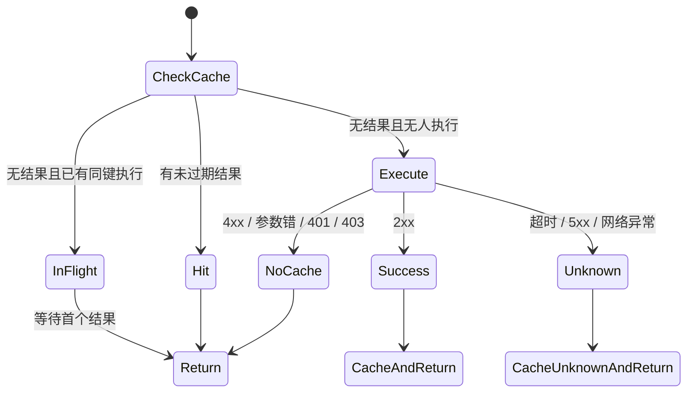

# 技术方案 — REQ-AGENT-0027 写工具幂等（MCP 转发层）

- **需求 ID**：`REQ-AGENT-0027`
- **前置**：`REQ-AGENT-0026`
- **落点选择**：`drone-mcp-server`（所有平台写工具都经过它，且它已经拿到 traceId）

## 1. 为什么放在 MCP 层

agent 侧的 `Tool.invoke` 没有「本次调用 id + 重试关系」的稳定标识，模型重试会生成新的
`tool_call_id`；放到 agent 层只能按「工具+参数」猜，且要改所有工具签名。
MCP 层同时具备 **traceId、工具名、参数、用户身份**，是幂等键的最佳位置。

## 2. 幂等键

```text
key = sha256(traceId + "|" + userId + "|" + toolName + "|" + canonical(args))
```

- `userId` 从 `Authorization` 解析（只用于分桶，不存 Token）；
- `canonical(args)`：对象字段递归排序后序列化，避免键顺序不同被当成两个操作；
- 数组保持原顺序（参数顺序通常有语义）。

## 3. 状态机



## 4. 缓存策略

| 上游结果 | 是否缓存 | 缓存内容 |
|---|---|---|
| 2xx 成功 | 是（10 分钟） | 原结果 |
| 超时 / 5xx / 网络异常 | 是（10 分钟） | 「写操作结果未知，请先查询确认，不要直接重试」 |
| 401 / 403 / 4xx | 否 | 原错误（下一次可修复后重试） |

- 仅写工具（`!spec.readOnly()`）参与；
- 读工具直接执行，不缓存；
- 缓存上限 2000 条，Caffeine 自动过期/淘汰；
- 并发同键：先到者执行，后来者等待并复用结果（最多等待上游超时 + 2 秒）。

## 5. 代码改造

| 位置 | 改动 |
|---|---|
| `drone-mcp-server/pom.xml` | 增加 Caffeine（Spring Boot 管理版本） |
| `invoke/IdempotencyStore` | 新增：缓存 + in-flight 去重 + 规范化参数哈希 |
| `invoke/ToolInvoker` | 拆出 `invoke(...) → Outcome`；写工具包一层幂等；超时/5xx 返回「未知」 |
| `ToolInvokerTest` | 新增 5 条：命中、超时未知、读不缓存、跨 trace、参数顺序无关 |

## 6. 日志

```text
【MCP-幂等】命中，跳过一次写操作：tool=..., traceId=..., user=...
【MCP-幂等】结果未知，已缓存：tool=..., traceId=..., 原因=超时
【MCP-幂等】并发重复，等待首个结果：tool=..., traceId=...
```

## 7. 风险与回滚

| 风险 | 影响 | 应对 |
|---|---|---|
| 合法重复写被吞 | 同一 trace 内重复派发只执行一次 | 刻意取舍；需要重复时新开请求（新 trace） |
| 缓存只在本进程 | 多实例/重启后失效 | 已知限制；后续迁 Redis/DB |
| 超时后下游实际成功 | 缓存「未知」，不重试 | 提示模型先查询确认，避免二次写 |
| 用户 id 解析失败 | 键退化为 trace+工具+参数 | 仍能防同 trace 重试；记录 debug |
