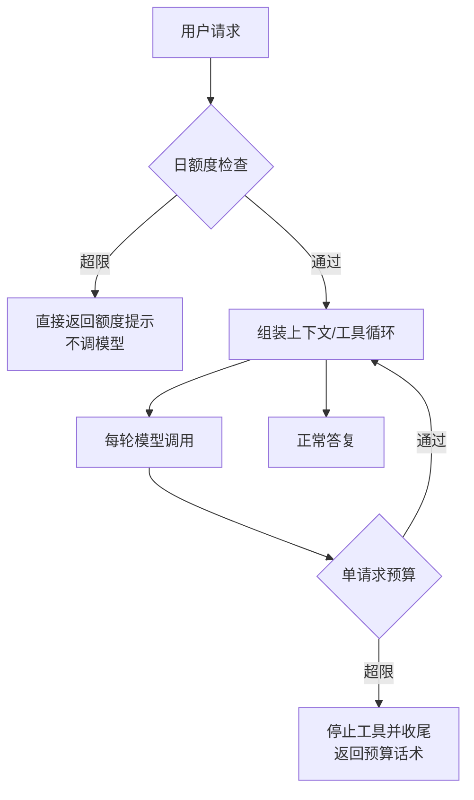

# 技术方案 — REQ-AGENT-0028 预算执行

- **需求 ID**：`REQ-AGENT-0028`
- **前置**：`REQ-AGENT-0017` / `REQ-AGENT-0025`

## 1. 两个检查点



- **日额度**在请求入口检查，超限直接拒绝（不再产生任何模型调用）；
- **单请求上限**在每轮模型调用后检查，超限立即收尾，避免继续滚雪球。

## 2. 配置

```yaml
agent:
  budget:
    enabled: true
    max-request-tokens: 60000        # 单次问答累计 prompt token 上限
    max-daily-tokens-per-user: 500000 # 单用户当天累计上限
```

- 关掉 `enabled` 即回滚；
- 账单关闭时 `BillStore` 返回空数据，预算视为 0，不拦截（这条依赖写进配置注释）。

## 3. 代码改造

| 位置 | 改动 |
|---|---|
| `config/BudgetProperties` | 新增配置记录 |
| `config/BudgetConfig` | 注册 `BudgetService` |
| `budget/BudgetService` | 日额度 / 单请求检查；`noop()` 供测试 |
| `service/ConversationService` | 入口检查；超限直接返回提示；流式同样 |
| `service/ToolCallingService` | 每轮后检查；超限停止循环并返回话术 |
| `application.yml` | 新增 `agent.budget.*` |

### BudgetService

```java
record Check(boolean exceeded, long used, int limit, String scope) {}

Check checkDaily(long userId);          // BillStore.aggregate(userId, today)
Check checkRequest(String traceId);     // BillStore.summary(traceId)
```

- 只读，不写账单；
- 读文件异常：WARN + 返回未超限（可用性优先）。

### 超限话术

- 日额度：`今日智能助手额度已用完（已用 X / 上限 Y token），请明天再试或联系管理员。`
- 单请求：`本次请求的上下文预算已用完（已用 X / 上限 Y token）。我先收尾；请把问题拆小一点再试。`

## 4. 测试

| 验收条件 | 层级 | 位置 |
|---|---|---|
| AC-1 / AC-2 | 单元 | `ConversationServiceTest`：日额度超限不调模型 |
| AC-3 | 单元 | `ToolCallingServiceTest`：第一轮后超限 → 只调一次模型 |
| AC-4 | 既有用例 | 默认配置下全部通过 |
| AC-5 / AC-6 | 单元 | 关闭开关 / 无账单数据 → 不拦截 |
| AC-7 | 单元 | 账单数值不变；超限日志字段 |

## 5. 风险与回滚

| 风险 | 影响 | 应对 |
|---|---|---|
| 日额度误判 | 用户被挡 | 只统计当天 prompt；配置可调；超限日志可核对 |
| 账单文件损坏 | 预算不准 | 读取失败按 0 放行并 WARN，不挡用户 |
| 多实例计数分裂 | 额度翻倍 | 单实例已知限制；后续迁 DB |
| 收尾话术生硬 | 体验 | 明确告知「拆小问题」，不暴露内部实现 |
