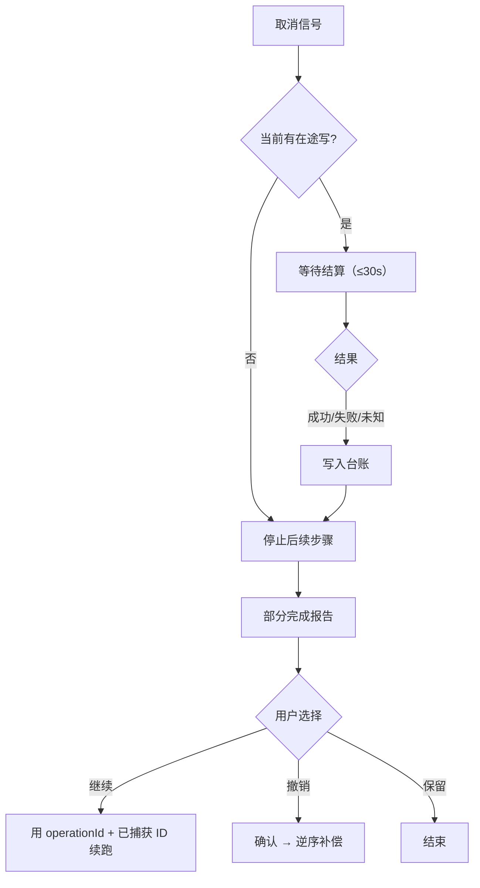
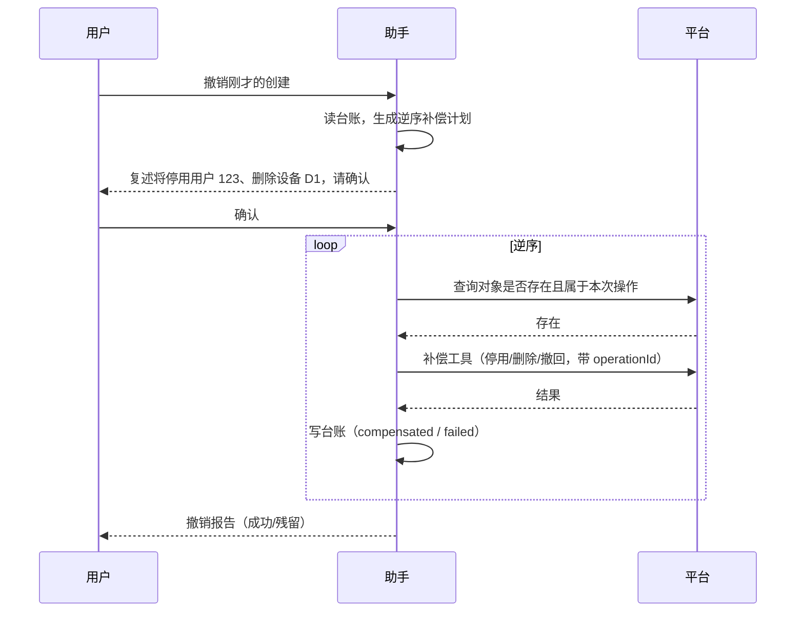

# 技术方案 — REQ-AGENT-0029 工具 Harness：可取消与待确认持久化

- **需求 ID**：`REQ-AGENT-0029`
- **前置**：`REQ-AGENT-0006` / `REQ-AGENT-0026` / `REQ-AGENT-0027`
- **状态**：方案设计，待评审

## 1. 总体思路



核心顺序：**先停调度 → 再结算在途 → 再报告 → 最后才谈撤销**。

## 2. 四个新组件

### 2.1 `CancellationRegistry`

- **键用 `conversationId`**：会话锁保证同一会话至多一个在途请求，
  frontend 本来就持有 conversationId；traceId 要到 `done` 才回传，来不及中途取消；
- 记录 `conversationId → (traceId, signal)`（Caffeine，30 分钟过期）；
- `POST /chat/cancel {conversationId}`：校验会话属于当前用户，置位并立即返回；
- 请求结束时清理；对已完成/不存在的请求返回「已完成或不存在」；
- 客户端断开也置位（SSE 写失败时）；
- 信号只置位，不做业务动作。

### 2.2 `WriteJournal`（写操作台账）

每条写步骤一行 JSONL（`data/operations/YYYY-MM-DD.jsonl`）：

```json
{
  "operationId": "op-uuid",
  "traceId": "4e816198",
  "userId": 5,
  "tool": "drone__user_add",
  "argsDigest": "sha256:…",
  "status": "started|succeeded|failed|unknown|cancelled",
  "objectId": "123",
  "ts": "2026-10-26T…"
}
```

- `operationId` 在执行前生成，**跨请求稳定**，用于续跑与补偿去重；
- 只存参数哈希与对象 ID，不存完整参数（可能有手机号）；
- 台账是报告与补偿的唯一依据。

### 2.3 `CancellationReport`

```json
{
  "cancelled": true,
  "completed": [{"tool":"drone__user_add","operationId":"op-uuid","objectId":"123","summary":"已完成"}],
  "failed": [],
  "notStarted": [{"tool":"drone__device_add","summary":"未执行"}],
  "unknown": [],
  "options": ["continue", "revoke", "keep"],
  "resumeToken": {
    "operations": [
      {"tool": "drone__user_add", "operationId": "op-uuid", "argsDigest": "3f2a…"}
    ],
    "captured": [
      {"tool": "drone__user_add", "objectId": "123", "operationId": "op-uuid"}
    ]
  }
}
```

- 成功 / 失败 / 未知三分：`failed` 表示业务错误、**确定未生效**；
  `unknown` 表示超时 / 5xx / 网络异常、**可能已生效**，只能先查询再决定；
- 只列写工具；读工具没有业务副作用，不进报告；
- `operations` / `captured` 用**列表**：同一工具多次调用各记一条；
  续跑按「工具 + 参数摘要」把每次调用对回自己的 `operationId`；
- 流式通过 `done.report` 下发；
- 面板渲染成卡片，按钮对应「继续 / 撤销 / 保留」；
  `resumeToken.captured` 为空时不给「撤销」（没有对象 ID，补偿计划无从生成）。

### 2.4 `PendingActionStore` 持久化

当前票据只在 `ConcurrentHashMap` 里，5 分钟 TTL，重启即丢。改为「内存 + 文件」双层：

```text
<root>/<userId>/<pendingId>.json
{
  "id": "...", "userId": 5, "conversationId": "conv-1",
  "toolName": "drone__user_toggle", "argumentsJson": "...",
  "messages": [ ... ], "assistantFrame": { ... },
  "dangerousCallId": "call_1", "createdAt": "2026-10-26T...", "traceId": "..."
}
```

- **写**：先写临时文件，再 `ATOMIC_MOVE` 改名；失败只 WARN，保留内存票据；
- **读**：启动时扫描目录，加载未过期票据；坏文件删除并 WARN；
- **消费**：确认/拒绝时先原子删除文件（或移动到 `.consumed`），再执行；
  并发确认只有一个能删成功——**最多执行一次**；
- **取消**：按 `userId + conversationId` 删除票据；
- **查询**：`GET /chat/pending?conversationId=` 返回票据元数据（id、工具、摘要、过期时间），
  不含消息正文；面板重启后据此恢复确认框；
- **TTL**：沿用 `agent.tool.pending-ttl`（默认 5m，可调大），启动与访问时清理过期文件；
- **隐私**：不含 JWT；文件权限尽量 600；消费/过期/取消即删除。

> 【取舍】是「最多一次」而不是「恰好一次」：删文件后、执行前崩溃，操作不会执行。
> 对危险操作来说，漏执行比重复执行安全。

## 3. 取消检查点

| 位置 | 动作 |
|---|---|
| 每轮开始时 | 已取消 → 不再调模型 |
| 模型调用在途 | 不强行断开；本轮返回后停止（流式在回调里停止读取） |
| 每个工具执行前 | 读工具：跳过；写工具：不开始 |
| 在途读 | 立即放弃等待，结果丢弃（读无副作用，不会留下半成品） |
| 在途写 | 不中断；等待结算（工具超时 15s < 30s 宽限），超时/5xx 记 `unknown` |
| 客户端断开 / SSE 超时 | 置位取消信号；在途写等结算，后续工具不再开始 |
| 等待危险确认 | 取消时作废票据（按会话删除 PendingAction），后续确认不执行 |
| 启动时 | 加载未过期票据；过期/坏文件清理；面板可查询恢复 |
| 工具返回后 | 写台账（成功/失败/未知） |
| 收尾 | 生成 `CancellationReport` |

> 【为什么写操作不强行中断】HTTP 请求可能已经到达下游并提交；中断只会让我们**丢失结果**，
> 并不能保证业务没发生。等待结算 + 如实记录，才是可解释的语义。

## 4. operationId 与幂等

当前 `REQ-AGENT-0027` 的幂等键是 `traceId + 用户 + 工具 + 参数`。
取消后「继续」是一个**新请求（新 trace）**，按 trace 幂等会重复创建。

调整为：

```text
幂等键 = operationId + 用户 + 工具 + 参数
```

- `operationId` 在写步骤**执行前**生成并写入台账；
- 续跑时从 `resumeToken.operations` 按「工具 + 参数摘要」找回原 operationId；
  同一工具多次调用各记一条，不按工具名整把覆盖；
- 同一 operationId 的重试被 MCP 幂等层复用结果，不重复创建；
- `ChatRequest` 增加可选 `resumeToken`（不放进自然语言消息，避免模型改写）。

## 5. 补偿（撤销）流程



- 补偿工具映射放在**工具元数据**（`agent.tool.catalog` 的新字段或独立配置），不在代码里硬编码；
- 写步骤的 `objectId` 优先按工具元数据声明的结果字段路径提取（如 `data.id`）；
  没声明或结果未知时留空，补偿前按业务唯一键查询确认；
- 补偿动作多数是危险操作，仍走人工确认；
- 先查后改：查不到、或发现对象不是本次创建 → 停止，不猜；
- 补偿失败立即停，返回「哪些撤了、哪些没撤、需要人工处理什么」。

## 6. 针对「用户 + 设备」的具体建议

| 方案 | 适用 | 代价 |
|---|---|---|
| **部分提交 + 报告**（本方案默认） | 两步不是强原子关系 | 用户可能留下一个「没设备」的用户，但可继续/停用 |
| **事务型批量接口** | 业务要求「要么全成、要么全不成」 | 需在 `drone-server` 新增端点 + DB 事务，另立需求 |
| **草稿/两阶段** | 复杂流程、需长时间人工填写 | 改造最大，本期不做 |

> 结论：默认采用「部分提交 + 报告」；如果业务明确要求原子性，再为「用户+设备」这类组合做事务接口，
> 不要用自动删除去假装事务。

## 7. 分阶段实施

| 阶段 | 内容 | 预计 |
|---|---|---|
| P0 | 取消信号 + 检查点 + 在途等待 + 台账 + 部分报告（**不回滚**） | 1.5 天 |
| P0 | **待确认票据持久化** + 启动加载 + 取消作废 + 查询恢复 | 1 天 |
| P1 | operationId 幂等 + 「继续」续跑 + 撤销确认流程 | 1.5 天 |
| P2 | 工具元数据里的补偿映射 + 通用 saga 执行 + 事务型接口（按需） | 2 天 |

## 8. 代码改造清单（P0）

| 位置 | 改动 |
|---|---|
| `controller/ChatController` | `POST /chat/cancel`；SSE `done` 带取消报告 |
| `service/CancellationRegistry` | 会话 → 信号；归属校验 |
| `service/ToolCallingService` | 循环检查；写工具在途等待；写台账；模型在途不发起下一轮 |
| `service/ConversationService` | 取消时生成报告并持久化已生成回复；作废待确认票据 |
| `tool/PendingActionStore` | 文件落盘/启动加载/原子消费/按会话作废/查询 |
| `config/ToolProperties` / yml | 新增 `pending-root`、`pending-ttl` |
| `journal/WriteJournal` | 写操作台账 JSONL |
| `dto/CancellationReport` / `ChatRequest` | 报告结构；resumeToken |
| `controller/ChatController` | `GET /chat/pending?conversationId=` |
| 前端 | 停止按钮；取消报告卡片；面板打开时查询待确认并恢复确认框 |

## 9. 风险与取舍

| 风险 | 影响 | 应对 |
|---|---|---|
| 取消来得太晚 | 写已完成 | 如实报告「取消未生效」，不假装回滚 |
| 在途写结果未知 | 无法判断是否创建 | 标记 unknown，提示先查询；补偿前必须查 |
| 自动删除误伤 | 数据丢失/级联 | **不自动回滚**；撤销需显式确认 |
| 补偿失败 | 残留部分状态 | 停止并报告残留，转人工 |
| 多实例 | 取消信号/台账不共享 | 本期单实例；后续迁 Redis/DB |
| 用户预期「取消=撤销」 | 体验落差 | UI 文案明确：「停止不会撤销已完成的步骤」 |
| 取消请求找不到活动请求 | 已结束/已过期 | 返回「已完成或不存在」，不报错 |
| 待确认票据未作废 | 取消后又执行 | 取消时按会话删除票据；确认接口再校验票据存在 |
| 对象 ID 未捕获 | 补偿找不到对象 | 按业务唯一键查询；仍不确定则转人工，不猜 |
| 票据落盘失败 | 重启丢票据 | 只 WARN，内存降级；不阻断当前确认 |
| 票据文件损坏 | 无法确认 | 启动时删除并 WARN；用户重新发起操作 |
| 票据删除后崩溃 | 操作未执行 | 最多一次语义，用户重新发起；不会重复执行 |
| 票据含用户内容 | 隐私 | 仅存于 data/（不入库不提交），600 权限，TTL 删除 |
