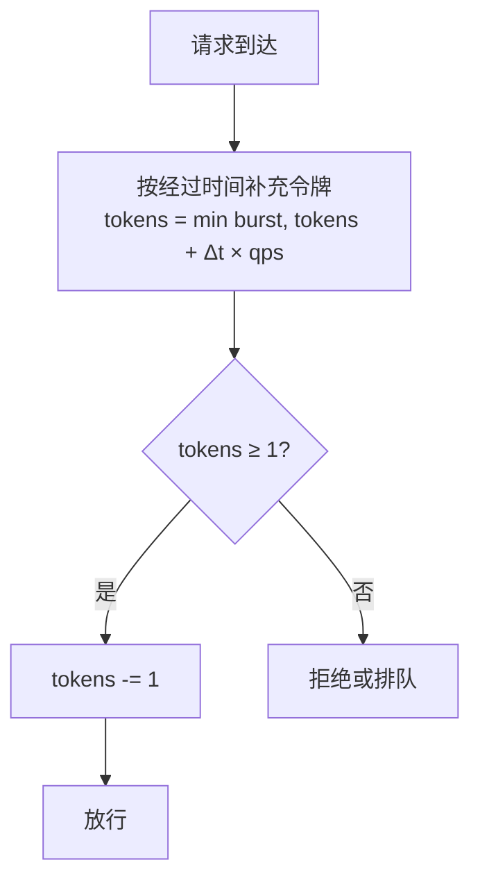
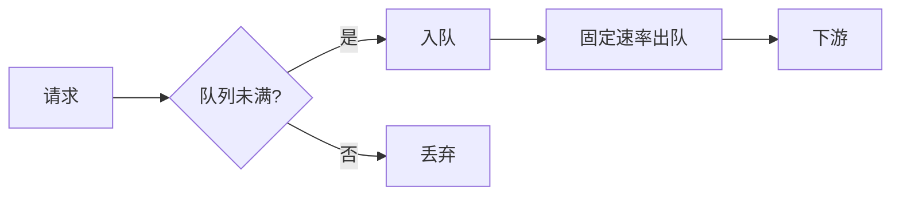
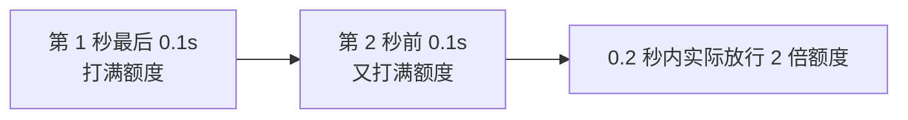
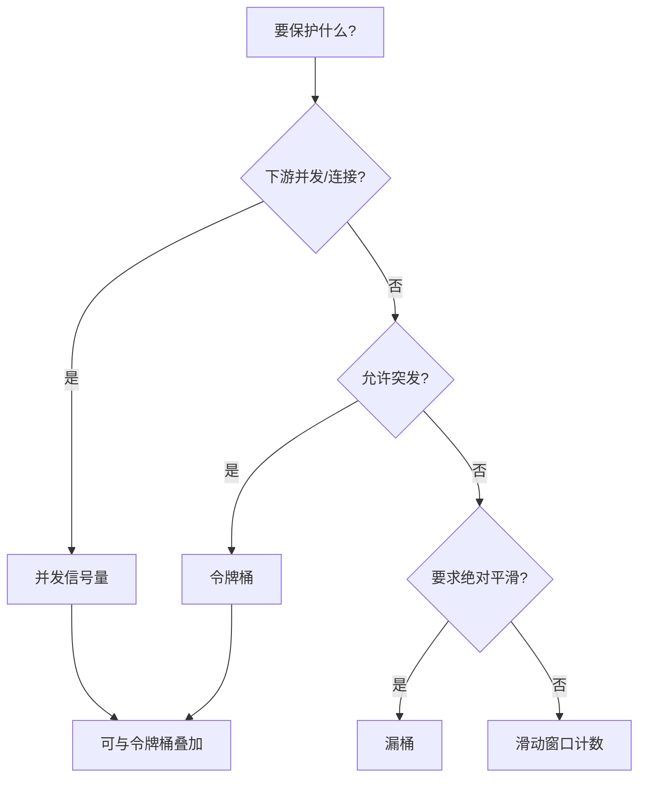
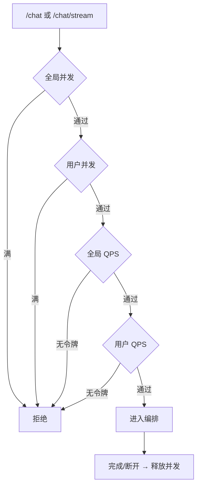
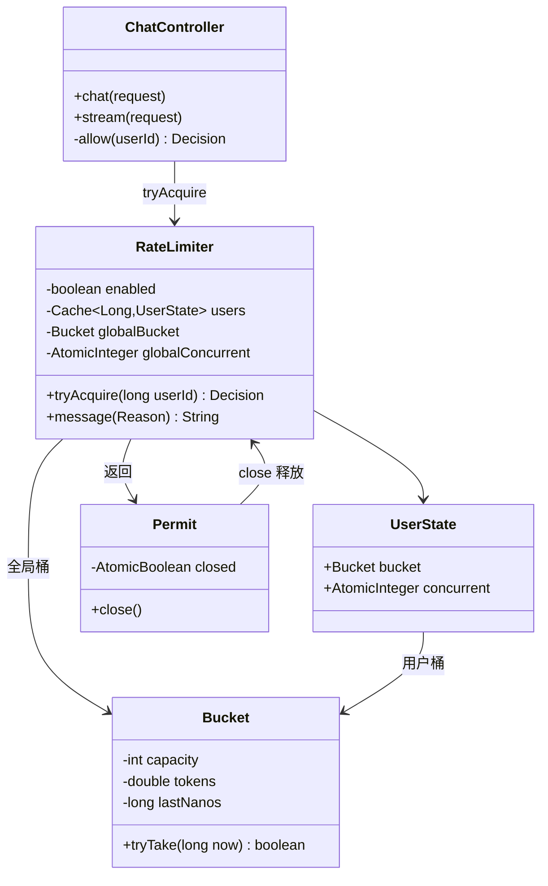
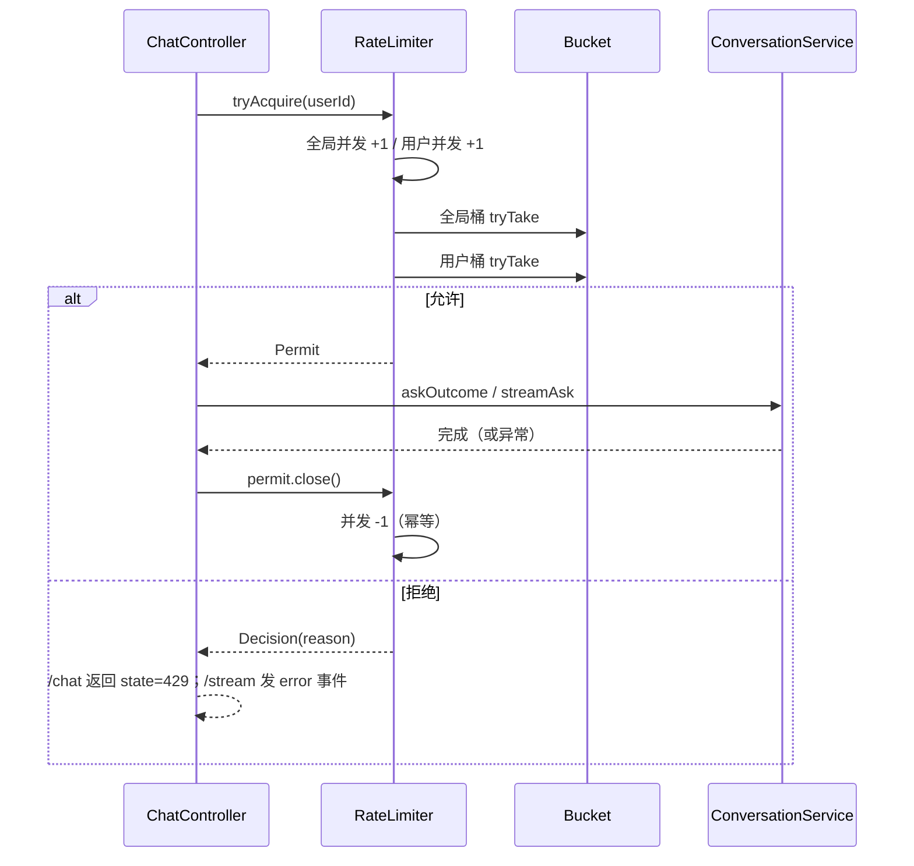

# 技术方案 — REQ-AGENT-0030 请求限流

- **需求 ID**：`REQ-AGENT-0030`
- **前置**：`REQ-AGENT-0028`

## 1. 概念：限流到底在限什么

限流不是「把请求变慢」，而是**在入口决定哪些请求现在可以进来**。
它有三个不同维度，不能混为一谈：

| 维度 | 限制什么 | 本项目 |
|---|---|---|
| **速率** | 单位时间允许多少请求 | 令牌桶（QPS + burst） |
| **并发** | 同一时刻允许多少请求在处理 | 计数信号量 |
| **配额** | 一段时间内总共允许多少用量 | 预算（REQ-0028，按天 token） |

### 1.1 常见算法

**固定窗口计数器（Fixed Window）**
把时间切成 1 秒一格，每格计数，超过就拒绝。
实现最简单；缺点是**窗口边界**：第 1 秒最后 0.1 秒和第 2 秒前 0.1 秒各打满，
实际 0.2 秒内放进了 2 倍额度。

**滑动窗口日志（Sliding Window Log）**
记录每个请求的时间戳，检查「最近 1 秒」内的条数。
精确；缺点是每个用户要存一串时间戳，内存随 QPS 增长。

**滑动窗口计数（Sliding Window Counter）**
把固定窗口与加权平均结合：当前窗口计数 + 上一窗口计数 × 重叠比例。
折中方案，精度足够、内存小；实现比固定窗口复杂一点。

**令牌桶（Token Bucket）**
桶里有令牌，按 `QPS` 匀速补充，容量为 `burst`；请求来了取一个令牌，取不到就拒绝/等待。
- **允许突发**：空闲一段时间后桶是满的，可以连续放 `burst` 个；
- **长期平均**受 `QPS` 约束；
- 交互式场景最常用。

**漏桶（Leaky Bucket）**
请求先进入队列，按**固定速率**流出；队列满就丢弃。
- **输出绝对平滑**，不允许突发；
- 代价是排队延迟；适合「下游只能承受恒定速率」的场景（如写数据库、调第三方）。

**并发信号量（Concurrency Limit）**
只限制「同时处理的数量」，不管速率；请求完成就释放。
它保护的是**下游连接数/线程数**，与 QPS 是两件事：
一个慢请求占着位置，QPS 没超也会把并发打满。

除了上面几种基础算法，工程上还有几类**变体**，面试里经常被追问：

**自适应并发限流（Adaptive Concurrency）**
并发上限不是写死的，而是根据**延迟/排队**动态调整：延迟升高就降并发，恢复后再升
（TCP Vegas、Netflix concurrency-limits 都是这个思路）。
适合「下游容量未知或波动」的场景；实现复杂，需要可靠的延迟反馈，本项目暂不做。

**分级 / 优先级限流**
按用户等级、接口重要性分配不同额度；过载时优先拒绝低优先级请求。
多租户 SaaS 常见；本项目当前只有单一大类额度，暂不做。

**预热（Warm-up）**
服务刚启动时逐步放量，避免冷缓存、连接池未热时被瞬时流量打垮。
可与令牌桶组合：初始 burst/速率小，随时间升到目标值；本项目暂不做。

**分布式限流**
单机限流在多实例下额度会翻 N 倍。常见做法是**网关统一限流**，
或 **Redis + Lua** 原子扣减令牌（把桶状态放 Redis，脚本保证「读-算-扣」原子）。
本项目单实例先做本地最后一道；上多实例时必须补这一层。

### 1.2 流程图

**令牌桶**



- `burst` 是桶容量：空闲越久，最多攒到 `burst`；
- 长期放行速率不会超过 `qps`；
- 本项目取「拒绝」，不排队。

**漏桶**



- 出口速率恒定，天然平滑；
- 代价是排队延迟，队列满了才丢弃；
- 适合「下游只能承受恒定速率」的写库/第三方调用。

**固定窗口的边界问题**



**怎么选：一张决策图**



> 本项目的答案是 **E + C 叠加**：令牌桶管速率与突发，并发信号量管同时在飞。

### 1.3 对比

| 算法 | 允许突发 | 输出平滑 | 内存 | 主要缺点 |
|---|---|---|---|---|
| 固定窗口 | 边界处可 2 倍 | 否 | 极小 | 临界突刺 |
| 滑动窗口日志 | 受窗口约束 | 较好 | 随请求数增长 | 内存大 |
| 滑动窗口计数 | 受窗口约束 | 较好 | 小 | 近似，非精确 |
| **令牌桶** | **是（burst）** | 平均平滑 | 小 | 参数要调 |
| 漏桶 | 否 | **最平滑** | 队列大小 | 排队延迟 |
| 并发信号量 | 不涉及 | 不涉及 | 极小 | 不限制速率 |

### 1.4 本项目为什么选「令牌桶 + 并发」

1. **问答是交互式的**：用户偶尔连发两条是正常行为，漏桶会把它排队变慢；
   令牌桶允许 `burst` 范围内的突发，体验更自然。
2. **只有 QPS 不够**：模型调用可能几秒到几十秒，QPS 没超也会堆满线程；
   所以再加并发上限，保护模型连接与执行器。
3. **不排队**：排队会把延迟变成不可控，用户不知道要等多久；
   直接拒绝 + 明确话术，让用户立刻知道「稍后再试」。
4. **先做本地最后一道**：单实例内存实现最简单；分布式部署时由网关/Redis 做全局限流，
   本地限流仍可作为兜底。

### 1.5 参数怎么读

以默认值为例：

```yaml
user-qps: 2
user-burst: 4
user-concurrency: 2
```

- **空闲后**：桶是满的，用户可连续发 4 条（burst）；
- **持续发**：长期平均 2 条/秒；
- **同时在处理**：最多 2 条，第 3 条直接拒绝；
- `qps` 是**长期平均**，不是硬上限；`burst` 是瞬时容忍；`concurrency` 是硬上限。

### 1.6 和预算、熔断、排队的区别

| 机制 | 解决的问题 | 触发后 |
|---|---|---|
| **限流** | 入口请求太多 | 拒绝新请求 |
| **预算** | 一段时间总 token 太多 | 拒绝/收尾 |
| **熔断** | 下游已经故障 | 暂时不再调用下游 |
| **排队** | 想尽量不丢请求 | 延迟处理 |
| **重试** | 偶发失败 | 再试一次 |

限流是**主动控制入口**；熔断是**被动保护下游**；预算管**成本**；四者不能互相替代。

### 1.7 常见误区

- **只限 QPS 不限并发**：慢请求会把线程/连接占满，QPS 看起来正常，实际已经堆积；
- **只限并发不限 QPS**：快请求可以瞬间刷爆下游；
- **固定窗口当令牌桶**：窗口边界会出现 2 倍突刺；
- **本地限流当分布式限流**：多实例部署时每个实例各有一份额度，实际是 N 倍；
- **拒绝没有话术/日志**：用户不知道为什么失败，排障也不知道是限流还是故障。

## 2. 结构

### 2.1 检查流程



### 2.2 组件结构



- 每个用户一个 `UserState`（桶 + 并发计数），放在 Caffeine 里（10 分钟不活跃过期）；
- 全局只有一个桶和一个并发计数；
- `Permit` 持有 `UserState` 引用，即使缓存过期也能正确释放。

### 2.3 请求时序



- 非流式：`finally` 里释放；
- 流式：`onCompletion` / `onError` / `onTimeout` 三处释放；
- 释放是**幂等**的：完成回调与异常回调可能都触发，CAS 保证只减一次。

### 2.4 为什么是这个检查顺序

1. **先并发、后 QPS**：并发是硬保护，判断只是原子加一；
   令牌是消耗品，先扣令牌再发现并发满了，会白白损失令牌。
2. **先全局、后用户**：整体过载时先保护全局；全局拒绝后不再碰用户状态。
3. **令牌不回收**：用户 QPS 拒绝时，全局令牌已经扣掉——这是刻意偏保守，
   宁可少放一个请求，也不让「被用户级拒绝的请求」继续消耗全局额度。
4. **在会话锁之前检查**：被拒请求不占会话锁、不写会话、不调模型，失败代价最小。

### 2.5 与现有链路的关系

```text
鉴权 → 限流 → 预算（日额度）→ 会话锁 → 上下文组装 → 工具循环
```

- 限流在最前：挡突发；
- 预算在其后：挡总量；
- 会话锁只保护「同一会话串行」，不负责全局并发——限流补上这一层。

## 3. 实现

| 类型 | 职责 |
|---|---|
| `rate/RateLimitProperties` | 配置：开关、QPS、burst、并发 |
| `rate/RateLimiter` | 令牌桶 + 并发计数；`tryAcquire(userId)` 返回 Permit 或拒绝原因 |
| `rate/RateLimiter.Permit` | `AutoCloseable`，幂等释放并发 |
| `ChatController` | 入口检查；流式在 emitter 完成/异常/超时释放 |

### 令牌桶

- 每用户一个桶（Caffeine，10 分钟过期，上限 1 万用户）；
- 全局一个桶；
- 容量 = burst，补充速率 = QPS/秒；
- 使用 `System.nanoTime()`；测试注入可控时钟。

### 并发

- `AtomicInteger`；先全局后用户，任一失败立即回滚已加计数；
- Permit 用 `AtomicBoolean` 保证只释放一次。

## 4. 拒绝话术

- 用户 QPS：`请求太频繁，请稍后再试（当前限制 X 次/秒）。`
- 用户并发：`你已有 N 个请求在处理，请等其中一个完成后再试。`
- 全局：`当前使用人数较多，请稍后再试。`

## 5. 测试

| 用例 | 断言 |
|---|---|
| 令牌桶 | 同刻第二请求拒绝；推进时钟后恢复 |
| 用户并发 | 占满后拒绝；释放后可进 |
| 全局并发 | 跨用户共享上限 |
| 关闭开关 | 永不拒绝 |
| Permit 幂等 | 重复 close 不把计数减成负数 |

## 6. 风险

| 风险 | 应对 |
|---|---|
| 流式未释放并发 | emitter 三个回调都挂 release；单元测 Permit |
| 时钟回拨 | 桶内 lastNanos 取 max，避免令牌暴涨 |
| 多实例额度翻倍 | 已知限制；后续网关/Redis |
