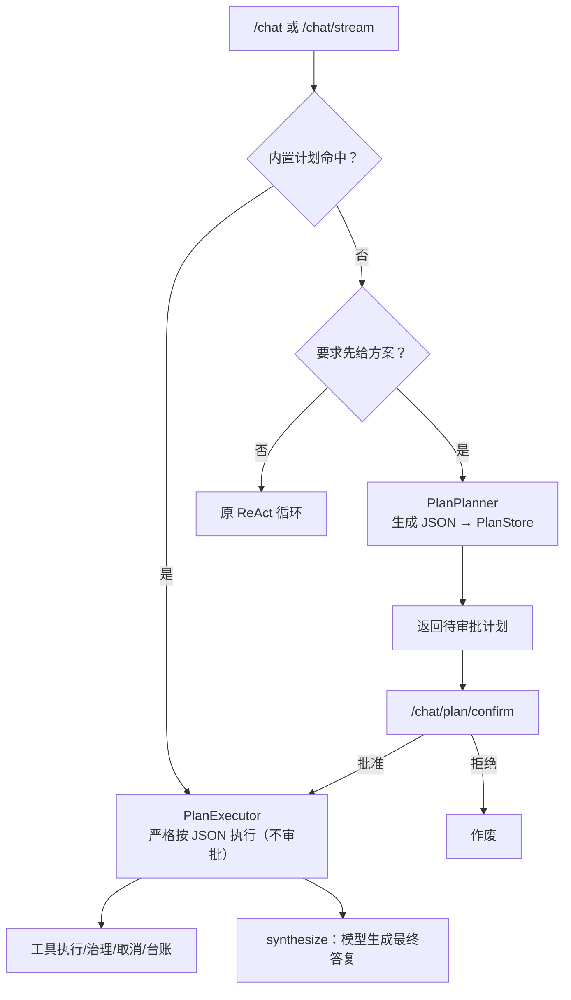

# 技术方案 — REQ-AGENT-0031 Plan 模式

- **需求 ID**：`REQ-AGENT-0031`
- **前置**：`REQ-AGENT-0014`、`REQ-AGENT-0029`、`ADR-0012`
- **状态**：已实现；**功能未测试**（407 条单测 + 一次手工冒烟，尚未沉淀为可重复 E2E）

## 1. 结构

## 2. 组件

| 类型 | 职责 |
|---|---|
| `plan/Plan` | 计划定义：name、origin、version、goal、triggers、steps |
| `plan/PlanStep` | 步骤：id、kind(TOOL/SYNTHESIZE)、tool、args、dependsOn、skill |
| `plan/PlanCatalog` | 加载 `classpath*:plans/*.json`；校验工具/依赖/环；按触发词匹配 |
| `plan/PlanStore` | 生成计划落盘：`data/plans/{userId}/{planId}.json`；TTL；原子消费 |
| `plan/PlanPlanner` | 调模型生成 JSON；解析/校验；拒绝未注册或无权限工具 |
| `plan/PlanExecutor` | 拓扑执行；只读并发、写串行；取消检查；synthesize |
| `plan/PlanSummary` | 给前端的计划摘要（步骤 + 状态） |
| `plan/PlanService` | 统一门面：匹配/生成/执行/审批；注入 ToolCallingService |
| `ChatController` | `/chat/plan/confirm`；SSE `plan` 摘要随 `done` 下发 |
| `AgentChatPanel` | 计划卡片：步骤、状态、批准/拒绝 |

## 3. 执行规则

- 依赖：步骤只能在其 `dependsOn` 全部 `DONE` 后调度；
- 并发：同一批 ready 步骤里，`registry.isReadOnly(tool)=true` 的并发（上限 `agent.plan.parallel`）；
- 写与 synthesize 串行；
- 每步执行前检查取消信号；取消后未执行步骤标 `SKIPPED`；
- 任一步失败：停止计划，返回已完成/失败/未执行；
- 参数解析：`${today.start}`、`${today.end}`、`${stepId}`（整个结果）与 `${stepId.field}`（简单 JSON 取值）；
- 每步写操作使用稳定 operationId：`plan-{planId}-{stepId}`，复用幂等；
- 危险工具：本期直接拒绝该计划（提示需要人工确认），不绕过确认；
  **这是 MVP 的实现限制，不是产品强制要求**；后续接入步骤级确认票据后可放开；
- 写操作：Planner 默认只做“完成用户请求所必需”的写步骤，但这条是建议；
  真正的强制边界是计划审批、RBAC、危险确认、预算/限流；
- 复用 `ToolCallingService.runTool` 的治理与追踪（新增 `invokeForPlan`）。

## 4. 生成计划

- 触发词：`先给方案`、`先给计划`、`先规划`、`plan`（消息包含即可）；
- Planner 输入：用户原话 + 工具目录（名称/描述/参数）+ 输出 JSON Schema；
- Planner 输出：同 Plan JSON；`origin=GENERATED`，`planId=UUID`；
- 校验：步骤非空、id 唯一、依赖存在、无环、工具已注册、角色允许；
- 落盘后返回 `PlanSummary(status=PENDING_APPROVAL)`，**不执行任何工具**。

## 5. 审批

- `POST /chat/plan/confirm`：`{conversationId, planId, approve}`；
- `PlanStore.take` 原子消费：同一 planId 只能批准/拒绝一次；
- 批准：执行计划，返回 `ChatResponse`（含 plan 摘要）；
- 拒绝：删除计划，返回“已拒绝”；
- 非流式本期实现；流式审批后续再做。

## 6. 前端

- `AgentPlan` 类型与 `AgentStreamDone.plan` / `AgentChatReply.plan`；
- `done.plan` 渲染步骤列表与状态；
- `status=PENDING_APPROVAL` 时显示「批准 / 拒绝」；
- 批准调用 `/agent/chat/plan/confirm`，把结果追加为助手消息。

## 7. 测试

| 层 | 用例 |
|---|---|
| 单测 | PlanCatalog 加载/触发/非法依赖；PlanStore TTL/归属/原子消费；PlanExecutor 顺序/并发/失败/取消/合成；PlanPlanner 非法工具拒绝 |
| 集成 | 日报内置计划不审批；生成计划未批准零执行；批准后执行；拒绝作废 |
| 回归 | 原 ReAct 路径、392 条单测保持不变 |

## 8. 风险

| 风险 | 应对 |
|---|---|
| Planner 编造工具/参数 | 注册表校验 + Schema + 执行前再校验 |
| 计划声明与执行不一致 | 执行器只执行计划步骤，记录偏差 |
| 计划执行慢 | 只读并发；synthesize 独立；后续流式审批 |
| 危险工具被计划绕过 | 本期直接拒绝；后续接待确认票据 |
| 与 ReAct 双路径漂移 | 共用工具执行/治理/取消/台账 |
