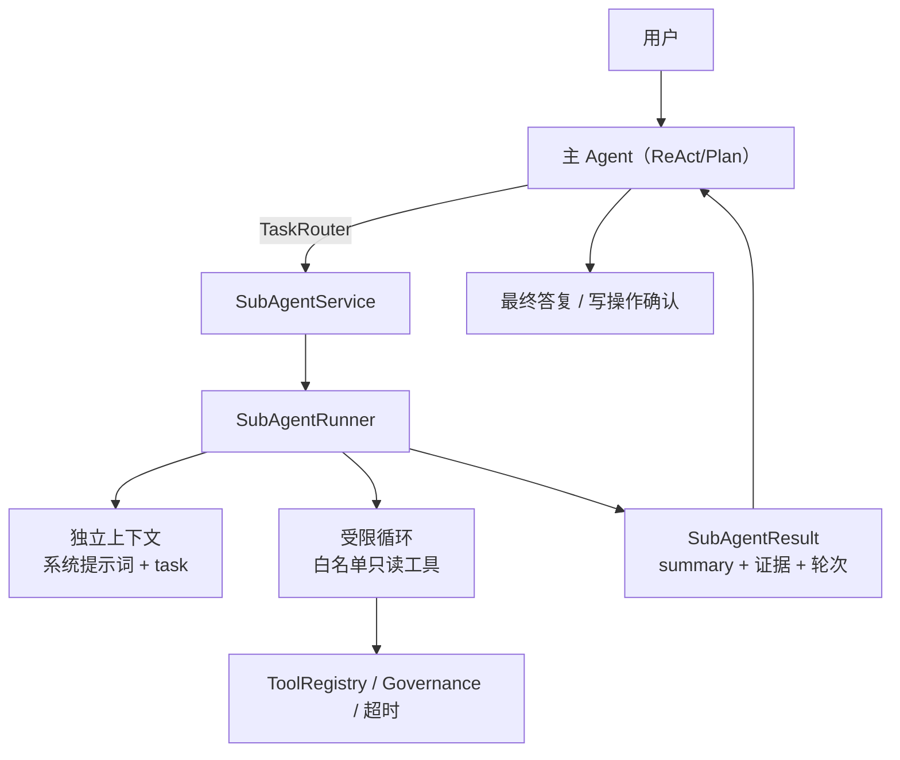

# 技术方案 — REQ-AGENT-0032 只读运营分析子 Agent

- **需求 ID**：`REQ-AGENT-0032`
- **前置**：`ADR-0013`、`REQ-AGENT-0031`
- **状态**：已实现 + 一次真实手工冒烟；尚未沉淀为可重复自动化 E2E

## 1. 结构

## 2. 组件

| 类型 | 职责 |
|---|---|
| `subagent/SubAgentDefinition` | name、description、tools、maxRounds、timeoutSeconds、readOnly、prompt（正文） |
| `subagent/SubAgentCatalog` | 加载 `classpath*:subagents/*.md`，解析 frontmatter + 正文；工具缺失只 WARN |
| `subagent/SubAgentRunner` | 独立上下文、受限 ReAct、白名单/只读/权限、轮次/超时/预算、trace |
| `subagent/SubAgentResult` | summary、rounds、toolCalls、elapsedMs、toolsUsed |
| `subagent/SubAgentService` | 按名字/default 执行子 Agent，供 `TaskRouter` 直接调用 |
| `config/SubAgentConfig` | 装配 Catalog / Runner / Tool |
| `resources/subagents/ops-analyst.md` | 运营分析子 Agent 定义（frontmatter + 正文提示词） |
| `prompts/subagent/ops-analyst.md` | 子 Agent 系统提示词 |

## 3. 执行规则

- 上下文：`system(子 Agent 提示词) + user(task)`，不读主对话；
- 工具定义：只下发 `definition.tools` 中的工具；
- 执行前校验：白名单、`registry.isReadOnly`、`governance.allows`、非危险；
- 单工具超时：`CompletableFuture.get(timeout)`，超时按失败回填；
- 轮次：`maxRounds`，超限返回“未完成”；
- 预算：每轮 `BudgetService.checkRequest(parentTraceId)`；
- trace：`subagent.run` span + 每轮 `subagent.model`/`subagent.tool`（可后续细化）；
- 结果：summary + 工具使用 + 轮次；不返回原始大段数据。

## 4. 接入主 Agent

> `REQ-AGENT-0033` 起，复杂只读任务由 `TaskRouter` 直接路由执行子 Agent；
> 不再向主模型暴露委派工具。

- `TaskRouter` 判断复杂只读 → `SubAgentService` → `SubAgentRunner`；
- `prompts/assistant/system.md` 不再维护委派路由规则（由代码路由负责）；
- 主 Agent 仍走原 ReAct/Plan；子 Agent 只是一个工具。

## 5. 约束

- 子 Agent **不能写**：定义必须 `readOnly=true`，Runner 逐工具再判；
- 不共享主对话，避免上下文污染；
- 子 Agent 的模型调用使用同一 traceId，账单可归因；
- 子 Agent 取消暂不能从主 Agent 穿透（本期限制）。

## 6. 测试

| 层 | 用例 |
|---|---|
| 单测 | Catalog 加载/校验；Runner 白名单、只读拒绝、轮次上限、超时、预算；Tool 参数解析 |
| 回归 | 主 Agent 工具目录仍为 74 个；原 ReAct/Plan 测试保持通过 |
