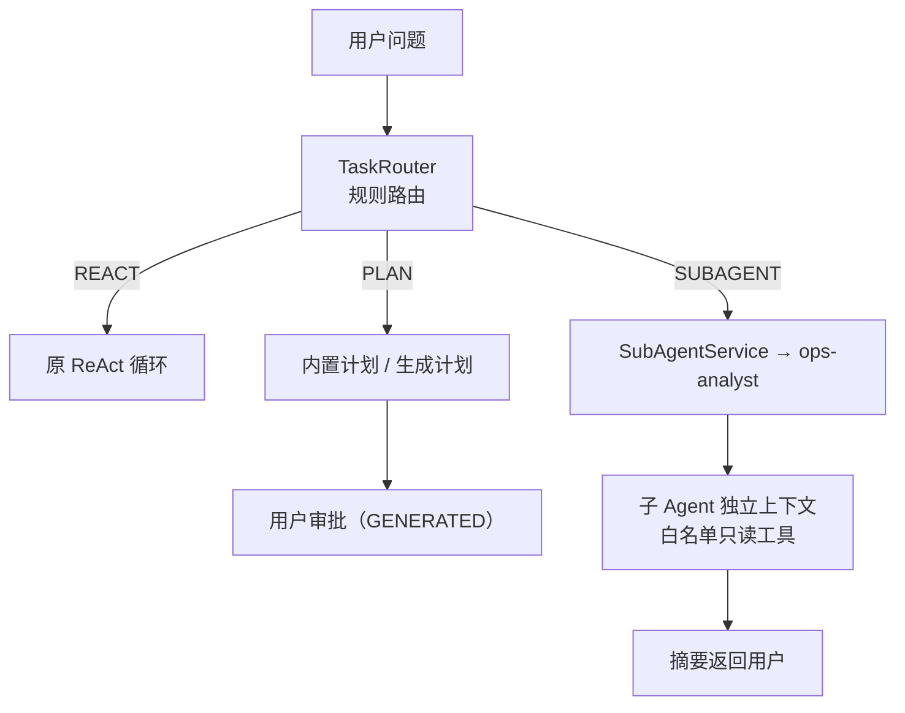

# 技术方案 — REQ-AGENT-0033 任务路由

- **需求 ID**：`REQ-AGENT-0033`
- **前置**：`ADR-0013`、`REQ-AGENT-0032`、`REQ-AGENT-0031`
- **状态**：已实现 + 一次真实手工冒烟

## 1. 结构

## 2. 组件

| 类型 | 职责 |
|---|---|
| `route/TaskRoute` | REACT / PLAN / SUBAGENT |
| `route/RouteDecision` | route、agent、reason、三个得分 |
| `route/TaskRouter` | 规则路由；无模型调用 |
| `subagent/SubAgentService` | 按名字/default 执行子 Agent |
| `config/RouteProperties` / `RouteConfig` | 开关与装配 |
| `ToolCallingService` | 按路由走三个分支；失败降级 |

## 3. 规则与得分

| 特征 | 影响 |
|---|---|
| 显式“先给方案/用子代理/直接查” | 直接决定路由 |
| 内置计划触发词 + 非知识问答 | PLAN |
| 知识/模板/文档类词 | REACT |
| 对比/分析/归因/趋势 | SubAgent +2 |
| 数据域（任务/告警/设备/…）≥2 | SubAgent +2；≥3 再 +1 |
| 逐条/下钻/所有/时间范围 | SubAgent +2 |
| 写操作词 | SubAgent −5，Plan +2 |
| 批量/多步写 | Plan +2 |
| 简单查询词 | SubAgent −3，ReAct +2 |

判定：

- `SUBAGENT`：可用子 Agent、SubAgent ≥4、数据域 ≥2、非写操作；
- `PLAN`：Plan ≥3、非简单查询、Plan ≥ ReAct；
- 其余 `REACT`。

## 4. 接入与降级

- 路由开启：
  - SUBAGENT → `SubAgentService.run()`；成功直接返回摘要；
  - PLAN → 内置计划直接执行；否则生成计划、等待审批；
  - REACT → 原循环。
- 子 Agent 失败/超时 → 降级 REACT，并向用户说明；
- Plan 生成失败 → 非“显式先给方案”时降级 REACT；显式要求时如实报错；
- 路由关闭 → 保留旧逻辑（显式计划 / 内置计划 / ReAct）。

## 4.1 子 Agent 预算

- 启动前：`agent.subagent.min-remaining-tokens`；主请求剩余额度低于该值 → 不启动；
- 运行中：`agent.subagent.max-prompt-tokens`；子 Agent 自身累计（相对启动基线）超过 → 停止；
- 任一预算触发都返回 `budget_exceeded`，路由层降级 ReAct；
- 子 Agent token 仍计入整条 trace 的 request 预算，避免“委派后总成本失控”。

## 5. 测试

| 层 | 用例 |
|---|---|
| 单测 | `TaskRouterTest`：复杂/简单、内置/知识、显式、写操作、简单查询 |
| 集成 | `ToolCallingServiceTest`：复杂只读走子 Agent、主模型未被调用 |
| 预算 | `SubAgentRunnerTest`：剩余额度不足时不启动 |
| 回归 | 原 ReAct/Plan/子 Agent 测试全部通过；工具目录 74 个 |
| 冒烟 | 真实 MCP + 模型：复杂走 SUBAGENT、简单走 REACT |
