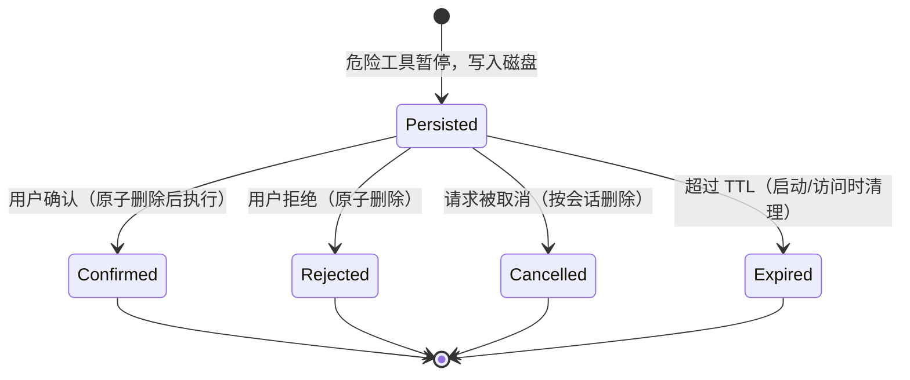
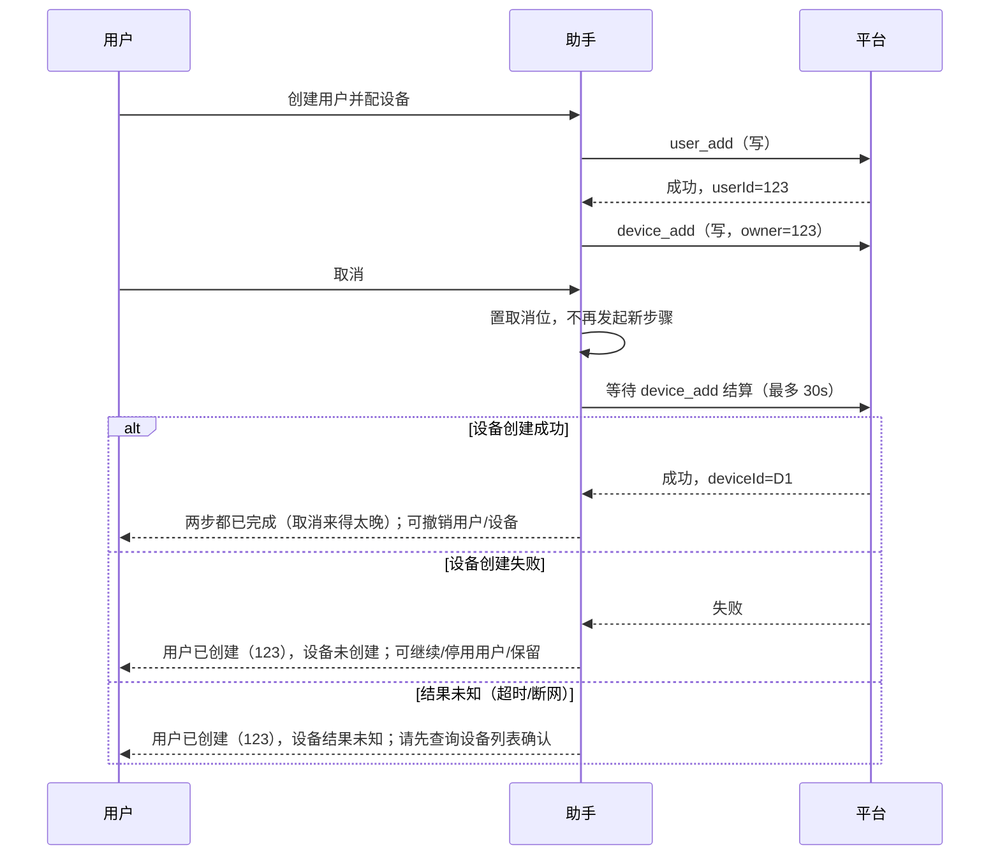

# 规格 — REQ-AGENT-0029 工具 Harness：可取消与待确认持久化

- **需求 ID**：`REQ-AGENT-0029`
- **提出人 / 日期**：需求方 / 2026-10-26
- **负责人**：AI（按 SDD 执行）
- **前置**：`REQ-AGENT-0006`（危险操作确认）、`REQ-AGENT-0026`（traceId）、`REQ-AGENT-0027`（写工具幂等）
- **状态**：方案设计，待评审

## 1. 背景与目标

典型场景：

> 用户：「创建一个用户，再给他配一台设备。」
> 第一步创建用户成功；第二步创建到一半，用户点了「取消」。

问题不是「怎么停」，而是**停下来之后怎么办**：

- 用户已经建出来了，设备没建——用户要不要删？
- 如果「取消」时设备其实已经建成功（只是响应慢），删不删？
- 自动删用户会不会连带删掉任务、告警、审计？
- 用户点取消，是「停止后续」还是「撤销全部」？

第二个 Harness 问题是**待确认票据只在内存**：

- 危险操作暂停后生成票据，5 分钟内不确认就过期；
- 服务重启/升级后，票据全丢，用户再点「确认」只会得到「票据不存在」；
- 长流程的人工审批（等主管、等现场确认）根本撑不过一次重启。

目标（两件事都属于「工具 Harness」：工具执行的状态与生命周期）：

1. 取消 = **停止后续步骤 + 等待在途写操作结算 + 如实报告已完成部分**；
2. **默认不自动回滚**；撤销必须由用户显式发起，并经过确认；
3. 为「撤销」提供受控的**补偿流程**（saga），每一步先查后改、可审计；
4. **待确认票据持久化**：重启后仍可确认；消费一次即失效；取消时作废；
5. 对真正的「要么全成、要么全不成」场景，给出事务型接口的边界建议。

## 2. 范围

### 做（In Scope）

- 取消信号：客户端断开 + 用户主动停止；
  主动取消按 **conversationId** 定位（会话锁保证同一会话至多一个在途请求，
  frontend 本来就持有 conversationId；traceId 在流结束才回传，来不及用于中途取消）；
- 循环在每个边界检查取消：轮次之间、每个工具执行前；
- 同一请求内的写操作**一次只允许一个在途**（现在已经是写串行），取消时等待其结算（宽限期）；
- 取消时**作废该会话的待确认票据**，避免用户随后点「确认」又执行已取消的操作；
- **待确认票据持久化**：
  - 票据（含续跑所需的消息快照与 assistant 帧）写入 `<root>/<userId>/<pendingId>.json`，
    原子落盘；
  - 启动时加载未过期票据；过期/损坏的清理；
  - 消费（确认/拒绝）时**先原子删除再执行**，保证最多执行一次；
  - `GET /chat/pending?conversationId=` 返回当前有效票据（不含消息正文），供面板在重启后恢复确认框；
  - 取消时按会话删除票据；
- 写操作台账（operationId、工具、参数摘要、结果、对象 ID、状态）；
- 取消后的**部分完成报告**：已做/未做/失败/结果未知（失败 = 确定未生效；未知 = 可能已生效）；
- 撤销（补偿）流程：用户显式发起、确认、逆序执行、先查后改、失败即停并报告残留；
- 部分报告里带 **resumeToken**（operationId + 已捕获对象 ID），供「继续」复用它、避免重复创建。

### 不做（Out of Scope）

- 不做自动回滚（无论取消还是超时）；
- 不做跨服务分布式事务（无 XA/2PC）；
- 不保证第三方副作用可撤销（如短信、外部系统通知）；
- 不改 `drone-server` 现有接口语义；事务型批量接口作为后续独立需求；
- 不做票据加密与跨实例共享（本期单实例；文件权限 600，TTL 后删除）。

## 3. 取消的语义（核心）

| 时点 | 读工具 | 写工具 |
|---|---|---|
| 未开始 | 直接不执行 | 直接不执行 |
| 执行中 | 放弃结果，安全 | **等待结算**（宽限期）；成功/失败/未知如实记录 |
| 已完成 | 无影响 | **保留结果**，不自动撤销；报告并给出选项 |

补充两类特殊时点：

- **模型调用在途**：不强行断开；本轮结果返回后立即停止，不再发起下一轮
  （流式则在回调里停止读取）；
- **等待危险操作确认**：取消时作废票据；之后点「确认」返回「已取消/已过期」，
  **不会执行**。

> 【原则】取消是「不再继续」，不是「当作没发生」。
> 自动删除用户的风险远大于「留下一个已创建的用户」：删除可能级联、可能违反业务约束、
> 也可能删错（超时场景下，我们并不确定它是否真的创建成功）。

## 4. 待确认票据的生命周期

- **重启恢复**：启动时扫描目录，加载未过期票据；过期/坏文件删除并 WARN；
- **最多执行一次**：消费前先 `move`/`delete` 票据文件；并发确认只有一个能成功；
- **失败策略**：落盘失败只 WARN、票据仍留在内存（本次可确认，重启会丢）；
- **隐私**：文件含会话消息与工具参数，但不含 JWT；目录 `data/` 已忽略提交，
  文件权限尽量设为 600；消费/过期/取消即删除。

## 5. 场景走查（创建用户 + 创建设备）

**不自动删用户**；报告里给出三个可执行选项：

1. **继续**：用已捕获的 `userId=123` 继续创建设备（新请求，携带 operationId 防重）；
2. **停用用户**：撤销的温和形式（`user_toggle` 停用），需确认；
3. **保留**：什么都不做（默认）。

## 6. 撤销（补偿）设计

- 只在用户明确说「撤销/删掉刚才那个用户」时触发；
- **逆序**执行（先撤设备，再撤用户）；
- 每步：
  1. **先查**：按唯一业务键（账号/设备编号）确认对象存在且是本次操作创建的；
  2. **再改**：调用补偿工具（停用/删除/撤回），带 operationId，幂等；
  3. **确认**：危险操作仍走人工确认；
  4. **失败即停**：不继续撤后面的步骤，报告残留；
- 不可撤销的步骤（已发通知、外部系统已受理）标记「需人工处理」。

补偿映射示例（后续落在工具元数据里，不在代码里硬编码）：

| 写操作 | 补偿 | 说明 |
|---|---|---|
| `user_add` | `user_toggle`（停用） | 优先停用而非删除，避免级联 |
| `device_add` | `device_delete` | 危险操作，需确认；失败则报告 |
| `task_dispatch` | `task_withdraw` | 已有业务语义 |
| `task_finish` | 无 | 不可逆，标记人工处理 |

## 7. 验收条件

| 编号 | 前置 | 操作 | 预期 |
|---|---|---|---|
| AC-1 | 尚未执行任何写操作 | 取消 | 不产生任何业务变更；返回「已取消」 |
| AC-2 | 用户创建成功、设备未开始 | 取消 | 设备不执行；报告「用户已创建、设备未创建」；**不自动删用户** |
| AC-3 | 设备写操作在途 | 取消 | 等待结算（≤30s）；成功/失败/未知如实报告 |
| AC-4 | 设备结果未知 | 取消后追问 | 助手建议先查询设备列表，不盲目重试/删除 |
| AC-5 | 用户明确要求撤销 | 确认后 | 逆序补偿；每步先查后改；失败停止并报告残留 |
| AC-6 | 补偿过程中再次取消 | — | 当前补偿步骤结算后停止，报告已撤/未撤 |
| AC-7 | 普通读工具 | 取消 | 立即停止，不等待 |
| AC-8 | 危险操作等待确认 | 取消后再点确认 | 票据已作废，不执行；提示「已取消」 |
| AC-9 | 请求已经结束 | 再取消 | 返回「已完成，无法取消」；不改变结果 |
| AC-10 | 部分完成报告 | 点「继续」 | 携带 resumeToken，复用 operationId/对象 ID，不重复创建用户 |
| AC-11 | 取消发生在模型调用中 | 取消 | 本轮结果返回后停止，不再发起下一轮 |
| AC-12 | 危险操作已暂停、票据已落盘 | 重启 agent 后确认 | 票据仍有效，确认可继续执行 |
| AC-13 | 同一票据 | 并发/重复确认 | 只执行一次，第二次返回「已处理或已过期」 |
| AC-14 | 票据超过 TTL | 确认 | 返回已过期；文件被清理 |
| AC-15 | 票据已落盘 | 取消会话 | 票据被删除，后续确认不执行 |
| AC-16 | 重启后打开面板 | 查看 | `GET /chat/pending` 返回有效票据，面板恢复确认框 |
| AC-17 | 落盘失败（磁盘满） | 生成票据 | 只 WARN；本次仍可在内存确认；重启丢失 |

### 非功能要求

- 取消请求本身要快（置位即返回），不等待业务步骤；
- 台账只记元数据（operationId、工具、对象 ID、状态），不记 Token/参数全文；
- 取消/补偿都要有审计日志，能回答「谁、何时、停了什么、撤了什么」。

## 8. 约束与依赖

- 写工具串行执行是前提（当前已满足）；若未来允许写并发，取消语义要重新定义；
- 需要 operationId（每次写步骤生成，跨请求稳定），用于续跑/补偿去重；
  当前幂等键基于 traceId，**续跑会换 trace**，因此需要把幂等键升级为 operationId；
- 平台接口不支持跨步骤事务；真正的原子性只能由 `drone-server` 提供事务型批量接口；
- 票据持久化是**最多一次**：消费前先删除文件，若进程在删除后、执行前崩溃，该操作不会执行；
- 票据含消息快照，属于用户内容，必须按 TTL 删除且不跨用户读取；
- 写步骤的 `objectId` 需要从工具结果里提取：优先用工具元数据声明的字段路径
  （如 `data.id`），没有声明时留空，补偿阶段按业务唯一键（账号/设备编号）查询确认。

## 9. 待定项

| 编号 | 问题 | 结论 | 决定人/日期 |
|---|---|---|---|
| Q-1 | 取消是否自动回滚 | **否**，需显式撤销 | 待评审 |
| Q-2 | 在途写等待宽限期 | 30 秒 | 待评审 |
| Q-3 | 用户撤销优先停用还是删除 | 优先停用；删除需单独确认 | 待评审 |
| Q-4 | 是否为「用户+设备」加事务接口 | 业务要求原子性时另立需求 | 待评审 |
| Q-5 | 票据 TTL | 默认 5 分钟；可配置（长审批可调大） | 待评审 |
| Q-6 | 落盘失败是否阻止生成票据 | 否，内存降级 + WARN | 待评审 |
| Q-7 | 是否加密票据 | 本期不做；靠目录权限 + TTL | 待评审 |
