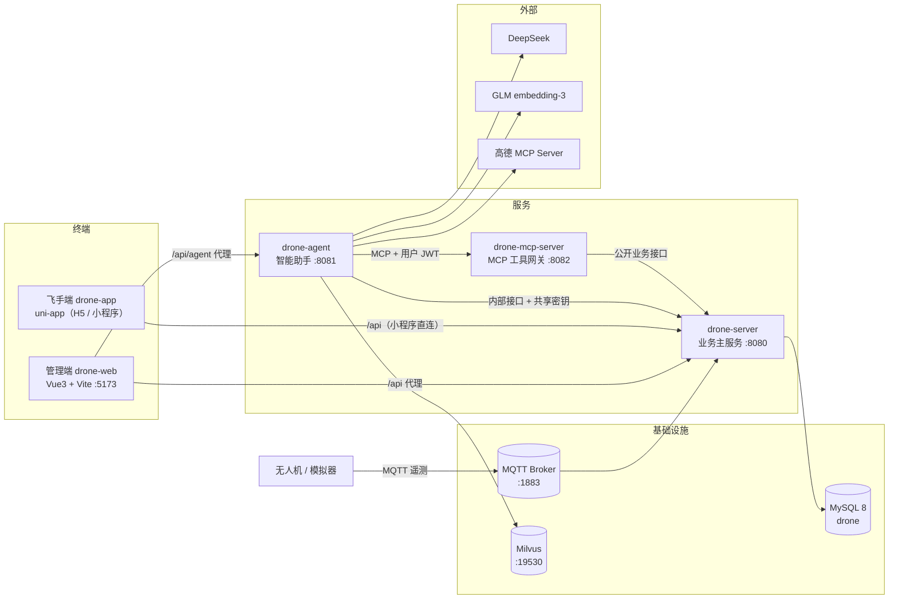
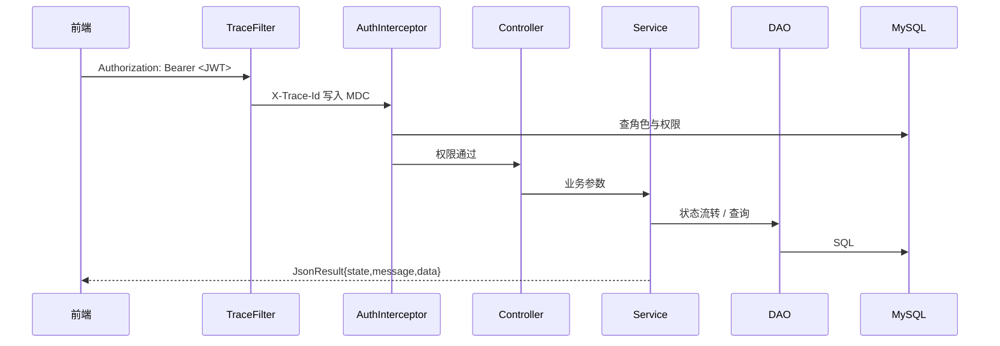
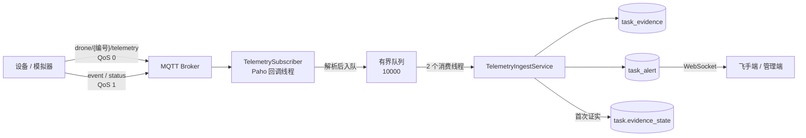
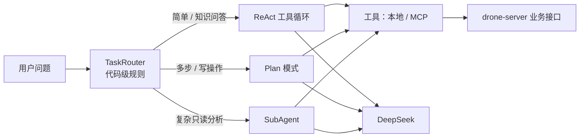

# drone 架构 Wiki

> 返回 [仓库 README](../../README.md)（环境、启动、账号、常用命令）。
>
> 这是一份**人工整理**的架构说明，面向第一次接手这个仓库的初级工程师。
> 它回答三个问题：**系统由谁组成、一次请求怎么走、要改东西该动哪里**。
>
> 与其它文档的分工：
>
> | 文档 | 回答什么 |
> |---|---|
> | 根目录 `README.md` | 怎么把项目跑起来（环境、建库、启动顺序、账号） |
> | 本 Wiki | 架构全貌、模块边界、关键链路、扩展点、已知限制 |
> | `docs/sdd/` | 需求怎么做：spec / plan / task、编码规范、ADR |
> | `drone-server/docs/` | 业务域的设计取舍（任务、告警、MQTT、大屏……） |
> | `drone-agent/docs/` | 大模型相关专题手册（上下文、工具、记忆、MCP、Skill……） |

---

## 一、一页看懂



**一句话分工**：

- `drone-server` 是**唯一拥有业务数据与业务规则**的服务；
- `drone-agent` 是**编排层**，自己不存业务数据，通过 MCP 工具替用户操作 `drone-server`；
- `drone-mcp-server` 是**协议适配层**，把 `drone-server` 的 HTTP 接口翻译成 MCP 工具；
- 两个前端只负责展示与操作，不承载业务规则。

---

## 二、五个工程

| 目录 | 角色 | 端口 / 包名 | 是否独立构建 |
|---|---|---|---|
| `drone-server` | 业务主服务：用户权限、设备、任务、航线、禁飞区、告警、分析、大屏 | 8080 / `cn.tedu.drone` | 是 |
| `drone-agent` | 智能助手：对话、工具调用、Plan、SubAgent、记忆、RAG、MCP 客户端 | 8081 / `cn.tedu.droneagent` | 是 |
| `drone-mcp-server` | MCP 工具网关：加载 OpenAPI 快照，转发到 `drone-server` | 8082 / `cn.tedu.drone.mcp` | 是 |
| `drone-web` | 管理端（Vue 3 + Element Plus） | 5173 | 是 |
| `drone-app` | 飞手端（uni-app，H5 + 微信小程序） | H5 5174 | 是 |

根目录**没有**聚合 pom，也没有 workspace。改哪个工程就进哪个目录构建。

---

## 三、贯穿全局的五条约定

这几条不是“风格建议”，而是踩过坑之后定下来的硬约束。

### 1. 统一响应体，业务失败也是 HTTP 200

后端统一返回：

```json
{ "state": 200, "message": "ok", "data": {} }
```

- 成功码是 `0` 或 `200`；
- **业务失败仍然是 HTTP 200**，靠 `state` 区分；
- 只有“没登录 / 没权限 / 鉴权服务不可用”才用 HTTP 401 / 403 / 503。

前端必须判 `state`，不能只看 HTTP 状态码。

### 2. Token 只装身份，权限每次查库

JWT 里只有 `sub`（用户 ID）与 `username`。角色与权限**不进 Token**：

- `drone-server` 每次请求查库补全（`AuthInterceptor`）；
- `drone-agent` 通过 `/internal/user/{id}/authorities` 向 `drone-server` 取，并做 60 秒缓存。

这样改权限后**下一次请求立即生效**，代价是每个请求多一次权限查询（agent 侧有短缓存）。

### 3. 内部接口用共享密钥，不暴露到网关

`/internal/**` 不走用户 JWT，改用请求头 `X-Internal-Token` 校验。它只应在内网可达。

### 4. ThreadLocal 必须清理，SSE 尤其要清

`UserContext` 保存当前登录人。Tomcat 线程是复用的，不清理就会把 A 用户的身份留给 B 用户。

- 普通请求：`afterCompletion` 清理；
- 异步请求（`/chat/stream`）：还要在 `afterConcurrentHandlingStarted` 清理；
- 工具跑在执行器线程 → 身份**不能靠 ThreadLocal 传**，必须显式放进 `ToolContext`。

### 5. 后端没有配 CORS

两个前端都必须走 devServer 代理：

- `drone-web`：`/api` → 8080，`/api/agent` → 8081；
- `drone-app` H5：`/api` → 8080；
- 小程序没有 CORS 概念，直连 `http://localhost:8080`（开发者工具要勾“不校验合法域名”）。

`drone-web` 的 `vite.config.ts` 里 `/api/agent` 必须排在 `/api` 之前，否则会被 `/api` 先匹配走。

---

## 四、三条主链路

### 链路 A：用户操作业务（HTTP）



### 链路 B：设备数据进入系统（MQTT）



### 链路 C：用户问智能助手（SSE）



具体见 [drone-agent 架构](./drone-agent-架构.md)。

---

## 五、按角色读

| 你是 | 建议顺序 |
|---|---|
| 刚接手的新人 | 本页 → `drone-server` 的“请求生命周期”与“任务域” → `drone-agent` 的“一次对话怎么走” |
| 要改业务功能 | `drone-server` 的“模块地图”→“任务域 / 告警域 / 设备与遥测”→ 对应 `drone-server/docs/*.md` |
| 要改智能助手 | `drone-agent` 的“编排层”→“工具 / Plan / SubAgent / Skill”→ 对应 `drone-agent/docs/*手册.md` |
| 准备面试 | 本页“五条约定” → 两个服务的“关键取舍”与“已知限制” → `docs/sdd/decisions/` |

---

## 六、页面目录

- [drone-server 架构](./drone-server-架构.md)
  - 分层与包结构、请求生命周期、RBAC、任务状态机、证据制、MQTT 接入、告警闭环、分析与大屏、定时任务、扩展点、已知限制
- [drone-agent 架构](./drone-agent-架构.md)
  - 与业务服务的关系、对话主流程、TaskRouter、ReAct / Plan / SubAgent、工具治理、Skill、记忆、RAG、MCP、成本与安全、扩展点、已知限制

---

## 七、全局已知边界

| 边界 | 影响 | 现实含义 |
|---|---|---|
| 数据库迁移手工执行 | 没有 Flyway/Liquibase | 新环境要按 `schema.sql` → `data.sql` → `migration/*.sql` 顺序跑；改表必须新增迁移文件 |
| `drone-agent` 有内存态 | 会话、限流、取消注册表都在单进程内 | **只能单实例部署**；多实例需要 Redis / 网关 / 共享存储 |
| `drone-server` 的 WebSocket 注册表是单机的 | 只能推给连在本节点上的客户端 | 多实例部署需要广播方案（如 Redis Pub/Sub） |
| MQTT 多实例会重复消费 | 每个实例都订阅同一批 Topic | 生产多实例要用共享订阅（`$share/...`），当前单实例 |
| 关键密钥有开发默认值 | `JWT_SECRET`、`DRONE_INTERNAL_TOKEN` 等 | 上生产必须用环境变量覆盖，且两边一致 |
| 提示词 / Skill / 计划改动需重启 | 启动期加载并校验 | 改 `resources/{prompts,skills,plans,subagents}/` 后重启生效 |
