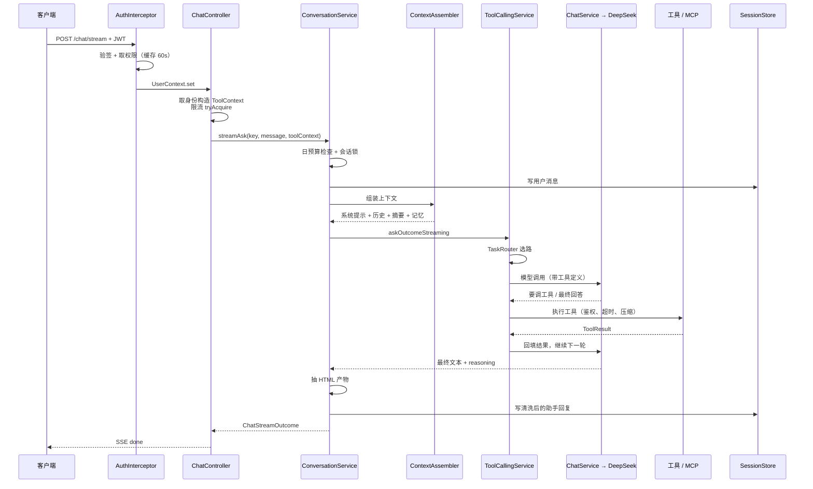
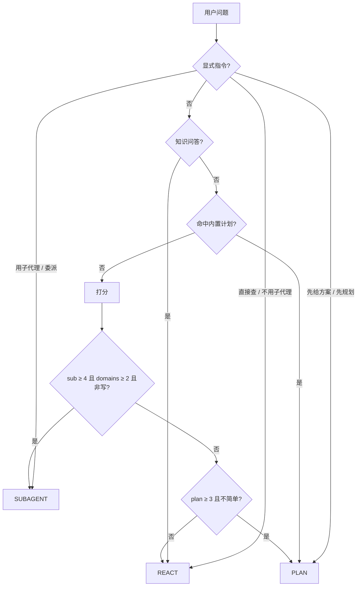
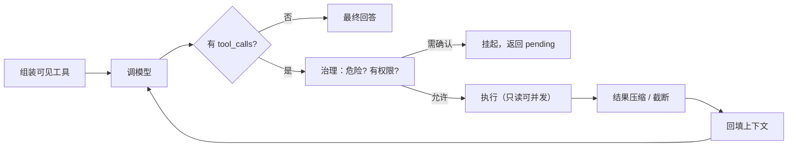
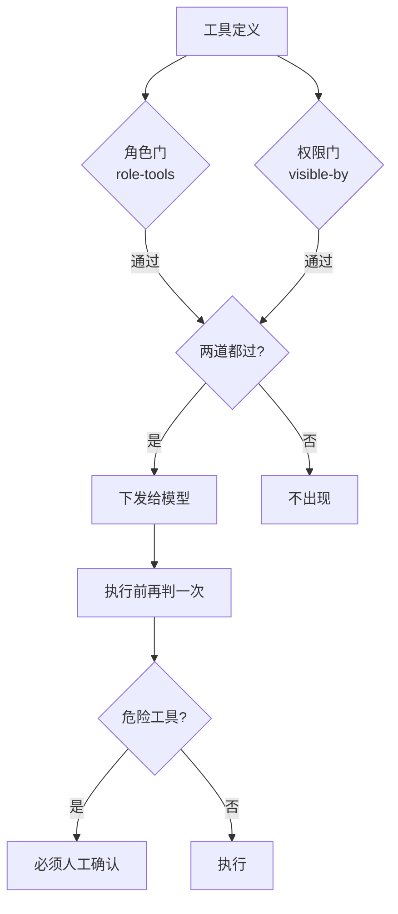
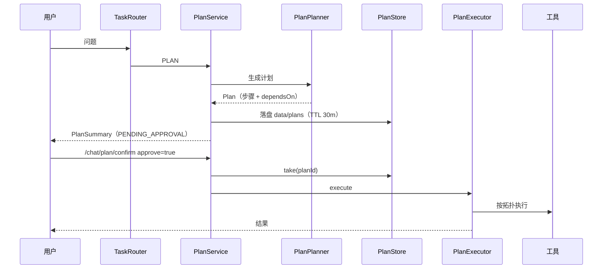
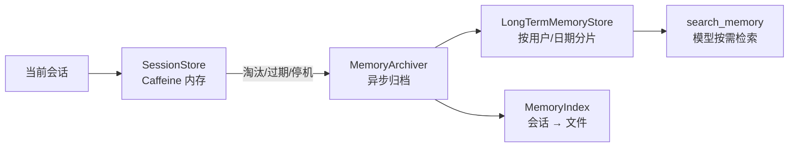
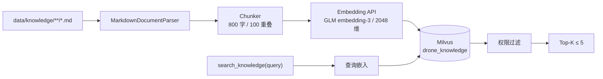
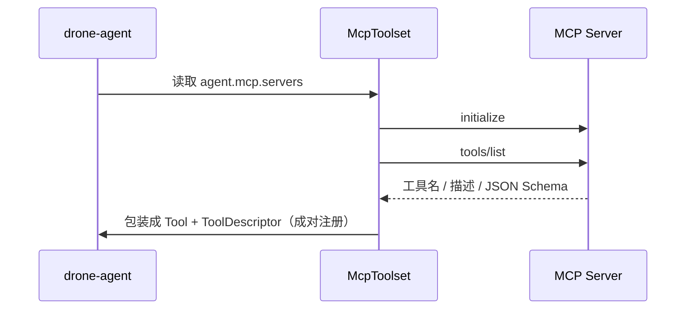

# drone-agent 架构

> 返回 [Wiki 首页](./README.md) · [仓库 README](../../README.md)
>
> 智能助手服务。**自己不拥有业务数据**，通过工具（本地 + MCP）替用户操作 `drone-server`。
> 本文回答：一次对话怎么走、ReAct / Plan / SubAgent 怎么选、工具/记忆/RAG/MCP 怎么协作、改东西该动哪里。

---

## 一、定位与边界

**它负责**：

- 接收用户问题，组装上下文，调用大模型；
- 决定“这题该用哪种编排方式”：ReAct / Plan / SubAgent；
- 执行工具调用（本地工具 + 远程 MCP 工具），并把结果回填给模型；
- 短期会话、长期记忆、会话压缩；
- 内部资料检索（RAG）；
- 业务流程 Skill、提示词管理；
- 成本控制（账单、预算、限流）、危险工具确认、取消与续跑；
- HTML 产物抽取、链路追踪。

**它不负责**：

- 不存业务数据（任务、设备、告警都在 `drone-server`）；
- 不做登录（登录在 `drone-server`，它只验 Token）；
- 不做 RBAC 的最终判定（业务接口仍由 `drone-server` 判一次）；
- 不实现 MCP 协议的服务端（在 `drone-mcp-server`）。

一句话：**它是“会调工具的编排层”，不是第二个业务后端。**

---

## 二、进程、鉴权与请求入口

入口：`cn.tedu.droneagent.DroneAgentApplication`，端口 `8081`。

### 2.1 鉴权

`AuthInterceptor` 与 `drone-server` 同款思路，但数据来源不同：

| 事项 | 做法 |
|---|---|
| 验证“你是谁” | 本地用同一把 `JWT_SECRET`、同一个 `issuer` 验签 |
| 查“你能做什么” | `AuthoritiesClient` 调 `drone-server` 的 `/internal/user/{id}/authorities`，缓存 60 秒 |
| 没带/过期 Token | 401 |
| 登录了但缺权限 | 403 |
| `drone-server` 挂了，取不到权限 | **503**，不误导用户重新登录 |

`UserContext` 的清理：

- 普通请求：`afterCompletion`；
- `POST /chat/stream` 是 SSE 异步请求：还要在 `afterConcurrentHandlingStarted` 清理请求线程上的身份；
- **工具在执行器线程上跑，拿不到 ThreadLocal**，所以身份必须由 Controller 在请求线程上构造成 `ToolContext` 显式传下去（含用户 JWT，用于转发给 MCP → `drone-server`）。

### 2.2 HTTP 接口

| 方法 | 路径 | 作用 |
|---|---|---|
| POST | `/chat` | 一次性对话（可能触发工具调用） |
| POST | `/chat/stream` | SSE 流式对话（reasoning / content / status / done / error） |
| POST | `/chat/confirm` | 确认一个待执行的危险工具 |
| POST | `/chat/plan/confirm` | 批准 / 拒绝一份运行时生成的计划 |
| POST | `/chat/cancel` | 取消在途请求（置位信号，不硬中断工具） |
| GET | `/chat/pending` | 查询会话中待确认的票据（面板刷新后恢复） |
| GET | `/chat/sessions` | 我的会话列表（只读索引） |
| DELETE | `/chat/sessions/{id}` | 删除我的会话 |
| GET | `/chat/bills` | 我的上下文账单 |
| GET | `/chat/bills/summary` | 账单汇总 |
| GET | `/chat/traces/{traceId}` | 链路追踪 |
| GET | `/chat/artifacts/{id}` | 下载 HTML 产物 |

所有接口都要求 `agent:chat` 权限。

### 2.3 SSE 事件

```text
reasoning {delta}   思考增量（前端折叠展示）
content   {delta}   正文增量
status    {text}    进度提示（正在生成计划 / 正在执行…）
done      {reply, reasoningMs, pending?, artifacts?, bill?, report?, plan?}
error     {message}
```

- 超时 300 秒，流线程池 8 个；
- 客户端断开时，服务端在 `emitter.send` 失败处感知，并置位取消信号；
- 已经生成的部分正文会写回会话，避免“断了就全丢”。

---

## 三、包结构

```text
cn.tedu.droneagent
├── controller/     HTTP 入口（对话、账单、追踪、产物）
├── service/        对话编排、工具循环、流装配
├── context/        上下文消息模型、token 估算、账单
├── memory/         会话、长期记忆、压缩、上下文组装
├── tool/           工具注册、治理、可见性、执行、确认、审计
├── skill/          业务流程 Skill（渐进式加载）
├── plan/           Plan 模式（内置计划 + 运行时生成）
├── subagent/       子 Agent（独立上下文 + 受限 ReAct）
├── route/          TaskRouter（ReAct / Plan / SubAgent 选择）
├── mcp/            MCP 客户端与工具发现
├── kb/ + vector/   内部资料检索（切块、嵌入、Milvus）
├── prompt/         提示词目录与启动期校验
├── bill/ budget/ rate/   账单、预算、限流
├── cancel/ journal/      取消、写台账
├── artifact/ trace/      HTML 产物、链路追踪
├── authority/      向 drone-server 取 RBAC
└── config/         各子系统的装配
```

---

## 四、一次对话怎么走

### 4.1 主流程



### 4.2 关键顺序

1. **先写用户消息，再组装上下文**：否则模型“没听见你刚说的”；
2. **整段“读—调—写”独占会话**：同一会话第二条消息会等，超时回“正忙”，避免历史互相覆盖；
3. **身份在请求线程构造**：异步线程没有 ThreadLocal；
4. **先抽产物，再存回复**：会话里存清洗后的文本，后续轮次不会重复带十几 KB 的 HTML。

### 4.3 流式与非流式的差异

| | `/chat` | `/chat/stream` |
|---|---|---|
| 返回 | 一次性 `ChatResponse` | SSE 增量 + `done` |
| 工具循环 | 同一套 | 同一套（带增量回调） |
| 身份传递 | `ToolContext` | 同样显式传 |
| 取消 | 可被 `/chat/cancel` 置位 | 客户端断开/超时也会置位 |

---

## 五、TaskRouter：三种编排方式怎么选

用户**不需要知道**“子代理 / 委派 / 计划”这些概念。路由在代码里做，依据是问题特征，不是模型自由发挥。



### 5.1 打分规则

| 特征 | 影响 |
|---|---|
| 对比 / 趋势 / 分析 / 归因 | `sub +2`（分别加） |
| 涉及 ≥2 个业务域 | `sub +2`；≥3 个再 `+1` |
| 逐条 / 下钻 / 本周 / 最近 | `sub +2` |
| 消息长度 ≥ 60 | `sub +1` |
| 写操作（创建/派发/删除/处置…） | `sub −5`，`plan +2` |
| 写操作 + 批量词 | `plan +2` |
| 多步连接词（再/然后/接着） | `plan +2` |
| 简单查询（多少/列表/详情/查一下） | `sub −3`，`react +2` |
| 消息很短 | `react +1` |

### 5.2 为什么用规则而不是模型分类

- **确定性**：同样的问题得到同样的路由，可测试、可复现；
- **零额外成本**：不额外调一次模型，不增加首字延迟；
- **可解释**：日志直接打出 `scores(plan/sub/react)` 与原因；
- **可替换**：`TaskRouter.route()` 是接口边界，将来换成轻量语义分类器，调用方不用改。

### 5.3 失败降级

- SubAgent 不可用 / 失败 / 超时 → 降级 ReAct；**预算超限除外**——已经超预算就不再跑主模型；
- Plan 生成失败 / 不可用 → 降级 ReAct；**用户明确“先给方案”时除外**——直接返回失败提示；
- 路由关闭（`agent.route.enabled=false`）→ 回到旧行为：显式先给方案 → 内置计划 → ReAct。

---

## 六、ReAct 工具循环

`ToolCallingService` 是“模型要工具 → 执行 → 回填 → 再问模型”的循环。

### 6.1 一轮里发生什么



### 6.2 关键约束

| 约束 | 值 / 做法 | 目的 |
|---|---|---|
| 最大轮次 | 8 | 防止无限循环；超了不再给工具，逼模型收尾 |
| 单工具超时 | 15 秒 | MCP 客户端自身超时更短（8s / 12s），日志能看到真实原因 |
| 只读并发 | 4 线程 | `parallel-safe=true` 的只读工具可并发 |
| 单结果上限 | 2000 字符 | 防止一个接口返回把上下文撑爆 |
| 总结果上限 | 6000 字符 | 一轮对话所有工具结果的总预算 |
| Skill 资源上限 | 单次 32768 / 累计 30000 | 模板不能被摘要毁掉，但也要有硬上限 |
| 失败重试 | 1 次 | 只对失败工具重试，不重复副作用 |
| 每轮预算检查 | 单请求 60000 prompt tokens | 超限停止工具循环并收尾 |

### 6.3 工具治理：两道门



- **角色门**：`agent.tool.role-tools` 配置“角色 → 允许的工具”。没配限制时：危险工具**默认拒绝**（fail-closed），其余默认放行；
- **权限门**：`agent.tool.visible-by` 按权限码裁剪“能看到哪些工具”，先匹配先用，未匹配默认可见；
- **执行前复核**：可见 ≠ 可执行，执行前仍判角色与权限；
- **危险工具**：`agent.tool.dangerous` 里的工具每次执行前都要确认，确认票据落盘（`data/pending`，TTL 5 分钟），重启后仍可确认；
- **写台账**：`data/operations` 记录 operationId、工具、对象 ID，供取消报告与续跑时避免重复创建。

### 6.4 工具元数据与行为必须 1:1

`ToolRegistry` 启动时校验：

- 有行为实现，就必须在 `agent.tool.catalog` 里有元数据；
- 有元数据，就必须有行为实现；
- 重名、缺一边，**服务直接起不来**。

本地工具的“行为”在 Java 里，“名字/描述/参数”在 `application.yml` 的 `catalog`。
MCP 工具不写 catalog，启动时由 `McpToolset` 自动注册。

---

## 七、Plan 模式

### 7.1 两种计划

| 类型 | 来源 | 是否审批 | 例子 |
|---|---|---|---|
| 内置计划 `BUILTIN` | `resources/plans/*.json` | **不审批**，严格按步骤执行 | 今日运营日报 |
| 运行时生成 `GENERATED` | `PlanPlanner` 调模型生成 | **必须审批**，用户看到步骤后决定 | 多步写操作、复杂流程 |

### 7.2 执行流程



### 7.3 执行器规则

- 按 `dependsOn` 拓扑执行；
- 同批 ready 步骤：**只读并发、写与合成串行**；
- 任一步失败就停，未执行步骤标 `SKIPPED`；
- 取消后不再开新步骤；
- **不绕过治理**：工具必须已注册、当前角色可用；**危险工具直接拒绝**——“计划批准”不等于“危险操作批准”。

### 7.4 内置计划的占位符

内置 JSON 支持：

- `${today.start}` / `${today.end}`；
- `${week.this.start}` / `${week.this.end}` 等周边界。

执行器只认这些占位符；出现无法解析的 `${...}` 会明确失败，而不是把字面量发给下游。

---

## 八、SubAgent

### 8.1 它解决什么问题

复杂只读分析（“对比本周和上周运营，逐条说明哪里变差了”）如果把所有中间数据都塞进主对话，
上下文会被迅速污染，主模型还要反复处理几十条明细。

SubAgent 的做法：**给一个独立上下文 + 白名单工具，让它自己查完，只把结论摘要交回来**。

### 8.2 定义方式

`resources/subagents/*.md`，frontmatter：

```yaml
name: ops-analyst
description: 只读运营分析
tools:
  - drone__dashboard_summary
  - drone__analytics_overview
  - drone__task_list
  - drone__alert_list
max_rounds: 4
timeout_seconds: 60
read_only: true
```

正文就是子 Agent 的系统提示词。

### 8.3 运行约束

| 约束 | 值 | 说明 |
|---|---|---|
| 工具白名单 | 定义里列出的 | 不在名单里的工具不可见 |
| 只读声明 | `read_only: true` | P0 强制；实际能调什么由白名单决定，危险工具仍会被拒绝 |
| 最大轮次 | 4 | 防止子 Agent 自己绕圈 |
| 超时 | 60 秒 | 超时返回失败，主流程降级 ReAct |
| 启动预算 | 剩余额度 < 15000 → 不启动 | 主请求预算不足时不要开新坑 |
| 自身上限 | 30000 prompt tokens | 每轮检查，超了直接返回 `budget_exceeded`，**不降级** |

### 8.4 为什么不做 MultiAgent

当前只做“主 Agent + 一个只读子 Agent”。多 Agent 协作（多个子 Agent 互相通信、共享黑板）
会带来调度、冲突、成本三倍放大，当前业务没有这个必要。先把手上的编排做稳。

---

## 九、Skill：把固定流程从提示词里拿出来

### 9.1 三层加载

```text
L1  常驻：name + description + when_to_use + permissions   （一行一个）
L2  按需：use_skill(name) 返回完整步骤正文
L3  再按需：read_skill_resource(skill, path) 读 references/ 或 assets/
```

目录：`resources/skills/<name>/SKILL.md`，可带 `references/`、`assets/`。

### 9.2 为什么这样设计

- 所有 SOP 都塞进系统提示词，常驻成本会随流程数量线性上涨；
- 只常驻一行元数据，模型判断“这题属于某流程”后再加载正文；
- 模板、口径表放 L3，避免每次请求都带着十几 KB。

### 9.3 启动期校验

- 目录名必须等于 frontmatter `name`；
- 正文不能为空，且不超过 8000 字符；
- `permissions` 决定可见性（**全部具备**才可见）；
- `tools` 里列的工具必须在注册表中存在；
- 任何一条不合格，**服务启动失败**。

### 9.4 权限

- L1 渲染时按权限过滤；
- `use_skill` 调用时**再判一次**；
- “无权”与“不存在”返回同一句文案，避免暴露流程存在性。

---

## 十、记忆与上下文

### 10.1 两层记忆



| 层 | 存什么 | 生命周期 |
|---|---|---|
| 短期 | 当前会话消息 | 内存，最多 500 个会话；空闲 30 分钟过期 |
| 长期 | 已结束会话的原文 | 磁盘 `data/agent-memory/<userId>/memory-YYYY-MM-DD.md`，单文件超 2MB 滚动 |

### 10.2 归档的三个细节

1. **只有“过期”和“容量淘汰”才归档**；用户主动删除**不归档**，否则删了会被监听器写回去；
2. 归档是**异步**的，跑在专用 2 线程池，不占 `commonPool`；
3. 异步带来一个已知窗口：会话被淘汰到落盘完成之间，进程若终止，这段内容会丢。这是明确取舍。

### 10.3 上下文组装

`ContextAssembler` 负责：

- 取当前会话最近的消息（默认上限 20 条）；
- 长会话压缩：未摘要条数超过 30 时，把“除最近 10 条以外”的部分压成摘要（上限 1500 字）；
- 默认**不再每轮注入**长期记忆，改为模型按需调用 `search_memory`；
- 系统提示词永远由服务端决定，且排第一条。

### 10.4 为什么服务变成有状态

内存会话、限流计数、取消注册表、待确认票据（部分落盘）都在本进程内。
因此 **`drone-agent` 只能单实例部署**；多实例需要把会话、限流、取消状态外置。

---

## 十一、内部资料检索（RAG）



关键配置：

| 项 | 值 | 说明 |
|---|---|---|
| 资料目录 | `data/knowledge` | 当前只支持 Markdown |
| 切块 | 800 字，重叠 100 | 避免关键句被切在边界 |
| 向量库 | Milvus REST，`localhost:19530` | 集合 `drone_knowledge` |
| 维度 | 2048 | 必须与 embedding 模型一致 |
| Top-K | 5 | |
| 相似度下限 | 0.5 | 低于它不返回；0 会让“查不到”永不发生 |

### 权限范围

- 规则写在配置里（`agent.kb.perm-rules`），**原始资料一个字都不用改**；
- 路径 glob 先匹配先用；
- 都没命中走 `default-perms`；
- `default-perms` 也为空 → **无人可见**（fail-closed）。

---

## 十二、MCP：远程工具怎么进来

### 12.1 启动期发现



- 单个服务器失败默认**降级**（记 WARN 跳过），不拖垮整个助手；
- 需要严格模式时开 `agent.mcp.fail-fast`；
- 工具名格式：`别名__远程名`，例如 `amap__maps_weather`、`drone__task_list`。

### 12.2 两个服务器

| 别名 | 地址 | 身份 | 并发 | 用途 |
|---|---|---|---|---|
| `amap` | 高德 MCP | **不转发**用户 Token | 可并发 | 天气、地理编码、路线 |
| `drone` | `drone-mcp-server:8082` | **转发**用户 JWT | 串行（含写操作） | 平台业务工具 |

### 12.3 身份与权限

`drone-mcp-server` 自己**不做鉴权判定**，它把 `Authorization` 原样转发给 `drone-server`。
最终权限仍由 `drone-server` 的 `AuthInterceptor` 判——这样“权限只有一处真相”。

### 12.4 MCP Server 侧

- 启动只读 classpath 里的 `openapi.json` 快照，**不依赖 `drone-server` 在线**；
- 应用就绪后可从线上 OpenAPI 刷新目录；
- 只实现四个 JSON-RPC 方法：`initialize`、`notifications/initialized`、`tools/list`、`tools/call`；
- 协议错误走 JSON-RPC `error`；业务失败走 `result.isError=true` + 可读文本（模型要读得懂原因）。

---

## 十三、提示词工程

### 13.1 提示词在哪里

```text
resources/prompts/
├── assistant/system.md     系统提示词
├── plan/planner.md         生成计划
├── memory/compaction.md    会话压缩
└── tool/summary.md         工具结果摘要
```

**不写在 `application.yml` 里**。改措辞改 md，重启生效。

### 13.2 启动期校验

`PromptCatalog` 在启动时加载并校验：

- 正文不能为空；
- 名字必须与路径一致；
- 变量与占位符必须对得上。

任何一条不合格，**服务起不来**——不留到运行时才发现。

### 13.3 组装顺序

1. 系统提示词（服务端固定）；
2. 当前用户可见的 Skill L1 元数据；
3. 历史消息 / 压缩摘要 / 按需记忆；
4. 工具定义（本地 + MCP，按权限裁剪后）。

---

## 十四、成本、安全与取消

### 14.1 三道成本闸

| 闸 | 位置 | 作用 |
|---|---|---|
| 限流 | `ChatController` | 每用户 QPS 2 / 突发 4 / 并发 2；全局 QPS 20 / 突发 40 / 并发 20 |
| 日预算 | `ConversationService` | 每用户每天 1,500,000 prompt tokens，超了直接拒绝新请求 |
| 单请求预算 | `ToolCallingService` | 单 trace 60,000 prompt tokens，超了停止工具循环 |

限流在入口直接拒绝，不调模型、不占会话锁。预算只读账单，不维护第二套计数。

### 14.2 账单与追踪

- **账单**：每次模型调用一条 JSONL（`data/bills`），只存 token / 工具名 / 耗时，不存正文；
- **追踪**：`data/traces/<userId>/<traceId>.jsonl`，span 包括 `chat.request`、`model.call`、`tool.call`；
- **traceId 贯通**：agent → MCP → `drone-server` 都带 `X-Trace-Id`，三边日志能 grep 出同一条请求。

### 14.3 取消

- 键是 `userId + conversationId`，防止 A 用户取消 B 用户的请求；
- 只置位，不硬中断正在执行的工具；循环在每个检查点停；
- 客户端断开 / SSE 超时也会置位；
- 取消时一并作废该会话的待确认票据。

### 14.4 危险操作

- 危险工具每次执行前人工确认；
- 确认票据落盘，5 分钟有效；
- 角色未显式授予 → 谁都不可用（fail-closed）；
- 计划批准**不**等于危险操作批准，执行器仍会拒绝危险工具。

---

## 十五、数据目录

| 目录 | 内容 | 是否可丢 |
|---|---|---|
| `data/agent-memory` | 长期记忆正文 + 索引 | **不可丢**，部署要挂卷 |
| `data/plans` | 待审批的生成计划 | 可丢（TTL 30 分钟） |
| `data/pending` | 待确认票据 | 可丢（TTL 5 分钟），丢了用户重问 |
| `data/operations` | 写操作台账 | 建议保留，用于追溯 |
| `data/bills` | 上下文账单 | 可丢，保留 30 天 |
| `data/traces` | 链路追踪 | 可丢，保留 7 天 |
| `data/artifacts` | HTML 产物 | 可丢，保留 7 天 |
| `data/knowledge` | 内部资料 | **不可丢**，部署要挂卷 |

`data/` 已在 `.gitignore` 覆盖范围内，不会被误提交。

---

## 十六、配置与环境变量

| 配置 | 环境变量 | 说明 |
|---|---|---|
| `agent.deepseek.api-key` | `DEEPSEEK_API_KEY` | 未配置时服务能启动，`/chat` 返回提示 |
| `agent.deepseek.model` | — | 默认 `deepseek-flash` |
| `agent.internal.base-url` | `DRONE_SERVER_URL` | 默认 `http://localhost:8080` |
| `agent.internal.token` | `DRONE_INTERNAL_TOKEN` | 必须与 server 一致 |
| `drone.jwt.secret` | `JWT_SECRET` | 必须与 server 一致 |
| `agent.memory.root` | `AGENT_MEMORY_ROOT` | 默认 `./data/agent-memory` |
| `agent.plan.root` | `AGENT_PLAN_ROOT` | 默认 `./data/plans` |
| `agent.kb.directory` | `AGENT_KB_ROOT` | 默认 `./data/knowledge` |
| `agent.kb.embedding.*` | `EMBEDDING_BASE_URL` / `EMBEDDING_API_KEY` / `EMBEDDING_MODEL` | 默认智谱 `embedding-3` |
| `agent.kb.milvus.*` | `MILVUS_HOST` / `MILVUS_PORT` | 默认 `localhost:19530` |
| `agent.mcp.servers[amap].url` | `AMAP_MCP_KEY` | 为空时跳过该服务器 |
| `agent.mcp.servers[drone].url` | `DRONE_MCP_URL` | 默认 `http://127.0.0.1:8082/mcp` |
| `agent.route.enabled` | — | 任务路由开关 |
| `agent.plan.enabled` | — | Plan 模式开关 |
| `agent.tool.enabled` | — | 工具调用总开关（关掉退化为纯对话） |

---

## 十七、扩展点：加东西该动哪里

### 新增一个本地工具

1. 实现 `Tool`（`name` + `invoke`）；
2. 在 `application.yml` 的 `agent.tool.catalog` 加同名元数据（描述、JSON Schema、是否只读/可并发）；
3. 如果是危险操作，加到 `dangerous` 并给角色授权；
4. 如果需要按权限可见，加 `visible-by` 规则；
5. 写测试，确认“行为与元数据 1:1”。

### 新增一条业务流程 Skill

1. 建 `resources/skills/<name>/SKILL.md`；
2. frontmatter 写 `name`（= 目录名）、`description`、`when_to_use`、`permissions`、`tools`；
3. 正文写编号步骤与输出模板，控制在 8000 字内；
4. 模板/口径放 `references/` 或 `assets/`，用 `read_skill_resource` 读取；
5. 启动验证：服务能起、`use_skill` 能返回正文。

### 新增一个内置计划

1. 建 `resources/plans/<name>.json`；
2. 写 `triggers`、`steps`（`tool`、`args`、`dependsOn`）；
3. 时间参数用 `${today.*}` / `${week.*}` 占位符；
4. 确认工具都在 MCP 目录里，且当前角色可用。

### 新增一个 SubAgent

1. 建 `resources/subagents/<name>.md`；
2. frontmatter 写 `name`、`description`、`tools`、`max_rounds`、`timeout_seconds`、`read_only`；
3. 正文写它的系统提示词；
4. 如果要让它成为默认路由目标，改 `TaskRouter` 的默认 agent 名。

### 新增一个 MCP Server

1. 在 `agent.mcp.servers` 加一项（`alias`、`url`、超时、`parallel-safe`、`forward-authorization`）；
2. 别名必须唯一；
3. 启动日志确认 `tools/list` 成功、工具数量符合预期。

---

## 十八、已知限制

| 限制 | 说明 |
|---|---|
| 单实例 | 会话、限流、取消、预算计数都在进程内；多实例需要外置 |
| 会话列表只显示已归档会话 | 新会话要等淘汰或停机刷盘后才进索引 |
| 归档存在时间窗 | 内存淘汰到落盘完成之间进程终止会丢这段会话 |
| 工具定义会占 prompt | MCP 暴露越多，每轮 prompt 越大；需要时用 `include/exclude` 收敛 |
| 模型能力依赖提示词 | 路由、思考语言、工具选择都受模型行为影响，改提示词要回归 |
| SubAgent 只读 | 写操作不会交给子 Agent |
| 危险工具需显式授权 | 默认 fail-closed，管理员没配就用不了 |
| Milvus 是外部依赖 | 没起 Milvus 时知识检索不可用；可关 `agent.kb.enabled` 回滚 |
| SSE 300 秒上限 | 超长任务会被超时取消，已生成部分会保存 |

---

## 十九、代码索引

| 想看什么 | 去哪里 |
|---|---|
| 对话入口 / SSE | `controller/ChatController.java` |
| 对话编排 | `service/ConversationService.java` |
| 工具循环 / 路由分支 | `service/ToolCallingService.java` |
| 模型调用 | `service/ChatService.java` |
| 路由规则 | `route/TaskRouter.java`、`route/RouteDecision.java` |
| Plan | `plan/PlanService.java`、`plan/PlanExecutor.java`、`plan/PlanPlanner.java` |
| SubAgent | `subagent/SubAgentRunner.java`、`subagent/SubAgentCatalog.java` |
| 工具注册 / 治理 | `tool/ToolRegistry.java`、`tool/ToolGovernance.java`、`tool/ToolVisibility.java` |
| Skill | `skill/SkillCatalog.java`、`skill/UseSkillTool.java` |
| 记忆 | `memory/SessionStore.java`、`memory/ContextAssembler.java`、`memory/LongTermMemoryStore.java` |
| RAG | `kb/KnowledgeIngestor.java`、`vector/MilvusVectorStore.java` |
| MCP 客户端 | `mcp/McpToolset.java`、`mcp/StreamableHttpTransport.java` |
| 提示词 | `prompt/PromptCatalog.java`、`resources/prompts/` |
| 预算 / 限流 / 取消 | `budget/BudgetService.java`、`rate/RateLimiter.java`、`cancel/CancellationRegistry.java` |
| 产物 / 追踪 | `artifact/DefaultArtifactService.java`、`trace/TraceRecorder.java` |

**延伸阅读**（面向初级工程师的专题手册）：

- [Harness 工程](../../drone-agent/docs/Harness工程-初级工程师手册.md)
- [主流 Agent 框架对比（Harness 视角）](../../drone-agent/docs/Agent框架对比-Harness视角-初级工程师手册.md)
- [Jev（System One）与 Agent Harness](../../drone-agent/docs/Jev与AgentHarness-初级工程师手册.md)
- [Plan 模式](../../drone-agent/docs/Plan模式-初级工程师手册.md)
- [SubAgent](../../drone-agent/docs/SubAgent-初级工程师手册.md)
- [上下文工程](../../drone-agent/docs/上下文工程-初级工程师手册.md)
- [工具调用](../../drone-agent/docs/工具调用-初级工程师手册.md)
- [MCP 接入](../../drone-agent/docs/MCP接入-初级工程师手册.md)
- [业务流程 Skill](../../drone-agent/docs/业务流程Skill-初级工程师手册.md)
- [知识库检索](../../drone-agent/docs/知识库检索-初级工程师手册.md)
- [记忆子系统](../../drone-agent/docs/记忆子系统-初级工程师手册.md)
- [提示词工程](../../drone-agent/docs/提示词工程-初级工程师手册.md)
