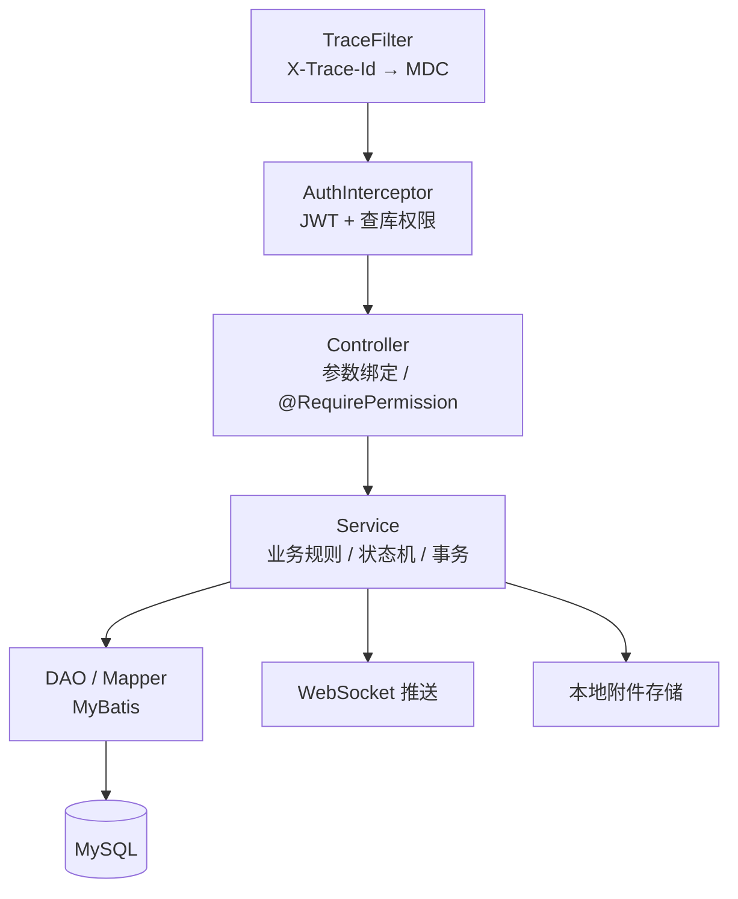
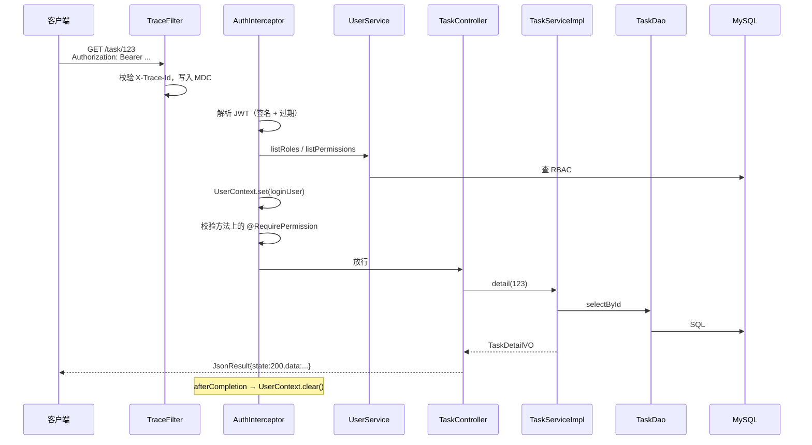
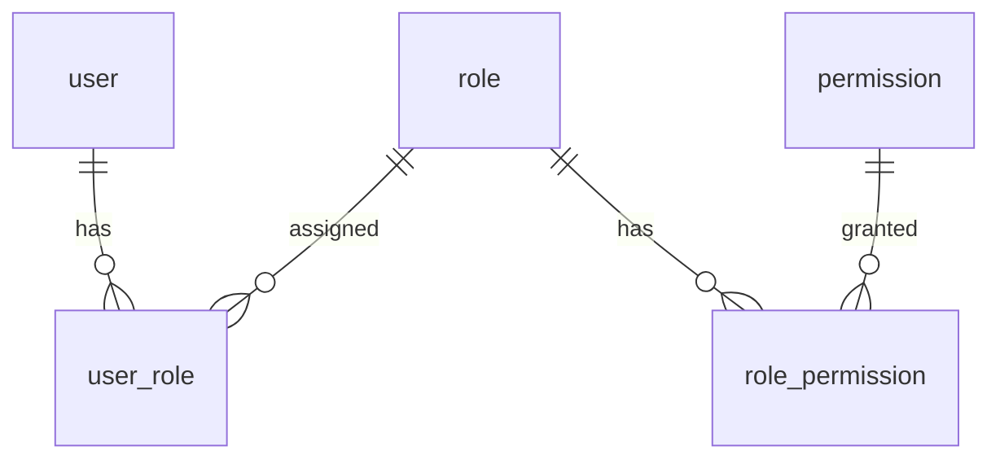
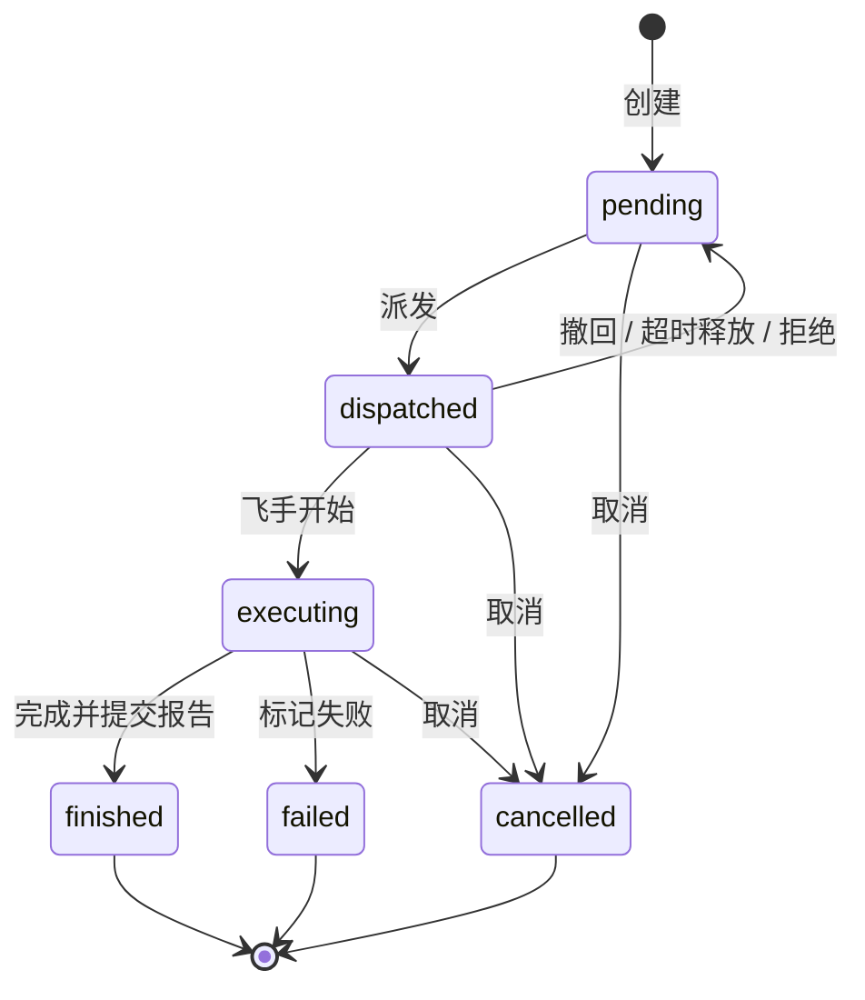
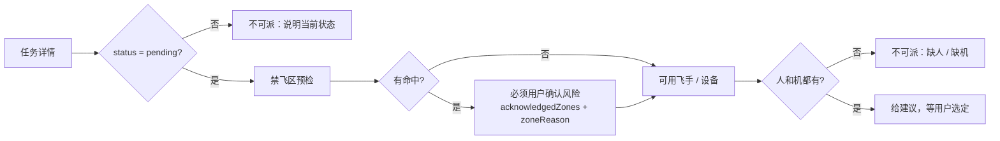
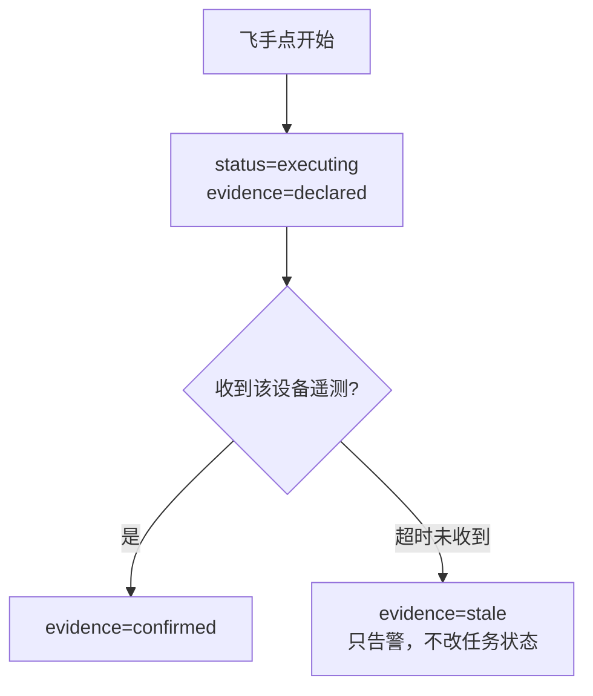
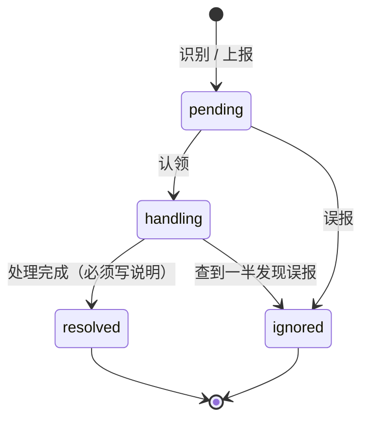

# drone-server 架构

> 返回 [Wiki 首页](./README.md) · [仓库 README](../../README.md)
>
> 业务主服务。**唯一拥有业务数据与业务规则**的进程。
> 本文回答：它怎么分层、一次请求怎么走、任务/设备/告警三条业务主线怎么落地、改东西该动哪里。

---

## 一、定位与边界

**它负责**：

- 用户、角色、权限（RBAC）与登录发 Token；
- 设备档案、航线、航点、禁飞区；
- 任务全生命周期（创建 → 派发 → 执行 → 完成/失败）；
- 设备遥测接入、证据归档、告警识别与闭环；
- 业务分析（预聚合日表、覆盖率、积压归因）与数字大屏；
- 给 `drone-agent` 提供“查用户权限”的内部接口。

**它不负责**：

- 不调用大模型（在 `drone-agent`）；
- 不实现 MCP 协议（在 `drone-mcp-server`）；
- 不做页面渲染（在两个前端）；
- 不保存对话、记忆、提示词（在 `drone-agent`）。

一句话：**业务真相只在 `drone-server` 的 MySQL 里**。其它服务要么读它、要么通过接口改它。

---

## 二、启动与分层

入口：`cn.tedu.drone.DroneServerApplication`，端口 `8080`。



| 层 | 约定 | 说明 |
|---|---|---|
| Controller | 只做参数接收、调 Service、包 `JsonResult` | 权限注解写在这里 |
| Service | 业务规则、状态机校验、事务边界 | 跨模块调用走 Service，不直接拿别人的 DAO（大屏是明确破例） |
| DAO | MyBatis Mapper | `mapper/*.xml` + 注解；`map-underscore-to-camel-case` |
| 公共层 | `JsonResult`、`BusinessException`、`GlobalExceptionHandler` | 业务失败仍返回 HTTP 200 |

**异常处理**：

- `BusinessException` → 原样返回 `state` 与中文提示；
- 其它异常 → 日志记完整堆栈，对外只回“服务器繁忙”，避免泄露 SQL / 类名。

---

## 三、包结构与职责

```text
cn.tedu.drone
├── common/          统一响应、异常、JWT、分页、坐标系、存储接口
├── config/          MVC、Knife4j、JWT 配置、TraceFilter
├── interceptor/     用户 JWT + RBAC 拦截器
├── internal/        /internal/** 服务间接口（共享密钥）
├── user/            用户、角色、权限、登录、Excel 导入导出
├── device/          设备档案、状态、Excel
├── route/           航线、航点（survey_point / route / route_point）
├── zone/            禁飞区几何与命中判断
├── task/            任务、证据、告警、MQTT、轨迹、WebSocket、定时任务
├── analytics/       业务分析、预聚合日表、覆盖率
└── dashboard/       数字大屏聚合与缓存
```

| 包 | 关键类 | 一句话 |
|---|---|---|
| `common` | `JsonResult`、`UserContext`、`JwtUtil`、`LocalStorageService` | 全模块共用 |
| `interceptor` | `AuthInterceptor` | 认证 + 授权 |
| `internal` | `InternalUserController`、`InternalAuthInterceptor` | 给 agent 查权限 |
| `user` | `UserServiceImpl`、`RbacServiceImpl` | RBAC 与登录 |
| `device` | `DeviceServiceImpl`、`DeviceExcelServiceImpl` | 设备档案 |
| `route` | `RouteServiceImpl`、`SurveyPointServiceImpl` | 航线与航点 |
| `zone` | `NoFlyZoneServiceImpl`、`ZoneGeometry` | 禁飞区判断 |
| `task` | `TaskServiceImpl`、`AlertServiceImpl`、`TelemetryIngestServiceImpl`、`TaskTrackServiceImpl` | 业务核心 |
| `task.mqtt` | `TelemetrySubscriber`、`TelemetryIngestQueue` | 设备接入 |
| `task.ws` | `TaskWsHandler`、`AlertNotifier`、`TaskNotifier` | 实时推送 |
| `task.job` | `TaskAutoReleaseJob`、`TaskDispatchBlockJob`、`TaskEvidenceStaleJob` | 定时兜底 |
| `analytics` | `AnalyticsServiceImpl`、`StatDailyServiceImpl`、`CoverageServiceImpl` | 统计分析 |
| `dashboard` | `DashboardServiceImpl`、`TtlCache` | 大屏聚合 |

---

## 四、一次 HTTP 请求怎么走

以 `GET /task/{id}` 为例：



### 4.1 白名单

`WebMvcConfig.WHITE_LIST` 目前放行：

- `/user/login`：还没登录，必须放行；
- `/ws/**`：WebSocket 握手有独立的 JWT 校验（`TaskWsHandshakeInterceptor`）；
- `/doc.html`、`/webjars/**`、`/v3/api-docs/**`、`/swagger-ui/**`：接口文档；
- `/internal/**`：不要求用户 JWT，但由 `InternalAuthInterceptor` 用共享密钥把关。

**新增免登录接口时必须同步改这里**，否则会一直 401。

### 4.2 401 与 403

| 状态码 | 含义 | 触发 |
|---|---|---|
| 401 | 未认证 | 没带 Token、格式不对、签名/过期不通过 |
| 403 | 未授权 | 登录了，但缺少 `@RequirePermission` 要求的权限 |

两个码由拦截器直接写 JSON，不走 `GlobalExceptionHandler`，这样前端能一眼区分“去登录”和“登录也没用”。

### 4.3 有两个接口刻意不写权限注解

`GET /task/report/{taskId}` 与 `GET /task/attachment/{id}/download` 需要“管理员 **或** 任务本人”的语义。
`@RequirePermission` 的多个值是 **AND**，表达不了 OR，所以在 Service 内部自行判断：

- 报告：有 `task:list`，或当前用户就是该任务飞手；
- 附件：有 `task:list`，或当前用户是该任务飞手/上传人。

这不是遗漏，是注解能力边界导致的有意设计。

---

## 五、认证与 RBAC

### 5.1 Token 里有什么

```json
{
  "sub": "12",
  "username": "zhangsan",
  "iss": "drone-server",
  "exp": ...
}
```

**只有身份，没有角色和权限。** 权限每次请求查库补全，保证“改权限下一次请求生效”。

### 5.2 权限模型



- 表：`user`、`role`、`permission`、`user_role`、`role_permission`；
- 权限码形如 `task:list`、`task:dispatch`、`alert:handle`、`system:role:grant`；
- 一个方法可要求多个权限码，**必须全部满足**。

### 5.3 服务间接口

`GET /internal/user/{userId}/authorities`：

- 不走用户 JWT，走 `X-Internal-Token`；
- 返回该用户的角色与权限码；
- 只允许内网访问。

两边的 `drone.internal.token` 与 `agent.internal.token` 必须一致，否则 agent 侧会 503。

### 5.4 大屏账号

大屏挂在值班室，不会有人每天重新登录。`screen` 角色签发 **365 天** Token（`screen-expire-hours`），
有效期由服务端按角色决定，前端传不了。

---

## 六、任务域（核心）

### 6.1 状态机



合法流转集中写在 `TaskStatusFlow` 的“动作 → 允许的起始状态”表里，Service 只查表，不散落 `if`。

**三条重要规则**：

1. **只能按箭头走**：不允许 `pending` 直接跳 `finished`。
2. **每次流转留痕**：`task_log` 记录动作、前后状态、操作人、附言。
3. **报告与完成原子**：完成时必须同时提交报告，同一个事务，不存在“已完成但没报告”。

> `dispatched → pending` 有三条不同来源：撤回、超时释放、拒绝执行。结果一样，`action` 必须分开记，
> 否则事后看流水不知道是谁、为什么把任务退回来了。

> **当前边界**：`cancelled` 在状态表里预留了，但还没有对外的“取消任务”接口。这是已知缺口，不要误以为已实现。

### 6.2 创建任务

`POST /task/create`（`task:add`）：

- 生成任务号，状态 `pending`；
- 保存航线快照（`RouteSnapshot`），之后航线改了不影响已建任务；
- 校验计划时间、设备/航线等基础字段；
- 写一条 `create` 流水。

### 6.3 派发前检查



对应接口：

- `GET /task/{taskId}/zone-check`：按任务航线查禁飞区；
- `GET /task/dispatch-options`：可派飞手（`user.state=idle`）与设备（`drone.status=idle`）；
- `POST /task/dispatch`：真正派发，成功置 `dispatched`，设备置 `assigned`。

禁飞区有命中但没确认时**不得派发**——这是业务规则，不是前端提示。

### 6.4 执行与收尾

| 动作 | 接口 | 权限 | 结果 |
|---|---|---|---|
| 开始 | `POST /task/start` | `task:execute` | `executing` + `evidence_state=declared` |
| 完成 | `POST /task/finish` | `task:execute` | `finished` + 报告落库 |
| 失败 | `POST /task/fail` | `task:execute` | `failed` |
| 拒绝 | `POST /task/refuse` | `task:execute` | 回 `pending`，释放人机 |
| 撤回 | `POST /task/withdraw` | `task:dispatch` | 回 `pending`，释放人机 |
| 打卡 | `POST /task/checkin` | `task:execute` | 写 `task_checkin`，服务端算偏差 |
| 现场上报 | `POST /task/alert/report` | `task:execute` | 生成人工告警 |

### 6.5 证据制：状态与依据拆成两个维度

**任务状态**回答“业务走到哪一步”；**证据状态**回答“这一步有没有依据”。

| 维度 | 字段 | 取值 |
|---|---|---|
| 业务进度 | `task.status` | `pending` / `dispatched` / `executing` / `finished` / `failed` / `cancelled` |
| 依据强度 | `task.evidence_state` | `none` 无依据 / `declared` 仅声明 / `confirmed` 已证实 / `stale` 声明过期 |



关键点：

- **遥测不会自动改任务状态**。它只把 `evidence_state` 抬到 `confirmed`；
- 判定“正在飞”只能靠实时遥测，飞行日志等事后证据只能事后核对；
- `stale` 由 `TaskEvidenceStaleJob` 扫描（默认 120 秒阈值、60 秒扫一次），只提示，不自动结束任务。

### 6.6 资源占用与自动释放

派发会把人和机占用住。如果飞手一直不开始，资源就永久卡住。兜底是 `TaskAutoReleaseJob`：

- 计划结束时间已过 **120 分钟**仍未开工 → 自动释放；
- 每 **10 分钟**扫一次；
- 释放动作写一条 `expire` 流水，和人工撤回、飞手拒绝区分开。

**执行中超时不会自动释放**——飞机在天上，系统不能替人做决定。

### 6.7 轨迹

`GET /task/{taskId}/track`：

1. 从 `task_evidence` 的报文里取经纬度，按时间升序；
2. `TrackSampler` 按距离抽稀（默认 5 米一个点，最多 500 点，首尾必留）；
3. 最后做 WGS84 → GCJ-02 坐标转换。

顺序不能反：抽稀算的是 WGS84 下的真实距离，先转坐标会让数学步骤依赖坐标系语义。

---

## 七、设备接入与遥测链路

### 7.1 Topic 与 QoS

| Topic | 内容 | QoS | 为什么 |
|---|---|---|---|
| `drone/+/telemetry` | 位置、电量、高度、速度、信号 | 0 | 下一帧马上来，丢一帧无所谓，重传反而挤占带宽 |
| `drone/+/event/+` | 起飞、返航、迫降等事件 | 1 | 丢一条就再也补不回来，重复靠唯一键去重 |
| `drone/+/status` | 在线/离线 | 1 | 状态变化不能丢 |

设备编号**以 Topic 里的那一段为准**，不信报文正文里的 `deviceCode`——Topic 由 broker 路由，正文没人保证。

### 7.2 六步处理链路


- 每一步失败都**丢弃并记录原因**，不把消费线程带走；
- 日志前缀就是 `【MQTT 处理 ② 校验信封】` 这种编号，能和设计文档直接对上；
- 队列容量 10000，2 个消费线程。队列满时丢数据并告警——**宁可丢设备数据，不能拖垮后端**；
- 不包大事务：极端情况下“证据存了、状态没抬”，下一条遥测会自愈；用吞吐换最终一致。

### 7.3 幂等键

| 表 | 唯一键 | 含义 |
|---|---|---|
| `task_evidence` | `(device_code, type, observed_at, seq)` | 同一秒两条遥测是两条真实采样，必须都留 |
| `task_alert` | `(device_code, alert_code, observed_at)` | 同一秒同一个问题就是一个问题，重复去掉 |
| `task_checkin` | `(task_id, seq, observed_at)` | 离线补传同一次打卡只留一条 |

人工上报告警的 `device_code` 为 NULL，MySQL 唯一索引不约束多个 NULL——正好实现“飞手一分钟报两次就是两次”。

### 7.4 轨迹与设备状态

- 遥测归档后，`TaskTrackService` 从证据表生成轨迹；
- 设备状态：`idle` 待命、`assigned` 已派出、`flying` 飞行中、`charging` 充电中、`offline` 离线、`maintenance` 维护中；
- 离线告警的严重度取决于是否有执行中任务：有任务为 `critical`，否则 `warning`。

---

## 八、告警域

### 8.1 告警从哪来

| 来源 | 例子 | 判定方式 |
|---|---|---|
| 遥测阈值 | 电量低、温度高、GPS 弱、超速、超限高 | `AlertDetector` 按配置阈值算 |
| 状态变化 | 设备离线 | status 报文 |
| 设备事件 | 返航、任务中断、紧急停机 | Topic 第 4 段映射成告警码 |
| 禁飞区 | 闯入禁飞区、超过限高 | 遥测坐标 + 区域几何 |
| 人工上报 | 现场障碍、设备损坏、天气 | 飞手端提交 |

告警码与阈值都在 `application.yml` 的 `drone.alert.*`，代码里不写死。

### 8.2 严重度

`critical` 严重 / `warning` 警告 / `info` 提示。**刻意不复用任务的 P0~P3**：
任务优先级是“排产顺序”，告警严重度是“要不要立刻处理”，两者不是一回事。

### 8.3 四态闭环



三个刻意设计：

1. **允许“误报”作为正经终态**：否则人都用“已处理”关掉，数据里再也分不清真假；
2. **`resolved` 必须写处置说明**：没有说明的“已处理”等于黑盒；
3. **没有额外“关闭”状态**：再加一层只会让人纠结 `resolved` 和 `closed` 的区别。

状态机是硬约束：`pending` 不能直接 `resolve`，必须先 `claim`。

### 8.4 需要飞手动手的告警

`drone.alert.pilot-action` 里配置的告警码，落库时 `pilot_action_required=1`，并写入 `action_hint`。
判断标准是**现场只有飞手能立刻做**，不是“这条严不严重”：

- 飞机在天上出事，办公室管理员再着急也帮不上忙；
- 所以既有 `critical`（电机异常），也有 `warning`（返航）。

**处置责任与销账是两件事**：飞手看到待办并动手，告警状态仍由有 `alert:handle` 的人处理。

### 8.5 通知

告警与任务状态通过 WebSocket 推送：

- 路径 `/ws/task`；
- 握手时单独校验 JWT；
- `AlertNotifier` 推给拥有 `alert:handle` 的人；`critical` 且挂着任务时，额外推给该任务飞手；`info` 只进库不推送；
- `TaskNotifier` 推给任务飞手与相关管理员；
- **小程序不在前台就收不到**，这是平台限制，不是后端没发。

---

## 九、分析与数字大屏

### 9.1 分析接口

| 接口 | 回答什么 |
|---|---|
| `GET /analytics/overview` | 任务量、完成率、按时率、平均时长、告警趋势、MTTR |
| `GET /analytics/dispatch-block` | 待派发积压与原因占比（缺飞手 / 缺设备 / 缺人又缺机 / 资源够没人派） |
| `GET /analytics/efficiency` | 设备利用率、飞手效率 |
| `GET /analytics/evidence` | 证据覆盖趋势 |
| `GET /analytics/coverage` | 点位覆盖率（默认 100 米内算“到过”） |
| `GET /analytics/coverage/export` | 覆盖率明细导出 |

### 9.2 为什么要预聚合日表

`task_evidence` 是唯一会无限增长的表（一台设备每秒一条）。在明细表上“按天看一年”实测要读 197 万行、0.58 秒；
`stat_daily` 只有 3650 行，0.04 秒。

- 粒度是“天 × 维度 × 指标”，窄表结构，加指标不用改表；
- `stat_daily` 不能只存“天”：`COUNT(DISTINCT)` 不可加，必须存到“天 × 设备”这一层；
- `StatDailyJob` 每 30 分钟检查“昨天及以前有没有该算没算的天”，往回看 30 天，能补停机漏掉的天；
- 口径版本升级要 +1 并整段重算，否则同一张表混着新旧口径，趋势图会断层。

### 9.3 数字大屏

`dashboard` 是横跨任务/设备/告警/人员/地理的**第六个域**，不挂在任何模块下面。

它刻意直接注入 8 个 DAO 做只读统计，破例理由：

- 只读，不写别人的表；
- 为守“跨模块走 Service”的形式规则，要给 6 个模块各加一个“只为大屏存在”的统计方法，反而扩大 API。

**一旦大屏开始写别人的表，这个破例就失效**，必须改回走 Service。

另外，`GET /dashboard/summary` 本身**不要求 `task:list`**：飞手也要能调。
它靠“按权限把块置 null”来控制能看到什么，而不是靠“整个接口 403”。

三条纪律：

1. 没权限的块返回 `null`，序列化后字段消失——**不能给 0**，否则看起来像“今天一架次都没飞”；
2. 每个块一条聚合 SQL，不把明细拉回 Java 数；
3. 时间点由 Java 传，不用 SQL 的 `CURDATE()` / `NOW()`：数据库时区是 UTC，存的是本地时间，会整整差一天。

`TtlCache` 按块缓存（总览 10 秒、告警流 5 秒），挡住多块屏同时挂着的重复请求。
缓存时长必须 ≤ 对应刷新间隔，否则大屏会“一直在刷却永远看到同一个值”。

---

## 十、其余业务模块

| 模块 | 关键点 |
|---|---|
| 用户 | 登录发 Token；状态 `idle/busy` 影响可派发性；Excel 导入导出 |
| 设备 | 编号唯一；状态决定能否派发；Excel 导入 |
| 航线 | 航点顺序、动作（拍照/录像/悬停）；建任务时存快照 |
| 航点 | 分类、坐标、高度；被航线引用 |
| 禁飞区 | 圆形/多边形几何；启用期与限高；派发前与遥测中都会判断 |
| 附件 | 现场照片/视频/日志；类型有不同大小上限；本地磁盘存储 |
| 打卡 | 服务端算偏差，不信客户端传的距离；离线补传靠唯一键去重 |

附件落盘路径：`{DRONE_UPLOAD_ROOT}/{taskNo}/{yyyyMMdd}/{uuid}.{ext}`。
目录是配置项，容器化时要挂卷。

---

## 十一、数据与迁移

### 11.1 主要表

| 域 | 表 |
|---|---|
| 用户权限 | `user`、`role`、`permission`、`user_role`、`role_permission` |
| 设备 | `drone` |
| 任务 | `task`、`task_log`、`task_report`、`task_attachment`、`task_checkin` |
| 证据告警 | `task_evidence`、`task_alert` |
| 航线禁飞区 | `route`、`route_point`、`survey_point`、`no_fly_zone` |
| 分析运营 | `task_dispatch_block`、`stat_daily` |

### 11.2 迁移方式

没有 Flyway / Liquibase，**手工按顺序执行**：

```bash
mysql -uroot -proot drone < drone-server/docs/sql/schema.sql
mysql -uroot -proot drone < drone-server/docs/sql/data.sql
# 再按文件头写明的顺序执行 migration/*.sql
```

改表结构**新增迁移文件**，不要改老文件。每个迁移文件头部写明执行顺序与前提。

---

## 十二、定时任务

| 任务 | 频率 | 作用 |
|---|---|---|
| `TaskAutoReleaseJob` | 10 分钟 | 派发后超时未开工，释放人机 |
| `TaskDispatchBlockJob` | 10 分钟 | 给 `pending` 任务记“当时为什么派不出去” |
| `TaskEvidenceStaleJob` | 60 秒 | `declared` 超 120 秒没遥测 → `stale` |
| `StatDailyJob` | 30 分钟 | 补齐预聚合日表，回看 30 天 |

派发积压采样**必须一直跑**：它记的是当时的资源池，事后补不回来。

---

## 十三、配置与环境变量

| 配置 | 环境变量 | 说明 |
|---|---|---|
| `drone.jwt.secret` | `JWT_SECRET` | 必须与 agent 一致 |
| `drone.jwt.issuer` | — | `drone-server` |
| `drone.internal.token` | `DRONE_INTERNAL_TOKEN` | 必须与 agent 一致 |
| `drone.upload.root` | `DRONE_UPLOAD_ROOT` | 默认 `./data/upload` |
| `drone.mqtt.enabled` | `MQTT_ENABLED` | 不关心设备时可关 |
| `drone.mqtt.broker-url` | `MQTT_BROKER_URL` | 默认 `tcp://localhost:1883` |
| MySQL | — | 默认 `localhost:3306/drone`，账号 `root/root`（仅开发） |
| `drone.alert.threshold.*` | — | 告警阈值，按现场调整 |
| `drone.analytics.*` | — | 可飞小时、覆盖率半径、预聚合开关 |

**开发默认值不可上生产**：JWT 密钥、内部密钥、数据库密码都要用环境变量覆盖。

---

## 十四、可观测性

- **traceId**：`TraceFilter` 从 `X-Trace-Id` 读取（只接受 8~64 位字母/数字/短横线），写入 MDC 并回显；
  非法值不设置、也不报错——追踪不能影响业务；
- **日志格式**：`时间 级别 [traceId] [线程] logger - 消息`；
- **日志级别**：开发环境 `cn.tedu.drone: debug`，生产建议改回 `info`；
- **关键链路**：MQTT 六步日志带编号；登录/权限有“拦截原因 + 放行结果”；
- **WebSocket**：连接建立发 `ready`，心跳回 `pong`。

---

## 十五、扩展点：改东西该动哪里

### 新增一个业务接口

1. Controller 方法 + `@RequirePermission("xxx:yyy")`；
2. Service 写业务规则与事务；
3. DAO / Mapper；
4. 若需新权限码：新增 `migration/*.sql` 插 `permission` 并授权给角色；
5. 更新 `docs/sdd/specs|plans|tasks` 与对应设计文档。

### 新增一类告警

1. `AlertCode` 加编码；
2. `application.yml` 加阈值（如需要）；
3. `AlertDetector` 加识别逻辑；
4. 若是“需要飞手动手”，加到 `pilot-action`；
5. 同步 `docs/告警体系设计.md`。

### 新增一张表

1. 新增 `migration/xxx.sql`，文件头写执行顺序与前提；
2. 不改 `schema.sql` 的历史内容（新环境按顺序跑）；
3. PO / DAO / Mapper；
4. 补文档。

### 新增前端可见字段

先确认是否泄露越权数据：列表接口按权限裁剪，不能靠前端隐藏。

---

## 十六、已知限制

| 限制 | 说明 |
|---|---|
| 任务“取消”只有状态定义，没有接口 | 当前只能撤回派发 / 拒绝执行；取消能力未落地 |
| WebSocket 注册表单机 | 多实例时客户端连不到同一节点就收不到推送 |
| MQTT 多实例重复消费 | 每个实例都订阅同一批 Topic，生产多实例要共享订阅 |
| 大屏直接读多模块 DAO | 只读破例；一旦要写就必须改回 Service |
| 路线偏离告警未实现 | 阈值已预留（`route.deviation`），需要计划航线与历史位置 |
| 附件存本地磁盘 | 多实例需要共享存储或对象存储 |
| 无 Flyway | 迁移靠人按顺序执行，环境一致性依赖文档纪律 |

---

## 十七、代码索引

| 想看什么 | 去哪里 |
|---|---|
| 请求入口与鉴权 | `interceptor/AuthInterceptor.java`、`config/WebMvcConfig.java` |
| 统一响应与异常 | `common/JsonResult.java`、`common/GlobalExceptionHandler.java` |
| 任务状态机 | `task/pojo/TaskStatusFlow.java`、`task/service/impl/TaskServiceImpl.java` |
| 证据制 | `task/pojo/EvidenceState.java`、`task/service/impl/TelemetryIngestServiceImpl.java` |
| 告警识别 | `task/alert/AlertDetector.java`、`task/alert/AlertProperties.java` |
| MQTT 接入 | `task/mqtt/TelemetrySubscriber.java`、`task/mqtt/TelemetryIngestQueue.java` |
| 轨迹抽稀 | `task/track/TrackSampler.java`、`task/service/impl/TaskTrackServiceImpl.java` |
| 推送 | `task/ws/TaskWsConfig.java`、`task/ws/AlertNotifier.java` |
| 分析 | `analytics/service/impl/AnalyticsServiceImpl.java`、`analytics/job/StatDailyJob.java` |
| 大屏 | `dashboard/service/impl/DashboardServiceImpl.java`、`dashboard/cache/TtlCache.java` |
| 建表 | `docs/sql/schema.sql`、`docs/sql/migration/` |

**延伸阅读**：

- [任务业务设计](../../drone-server/docs/任务业务设计.md)
- [告警体系设计](../../drone-server/docs/告警体系设计.md)
- [MQTT 与设备接入](../../drone-server/docs/MQTT与设备接入.md)
- [业务分析方案](../../drone-server/docs/业务分析方案.md)
- [数字大屏方案](../../drone-server/docs/数字大屏方案.md)
- [RBAC 权限设计](../../drone-server/docs/RBAC权限设计.md)
