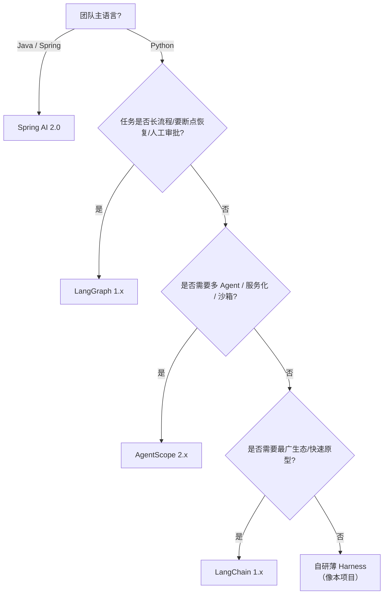

# 主流 Agent 框架对比：Harness 视角（面向初级工程师）

> **读者定位**：会 Spring Boot / Java，能看懂 Python 示例，知道什么是工具调用，但对“框架到底替我做了什么、我还得自己做什么”没有系统认识。
> **写法**：先给结论，再按 Harness 的八个维度逐项对比，最后落到本项目：哪些思想已经实现、哪些值得借、哪些不要照搬。
> **口径**：框架事实以**官方文档 / 官方仓库**为准，查询日期 **2026-10-29**；本项目以当前代码与配置为准。
> **版本**：Spring AI **2.0.x**（查到 2.0.2，2026-10-23）、LangChain **1.4.7**、LangGraph **1.2.18**、AgentScope **2.0.11**。版本会变，**设计思想比版本号更值得记**。
> **证据标记**：✅ = 官方文档/代码直接可见；⚠️ = 基于文档的推断或取舍判断；📌 = 本项目现状。

---

## 第一部分 · 先给结论

### 1.1 一句话定位

| 框架 | 它到底是什么 | Harness 的主战场 | 最适合 | 主要代价 |
|---|---|---|---|---|
| **Spring AI 2.0** | Spring 生态里的 AI 客户端与工具调用框架 | **Advisor 链**：把记忆、RAG、日志、工具循环串成一条可排序的链 | Java/Spring 团队做单 Agent、企业集成 | 长期记忆、多 Agent、业务级防护要自己补；2.0 有迁移成本 |
| **LangChain 1.x** | “Agent = Model + Harness”的显式实现 | **`create_agent` + Middleware**：在 Agent 循环的固定钩子上插逻辑 | 快速搭 Agent、需要大量现成中间件与集成 | 抽象多、版本演进快；观测/评估主要靠 LangSmith |
| **LangGraph 1.x** | 低层、有状态的图编排运行时 | **StateGraph + Checkpointer + Interrupt** | 长任务、断点恢复、人工审批、复杂控制流 | 状态、节点、幂等、存储都要自己设计；简单任务会过度工程 |
| **AgentScope 2.x** | 多 Agent 平台 + 开箱即用的 Agent Service | **ReAct + Permission + Context + Workspace + Service** | Python 多 Agent、需要沙箱/服务化/团队协作 | 2.0 与 1.x 不兼容；平台面更大、运维更重；认证仍归应用 |
| **本项目 drone-agent** | 面向无人机业务的**自研薄 Harness** | **Router + 有界 ReAct + Plan/SubAgent + 业务治理** | 业务边界清楚、权限/成本/可追溯优先 | 评估、持久化执行、跨服务观测仍是短板 |

### 1.2 最重要的一句话

**框架不是 Harness 的同义词。** 框架提供的是“可复用的零件和默认拼法”；Harness 是你为**自己的业务**决定的那套运行时约束：

- 给模型看什么（Context）；
- 能调什么、怎么调（Tools）；
- 记得什么、忘什么（Memory）；
- 谁循环、何时停、失败怎么办（Control Flow）；
- 越权/误删/烧钱谁拦（Guardrails）；
- 改完有没有变好（Evaluation）；
- 出事能不能还原（Observability）；
- 用户反馈如何变成下一版（Feedback）。

这八个维度沿用本项目 [`Harness工程-初级工程师手册.md`](./Harness工程-初级工程师手册.md) 的分类；本文额外把 **State（状态/产物）** 和 **Cost/Latency（成本/延迟）** 作为横切关注点单列。

> **先纠正一处旧口径**：`Harness工程-初级工程师手册.md` 写于 2026-10-26，当时 Plan / SubAgent 还没落地，文中“只有 ReAct、没有 Plan、没有子 Agent”的描述已经过时。本文以当前代码为准：`TaskRouter` 已经在 ReAct / Plan / SubAgent 之间选路。

---

## 第二部分 · 八个维度横向对比

### 2.1 一张总表

| 维度 | Spring AI 2.0 | LangChain 1.x | LangGraph 1.x | AgentScope 2.x |
|---|---|---|---|---|
| **Context** | ChatClient 组装 Prompt；Advisor 可改写；窗口记忆；ToolSearch 做工具渐进披露 | messages state + `SummarizationMiddleware` / `ContextEditingMiddleware`；工具选择中间件 | 状态由 `StateGraph` 的 schema/reducer 决定；不抽象 Prompt | 三层组装（系统提示 + 摘要 + 近期消息）；压缩 + offload；系统提示中间件 |
| **Tools** | `@Tool` / `MethodToolCallback` / `FunctionToolCallback`；`ToolCallingManager`；MCP 双向；调用上限；可关自动循环自己驱动 | `@tool`；运行时动态选工具；中间件做重试/限流/工具选择；MCP 内置 `langchain.mcp` | `ToolNode` 只是图里的节点；治理自己写 | `Toolkit`：Python / MCP / Skill / Meta Tool；批量串行或并发；权限系统 + 沙箱 |
| **Memory** | `ChatMemory` + `ChatMemoryRepository`；窗口记忆（默认 20 条）+ `VectorStoreChatMemoryAdvisor`（向量库检索历史）；无独立长期记忆抽象 | 短期：checkpointer 按 thread 持久化；长期：Store 按 namespace/key 存 JSON | Checkpointer（thread 内）vs Store（跨 thread） | Agentic Memory（Markdown + `MEMORY.md` 索引）/ ReMe / Mem0；压缩与 offload |
| **Control Flow** | `ToolCallingAdvisor` 自动循环；可按调用关闭、自己写循环；无 Plan/图 | `create_agent` 的 Agent 循环 + Middleware 钩子；底层是 LangGraph | `StateGraph`：节点、边、条件边、`Send`；确定性 + Agentic 混排 | ReAct 循环；批量工具；中间件可拦截“结束事件”强制再跑一轮；SOP / TeamPipeline |
| **Guardrails** | 工具调用上限、异常处理器；**无业务 RBAC/危险确认**；可用“用户控制执行”自己加审批 | Middleware：HITL、PII、调用上限、重试；**无业务 RBAC** | 低层：interrupt/checkpoint 是能力，策略自己写 | 权限模式 + allow/deny/ask 规则 + 工具级检查；HITL；Workspace 沙箱；Service 认证归应用 |
| **Evaluation** | `Evaluator`、`RelevancyEvaluator`、`FactCheckingEvaluator`；偏单点评估 | 主要靠 LangSmith；`RubricMiddleware` 在 deepagents 里是 beta | 主要靠 LangSmith；本身不提供评估 API | 2.0.11 文档提供 `TracingMiddleware`；未见独立评估模块 |
| **Observability** | Micrometer metrics/tracing；ChatClient、模型、工具都有 observation | LangSmith trace；callbacks | LangSmith；stream 的 values/updates/messages/checkpoints/tasks/debug 模式 | `TracingMiddleware`（OpenTelemetry）；AgentEvent 事件总线 |
| **Feedback** | 无内置反馈闭环 | HITL 决策（approve/edit/reject/respond）；LangSmith 评估 | interrupt 暂停 + time travel；无自动学习 | 权限确认 + HITL；ReMe 自动抽取记忆；无显式评价闭环 |

> 表中“无/未见”只表示**核心文档没有把它作为一等能力**，不代表社区绝对做不到。框架都可以通过自定义代码补。

---

### 2.2 Context（上下文工程）

**这一维看什么**：一次模型调用里，系统提示、历史、记忆、工具定义、检索结果各占多少；超长时怎么压缩；怎么保证前缀稳定。

| 框架 | 官方做法 | 评价 |
|---|---|---|
| **Spring AI** | `ChatClient` 用链式 API 组装 Prompt；Advisor 可以在调用前后改写请求/响应；`ChatMemory` 管历史窗口；RAG 通过 Advisor 接入；工具多时用 `ToolSearchToolCallingAdvisor` 做渐进披露 | 组装能力够，但**没有内置的摘要压缩**；长会话要么换大窗口，要么自己写 Advisor |
| **LangChain** | Agent 状态里存 messages；`SummarizationMiddleware` 接近 token 上限时压缩旧消息；`ContextEditingMiddleware` 清理旧工具结果；`LLMToolSelectorMiddleware` 先让模型选相关工具 | 中间件覆盖了“压缩/清理/选工具”三类最常见问题，组合性强 |
| **LangGraph** | 自己不抽象 Prompt；上下文就是 State 里的字段，节点决定往 State 写什么；checkpoint 保存状态 | 最灵活，也最考验设计：**你得自己定义 State schema 和 reducer** |
| **AgentScope** | 每次模型调用前组装三层：系统提示（含 Skill 指令、`on_system_prompt` 中间件）→ 摘要 → 近期未压缩消息；支持 `compress_context` 和 **offload**（把丢掉的内容落盘，之后可读回） | “压缩 + 可读回”是一个很实用的设计：既省 token，又不把信息彻底丢掉 |
| **本项目** | `ContextAssembler`：系统提示 + 最近会话 + 摘要 + 按需记忆；工具按角色/权限裁剪；工具结果 2,000/6,000 字符预算；Skill 资源独立预算；账单记录各段 token | 工程化程度高，但**工具仍是“角色内全量”**，没有 Tool RAG；系统提示仍是静态模板 |

**本项目差距**：

- 没有“按当前问题召回 8~12 个工具”的机制（Spring AI ToolSearch、LangChain LLM tool selector、AgentScope Meta Tool 都在解决这个问题）；
- 没有结构化任务状态卡（目标/约束/已完成/待确认），长会话压缩可能丢约束；
- 没有 context offload（被截断的工具结果不可读回）。

---

### 2.3 Tools（工具层）

**这一维看什么**：工具怎么描述、怎么发现、谁能用、怎么执行、失败/重复/并发怎么办。

| 框架 | 官方做法 | 评价 |
|---|---|---|
| **Spring AI** | `@Tool` 注解、`MethodToolCallback`、`FunctionToolCallback`、`ToolCallback` Bean；`ToolCallingManager` 执行；`ToolContext` 传调用上下文；`ToolSearchToolCallingAdvisor` 解决“几百个工具”；工具调用上限（每工具/总量）；异常处理器；MCP 客户端/服务端双向；可关闭自动循环，自己驱动每一轮 | 工具调用是**一等公民**，类型安全、可组合；但**业务权限/危险确认不在核心**，要自己做 |
| **LangChain** | `@tool`；工具可以读 State/Store/Context；运行时动态增删工具；`ToolRetryMiddleware`、`ToolCallLimitMiddleware`、`LLMToolSelectorMiddleware`；MCP 走 `langchain.mcp` | 生态最广、动态性最强；代价是工具来源多、描述质量参差，需要治理 |
| **LangGraph** | `ToolNode` 只是图里的一个节点；工具执行由你编排 | 控制力最强，但**没有开箱治理**：权限、重试、审计都要自己写 |
| **AgentScope** | `Toolkit` 统一管理 Python 工具、MCP、Skill、Meta Tool；支持批量串行/并发；权限系统在执行前判 allow/deny/ask；Workspace 提供沙箱 | “工具 + 权限 + 沙箱”是一套完整能力，尤其适合编码/文件类工具 |
| **本项目** | 本地 4 个 + MCP 80+ 个；行为与元数据 1:1；角色门 + 权限门；危险工具 fail-closed + 人工确认；`operationId` 幂等；写台账；取消/续跑；结果预算 | **业务治理是我们最强的一环**；缺 Tool RAG、入口 Schema 校验、工具级 SLO、沙箱 |

**关键判断**：

- 工具不是越多越好。Spring AI 文档明确说：默认把全部工具定义发给模型，30+ 工具就会出现上下文膨胀、准确率下降和 token 成本；LangChain 也把“工具太多导致选错”作为多 Agent 的理由之一；AgentScope 用 Meta Tool 让 Agent 运行时开关工具组。
- “模型看不到工具”不等于“不能调用”。真正的边界在执行侧：本项目的角色/权限二次判定、危险工具 fail-closed，比“只在 Prompt 里说不要用”可靠。

---

### 2.4 Memory（记忆）

**这一维看什么**：跨轮、跨会话记得什么；存在哪；怎么检索；怎么删；多实例能不能共享。

| 框架 | 官方做法 | 评价 |
|---|---|---|
| **Spring AI** | `ChatMemory` + `ChatMemoryRepository`：内存、JDBC、Redis、Mongo、Neo4j、Cassandra、Cosmos；`MessageWindowChatMemory`（默认 20 条，保留 system 消息，按“完整 turn”淘汰）；`VectorStoreChatMemoryAdvisor` 从向量库检索历史并拼进 system | 短期窗口够用；**没有独立长期记忆抽象**（向量库检索是 Advisor 拼装，生命周期自己管）；工具调用中间消息当前不写入记忆，JDBC 仓库会静默过滤，完整持久化要 Spring AI Session |
| **LangChain** | 短期：checkpointer 按 thread 保存 Agent State；长期：Store 按 namespace/key 存 JSON，跨会话可检索 | 短期/长期分得清楚；生产要配 Postgres/Redis 等 checkpointer/store |
| **LangGraph** | `Checkpointer` 保存 thread 内图状态；`Store` 保存跨 thread 的应用数据；支持 time travel | 记忆 = 状态持久化 + 应用数据，概念最干净；代价是存储与生命周期要自己管 |
| **AgentScope** | Agentic Memory：Agent 自己用 Read/Write/Edit 维护 Markdown 记忆文件，`MEMORY.md` 做索引并注入系统提示（渐进披露）；也支持 ReMe（自动抽取）/ Mem0 | 最接近“人写笔记”的记忆；检索质量依赖 Agent 会不会写、会不会读 |
| **本项目** | `SessionStore`（500 会话、30 分钟、200 条）+ 异步归档 + 长期记忆 Markdown + 关键词 `search_memory`；默认不每轮注入 | 隔离、删除、按需检索做得好；**只有关键词检索，没有语义/事实级记忆** |

**本项目差距**：

- 没有事实级记忆（用户偏好、设备别名、长期约束）；
- 没有记忆写入/遗忘工具（用户说“记住”只能等会话归档）；
- 没有混合检索（关键词 + 向量 + 时间衰减）；
- 记忆是单实例文件存储，多实例无法共享。

---

### 2.5 Control Flow（控制流/编排）

**这一维看什么**：谁循环、循环几次、何时停、失败怎么办、取消怎么办、长任务能否恢复。

| 框架 | 官方做法 | 评价 |
|---|---|---|
| **Spring AI** | `ToolCallingAdvisor` 自动驱动“模型 → 工具 → 模型”循环，直到模型不再要工具；Advisor 顺序可组合；需要审批/进度转发/条件逻辑时，可关闭自动循环，自己用 `ToolCallingManager` 驱动每一轮 | 单 Agent 很顺；**没有内置 Plan/图/多 Agent**，复杂编排要自己搭或采用社区模式 |
| **LangChain** | `create_agent` 是标准 Agent 循环，Middleware 在 `before_agent` / `before_model` / `after_model` / `after_agent` / `wrap_model_call` / `wrap_tool_call` 插逻辑；底层是 LangGraph，所以天然有持久化/流式/HITL | 上手快、扩展点多；中间件顺序和状态变化是主要复杂度 |
| **LangGraph** | `StateGraph`：State + Node + Edge + 条件边 + `Send`；可以把确定性代码和 Agent 决策混在同一张图；checkpoint + interrupt 支持长任务和人工审批 | 控制力最强；**简单 ReAct 用它是杀鸡用牛刀** |
| **AgentScope** | ReAct 循环；每轮一个决策点选 reasoning / acting / exit；工具可批量串行/并发；中间件可以拦截“结束事件”强制再跑一轮；SOP 把多步任务变成固定顺序的里程碑 | 默认循环简洁，扩展点强；SOP/TeamPipeline 覆盖“固定流程/团队协作” |
| **本项目** | `TaskRouter` 规则选路：ReAct / Plan / SubAgent；ReAct 8 轮、15s/工具、只读并发 4、失败重试 1；Plan 按 `dependsOn` 拓扑执行，只读并发、写串行；SubAgent 独立上下文、4 轮、60s | 三种模式覆盖了查询/多步/复杂只读分析；**主循环没有持久化断点**，进程重启不能从第 3 步继续 |

**关键差异**：

- 框架把“循环”做成**可插拔的运行时**（Advisor / Middleware / Graph / Hook）；本项目把“循环”做成**一个 Service 里的显式分支**。前者扩展性好，后者可读性和业务约束更强。
- LangGraph 的 checkpoint 不是“所有副作用自动幂等”：官方明确说，恢复时**整个节点从头重跑**，节点里在 interrupt 之前的代码和副作用会再执行一次，必须用幂等键/upsert/先查后写保证安全。这一点和本项目 `operationId` 的思路完全一致。

---

### 2.6 Guardrails（约束防护）

**这一维看什么**：越权、误删、注入、烧钱、泄露时，系统能不能拦住。

| 框架 | 官方做法 | 评价 |
|---|---|---|
| **Spring AI** | 工具调用上限、异常处理器；需要人工审批时，官方建议关掉自动循环、自己控制执行；**没有业务 RBAC/危险工具清单** | 给的是“机制”，不是“策略”；策略要应用自己写 |
| **LangChain** | Middleware 提供 HITL、PII 检测、模型/工具调用上限、重试与 fallback；工具可以按权限/状态动态过滤 | 通用防护很强；**业务级数据权限仍需自己接** |
| **LangGraph** | interrupt/checkpoint 是 HITL 的基础；没有内置策略 | 低层能力，策略全自己写 |
| **AgentScope** | 权限系统：deny/ask/allow 规则 + 5 种模式（DEFAULT / ACCEPT_EDITS / EXPLORE / BYPASS / DONT_ASK）+ 工具级只读/危险路径检查；HITL；Workspace 沙箱 | **权限模型最完整**；但 Agent Service 的认证仍要应用自己接 |
| **本项目** | JWT + 每次查库 RBAC；工具角色门 + 权限门；危险工具 fail-closed；人工确认；`operationId` 幂等；预算/限流；数据信封；审计 | **业务纵深最强**；缺输出守卫、注入分类器、工具级数据范围 |

**一个容易混的点**：

- **AgentScope 的 Permission** 管的是“这个工具调用要不要问人/能不能执行”；
- **本项目的 RBAC** 管的是“这个用户有没有这个业务权限”；
- 两者层次不同：前者是运行时安全策略，后者是业务授权。成熟系统两层都要有。

---

### 2.7 Evaluation（评估）

**这一维看什么**：改完到底有没有变好；不只看最终答案，还要看工具选择、步数、成本、延迟。

| 框架 | 官方做法 | 评价 |
|---|---|---|
| **Spring AI** | `Evaluator` 接口 + `RelevancyEvaluator`（回答与上下文的相关性）+ `FactCheckingEvaluator`（事实核查）；适合集成测试 | 有起点，但没有数据集管理、轨迹评估、CI 门禁 |
| **LangChain** | 官方把测试/评估指向 LangSmith；`RubricMiddleware`（deepagents）可以让 Agent 按 rubric 自评迭代，但标注 beta | 生态最完整；评估体验与 LangSmith 强绑定 |
| **LangGraph** | 主要靠 LangSmith 的 trace/eval；框架本身不提供评估 API | 观测数据很丰富，评估要外接 |
| **AgentScope** | 2.0.11 文档提供 `TracingMiddleware`；未看到与 LangSmith 对等的独立评估章节 | 观测有，评估要自己搭 |
| **本项目** | 9 条上下文评估集（手工跑）+ 单测 + 每个需求的回归记录 | 有真实用例和指标；**规模小、手工、缺轨迹指标与 CI** |

**结论**：四个框架都没有替你把“业务评估”做完。LangChain/LangGraph 的优势是 LangSmith 生态；Spring AI 的优势是 Java 测试体系；AgentScope 的优势是事件/Tracing。**评估永远是应用侧的事**。

---

### 2.8 Observability（可观测/审计）

**这一维看什么**：一次请求经过哪些步骤、每步多久、哪步失败、花了多少 token、谁做了什么危险操作。

| 框架 | 官方做法 | 评价 |
|---|---|---|
| **Spring AI** | 基于 Spring 的 Micrometer Observation：ChatClient、ChatModel、EmbeddingModel、VectorStore、Tool Calling 都有 metrics/tracing；低基数标签进 metrics，高基数进 traces | Java 企业观测体系无缝；需要自己接 Prometheus/OTel 后端 |
| **LangChain** | LangSmith trace：模型调用、工具调用、状态变化；callbacks | 开箱体验最好；但 LangSmith 是商业化平台 |
| **LangGraph** | LangSmith + stream 模式：values / updates / messages / custom / checkpoints / tasks / debug | 调试长任务很强；同样依赖 LangSmith |
| **AgentScope** | `TracingMiddleware` 提供 OpenTelemetry 全生命周期 trace；AgentEvent 事件总线把 reasoning/tool call/多模态内容推给前端 | 事件流设计适合做实时 UI；指标/告警要自己接 |
| **本项目** | traceId 跨 agent → MCP → server；span/bill 按用户落 JSONL；写台账、审计日志 | 跨服务 traceId 是亮点；**没有 OTel span 树、metrics、告警、Trace UI** |

---

### 2.9 Feedback（反馈学习）

**这一维看什么**：用户确认/拒绝/取消/纠正、运行失败、评估结果，如何变成下一版 Harness 的改进。

| 框架 | 官方做法 | 评价 |
|---|---|---|
| **Spring AI** | 无内置反馈闭环 | 应用自己收集 |
| **LangChain** | HITL 四种决策：approve / edit / reject / respond；LangSmith 评估 | 人工反馈的“动作”很完整；自动学习没有 |
| **LangGraph** | interrupt + time travel：人可以改状态、回到任意 checkpoint 重跑 | 调试/复盘很强；不是自动学习 |
| **AgentScope** | 权限确认 + HITL；ReMe 在每轮对话后自动抽取记忆 | 记忆会“越用越厚”，但不是评估驱动的自我改进 |
| **本项目** | 危险操作确认、取消报告、继续/撤销、失败话术；没有点赞/点踩、失败样本入集、A/B | 人机协同有雏形；**反馈闭环最弱** |

---

### 2.10 两个横切关注点

| 关注点 | 框架 | 本项目 |
|---|---|---|
| **State / Artifacts** | LangGraph checkpointer + Store；LangChain thread state；AgentScope Agent Service 持久化 + Workspace | 会话内存 + 长期记忆文件；PlanStore（30 分钟 TTL）、PendingActionStore（5 分钟）；**主循环没有 checkpoint** |
| **Cost / Latency** | Spring AI 观测 token；LangChain 调用次数上限；AgentScope `ReplyBudgetControlMiddleware`；LangGraph 无内置预算 | 单请求 60k、日 1.5M token；用户 2 QPS/2 并发、全局 20/20；账单可对账 |

---

## 第三部分 · 四个框架逐个看

### 3.1 Spring AI 2.0：把工具循环做成 Advisor 链

**设计思想** ✅

Spring AI 2.0 的官方定位很明确：**工具调用循环是 `ChatClient` Advisor 链上的一等公民**。`ChatClient` 自动注册 `ToolCallingAdvisor`，模型要工具就由 `ToolCallingManager` 执行，循环到模型不再要工具为止；memory、observability、retry、自定义逻辑都通过 Advisor 顺序组合。

**它最值得学的三点**

1. **Advisor 链 = 可组合的 Harness**：把“记忆、RAG、日志、工具循环”都变成同一种可排序的横切组件，顺序就是语义。
2. **渐进式工具披露**：`ToolSearchToolCallingAdvisor` 先索引全量工具，只给模型一个 `toolSearchTool`，按自然语言检索相关工具，后续请求只带被发现的工具。这是“工具很多”的正解。
3. **自动循环可关闭**：需要人工审批、SSE 进度、条件逻辑、侧信道停止时，官方让你关掉自动循环，自己用 `ToolCallingManager` 驱动每一轮。**“框架给你默认值，但保留手动挡”**，这是很成熟的设计。

**明显不足 / 代价**

- 核心是**单 Agent 工具循环**；Plan、多 Agent、子 Agent、Skills 不在核心稳定 API。官方博客有 Agentic Patterns 系列，Spring AI Community 的 Agent Utils 提供 Sub-Agent/Todo/Skills，但它标注 0.4.0、需要 Spring AI 2.0.0-SNAPSHOT/M2，**不能当成核心能力**。
- **没有业务 RBAC/危险工具确认**；要靠用户控制循环或自定义 Advisor 补。
- 记忆是“窗口 + 向量库检索 Advisor”；没有独立长期记忆抽象，写入与生命周期要自己管。工具调用中间消息当前不写入记忆（JDBC 仓库会静默过滤），完整持久化要引入 Spring AI Session。
- MCP Provider 刻意不自动注册到 ChatClient（避免启动时每个 server 都网络往返），所以接线比“全自动”多一步。

**适合谁**：Java/Spring 团队、单 Agent、需要企业观测与模型可替换、工具以内部 API 为主。

**官方依据**：

- [Tool Calling](https://docs.spring.io/spring-ai/reference/api/tools.html)
- [Advisors API](https://docs.spring.io/spring-ai/reference/api/advisors.html)
- [Chat Memory](https://docs.spring.io/spring-ai/reference/api/chat-memory.html)
- [Observability](https://docs.spring.io/spring-ai/reference/observability/index.html)
- [Evaluation Testing](https://docs.spring.io/spring-ai/reference/api/testing.html)

---

### 3.2 LangChain 1.x：把 “Agent = Model + Harness” 写进产品

**设计思想** ✅

LangChain v1 官方文档直接给出：

> An agent is a model calling tools in a loop until a given task is complete.
> A harness is everything around that loop: the prompt, the tools, and any middleware that shapes the model’s behavior.
> **Agent = Model + Harness**

`create_agent` 取代了旧的 `create_react_agent`，成为标准入口；它建立在 LangGraph 之上，所以持久化、流式、HITL、time travel 都能直接用。

**它最值得学的三点**

1. **Middleware 是 Harness 的“插槽”**：`before_agent` / `before_model` / `after_model` / `after_agent` / `wrap_model_call` / `wrap_tool_call` 六个钩子，覆盖“模型前后、工具前后、整次调用前后”。这比在 Agent 类里加一堆 `if` 干净得多。
2. **内置中间件就是一份 Harness 清单**：摘要、上下文清理、工具选择、工具重试、模型 fallback、模型/工具调用上限、PII、HITL、子 Agent、Rubric 自评、文件系统/Shell。**读这份清单，等于读一遍生产 Agent 的检查表。**
3. **HITL 的决策模型很完整**：approve（原样执行）、edit（改参数再执行）、reject（拒绝并反馈）、respond（把人的话当工具结果返回）。本项目目前只有“批准/拒绝”，缺 edit/respond。

**明显不足 / 代价**

- 抽象层多：Model、Prompt、Tool、Middleware、State、Store、Checkpointer、Graph 一起出现，初级工程师容易“会调 API 但说不清运行时”。
- Middleware 顺序会改变行为，`before/after/wrap` 的嵌套关系需要理解；顺序错了，日志、压缩、权限的语义都会变。
- 观测/评估主推 LangSmith（商业平台）；不接它也能跑，但体验差距明显。
- 版本演进快：v1 把很多旧链式 API 收进 `langchain-classic`，迁移需要成本。

**适合谁**：Python 团队、快速搭 Agent、需要大量现成中间件/集成、愿意接受“先跑起来再治理”。

**官方依据**：

- [Agents](https://docs.langchain.com/oss/python/langchain/agents)
- [Middleware overview](https://docs.langchain.com/oss/python/langchain/middleware/overview)
- [Prebuilt middleware](https://docs.langchain.com/oss/python/langchain/middleware/built-in)
- [Custom middleware](https://docs.langchain.com/oss/python/langchain/middleware/custom)
- [Human-in-the-loop](https://docs.langchain.com/oss/python/langchain/human-in-the-loop)
- [What's new in LangChain v1](https://docs.langchain.com/oss/python/releases/langchain-v1)

---

### 3.3 LangGraph 1.x：低层、可恢复的图运行时

**设计思想** ✅

LangGraph 官方说得很直白：

> LangGraph provides low-level supporting infrastructure for any long-running, stateful workflow or agent. **LangGraph does not abstract prompts or architecture.**

它把 Agent 还原成一张**有状态的图**：State schema + Node + Edge + 条件边 + `Send`；你可以把确定性的代码和模型决策混在同一张图里。它的核心卖点不是“帮你写 Prompt”，而是：

- **Persistence**：checkpoint 保存每一步状态，失败/中断后可恢复；
- **Human-in-the-loop**：`interrupt()` 暂停，`Command` 恢复；
- **Memory**：checkpointer（thread 内）+ store（跨 thread）；
- **Time travel**：回到任意 checkpoint 重跑；
- **Streaming**：values / updates / messages / custom / checkpoints / tasks / debug 多种流。

**它最值得学的三点**

1. **把“控制流”显式化**：节点、边、条件边就是编排的“源代码”，比藏在一个大 Service 的 `while` 里更容易评审和测试。
2. **持久化不是附属功能**：checkpoint 让长任务、人工审批、失败恢复成为一等能力。
3. **多 Agent 是“模式”，不是“框架魔法”**：官方把 Subagents、Handoffs、Skills、Router、Custom workflow 作为可选模式，并给出成本/调用次数对比。**不要为了多 Agent 而多 Agent。**

**明显不足 / 代价**

- 低层意味着**你要自己设计 State、reducer、节点边界、幂等**；写不好会比一个大 `while` 更难维护。
- 恢复会**从头重跑整个节点**，interrupt 之前的副作用会再次发生；官方明确要求用幂等键/upsert/先查后写。很多“durable execution”的坑都出在这里。
- 生产环境通常要配 Postgres/Redis 等持久化后端；checkpoint 无限增长要自己治理。
- 简单 ReAct 用 LangGraph 是过度工程；它适合“长、状态多、要恢复”的任务。

**适合谁**：长任务、人工审批、需要断点恢复/时间旅行、复杂多阶段流程；也适合作为 LangChain Agent 的底层运行时。

**官方依据**：

- [LangGraph overview](https://docs.langchain.com/oss/python/langgraph/overview)
- [Persistence](https://docs.langchain.com/oss/python/langgraph/persistence)
- [Interrupts](https://docs.langchain.com/oss/python/langgraph/interrupts)
- [Graph API](https://docs.langchain.com/oss/python/langgraph/graph-api)
- [Streaming](https://docs.langchain.com/oss/python/langgraph/streaming)
- [Multi-agent](https://docs.langchain.com/oss/python/langchain/multi-agent)

---

### 3.4 AgentScope 2.x：面向“越来越 Agentic 的模型”的多 Agent 平台

**设计思想** ✅

AgentScope 2.0 的官方定位是“production-ready, easy-to-use agent framework”，并且明确说：

> We design for increasingly agentic LLMs. Our approach leverages the models' reasoning and tool use abilities **rather than constraining them with strict prompts and opinionated orchestrations**.

它提供两层：

- **Python SDK**：`Agent` + `Toolkit` + `Model` + `Context` + `Permission` + `Middleware` + `Memory` + `Workspace`；
- **Agent Service**：FastAPI 后端 + Web UI，多租户、多会话、持久化、调度、团队、RAG、MCP/Skill Hub。

**它最值得学的三点**

1. **上下文“压缩 + offload”**：压缩省 token，offload 把丢掉的内容落盘、之后可读回。比“直接截断”更接近真实工作。
2. **权限模式是一等能力**：DEFAULT / ACCEPT_EDITS / EXPLORE / BYPASS / DONT_ASK 五种模式，配合 deny/ask/allow 规则和工具级只读/危险路径检查。**这比“只有一个 dangerous 列表”细得多。**
3. **Workspace/Sandbox**：本地、Docker、Apple Container、Bubblewrap、E2B、OpenSandbox、Daytona、K8s；工具和代码在隔离环境执行。做编码类 Agent 时，这是硬需求。

**明显不足 / 代价**

- **2.0 与 1.x 不兼容**：官方 FAQ 明确说 agent 抽象、消息/事件、工具、状态、部署 API 都变了，升级需要改代码。
- Python 3.11+，平台面大：SDK、Service、Web UI、RAG Service、团队/渠道/调度，学习和运维成本高。
- Agent Service 的**认证仍归应用**：示例里的 user-header 依赖必须换成自己的身份集成。
- “模型优先、少约束”意味着：需要强确定性的流程，要自己上 SOP / 权限 / 中间件；不能指望 Prompt 自觉。
- 2.0.11 文档提供 TracingMiddleware，但**没有与 LangSmith 对等的内置评估体系**。

**适合谁**：Python 多 Agent、需要服务化/沙箱/团队协作、希望“开箱即用”而不是自己拼运行时。

**官方依据**：

- [AgentScope GitHub](https://github.com/agentscope-ai/agentscope)
- [Agent overview](https://docs.agentscope.io/latest/en/building-blocks/agent/overview)
- [Tool overview](https://docs.agentscope.io/latest/en/building-blocks/tool/overview)
- [Context overview](https://docs.agentscope.io/latest/en/building-blocks/context/overview)
- [Permission system](https://docs.agentscope.io/latest/en/building-blocks/permission-system/overview)
- [Middleware](https://docs.agentscope.io/latest/en/building-blocks/middleware)
- [Long-term memory](https://docs.agentscope.io/latest/en/building-blocks/long-term-memory)
- [Workspace](https://docs.agentscope.io/latest/en/building-blocks/workspace/overview)
- [AgentScope 2.0 FAQ](https://agentscope.io/blog/agentscope-faq/)

---

## 第四部分 · 和本项目逐项对照

### 4.1 我们其实已经实现了哪些框架概念

| 框架概念 | 本项目对应实现 | 说明 |
|---|---|---|
| Agent loop | `service/ToolCallingService` | 模型 → 工具 → 回填 → 再问，最多 8 轮 |
| Advisor / Middleware | **没有通用插槽**；用显式分支实现 | 好处是链路可读、业务约束硬；坏处是加横切能力要改主循环 |
| Router 模式 | `route/TaskRouter` | 规则打分选 ReAct / Plan / SubAgent |
| Subagents 模式 | `subagent/SubAgentRunner` + `ops-analyst` | 独立上下文、只读白名单、预算/超时 |
| Skills 模式 | `skill/SkillCatalog` + `use_skill` / `read_skill_resource` | L1/L2/L3 渐进披露，权限与工具校验 |
| Plan / 图编排 | `plan/PlanExecutor` | `dependsOn` 拓扑；只读并发、写串行；SYNTHESIZE 汇总 |
| Checkpoint | `PlanStore` / `PendingActionStore` | 只有票据/计划 TTL，**不是主循环断点** |
| Human-in-the-loop | 危险工具确认 + 计划审批 | 有 approve/reject，没有 edit/respond |
| Tool search | 无；只有角色/权限裁剪 | 工具仍是角色内全量 |
| Context compression | `ContextAssembler` + `ConversationCompactor` | 30/10 摘要；工具结果 2k/6k |
| Memory | `SessionStore` + `LongTermMemoryStore` + `search_memory` | 关键词检索，按需注入 |
| RAG | `kb` + `Milvus` | 切块 800/100，top-5，权限路径过滤 |
| Permission | JWT + RBAC + ToolGovernance + ToolVisibility | 业务权限 + 工具可见性 + 执行复核 |
| Tracing | `TraceRecorder` + `BillStore` + 审计 | traceId 跨三服务，JSONL 落盘 |
| Evaluation | 9 条上下文评估集 + 单测 + 回归记录 | 手工跑，未进 CI |

### 4.2 框架比我们强的地方（值得借）

| 能力 | 谁做得最好 | 我们缺什么 | 建议 |
|---|---|---|---|
| **断点恢复 / 持久化执行** | LangGraph、AgentScope Service | 主循环没有 checkpoint；重启只能重来 | 先把 `PlanExecutor` 的步骤状态落盘，支持“从第 3 步继续” |
| **工具渐进披露 / Tool RAG** | Spring AI `ToolSearchToolCallingAdvisor`、LangChain `LLMToolSelectorMiddleware`、AgentScope Meta Tool | 角色内全量工具，80+ 个都进 Prompt | 先做“按问题召回 8~12 个工具”，再做语义 Tool RAG |
| **HITL 的完整决策** | LangChain approve/edit/reject/respond；LangGraph interrupt | 只有批准/拒绝 | 增加“改参数后执行”和“人工回复当工具结果” |
| **上下文 offload** | AgentScope | 截断即丢失，读不回来 | 把超长工具结果落盘，给模型一个 `read_offloaded` 工具 |
| **权限模式** | AgentScope 五种模式 + 规则 | 只有显式危险清单 | 引入 deny/ask/allow 规则，按环境切模式（开发/生产） |
| **沙箱** | AgentScope Workspace | 工具在服务进程内/远端执行，无进程级隔离 | 将来接 shell/文件工具前必须先上沙箱 |
| **指标 / OTel** | Spring AI Micrometer、AgentScope OTel | 只有日志/JSONL span | 接 OpenTelemetry，补成功率/P95/token 指标 |
| **评估平台** | LangSmith（LangChain/LangGraph） | 9 条手工评估 | 评估进 CI，补轨迹指标和失败样本入集 |

### 4.3 我们比框架更贴近业务的地方（不要丢）

| 能力 | 本项目做法 | 为什么框架默认给不了 |
|---|---|---|
| **业务 RBAC** | Token 只装身份，每次请求查库补权限；`@RequirePermission` | 框架不知道你的“飞手/机务/管理员” |
| **工具可见性 + 执行复核** | 角色门 + 权限门 + 执行前再判 | 框架的“工具列表”不等于你的数据边界 |
| **危险工具 fail-closed** | 没显式授权角色，谁都不可用 | 框架通常只给“确认”机制，不给“谁有权确认” |
| **写操作幂等** | `operationId + 用户 + 工具 + 参数`，端到端贯通 | 框架的 checkpoint 不等于业务幂等 |
| **取消/续跑/补偿** | 取消报告、resumeToken、CompensationPlanner | 框架给 interrupt，业务补偿要自己写 |
| **成本账单** | 每次模型调用记录各段 token，与真实值对账 | 框架给观测，不给你的计费口径 |
| **跨服务 traceId** | agent → MCP → server 同一个 `X-Trace-Id` | 框架只管自己进程内的 trace |

### 4.4 不要照搬的五件事

| 不要照搬 | 原因 |
|---|---|
| **为了“像 LangGraph”把所有流程都画成图** | 简单查询用 ReAct 更快；图的价值在“长、状态多、要恢复”，不是“看起来高级” |
| **为了“多 Agent”而多 Agent** | LangGraph 官方也把成本列出来：Subagents 模式一次请求可能 4 次模型调用；AgentScope FAQ 也说单 Agent 够用就别拆 |
| **把框架自带的记忆当业务记忆** | Spring AI 窗口记忆、LangChain checkpointer 都解决“对话连续性”，不解决“设备别名/用户偏好/审计” |
| **把“工具可见”当安全边界** | 模型看不到也可能被诱导调用；执行侧必须再判（本项目已经这么做） |
| **在没有沙箱时接 Shell/文件工具** | AgentScope 明确区分本地 workspace 与容器沙箱；本地 workspace 不提供隔离 |

---

## 第五部分 · 选型：先问四个问题

> 这是经验法则，不是绝对答案。Spring AI 也能通过“用户控制循环”做 HITL；LangGraph 也能做单 Agent；AgentScope 也能做单 Agent。
>
> 特别注意：**Java + 长流程/断点恢复**并不等于“选 Spring AI 就自动有了”。Spring AI 负责模型与工具循环，执行状态仍要落库或用工作流引擎补；不要让它承担它不提供的耐久执行。

### 5.1 四种典型团队

| 团队 | 建议 | 理由 |
|---|---|---|
| Java 后端团队，已有 Spring Boot | **Spring AI** | 依赖注入、配置、观测、模型可替换都顺手；复杂编排再补 |
| Python 算法/数据团队，快速验证 | **LangChain** | 生态最广，Agent/Middleware 开箱即用 |
| 平台团队，要做长任务/审批/恢复 | **LangGraph** | 图 + checkpoint + interrupt 是核心卖点 |
| 多 Agent 产品团队，要服务化/沙箱 | **AgentScope** | SDK + Agent Service + Workspace 一套齐 |

### 5.2 什么时候“自研薄 Harness”更合适

- 业务边界非常清楚（无人机任务/告警/设备），不需要通用 Agent 平台；
- 权限、幂等、取消、审计的要求高于“快速接模型”；
- 团队是 Java 为主，框架的 Python 生态用不上；
- 模型调用量可控，愿意自己维护上下文/工具/评估。

本项目的选择就是这个：**不引入大框架，自己写一个有边界的运行时**。代价是评估/持久化/观测要自己补；收益是业务约束可以做到最硬。

### 5.3 学习顺序（少走弯路）

| 顺序 | 读什么 | 为什么 |
|---|---|---|
| 1 | 本项目 Harness 手册 + 架构 Wiki | 先知道一个运行时由哪些零件组成 |
| 2 | Spring AI Tools + Advisors | 看“工具循环作为 Advisor”如何组合 |
| 3 | LangChain Agents + Prebuilt middleware | 看一份生产 Harness 的“检查表” |
| 4 | LangGraph Persistence + Interrupts | 看状态、恢复、人工审批的底层 |
| 5 | AgentScope Agent / Context / Permission / Workspace | 看多 Agent、权限模式与沙箱 |
| 6 | 回到本项目，逐项标注“已有/缺失” | 对比才有意义，避免只背概念 |

---

## 第六部分 · 面试怎么讲（10 个问题）

### Q1. 什么是 Agent Harness？框架等于 Harness 吗？

**要点**：Harness 是模型之外的运行时（上下文、工具、记忆、控制流、防护、评估、观测、反馈）。框架提供零件和默认拼法，但**业务约束、权限、幂等、评估口径仍然要你自己定**。LangChain 官方把这句话写成了 “Agent = Model + Harness”，可以作为佐证。

### Q2. Spring AI 的 Advisor 和 LangChain 的 Middleware 有什么区别？

**要点**：都是“在模型调用前后插逻辑”的机制。Spring AI 的 Advisor 是**链式、可排序、栈式**（低 order 先处理请求、后处理响应），工具循环本身也是一个 Advisor；LangChain 的 Middleware 有**节点式钩子 + 包裹式钩子**，并且直接建在 LangGraph 上。前者更贴近 Spring 的 `Ordered` 文化，后者钩子更细、和状态/图结合更紧。

### Q3. LangGraph 的 checkpoint 能保证“断点恢复”吗？

**要点**：能保存状态，但**不自动保证副作用安全**。官方明确说，恢复时整个节点从头重跑，interrupt 之前的代码会再执行；必须用幂等键/upsert/先查后写。和本项目的 `operationId` 是同一个思想。

### Q4. 工具很多时怎么办？

**要点**：三条路：Spring AI 的 `ToolSearchToolCallingAdvisor`（渐进披露）、LangChain 的 `LLMToolSelectorMiddleware`（先让模型选）、AgentScope 的 Meta Tool（运行时开关工具组）。共同思想是**不要把全部工具定义塞进每次 Prompt**，而是按任务召回。

### Q5. 人工审批怎么做？四个框架各怎么做？

**要点**：
- Spring AI：关掉自动工具循环，自己用 `ToolCallingManager` 驱动，在每轮之间审批；
- LangChain：`HumanInTheLoopMiddleware`，approve/edit/reject/respond，需要 checkpointer；
- LangGraph：`interrupt()` 暂停 + `Command` 恢复；
- AgentScope：Permission 的 ask 规则 + HITL 事件。

### Q6. 记忆分几层？框架怎么实现？

**要点**：短期（thread/会话）与长期（跨会话）。Spring AI 是窗口记忆 + 可换 Repository + 向量库检索 Advisor；LangChain 是 checkpointer（短期）+ Store（长期）；LangGraph 是 checkpointer vs store；AgentScope 是 Agentic Memory/ReMe/Mem0；本项目是 SessionStore + 文件归档 + 关键词检索。

### Q7. 为什么“模型看不到工具”不等于安全？

**要点**：模型可以被诱导生成工具名/参数；可见性只影响 Prompt，执行侧必须再判角色/权限/危险清单。本项目 `ToolVisibility` + `ToolGovernance` + 执行前复核就是三层。

### Q8. 评估为什么不能只看最终答案？

**要点**：工具选错但答案蒙对，也是失败；还要看步数、重复调用、越权、token、延迟。框架里 LangSmith 做得最完整，Spring AI 只有相关性/事实核查评估器，AgentScope 主要给 tracing；业务评估仍要自己建集。

### Q9. 为什么 AgentScope 2.0 升级要改代码？

**要点**：官方 FAQ 明确 2.0 与 1.x 不兼容：agent 抽象、消息/事件、工具、状态、部署 API 都变了。选框架时要看**迁移成本**，不只看功能。

### Q10. 如果让你给我们项目选一个框架，你选什么？

**要点**：先看约束：Java 为主、业务权限/幂等/取消要求高、当前单实例。**不一定要换框架**；可以借 Spring AI 的 ToolSearch、LangGraph 的 checkpoint、LangChain 的 HITL 决策、AgentScope 的 context offload/权限模式，逐项补进现有 Harness。换框架的收益要大于迁移/运维成本。

---

## 第七部分 · 落到本项目：8 个可执行改进

| 优先级 | 改进 | 借谁 | 完成标志 |
|---|---|---|---|
| **P0** | 评估进 CI + 轨迹指标 | LangSmith 思路 | 每次提示词/工具变更自动跑 9+ 条；记录步数/重复调用/越权 |
| **P0** | 工具渐进披露（先召回 8~12 个） | Spring AI ToolSearch / LangChain LLM selector | admin 单次工具定义 token 明显下降；选错率不升 |
| **P1** | Plan 步骤状态落盘，支持断点继续 | LangGraph checkpoint | 进程重启后能从第 N 步继续，不重复写 |
| **P1** | HITL 增加 edit / respond | LangChain HITL | 用户可改参数后执行；可把人工回复当工具结果 |
| **P1** | 超长工具结果 offload | AgentScope | 截断内容落盘，模型可 `read_offloaded` 读回 |
| **P2** | 权限模式（deny/ask/allow） | AgentScope | 开发/生产可切模式；规则可配置、可审计 |
| **P2** | OpenTelemetry + 指标 | Spring AI / AgentScope | agent/MCP/server 同一 trace 树；成功率/P95/token 可看 |
| **P2** | 沙箱化执行环境 | AgentScope Workspace | 接 Shell/文件工具前必须完成；本地/容器可切 |

> 顺序建议：**先评估（知道有没有变好）→ 再 Tool RAG（降本+选准）→ 再持久化/HITL（支撑长任务）→ 最后沙箱/OTel（平台化）**。

---

## 第八部分 · 来源与版本（查询日期 2026-10-29）

### 8.1 框架版本

| 框架 | 查询到的版本 | 来源 |
|---|---|---|
| Spring AI | 2.0.2（2026-10-23） | [GitHub Releases](https://github.com/spring-projects/spring-ai/releases/tag/v2.0.2) |
| LangChain | 1.4.7 | [PyPI](https://pypi.org/project/langchain/) |
| LangGraph | 1.2.18 | [PyPI](https://pypi.org/project/langgraph/) |
| AgentScope | 2.0.11 | [PyPI](https://pypi.org/project/agentscope/) |

> 版本号会继续变；本文的设计判断不依赖某个补丁版本。

### 8.2 官方文档

**Spring AI**

- Tool Calling: <https://docs.spring.io/spring-ai/reference/api/tools.html>
- Advisors API: <https://docs.spring.io/spring-ai/reference/api/advisors.html>
- ChatClient: <https://docs.spring.io/spring-ai/reference/api/chatclient.html>
- Chat Memory: <https://docs.spring.io/spring-ai/reference/api/chat-memory.html>
- Observability: <https://docs.spring.io/spring-ai/reference/observability/index.html>
- Evaluation Testing: <https://docs.spring.io/spring-ai/reference/api/testing.html>
- Spring AI Community Agent Utils（社区，非核心）: <https://springaicommunity.mintlify.app/projects/incubating/spring-ai-agent-utils>

**LangChain**

- Agents: <https://docs.langchain.com/oss/python/langchain/agents>
- Middleware overview: <https://docs.langchain.com/oss/python/langchain/middleware/overview>
- Prebuilt middleware: <https://docs.langchain.com/oss/python/langchain/middleware/built-in>
- Custom middleware: <https://docs.langchain.com/oss/python/langchain/middleware/custom>
- Human-in-the-loop: <https://docs.langchain.com/oss/python/langchain/human-in-the-loop>
- Short-term memory: <https://docs.langchain.com/oss/python/langchain/short-term-memory>
- Long-term memory: <https://docs.langchain.com/oss/python/langchain/long-term-memory>
- Multi-agent: <https://docs.langchain.com/oss/python/langchain/multi-agent>
- What's new in v1: <https://docs.langchain.com/oss/python/releases/langchain-v1>
- MCP: <https://docs.langchain.com/oss/python/langchain/mcp>

**LangGraph**

- Overview: <https://docs.langchain.com/oss/python/langgraph/overview>
- Persistence: <https://docs.langchain.com/oss/python/langgraph/persistence>
- Interrupts: <https://docs.langchain.com/oss/python/langgraph/interrupts>
- Graph API: <https://docs.langchain.com/oss/python/langgraph/graph-api>
- Streaming: <https://docs.langchain.com/oss/python/langgraph/streaming>
- Workflows and agents: <https://docs.langchain.com/oss/python/langgraph/workflows-agents>

**AgentScope**

- GitHub: <https://github.com/agentscope-ai/agentscope>
- Agent overview: <https://docs.agentscope.io/latest/en/building-blocks/agent/overview>
- Tool overview: <https://docs.agentscope.io/latest/en/building-blocks/tool/overview>
- Context overview: <https://docs.agentscope.io/latest/en/building-blocks/context/overview>
- Permission system: <https://docs.agentscope.io/latest/en/building-blocks/permission-system/overview>
- Middleware: <https://docs.agentscope.io/latest/en/building-blocks/middleware>
- Long-term memory: <https://docs.agentscope.io/latest/en/building-blocks/long-term-memory>
- Workspace: <https://docs.agentscope.io/latest/en/building-blocks/workspace/overview>
- FAQ: <https://agentscope.io/blog/agentscope-faq/>

### 8.3 本项目依据

| 主题 | 代码/文档 |
|---|---|
| 工具循环 | `drone-agent/src/main/java/cn/tedu/droneagent/service/ToolCallingService.java` |
| 路由 | `drone-agent/src/main/java/cn/tedu/droneagent/route/TaskRouter.java` |
| Plan | `drone-agent/src/main/java/cn/tedu/droneagent/plan/PlanExecutor.java` |
| SubAgent | `drone-agent/src/main/java/cn/tedu/droneagent/subagent/SubAgentRunner.java` |
| Skill | `drone-agent/src/main/java/cn/tedu/droneagent/skill/SkillCatalog.java` |
| 记忆 | `drone-agent/src/main/java/cn/tedu/droneagent/memory/` |
| 工具治理 | `drone-agent/src/main/java/cn/tedu/droneagent/tool/ToolGovernance.java`、`ToolVisibility.java` |
| 配置 | `drone-agent/src/main/resources/application.yml` |
| Harness 手册 | [`Harness工程-初级工程师手册.md`](./Harness工程-初级工程师手册.md) |

---

## 附录 · 一页速记

### 四框架一句话

| 框架 | 一句话 |
|---|---|
| Spring AI | 把工具循环做成 Advisor 链上的可组合组件 |
| LangChain | Agent = Model + Harness，Middleware 是 Harness 的插槽 |
| LangGraph | 低层状态图 + checkpoint + interrupt，控制力最强 |
| AgentScope | 面向 Agentic 模型的多 Agent 平台，权限/沙箱/服务开箱即用 |

### 本项目一句话

**用自研薄 Harness 把业务约束做到最硬：Router 选路、ReAct 有界、Plan 可审批、SubAgent 隔离、工具可治理、取消可恢复、成本可对账；短板是评估、持久化执行和跨服务观测。**

### 最值得记住的三句话

1. **框架给默认拼法，不给业务边界。**
2. **工具越多越要“按需披露”，不是“全量下发”。**
3. **断点恢复的前提是幂等；没有幂等的 checkpoint 只是“会重放”。**
