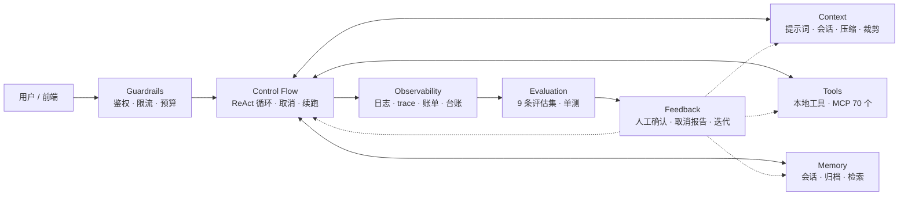
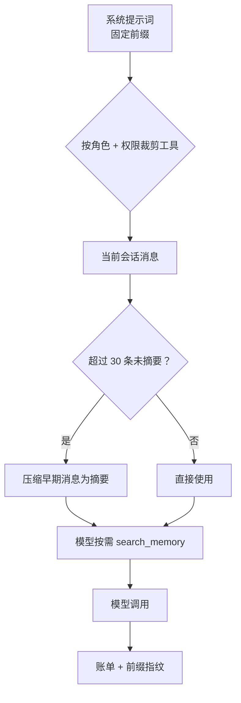
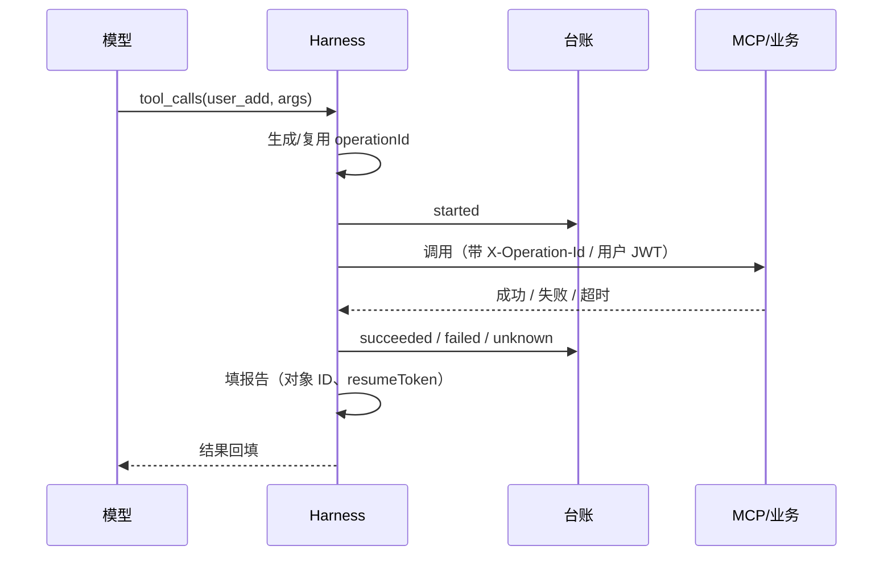
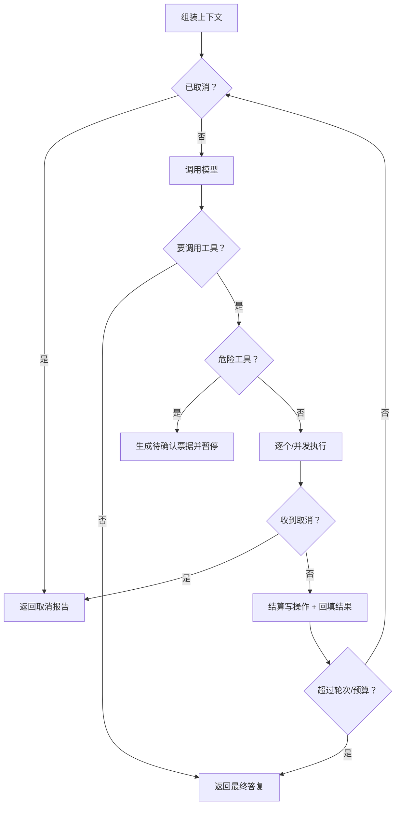
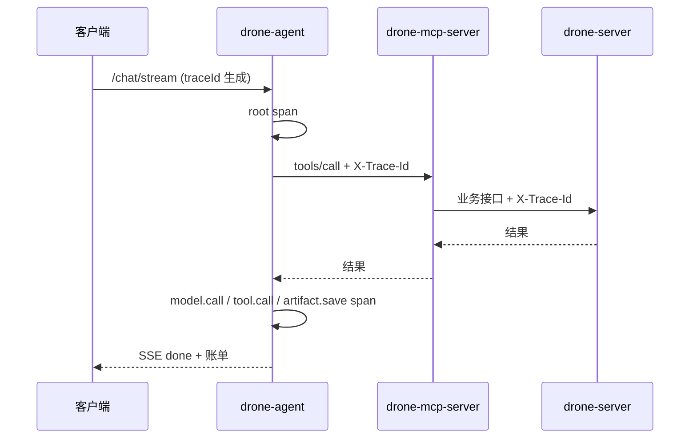
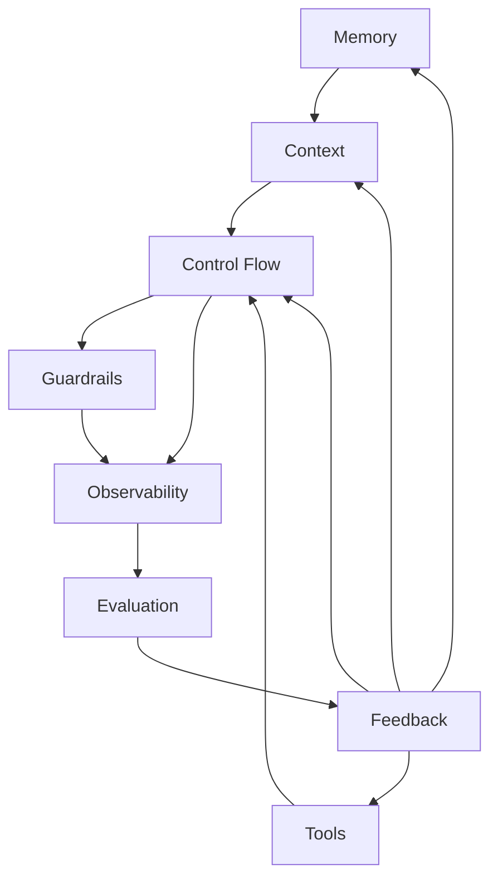

# 智能助手「Agent Harness」总结手册（面向初级工程师）

> **读者定位**：能看懂 Spring Boot 与 Vue，做过后端接口或前端页面，但对「模型之外那圈代码为什么重要」还没有系统认识的工程师。
> **写法**：先讲这一类问题在业务上是什么，再讲本项目怎么实现、亮点与不足，最后给迭代方向、简历话术与面试答题要点。
> **范围**：`drone-agent` 的 Harness 全链路（上下文、工具、记忆、编排、防护、评估、可观测、反馈）。
> **口径**：代码与数据截至 2026-10-26（`REQ-AGENT-0030` 已落地，`drone-agent` 单测 392 条）。
> **相关手册**：`上下文工程`、`工具调用`、`记忆子系统`、`提示词工程`、`业务流程Skill`、`MCP接入`、`知识库检索`——它们分别讲一个器官；本手册讲这些器官如何组成一个能跑、能停、能查、能改的**运行时**。
>
> **2026-10-29 更新**：本文口径截至 2026-10-26；此后 Plan / SubAgent / TaskRouter 已落地，
> Control Flow 章节中“只有 ReAct、没有 Plan、没有子 Agent”等描述已过时；文中的工具数、单测数等
> 也是当时口径，最新以代码与评估记录为准。最新实现见
> [架构 Wiki](../../docs/wiki/drone-agent-架构.md) 与
> [框架对比手册](./Agent框架对比-Harness视角-初级工程师手册.md)。

---

## 第一部分 · 先搞清楚：Harness 是什么

### 1.1 一句话定义

**Harness（挽具/ harness engineering，下文简称 HE）就是「模型之外，决定 Agent 能做什么、怎么做、做错怎么办」的全部运行时代码与配置。**

模型只负责「下一步该说什么/调什么」；真正让它变成一个可用系统的，是外面这圈东西：

- 这次请求给它看什么（上下文）；
- 它能看到哪些工具、怎么执行、失败怎么办（工具层）；
- 上一轮说过的话、上个月的任务还在不在（记忆）；
- 它想连调十步时，谁负责循环、超时、重试、停止（控制流）；
- 它想删数据、越权、烧钱时，谁拦得住（约束防护）；
- 改完到底有没有变好（评估）；
- 出了问题能不能还原现场（可观测）；
- 用户的确认、取消、纠正，如何变成下一版改进（反馈）。

一个常见的比喻：**模型是发动机，Harness 是底盘、变速箱、刹车和仪表盘。** 发动机换一代，车会更快；但底盘不行，再好的发动机也跑不稳。

### 1.2 为什么同一模型，效果能差出数倍

2026 年业界讨论 Harness 时，最常被引用的一句话是：**同一个模型、同一套基准，换一套 Harness，任务成功率可能相差数倍**（公开分享里常提到 6×，具体倍数取决于基准与任务，不宜当成定论）。原因不神秘：

- 模型看不到该看的上下文，就会猜；
- 工具描述互相重叠，就会选错；
- 没有轮次/超时/预算，就会死循环或烧钱；
- 没有确认与幂等，就会重复创建、误删；
- 没有评估与追踪，就不知道改的是好是坏。

本项目有很直观的对照：给 admin 下发 74 个工具定义时，**仅工具定义就约 10,612 token**；按角色裁剪后，飞手只看到 22 个工具，单次实际 prompt 从 12,428 降到 5,136（**−58.7%**）。模型没换，体验和成本都变了。

### 1.3 八个分类：一张体检表

你给出的八类，与 2026 年多篇 Harness 综述/工程实践的分类基本对齐。可以把它当成**体检表**，而不是必须遵守的标准：

| # | 分类 | 一句话职责 | 本项目主要落点 | 自评成熟度 |
|---|---|---|---|---|
| 1 | **Context**（上下文工程） | 这次请求让模型看到什么、各看多少 | `ContextAssembler`、压缩、工具裁剪、账单、前缀缓存 | ★★★★☆ |
| 2 | **Tools**（工具层） | 模型能做什么、怎么安全地做 | 本地工具 + MCP 70 个业务工具、治理、幂等 | ★★★★☆ |
| 3 | **Memory**（记忆） | 跨轮、跨会话还记得什么 | 会话存储、归档、索引、`search_memory` | ★★★☆☆ |
| 4 | **Control Flow**（控制流/编排） | 谁来循环、何时停、失败怎么办 | `ToolCallingService` ReAct 循环、取消、续跑 | ★★★☆☆ |
| 5 | **Guardrails**（约束防护） | 越权/误删/注入/烧钱时谁拦 | RBAC、危险确认、数据信封、预算、限流 | ★★★★☆ |
| 6 | **Evaluation**（评估） | 改完到底有没有变好 | 9 条上下文评估集、392 条单测、回归记录 | ★★☆☆☆ |
| 7 | **Observability**（可观测/审计） | 出了问题能否还原现场 | traceId、span、账单、台账、审计日志 | ★★★☆☆ |
| 8 | **Feedback**（反馈学习） | 用户与运行数据如何变成下一版改进 | 人工确认、取消报告、评估驱动的**人工**迭代 | ★☆☆☆☆ |

> 成熟度是**项目自评**，不是行业评级。打分依据写在各节的「亮点 / 不足」里。

### 1.4 2026 年的最新分类与方向（先看地图）

2026 年 Harness Engineering 的一个明显变化是：**从博客经验走向综述化、分类化、可评估化**。公开可见的代表材料：

| 材料（2026） | 它补了什么 |
|---|---|
| Meng 等《Agent Harness for Large Language Model Agents: A Survey》 | 系统梳理 harness 概念演进与现有工作，是“Harness 作为独立研究对象”的代表 |
| 《Agent Harness Engineering: A Survey》（Picrew） | 给出 Harness 的分类树（公开页面显示为七个分支），把组件拆到可讨论的粒度 |
| OpenReview《Harness Engineering for LLM Agents: A Survey of Harness Component Taxonomy, Evaluation, and Model–Harness Coevolution》 | 把**组件分类、评估、模型–框架协同演化**放在同一框架里 |
| arXiv《A Survey on Agent System and Harness Design》 | 从 Agent 系统设计角度讨论 Harness 的边界与取舍 |
| arXiv《Observability-Driven Automatic Evolution of Coding-Agent Harnesses》 | 提出用**可观测数据自动演化 harness** 的方向 |
| arXiv《A Two-Dimensional Framework for AI Agent Design Patterns》 | 用“认知能力 × 协作拓扑”等维度整理 Agent 设计模式 |
| Snowflake / dev.to / awesome-harness-engineering | 工程侧共识：Harness = 模型之外的运行时层，覆盖工具、上下文、记忆、状态、防护、可观测与人机协同 |

由此可以提炼出**三条最新主线**：

1. **分类在收敛，但没有唯一标准。**
   七类、八类、十类都有；差异主要在「状态/产物」「人机协同」「成本/延迟」是单列还是并入其他类。
   本手册建议在你给的八类之外，额外关注两类：
   - **State / Artifacts（状态与产物）**：跨轮任务状态、文件产物、可恢复执行点；
   - **Cost / Latency（成本与延迟）**：token、缓存、并发、P95，不只是“能不能做对”。

2. **Model–Harness Coevolution（模型与框架协同演化）。**
   模型升级会改变 Harness 的最优解：上一代需要的“强制分步提示”，新一代模型可能不需要；
   上一代不擅长的工具选择，新一代可能自己会。**Harness 必须可重评、可替换，不能把某代模型的怪癖写死。**

3. **Observability-driven evolution（可观测驱动的自动演化）。**
   先用 trace/评估把失败模式量化，再反过来改上下文、工具描述、控制流。
   这比“拍脑袋改提示词”可靠，也是 2026 年论文与工程工具的共同方向。

**Agent 设计模式**是 Control Flow 层的“战术库”，常见的有：

> 先澄清一个容易混的说法：如果你说的“Agent 设计模型”是指 ReAct / Plan-and-Execute 这类**执行模式**，
> 那它属于 Control Flow；如果指的是“模型与框架如何分工、如何一起演进”，那更接近下面的
> **Model–Harness Coevolution**。两者不是一回事。

| 模式 | 一句话 | 适合 |
|---|---|---|
| **ReAct** | 想一步、调一次工具、看结果、再想 | 大多数查询/操作类任务；本项目当前主模式 |
| **Plan-and-Execute** | 先列计划，再逐步执行，可重规划 | 多步骤、步骤间依赖强的任务（日报、批量配置） |
| **Reflection / Reflexion** | 做完先自检/复盘，再决定重试或修正 | 高风险写操作、长报告、代码类任务 |
| **ReWOO** | 先把工具调用计划好，再批量取数 | 工具调用可预知、想减少模型往返 |
| **Multi-Agent** | 多个角色分工（规划/执行/审核） | 超长流程、需要独立审核视角 |

> **本项目的定位**：ReAct + 强约束（轮次/超时/预算/确认/取消），没有 Plan 产物、没有 Reflection 审核、没有多 Agent。
> 这不是“落后”，而是当前业务（设备查询、任务操作、日报）用 ReAct 足够；真正的短板在 **Evaluation 与 Feedback**。

### 1.5 本项目 Harness 全景



一条请求的真实顺序是：

```text
鉴权/权限 → 限流 → 预算 → 会话锁 → 组装上下文 → 裁剪工具
→ 模型（可能多轮）→ 工具执行（读写分离/超时/取消）
→ 回填结果 → 再问模型 → 产物落盘 → 写会话 → 账单/trace
```

任何一个环节缺失，模型本身都不会“报错”，但系统会以四种方式坏掉：**答错、越权、烧钱、无法解释**。

---

## 第二部分 · 八个分类逐个讲

每一节都按同一个顺序：**分类是什么 → 本项目实现 → 亮点 → 不足 → 迭代方向**。

---

## 2.1 Context（上下文工程）

### 2.1.1 分类是什么

**上下文工程，就是决定“这一次请求里，模型能看到什么、看不到什么、各看多少”。**

它要同时平衡四件事：

| 目标 | 业务含义 | 做不好会怎样 |
|---|---|---|
| 记得住 | 跨轮、跨会话接得上 | 用户说“就按刚才说的办”，模型不知道“刚才” |
| 答得准 | 该查的查、该看的看 | 模型靠猜，答非所问 |
| 花得少 | 固定成本可控 | 一句“有多少设备”也付整页上下文的钱 |
| 不越界 | 只看权限内的内容 | 飞手看到删除设备、角色授权 |

上下文不是“越多越好”。长上下文会带来 **context rot**：关键信息被埋在中间时召回下降，
而且每轮都要重新计费。**上下文要像预算一样管理，不能像仓库一样堆满。**

### 2.1.2 本项目怎么做的

| 机制 | 实现 | 作用 |
|---|---|---|
| 上下文组装 | `memory/ContextAssembler` | 系统提示词 + 会话消息 + 长期记忆（按需）+ 工具定义 |
| 提示词版本化 | `prompt/PromptCatalog` + `prompts/**/*.md` | 提示词只在文件里，带 version/changelog；改文案不动代码 |
| 工具按角色/权限裁剪 | `tool/ToolVisibility` + `ToolGovernance` | 74 个工具按角色门 + 权限门收窄后再下发 |
| 会话内压缩 | `memory/ConversationCompactor` | 超过 30 条未摘要消息，把早期消息压成摘要，保留最近 10 条 |
| 长期记忆按需检索 | `memory/MemorySearchTool` | 默认不再每轮注入，模型需要时调 `search_memory` |
| Skill 资源独立预算 | `REQ-AGENT-0019` | 模板/口径不参与通用压缩，但有单次 32,768、累计 30,000 字符上限 |
| 工具结果预算 | `ToolCallingService.fit` | 单次 2,000 字符、单请求累计 6,000 字符；超出只留省略标记 |
| 上下文账单 | `bill/BillStore` + `context/ContextBill` | 每次调用记录系统/记忆/会话/工具/摘要各占多少 token，并与真实 prompt_tokens 对账 |
| 前缀缓存稳定 | `REQ-AGENT-0022` | 固定前缀顺序、输出前缀指纹；实测命中率 96.5% |
| 系统提示词瘦身 | `REQ-AGENT-0024` | 模板 3,673 → 1,594 字符（−56.6%），估算 token 1,844 → 848（−54.0%） |

一次请求的上下文流水线：



### 2.1.3 亮点

1. **把“感觉”变成了账单**：每次模型调用都能说清各段占多少 token，并与真实 `prompt_tokens` 对账（通常 ±2% 内）。
2. **固定成本显著下降**：系统提示词瘦身 54%，工具裁剪让飞手单次 prompt 下降 58.7%。
3. **长会话不断片**：21 条早期消息压成 788 字，模型仍能复述最早的业务事实。
4. **长期记忆从“每轮硬塞”改为“按需检索”**：固定成本几乎归零；评估集中“无条件注入长期记忆”为 0 次。
5. **前缀缓存稳定**：评估集平均命中 96.5%，同一配置下前缀指纹只有 1 个。

### 2.1.4 不足

- **系统提示词仍是“一份静态模板”**：没有按任务类型（查询/操作/日报/闲聊）切换或组合模块，所有场景共用一套规则。
- **工具定义仍是“角色内全量”**：admin 每次仍要背 74 个工具、约 10,612 token；没有“按当前问题检索最相关的 10 个工具”。
- **压缩是“摘要式丢信息”**：没有结构化的任务状态（目标、约束、已完成、待确认），长流程压缩后可能丢关键约束。
- **长期记忆检索只有关键词**：编号/人名/任务号很准，但同义表达、跨语言、语义召回不行。
- **没有上下文质量监控**：账单能看 token，但看不出“这次是不是因为少给了某段信息而答错”。
- **评估集只有 9 条**，覆盖不了所有上下文退化模式。

### 2.1.5 迭代方向

1. **结构化任务状态卡（State）**：压缩时除了摘要，额外抽取 `goal / constraints / done / pending`，作为固定段保留，避免“摘要丢约束”。
2. **工具检索（Tool RAG）**：按当前问题先召回 8~12 个候选工具，再下发；从“角色裁剪”升级为“任务裁剪”。
3. **记忆混合检索**：关键词 + 向量 + 时间衰减；对编号用关键词，对自然语言用语义。
4. **上下文预算策略化**：按任务类型分配预算（日报允许更大 Skill 预算，闲聊收紧），而不是一套全局阈值。
5. **上下文评估进 CI**：把 9 条扩到 30~50 条，并纳入每次提示词/裁剪策略变更。

---

## 2.2 Tools（工具层）

### 2.2.1 分类是什么

**工具层负责回答：模型能做什么、每个动作的边界是什么、失败/重复/并发时怎么办。**

一个成熟工具层至少要解决六件事：

| 问题 | 不解决会怎样 |
|---|---|
| 工具怎么描述 | 模型不知道何时用、怎么传参 |
| 工具怎么发现 | 新增能力要改代码、重启 |
| 谁能用 | 越权调用、数据越界 |
| 怎么执行 | 超时、并发、结果过大拖垮上下文 |
| 重复调用怎么办 | 重试/续跑重复创建 |
| 执行到一半取消怎么办 | 半成品、结果未知、无法解释 |

### 2.2.2 本项目怎么做的

| 机制 | 实现 | 说明 |
|---|---|---|
| 行为与元数据分离 | `tool/Tool` + `application.yml` 的 `agent.tool.catalog` | 代码只提供行为；名字/描述/Schema/是否只读在配置里，按 name 对齐，对不上启动失败 |
| 本地工具 | 4 个 | `search_knowledge`、`search_memory`、`use_skill`、`read_skill_resource` |
| MCP 业务工具 | `drone-mcp-server` 暴露 70 个 `drone__*` | 启动时从 `tools/list` 自动注册；用户 JWT 原样转发，权限与审计落到真人 |
| 角色/权限裁剪 | `ToolGovernance` + `ToolVisibility` | 角色门 + 权限门是 AND；执行前还会再判一次角色 |
| 危险工具 | `agent.tool.dangerous` + `role-tools` | 删除/授权/状态翻转/撤回等；必须显式授予角色，否则谁都不可用（fail-closed） |
| 执行参数 | `ToolProperties` | 最多 8 轮、单工具 15s、只读并发 4 线程、失败重试 1 次、单次结果 2,000 字/总量 6,000 字 |
| 写操作幂等 | `REQ-AGENT-0027` + `operationId` | 同一 operationId + 用户 + 工具 + 参数只执行一次；续跑复用 |
| 取消与待确认 | `REQ-AGENT-0029` | 票据落盘、重启可确认、最多执行一次、取消作废；写台账 + 部分报告 |
| 结果信封 | `prompt/ToolResultEnvelope` | 工具结果是“数据不是指令”，降低注入风险 |

一条写工具的完整生命周期：



### 2.2.3 亮点

1. **元数据外置**：改工具描述、参数 Schema 不用改代码；启动时做“行为 ↔ 元数据”一致性校验。
2. **MCP 标准化接入**：业务能力以协议方式接入，70 个工具不写死在 agent 里；身份原样转发，避免“助手变成超级账号”。
3. **工具裁剪有量化效果**：飞手 22/74，单次 prompt −58.7%，同时降低选错工具概率。
4. **写操作可追溯、可去重**：operationId 端到端贯通（agent → MCP → 上游），续跑不重复创建。
5. **取消语义完整**：不是“拔电源”，而是“停止后续 + 在途写结算 + 如实报告 + 可继续/可撤销”。

### 2.2.4 不足

- **没有“按问题选工具”**：同一角色内仍是全量下发；74 个工具对模型是实打实的选择负担。
- **没有调用前 Schema 校验**：模型给错参数时，多数情况靠下游报错回来，浪费一轮。
- **没有工具级配额/熔断**：只有全局超时与请求预算；某个工具持续 5xx 时，仍会被反复调用。
- **没有工具版本化**：MCP 工具描述随服务端变化，agent 侧没有版本/兼容性记录。
- **没有沙箱**：工具执行依赖远端权限与本地超时，没有进程级隔离（当前工具均为受控 MCP，本地工具也不执行任意代码，但这是“当前没有”，不是“架构保证”）。
- **结果压缩会调用模型摘要**：省 token，但增加一次调用与延迟，且可能丢细节。

### 2.2.5 迭代方向

1. **Tool RAG**：按问题召回候选工具，再让模型选；配套“工具描述质量”评估。
2. **入口校验 + 失败分类**：参数 Schema 校验、业务错误/网络错误/超时三类分开回填，减少无效重试。
3. **工具级 SLO**：成功率、P95、错误码、调用次数；失败率高时熔断/降级。
4. **工具版本与能力声明**：`name@version`、所需权限、是否幂等、是否危险，形成可审计的工具目录。
5. **更细的写操作语义**：把“最多一次”的票据与“可重试”的幂等分开建模，支持“先查后写”的标准动作。

---

## 2.3 Memory（记忆）

### 2.3.1 分类是什么

**记忆负责回答：哪些信息要跨轮保留、跨会话保留、保留多久、谁可以看、怎么删。**

它和上下文工程的区别是：上下文是“这次给模型看什么”，记忆是“系统长期存什么”。
记忆做不好，通常不是“记不住”，而是：

- 记了不该记的（越权、隐私）；
- 该忘的没忘（删了还能查到）；
- 记了太多（每轮都注入，成本失控）；
- 记了但取不出来（有存储、没检索）。

### 2.3.2 本项目怎么做的

| 机制 | 实现 | 说明 |
|---|---|---|
| 会话存储 | `memory/SessionStore` | 内存保留最近会话；500 个会话、30 分钟空闲、单会话 200 条 |
| 落盘归档 | `memory/SessionArchiver` / `LongTermMemoryStore` | 驱逐/停机时写正文；单文件 2MB 滚动 |
| 索引 | `memory/MemoryIndex` | 按用户记录会话摘要，不读正文即可列会话 |
| 长期记忆检索 | `memory/MemorySearchTool` | 只读当前用户归档；关键词打分，最多 3 段、总长 2,000 字 |
| 默认不注入 | `agent.memory.inject-enabled: false` | 从“每轮 10 轮/8,000 字”改为“模型按需查” |
| 删除语义 | 删除会话 → 内存/正文/索引三处一起清 | 删除后检索立即失效 |
| 停机刷盘 | `MemoryShutdownFlusher` | 停机前把内存会话落盘，避免丢 |
| 审计 | `MemoryAuditLog` | 删除会话先写审计，再删除 |
| 知识库（另一条线） | `kb` + `vector` + Milvus | 内部资料走嵌入 + 向量 + 权限码过滤，与“对话记忆”分开 |

### 2.3.3 亮点

1. **固定成本归零**：长期记忆默认不注入；评估集“无条件注入”为 0 次。
2. **隔离是硬边界**：检索只读 `<root>/<userId>/`；`ToolContext.userId()` 为空时 fail-closed。
3. **删除是真的删除**：会话删除同时清内存、正文、索引；不会“删了还能搜到”。
4. **检索够快**：关键词检索 5ms 级命中，适合编号/人名/任务号。
5. **有停机保护**：`MemoryShutdownFlusher` 避免重启丢最近会话。

### 2.3.4 不足

- **只有关键词检索**：同义表达、跨语言、语义相似会漏；没有向量/混合召回。
- **记忆粒度是“会话摘录”**：没有事实级记忆（用户偏好、设备别名、长期约束），每次都要从原文里找。
- **没有主动写入工具**：用户说“记住……”时，没有 `remember` 工具；只能等会话归档。
- **没有更新/遗忘机制**：事实变化（换了负责人）后，旧记忆仍在；没有冲突消解。
- **没有保留期策略**：对话记忆没有 TTL/归档分层，只有“删会话”。
- **单实例文件存储**：多实例共享、容量治理都没有。
- **记忆没有独立评估**：只有 1 条 C09 用例覆盖。

### 2.3.5 迭代方向

1. **混合检索**：关键词 + 向量 + 时间衰减；编号走关键词，自然语言走向量。
2. **记忆分层**：`episodic（会话） / semantic（事实） / procedural（流程偏好）`，不同类型不同 TTL 与检索方式。
3. **写入与遗忘工具**：`remember / forget / update_memory`，带权限与审计；危险操作仍走确认。
4. **保留期与容量治理**：按用户/类型设 TTL、冷热分层、配额。
5. **记忆评估**：正确召回、错误召回、删除后不可见、跨用户隔离，四类指标。

---

## 2.4 Control Flow（控制流/编排）

### 2.4.1 分类是什么

**控制流负责回答：一次请求里，模型与工具如何交替、循环几次、何时停、失败怎么办、用户取消怎么办。**

它决定了 Agent 是“一次问答”还是“能完成多步任务”。核心问题：

- 循环终止条件是什么？
- 工具结果怎么回填？
- 重试/并行/超时的边界？
- 危险操作在哪暂停？
- 用户取消/断线时，在途操作怎么收尾？
- 长任务能不能恢复？

### 2.4.2 本项目怎么做的

| 机制 | 实现 | 说明 |
|---|---|---|
| 主循环 | `service/ToolCallingService` | 模型 → 工具 → 回填 → 再问；最多 8 轮 |
| 终止条件 | 轮次上限 / 不再要工具 / 预算超限 / 取消 / 工具被收回 | 超过上限不再给工具，逼模型收尾 |
| 失败重试 | `max-retries: 1` | 按“事故轮数”计，不是无限重试 |
| 并行 | 只读工具最多 4 线程 | 写工具串行，避免并发副作用 |
| 超时 | 单工具 15s | 超时只把这一个工具按失败回填，不拖垮整轮 |
| 流式 | `ChatService.streamStep` + SSE | reasoning / content / status 三类事件 |
| 危险暂停 | `pause()` + 待确认票据 | 整轮不执行，先生成票据 |
| 取消 | `CancellationRegistry` + 检查点 | 轮次前、模型返回后、每个工具前；读工具立即放弃等待，写工具等结算 |
| 断线 | SSE 写失败/超时回调置位 | 在下一个检查点停 |
| 续跑 | `ResumeToken` + `operationId` | 按“工具 + 参数摘要”对回已完成步骤 |
| 预算/限流 | `BudgetService` / `RateLimiter` | 单请求 60k、日 500k；用户 2 QPS/2 并发，全局 20/20 |

主循环（简化）：



### 2.4.3 亮点

1. **边界明确**：8 轮、15s、1 次重试、2,000/6,000 字符、60k/500k token、2 QPS/2 并发——每个数字都有对应的“为什么”。
2. **流式 + 取消 + 续跑是一套完整语义**：不是三个独立功能；取消报告、resumeToken、幂等是一起工作的。
3. **读写分离执行**：只读并发、写串行；在途写等结算，读可立即放弃。
4. **危险操作可暂停、可恢复**：票据落盘，重启仍可确认；最多执行一次。
5. **392 条单测**把大部分边界行为锁住了（取消、预算、并行、压缩、续跑、报告）。

### 2.4.4 不足

- **只有 ReAct 一种模式**：日报、批量配置、查询都用同一套循环；没有计划产物、没有步骤依赖表达。
- **没有自检/反思**：模型说“已完成”就结束；没有 verifier 检查“是否真的完成、是否漏步”。
- **没有持久化工作流**：除了待确认票据，长任务没有状态机/断点续跑；进程重启后无法从第 3 步继续。
- **没有时间预算**：只有 token 预算；一个慢工具 + 多轮仍可能拖很久（评估集 P95 48.7s）。
- **重试粒度粗**：按“轮”计，不区分可重试错误（429/5xx）与不可重试错误（4xx 业务失败）。
- **模型调用在途不能中断**：取消要等本轮模型返回；流式只是停止读取，不是停止生成。
- **没有多 Agent/子任务**：复杂任务无法拆给子代理并行做。

### 2.4.5 迭代方向

1. **Plan-and-Execute（只对多步任务启用）**：先产出结构化计划（步骤/依赖/验收），再逐步执行；简单问题仍走 ReAct。
2. **Reflection / Verifier**：高风险写操作后做一次“结果核对”（查询确认），不通过则报告而不是假装完成。
3. **持久化执行状态**：把“目标、步骤、已完成、待确认、产物”落到可恢复存储；支持断点续跑。
4. **时间预算与退避**：按请求设 wall-clock 上限；对 429/5xx 做指数退避，对 4xx 直接失败。
5. **子代理**：把“取数/分析/写报告”拆成子任务，主循环只做编排与验收。

---

## 2.5 Guardrails（约束防护）

### 2.5.1 分类是什么

**约束防护负责回答：模型想越权、误删、被注入、烧钱、泄露时，系统能不能拦住。**

它不是一条规则，而是**多层防线**：

| 层 | 典型手段 |
|---|---|
| 身份 | 登录、Token 验签、权限每次查库 |
| 能力 | 工具可见性、危险工具白名单、执行前复核 |
| 数据 | 数据信封、权限过滤、脱敏、文件权限 |
| 行为 | 人工确认、幂等、取消/撤销 |
| 资源 | 限流、并发、token 预算、超时 |
| 审计 | 危险操作审计、写台账、删除审计 |

**关键原则：前端隐藏入口不算边界；模型“看不到”也不等于“不能调用”。执行侧必须再判一次。**

### 2.5.2 本项目怎么做的

| 防线 | 实现 | 说明 |
|---|---|---|
| 身份 | `drone-server` 签发 JWT；agent 用同一密钥/issuer 验签 | Token 只装 `sub`/`username`；权限每次查库 |
| 服务间 | `/internal/**` + `X-Internal-Token` | 不暴露到网关之外 |
| 工具可见性 | 角色门 + 权限门 | 飞手看不到危险工具 |
| 执行复核 | `ToolCallingService.doRunTool` 再判角色 | 即使模型被诱导调用，也过不了执行侧 |
| 危险确认 | `agent.tool.dangerous` + 待确认票据 | 删除/授权/撤回等必须人工确认 |
| 注入防护 | `<tool_result>` 信封 + 系统提示词 | 外部内容是数据，不是指令 |
| 写幂等 | `operationId + 用户 + 工具 + 参数` | 重试/续跑不重复创建 |
| 预算 | 单请求 60k、日 500k | 超限停止循环/拒绝请求 |
| 限流 | 用户 2 QPS / 2 并发；全局 20 QPS / 20 并发 | 超限直接拒绝，不调模型、不占会话锁 |
| 脱敏 | `SensitiveMasker` | 日志/摘要里不出现完整参数与正文 |
| 文件 | `data/` 已被 `.gitignore`；票据文件 600 | 降低误提交/越权读取风险 |
| 审计 | `ToolAuditLog`、`WriteJournal`、`MemoryAuditLog` | 危险操作、写操作、删除都可追 |

### 2.5.3 亮点

1. **纵深防御**：可见性、执行复核、危险确认、幂等、预算、限流是六层，不依赖单点。
2. **fail-closed**：`anonymous()` 没有身份时工具什么都不给；危险工具未显式授权则谁都不可用。
3. **限制是“可解释的数字”**：每个阈值都有业务依据，不是拍脑袋。
4. **删除有审计**：删会话先写审计再删；写操作有台账与对象 ID。
5. **限流不占资源**：超限在创建 emitter 之前拒绝，不调模型、不占会话锁。

### 2.5.4 不足

- **注入防护偏“约定”**：靠数据信封 + 提示词，没有独立的注入分类器/规则引擎；知识库内容被检索出来后仍依赖模型自律。
- **输出侧没有守卫**：没有敏感信息检测、危险链接/HTML 过滤；产物是下载而非内联渲染，风险较低，但没有正式策略。
- **RBAC 粒度偏粗**：按权限码裁工具，但没有“工具级参数范围”（例如只能查自己部门的数据）。
- **限流是单实例内存**：多实例部署时用户 QPS/并发不共享。
- **审计覆盖不全**：危险操作与写操作有审计；普通读工具没有统一审计（只有 trace span）。
- **没有安全评估/红队集**：注入样本只有 `docs/tests/REQ-AGENT-0009-注入样本.md`，没有持续回归。
- **没有策略即代码**：危险清单、角色映射在 YAML 里，缺少变更评审与自动化校验（目前靠启动校验）。

### 2.5.5 迭代方向

1. **红队评估集**：把注入、越权、诱导删除、数据外带做成固定用例，每次改提示词/工具都跑。
2. **输入/输出双向守卫**：输入侧做注入分类/规则；输出侧做敏感信息与危险链接检测。
3. **工具级策略**：在“能不能用”之上增加“能用到什么范围”（参数约束、数据范围）。
4. **分布式限流**：Redis/网关统一配额；保留单机兜底。
5. **全量工具审计 + 策略即代码**：所有工具调用落审计；危险清单/角色映射走代码评审与自动校验。

---

## 2.6 Evaluation（评估）

### 2.6.1 分类是什么

**评估负责回答：改完到底有没有变好，而不是“感觉好像聪明了”。**

Agent 评估比传统接口测试难，因为：

- 输出是自然语言，没有唯一答案；
- 过程比结果重要（工具选错但答案蒙对，也是失败）；
- 一次运行有随机性，受模型版本、温度、上下文影响；
- 成本与延迟本身就是指标。

一个可用的评估体系通常有三层：

| 层 | 看什么 | 本项目现状 |
|---|---|---|
| 单测/组件 | 纯逻辑、边界、异常 | 392 条，较完整 |
| 轨迹评估 | 工具选择、步数、冗余、是否越权 | 只有“预期工具/禁用工具”粗粒度 |
| 端到端评估 | 最终回答、延迟、token、缓存 | 9 条真实问题，手工跑 |

### 2.6.2 本项目怎么做的

| 机制 | 实现 | 说明 |
|---|---|---|
| 评估集 | `tools/context-eval/cases.json` | 9 条可跑用例（C10 日报为 heavy，默认跳过） |
| 运行器 | `tools/context-eval/run_eval.py` | 真调模型，解析回答与日志 |
| 指标 | 通过率、工具选择、延迟、上下文 token、累计 prompt、缓存命中、记忆注入次数、前缀指纹 | 见 `docs/tests/REQ-AGENT-0023` |
| 单测 | `drone-agent` 392 条 | 覆盖编排、预算、限流、取消、票据、压缩、账单等 |
| 回归记录 | `docs/tests/REQ-AGENT-*.md` | 每个需求都有端到端/单测记录 |
| MCP 单测 | `drone-mcp-server` 30 条 | 目录、协议、转发、幂等 |

最近一次上下文评估结果（2026-10-23）：

```text
执行 9，通过 9（100.0%）
延迟：平均 12,864 ms，P95 48,691 ms
最终上下文：平均 14,750 token
累计 prompt：平均 39,990 token/用例
缓存命中率：平均 96.5%
前缀指纹：1 个
无条件注入长期记忆：0 次
```

### 2.6.3 亮点

1. **有“可复现的真实问题集”**：不是临时问两句，而是固定用例 + 固定断言 + 固定指标。
2. **指标覆盖成本与体验**：通过率之外，还看延迟、token、缓存命中、前缀稳定性。
3. **评估驱动过真实优化**：工具裁剪、提示词瘦身、长期记忆按需检索都用这 9 条做过前后对比。
4. **单测与端到端分工清楚**：纯逻辑用单测锁，模型行为用评估集看趋势。
5. **每次需求都有回归记录**，能追溯“哪次改动、什么结果”。

### 2.6.4 不足

- **规模小**：9 条覆盖 6 类场景，长尾、边界、对抗样本不足。
- **手工运行**：没有 CI 门禁，也没有 nightly；改完可能忘记跑。
- **只看终态**：工具选择只断言“有没有调预期/禁用工具”，没有看步数、重复调用、无效轮次。
- **没有 LLM-as-judge**：回答质量靠字符串断言，复杂答案（日报、分析）难评。
- **没有安全/记忆专项评估**：注入、越权、删除后不可见等没有固定集。
- **heavy 用例默认跳过**：日报这类高价值长流程反而覆盖少。
- **没有阈值与趋势**：没有“P95 ≤ X、通过率 ≥ Y”的硬门槛。

### 2.6.5 迭代方向

1. **CI/nightly 化**：每晚跑 9+ 条，输出报告；关键指标下降则告警。
2. **扩集与分层**：按能力（查询/操作/统计/知识/记忆/拒答/安全）扩到 30~50 条；heavy 用例单独夜间跑。
3. **轨迹指标**：步数、工具调用次数、重复调用、无效轮次、危险工具被拒次数。
4. **Judge + 人工抽检**：结构化答案用断言，开放答案用 judge + 人工抽检，避免“字符串断言”假通过。
5. **模型–Harness 矩阵**：同一套用例跑不同模型/不同 harness 配置，观察协同演化。

---

## 2.7 Observability（可观测/审计）

### 2.7.1 分类是什么

**可观测负责回答：这一次请求到底发生了什么，能不能还原现场、定位责任、算清成本。**

它不只是“打日志”，至少包括：

| 维度 | 回答的问题 |
|---|---|
| Trace | 一次请求经过哪些步骤、每步多久、哪步失败 |
| Logs | 关键节点的输入/输出/错误（不含敏感正文） |
| Metrics | 成功率、P95、token、缓存命中、限流拒绝 |
| Audit | 谁在什么时候做了什么危险/写操作 |
| Cost | 每个请求/用户/工具花多少 token、多少钱 |
| Artifacts | 产物在哪、属于谁、保留多久 |

### 2.7.2 本项目怎么做的

| 机制 | 实现 | 说明 |
|---|---|---|
| traceId | 每次请求生成；`X-Trace-Id` 透传到 MCP | agent 日志、账单、span 都能按 trace 串起来 |
| Span | `trace/TraceRecorder` | root / model.call / tool.call / artifact.save / budget.stop，按 `{userId}/{traceId}.jsonl` 落盘，7 天 TTL |
| 账单 | `bill/BillStore` | 每次模型调用一条 JSONL；记录 token、工具名、前缀指纹、缓存命中；30 天保留 |
| 账单页面 | `drone-web` `AgentBillsView` | 管理员按时间/用户查看，可视化各段 token |
| 写台账 | `journal/WriteJournal` | operationId、工具、参数摘要、状态、对象 ID |
| 审计 | `ToolAuditLog` / `MemoryAuditLog` | 危险操作审计；删除会话先审计 |
| 日志 | 中文、一进一出、带 traceId | 关键节点能串成一条链路；异步动作标明异步 |
| 限流/预算信号 | `RateLimiter` 拒绝原因、`budget.stop` span | 不是只返回一句“失败了” |

一次请求的观测链路：



### 2.7.3 亮点

1. **traceId 端到端透传**：即使跨 agent → MCP → server，也能按同一个 id 对齐日志。
2. **追踪按用户隔离**：`{userId}/{traceId}.jsonl`，别人拿到 traceId 也读不到。
3. **成本可对账**：账单的估算 token 与模型真实 `prompt_tokens` 通常 ±2% 内（HTML 重场景约 −4%）。
4. **写操作可追溯**：operationId + 台账 + 对象 ID，取消/撤销有据可查。
5. **追踪是旁路**：写失败只 WARN，不影响对话。

### 2.7.4 不足

- **只有 agent 侧 span**：`TraceRecorder` 明确写了“不采集 MCP/server 的 span”；跨服务只有 traceId，没有完整 span 树。
- **没有指标系统**：没有 Prometheus/OpenTelemetry；成功率、P95、错误率只能从日志/评估里算。
- **没有告警与看板**：账单页是成本视图，不是运行监控；没有“错误率突增/延迟突增”告警。
- **没有 trace 查询 UI**：只能翻 JSONL 文件。
- **日志解析耦合评估脚本**：`run_eval.py` 依赖固定中文标记，改日志措辞会破坏评估。
- **没有实时成本**：账单是落盘后查，不是请求级实时预算看板（预算是有，但观测滞后）。

### 2.7.5 迭代方向

1. **OpenTelemetry 全链路**：agent/MCP/server 统一 span，trace 树可查；保留 traceId 兼容。
2. **指标与看板**：QPS、成功率、P95、token/请求、缓存命中、限流拒绝、工具错误率。
3. **告警**：错误率/延迟/预算超限/注入命中，接现有告警通道。
4. **Trace UI**：按 traceId 展示时间线、工具参数摘要、结果状态（不展示正文）。
5. **成本归因**：按用户/会话/工具/模型维度汇总，支持配额与账单。

---

## 2.8 Feedback（反馈学习）

### 2.8.1 分类是什么

**反馈负责回答：用户与运行数据，如何变成下一版 Harness 的改进。**

它是最容易被忽略的一层，因为它不直接产生功能。常见反馈来源：

| 来源 | 例子 | 本项目 |
|---|---|---|
| 显式反馈 | 点赞/点踩、评分、纠错 | 没有 |
| 隐式反馈 | 重试、改写问题、放弃、点“继续/撤销” | 部分有（取消后的选择） |
| 人工确认 | 危险操作批准/拒绝 | 有 |
| 运行数据 | 失败 trace、评估结果、工具错误 | 有数据，未闭环 |
| 人工评审 | 抽检回答、复盘事故 | 有文档，无流程化 |

### 2.8.2 本项目怎么做的

| 机制 | 实现 | 说明 |
|---|---|---|
| 危险操作确认 | 待确认票据 + 确认/拒绝 | 用户的一次真实决策；拒绝会回填“用户拒绝” |
| 取消报告 | `CancellationReport` | 已完成/失败/未开始/未知 + 继续/撤销/保留 |
| 继续 | `resumeToken` + operationId 幂等 | 用户用行动表达“继续未完成步骤” |
| 撤销 | `CompensationPlanner` + 确认 | 用户显式发起；逆序、先查后改 |
| 失败话术 | 预算/限流/取消/兜底 | 让用户知道“为什么没做成”，而不是静默失败 |
| 评估驱动迭代 | 9 条评估集 + 回归记录 | 开发者根据结果人工改提示词/工具/上下文 |
| 审计 | 危险/写/删除审计 | 事后复盘的事实来源 |

### 2.8.3 亮点

1. **有“人机协同”的雏形**：危险操作能暂停，取消后能继续/撤销，不是全自动蛮干。
2. **反馈是结构化的**：取消报告不是一句“已取消”，而是分状态、带 token、可继续/可撤销。
3. **反馈驱动过真实改动**：上下文评估集推动了工具裁剪、提示词瘦身、记忆按需检索。
4. **拒绝也是反馈**：用户拒绝危险操作会被回填，模型不会当没发生。

### 2.8.4 不足

- **没有显式评价入口**：用户无法点“有用/没用”，也不知道答案错在哪。
- **没有失败样本沉淀**：评估集是手工维护，线上失败 trace 不会自动变成新用例。
- **没有自动优化闭环**：提示词/工具描述/裁剪策略仍靠人看评估结果手改。
- **没有 A/B 实验**：改一版提示词，无法按用户/流量对比。
- **没有用户纠正捕获**：用户改口、补充条件、重新描述，没有被记录为“上一轮理解错了”。
- **撤销是提示词驱动 MVP**：模型可能选错补偿工具；没有确定性执行器与失败残留报告。

### 2.8.5 迭代方向

1. **显式反馈**：回答下方“有用/没用 + 原因标签”；低分样本进入待评审队列。
2. **失败样本自动入集**：从 trace/取消报告/工具失败中抽取候选，人工确认后加入评估集。
3. **离线优化闭环**：提示词/工具描述变更 → 评估集跑分 → 对比 → 灰度；形成“改—测—放”的循环。
4. **A/B 与灰度**：按用户/会话分流两套 harness 配置，比较通过率、成本、延迟。
5. **确定性补偿执行器**：把撤销从“模型自由发挥”升级为“服务端按映射执行 + 人工确认”，失败即停并报告残留。

---

## 第三部分 · 横向看：依赖、优先级与路线

### 3.1 八类之间的依赖



两条重要结论：

1. **Control Flow 是脊柱**：Context/Tools/Memory 都要通过它才能变成一次请求。
2. **Evaluation + Observability 是眼睛**：没有它们，Feedback 只能靠感觉，其他六类无法证明“改好了”。

### 3.2 当前最该补的四件事

| 优先级 | 事项 | 为什么现在做 | 预期收益 |
|---|---|---|---|
| P0 | **评估进 CI + 扩集** | 已有 9 条和运行器，缺的是“每次改动都跑” | 防止提示词/工具改动悄悄退化 |
| P0 | **工具检索（Tool RAG）** | admin 仍背 74 个工具、10.6k token | 成本与选错率一起降 |
| P1 | **结构化状态 + 混合记忆** | 压缩会丢约束；记忆只支持关键词 | 长流程更稳、跨会话更准 |
| P1 | **OpenTelemetry + 指标告警** | 只有 agent span 与 JSONL，排障靠翻文件 | 线上问题定位从小时级降到分钟级 |
| P2 | **Plan/Reflection + 持久化执行** | 复杂任务仍是单 ReAct，重启不能续 | 支撑更长、更高价值的流程 |
| P2 | **反馈闭环 + A/B** | 有数据但无闭环 | 从“人改”走向“数据驱动” |

### 3.3 三阶段路线图

| 阶段 | 目标 | 关键动作 | 验收 |
|---|---|---|---|
| **P0（1~2 周）** | 看得见、测得准 | 评估集进 CI；补安全/记忆用例；工具调用轨迹指标 | 每晚报告；通过率/P95/成本有基线 |
| **P1（1~2 月）** | 选得准、记得住 | Tool RAG；结构化状态卡；记忆混合检索；OTel 指标 | admin prompt 再降 30%；长会话约束不丢 |
| **P2（1 季度）** | 跑得长、改得快 | Plan/Reflection；持久化执行；反馈入集；A/B | 复杂流程成功率提升；改动有数据对比 |

### 3.4 成熟度自评（1~5 分）

| 分类 | 分数 | 依据（一句话） |
|---|---|---|
| Context | 4 | 有账单、裁剪、压缩、缓存、评估；缺动态工具/状态卡 |
| Tools | 4 | MCP + 治理 + 幂等 + 取消；缺 Tool RAG/Schema 校验/熔断 |
| Memory | 3 | 隔离/按需/可删；缺语义/事实级/写入/保留期 |
| Control Flow | 3 | ReAct 稳、可取消可续跑；缺 Plan/Reflection/持久化 |
| Guardrails | 4 | 纵深防御、限流预算、确认幂等；缺安全评估/输出守卫 |
| Evaluation | 2 | 有 9 条与运行器；缺 CI/规模/轨迹/裁判 |
| Observability | 3 | traceId + span + 账单 + 台账；缺跨服务 span/metrics/告警 |
| Feedback | 1 | 有确认与取消报告；缺显式反馈与自动闭环 |

> 这组分数最适合放在面试里讲“我知道自己的系统强在哪、弱在哪”，而不是“我们什么都做了”。

---

## 第四部分 · 简历怎么写（Harness 视角）

> 原则：**动词 + 机制 + 数字 + 结果**。不要写“负责 AI 助手开发”，要写“把不可控的模型调用变成可约束、可观测、可恢复的运行时”。

1. **工具层**：设计 74 个工具（70 个 MCP 业务工具 + 4 个本地工具）的统一接入与治理，按角色/权限裁剪后飞手仅见 22 个，单次 prompt 下降 **58.7%**。
2. **上下文工程**：落地“账单 + 压缩 + 按需记忆 + 前缀缓存”，长会话 21 条早期消息压至 **788 字**，前缀缓存命中 **96.5%**。
3. **控制流**：实现 ReAct 工具循环（8 轮上限、15s 单工具超时、只读并发 4 线程），支持 SSE 流式、取消、待确认持久化与续跑，写操作 **operationId 幂等**。
4. **约束防护**：补齐危险工具确认、注入数据信封、单请求 60k/日 500k token 预算、用户 2 QPS/全局 20 QPS 限流，形成六层防线。
5. **可观测**：traceId 跨 agent/MCP/server 透传，按用户落盘 span 与账单，估算 token 与真实值对账误差 **±2%**。
6. **评估**：维护 9 条真实问题评估集（工具选择/延迟/token/缓存），配合 **392 条单测**；评估驱动的三次优化均以数据验收。

---

## 第五部分 · 常见面试题（含答题要点）

### Q1. 什么是 Agent Harness？它和模型、Agent 的区别是什么？

**要点**：模型只负责生成下一步；Agent 是“模型 + 循环 + 工具”的行为主体；Harness 是模型之外的运行时，负责上下文、工具、记忆、控制流、防护、评估、观测、反馈。可以类比发动机与底盘。

### Q2. 为什么同一个模型，换一套 Harness 效果会差很多？

**要点**：模型能看到的上下文、能选的工具、循环边界、失败处理、成本约束都变了。举例：74 个工具全量下发 vs 按角色裁剪到 22 个，prompt −58.7%，选错率也下降。

### Q3. 上下文工程具体在管什么？怎么衡量？

**要点**：管“看什么、看多少、何时看”。衡量用账单：系统/记忆/会话/工具/摘要各占多少 token，与真实 `prompt_tokens` 对账；再看缓存命中、延迟、通过率。关键是**预算化**，不是堆满。

### Q4. 工具是不是越多越好？怎么让模型选对？

**要点**：不是。工具描述互相重叠、数量过多会降低选择准确率，还增加固定 token。做法：按角色/权限裁剪、描述去重、按任务召回候选（Tool RAG）、执行前 Schema 校验、工具级成功率监控。

### Q5. 写操作如何保证不重复？

**要点**：`operationId + 用户 + 工具 + 参数` 做幂等键；operationId 在执行前生成并写台账，续跑时按“工具 + 参数摘要”复用；MCP 幂等层命中缓存，不再打上游。危险操作还有“最多一次”的票据消费（先删除后执行）。

### Q6. 用户取消时，正在执行的写操作怎么办？为什么不自动回滚？

**要点**：取消 = 停止后续 + 在途写等结算 + 如实报告；默认不回滚。因为写可能已经到达下游并提交，自动删除可能级联、误删、违反业务约束；超时场景下甚至不确定是否成功。撤销必须用户显式发起，走补偿计划 + 确认。

### Q7. 如何防提示词注入？

**要点**：三层：数据信封（外部内容是数据不是指令）、系统提示词明确边界、执行侧权限复核。再加：知识库按权限前置过滤、危险工具确认、工具结果不直接当命令。诚实说：没有独立注入分类器，这是待补项。

### Q8. Agent 怎么做评估？只看最终答案为什么不够？

**要点**：要分三层：单测、轨迹（工具选择/步数/重复/越权）、端到端（答案/延迟/token/缓存）。只看答案会出现“工具选错但蒙对”。还要有固定用例、阈值、CI、回归对比；开放答案用 judge + 人工抽检。

### Q9. 一次请求跨多个服务，怎么排障？

**要点**：请求入口生成 traceId，随 `X-Trace-Id` 透传；每层记录 span（模型/工具/产物）与关键日志；按用户/请求落盘，查询时按 traceId 拼时间线。当前只有 agent 侧 span，跨服务完整 span 树是下一步。

### Q10. 长期记忆为什么不再每轮注入？删了会话真的查不到吗？

**要点**：每轮注入固定成本高且与当前问题无关；改为模型按需 `search_memory`，固定成本归零。记忆按 `<root>/<userId>/` 隔离；删除会话同时清内存、正文、索引，检索立即失效；无身份时 fail-closed。

### Q11. 限流、预算、并发控制有什么区别？

**要点**：限流管“单位时间请求量”（QPS/并发），预算管“token 消耗”（单请求/日），并发控制管“同时执行数”（工具/用户）。三者解决不同问题：限流防打爆、预算防烧钱、并发防资源争抢。

### Q12. 你们 Harness 最弱的一环是什么？

**要点**：Evaluation 与 Feedback。评估只有 9 条、手工跑、看终态；反馈没有显式评价与自动入集，改提示词仍靠人。下一步是评估进 CI、扩集、轨迹指标、失败样本自动沉淀、A/B。**能说清短板，比背优点更加分。**

---

## 附录 · 一页速记

### 八类一句话

| 分类 | 一句话 |
|---|---|
| Context | 这次给模型看什么、各看多少 |
| Tools | 模型能做什么、怎么安全地做 |
| Memory | 跨轮跨会话记得什么、怎么删 |
| Control Flow | 谁循环、何时停、失败/取消怎么办 |
| Guardrails | 越权/误删/注入/烧钱谁拦 |
| Evaluation | 改完有没有变好 |
| Observability | 出事能不能还原现场 |
| Feedback | 用户与数据如何变成下一版 |

### 本项目的关键数字

| 指标 | 数值 |
|---|---|
| 工具总数 | 74（70 MCP + 4 本地） |
| 飞手可见工具 | 22 / 74 |
| 单次 prompt（裁剪前后） | 12,428 → 5,136（−58.7%） |
| 系统提示词 | 3,673 → 1,594 字符（−56.6%） |
| 上下文评估 | 9/9 通过，缓存命中 96.5% |
| 平均延迟 / P95 | 12.9s / 48.7s |
| 单测 | drone-agent 392，drone-mcp-server 30 |
| 工具循环 | 8 轮、15s/工具、4 线程只读并发、重试 1 |
| 预算 | 单请求 60k、日 500k token |
| 限流 | 用户 2 QPS/2 并发；全局 20 QPS/20 并发 |
| 记忆 | 500 会话、30m 空闲、200 条/会话、按需检索 |
| 保留 | trace 7d、账单 30d、待确认票据 5m |

### 三句话总结

1. **Harness 是模型之外的运行时**：上下文、工具、记忆、控制流、防护、评估、观测、反馈，缺一层就会以“答错、越权、烧钱、无法解释”的方式坏掉。
2. **本项目的强项是约束与可追溯**：74 工具治理、裁剪降本 58.7%、写操作幂等、取消/续跑、六层防护、trace + 账单。
3. **本项目的短板是评估与反馈**：9 条手工评估、看终态、无自动闭环；下一步是评估进 CI、轨迹指标、失败样本入集与 A/B。

---

## 参考资料（2026）

> 说明：以下为 2026 年公开可见的综述、工程文章与项目索引；本手册引用其**分类视角与方向**，不把其中任何单一结论当作定论。

- Meng et al., *Agent Harness for Large Language Model Agents: A Survey* (2026) — <https://www.preprints.org/manuscript/202604.0428>
- *Agent Harness Engineering: A Survey* — <https://picrew.github.io/LLM-Harness/>
- *Harness Engineering for LLM Agents: A Survey of Harness Component Taxonomy, Evaluation, and Model–Harness Coevolution* — <https://openreview.net/forum?id=1VJLY0hAFT>
- *A Survey on Agent System and Harness Design* (arXiv 2606.20683) — <https://arxiv.org/html/2606.20683v1>
- *Observability-Driven Automatic Evolution of Coding-Agent Harnesses* (arXiv 2604.25850) — <https://arxiv.org/html/2604.25850v1>
- *A Two-Dimensional Framework for AI Agent Design Patterns* (arXiv 2605.13850) — <https://arxiv.org/html/2605.13850v2>
- Snowflake, *Harness Engineering for Reliable AI Agents* — <https://www.snowflake.com/en/artificial-intelligence/ai-engineering/harness-engineering/>
- *Harness Engineering: The Infrastructure Layer That Makes AI Agents Actually Work* — <https://dev.to/vishalmysore/harness-engineering-the-infrastructure-layer-that-makes-ai-agents-actually-work-4nl1>
- *awesome-harness-engineering*（工具/模式/评估/记忆/MCP/权限/可观测/编排索引） — <https://github.com/ai-boost/awesome-harness-engineering>
- *AI Agents in 2026: Tools, Memory, Evals, and Guardrails* — <https://andriifurmanets.com/blogs/ai-agents-2026-practical-architecture-tools-memory-evals-guardrails>
- Cobus Greyling, *The Rise of AI Harness Engineering* — <https://cobusgreyling.medium.com/the-rise-of-ai-harness-engineering-5f5220de393e>
- *Agent Harness Engineering: A Comprehensive Survey*（导读） — <https://www.getorchestra.io/guides/agent-harness-engineering-survey>
