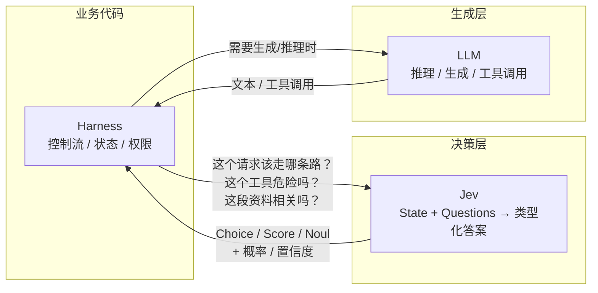

# Jev（System One）与 Agent Harness：来龙去脉、用法与本项目场景

> **读者定位**：会 Spring Boot / Java，知道 Agent 是“模型 + 工具循环”，但没接触过“决策模型”这一类组件。
> **写法**：先讲 Jev 是什么、为什么会出现，再讲 State / Questions / Choice / Score / Noul / Confidence，最后落到无人机业务场景与落地规则。
> **口径**：官方材料写作 **Jev**（用户也常写 JEV，本文统一用官方写法）；本文以 TypeSafe 官方文档、AgentScope 2.0.11 文档、LangChain 官方博客为准，查询日期 **2026-10-29**。
> **版本**：Jev 1.14（2026-10-14 发布，别名 `jev-latest`）；AgentScope 2.0.11；LangChain 1.4.7。
> **证据标记**：✅ = 官方文档/代码直接可见；⚠️ = 基于文档的推断或工程建议；📌 = 本项目现状。
> **重要提醒**：Jev 的主要训练语言是英文，**中文（CJK）可用但官方明确说准确率较低**；本文所有中文场景都必须先做本地评估，不能直接上线。

---

## 第一部分 · 先给结论

### 1.1 一句话

**Jev 不是 Agent，也不是 LLM。它是 Harness 里的“高频判断函数”：你给它一段 State 和几个结构化问题，它返回带概率的、类型安全的答案；控制流仍然在你自己的代码里。**

### 1.2 它是什么 / 不是什么

| 它是 | 它不是 |
|---|---|
| **System One 决策模型**：对 State 做快速、结构化的判断 | 不是聊天模型：不生成正文、代码、解释 |
| 返回 `Choice` / `Score` / `Noul` 的类型化答案 | 不是 Agent 框架：不自己选下一步、不调工具 |
| 返回概率分布与（部分类型的）置信度 | 不是传统分类器 API：支持自然语言指令、多问题并行、结构化 State |
| Harness 里的“判断点”组件 | 不是 LLM 的替代品：开放式推理与生成仍交给 LLM |

> TypeSafe 官方对它的定位是：**“unstructured state in, typed probabilistic decisions out”**；并且明确说 Jev 不生成文本，所以“不会编造选项之外的值”。⚠️ 注意：这并不表示判断一定正确——**它仍可能把类别判错**，概率/置信度就是给你处理“可能错”的。

### 1.3 最重要的一句话

**代码负责“做什么、什么时候做、做完怎么处理”；Jev 只负责“这一步的判断是什么”。**

这和我们在 [`Harness工程-初级工程师手册.md`](./Harness工程-初级工程师手册.md) 里的原则一致：模型是发动机，Harness 是底盘；Jev 不是换发动机，而是给底盘加一个**快速判断传感器**。

---

## 第二部分 · 来龙去脉

### 2.1 时间线（只列官方可核实的事实）

| 时间 | 事件 | 意义 |
|---|---|---|
| **2026-09-15** | TypeSafe AI 发布 **System One 模型**与首个模型 **Jev**（early access） | 提出“为软件做快速、结构化决策”的模型类别；用 RLCD（Reinforcement Learning for Calibrated Decisions）训练 |
| **2026-09-17** | LangChain 官方博客《Building a Harness with Jev》 | 明确把 Jev 放进 Agent Harness：模型路由、工具风险门禁；提供 `TypeSafeClassifier` 等集成 |
| **2026-09** | AgentScope 集成 `JevClassifierModel`（通过 TypeSafe SDK） | AgentScope 的 `ModelRouterMiddleware` 可以用 Jev 做模型路由 |
| **2026-10-14** | Jev 1.14 发布 | 当前最新；`jev-latest` 指向 `jev-1.14.0` |
| **2026-10-29** | 本文档 | 以当前官方文档为准 |

### 2.2 为什么叫 “System One”

TypeSafe 官方说，这个名字来自 Daniel Kahneman 在《思考，快与慢》里的区分：

- **System 1**：快速、直觉、低成本的判断；
- **System 2**：慢速、深思、需要多步推理。

Jev 刻意只做 **System 1**：一次判断、一个明确问题、一个类型化答案。它不试图替代“慢思考”的 LLM。

### 2.3 生态位置



**关键**：Jev 在 Harness 里是**被调用的一方**，不是编排者。它不决定“下一步做什么”，只回答“你问的那个判断”。

### 2.4 三个官方集成点

| 生态 | 集成方式 | 官方事实 |
|---|---|---|
| **TypeSafe API / SDK** | `POST /v1/systemone`；Python / JavaScript SDK | State + Questions；Choice / Score / Noul；多问题并行 |
| **LangChain** | `TypeSafeClassifier`；`ModelRouterMiddleware`；`AutoModeMiddleware` | Jev 选择模型、检查高风险工具调用 |
| **AgentScope** | `JevClassifierModel` + `ModelRouterMiddleware` | 用 Jev 在候选模型之间做单选；失败回退到 Agent 自己的模型 |

---

## 第三部分 · 它要解决什么问题

### 3.1 Agent 循环里的“判断税”

一个 Agent 每转一圈，通常要做很多**小判断**：

- 用户这句话是什么意图？
- 这题该用便宜模型还是强模型？
- 这段检索结果相关吗？
- 这个工具调用危险吗？
- 这个回答有没有超出证据？
- 这条信息值得长期记住吗？

如果每个判断都调一次 LLM：

- **慢**：每次多几百毫秒到几秒；
- **贵**：每个判断都按生成模型计费；
- **不稳定**：自然语言输出要解析，可能格式错、可能“编”；
- **不可校准**：LLM 说“是/否”，你很难知道它有多确定。

### 3.2 Jev 的答案

| 问题 | Jev 的做法 |
|---|---|
| 判断要结构化 | 你预定义 `Choice` / `Score` / `Noul`，答案只能落在你给的选项/等级里 |
| 判断要快 | 官方称多数调用约 100ms，厂商宣称比 LLM 快 40–200 倍 |
| 判断要便宜 | 官方模型页：**$0.042 / Mtok 输入，输出免费** |
| 判断要能处理“不确定” | Choice/Score 返回 `confidence`；Noul 返回 0–1 概率 |
| 一次要做很多判断 | 同一 State 的多个问题在**一个请求里并行**，互不影响 |
| 判断要可组合 | 每个问题原子化，代码用权重/阈值/规则组合 |

> 厂商宣称“200x faster / 400x cheaper”；LangChain 博客转述为“公司报告的数据”。本文把它标为**厂商口径**，不当作独立实测结论。

### 3.3 它明确不解决的问题

- 不生成回答、不写代码、不解释理由；
- 不做多步推理（需要多步就拆成多个问题，代码组合）；
- 不做数学、计数、日期比较（官方明确建议放代码）；
- 不做权限判定（RBAC 仍在你的代码/业务服务）；
- 不替代工具执行与业务事务。

---

## 第四部分 · 核心概念

### 4.1 State：一次判断的“案卷”

**State 是你要 Jev 评估的内容**，可以是：

| 形态 | 适合 | 示例 |
|---|---|---|
| 字符串 | 一条消息、一段文本 | `"把刘洋停用"` |
| JSON 对象 | 多个相关字段、记录、策略 | `{"user":"刘洋","action":"停用","role":"pilot"}` |
| 数组 | 多条消息/记录 | `["用户：...", "助手：..."]` |

官方建议：

- **只放与当前问题相关的信息**；无关内容会变成干扰，降低准确率（context rot）；
- 用对象时给字段起清楚的名字；
- 问题里可以用反引号路径指向具体字段，例如 `` `task.status` ``；
- **Jev 目前只接受文本**（字符串/JSON/数组），不支持图片、音频、视频；
- 默认上下文：**64k / 请求，32k / 问题**；长上下文模式 262k，但更慢、更不准；
- **主要训练语言是英文，中文准确率较低**，必须本地评估。

### 4.2 Questions：你问什么

每个问题有：

| 字段 | 含义 |
|---|---|
| **ID** | 你自己用的键，返回时按它取答案；**不会发给模型** |
| **type** | `choice` / `score` / `noul` |
| **instructions** | 完整的问题描述；不要因为 ID 起得清楚就省略 |
| **criteria** | Choice 的选项、Score 的等级、Noul 的可选 yes/no 说明 |

**最重要的设计原则：一个问题只问一个判断。**

- 好问题：“这句话是在要求停用某个账号吗？”
- 坏问题：“分析这句话并决定下一步怎么做。”——这是 System 2，应该拆成多个问题，再由代码组合。

### 4.3 三种原语

| 类型 | 回答什么 | 返回 | 典型用途 |
|---|---|---|---|
| **Choice** | 从固定选项里选一个 | `choice`、`probabilities`、`confidence` | 意图分类、工单路由、工具/技能选择 |
| **Score** | 在有序等级上打分 | `score`、`legend`、`probabilities`、`confidence` | 严重度、复杂度、相关性、风险 |
| **Noul** | 一个 yes/no 判断 | `noul`（0–1 的概率） | 是否包含越权/绕过权限的语义、是否包含注入、是否需要人工、是否有证据 |

> 官方文档还列出 **Box**（在图片中定位目标）；但 Jev 1.14 目前只接受文本，本文不展开。

#### Choice 示例

```json
{
  "model": "jev-latest",
  "state": {
    "message": "帮我看一下本周的运营情况"
  },
  "questions": {
    "intent": {
      "type": "choice",
      "instructions": "用户这句话的主要意图是什么？",
      "criteria": {
        "analytics": "查看统计、趋势、对比、效率、积压",
        "task_query": "查看具体任务、任务列表、任务详情",
        "device_query": "查看设备、状态、档案",
        "alert_query": "查看告警、处理告警",
        "knowledge": "询问操作手册、制度、流程、文档",
        "other": "以上都不是"
      }
    }
  }
}
```

示意返回（数值不是实测）：

```json
{
  "answers": {
    "intent": {
      "choice": "analytics",
      "probabilities": {
        "analytics": 0.86,
        "task_query": 0.06,
        "device_query": 0.03,
        "alert_query": 0.02,
        "knowledge": 0.02,
        "other": 0.01
      },
      "confidence": 0.83
    }
  }
}
```

#### Score 示例

```json
{
  "questions": {
    "complexity": {
      "type": "score",
      "instructions": "完成这个请求需要多少步骤和多少数据源？",
      "criteria": [
        "一次查询即可回答",
        "需要查 2 个数据源或简单对比",
        "需要多步查询、逐条下钻或跨周期对比",
        "需要写操作、审批或多阶段流程"
      ]
    }
  }
}
```

#### Noul 示例

```json
{
  "questions": {
    "writes_data": {
      "type": "noul",
      "instructions": "用户是否明确要求修改、删除、停用、派发或撤回业务数据？"
    },
    "explicit_target": {
      "type": "noul",
      "instructions": "用户是否明确指出了要操作的对象（人名、任务号、设备编号或角色名）？"
    }
  }
}
```

### 4.4 多问题并行：一次请求，多个判断

同一 State 的多个问题可以放在**一个请求**里：

- 每个问题**独立评估**，一个问题的答案不会成为另一个问题的隐藏上下文；
- 并行执行，增加问题**几乎不增加延迟**，只增加少量输入 token；
- 因此可以“ speculative fan-out”：把可能用到的判断都问上，代码按需取用。

官方例子：把 13 个问题放进一个请求，比 13 次单独调用 **便宜 11.5×、快 9.6×**（官方 cookbook 数据，场景是 GDPR 文本；不是我们的业务数据）。

### 4.5 Confidence：知道“它有多确定”

- **Choice/Score** 返回 `confidence`（0–1），由概率分布计算；
- **Noul** 不单独返回 confidence，`noul` 本身是概率；离 0.5 越远越确定；
- 官方建议按风险分三档：

| 置信度 | 建议行为 |
|---|---|
| 高 | 自动执行 |
| 中 | 先确认、补充信息或人工复核 |
| 低 | 不执行，转人工或走确定性规则 |

**阈值不是一套数字，而是按动作风险分层**：

- 查余额：0.6 可能就够；
- 审批转账：0.85 以上才自动，0.6–0.85 先让用户确认；
- 删除/停用/授权：更高阈值，且必须叠加 RBAC 与人工确认。

---

## 第五部分 · 具体例子

### 5.1 例 1：客服工单分诊

State 放工单消息、订单、退款政策；问题同时问：

- `refund_requested`（Noul）
- `request_type`（Choice：退款/改签/咨询）
- `frustration`（Score：平静/不满/非常愤怒）

代码根据 `request_type` 路由，根据 `frustration` 决定优先级，根据 `refund_requested` 与政策判断是否需要人工。**Jev 只给判断，路由与政策仍在代码。**

### 5.2 例 2：意图 + 复杂度 + 写意图 → 选执行模式

这是最贴近我们 `TaskRouter` 的例子：

```json
{
  "model": "jev-latest",
  "state": {
    "question": "对比一下本周和上周的运营情况，逐条说明哪里变差了",
    "user_role": "admin",
    "available_modes": ["react", "plan", "subagent"]
  },
  "questions": {
    "intent": {
      "type": "choice",
      "instructions": "用户的主要意图是什么？",
      "criteria": {
        "analytics": "统计、趋势、对比、效率、积压",
        "task_operation": "创建、派发、撤回、完成、失败、拒绝任务",
        "device_operation": "新增、编辑、停用设备",
        "alert_operation": "处理、忽略、上报告警",
        "knowledge": "查手册、制度、流程",
        "chat": "闲聊或其他"
      }
    },
    "complexity": {
      "type": "score",
      "instructions": "这个请求需要多少步骤和多少数据源？",
      "criteria": [
        "一次查询即可回答",
        "需要 2 个数据源或简单对比",
        "需要多步查询、逐条下钻或跨周期对比",
        "需要写操作、审批或多阶段流程"
      ]
    },
    "writes_data": {
      "type": "noul",
      "instructions": "用户是否明确要求修改、删除、停用、派发或撤回业务数据？"
    }
  }
}
```

代码侧（示意）：

```text
if writes_data.noul >= 0.8:
    if complexity.score >= 3 or intent == task_operation:
        -> Plan（生成计划 + 用户审批）
    else:
        -> ReAct（带危险工具确认）
elif intent == analytics and complexity.score >= 2:
    -> SubAgent（只读运营分析）
elif intent in (knowledge, chat) or complexity.score <= 1:
    -> ReAct
else:
    -> 默认 ReAct，或低置信度时转人工
```

**注意**：这只是示意规则；真实阈值必须用我们的中文评估集调，不能照抄。

### 5.3 例 3：工具/技能选择

官方 Skill suggestion cookbook 的做法很有参考价值：

- 先给“全部技能索引”（一行一个）问一个 Choice：哪个技能最相关？同时用 Noul 问“这轮到底需不需要技能”；
- 再取前 3 个，带着完整描述问第二次：这 3 个里哪个真的合适？可以全部拒绝；
- 代码只把胜出的技能名放进系统提示，不改变原有索引。

官方在 182 个技能的 Hermes roster 上做了实验（`jev-1.12` + `claude-haiku-4-5`，488 次请求）：

| 方案 | 选错技能 | 不该加载却加载 |
|---|---|---|
| 仅靠 Agent 自己看索引 | **16.8%** | **9.8%** |
| 加 Jev 建议 | **7.3%** | **4.0%** |
| 直接给正确答案（下限） | 2.5% | 1.2% |

这是**外部实验数据**，不能直接套到我们的业务；但它说明一个模式：**先粗排、再精排、最后由代码决定**。

### 5.4 例 4：RAG 检索片段过滤

官方 RAG cookbook 在“检索”和“生成”之间加一层：

对每个候选片段，问四个 Noul：

- 和问题相关吗？
- 是否提供了可用于回答的证据？
- 是否与问题前提矛盾？
- 是否在试图给模型下指令（注入）？

代码按阈值路由：

- 相关且有用 → 作为证据；
- 与前提矛盾 → 单独放“冲突信息”块；
- 注入/跑题/无用 → 丢弃。

这正好补我们知识库检索的短板：当前我们只有 `min-score 0.5` 的向量相似度，**相似≠有用，也不防注入**。

### 5.5 例 5：输入/输出 Guardrails

官方 guardrails cookbook 用一组 Noul + 一个 Score 做输入/输出双向检查：

- 输入：越狱、有害请求、医疗建议、自残风险；
- 输出：是否配合了越狱、是否提供有害帮助、是否给出医疗建议、是否鼓励自残；
- 一个 Score：如果照做，危害有多大；
- 代码按阈值决定 pass / review / block / support。

**关键**：Jev 给概率，**策略阈值在代码**；不要指望模型自己“决定要不要拦”。

### 5.6 例 6：置信度门控的人机协同

官方 voice banking 例子：

- 意图 `check_balance`：0.6 以上可直接展示；
- 意图 `approve_transfer`：0.6–0.85 先让用户确认，0.85 以上才自动；
- 任何意图低于 0.6：转人工。

这和我们“危险工具确认”是同一思路，但更细：**不是所有动作一个阈值，而是按风险分层**。

---

## 第六部分 · AgentScope / LangChain 里怎么用

### 6.1 AgentScope：用 Jev 做模型路由

AgentScope 2.0.11 的 `ModelRouterMiddleware` 支持两种 router：

| Router 类型 | 怎么选 |
|---|---|
| **Classifier model**（`ClassifierModelBase`） | 把候选模型作为单选问题交给分类器，取概率最高的 |
| **Chat model**（`ChatModelBase`） | 用结构化输出让模型选一个候选名 |

Jev 通过 `JevClassifierModel` 接入：

```python
from agentscope.classifier import JevClassifierModel
from agentscope.credential import TypeSafeCredential
from agentscope.middleware import ChatModelCandidate, ModelRouterMiddleware

router = ModelRouterMiddleware(
    classifier_model=JevClassifierModel(
        credential=TypeSafeCredential(api_key=os.environ["TYPESAFE_API_KEY"]),
    ),
    candidates=[
        ChatModelCandidate(
            name="fast",
            model=fast_model,
            description="日常问题、简单查询",
        ),
        ChatModelCandidate(
            name="strong",
            model=strong_model,
            description="复杂多步推理、代码、数学",
        ),
    ],
)
agent = Agent(..., model=fast_model, middlewares=[router])
```

官方行为（✅）：

- 每次 reply 开始时，用最新用户消息问 router；
- 选中后，本次 reply 内替换 `agent.model`，结束后恢复；
- **一次 reply 只选一次**；中途暂停（如人工确认）后恢复，保留之前的选择；
- router 失败、选了不存在的候选、或没有用户文本 → **回退到 Agent 自己的模型**，不失败；
- 安装：`pip install "agentscope[classifier-jev]"`。

这正是一个“Jev 在 Harness 里”的完整例子：Jev 只做选择，AgentScope 的中间件负责替换模型、恢复、失败回退。

### 6.2 LangChain：模型路由 + 工具风险门禁

LangChain 官方博客给出两个中间件：

- **`ModelRouterMiddleware`**：Jev 根据请求选择模型；候选模型各带一段 `criteria`；
- **`AutoModeMiddleware`**：Jev 在工具执行前检查高风险调用，危险则拦截。

官方定位：

> Jev isn’t a drop-in replacement for an LLM. It doesn’t generate text, but it can handle classification tasks we often use LLMs for today... use an LLM for open-ended reasoning and generation, and Jev for fast, structured decisions along the way.

这和 AgentScope 的用法一致：**Jev 是 Harness 的判断层，不是生成层**。

---

## 第七部分 · 放回 Harness 八个维度

| Harness 维度 | Jev 可以做什么 | 不应该让 Jev 做什么 |
|---|---|---|
| **Context** | 过滤 RAG 片段、判断记忆是否相关、判断是否值得长期记住 | 生成摘要、改写用户问题 |
| **Tools** | 工具粗排/精排、危险调用前置判断、工具结果是否支持结论 | 真正执行工具、判断 RBAC 权限 |
| **Memory** | 判断“这条信息是否值得记住”、判断旧记忆是否仍相关 | 存储/删除记忆、决定保留期 |
| **Control Flow** | 意图/复杂度路由、模型路由、计划步骤验收 | 自己循环、自己选下一步、自己调工具 |
| **Guardrails** | 输入/输出风险分类、注入检测、PII 风险 | 代替 RBAC、代替人工确认、代替审计 |
| **Evaluation** | 按 rubric 打分、检查 claim 是否有证据 | 评估开放式回答的“整体质量”（它不生成解释） |
| **Observability** | 把概率/置信度作为结构化 trace 属性 | 代替日志/追踪系统 |
| **Feedback** | 低置信度样本转人工、记录人工决策用于校准 | 自动改 Prompt/自动学习 |

**一句话**：Jev 适合放在“**判断点**”，不适合放在“**执行点**”和“**授权点**”。

---

## 第八部分 · 结合我们的业务：五个场景

### 8.0 先看现状

📌 本项目当前 Harness：

| 能力 | 现状 |
|---|---|
| 路由 | `TaskRouter` 纯规则打分：显式指令、知识问答、内置计划、业务域数量、写操作、简单查询 |
| 工具 | 本地 4 个 + MCP 80+ 个；角色门 + 权限门；危险工具确认 |
| 知识库 | 向量检索 top-5，`min-score 0.5`；没有片段级相关性/注入过滤 |
| 子 Agent | `ops-analyst` 只读分析；结果摘要直接回主流程 |
| 记忆 | 会话归档 + 关键词检索；没有“是否值得记住”的判断 |
| 预算/观测 | token 预算、限流、trace/bill；没有 Jev 调用 |

### 场景 A：TaskRouter 的语义兜底（最优先）

**问题**：规则路由快、可解释，但中文表达千变万化；规则分数在边界附近时容易误判。

**插入点**：`drone-agent/src/main/java/cn/tedu/droneagent/route/TaskRouter.java`

**做法**：

1. 规则先跑，得到 `RouteDecision` 与分数；
2. 只在以下情况调用 Jev（避免每次请求都走外部）：
   - 规则最高分与次高分差距小于阈值；
   - 消息命中“知识问答”但同时包含业务域词；
   - 规则判为 ReAct，但消息较长/含多步连接词；
3. Jev 问三个问题：`intent`（Choice）、`complexity`（Score）、`writes_data`（Noul）；
4. 代码把 Jev 结果作为规则分数的**加分/降分项**（不是直接覆盖），再按阈值出最终结论；
5. Jev 超时/失败/低置信度 → **完全回退规则**。

**示意决策表**：

| 规则结果 | Jev 结果 | 最终 |
|---|---|---|
| PLAN（高分） | 任意 | PLAN（规则优先，省调用） |
| REACT（边界） | analytics + complexity≥2 + 非写 | SUBAGENT |
| REACT（边界） | writes_data≥0.8 | PLAN（需审批） |
| 任意 | confidence < 0.5 | 规则结果；若仍不确定 → 追问用户 |

**收益**：语义鲁棒性；**代价**：多一次外部调用、中文准确率风险。**结论：先 shadow，不直接接管。**

### 场景 B：工具粗排/精排（Tool RAG）

**问题**：admin 仍要看到 80+ 个工具，工具定义占 Prompt；模型容易选错。

**插入点**：`ToolCallingService.visibleDefinitions()`（先角色/权限过滤）之后。

**做法**：

1. 先按角色/权限过滤（现有逻辑，保证安全边界）；
2. 对剩下的候选工具，按关键词/工具组先粗排到 12–20 个；
3. 用 Jev 对每个候选问一个 Noul：“这个工具是否适合完成用户当前请求？”；
4. 取概率最高的 5–8 个，连同原有描述一起下发；
5. 如果 Jev 不可用，回退到现有“角色内全量”。

> 不建议一上来对 80 个工具各问一个 Noul：State 会很大，且中文工具描述准确率未知。先粗排、再精排。

**收益**：降 Prompt token、降选错率；**风险**：漏掉真正需要的工具。必须用“召回率”评估，而不是只看省了多少 token。

### 场景 C：危险操作前置判断

**问题**：危险工具已经有 `dangerous` 清单 + 人工确认，但用户一句话可能语义模糊：

- “把刘洋停用” vs “刘洋为什么被停用？”
- “把 A 任务撤了” vs “A 任务能撤吗？”

**插入点**：`ToolGovernance` / `ToolCallingService` 的危险工具确认之前。

**Jev 问题**：

- `writes_data`（Noul）：是否明确要求修改/删除/停用/派发/撤回？
- `explicit_target`（Noul）：是否明确指出了对象？
- `command_not_question`（Noul）：这是命令还是询问？
- `risk`（Score）：如果执行错，影响多大？

**代码规则**：

```text
if writes_data.noul < 0.6 or command_not_question.noul < 0.6:
    -> 当作咨询回答，不执行
elif explicit_target.noul < 0.8:
    -> 追问具体对象，不执行
elif risk.score >= 2:
    -> 人工确认（现有票据流程）
else:
    -> 现有 RBAC + 危险工具确认
```

**底线**：Jev 不能替代 RBAC、不能替代人工确认、不能替代目标存在性校验。它只减少“语义歧义”。

### 场景 D：知识库片段过滤（RAG）

**问题**：当前 `top-5 + min-score 0.5` 只保证“向量相似”，不保证“有证据、无注入、不矛盾”。

**插入点**：`KnowledgeSearchTool` / `VectorRetriever` 返回候选之后、拼进上下文之前。

**Jev 问题**（每个片段一组，可并行）：

- `relevant`（Noul）：和用户问题相关吗？
- `has_evidence`（Noul）：是否包含可用于回答的事实？
- `is_injection`（Noul）：是否在试图给模型下指令？
- `contradicts_premise`（Noul）：是否与用户问题的前提矛盾？

**代码路由**：

| 条件 | 处理 |
|---|---|
| 注入概率高 | 丢弃，记审计 |
| 不相关/无证据 | 丢弃 |
| 与前提矛盾 | 单独放“冲突信息”块，提示模型不要当事实 |
| 相关且有证据 | 正常作为证据 |

**收益**：回答更稳、注入面更小；**风险**：中文片段误杀。先用离线集评估“保留率/误杀率”。

### 场景 E：SubAgent 结论核查

**问题**：`ops-analyst` 返回“结论 + 证据”，但主流程目前直接采用；模型可能把工具结果说过头。

**插入点**：`SubAgentRunner` 返回摘要之后、主流程采用之前。

**Jev 问题**：

- 对摘要里的每个关键 claim（代码先拆句/抽取数字）问 Noul：
  - “这个结论是否有工具结果中的证据支持？”
  - “这个数字是否与工具结果一致？”
- 低置信度/低支持 → 标记“证据不足”，或让子 Agent 补查，而不是直接输出。

**收益**：减少“看起来有证据、其实没有”的结论；**代价**：多一次判断，需要把 claim 与证据结构化。

### 场景 F（可选）：记忆写入判断

**问题**：长期记忆目前只在会话归档时写入，里面可能有很多一次性信息。

**做法**：在归档/写入前问 Jev：

- `durable_preference`（Noul）：这是长期偏好/事实吗？
- `sensitive`（Noul）：是否包含敏感信息？
- `worth_remembering`（Score）：未来会话还可能用到吗？

低分/高敏感 → 不写或脱敏；代码决定保留期与可见范围。

---

## 第九部分 · 落地规则（很重要）

### 9.1 Jev 必须是“可降级”的依赖

Jev 是外部 API。任何调用都要：

- **超时**（建议 0.8–1.5 秒，按实测调）；
- **失败回退**：超时/429/5xx/低置信度 → 回退规则或现有逻辑；
- **不阻塞核心路径**：Jev 挂了，对话/任务操作仍要能跑；
- **重试有上限**：429 按 `retry-after`，不要无限重试。

### 9.2 绝不让 Jev 做“授权”

Jev 可以判断“这句话像不像命令”，但**不能判断“这个用户有没有权限”**：

- 权限仍然由 `drone-server` 的 RBAC 决定；
- 危险工具仍然走 `ToolGovernance` + 人工确认；
- Jev 的低置信度只能让系统“更谨慎”，不能让它“放行”。

### 9.3 中文必须先评估

官方明确：英文是主要训练语言，CJK 可用但准确率较低。落地前至少做：

- **50–100 条真实中文问题**，覆盖查询/分析/写操作/知识/告警/闲聊；
- 标注 `intent`、`complexity`、`writes_data`、`risk`；
- 比较 Jev vs 现有规则：准确率、置信度校准、延迟、成本；
- 先 **shadow mode**（只记录、不接管），观察 1–2 周；
- 达到门槛再按场景逐步启用。

### 9.4 State 最小化与数据边界

- 只发判断所需字段：不要发完整任务详情、完整告警 JSON、无关坐标；
- 人员姓名/手机号等敏感字段，能脱敏就脱敏；
- 确认 TypeSafe 的数据处理条款（官方说不用客户请求训练，企业有 ZDR 选项）；
- 业务数据出境/合规要求要单独评估，不能只看“模型不训练”。

### 9.5 锁定模型版本

- `jev-latest` 会随版本移动；阈值调好后，**固定 `jev-1.14.0`**；
- 每次响应记录 `response.model`，便于回溯；
- 升级模型要重跑阈值评估，不能假设“新版本一定更好”。

### 9.6 成本与观测

- 官方价格：**$0.042 / Mtok 输入，输出免费**；批量问题只增加输入 token；
- 把 Jev 调用纳入现有预算/trace：记录 question 数、state 大小、latency、model、confidence；
- 📌 当前 `BudgetService` 只读 LLM 账单，**还没有 Jev 成本记录**；需要新增一张 Jev 调用记录，否则成本会“看不见”；
- 不要记录完整 State（可能含业务数据）；记录长度、字段名、答案摘要即可。

### 9.7 已知失败模式（官方 Jev 1.13 文档；1.14 需实测）

| 失败模式 | 表现 | 应对 |
|---|---|---|
| 字面理解 | 你写的不是你想的 | instructions 写精确条件，边界案例写进 criteria |
| 数学/计数 | 数不准 | 计数/算术放代码 |
| 日期比较 | 把日期当文本 | 抽取组件，代码比较 |
| 多跳/间接 | 准确率下降 | 减少跳数，直接指向 State 字段 |
| State 太大 | 无关信息干扰 | 先过滤，只发相关字段 |
| 对抗内容 | 注入可影响判断 | 精确 criteria + 测试；不要把它当唯一防线 |
| 指令与 criteria 矛盾 | 答案不稳定 | 两者对齐，语言清楚 |
| Choice 选项顺序 | 可能偏向第一个 | 换顺序复测 |
| 生成 | 不会写文本 | 生成交给 LLM |

> 这些是官方针对 `jev-1.13` 的“jaggedness”说明；1.14 是最新版本，但不代表全部消失。上线前用自己的数据复测。

---

## 第十部分 · 建议的实施路线

| 阶段 | 做什么 | 验收 |
|---|---|---|
| **P0 离线评估** | 100 条中文标注集；Jev vs 规则；不接入线上 | 准确率、校准、延迟、成本有基线 |
| **P0 Shadow** | 在 TaskRouter 旁路调用，只记录不接管 | 误判率、回退率、延迟可接受 |
| **P1 Tool 粗排** | 先角色过滤，再 Jev Noul 精排到 5–8 个工具 | 召回率不降、Prompt token 下降 |
| **P1 RAG 过滤** | 对 top-5 片段做相关性/证据/注入判断 | 回答有据率提升、注入样本被拦 |
| **P2 危险操作前置** | 只在高风险工具前启用；保留人工确认 | 误放行 0、误拦截可解释 |
| **P2 SubAgent 核查** | 对关键 claim 做证据支持判断 | 无证据 claim 比例下降 |
| **P3 记忆判断** | 归档前判断是否值得长期记住 | 记忆噪声下降、召回不降 |

**不要一次性全上**。每加一个场景，都要有“回退开关”和“离线/影子数据”。

---

## 第十一部分 · 面试怎么讲（8 个问题）

### Q1. Jev 是什么？和 LLM 有什么区别？

**要点**：Jev 是 TypeSafe 的 System One 决策模型；输入 State + 类型化 Questions，输出 Choice/Score/Noul 答案、概率与置信度；不生成文本、不做多步推理。LLM 负责开放推理与生成，Jev 负责 Harness 里的高频判断。

### Q2. 为什么不用 LLM 做这些判断？

**要点**：每个判断都调 LLM 慢、贵、输出要解析、难以校准；Jev 把判断变成类型化函数，快、便宜、可阈值化。代价是只能做原子判断，复杂判断要拆。

### Q3. Choice、Score、Noul 怎么选？

**要点**：固定类别用 Choice；有序程度用 Score；是/否/概率用 Noul。一个问题只问一个判断，复杂判断拆成多个再在代码里组合。

### Q4. 为什么要一次问多个问题？

**要点**：同一 State 的问题并行、独立，增加问题几乎不增加延迟，只增加少量输入 token；可以 speculative fan-out，代码按需取用。官方 13 问一次比 13 次单独调用便宜 11.5×、快 9.6×（官方 cookbook 数据）。

### Q5. Confidence 怎么用？

**要点**：Choice/Score 返回 confidence；Noul 用概率离 0.5 的距离。按风险分层设阈值：低风险自动、中风险确认、低置信度转人工/回退规则。阈值必须用本地数据校准。

### Q6. Jev 能替代 RBAC 吗？

**要点**：不能。Jev 只判断语义（像不像命令、目标是否明确、风险多大），权限必须由业务服务 RBAC 决定；危险操作仍要人工确认与审计。

### Q7. 中文能用吗？

**要点**：官方说英文是主要训练语言，CJK 可用但准确率较低；必须先做 50–100 条中文评估，shadow 后再启用。不要拿英文 benchmark 直接推断中文效果。

### Q8. 如果 Jev 挂了怎么办？

**要点**：把它当可降级依赖：超时/失败/低置信度回退规则或现有逻辑；不阻塞对话与任务操作；记录回退率，持续观察。

---

## 第十二部分 · 来源与版本（查询日期 2026-10-29）

### 12.1 版本

| 项 | 版本/价格 | 来源 |
|---|---|---|
| Jev | 1.14（`jev-1.14.0`），2026-10-14 | <https://docs.typesafe.ai/models> |
| 价格 | $0.042 / Mtok 输入；输出免费 | <https://docs.typesafe.ai/models> |
| 上下文 | 64k / 请求，32k / 问题；长上下文 262k（需 header） | <https://docs.typesafe.ai/models> |
| AgentScope | 2.0.11 | <https://pypi.org/project/agentscope/> |
| LangChain | 1.4.7 | <https://pypi.org/project/langchain/> |

### 12.2 官方文档

**TypeSafe / Jev**

- Introduction: <https://docs.typesafe.ai/introduction>
- System One: <https://docs.typesafe.ai/concepts/system-one>
- State: <https://docs.typesafe.ai/concepts/state>
- Primitives: <https://docs.typesafe.ai/primitives>
- Choice: <https://docs.typesafe.ai/primitives/choice>
- Score: <https://docs.typesafe.ai/primitives/score>
- Noul: <https://docs.typesafe.ai/primitives/noul>
- Confidence: <https://docs.typesafe.ai/confidence>
- How to build: <https://docs.typesafe.ai/concepts/how-to-build-with-system-one>
- Intent routing: <https://docs.typesafe.ai/patterns/intent-routing>
- Confidence routing: <https://docs.typesafe.ai/patterns/confidence-routing>
- Guardrails cookbook: <https://docs.typesafe.ai/cookbooks/llm_guardrails>
- RAG passages cookbook: <https://docs.typesafe.ai/cookbooks/classifying_rag_passages>
- Skill suggestion cookbook: <https://docs.typesafe.ai/cookbooks/skill_suggestion>
- Parallel questions cookbook: <https://docs.typesafe.ai/cookbooks/parallel_questions>
- Models: <https://docs.typesafe.ai/models>
- Jev 1.13 jaggedness: <https://docs.typesafe.ai/model-jaggedness/jev-1.13>
- API: <https://docs.typesafe.ai/api/system-one>

**AgentScope**

- Jev 分类模型与 ModelRouterMiddleware: <https://docs.agentscope.io/latest/en/building-blocks/middleware>
- AgentScope NEWS（2026-09 集成）: <https://github.com/agentscope-ai/agentscope/blob/main/docs/NEWS_zh.md>
- AgentScope 2.0 FAQ: <https://agentscope.io/blog/agentscope-faq/>

**LangChain**

- Building a Harness with Jev: <https://www.langchain.com/blog/building-a-harness-with-jev>
- TypeSafe integration: <https://docs.langchain.com/oss/python/integrations/providers/typesafe>

### 12.3 本项目依据

| 主题 | 代码/文档 |
|---|---|
| 路由 | `drone-agent/src/main/java/cn/tedu/droneagent/route/TaskRouter.java` |
| 工具治理 | `drone-agent/src/main/java/cn/tedu/droneagent/tool/ToolGovernance.java`、`ToolVisibility.java` |
| 工具循环 | `drone-agent/src/main/java/cn/tedu/droneagent/service/ToolCallingService.java` |
| 知识库 | `drone-agent/src/main/java/cn/tedu/droneagent/kb/`、`vector/` |
| 子 Agent | `drone-agent/src/main/java/cn/tedu/droneagent/subagent/SubAgentRunner.java` |
| 记忆 | `drone-agent/src/main/java/cn/tedu/droneagent/memory/` |
| Harness 手册 | [`Harness工程-初级工程师手册.md`](./Harness工程-初级工程师手册.md) |

---

## 附录 · 一页速记

### 一句话

**Jev 是 Harness 里的“快速判断函数”：State + Questions → 类型化答案 + 概率；它不生成、不编排、不授权。**

### 三个原语

| 原语 | 问什么 | 返回 |
|---|---|---|
| Choice | 哪个选项？ | choice + probabilities + confidence |
| Score | 哪个等级？ | score + legend + probabilities + confidence |
| Noul | 这个陈述为真吗？ | noul（0–1） |

### 五个使用原则

1. **一个问题只问一个判断**；
2. **能放代码的算术/日期/计数，不要给模型**；
3. **同一 State 的问题一次问完**；
4. **按风险设置信度阈值**；
5. **Jev 只做判断，不做执行/授权**。

### 本项目的正确姿势

**先用规则保底，再用 Jev 增强；先 shadow，再接管；先中文评估，再上线。**
