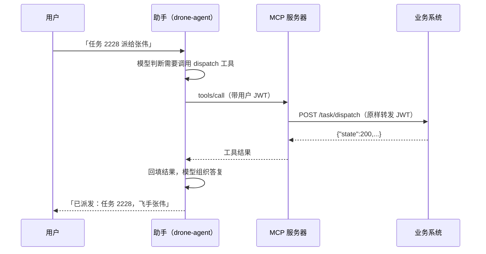
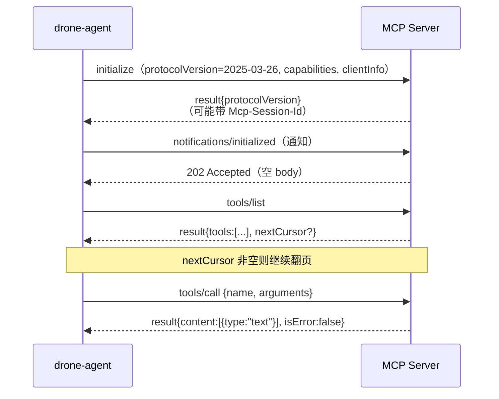
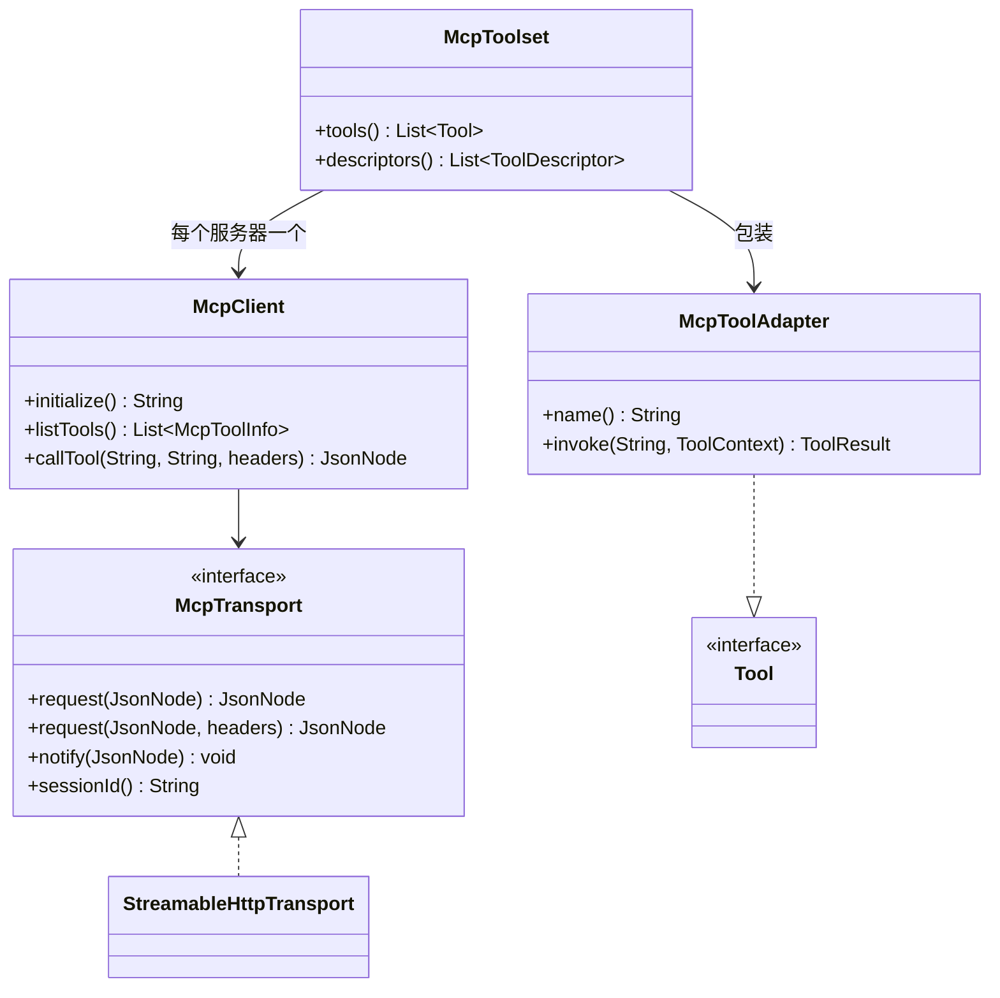
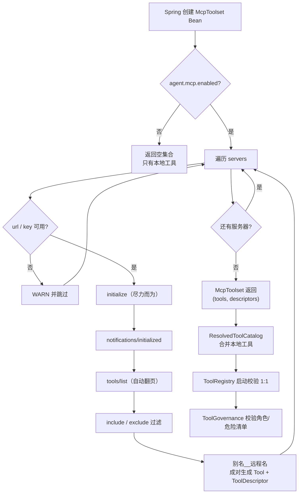
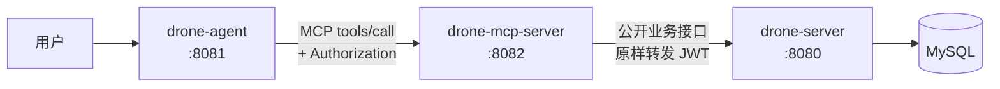
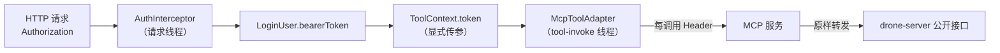

# 智能助手「MCP 接入」总结手册（面向初级工程师）

> 读者定位：刚入行 0～2 年的后端 / 全栈工程师，第一次接触 MCP。
> 这份文档有三个用途：**能跟面试官聊业务**、**能跟面试官聊技术细节**、**能把它写进简历**。
>
> 全文分四部分：
> 1. 业务角度——这个功能在做什么
> 2. 技术角度——协议怎么工作、本项目怎么接、踩过哪些坑
> 3. 简历怎么写——模版 + 实例
> 4. 常见面试题——含答题要点
>
> 记号约定：**【事实】** 是代码、配置或日志里查到、可以复现的；**【判断】** 是解释性内容，你可以再验证一句。
>
> 相关文档：[`业务流程Skill-初级工程师手册.md`](./业务流程Skill-初级工程师手册.md)（MCP 的「手」配上 Skill 的「作业指导书」）、
> [`工具调用-初级工程师手册.md`](./工具调用-初级工程师手册.md)（工具循环与治理）、
> [`../../docs/sdd/decisions/ADR-0007-MCP客户端选型与工具适配.md`](../../docs/sdd/decisions/ADR-0007-MCP客户端选型与工具适配.md)。

---

## 第一部分 · 业务角度：这个功能到底在做什么

### 1.1 一句话

**MCP（Model Context Protocol）是给大模型应用装「手」的标准协议。**
模型本身不会上网、不会查数据库、不会操作业务系统；应用通过 MCP 把外部能力包装成「工具」交给模型，
模型说「我要调哪个、传什么参数」，应用去执行，再把结果回填给模型。

在本项目里，助手的手来自两处：

| MCP 服务器 | 提供什么 | 例子 |
|---|---|---|
| 高德 MCP（第三方） | 天气、地理编码、POI、路线、打车唤端 | 「明天北京适合起飞吗」 |
| `drone-mcp-server`（自建） | 平台**已有**的业务接口 | 「把任务 2228 派给张伟」「出个运营日报」 |

### 1.2 为什么需要 MCP

助手原来只能凭模型自己的知识回答。三个典型场景都答不了：

1. **实时信息**：「明天北京适合起飞吗」——模型没有实时天气，只能编。
2. **平台数据**：「张伟手上还有几个任务」——数据在平台的数据库里，模型看不到。
3. **业务操作**：「把这个任务派给张伟」——模型不能直接改库，必须走服务端接口。

【判断】MCP 真正解决的**不是「调用工具」**，而是**「工具的发现与描述」**：
模型需要知道「有哪些工具、每个工具要什么参数」，这部分才是各家私有适配最乱的地方。
MCP 把它标准化成 **N + M**（N 个应用、M 个能力，各实现一次）。

### 1.3 业务流程（用户视角）



对用户来说，他只说了一句话；背后是「模型判断 → 协议调用 → 业务执行 → 结果回填」四段。

### 1.4 关键业务规则（以及为什么这么定）

| 规则 | 为什么 |
|---|---|
| **工具以用户本人身份执行** | 权限与审计要落到真人，不能用「服务账号」一把梭 |
| **写操作前先复述、等确认** | 派发、删除、告警处置都不可逆或高影响 |
| **权限不足如实转述** | 说「当前账号没有该权限」，不说「系统坏了」 |
| **不编造业务数据** | 工具没返回的任务号、设备号、告警，一律不许补 |
| **第三方能力只给链接** | 打车的唤端链接不能声称「已下单」 |

### 1.5 你能跟面试官聊的「业务亮点」

- 把「模型能聊天」变成「模型能操作真实业务」，且**权限与审计不降级**（身份透传到下游）。
- 接入两家 MCP 服务器（第三方 + 自建），**加一家只改配置**。
- 自建 MCP 服务把 70 个现有接口暴露成工具，**没有新增一个业务接口**。
- 标准化流程（日报、派发检查）沉淀为 Skill，业务经验可复用、可版本化。

---

## 第二部分 · 技术角度：怎么实现的、为什么这么选

### 2.1 MCP 是什么

#### 三个角色

| 角色 | 在本项目里 | 职责 |
|---|---|---|
| **Host** | `drone-agent` 进程 | 管理一个或多个 Client，决定把哪些工具给模型 |
| **Client** | `McpClient` | 维护与某个 Server 的协议连接 |
| **Server** | 高德 / `drone-mcp-server` | 暴露工具、执行、返回结果 |

一个 Host 可以连多个 Server——**这正是本项目要支持「后续接其它 MCP Server」的原因**。

#### 服务器能提供什么

MCP 定义了三类能力，**本期只用了第一类**：

| 能力 | 方法 | 是什么 | 本期 |
|---|---|---|---|
| **Tools** | `tools/list`、`tools/call` | 可执行的函数（查天气、算路线） | 已接 |
| Resources | `resources/list`、`resources/read` | 可读取的数据（文件、记录） | 不做 |
| Prompts | `prompts/list`、`prompts/get` | 预置的提示词模板 | 不做 |

【判断】选 Tools 是因为它和现有的 `Tool` 框架是同一形状：有名字、有描述、有参数 Schema、调用后有结果。
Resources/Prompts 需要新的抽象，收益不确定，所以明确不做。

#### 底层就是 JSON-RPC 2.0

```json
{"jsonrpc":"2.0","id":1,"method":"tools/call",
 "params":{"name":"maps_weather","arguments":{"city":"北京"}}}
```

两种消息形态，**这是最容易踩坑的地方**：

- **请求**：有 `id`，服务器必须回一条同 `id` 的响应；
- **通知**：没有 `id`，服务器**不回 JSON-RPC 响应**。实测 `notifications/initialized`
  返回的是 **HTTP 202 + 空 body**——按请求去解析会直接炸。

#### 两种传输

| 传输 | 长相 | 适用 |
|---|---|---|
| **stdio** | 启动子进程，用标准输入输出传 JSON | 本地工具（文件系统、Git） |
| **Streamable HTTP** | 一个 URL，POST JSON-RPC | 远程服务（本期两家都是） |

本项目只实现 Streamable HTTP。`McpTransport` 是接口，将来要支持 stdio 时**加一个实现即可**，
上层 `McpClient` / `McpToolAdapter` 不用动。

#### 一次完整会话



#### 版本演进（截至 2026-10）

| 版本 | 关键变化 |
|---|---|
| 2024-11-05 | 首个版本 |
| 2025-03-26 | 引入 Streamable HTTP、OAuth；**高德实现的是这一版** |
| 2025-06-18 | 结构化工具输出、elicitation 等 |
| **2026-07-28** | **无状态核心**：移除 initialize 与 `Mcp-Session-Id`；弃用 Roots/Sampling/Logging |

【事实】高德仍返回 `2025-03-26`，且不返回会话头（2026-10-20 实测）。
【判断】客户端因此必须「能握手就握手，不能握手也能干活」——本项目把 `initialize` 做成**尽力而为**。

### 2.2 本项目的 MCP 客户端

#### 类图



#### 启动时发生了什么



**为什么必须在 Bean 构造期做完**：`ToolRegistry` 创建时就要校验「每个行为都有元数据」。
如果改用 `ApplicationRunner`（知识库同步就是这么做的），端口会先开放，
出现「服务能访问但工具列表还没齐」的窗口——用户问到地图问题时模型会直接说没有这个工具。

#### 四个关键设计

| 设计 | 不这样做会怎样 |
|---|---|
| **工具名加 `别名__` 前缀** | 两个服务器都有 `search` 时互相覆盖；模型调错一家 |
| **行为与元数据成对产出** | `ToolRegistry` 的 1:1 校验失败，服务起不来 |
| **发现失败默认降级** | 地图服务临时故障就会拖垮整个助手 |
| **白名单保留，默认留空（= 全部）** | 工具描述每轮都进 prompt；要收敛就往 `include` 里加名字 |

### 2.3 自建 MCP 服务：`drone-mcp-server`

**它做什么**：把 `drone-server` **已经实现**的业务接口暴露成工具，不改任何业务代码。

| 项 | 值 |
|---|---|
| 端口 | 8082（默认只绑 `127.0.0.1`） |
| 端点 | `POST /mcp`、`GET /health` |
| 工具数 | 70（87 个映射去掉登录/健康检查/导入导出/附件/内部接口） |
| 协议 | 手写 JSON-RPC，`2025-03-26` |



**三个与第三方 MCP 不同的地方**

1. **身份必须转发**：每次 `tools/call` 带 `Authorization`，由 `ToolInvoker` 原样转发给
   `drone-server`；没有 Token 就直接失败、不发上游请求。
2. **工具目录来自快照**：`openapi.json` 打包进 classpath，**启动不联网**；
   后台可选刷新只打印差异（`sync-openapi.sh` 更新快照）。
3. **启动顺序无硬约束**：MCP 服务不依赖 8080；agent 发现阶段有 3 次重试，
   对方晚几秒起来也能被发现。

**超时三道闸**（必须递增）：

```text
MCP 服务调上游 10s  <  agent 调 MCP 12s  <  编排层单工具 15s
```

### 2.4 身份与安全

#### JWT 怎么流到工具里



- **不靠 ThreadLocal**：工具跑在执行器线程，ThreadLocal 取不到；
  SSE 进异步后 ThreadLocal 也会被清理。
- **不进日志**：`LoginUser` 用 `@ToString.Exclude`，`ToolContext.toString()` 遮蔽 Token；
  任何日志都不打印 Authorization。
- **可见性不是边界**：前端/L1 裁剪只是体验优化，真正的授权在 `drone-server`。

#### 危险工具

`agent.tool.dangerous` 里的工具**每次执行前都要人工确认**（票据 5 分钟、仅本人、用一次失效）。
默认清单覆盖删除、授权、状态翻转、拒绝/撤回、报告修订。

### 2.5 可观测：原始报文日志

排障时最有用的是原文。两边都有开关（默认开，生产建议关）：

| 服务 | 配置 | 打印内容 |
|---|---|---|
| drone-agent | `agent.mcp.log-raw-payload` | JSON-RPC 请求/响应、工具入参、工具结果 |
| drone-mcp-server | `drone.mcp-server.log-raw-payload` | `POST /mcp` 的请求/响应、转发给上游的请求体、上游原始响应 |

统一前缀 `【MCP-RAW】`：

```bash
grep "【MCP-RAW】" 日志 | tail -20
```

**两条硬约束**：

1. `Authorization` 请求头**任何情况下都不打印**；URL 里的 `key=` 走 `McpSecrets.maskUrl` 脱敏。
2. 报文含任务详情、位置等业务数据，**生产环境请置 false**；这是有意的排障开关，不是忘了脱敏。

### 2.6 踩过的坑（面试里讲这些最加分）

| 坑 | 现象 | 解法 |
|---|---|---|
| **通知被当请求解析** | 空 body 不是合法 JSON，炸 | `notify()` 不解析响应体；202 算成功 |
| **SSE 不关流** | 请求成功却卡到超时 | `BodyHandlers.ofInputStream()`，读到匹配 id 立即返回 |
| **高德不返回 session** | 按 2025 规范假设有会话会出错 | 有就回带，没有就按无状态处理 |
| **深度思考的 reasoning 丢失** | 人工确认后续跑 HTTP 400 `reasoning_content must be passed back` | 续跑**原样回放**模型原始 assistant 帧（原始 id + reasoning），不能现造 `confirm_` 帧 |
| **70 个工具的成本** | 每轮约 15k tokens | 需要时用 `include` 收窄；默认按需求全开 |
| **轮次预算不足** | 流程查 4–6 个接口，3 轮就被收回工具，模型输出伪工具文本（DSML） | `max-rounds` 提到 6，提示词禁止输出调用标记 |
| **工具名冲突** | 多服务器同名 | `别名__` 前缀 + 注册表重名检测 |
| **会话共享** | 多用户共用一个 client/transport | 每调用头；不把用户身份存成字段 |

### 2.7 排障速查

| 现象 | 先看什么 | 常见原因 |
|---|---|---|
| 模型说「没有这个工具」 | 启动日志有没有 `开始发现：alias=...` | 没配 Key / `enabled=false` / 服务没起 |
| 启动卡十来秒 | `startup-budget` 与各服务器超时 | 地址不通 |
| `initialize 未成功` 但工具正常 | 后面的 `tools/list` | 服务器是无状态版本，正常 |
| 工具调用超时 | 三道闸谁先触发 | 上游超时 > 编排超时 |
| 工具返回「调用失败」 | WARN 里的原因 | 网络、配额、参数不合法；不会自动重试 |
| 返回「没有执行该操作的权限」 | 换账号或去后台授权 | 正常 RBAC 结果，不是故障 |
| 工具参数与实际接口不符 | 快照是否过期 | 跑 `sync-openapi.sh` 并提交 diff |

### 2.8 读代码的顺序

1. `mcp/McpTransport.java` —— 请求与通知为什么必须分开？
2. `mcp/StreamableHttpTransport.java` —— 为什么用 `ofInputStream` 而不是 `ofString`？
3. `mcp/McpClient.java` —— initialize 失败为什么不算错？
4. `mcp/McpToolAdapter.java` —— 异常为什么必须在这里吞掉？
5. `mcp/McpToolset.java` —— 为什么发现要放在启动期？
6. `config/McpConfig.java` + `config/ToolConfig.java` —— 两条来源怎么合并成一份？
7. `tool/ToolRegistry.java` —— 合并后靠什么保证一一对应？

### 2.9 扩展：再接一个 MCP Server

**不用改代码**，只加一段配置：

```yaml
agent:
  mcp:
    servers:
      - alias: corp          # 新服务器
        url: https://mcp.example.com/mcp
        headers:
          Authorization: "Bearer ${CORP_MCP_TOKEN:}"
        include: [search_docs]
        parallel-safe: true
```

启动后会多出 `corp__search_docs`。需要注意：

- `alias` 不能重复（重复直接启动失败）；
- 若 `headers` 里带了密钥而值为空，本项目**不会**自动跳过（只有 URL 里的 `key=` 空值会跳过）；
- 工具名会被校验为 `[A-Za-z0-9_-]{1,64}`，不合规的会被跳过并记 WARN。

---

## 第三部分 · 简历怎么写

### 3.1 核心原则

1. **业务一句话 + 技术一句话**：HR 看业务，面试官看技术。
2. **有数字**：工具数、超时、并发、重试次数、Token 成本。
3. **有取舍**：写清「为什么不用 X」。
4. **别写「精通」**：写「实现过 / 踩过什么坑」。

### 3.2 项目描述模版

```
【项目名称】无人机管理平台 - 智能助手 MCP 工具接入（第三方 + 自建）
【角色】核心开发
【规模】MCP 客户端/服务端单测 40+ 例；自建服务暴露 70 个现有业务接口
【背景】助手只能凭模型知识作答，拿不到实时信息、也操作不了平台业务；
        且业务操作必须以用户本人身份执行，权限与审计不能降级
【职责】负责 MCP 客户端、自建 MCP 服务、身份透传与治理的设计与实现
【技术】Spring Boot 3.3 · Java 17 · JSON-RPC 2.0 · Streamable HTTP · OpenAPI · RBAC · JWT
【要点】
  · 客户端：手写 4 个 RPC，兼容 2025-03-26 生命周期与 2026-07-28 无状态服务器
  · 自建服务：从 OpenAPI 快照派生 70 个工具，启动零外部依赖；每调用转发用户 JWT
  · 身份：请求线程取 Token → ToolContext → 每调用 Header；不落日志、不共享会话
  · 可靠性：超时三道闸、发现阶段有界重试、失败降级、原始报文开关
```

### 3.3 简历 Bullet 示例（挑 3～5 条）

**偏业务：**
- 为无人机平台 AI 助手接入 **MCP**，使其能查询实时天气/路线、并**以用户本人身份**操作
  任务派发、告警处置等真实业务，补齐「只会聊天」的短板。

**偏技术：**
- 手写 **MCP 客户端**（JSON-RPC 2.0 / Streamable HTTP），兼容 `2025-03-26` 与无状态的新版服务器；
  处理 **202 空体通知、JSON/SSE 双响应、无会话服务器**等边界。
- 自建 **`drone-mcp-server`**：从 **OpenAPI 快照派生 70 个工具**（启动零外部依赖），
  **不新增业务接口**；用户 JWT **每调用转发**，权限与审计落到真人。
- 设计 **身份显式传递**链路（`LoginUser → ToolContext → 每调用 Header`），
  不依赖 ThreadLocal、不共享会话、Token 不进日志。
- 建立**原始报文可观测**开关（请求/响应原文，Authorization 永不打印）与**超时三道闸**，
  把「卡在哪一层」从猜测变成可查。

### 3.4 面试自述模版（口述 60 秒）

> 「这个项目里我负责 AI 助手的 MCP 接入。简单说，模型本身只会聊天，我们要给它装手。
> 我写了一个 MCP 客户端：模型说要调哪个工具、传什么参数，客户端用 JSON-RPC 发过去，
> 结果回填给模型。同时我还写了一个 MCP 服务端，把平台现有的 70 个接口暴露成工具——
> 没有新增任何业务接口，工具定义直接从 OpenAPI 快照生成。
> 这里最难的是身份：平台操作必须以用户本人身份执行，所以把请求里的 JWT 一路显式传到工具，
> 每次调用单独带头，不共享会话、不进日志。
> 中间踩过一个坑：高德服务器不返回会话头，而且深度思考模式下，人工确认后的续跑必须原样回放
> 模型原始的工具调用帧，否则会 400。这些都在日志里能看到原文，排障很快。」

---

## 第四部分 · 常见面试题（含答题要点）

### 分类 A · 概念与选型

**Q1：MCP 是什么？和直接写 function calling 有什么区别？**
- MCP 是**标准协议**：统一了工具的发现、描述与调用；function calling 只是模型侧的表达方式。
- 【事实】本项目的工具最终仍以 OpenAI 兼容的 `tools` 交给模型；MCP 解决的是**工具从哪来、怎么调**。
- 加分：MCP 让「接 N 个应用 × M 个能力」变成 N+M。

**Q2：MCP 的 Host / Client / Server 分别是什么？**
- Host = 助手进程；Client = 与某个 Server 的连接；Server = 提供工具的一方。
- 一个 Host 可连多个 Server（本项目同时连高德与自建服务）。

**Q3：为什么不用官方 Java SDK？**
- 【事实】只用 4 个 RPC；SDK 引入 reactor 等大依赖，且仍需特判高德「无会话 / JSON 或 SSE」。
- 代价：协议演进要自己跟；`McpClient` 只暴露 `listTools/callTool`，将来换 SDK 面很小。

**Q4：tools / resources / prompts 有什么区别？**
- tools 是可执行函数；resources 是可读数据；prompts 是预置模板。
- 【判断】本期只用 tools：它和现有 `Tool` 框架同形；另两类需要新抽象，收益不确定。

### 分类 B · 协议细节

**Q5：一次 MCP 会话的完整流程？**
- `initialize`（协商版本/能力）→ `notifications/initialized`（202 空体）→ `tools/list`（可分页）→ `tools/call`。
- 新版（2026-07-28）移除了握手与会话，老客户端仍可用。

**Q6：为什么要区分「请求」和「通知」？**
- 通知没有 `id`，服务器回 202 空体；按响应解析会炸在「空 body 不是 JSON」。
- 【事实】`StreamableHttpTransport` 分成 `request()` 与 `notify()` 两个方法，从根上避免。

**Q7：服务器用 SSE 回包，且发完不关流，怎么处理？**
- 用 `BodyHandlers.ofInputStream()` 逐事件读，读到 id 匹配的响应立即返回；
  否则 `ofString` 会一直等流结束，表现成「成功却超时」。

**Q8：2025-03-26 与 2026-07-28 的差别？**
- 后者是**无状态核心**：移除 initialize 与 `Mcp-Session-Id`，弃用 Roots/Sampling/Logging。
- 【事实】高德仍是 2025-03-26，所以客户端以老版本为准、对新版本宽容。

### 分类 C · 身份与安全

**Q9：为什么转发用户 JWT，而不是用服务账号？**
- 服务账号会让任何能对话的人获得该账号的权限，RBAC 与审计都失真。
- 【事实】本项目的 `ToolContext` 显式携带 token，只有声明 `forward-authorization` 的服务器才转发。

**Q10：为什么身份要显式传参，不用 ThreadLocal？**
- 工具跑在执行器线程，ThreadLocal 取不到；SSE 进异步后还会被清理。
- 所以规矩是「请求线程上取好、显式往下传」。

**Q11：Token 怎么保证不泄漏？**
- `LoginUser` 与 `ToolContext` 的 `toString` 遮蔽；日志永远不打印 Authorization；
  MCP 服务只打印 body，不打印头。

**Q12：越权怎么防？**
- 工具可见性只是体验优化；真正的判定在 `drone-server` 的 RBAC。
- 自建 MCP 服务对「无权」与「不存在」返回同一句文案，不暴露存在性。

### 分类 D · 工程与踩坑

**Q13：为什么自建 MCP 服务的工具目录要用快照，不在启动时拉取？**
- 启动时拉取会强制 `drone-server` 先起，形成顺序依赖。
- 快照随包发布，启动零外部依赖；后台刷新只打印差异。

**Q14：70 个工具会不会太贵？**
- 【事实】约 15k tokens/轮；需要时用 `include` 收窄。
- 工具描述必须清晰，否则模型选错；宁可少而准。

**Q15：工具调用失败怎么处理？**
- 适配器把异常吞成 `ToolResult.failed`，不回 500；
- 业务失败（`isError`）也让模型向用户解释；
- 上游超时分层：10s < 12s < 15s，避免「谁先掐断」说不清。

**Q16：最难忘的 bug？**
- 深度思考模式下，人工确认后的续跑 400 `reasoning_content must be passed back`。
  根因是续跑现造了新的 `tool_call_id`，而 reasoning 与原始调用绑定；
  修法是**原样回放**模型原始 assistant 帧（原始 id + reasoning）再追工具结果。

---

## 附录 · 一页速记（面试前扫一眼）

- **MCP**：给模型装手的标准协议；JSON-RPC 2.0；Host/Client/Server；Tools/Resources/Prompts。
- **两种消息**：请求有 id 等响应；通知无 id，202 空体。
- **两种传输**：stdio；Streamable HTTP（JSON 或 SSE）。
- **生命周期**：initialize → initialized → tools/list → tools/call。
- **版本**：高德 2025-03-26；新版 2026-07-28 无状态。
- **本项目**：手写客户端；自建 `drone-mcp-server`（8082，70 工具，OpenAPI 快照）。
- **身份**：用户 JWT 每调用转发；显式传参；不共享会话；不进日志。
- **超时**：上游 10s < agent 12s < 编排 15s。
- **坑**：202 空体、SSE 不关流、无 session、reasoning 回放、轮次预算、工具名冲突。

## 附录 · 术语表

| 术语 | 含义 |
|---|---|
| MCP | Model Context Protocol，模型与外部工具/数据的标准协议 |
| JSON-RPC | 基于 JSON 的远程调用协议，MCP 的底层消息格式 |
| Streamable HTTP | MCP 的 HTTP 传输方式，一个端点收发 JSON-RPC |
| SSE | Server-Sent Events，服务器持续推送事件；MCP 可用它回包 |
| initialize | 老版本的握手，协商协议版本与能力 |
| tools/list | 列出服务器提供的工具 |
| tools/call | 调用一个工具 |
| `isError` | 工具级错误标记：调用成功但业务失败 |
| alias | 本项目给每个 MCP Server 起的短名，用作工具名前缀 |
