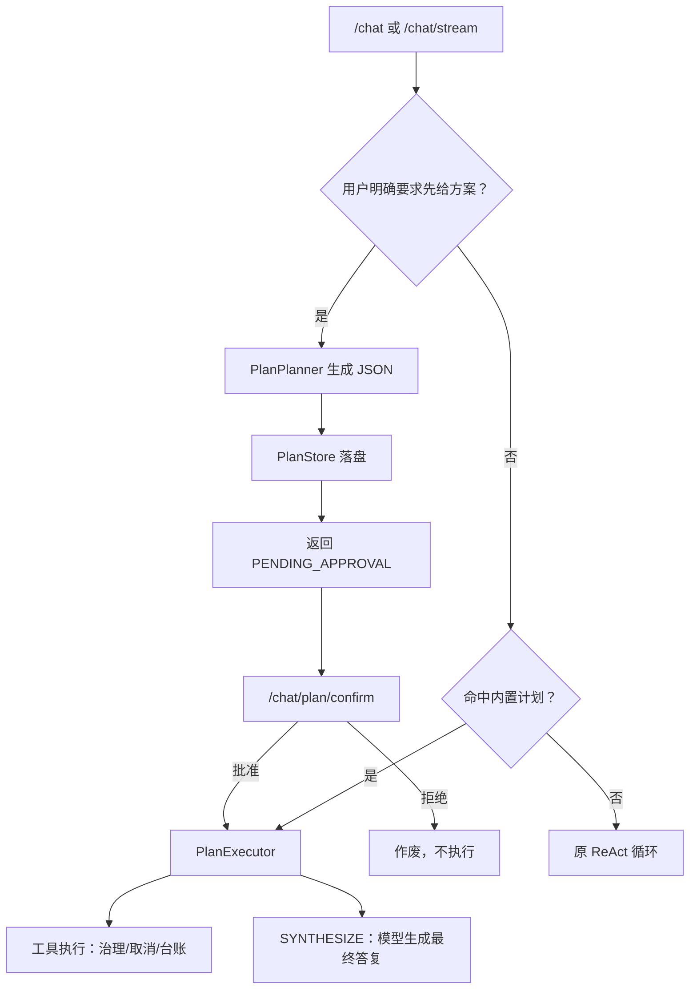

# 智能助手「Plan 模式」总结手册（面向初级工程师）

> **读者定位**：能看懂 Spring Boot 与 Vue，做过工具调用或 Agent 对话，但对「计划模式到底解决什么问题、代码怎么落地」还没有系统认识的工程师。
> **写法**：先讲业务上为什么需要两种计划，再讲技术实现、真实日志、踩过的坑，最后给简历话术与面试答题要点。
> **范围**：`drone-agent` 的 Plan 模式（`REQ-AGENT-0031`）：内置计划、生成计划、审批、JSON 存储、执行器、前端计划卡。
> **口径**：代码截至 2026-10-27；`drone-agent` 单测 407 条；两种流程均做过一次真实 MCP + 真实模型冒烟（日志见文末路径），但**尚未形成可重复的端到端测试，仍按「功能未测试」管理**。
> **相关手册**：`上下文工程`、`工具调用`、`业务流程Skill`、`工具 Harness`、`MCP接入`——Plan 模式是把这些能力**串成一条可执行计划**的上层编排。

---

## 第一部分 · 业务角度：Plan 到底在解决什么

### 1.1 一句话说清

**Plan 模式 = 把「边想边做」拆成「先产出显式计划，再按计划执行，执行中校验，失败可报告」。**

和 ReAct 的区别：

```text
ReAct：想一步 → 调一个工具 → 看结果 → 再想下一步
Plan ：先列步骤 → 按依赖执行 → 每步记录状态 → 最后汇总
```

Plan 不替代 ReAct；它是**可选的编排策略**：简单问题继续 ReAct，固定流程走内置计划，复杂任务先生成计划给用户看。

### 1.2 两个业务症状（为什么需要 Plan）

**症状一：日报贴着轮次上限**

运营日报要查 5 个数据源，再读模板生成 HTML。SKILL 里写了「第 2/3 步可并发、第 4/5 步可并发」，
但 ReAct 下**是否并发取决于模型是否把两个工具放进同一轮**；实测整条流程会用到 7~8 轮，
而 `agent.tool.max-rounds` 正好是 8，再有一点偏差工具就被收回。

**症状二：复杂任务缺少「先看方案」的机会**

用户说「对比本周和上周的运营情况，给 3 条建议」——这是一个多步取数 + 对比 + 分析的任务。
ReAct 会直接开始查，用户既不知道它准备查什么，也无法在花 token 之前否定一个错误的思路。

### 1.3 两种计划：来源决定是否审批

| 维度 | **BUILTIN（内置计划）** | **GENERATED（生成计划）** |
|---|---|---|
| 谁写的 | 人事先放在 `resources/plans/*.json` | Planner 在运行时生成 |
| 典型场景 | 运营日报、交接班等固定强流程 | 跨周对比、临时多实体配置等复杂任务 |
| 是否展示 | 展示步骤与进度 | **必须展示完整计划** |
| 是否审批 | **不审批** | **一律审批** |
| 执行约束 | 严格按 JSON 执行，不允许模型改步骤 | 用户批准后按计划执行 |
| 读写属性 | 只影响并发/串行与危险确认 | 只影响并发/串行与危险确认 |

> **审批只看计划来源，不看步骤是只读还是写入。**
> 只读计划也可能选错数据源、漏步骤、成本失控，所以 GENERATED 即使全只读也要审批。
> **危险工具确认是另一条线**：计划批准 ≠ 危险操作批准。

### 1.4 三个业务场景

#### 场景一：运营日报（BUILTIN，不审批）

用户：**“出个今天的运营日报。”**

- 命中内置计划 `daily-operations-report`；
- 按 JSON 执行 6 步：总览、今日任务、派发积压、在执行清单、待处理告警、生成 HTML；
- 前 5 个数据源可并发（并发上限 4，s5 等线程空出后执行），最后一步合成 HTML；
- 用户不需要批准，直接看到日报与计划步骤状态。

实测：6 步全部 `DONE`，耗时约 28.6 秒，日报 HTML 14,858 字节。

#### 场景二：跨周运营对比（GENERATED，必须审批）

用户：**“先给方案：对比本周和上周的任务完成率和告警数量，给 3 条建议。”**

- Planner 生成 3 步计划：
  1. 查本周 `analytics_overview`；
  2. 查上周 `analytics_overview`；
  3. 汇总对比并给建议；
- 计划落盘，返回 `PENDING_APPROVAL`，**不执行任何工具**；
- 用户点「批准并执行」后，两个查询并发，最后合成对比结论。

实测：规划约 4.1 秒，批准后执行约 8.3 秒，最终回复 1,428 字。

#### 场景三：临时多实体配置（GENERATED，写入演示，需测试数据）

用户：**“先给方案：创建一个临时运维账号，配一台备用机，再建一条巡检航线，明天派一条任务。”**

- 计划有强依赖：用户 ID → 设备 owner → 航线/任务参数；
- 写操作在批准后按顺序执行，每步有稳定 `operationId` 与台账；
- 取消后可复用 Harness 的续跑/补偿能力（本期未做计划级断点恢复）。

#### 什么时候不该用 Plan

| 任务 | 建议 |
|---|---|
| 单次查询、知识问答、闲聊 | 继续 ReAct；Plan 只增加一次规划开销 |
| 开放式分析（“为什么完成率下降”） | 步骤取决于发现，先规划容易空；继续 ReAct |
| 一两步就能完成的任务 | 不需要计划，避免“为了像计划而堆步骤” |
| 固定且已稳定的流程 | 沉淀为 BUILTIN，而不是每次生成 |

### 1.5 用户看到什么

计划卡包含：

- 来源：`内置流程` / `执行计划`；
- 名称与状态：`等待批准 / 已完成 / 执行失败 / 已拒绝 / 已过期 / 已取消`；
- 步骤列表：每步 `待执行 / 执行中 / 完成 / 失败 / 未执行`；
- GENERATED 且 `PENDING_APPROVAL` 时，显示「批准并执行 / 拒绝」。

---

## 第二部分 · 技术角度：怎么实现的

### 2.1 全景



### 2.2 计划 JSON

内置计划示例（日报）：

```json
{
  "name": "daily-operations-report",
  "origin": "BUILTIN",
  "version": 1,
  "goal": "生成今日运营日报",
  "triggers": ["日报", "运营日报", "今天运营情况"],
  "steps": [
    {"id":"s1","title":"总览","kind":"TOOL","tool":"drone__dashboard_summary",
     "args":{},"dependsOn":[]},
    {"id":"s2","title":"今日任务","kind":"TOOL","tool":"drone__analytics_overview",
     "args":{"from":"${today.start}","to":"${today.end}"},"dependsOn":[]},
    {"id":"s6","title":"生成日报 HTML","kind":"SYNTHESIZE",
     "skill":"daily-operations-report","dependsOn":["s1","s2","s3","s4","s5"]}
  ]
}
```

字段职责：

| 字段 | 含义 |
|---|---|
| `id` | 步骤唯一标识，依赖与参数引用都用它 |
| `kind` | `TOOL` 调工具；`SYNTHESIZE` 把前序结果交给模型汇总 |
| `tool` | 已注册工具名；执行器会再判角色与危险清单 |
| `args` | 工具参数，支持占位符 |
| `dependsOn` | 前置步骤；全部 `DONE` 才可调度 |
| `skill` | SYNTHESIZE 时可引用 Skill 正文/模板 |
| `prompt` | SYNTHESIZE 的额外要求 |

支持的占位符：

- `${today.start}` / `${today.end}`：今天 00:00 与明天 00:00；
- `${week.this.start/end}`：本周一 00:00 / 下周一 00:00；
- `${week.last.start/end}`：上周一 00:00 / 本周一 00:00；
- `${s1}`：前一步的完整结果；
- `${s1.id}`：从前一步 JSON 里取 `id`（根上没有会再往 `data` 里找）。

**未解析的 `${...}` 会直接让该步失败**，不会原样发给上游。

### 2.3 内置计划：PlanCatalog

`plan/PlanCatalog` 启动时扫描 `classpath*:plans/*.json`，做四件事：

1. **结构校验**：步骤非空、id 唯一、依赖存在、无环、最多 12 步；
2. **工具校验**：GENERATED 必须引用已注册工具；BUILTIN 允许工具暂时不可用（例如测试环境关了 MCP），只 WARN；
3. **Skill 校验**：SYNTHESIZE 引用的 Skill 必须存在；
4. **触发匹配**：消息包含任一 `triggers` 即命中。

两个细节：

- `planId` 自动补成 `builtin-<name>`；
- **用户明确说“先给方案”时优先走生成计划**，即使消息里含“日报”等内置触发词。

### 2.4 生成计划：PlanPlanner

`plan/PlanPlanner` 把用户请求、当前角色可用的非危险工具列表交给模型，要求输出 JSON。

- Prompt：`prompts/plan/planner.md`（版本化管理）；
- 解析：去掉 Markdown 围栏，取第一个 `{` 到最后一个 `}`；
- 校验：复用 `PlanCatalog.validate`，并额外拒绝当前角色无权/危险的 工具；
- 生成 `planId=plan-<uuid>`、`origin=GENERATED`、`sourceMessage=用户原话`。

> Planner 提示词里的“危险工具默认不引入”“写操作以必需为限”是**默认建议，不是强制约束**。
> 真正的强制边界在运行时：RBAC、计划审批、危险确认、预算/限流。

### 2.5 计划存储：PlanStore

```text
data/plans/<userId>/<planId>.json
```

- 写入：先写 `.tmp`，再原子改名；
- 消费：审批时先改名为 `.consumed`，再做执行——**同一计划最多执行一次**；
- TTL：默认 30 分钟；启动时加载未过期计划；
- 权限：文件尽量 600；目录在 `data/`（已 gitignore）；
- 注意：JSON 里包含 `sourceMessage`（用户原话），属于本地敏感数据。

### 2.6 执行器：PlanExecutor

核心循环：

```text
while 还有 PENDING 步骤:
    取消？ → 剩余标 SKIPPED，返回取消
    ready = 依赖全部 DONE 的步骤
    ready 为空 → 失败（依赖无法满足）
    把 ready 分成：只读工具（可并发）/ 其他（串行）
    并发执行只读工具，按原顺序收集结果
    串行执行写工具与 SYNTHESIZE
    任一步失败 → 剩余 SKIPPED，返回失败报告
```

关键规则：

| 规则 | 实现 |
|---|---|
| 只读并发 | `registry.isReadOnly(tool)=true` 且非危险，提交到工具线程池 |
| 写串行 | 写工具与 SYNTHESIZE 逐条执行 |
| 取消 | 每个步骤开始前检查信号；已执行步骤保留结果 |
| 权限 | 执行前再判 `governance.allows(tool, roles)` |
| 危险工具 | 本期直接拒绝（MVP 限制，不是产品要求） |
| 台账 | 写步骤记 `started` + 终态，`operationId=plan-{planId}-{stepId}` |
| 失败 | 停止计划，报告“已完成/失败/未执行”，不自动回滚 |
| 合成 | 汇总步骤结果 + Skill 正文 + 模板，调 `ChatService.chat` 生成最终答复 |

### 2.7 AgentLoop 怎么接入

入口在 `service/ToolCallingService.loop`，顺序是：

1. 用户明确要求“先给方案/先给计划/先规划/plan” → `PlanPlanner` 生成 + 落盘 + 返回 `PENDING_APPROVAL`；
2. 否则命中内置计划 → `PlanExecutor` 直接执行；
3. 都不命中 → 原 ReAct 循环。

审批链路：

```text
POST /chat/plan/confirm
→ ConversationService.confirmPlan
→ ToolCallingService.confirmPlan
→ PlanStore.take（原子消费）
→ 批准：PlanExecutor；拒绝：作废
```

响应链路：

```text
PlanExecutor.Result
→ ToolCallingService.AskResult.plan
→ ChatResponse.plan / ChatStreamOutcome.plan
→ SSE done.plan
→ 前端计划卡
```

### 2.8 前端

- 类型：`AgentPlan` / `AgentPlanStep`（`api/agent.ts`）；
- `done.plan` 渲染计划卡；
- `PENDING_APPROVAL` 显示「批准并执行 / 拒绝」；
- 批准调用 `/agent/chat/plan/confirm`，结果写回同一条助手消息；
- 拒绝后计划卡显示「已拒绝」，不执行任何步骤。

### 2.9 一次真实运行的日志

#### 内置计划（不审批）

```text
16:07:44.234 【对话·流式】收到请求 traceId=c9dc3b12 conversationId=plan-demo2-builtin
16:07:44.249 【计划】命中内置计划 name=daily-operations-report planId=builtin-daily-operations-report
16:07:44.261 【计划】开始执行 origin=BUILTIN 步骤6个
16:07:44.264 【计划】执行步骤 s1 drone__dashboard_summary   (tool-invoke-1)
16:07:44.264 【计划】执行步骤 s2 drone__analytics_overview   (tool-invoke-2)
16:07:44.264 【计划】执行步骤 s3 drone__analytics_dispatch_block (tool-invoke-3)
16:07:44.265 【计划】执行步骤 s4 drone__task_list            (tool-invoke-4)
16:07:44.370 【计划】执行步骤 s5 drone__alert_list（等线程空出）
16:07:44.559 调用模型（s6 SYNTHESIZE，生成日报 HTML）
16:08:12.890 【计划】完成 耗时 28629ms 回复 13289字
16:08:12.898 【产物】已保存 运营日报 · 2026-10-27.html 14858字节
16:08:12.899 【对话·流式】完成 回复182字 产物1个
```

#### 生成计划（必须审批）

```text
16:08:12.943 【对话·流式】收到请求 traceId=7c4a684f
16:08:17.032 【计划】已生成 planId=plan-fa36… 步骤3个
16:08:17.314 【计划】已落盘，等待用户审批
16:08:17.416 【对话·流式】完成 回复13字（等待批准）
16:08:17.901 【计划】收到审批 approve=true
16:08:17.912 【计划】用户批准，开始执行
16:08:17.914 【计划】执行步骤 s1 analytics_overview
16:08:17.915 【计划】执行步骤 s2 analytics_overview
16:08:17.918 MCP 入参 s1: {"from":"2026-10-26 00:00:00","to":"2026-11-02 00:00:00"}
16:08:17.920 MCP 入参 s2: {"from":"2026-10-19 00:00:00","to":"2026-10-26 00:00:00"}
16:08:18.046 调用模型（s3 SYNTHESIZE，两周对比）
16:08:26.230 【计划】完成 耗时 8317ms 回复1428字
16:08:26.235 【计划】审批完成 耗时 8334ms
```

#### 日志里发现并修掉的真实 bug

第一次跑生成流程时，Planner 输出了 `${week.this.start}` / `${week.last.start}`，
执行器当时只支持 `${today.*}`，原样发给了上游：

```text
MCP 入参: {"from":"${week.this.start}","to":"${week.this.end}"}
MCP 返回: 服务器繁忙，请稍后再试
计划执行失败：s1/s2 FAILED，s3 SKIPPED
```

修复：

1. 执行器支持周边界占位符；
2. 参数里仍有 `${...}` 时直接失败，不再发给上游；
3. Planner 提示词限定可用占位符；
4. 单测覆盖“周边界解析 + 未知占位符拒绝”。

> 这是本手册最值得记住的一段：**Plan 的日志不能只看“完成/失败”，要看每一步实际发出去的参数**。
> 上游一句“服务器繁忙”，真实原因可能是占位符没解析。

### 2.10 测试

`drone-agent` 407 条单测，其中 Plan 相关：

| 测试 | 覆盖 |
|---|---|
| `PlanCatalogTest`（4） | 触发词、依赖环、生成计划非法工具、内置计划缺工具容忍 |
| `DailyPlanCatalogTest`（1） | 真实日报 JSON 可加载、可命中、步骤与 Skill 对齐 |
| `PlanStoreTest`（2） | 落盘/重启可读/只消费一次、用户隔离 |
| `PlanExecutorTest`（6） | 依赖执行 + 合成、失败停止、取消、危险工具拒绝、步骤参数引用、周边界/未知占位符 |
| `ToolCallingServiceTest`（2） | 内置计划不走 ReAct、生成计划未批准零执行/批准后执行 |

前端：`type-check`、`lint` 通过。

**未覆盖**：真实 MCP + 真实模型的可重复端到端测试。本次手工冒烟跑通了两种流程，
但还没有沉淀成自动化用例，所以仍按「功能未测试」管理。

### 2.11 已知限制

- 内置触发词包含“日报”，范围较宽；后续可改为入口显式触发；
- 生成计划只由“先给方案/先给计划/先规划/plan”触发，未做自动复杂度路由；
- 审批是非流式；执行期间同步等待；
- 计划中的危险工具被 Planner 与 Executor 双重拒绝（MVP 限制，后续接步骤级确认）；
- 没有自动重规划；计划执行失败只停并报告；
- 没有计划执行中途的断点恢复（落盘只覆盖“等待审批”阶段）；
- 只读并行步骤不逐个推送状态，计划卡在结束时统一展示；
- 计划工具调用未进入账单的 `toolNames`（日志与 trace 可见），成本归因还缺一块；
- 计划 JSON 含用户原话（`sourceMessage`），属于本地敏感数据。

---

## 第三部分 · 简历怎么写

> 原则：**动词 + 机制 + 数字 + 结果**。

1. **编排**：在 ReAct AgentLoop 上增加可选 Plan 模式——内置固定流程按 JSON 严格执行、不审批；
   复杂任务生成计划、落盘、用户批准后执行。
2. **确定性**：实现计划执行器：依赖拓扑、只读并发、写串行、取消检查、失败即停；
   日报 6 步实测 28.6s 完成，5 个数据源并发。
3. **安全**：生成计划一律审批；计划审批与危险工具确认分离；工具执行复用 RBAC、预算、限流、幂等与台账。
4. **可恢复**：计划 JSON 落盘（TTL 30m）、审批原子消费、最多执行一次；写步骤 `operationId=plan-{planId}-{stepId}`。
5. **排障**：通过完整步骤日志定位“占位符未解析导致上游繁忙”，补齐周边界占位符与未解析校验。
6. **工程化**：407 条单测覆盖计划加载/存储/执行/审批；前端计划卡展示步骤与状态，支持批准/拒绝。

---

## 第四部分 · 常见面试题（含答题要点）

### Q1. Plan 模式和 ReAct 的区别？

Plan 先产出显式计划，再按依赖执行；ReAct 每一步都重新决策。Plan 适合多步、固定、需要审批与恢复的任务；ReAct 适合探索与简单查询。两者不是替代关系。

### Q2. 你们的 Plan 有几种？为什么这样分？

两种：BUILTIN（人事先写的固定流程）和 GENERATED（运行时生成）。BUILTIN 不审批、严格按 JSON；GENERATED 一律审批。**审批看来源，不看读写**。

### Q3. 为什么只读计划也要审批？

只读也可能选错数据源、漏步骤、成本失控；审批是“同意方案”，不是“同意风险操作”。危险工具确认仍然独立。

### Q4. 怎么防止模型生成不存在的工具或参数？

计划 JSON 先过 Schema/结构校验，再校验工具是否注册、当前角色是否可用、是否有环、是否超过步数上限；执行前还会再判一次权限。

### Q5. 写操作为什么不会重复？

计划审批先原子消费（`.consumed`），同一计划最多执行一次；写步骤有稳定 `operationId`，MCP 幂等层按 operationId + 用户 + 工具 + 参数去重。

### Q6. 计划执行到一半失败怎么办？

停止计划，未执行步骤标 `SKIPPED`，返回“已完成/失败/未执行”；不自动回滚。本期没有自动重规划，后续可加有界 Replanner。

### Q7. 只读步骤怎么并发？写为什么不能并发？

执行器按 `registry.isReadOnly(tool)` 分组，独立只读步骤提交线程池；写步骤串行，避免并发副作用与不确定的提交顺序。

### Q8. 取消时在途工具怎么办？

每个步骤开始前检查取消信号；读工具可以放弃等待，写工具要等结算（这是 Harness 既有语义）。计划层面把剩余步骤标 `SKIPPED`。

### Q9. 计划怎么落盘、重启后还能审批吗？

`data/plans/{userId}/{planId}.json`，写入原子改名；启动时加载未过期计划；审批时先改名 `.consumed` 再执行，保证最多一次。

### Q10. 计划模式怎么评估？

对比 ReAct 与 Plan 的成功率、步骤完成率、实际工具调用与计划的偏差、延迟、token、缓存命中、取消/恢复成功率；首批用例：日报、交接班、派发、告警、创建用户+设备。

### Q11. 你们踩过什么坑？

生成计划用了未支持的 `${week.this.start}`，执行器原样发给上游，上游返回“服务器繁忙”。后来补齐周边界占位符，并在发送前检测未解析的 `${...}` 直接失败。**教训：看每一步的实际参数，不要只看最终错误。**

### Q12. 这套 Plan 还有什么不足？

没有自动重规划、没有执行中断点恢复、审批非流式、危险工具在 MVP 被直接拒绝、只读步骤进度不实时、计划工具未进账单归因。下一步优先补评估与恢复，而不是继续堆功能。

---

## 附录 · 一页速记

### 两种模式

| | BUILTIN | GENERATED |
|---|---|---|
| 来源 | `resources/plans/*.json` | Planner 运行时生成 |
| 审批 | 不审批 | 一律审批 |
| 执行 | 严格按 JSON | 批准后按计划 |
| 例子 | 日报、交接班 | 跨周对比、临时多实体配置 |

### 关键数字

| 指标 | 数值 |
|---|---|
| 计划最大步骤 | 12 |
| 只读并发 | 4（`agent.plan.parallel`） |
| 生成计划 TTL | 30 分钟 |
| 日报实测 | 6 步，28.6s，HTML 14.8KB |
| 生成计划实测 | 规划 4.1s，执行 8.3s，回复 1.4k 字 |
| 单测 | 407 条 |

### 代码地图

| 路径 | 作用 |
|---|---|
| `plan/Plan` / `PlanStep` | 计划模型 |
| `plan/PlanCatalog` | 内置计划加载/校验/触发 |
| `plan/PlanPlanner` | 生成计划 |
| `plan/PlanStore` | JSON 落盘/审批消费 |
| `plan/PlanExecutor` | 依赖执行/并发/取消/合成/台账 |
| `plan/PlanService` | 门面 |
| `service/ToolCallingService` | AgentLoop 入口与审批执行 |
| `controller/ChatController` | `/chat/plan/confirm` |
| `AgentChatPanel.vue` | 计划卡与批准/拒绝 |

### 真实日志

- 内置流程：`/tmp/plan-builtin-flow.log`
- 生成流程：`/tmp/plan-generated-flow.log`
- 完整运行：`/tmp/agent-plan-demo2.log`

### 三句话总结

1. **Plan 是可选编排**：内置流程不审批、严格执行；生成计划必须审批。
2. **确定性来自执行器**：依赖、并发、取消、台账、失败报告，不靠提示词。
3. **真正的教训在日志里**：每一步实际参数比最终错误信息更有诊断价值。

---

## 参考资料

- `docs/sdd/specs/REQ-AGENT-0031-Plan模式.md`
- `docs/sdd/plans/REQ-AGENT-0031-Plan模式.md`
- `docs/sdd/tasks/REQ-AGENT-0031-Plan模式.md`
- `docs/sdd/decisions/ADR-0012-Plan模式引入评估.md`
- `docs/tests/REQ-AGENT-0031-Plan模式.md`
- LangChain, *Plan-and-Execute Agents* — <https://www.langchain.com/blog/planning-agents>
- *Plan-and-Act*（ICML 2025） — <https://arxiv.org/html/2503.09572v2>
- *Do LLM Agents Execute the Plans They Declare?*（2026） — <https://arxiv.org/html/2609.38108v1>
