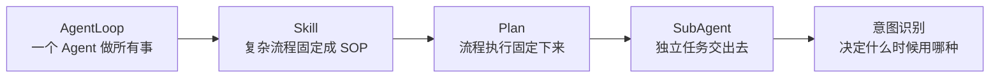
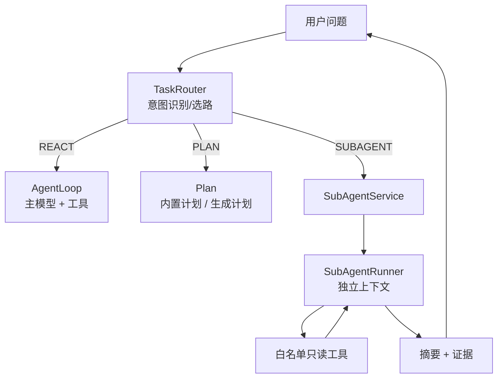
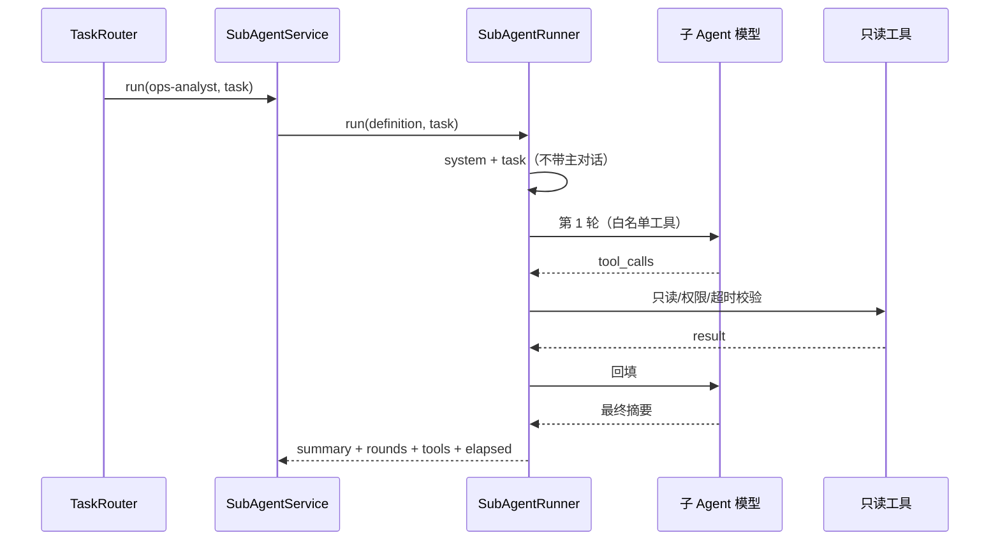

# 智能助手「SubAgent 与意图识别」总结手册（面向初级工程师）

> **读者定位**：能看懂 Spring Boot 与 Vue，做过 Agent 对话或工具调用，但对「一个 Agent 怎么演进到任务分工」还没有系统认识的工程师。
> **写法**：先讲项目技术演进（AgentLoop → Skill → Plan → SubAgent → 意图识别），再讲 SubAgent 与意图识别各自怎么实现，最后给真实日志、简历话术与面试答题要点。
> **范围**：`drone-agent` 的 SubAgent（`REQ-AGENT-0032`）与任务路由（`REQ-AGENT-0033`），以及它们与 AgentLoop、Skill、Plan 的关系。
> **口径**：代码截至 2026-10-29；`drone-agent` 单测 **419 条**；复杂只读与简单查询各做过一次真实 MCP + 真实模型手工冒烟，但**尚未沉淀为可重复的自动化 E2E**。
> **相关手册**：`工具调用`、`Harness工程`、`Plan模式`、`业务流程Skill`、`上下文工程`。

---

## 第一部分 · 业务角度：从“一个 Agent 包打天下”到“任务分工”

### 1.1 一张图看演进



每一层不是替代上一层，而是**解决上一层暴露出的新问题**：

| 阶段 | 解决了什么 | 又暴露了什么 |
|---|---|---|
| **AgentLoop** | 模型能调工具、能多轮执行 | 工具多、上下文长；复杂任务容易跑偏、超轮次 |
| **Skill** | 复杂流程沉淀成可复用 SOP | 只是“说明书”，模型是否按步骤执行仍靠自觉 |
| **Plan** | 流程执行固定：内置计划严格按 JSON；生成计划先审批 | 所有步骤仍在主上下文里，长分析会污染主对话 |
| **SubAgent** | 把有界任务放到独立上下文，只拿摘要 | 谁来委派？模型自己判断会摇摆 |
| **意图识别** | 代码层决定 ReAct / Plan / SubAgent | 规则可能误判，后续需要语义识别 |

### 1.2 AgentLoop：一个 Agent 负责所有事情

早期只有 AgentLoop：

- 一个系统提示词；
- 74 个工具（70 个 MCP 业务工具 + 4 个本地工具）；
- 模型每一轮自己决定“下一步调什么”。

**它擅长的**：简单查询、单步操作、需要探索的任务。

**它的问题**：

- 工具多，模型选择负担大；
- 长对话 + 工具结果，上下文越来越重；
- 复杂任务没有固定步骤，容易漏步、重复调用、超轮次。

### 1.3 Skill：把复杂流程固定成 SOP

日报、派发前检查、告警分诊、交接班这类流程，做法是固定的，不应该每次让模型重新发明。

于是有了 Skill：

- `SKILL.md` 写清目标、步骤、工具、输出模板；
- 按角色/权限裁剪，只给用得上的人；
- 模型先 `use_skill` 取步骤，再按步骤执行。

**它解决的**：流程知识复用、输出格式统一。

**它没解决的**：Skill 是 Markdown 指令，**是否按顺序执行、是否漏步，仍取决于模型**。

### 1.4 Plan：把流程执行固定下来

Plan 模式在 Skill 之上再进一步：

- **内置计划（BUILTIN）**：日报等固定流程写成 JSON，严格按步骤执行，不审批；
- **生成计划（GENERATED）**：复杂任务先生成计划，用户批准后执行；
- 执行器负责依赖顺序、只读并发、失败停止、取消。

**它解决的**：步骤顺序、并行、状态、失败报告。

**它没解决的**：所有步骤仍在**主上下文**里跑。
像“对比近 30 天所有告警，逐条看任务和轨迹”这种分析，几十条工具结果会挤占主对话。

### 1.5 SubAgent：把独立任务交出去

SubAgent 的思路是：

> 这个任务有界、只读、上下文重——交给一个**独立上下文**的子 Agent 做，只把结论和证据拿回来。

子 Agent：

- 有自己的系统提示词，只带任务，不带主对话；
- 只能使用白名单里的只读工具；
- 有轮次、超时、预算上限；
- 返回摘要，不返回几十条原始 JSON。

**它解决的**：上下文污染、长分析挤占主对话。

**它没解决的**：**谁来判断该不该委派？** 如果让模型自己判断，就会出现“有时委派、有时自己做”，失败后还可能反复委派。

### 1.6 意图识别：决定“什么时候用哪种”

意图识别是**选路层**，和 SubAgent 执行层是两件事：

| 层 | 回答的问题 | 本项目 |
|---|---|---|
| **意图识别 / 任务路由** | 这次走 ReAct、Plan 还是 SubAgent？ | `TaskRouter` 规则路由 |
| **SubAgent** | 选中的任务怎么在独立上下文里执行？ | `SubAgentRunner` |

当前实现：

- 显式指令优先：“先给方案” → Plan；“用子代理” → SubAgent；“直接查” → ReAct；
- 自动规则：内置计划 → Plan；知识问答 → ReAct；
  ≥2 个数据域 + 对比/分析/下钻 → SubAgent；多步/批量写 → Plan；其余 ReAct；
- 规则确定、可测试、无额外模型调用。

**当前规则，后续语义识别**：

- 规则能覆盖明确表达，但对“帮我看看最近哪里不对劲”这类模糊问题可能误判；
- 后续可以引入**语义分类器**（embedding / 轻量模型）判断意图，规则作为兜底；
- 分类器需要评估集和阈值，不应一上来就替换规则。

### 1.7 无人机业务场景

| 场景 | 用户 | 演进后的路径 | 说明 |
|---|---|---|---|
| “出个今天的运营日报” | admin | Plan（BUILTIN） | Skill + Plan 固定 6 步，不审批 |
| “对比本周和上周的任务完成率和告警数量” | admin | **SubAgent** | 2 个数据域 + 对比，独立上下文 |
| “分析近 30 天所有告警，逐条看任务和轨迹” | admin | **SubAgent** | 3 个数据域 + 下钻 |
| “今天有多少设备” | 全角色 | ReAct | 一次查询，不需要子代理 |
| “创建一个用户再给他配设备” | admin | Plan（GENERATED） | 多步写，生成计划并审批 |
| “帮我派发任务 123” | admin | ReAct | 单步写，走确认 |
| “把今天所有 critical 告警处理掉” | admin | Plan | 批量写，生成计划并审批 |
| 设备异常诊断 / 交接班汇总 | maintainer/pilot | **SubAgent** | 只读、证据链长、按任务 fan-out |
| 实时飞行控制 | pilot | 不交给 LLM | 安全与延迟要求高 |

### 1.8 用户视角：只关心结果

用户不需要知道：

- 什么是子代理；
- 有没有发生委派；
- 走的是 ReAct、Plan 还是 SubAgent；
- 路由是规则还是语义分类器。

用户只需要：**答得准、够快、别乱花钱、别越权**。
技术演进的价值，最终要落到这四个字：**稳定、可控**。

### 1.9 业务亮点

1. **复杂分析不再挤占主对话**：独立上下文 + 工具白名单 + 摘要返回；
2. **路径稳定**：意图识别在代码层选路，不再靠模型在提示词里纠结；
3. **成本可控**：子 Agent 有自身预算与启动前剩余额度检查；
4. **安全边界清楚**：子 Agent 只读，写操作留在主 Agent 并走确认；
5. **可解释**：日志能看到路由决策、子 Agent 轮次、工具调用与耗时。

---

## 第二部分 · 技术角度：SubAgent 与意图识别是两层

### 2.1 全景



先看两层边界：

- **TaskRouter** 只决定“走哪条路”，不执行任务；
- **SubAgentRunner** 只负责“把这个有界任务做完”，不决定要不要被调用。

### 2.2 SubAgent 定义：Markdown

`resources/subagents/ops-analyst.md`：

```markdown
---
name: ops-analyst
description: 只读运营分析：跨周期指标对比、日报/周报取数、异常归因
tools:
  - drone__dashboard_summary
  - drone__analytics_overview
  - drone__analytics_dispatch_block
  - drone__analytics_efficiency
  - drone__task_list
  - drone__alert_list
max_rounds: 4
timeout_seconds: 60
read_only: true
---

你是无人机管理平台的「运营分析子代理」。
...（正文就是系统提示词）
```

与 Skill 一致：**frontmatter 写元数据，正文写提示词**。

字段：

| 字段 | 含义 |
|---|---|
| `name` | 子 Agent 名，必须等于文件名 |
| `tools` | 工具白名单；P0 必须全部只读 |
| `max_rounds` | 最多 4 轮模型/工具循环（1~8） |
| `timeout_seconds` | 整体超时（5~300 秒） |
| `read_only` | P0 必须为 true |
| 正文 | 系统提示词；空正文启动失败 |

### 2.3 SubAgentRunner：独立上下文 + 受限循环



关键实现：

- **独立上下文**：只放子 Agent 系统提示词 + task；
- **白名单**：只下发 `definition.tools()`；
- **只读**：每个工具执行前再判 `registry.isReadOnly`；
- **角色**：`governance.allows(tool, roles)`；
- **危险工具**：拒绝；
- **超时**：整体 deadline + 单工具 `CompletableFuture.get(timeout)`；
- **trace**：`subagent.run` / `subagent.tool` span，同一 traceId。

### 2.4 预算与安全

`application.yml`：

```yaml
agent:
  route:
    enabled: true
  subagent:
    max-prompt-tokens: 30000
    min-remaining-tokens: 15000
```

| 闸 | 行为 |
|---|---|
| 启动前剩余额度 < 15k | 不启动子 Agent |
| 子 Agent 自身累计 ≥ 30k | 停止，返回 `budget_exceeded` |
| 预算超限 | 直接返回预算提示，不再降级跑主模型 |
| 写操作 | 不委派，留在主 Agent 走确认 |
| 工具目录 | 主模型 74 个；子 Agent 只看到白名单里的 6 个 |

### 2.5 AgentLoop 接入

`service/ToolCallingService.loop`：

```text
用户问题
  → TaskRouter.route()
  → SUBAGENT：SubAgentService.run()，成功直接返回摘要
  → PLAN：内置计划直接执行；否则生成计划、等待审批
  → REACT：原工具循环
```

失败处理：

- 子 Agent 超时/轮次上限 → 降级 ReAct，并向用户说明；
- 子 Agent 预算超限 → 直接返回预算提示，不再跑主模型；
- Plan 生成失败 → 非显式“先给方案”时降级 ReAct；显式要求时如实报错。

### 2.6 意图识别：TaskRouter

这是**选路层**，与 SubAgent 执行分开。

#### 显式指令优先

| 用户说法 | 路由 |
|---|---|
| “先给方案 / 先给计划 / 先规划” | PLAN |
| “用子代理 / 委派 / 让子代理分析” | SUBAGENT |
| “直接查 / 不用子代理 / 不要委派” | REACT |

#### 自动规则

| 特征 | 影响 |
|---|---|
| 命中内置计划 + 非知识问答 | PLAN（BUILTIN） |
| 知识/模板/文档类词 | REACT（即使含“日报”） |
| 对比/分析/归因/趋势 | SUBAGENT +2 |
| 数据域（任务/告警/设备/…）≥2 | SUBAGENT +2；≥3 再 +1 |
| 逐条/下钻/所有/时间范围 | SUBAGENT +2 |
| 写操作词 | SUBAGENT −5，PLAN +2 |
| 批量/多步写 | PLAN +2 |
| 简单查询词 | SUBAGENT −3，REACT +2 |

判定：

```text
SUBAGENT：可用子 Agent && sub >= 4 && domains >= 2 && 非写
PLAN    ：plan >= 3 && 非简单查询 && plan >= react
REACT   ：其余
```

真实日志：

```text
【路由】decision=SUBAGENT，reason=complex_readonly，domains=2，
        scores(plan/sub/react)=0/8/0，消息长度=26
【路由】decision=REACT，reason=simple_or_default，domains=0，
        scores(plan/sub/react)=0/4/1，消息长度=10
```

#### 为什么先规则、后语义

- 规则确定、可测试、无额外模型调用；
- 明确表达（对比、逐条、写操作）覆盖率高；
- 模糊表达可能误判，后续引入语义分类器（embedding / 轻量模型）补充；
- 规则作为兜底，分类器不能绕过硬约束（RBAC、预算、危险确认）。

### 2.7 可观测

```text
【工具编排】开始：可用工具 74 个
【路由】decision=SUBAGENT，reason=complex_readonly，domains=2，scores=0/8/0
【子代理】开始：name=ops-analyst，maxRounds=4，tools=[...]
【子代理】第 1 轮：模型请求 2 个工具
【子代理】工具完成：analytics_overview，ok=true，27ms
【子代理】完成：status=ok，轮次=3，工具调用=6，耗时 13698ms，摘要 1082 字
【子代理】路由完成：agent=ops-analyst，traceId=...
```

trace：`data/traces/<userId>/<traceId>.jsonl`，包含 `subagent.run`、`subagent.tool`。

### 2.8 方案对比：提示词委派 vs 代码路由 vs 工具门禁

| 方案 | 做法 | 优点 | 问题 | 适用 |
|---|---|---|---|---|
| **提示词委派** | 给模型一个委派工具，让它自己判断 | 灵活，能处理开放式任务 | 不稳定：有时委派、有时自己做；失败可能反复委派 | 兜底/探索 |
| **代码路由** | `TaskRouter` 按问题特征选择 REACT/PLAN/SUBAGENT | 确定、可测试、无额外模型调用 | 规则需要维护，可能误判 | 已知任务类别 |
| **工具门禁** | 工具执行前检查权限/只读/预算/危险 | 硬约束可靠，模型绕不过 | 不负责“走哪条路” | 安全/成本边界 |

本项目的选择：

- **代码路由**负责“走哪条路”；
- **工具门禁**负责“这一步能不能过”；
- **提示词**只做补充说明，不再承担路由决策。

三者不是互斥的：路由选错时，门禁还能兜底；门禁管不了的事情，才交给提示词。

### 2.9 测试

`drone-agent` **419 条单测**，SubAgent/路由相关：

| 测试 | 覆盖 |
|---|---|
| `TaskRouterTest`（5） | 复杂/简单、内置/知识、显式、写操作、简单查询 |
| `SubAgentRunnerTest`（6） | 独立上下文、白名单/写工具拒绝、轮次上限、定义校验、预算不足、Markdown 定义加载 |
| `ToolCallingServiceTest`（+1） | 复杂只读直接走子 Agent、主模型未被调用 |
| `DailyPlanCatalogTest` 等 | 原有 Plan/ReAct 回归 |

### 2.10 已知限制与后续演进

- 规则路由是启发式，可能误判（如“派发积压”同时含写操作词“派发”）；
- 后续引入语义分类器时，需要评估集、阈值与规则兜底；
- 子 Agent 取消仍不能从主 Agent 穿透；
- 子 Agent 的 `chatStep` 仍会带主 `assistant.system`，上下文隔离是会话/工具结果级；
- 只读；写操作不交给子 Agent；
- 无 MultiAgent；
- 真实冒烟尚未自动化；
- 主模型 74 个工具定义约 10.6k token/次，长期需要 Tool RAG。

---

## 第三部分 · 简历怎么写

> 原则：**动词 + 机制 + 数字 + 结果**。

1. **编排演进**：从单 Agent Loop 逐步演进到 Skill（流程 SOP）、Plan（执行固定）、SubAgent（独立上下文）与意图识别（选路），解决复杂任务的稳定性与上下文成本。
2. **SubAgent**：实现只读子代理（独立上下文 + 工具白名单 + 轮次/超时/预算），复杂运营分析由子代理执行，主对话不再背几十条工具结果。
3. **意图识别**：实现规则路由 `TaskRouter`，按问题自动选择 ReAct / Plan / SubAgent；显式指令优先，减少模型自行判断带来的摇摆。
4. **安全**：子 Agent 只读、白名单、角色复核、危险工具拒绝；写操作仍由主 Agent 确认执行。
5. **可观测**：`subagent.run` / `subagent.tool` span + 路由 `decision/reason/scores` 日志。
6. **工程化**：419 条单测覆盖路由、子 Agent、Plan/ReAct 回归；真实 MCP + 模型冒烟（3 轮 / 6 工具 / 13.7s）。

---

## 第四部分 · 常见面试题（含答题要点）

### Q1. 为什么要从单 Agent 演进到 SubAgent？

单 Agent 要背所有工具与所有工具结果；复杂分析会把主上下文挤爆。
SubAgent 把有界、只读、上下文重的任务放到独立上下文，只返回摘要。
Skill 解决流程知识，Plan 解决执行顺序，SubAgent 解决上下文污染，意图识别解决选路。

### Q2. SubAgent 和 MultiAgent 的区别？

SubAgent 是主 Agent 委托一个有界任务，子 Agent 独立上下文、返回结果；
MultiAgent 是多个 Agent 以角色/层级协作，需要编排、共享状态与协调协议。
本项目先做 SubAgent，MultiAgent 暂缓。

### Q3. 为什么 SubAgent 和意图识别要拆开？

它们是两层：
意图识别回答“走哪条路”（ReAct/Plan/SubAgent）；
SubAgent 回答“选中的任务怎么执行”。
混在一起会让执行器承担路由职责，职责不清、难测试。

### Q4. 意图识别为什么先规则、后语义？

规则确定、可测试、无额外模型调用，能覆盖“对比/逐条/写操作”等明确表达；
模糊表达需要语义分类器补充。顺序是先规则兜底、再语义增强，不是一上来换模型。

### Q5. 路由怎么判断？

显式指令优先（先给方案/用子代理/直接查）；其次内置计划、知识问答；
其余按特征打分：数据域数量、对比/分析/下钻、写操作、简单查询。
SUBAGENT 需 ≥2 数据域且非写；PLAN 需多步/批量写或显式计划。

### Q6. 子 Agent 怎么隔离上下文？

只带子 Agent 系统提示词 + task，不带主对话；工具只下发白名单；
结果只返回摘要。注意：系统提示词仍会带主 `assistant.system`，这是已知限制。

### Q7. 子 Agent 怎么保证只读/安全？

定义 `read_only: true`；Runner 每个工具执行前再判白名单、`isReadOnly`、角色、危险工具；
写操作不委派，仍在主 Agent 确认执行。

### Q8. 子 Agent 的预算怎么控制？

启动前看主请求剩余额度（<15k 不启动）；运行中看子 Agent 自身累计（≥30k 停止）；
预算超限直接返回提示，不再降级跑主模型；子 Agent token 计入整条 trace。

### Q9. 子 Agent 失败/超时怎么办？

超时/轮次上限 → 降级 ReAct，并向用户说明；
预算超限 → 直接返回预算提示，不再跑主模型；
不会自动假装完成，也不会重复查同一批数据。

### Q10. 为什么主模型不再有委派工具？

路由已经是唯一入口；模型侧工具会导致反复委派、增加工具描述成本。
移除后工具目录回到 74 个，行为更确定。

### Q11. Skill、Plan、SubAgent 的关系？

Skill 是“流程知识”（怎么做）；
Plan 是“执行约束”（按什么顺序、怎么停）；
SubAgent 是“执行隔离”（在哪里做、上下文怎么控）。
三者可以叠加：日报用 Skill + Plan，复杂分析用 SubAgent，选路由靠意图识别。

### Q12. 这套方案还有什么不足？

规则路由可能误判；语义分类器尚未落地；子 Agent 取消不能穿透；没有 MultiAgent；
没有自动化 E2E；74 个工具定义仍偏大，长期要做 Tool RAG。

---

## 附录 · 一页速记

### 演进链

```text
AgentLoop → Skill → Plan → SubAgent → 意图识别
工具调用     流程知识   执行固定   上下文隔离   选路
```

### 三种路由

| 路径 | 适合 | 审批 |
|---|---|---|
| REACT | 简单查询、知识问答、单步写 | 无 |
| PLAN | 内置流程、多步/批量写 | BUILTIN 不审批；GENERATED 审批 |
| SUBAGENT | 复杂只读分析 | 无（只读）；写操作不委派 |

### 关键数字

| 指标 | 数值 |
|---|---|
| 工具总数 | 74（70 MCP + 4 本地） |
| 子 Agent 工具 | 6（ops-analyst） |
| 子 Agent 轮次 | 4 |
| 子 Agent 超时 | 60s |
| 子 Agent 自身预算 | 30k |
| 启动前剩余额度下限 | 15k |
| 单测 | 419 |
| 真实冒烟 | 3 轮 / 6 工具 / 13.7s / 摘要 1082 字 |

### 代码地图

| 路径 | 作用 |
|---|---|
| `route/TaskRouter` | 意图识别/选路 |
| `route/RouteDecision` | 路由结果 + 得分 |
| `subagent/SubAgentDefinition` | 定义（MD frontmatter + 正文） |
| `subagent/SubAgentCatalog` | 加载 `subagents/*.md` |
| `subagent/SubAgentRunner` | 独立上下文 + 受限循环 |
| `subagent/SubAgentService` | 路由直连门面 |
| `service/ToolCallingService` | 三路由接入 |
| `config/RouteProperties` / `SubAgentProperties` | 开关与预算 |

### 三句话总结

1. **演进不是替代**：AgentLoop、Skill、Plan、SubAgent 各解决一层问题。
2. **SubAgent 和意图识别是两层**：一个负责“怎么执行”，一个负责“走哪条路”。
3. **先规则、后语义**：规则确定可测，语义分类器后续增强，兜底始终存在。

---

## 参考资料

- `docs/sdd/specs|plans|tasks/REQ-AGENT-0032-只读运营分析子Agent.md`
- `docs/sdd/specs|plans|tasks/REQ-AGENT-0033-任务路由.md`
- `docs/sdd/decisions/ADR-0013-SubAgent与MultiAgent场景评估.md`
- `docs/tests/REQ-AGENT-0032-子代理.md`
- `docs/tests/REQ-AGENT-0033-任务路由.md`
- `drone-agent/docs/Plan模式-初级工程师手册.md`
- `drone-agent/docs/业务流程Skill-初级工程师手册.md`
- `drone-agent/docs/Harness工程-初级工程师手册.md`
