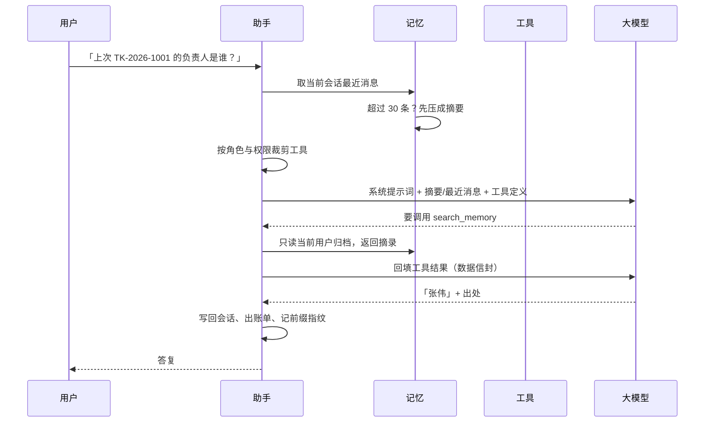
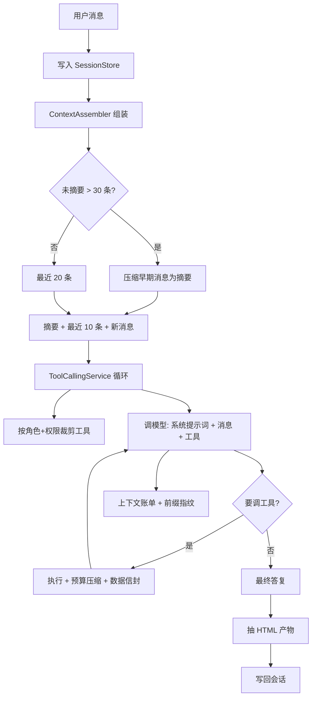
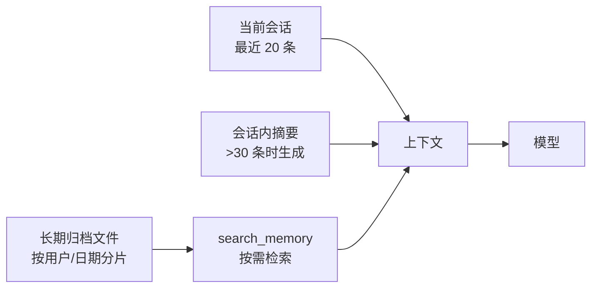
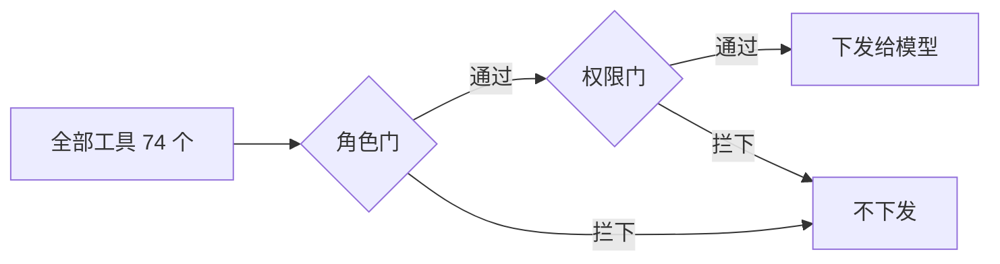

# 智能助手「上下文工程」总结手册（面向初级工程师）

> **读者定位**：刚接触大模型应用、能看懂 Spring Boot 与 Vue，但对「上下文怎么管」还没有系统认识的工程师。
> **写法**：先讲业务上到底解决什么问题，再讲技术怎么实现、为什么这么选，最后给你能直接用的简历话术与面试答题要点。
> **范围**：本项目 `drone-agent` 的上下文管理全链路（记忆、压缩、检索、工具预算、账单、缓存、评估）。
> 相关手册：`记忆子系统`、`工具调用`、`提示词工程`、`业务流程Skill`、`知识库检索`——本手册负责把它们**串成一条上下文流水线**。

---

## 第一部分 · 业务角度：这个功能到底在做什么

### 1.1 一句话说清它是什么

**上下文工程，就是决定「这一次请求里，模型能看到什么、看不到什么、各看多少」。**

模型本身没有记忆、不会查库、不会操作业务系统。它每次回答，只能依据你这一次塞给它的内容。
塞多了：贵、慢、抓不住重点；塞少了：失忆、答偏、重复问；塞错了：越权、被注入、答非所问。

本项目要同时满足四件事：

| 目标 | 业务含义 |
|---|---|
| 记得住 | 跨轮、跨会话还能接上「上次那个任务」 |
| 答得准 | 该查设备查设备，该查资料查资料，不靠猜 |
| 花得少 | 每个请求的固定成本可控，长会话不失控 |
| 不越界 | 只能看自己权限内的数据，删了就是删了 |

### 1.2 三个业务症状（为什么需要上下文工程）

**症状一：聊到后面「断片」**
会话只带最近 20 条，更早的内容被静默丢掉。用户说「就按刚才说的办」，模型却不知道「刚才」是什么。

**症状二：越聊越贵**
早期实现每个请求都无条件注入其他会话的最近 10 轮 / 8000 字符；再叠加 70 多个工具定义，
一次普通提问的请求体就有 3 万多字符。用户只问一句「有多少设备」，成本却和问一整页问题差不多。

**症状三：越权与污染**
工具定义对所有人全量下发，飞手也能看到「删除设备」「角色授权」；
外部工具返回的文本如果夹带指令，模型可能当命令执行；
10KB 的 HTML 模板留在上下文里，后续每轮都重复计费。

### 1.3 一次提问的上下文旅程（用户视角）



用户只感知到「它记得」；背后是**七层过滤与预算**在同时工作。

### 1.4 关键业务规则（以及为什么这么定）

| 规则 | 为什么 |
|---|---|
| 只带当前会话最近 20 条，超出先摘要 | 不做摘要就丢，用户会觉得「失忆」；全带又太贵 |
| 长期记忆默认**不自动注入**，改由 `search_memory` 按需查 | 固定成本从「每轮最多 8000 字符」降到「0」，且删会话即失效 |
| 工具按**角色 + 权限**裁剪后下发 | 模型看不到用不上的工具，选错率与成本一起降 |
| 危险工具执行前必须人工确认 | 裁剪是成本优化，不是安全边界；执行侧必须复核 |
| 工具结果包 `<tool_result>` 信封 | 外部数据里的指令不能被当成命令执行 |
| Skill 资源单独预算 | 模板不能被通用压缩改坏，也不能无限读取 |
| HTML 产物落盘、会话只存摘要 | 十几 KB 的报告不能长期占据后续每轮上下文 |
| 账单只记数量与 token，不记正文 | 常规日志里不该出现用户原话 |

### 1.5 你能跟面试官聊的「业务亮点」

1. **把「上下文」从一个感觉，变成了可度量的账单**：每次调用都输出系统/记忆/会话/工具/摘要各占多少 token，
   并与模型真实 `prompt_tokens` 对账（通常 ±2% 内，HTML 重场景约 −4%）。
2. **按角色裁剪工具**：飞手从 73 个工具降到 21 个（新增 `search_memory` 后 22/74），
   单次请求实际 prompt 从 12,428 降到 5,136（**−58.7%**）。
3. **长会话不再断片**：超过 30 条未摘要消息时压成 1500 字以内的背景摘要；
   实测 21 条早期消息压成 788 字，模型仍能复述出最早的业务事实。
4. **长期记忆从「每轮硬塞」改成「按需检索」**：关键词检索 5ms 命中，删除会话后立即查不到。
5. **前缀缓存稳定**：同配置下前缀指纹唯一，实测缓存命中 98.3%～98.6%，评估集平均 96.5%。
6. **有一套能说清「改完有没有变好」的评估集**：9 条真实问题，输出通过率、延迟、token、缓存命中。

### 1.6 能力与需求对照

| 业务问题 | 能力 | 需求 |
|---|---|---|
| 跨轮还记得 | 会话短期记忆 | `REQ-AGENT-0002/0003` |
| 跨会话还记得 | 长期记忆归档 + 按需检索 | `REQ-AGENT-0003/0021` |
| 长会话不断片 | 会话内压缩 | `REQ-AGENT-0020` |
| 工具太多、选不对、太贵 | 工具裁剪 + 结果预算 | `REQ-AGENT-0007/0018/0019` |
| 内部资料问答 | RAG 按需检索 | `REQ-AGENT-0010` |
| 固定业务流程 | Skill 渐进披露 | `REQ-AGENT-0014` |
| 大块 HTML 不回灌 | 产物抽取 | `REQ-AGENT-0015` |
| 知道花了多少 | 上下文账单 | `REQ-AGENT-0017` |
| 缓存命中、前缀不抖 | 前缀指纹与排序 | `REQ-AGENT-0022` |
| 改完是否更好 | 评估集 | `REQ-AGENT-0023` |

---

## 第二部分 · 技术角度：怎么实现的、为什么这么选

### 2.1 总图：一次请求的上下文流水线



三句话概括：

1. **组装**：决定这次带哪些消息（摘要、最近对话、检索结果）；
2. **裁剪**：决定这次给模型看哪些工具（角色 + 权限）；
3. **记账**：每次调用都算清各类内容占多少 token，并用真实用量对账。

### 2.2 系统提示词：最贵的固定前缀

系统提示词在 `prompts/assistant/system.md`，版本化管理（当前 v9），启动时由 `PromptCatalog` 加载并校验。
它包含：人设与业务范围、工具使用规则、Skill 使用规则、历史记忆规则、拒答口径。

**两处关键设计：**

1. **按权限裁剪 Skill L1**：`{{skills}}` 只列出当前用户有权使用的流程（`SkillCatalog.l1Text(permissions)`）；
   权限不同 → 提示词不同 → 前缀指纹不同（这是预期，不是 bug）。
2. **Skill 清单按名字排序**：文件系统返回顺序不稳定，不排序会让工具前缀在不同机器上抖动。

> 【判断】系统提示词不是「越详细越好」。它每轮都发，长一段就多一份固定成本；
> 能移到 Skill L2/L3、工具描述里的细则，就不要常驻。

### 2.3 记忆：三层 + 压缩 + 按需检索



#### 2.3.1 短期记忆：`SessionStore`

- 内存里按 `userId + conversationId` 保存会话，Caffeine 管容量（500）与空闲过期（30m）；
- 单会话最多 200 条，超过就归档并移出内存；
- 归档异步写盘：先正文、后索引（反过来会出现「索引有、正文没有」的坏数据）；
- 停机时同步刷盘，避免内存里的会话丢失。

#### 2.3.2 长期记忆：`LongTermMemoryStore`

- 目录：`<root>/<userId>/memory-YYYY-MM-DD.md`，按会话段存放，索引是 `memory.md`；
- 落盘前脱敏；正文换行转义，保证一条消息严格占一行；
- 删除是**物理删除**（从该用户所有分片里移除会话段）。

#### 2.3.3 会话内压缩（`REQ-AGENT-0020`）

触发条件：未摘要消息 **> 30 条**；压缩「除最近 10 条以外」的部分，摘要 ≤ 1500 字；
摘要以 `system` 消息注入，类别 `历史摘要`。

- 摘要缓存在 `Session` 上（`summary` + `summarizedUpTo`），后续轮次不重复调用；
- **失败回退**到「只保留最近 20 条」，用户这一问照常进行；
- 摘要**不落盘**：归档写完整原文，重启后按需重算。

> 【为什么摘要不落盘】落盘要改会话文件格式；原文已经在长期记忆里，摘要丢了不丢数据，
> 只是多一次摘要调用。这是有意的取舍，不是遗漏。

#### 2.3.4 按需检索（`REQ-AGENT-0021`）

`search_memory(query)`：

- 只读**当前用户**目录（`<root>/<userId>/`），`userId` 为空时 fail-closed；
- 关键词打分：整句 ×3、编号 ×2、普通词 ×1；最多 3 段、总计 ≤ 2000 字符；
- 返回带会话 id 与时间的摘录，模型可注明出处；
- 排序后直接读文件，删除会话即失效，没有向量索引同步问题。

**为什么先做关键词，不做向量**：业务问题大量是任务号、设备号、人名，关键词更准；
向量要嵌入、索引、删除同步、阈值调参，等数据量与评测证明有必要再上（见 `REQ-AGENT-0021` plan §7）。

### 2.4 工具上下文：裁剪、压缩、信封、技能预算

#### 2.4.1 工具定义是最大的固定成本

实测一次请求约 12.6k token，其中**工具定义约 10.6k（84%）**。所以优化的第一刀就是工具面：



- 角色门：复用 `ToolGovernance.allows`（`role-tools`，危险工具只授予特定角色）；
- 权限门：`agent.tool.visible-by`，模式 → 权限码（任一满足），先匹配先用，未匹配默认可见；
- 两道门是 **AND**；执行前还会再判一次角色（纵深防御）。

实测：飞手 21/73、机务 46/73、admin 73/73；新增 `search_memory` 后各 +1。
飞手单次实际 prompt 从 12,428 降到 5,136（**−58.7%**）。

#### 2.4.2 工具结果的预算

| 预算 | 默认值 | 超限处理 |
|---|---|---|
| 单条通用工具结果 | 2,000 字符 | 结构化裁剪 → 模型摘要 → 硬截断 |
| 单次对话通用结果总量 | 6,000 字符 | 只留「已省略」占位 |
| Skill 单次资源 | 32,768 字符 | 硬截断 + 标记（**不摘要**） |
| Skill 单次请求累计 | 30,000 字符 | 用尽给占位 |

> 【踩坑】Skill 资源曾经被**完全豁免**预算，导致单次 32KB、总量不限。
> 后来改成独立预算：模板要完整，但必须有上限。**豁免 ≠ 无界**。

#### 2.4.3 数据信封：工具结果是数据，不是指令

`ToolResultEnvelope` 把结果包进 `<tool_result>…</tool_result>`，并中和内容里自带的闭合标记，
防止外部文本「提前闭合信封」后冒充系统指令（间接提示词注入）。

#### 2.4.4 产物：大块 HTML 不回灌

回复里的 HTML 由 `ArtifactService` 抽成文件，会话里只存摘要与一句提示；
后续每轮不再重复计费，前端通过沙箱 iframe 预览、下载。

### 2.5 检索：知识库与 Skill 的渐进披露

两者都遵循「**用到才取**」：

| 能力 | L1（常驻） | L2（按需） | L3（按需） |
|---|---|---|---|
| 知识库 | 只有工具描述 | `search_knowledge(query)` 返回 top-5 片段 | 无 |
| Skill | 名称 + 描述 + 适用场景（按权限） | `use_skill(name)` 取完整步骤 | `read_skill_resource` 取模板/口径 |

- 知识库 top-k = 5，相似度阈值 0.5（小样本标定，后续应基于更大评测集调）；
- Skill 正文 ≤ 8000 字符，资源 ≤ 32768 字符；两者都计入各自的预算。

### 2.6 账单：把上下文变成可度量的数

#### 2.6.1 消息包装对象

`ContextMessage = ModelMessage + MessageKind + toolName`，`tokens()` 现算。
类别：系统提示词、长期记忆、当前会话、工具调用请求、工具结果、续跑、历史摘要。

`ContextBill` 汇总：

```text
合计 = 模板 22 + Σ消息 + 工具定义
```

#### 2.6.2 估算系数（2026-10-23 实测 deepseek-flash）

| 内容 | 系数 |
|---|---|
| 汉字 / 中文标点 | 0.62 token / 字 |
| 自然语言里的其他字符 | 0.21 / 字符 |
| 结构化文本（JSON/HTML/工具结果） | 0.34 / 字符 |
| 每条消息固定开销 | 4 |
| 请求模板固定开销 | 22 |
| 带工具时的固定开销 | 450（仅当有 tools） |

**为什么 JSON/HTML 单独一档**：引号、冒号、尖括号几乎按字符计 token。
第一版用 0.21 估工具定义，账单低估 24%；用 0.34 + 450 后偏差收敛到 −0.3%～−4%。

#### 2.6.3 实际对账

- 非流式：响应里的 `usage.prompt_tokens`；
- 流式：请求带 `stream_options.include_usage`，最后一帧返回 usage；
- 账单同时打印 `估算 / 实际 / 缓存命中 / 偏差`，没有实际值时明确写「实际值不可用」。

日志样例：

```text
【上下文账单】估算 12646 token（模板 22 / 系统提示词 2002×1 / 当前会话 10×1 /
工具定义 10612×74）；前缀指纹=4b41a4976a6c；模型实际 prompt_tokens=12716，
缓存命中=12544（98.6%），估算偏差 -0.6%
```

### 2.7 前缀缓存：让稳定的部分真的稳定

供应商对**相同前缀**自动做上下文缓存。本项目的前缀 = 系统提示词 + 工具定义：

- 系统提示词按权限裁剪，同一用户稳定；
- 工具定义按角色/权限裁剪，顺序按名字排序（MCP 工具在注册时排序）；
- 每次请求计算「系统提示词 + 工具定义」的 SHA-256 前 12 位，打进账单；
- 消息、摘要、工具结果都在前缀之后，属于后缀，变化不影响指纹。

**指纹的用法**：

| 现象 | 解释 |
|---|---|
| 指纹相同、命中率高 | 正常，前缀被缓存 |
| 指纹相同、命中率低 | 多半是供应商缓存过期或驱逐 |
| 指纹变了 | 系统提示词/工具集/权限变了，缓存必然从变化点失效 |

实测：同实例第二轮命中 98.3%，重启后首轮 98.6%，评估集平均 96.5%。

> 【注意】会话压缩生成摘要时，消息前缀会**一次性**变化，这是预期事件，不是稳定性 bug。

### 2.8 评估集：改完怎么证明有效

`tools/context-eval/` 提供一套手工运行的真实问题集（9 条默认 + 1 条重用例）：

```bash
python3 tools/context-eval/run_eval.py \
  --agent-url http://127.0.0.1:8083 \
  --server-url http://127.0.0.1:8080 \
  --log /tmp/agent_eval.log \
  --memory-root ./drone-agent/data/agent-memory-eval --memory-user 5
```

指标：

| 指标 | 说明 | 本项目首轮结果 |
|---|---|---|
| 通过率 | 工具选择 + 回答断言 | 9/9 |
| 平均延迟 | HTTP 端到端 | 12.9s |
| P95 延迟 | 慢请求 | 48.7s（统计总览，8 次工具） |
| 最终上下文 | 最后一轮 prompt tokens | 平均 14,750 |
| 累计 prompt | 所有轮次之和 | 平均 39,990 / 用例 |
| 缓存命中 | Σ命中 / Σprompt | 96.5% |
| 前缀指纹 | 同配置应为 1 个 | 1 个 |
| 长期记忆注入 | 应为 0 | 0 |

> 【怎么用】改提示词、改工具规则、改预算前后各跑一次，对比通过率与 token；
> 不要只看「感觉变好了」。

### 2.9 代码地图（读代码的顺序）

| 顺序 | 类 | 职责 |
|---|---|---|
| 1 | `memory.ContextAssembler` | 组装上下文、触发压缩、注入摘要 |
| 2 | `memory.SessionStore` | 短期记忆（内存 + 归档 + 懒加载） |
| 3 | `memory.LongTermMemoryStore` | 长期记忆正文（读/写/删/readAll） |
| 4 | `memory.MemorySearchTool` | `search_memory` 关键词检索 |
| 5 | `service.ToolCallingService` | 工具循环、预算、裁剪、暂停确认 |
| 6 | `service.ChatService` | 请求构造、系统提示词、账单、前缀指纹 |
| 7 | `context.TokenEstimator` / `ContextBill` | 估算与按类别汇总 |
| 8 | `tool.ToolVisibility` | 可见性规则匹配 |
| 9 | `prompts/assistant/system.md` | 系统提示词（行为规则的唯一来源） |
| 10 | `tools/context-eval/run_eval.py` | 评估集运行器 |

### 2.10 排障速查

| 现象 | 先看什么 | 常见原因 |
|---|---|---|
| 模型「不记得上次」 | 有没有 `【记忆检索】命中/未命中` | 没调 `search_memory`；历史未归档；关键词不匹配 |
| 回答前后矛盾 | `【上下文压缩】完成` 的摘要条数与字数 | 摘要丢了关键决定；可调大保留条数 |
| 请求很贵 | 账单里「工具定义」占比 | 角色/权限规则没生效，工具全量下发 |
| 账单估算偏差大 | 是否 HTML/JSON 内容 | 结构化系数不适用；需重新标定 |
| 缓存命中率突然下降 | 账单「前缀指纹」是否变化 | 权限/角色变了；工具顺序变了；提示词版本变了 |
| 工具报「没有权限」 | `【工具裁剪】` 可见数 | 规则写错或用户确实没权限（执行侧如实拒绝） |
| 技能模板不完整 | `技能资料 X 字（截断 N 次）` | 超过 30,000 累计预算；需要分段读取 |
| 模型输出 DSML 伪工具文本 | `【工具编排】完成` 的轮次 | 轮次上限 8 仍不够；流程需要拆分 |

### 2.11 踩过的坑（面试最加分）

| 坑 | 现象 | 根因 | 解法 |
|---|---|---|---|
| 工具定义吃掉预算 | 请求 3.3 万字符，88% 是工具 | 全量下发，不按角色裁剪 | 角色 + 权限双门裁剪；账单验证 |
| 每轮硬塞长期记忆 | 与当前问题无关也照付 8000 字符 | 用「最近」代替「相关」 | 改 `search_memory` 按需检索 |
| Skill 模板被压成 10 字 | 模型说「模板是空的」 | 通用 2000 字预算套在模板上 | Skill 独立预算；超限只截断不摘要 |
| 账单低估 24% | 估算 9.4k，实际 12.4k | JSON 按自然语言系数估 | JSON 0.34 + 固定 450；实际 usage 对账 |
| 账单低估 14% | 日报场景偏差变大 | HTML 也是标点密集 | 工具结果/调用帧用结构化系数 |
| 长会话突然断片 | 用户说「按刚才说的」模型不懂 | 只保留最近 20 条，更早静默丢弃 | 会话内压缩（摘要 + 最近 10 条） |
| 缓存命中率跳水 | 同配置重启后指纹变了 | MCP 工具按服务端返回顺序注册 | 按名字排序 + 前缀指纹 |
| 删了会话还能被检索 | 隐私事故 | 向量/缓存未同步删除 | 记忆检索直接读文件；删除即失效 |
| 外部数据里的指令被执行 | 模型「听从」工具结果 | 工具结果是不可信文本 | `<tool_result>` 信封 + 中和闭合标记 |
| 确认续跑 400 | `reasoning_content must be passed back` | 现造了新的 tool_call id | 原样回放模型原始 assistant 帧 |

---

## 第三部分 · 简历怎么写

### 3.1 核心原则

1. **写「你解决了什么问题」，不写「你用了什么框架」**；
2. **每个 bullet 尽量带数字**：token、比例、延迟、通过率；
3. **区分「做了」与「验证了」**：没有度量就别写「优化了 50%」；
4. 面试官更关心**取舍**：为什么不用向量？为什么摘要不落盘？为什么裁剪不等于安全？

### 3.2 项目描述模版（直接套）

> 负责无人机管理平台智能助手的**上下文管理**：在「模型无状态、业务数据多、角色权限复杂」的约束下，
> 设计并落地了会话记忆、会话内压缩、工具按角色/权限裁剪、工具结果预算、上下文账单与评估集。
> 单次请求固定成本下降约 58%（飞手场景），长会话不再断片，缓存命中率稳定在 96%+。

### 3.3 简历 Bullet 示例（挑 3～5 条）

- **上下文账单**：为每条发给模型的消息建立计量对象（类别 + 工具名 + token），每次调用输出分类账单，
  并用模型 `usage` 对账；估算偏差从 −24% 收敛到 −4% 以内（常规场景 ±2%）。
- **工具裁剪**：按「角色门 + 权限门」裁剪工具定义，飞手可见 73 → 21 个，单次实际 prompt
  12,428 → 5,136（**−58.7%**），同时保留执行侧权限复核。
- **长会话压缩**：未摘要消息超过 30 条时，将早期内容压成 ≤1500 字摘要并注入；
  实测 21 条压成 788 字，模型仍能复述最早的业务事实；失败自动回退，不影响主流程。
- **长期记忆按需检索**：停掉每轮 8000 字符的无条件注入，新增 `search_memory` 关键词检索
  （只读本人归档、5ms 命中、删除即失效），固定成本降为 0。
- **前缀缓存稳定**：对系统提示词 + 工具定义计算指纹，固定工具顺序；实测缓存命中 98.6%，
  并能用「指纹相同但命中低」区分「内容变了」与「缓存过期」。

### 3.4 面试自述模版（口述 60 秒）

> 这个助手最贵、最容易出问题的不是模型调用本身，而是**每次要塞给模型的上下文**。
> 我们先把上下文拆成可计量的消息对象，做了账单，发现 84% 的 token 花在工具定义上；
> 于是按角色和权限裁剪工具，飞手场景成本降了 58%。
> 长会话会断片，就做了会话内压缩；长期记忆原来每轮硬塞 8000 字符，改成工具按需检索。
> 最后用前缀指纹保证缓存稳定（命中 98%），并用一套 9 条真实问题的评估集防止改坏。
> 整个过程的原则是：**能按需取的不常驻，常驻的必须可度量、可回滚。**

---

## 第四部分 · 常见面试题（含答题要点）

### 分类 A · 概念与选型

**Q1：上下文工程和提示词工程有什么区别？**

答题要点：
- 提示词工程关注「这句话怎么写」；上下文工程关注「这次请求里放什么、放多少、什么时候放」；
- 上下文是有限预算，长上下文有边际收益递减；目标是「最小的高信号 token 集合」；
- 手段包括：系统提示词分层、工具裁剪、检索、压缩、笔记、子代理、缓存、评估。

**Q2：为什么上下文不是越多越好？**

要点：注意力预算有限（token 两两交互）、成本随长度增长、无关信息稀释重点、越长的前缀越难缓存。
本项目用账单证明：工具定义占 84%，先裁它比再加更多说明更有效。

**Q3：上下文里应该放哪几类内容？**

要点：任务指令（系统提示词）、当前目标与约束、近期对话、按需检索到的事实、工具结果。
每一类都要有**预算与来源标记**；不要把「可能有用」的东西预加载。

### 分类 B · 记忆与压缩

**Q4：短期记忆、长期记忆、压缩、检索，怎么分工？**

要点：
- 短期：当前会话最近消息，进程内 + 归档；
- 长期：跨会话原文，按用户/日期分片，支持删除；
- 压缩：会话内超过阈值时，把早期消息摘要成背景，避免断片；
- 检索：跨会话需要细节时，按关键词/语义取原文，避免每轮硬塞。

**Q5：为什么摘要不落盘？**

要点：归档写的是完整原文，摘要只是「给模型看的视图」；落盘要改会话格式，
重启后重算一次成本可接受；丢失摘要不丢数据。

**Q6：长期记忆为什么从「自动注入」改成「工具检索」？**

要点：自动注入与问题无关也付费；工具检索零固定成本、删除即失效、可解释；
代价是模型可能不调用，需要用提示词明确触发场景。

**Q7：工具、画像、向量库三种记忆方案怎么选？**

要点：
- 工具 + 关键词：便宜、精确匹配强、删除一致，先做；
- 用户画像：小、稳，适合身份/偏好，但需要提炼与过期治理；
- 向量：语义召回强，但有嵌入、索引、删除同步、阈值与误召回成本；
- 推荐顺序：工具 → 画像 → 向量，且保持工具契约不变。

### 分类 C · 工具与预算

**Q8：为什么工具定义是最大成本？怎么裁？**

要点：每个工具含名称、描述、参数 Schema，几十个就是上万 token；按角色（岗位）与权限（数据范围）
两个维度裁剪，未匹配规则默认可见，执行侧仍复核。

**Q9：裁剪工具算安全边界吗？**

要点：不算。裁剪是成本与准确率优化；真正的边界是执行侧 `ToolGovernance` 与下游 RBAC。
模型可能被诱导调用看不见的工具，执行时必须拒绝。

**Q10：工具结果怎么压缩？为什么 Skill 资源单独预算？**

要点：结构化裁剪（去链接/重复行）→ 模型摘要 → 硬截断；Skill 模板不能被改写，所以不摘要，
只截断并标记；但必须有独立上限，防止无限读取。

### 分类 D · 度量与缓存

**Q11：token 怎么估？为什么不引 tokenizer？**

要点：DeepSeek 无公开 tokenizer；用实测系数（中文 0.62、其他 0.21、结构化 0.34、
每条消息 4、模板 22、带工具固定 450），并用真实 usage 对账；
估算用于看趋势与找大头，不用于计费。

**Q12：为什么 JSON 和自然语言的系数不一样？**

要点：JSON/HTML 里引号、冒号、尖括号占比高，几乎按字符切 token；自然语言有子词合并。
用 0.21 估 JSON 会低估 24%～40%。

**Q13：前缀缓存怎么工作？哪些操作会让它失效？**

要点：供应商缓存「逐 token 相同的前缀」；系统提示词/工具定义/权限变化、工具顺序变化、
摘要插入都会让缓存从变化点失效；消息追加在末尾不影响前缀。
本项目用指纹（系统+工具）与命中率联合判断。

**Q14：缓存命中率低，怎么排查？**

要点：先看指纹是否变化（内容变了），再看实际命中率（供应商过期/驱逐）；
再看请求是否跨账号、是否频繁改提示词；不要盲目加缓存逻辑。

### 分类 E · 安全与权限

**Q15：跨用户记忆怎么隔离？删除怎么保证？**

要点：目录按 `userId` 分；工具用显式 `ToolContext.userId`，为空 fail-closed；
检索只读本人目录；删除是物理删除，检索直接读文件，所以删了立刻查不到。

**Q16：工具结果注入怎么防？**

要点：把结果包进 `<tool_result>` 信封，中和内容里的闭合标记；系统提示词声明「信封里是数据」；
真正的兜底是执行侧权限与人工确认，不依赖模型自觉。

### 分类 F · 送命题（答好会亮眼）

**Q17：上下文快满了，你会怎么办？**

要点（按优先级）：先裁固定成本（工具面）→ 会话内压缩 → 按需检索替代常驻 →
大块内容移出上下文（产物落盘）→ 子代理隔离重活 → 最后才考虑换更长窗口的模型。

**Q18：怎么证明你的上下文改造有效？**

要点：固定评估集（真实问题 + 工具/事实断言），度量通过率、延迟、上下文 token、缓存命中；
改造前后各跑一次；单测只证明机制正确，不证明效果。

**Q19：如果让你重新设计，会先做什么？**

要点：先做**度量**（账单 + 评估集），再做优化；没有度量，裁剪与压缩都是拍脑袋。
其次先做「按需」而不是「预加载」：检索、Skill、记忆都遵循同一原则。

---

## 附录 · 一页速记（面试前扫一眼）

### A. 关键数字

| 指标 | 数值 |
|---|---|
| 工具定义占请求 | 约 84% |
| 工具数量（admin） | 74（70 业务 + 4 本地） |
| 飞手可见工具 | 约 22/74（裁剪前 73/73） |
| 飞手实际 prompt | 5,136（admin 12,428，−58.7%） |
| 会话注入上限 | 最近 20 条 |
| 压缩触发 / 保留 / 摘要 | 30 条 / 10 条 / 1,500 字 |
| 通用工具结果预算 | 单条 2,000 / 总量 6,000 字符 |
| Skill 资源预算 | 单次 32,768 / 累计 30,000 字符 |
| 账单估算偏差 | −0.3%～−4% |
| 缓存命中 | 98.3%～98.6%（评估集 96.5%） |
| 评估集 | 9/9，平均 12.9s，P95 48.7s |

### B. 三条公式

```text
上下文合计 ≈ 模板 22 + Σ每条消息 + 工具定义
每条消息 ≈ 4 + 0.62×汉字 + 0.21×其他（工具结果/JSON 用 0.34）
工具定义 ≈ 450 + 0.34 × JSON 字符数
缓存命中率 = 命中 tokens / prompt tokens
```

### C. 配置速查

```yaml
agent.memory.inject-enabled: false        # 不再每轮硬塞长期记忆
agent.memory.compact-trigger-messages: 30
agent.memory.compact-keep-messages: 10
agent.memory.compact-summary-chars: 1500
agent.memory.compact-input-chars: 12000
agent.tool.max-result-chars: 2000
agent.tool.max-total-result-chars: 6000
agent.tool.max-skill-result-chars: 32768
agent.tool.max-total-skill-chars: 30000
agent.tool.visible-by: [...]              # 工具可见性规则
agent.skill.max-body-chars: 8000
agent.skill.max-resource-chars: 32768
agent.kb.top-k: 5
agent.kb.min-score: 0.5
```

### D. 日志关键词

| 关键词 | 说明 |
|---|---|
| `【上下文账单】` | 每次模型调用的分类账单、估算/实际、指纹、命中率 |
| `【上下文压缩】` | 摘要条数、字数、保留条数 |
| `【工具裁剪】` | 可见/总数、角色拦下、权限拦下、隐藏名单 |
| `【工具编排】开始/完成` | 轮次、工具名、压缩条数、技能资料用量 |
| `【记忆检索】命中/未命中` | 记忆检索结果与耗时 |
| `【MCP】发现完成` | 远程工具注册情况 |

### E. 需求索引

| 需求 | 主题 |
|---|---|
| 0002 / 0003 | 简单记忆 / 会话与长期记忆 |
| 0007 | 编排优化（重试、结果压缩、预算） |
| 0009 | 提示词注入防护（数据信封） |
| 0010 | 内部资料检索（RAG） |
| 0014 | 业务流程 Skill（渐进披露） |
| 0015 | HTML 产物预览与下载 |
| 0016 | 流式输出与思考展示 |
| 0017 | 上下文账单（按消息计量） |
| 0018 | 工具按角色与权限裁剪 |
| 0019 | Skill 资源独立预算 |
| 0020 | 会话内压缩 |
| 0021 | 长期记忆按需检索 |
| 0022 | 前缀缓存与稳定性 |
| 0023 | 上下文质量评估集 |

### F. 术语表

| 术语 | 解释 |
|---|---|
| 上下文窗口 | 模型一次能处理的最大 token 数 |
| 前缀缓存 | 供应商对相同前缀复用计算结果，命中部分更便宜 |
| Compaction | 把长对话早期内容压成摘要，保留最近原文 |
| 渐进披露 | 元数据常驻、正文与资源按需加载（L1/L2/L3） |
| 数据信封 | 用标记把外部内容包起来，声明「这是数据不是指令」 |
| 指纹 | 系统提示词 + 工具定义的哈希，用于判断前缀是否变化 |
| 评估集 | 一组真实问题 + 断言，用于回归与对比 |

---

> **如果只记三句话**：
> 1. 上下文是预算，不是仓库：能按需取的不常驻。
> 2. 先度量再优化：没有账单与评估集，裁剪和压缩都是感觉。
> 3. 裁剪不等于安全：执行侧必须自己再判一次。
