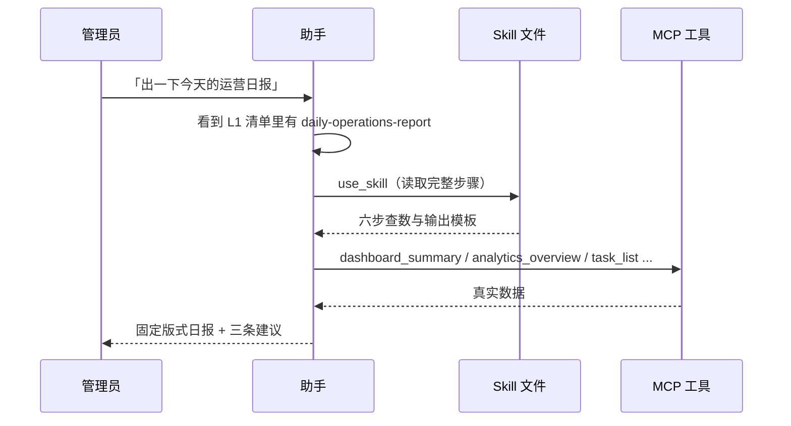
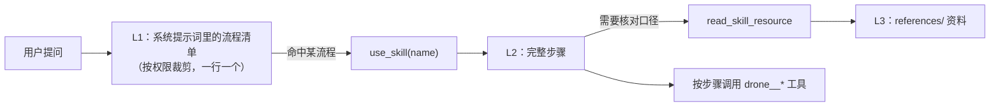
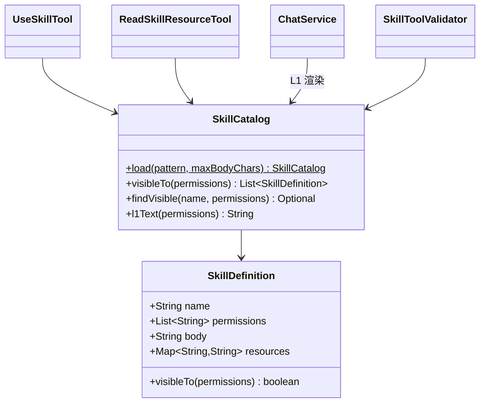
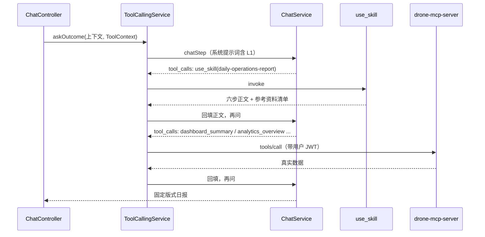
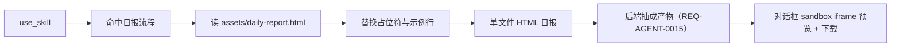

# 智能助手「业务流程 Skill」总结手册（面向初级工程师）

> 读者定位：刚入行 0～2 年的后端 / 全栈工程师，第一次接触 Agent Skill。
> 这份文档有三个用途：**能跟面试官聊业务**、**能跟面试官聊技术细节**、**能把它写进简历**。
>
> 全文分四部分：
> 1. 业务角度——为什么要把业务流程变成资产
> 2. 技术角度——Skill 是什么、渐进式加载怎么实现、权限怎么裁
> 3. 简历怎么写——模版 + 实例
> 4. 常见面试题——含答题要点
>
> 记号约定：**【事实】** 是代码、配置或日志里查到、可以复现的；**【判断】** 是解释性内容，你可以再验证一句。
>
> 相关文档：[`MCP接入-初级工程师手册.md`](./MCP接入-初级工程师手册.md)（Skill 的「作业指导书」要配上 MCP 的「手」）、
> [`../../docs/sdd/decisions/ADR-0009-Skill指令式与按权限裁剪.md`](../../docs/sdd/decisions/ADR-0009-Skill指令式与按权限裁剪.md)。

---

## 第一部分 · 业务角度：这个功能到底在做什么

### 1.1 一句话

**Skill 是把「一套固定做法」写成可版本化、可按需加载的文件。**
它不是代码，是一份**标准作业程序（SOP）**：什么场景用、按什么顺序查什么、按什么版式输出。
执行仍由模型按步骤调用已有工具完成。

### 1.2 为什么需要 Skill

助手已经能通过 MCP 操作真实业务，但每次都让模型「临场发挥」有三个问题：

| 问题 | 表现 |
|---|---|
| **步骤不稳** | 同样问「今天运营怎么样」，每次查的项不一样 |
| **口径不一** | 状态值、字段名记错；完成率分母算错 |
| **无法沉淀** | 好用的问法只存在于聊天记录里，换个模型/换个人就没了 |

### 1.3 业务流程（用户视角）



用户只看到「一份日报」；背后是「识别场景 → 加载步骤 → 按序取数 → 按模板输出」。

### 1.4 四条内置流程的业务价值

| 流程 | 使用者 | 解决什么 |
|---|---|---|
| `daily-operations-report` 运营日报 | 管理员 | 固定查数口径与版式，替代手工拼 5 张表 |
| `dispatch-readiness` 派发前检查 | 调度 | 状态、禁飞区、可用人机三项缺一不可，漏一步就白派 |
| `alert-triage` 告警分诊 | 值班 | 级别排序、处置动作与状态机强对应（claim→resolve/ignore） |
| `shift-handover` 飞手交接班 | 飞手 | 未完成任务、异常告警、证据缺口必须交接 |

候选（本期只登记）：证据缺口审计、航线合规巡检、周报/月报。

### 1.5 关键业务规则（以及为什么这么定）

| 规则 | 为什么 |
|---|---|
| **先查后写** | 任务/设备/人员 ID 必须先查出来，不能臆造 |
| **写前复述、等确认** | 派发、处置、删除都不可逆或高影响 |
| **权限不足如实说** | 「当前账号没有该流程/权限」，不说系统故障 |
| **数据缺就写缺** | 接口没返回的数字不许估；无权限的块不能当 0 |
| **建议要能落地** | 「加强管理」不是建议，要说谁、做什么、什么时候 |

### 1.6 你能跟面试官聊的「业务亮点」

- 把散落在聊天里的「好问法」变成**随代码版本化的资产**：可评审、可回滚、可复用。
- 四条流程覆盖管理员、调度、值班、飞手四类角色，**每条都有固定产出物**。
- 流程**按权限可见**：不同角色只看到自己用得上的，既省成本也不误导模型。
- 新增流程**只加一个目录**，不改 Java。

---

## 第二部分 · 技术角度：怎么实现的、为什么这么选

### 2.1 Skill 是什么

**一个目录 + 一个 `SKILL.md`**，可选 `references/`：

```text
skills/
├── _template/SKILL.md                  # 模板（下划线开头，扫描时跳过）
├── daily-operations-report/
│   ├── SKILL.md
│   └── references/metric-definitions.md
├── dispatch-readiness/SKILL.md
├── alert-triage/SKILL.md
└── shift-handover/SKILL.md
```

`SKILL.md` 的结构：

```yaml
---
name: daily-operations-report        # 必须等于目录名
version: 1
owner: 运营部
description: 生成当日运营日报（任务/人员/设备/告警/风险建议）
when_to_use: 管理员问「今天运营情况怎么样」「出个日报」
permissions: [task:list, alert:list] # 必填：全部具备才可见/可用
tools:                               # 正文会用到哪些工具（启动校验）
  - drone__dashboard_summary
  - drone__analytics_overview
---
正文：目标、编号步骤、输出模板、禁止事项。
```

#### 和提示词、工具的区别

| 东西 | 解决什么 | 在哪 |
|---|---|---|
| 系统提示词 | 人设、范围、总规则 | 每次请求都进上下文 |
| 工具（MCP） | 能做**一件事** | 模型按需调用 |
| **Skill** | **把多件事按标准顺序串起来** | L1 常驻、L2/L3 按需 |

【判断】Skill 不替代工具，而是**编排工具**；也不替代提示词，而是**补充某类任务的专用做法**。

### 2.2 渐进式加载（Progressive Disclosure）

把所有 SOP 塞进每次请求既贵又吵。Skill 分三层加载：

| 层级 | 内容 | 何时进上下文 | 体积 |
|---|---|---|---|
| **L1 元数据** | name / description / when_to_use | **常驻**系统提示词，一行一个 | 30–60 tokens |
| **L2 指令** | `SKILL.md` 正文（步骤、参数、输出模板） | 模型调用 `use_skill(name)` 时 | 0.5–2k tokens |
| **L3 资源** | `references/`（口径、字段表）与 `assets/`（模板、样式） | 再调用 `read_skill_resource` 时 | 按需 |



这样即使以后有几十个流程，常驻成本也只是几十行元数据。

### 2.3 本项目的实现



| 类 | 职责 |
|---|---|
| `SkillCatalog` | 启动扫描 `classpath*:skills/**`；只解析 frontmatter；按权限过滤；提供 L1 文本 |
| `SkillDefinition` | 单条流程的 L1/L2/L3 内容 |
| `UseSkillTool` | `use_skill(name)` → L2；**二次校验权限** |
| `ReadSkillResourceTool` | `read_skill_resource` → L3；只允许 `references/` 或 `assets/` + 文本类扩展名 + 防路径穿越 |
| `SkillToolValidator` | 启动校验 `tools`：本地工具缺失即失败，`drone__*` 缺失只 WARN |
| `ChatService` | 把 `l1Text(permissions)` 渲染进系统提示词 |

**启动期校验（fail-fast）**：

- 目录名与 `name` 不一致、`description` 为空、`permissions` 为空、正文为空或超长、重名
  → **启动失败**；
- `tools` 引用了不存在的本地工具 → 启动失败；`drone__*` 未发现 → 只 WARN（MCP 服务可能没起）。

### 2.4 权限模型（本期重点）

- 每条 Skill **必须**声明 `permissions`，用户**全部具备**才可见、可用。
  - 用「全部」而不是「任一」：日报要同时查任务与告警，只有一半权限时让它出现，模型调用后会拿 403。
- **L1 按权限实时裁剪**：admin 看到 4 条；只具备 `task:execute` 的飞手只看到交接班；
  没有可见流程时渲染「（当前账号没有可用的标准化流程）」。
- **调用时二次校验**：无权与不存在返回**同一句**「没有找到该流程（可能不存在，或当前账号无权使用）」，
  真实原因只进日志，避免暴露流程存在性。
- **边界仍在服务端**：可见性只是体验优化；真正的授权由 `drone-server` 的 RBAC 判定。

**权限怎么传进提示词（显式传参，不靠 ThreadLocal）**：

| 入口 | 做法 |
|---|---|
| 工具循环 | `ToolCallingService` 已有 `ToolContext` → 传给 `chatStep` |
| 非工具对话 | `ConversationService` 把 `toolContext.permissions()` 传给 `chat` |
| SSE 流式 | `ChatController` 在**请求线程**上取权限，再传进异步线程 |

> 注意：`/chat` 接口本身要求 `agent:chat`。初始数据里它只授予了 admin；
> 要让飞手用交接班流程，需要先给 `pilot` 角色授予 `agent:chat`。

### 2.5 一次「出日报」的完整链路



日志里能按顺序读到：

```text
【Skill】加载流程：name=daily-operations-report，正文 2015 字符，参考资料 1 份
【工具编排】第 2 轮：工具「drone__dashboard_summary」执行成功
【工具编排】第 3 轮：drone__analytics_overview / drone__analytics_dispatch_block 并发执行
【工具编排】第 4 轮：drone__task_list / drone__alert_list
【工具编排】第 5 轮：模型直接作答
```

### 2.6 日报 HTML 模板（assets/）

`daily-operations-report` 自带一个可直接打开、可打印的 HTML 模板：

```text
skills/daily-operations-report/
├── SKILL.md
├── references/metric-definitions.md   # 口径
└── assets/daily-report.html           # 版式模板（自包含 CSS）
```

- 正文要求「需要 HTML 版时，用 `read_skill_resource` 读 `assets/daily-report.html`」；
- 模板里是 `{{占位符}}` + 示例行，模型替换成真实数据后输出单文件 HTML；
- 模板不依赖外部 CSS/JS/字体，浏览器直接打开、A4 打印都可用；
- 设计要点：6 个 KPI 卡、任务状态堆叠条、告警表、三条风险建议；缺失数据写「无数据」。



> **日报的默认输出就是 HTML**（REQ-AGENT-0015 之后没有 Markdown 版）：模型每次都读取模板、
> 把文档放在 ` ```html ` 围栏里、围栏前写 2–3 行摘要。
> 后端会把围栏里的 HTML 抽成文件（回复与会话里只留摘要），前端用沙箱 iframe 预览并提供下载；
> 详见 [`REQ-AGENT-0015`](../../docs/sdd/specs/REQ-AGENT-0015-HTML产物预览与下载.md)。

### 2.7 工程化：两个必须知道的点

**1）轮次预算要覆盖流程步数。**
日报要查 5 个接口。`max-rounds` 还是 3 时，第 4 轮就被收回工具，模型把没执行完的调用
写成了**伪工具文本（DSML）**返回给用户。修复：

- `agent.tool.max-rounds` 由 3 提到 **6**；
- 提示词补「互不依赖的查询可同轮并发」「不要在正文输出工具调用标记」「工具被收回时直接作答」。

**2）正文要控制长度，细节放 `references/`。**
`max-body-chars` 默认 8000，超了启动失败。把「指标口径、字段表、模板」放 L3，
既避免正文膨胀，也便于单独维护。

### 2.8 排障

| 现象 | 先看 |
|---|---|
| 模型不知道有流程 | 该系统提示词里的 L1 是否包含（受权限影响）；启动日志有没有「加载完成」 |
| 加载失败 | 日志里的 `【Skill】` 报错：缺 permissions、正文为空、name 与目录不符 |
| 启动报「引用了不存在的本地工具」 | 检查 `tools` 里是否写错；`drone__*` 未发现只会 WARN |
| 模型跳步 | 正文是否写清编号步骤与「缺一步停下」；`use_skill` 返回里也有同样约束 |
| 输出半截、出现伪工具文本 | 轮次预算不够：`max-rounds` 需覆盖流程步数（当前 6） |
| 飞手看不到交接班 | 先确认 `agent:chat` 与 `task:execute` 是否都授予了该角色 |

### 2.9 设计取舍（详见 ADR-0009）

- **指令式，不做工作流引擎**：复用现有工具循环与治理；代价是步骤遵守依赖模型。
- **随包发布，不做热加载**：与 prompts 一致，可评审、可回滚；改文件需重启。
- **L1 按权限裁剪**：省 token、不摆无权流程；代价是提示词随用户变化，排查时先看是谁在问。

### 2.10 扩展：新增一条流程（不用改 Java）

1. 复制 `skills/_template/SKILL.md` 到 `skills/<流程名>/SKILL.md`；
2. `name` 必须等于目录名；
3. 填 `description` / `when_to_use`（会进 L1，写清用户会怎么问）；
4. 填 `permissions`（用到的每个接口所需权限码，全部具备才可见）；
5. 在 `tools` 里列出正文要调用的工具（启动会校验）；
6. 正文用**编号步骤**写清「调哪个工具、传什么参数、按什么版式输出」，细节放 `references/`，模板放 `assets/`；
7. 重启服务；日志会打印加载结果与校验结果。

---

## 第三部分 · 简历怎么写

### 3.1 核心原则

1. **业务一句话 + 技术一句话**：HR 看业务，面试官看技术。
2. **有数字**：流程数、权限数、正文长度、轮次预算。
3. **有取舍**：写清「为什么不做工作流引擎」。
4. **别写「精通」**：写「实现过 / 踩过什么坑」。

### 3.2 项目描述模版

```
【项目名称】无人机管理平台 - 智能助手业务流程 Skill（渐进式加载 + 按权限裁剪）
【角色】核心开发
【规模】4 条业务 SOP；Skill 相关单测 17 例
【背景】助手能操作业务后，流程仍依赖模型临场发挥：步骤不稳、口径不一、经验无法沉淀
【职责】负责 Skill 框架、权限可见性与四条业务流程的设计与实现
【技术】Spring Boot 3.3 · Java 17 · YAML frontmatter · 渐进式加载 · RBAC
【要点】
  · 三层加载：L1 元数据常驻 / L2 正文按需 / L3 资料按需，常驻成本一行一个
  · 权限：每条流程声明权限码，全部具备才可见；L1 按用户实时裁剪，调用二次校验
  · 资产化：新增流程只加目录，启动校验名字/正文/权限/工具引用
  · 可靠性：轮次预算覆盖流程步数；提示词禁止输出伪工具标记
```

### 3.3 简历 Bullet 示例（挑 3～5 条）

**偏业务：**
- 将运营日报、派发前检查、告警分诊、交接班四条**业务 SOP 资产化**，
  固定查数口径与产出格式，减少对个人经验的依赖。

**偏技术：**
- 实现 **Skill 渐进式加载**（L1 元数据常驻 / L2 正文按需 / L3 资料按需），
  常驻上下文成本从「每份 SOP 全量」降到**一行一个**。
- 实现 **按权限裁剪的 L1**：流程声明所需权限码（全部具备才可见），
  按当前用户实时过滤；`use_skill` 二次校验，无权与不存在返回同一文案。
- 建立 **Skill 启动校验**（目录名/正文/权限/工具引用），坏文件直接让服务起不来；
  本地工具缺失 fail-fast，MCP 工具缺失降级告警。
- 解决**流程执行半途工具被收回**的问题：把轮次预算从 3 提到 6，
  并在提示词中禁止输出伪工具文本（DSML）。

### 3.4 面试自述模版（口述 60 秒）

> 「这个项目里我负责把业务流程做成 Skill。背景是助手已经能调工具了，但每次怎么做全靠模型发挥，
> 同样的日报每次查的项都不一样。我用 **SKILL.md** 把流程写成标准步骤，分三层加载：
> 元数据常驻一行，正文等模型说『要用这个流程』再读，口径资料再按需读。
> 权限上，每条流程声明需要的权限码，用户全都有才看得到；提示词里的清单是按人实时裁的，
> 不同角色看到的流程不一样，也省 token。新增流程只要加一个目录，不用改 Java。
> 中间踩过一个坑：日报要查五个接口，轮次上限还是 3，模型做到一半工具被收走，
> 把没执行完的调用写成了伪工具文本返回给用户——后来把轮次调到 6 并补了提示词约束。」

---

## 第四部分 · 常见面试题（含答题要点）

### 分类 A · 概念

**Q1：Agent Skill 是什么？和提示词、工具有什么区别？**
- Skill 是一份可加载的 SOP（frontmatter + 正文 + 可选资料）。
- 提示词管「人设与总规则」；工具管「做一件事」；Skill 管「把多件事按标准顺序串起来」。

**Q2：什么是渐进式加载？为什么要它？**
- 三层：L1 元数据常驻、L2 正文按需、L3 资料按需。
- 目的：即使有几十个流程，常驻成本也只是几十行元数据。

**Q3：Skill 的 frontmatter 里有什么？**
- `name`（等于目录名）、`version`、`owner`、`description`、`when_to_use`、
  `permissions`、`tools`。

### 分类 B · 加载与实现

**Q4：Skill 什么时候加载？怎么触发？**
- 启动时只解析 frontmatter 建目录；模型判断场景匹配后调用 `use_skill` 才读正文。

**Q5：为什么不把正文直接写进系统提示词？**
- 每份 SOP 0.5–2k tokens，全量常驻会挤占上下文；而且大多数请求用不到。

**Q6：Skill 的正文太长怎么办？**
- 正文设上限（8000 字符），细节放 `references/`，通过 `read_skill_resource` 按需读取。

### 分类 C · 权限与安全

**Q7：不同用户看到的 Skill 为什么不一样？**
- 每条 Skill 声明 `permissions`，用户**全部具备**才可见；
  L1 按当前用户实时过滤，无可见项时显示「暂无」。

**Q8：为什么用「全部具备」而不是「任一具备」？**
- 一个流程通常要连续调多个接口；只有一半权限时让它出现，模型做到一半会拿 403，体验更差。

**Q9：权限是怎么传进提示词的？**
- 显式传参：`ToolContext.permissions()` → `chatStep` / `chat` / `streamAsk`。
  不用 ThreadLocal，因为工具在别的线程、SSE 进异步后 ThreadLocal 会被清理。

**Q10：谁能看到 Skill 是不是安全边界？**
- 不是。可见性只是体验优化；真正的判定在 `drone-server` 的 RBAC。
- `use_skill` 还会二次校验，无权与不存在返回同一句文案，不暴露存在性。

**Q11：读取参考资料怎么防止目录穿越？**
- 只允许 `references/` 前缀；拒绝 `..`、绝对路径、反斜杠；
  扩展名白名单（md/txt/json/csv）；内容启动时已入内存，运行期不做磁盘 IO。

### 分类 D · 工程与取舍

**Q12：为什么不做工作流引擎（DSL 解释执行）？**
- 现有工具循环已能表达顺序、分支与错误处理；引擎要重写参数映射、条件、重试与可观测性，
  收益（确定性）在当前流程规模下不足以覆盖复杂度。
- 【判断】若出现「必须逐字执行、不能由模型决定」的流程（如结算），再单独引入。

**Q13：模型跳步怎么办？**
- 正文写「必须按顺序、缺一步停下说明」；`use_skill` 的返回里重复同一约束；
  冒烟时逐条核对输出模板。

**Q14：轮次预算为什么从 3 提到 6？**
- 日报要串行查 5 个接口，3 轮会在半路收回工具；
- 实测模型会把没执行完的调用写成伪工具文本（DSML），所以同时补了提示词约束。

**Q15：新增一个 Skill 要改多少代码？**
- 【事实】零代码：加一个目录 + `SKILL.md`（+ 可选 `references/`），重启即可。
  启动会校验名字、正文、权限与工具引用。

**Q16：Skill 和 MCP 是什么关系？**
- MCP 给助手「手」（能操作）；Skill 给「作业指导书」（怎么按标准操作）。
- 两者组合：Skill 的步骤调用 MCP 暴露的工具。

---

## 附录 · 一页速记（面试前扫一眼）

- **Skill** = 目录 + `SKILL.md`（frontmatter + 正文）+ 可选 `references/`；是 SOP，不是代码。
- **渐进式加载**：L1 元数据常驻 / L2 正文按需 / L3 资料按需。
- **权限**：`permissions` 必填，全部具备才可见；L1 按人裁剪；调用二次校验。
- **本项目**：4 条流程（日报/派发检查/告警分诊/交接班）；`use_skill` + `read_skill_resource`。
- **校验**：名字=目录名、正文非空、权限非空、工具引用存在；坏文件启动失败。
- **扩展**：加目录即可，不改 Java。
- **坑**：轮次预算不足导致半途收工具、模型输出伪工具文本。

## 附录 · 术语表

| 术语 | 含义 |
|---|---|
| Skill | 可加载的标准作业程序（SOP），由 frontmatter + 正文 + 资料组成 |
| 渐进式加载 | 元数据常驻、正文按需、资料再按需的三层加载 |
| L1 / L2 / L3 | 元数据 / 正文 / 参考资料 |
| frontmatter | 文件开头的 YAML 元数据块 |
| `use_skill` | 加载某个流程完整步骤的工具 |
| `read_skill_resource` | 按需读取流程参考资料的工具 |
| SOP | Standard Operating Procedure，标准作业程序 |
| 可见性裁剪 | 按权限过滤 L1 清单，只展示用户用得上的流程 |
