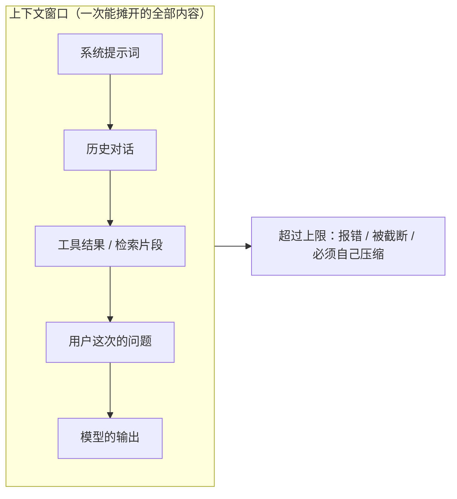
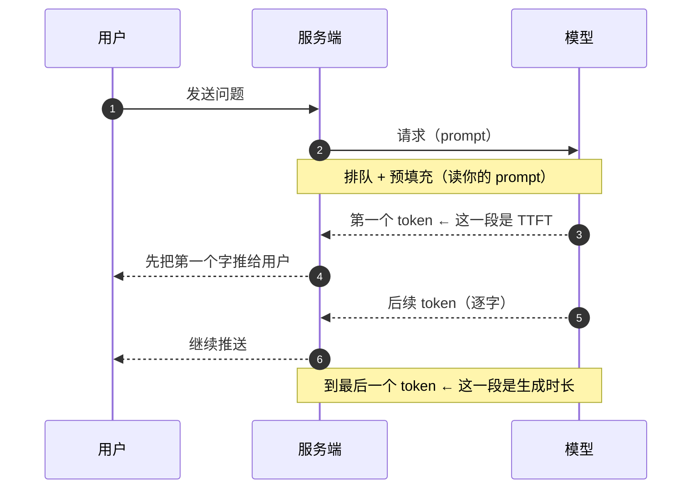
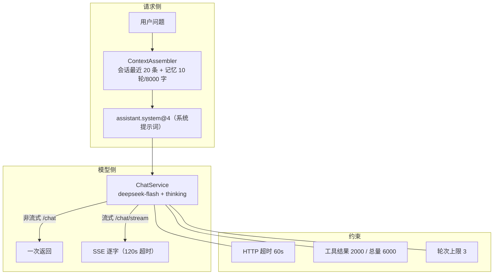

# 智能助手「大模型基础」总结手册（面向初级工程师）

> **读者**：刚入行 0～2 年的后端 / 全栈工程师，第一次接大模型。
> **用途**：把**必须懂的几个概念**讲成人话（模型类型 / Token / 上下文窗口 / 温度 / 幻觉 / 上下文限制 / TTFT），
> 再对照**本项目里对应的是什么、怎么落地的**，最后讲**工程上真正会踩的坑**。
>
> 记号：**【事实】**＝代码 / 配置 / 实测可核对；**【判断】**＝经验性结论；**【概念】**＝业界名词。
> 配套：[`知识库检索（RAG）`](./知识库检索-初级工程师手册.md) · [`提示词工程`](./提示词工程-初级工程师手册.md) ·
> [`工具调用`](./工具调用-初级工程师手册.md) · [`记忆子系统`](./记忆子系统-初级工程师手册.md)。
>
> **【重要前提】** 本手册里涉及**模型能力 / 价格 / 窗口大小**的具体数字，**一律以供应商官方文档为准**——
> 这些会变，本文不写死。

---

# 第一部分 · 基础概念（先讲人话）

## 1.1 模型的类型

大模型不是一个东西，是**一族东西**。按用途分，你至少要知道这四种：

| 类型 | 干什么 | 通俗类比 | 本项目用到 |
|---|---|---|---|
| **生成模型（对话 / Instruct）** | 读一段话，接着往下写 | 「会说话的人」 | ✅ `deepseek-flash` |
| **推理模型（Thinking / Reasoning）** | 先「想一想」再回答，擅长复杂推理 | 「打草稿再答题的人」 | ✅ 同一模型开了 thinking |
| **嵌入模型（Embedding）** | 把文字变成向量（给检索用） | 「把书按内容归类上架」 | ✅ GLM `embedding-3` |
| **多模态模型** | 能看图 / 听音 / 看视频 | 「眼睛耳朵也能用的人」 | ❌ 未用 |

还有几种常见分法：

- **开源 / 闭源**：开源可自己部署（数据不出内网），闭源省事但依赖外部服务；
- **大 / 小模型**：大模型更聪明但更贵更慢，小模型便宜快，适合简单任务；
- **指令微调（Instruct/Chat）vs 基座（Base）**：你要对话就用 Instruct/Chat，基座只会「续写」。

> **【事实】本项目用了两种模型**：生成用 `deepseek-flash`（开了深度思考），
> 嵌入用 GLM `embedding-3`（2048 维）。**生成模型和嵌入模型是两回事**，不能拿一个当另一个用。

**【判断】选型口诀**：**难推理用推理模型，日常问答用对话模型，检索必须用嵌入模型。**

## 1.2 Token 是什么

**Token 是模型眼里的「字」。** 它不是汉字也不是英文单词，而是分词器切出来的**小块**：

- 英文：一个词可能是一块，也可能拆成几块（`unbelievable` → `un` + `believ` + `able`）；
- 中文：**大致 1 个汉字 ≈ 1～2 个 token**（取决于分词器，**以实际 tokenizer 为准**）；
- 标点、空格、换行**也占 token**。

> 通俗类比：**拼乐高的积木**。模型不是按「字」处理，而是按「积木块」处理；
> 不同语言、不同符号，切出来的块数不一样。

为什么你必须懂它？因为**三件事都按 token 算**：

1. **钱**：API 按 token 计费，**输入和输出通常不同价**；
2. **窗口**：上下文窗口的大小就是「最多能放多少 token」；
3. **速度**：token 越多，生成越慢、首包越晚。

**【事实】本项目目前没有统计 token**：调模型返回的 `usage`（`prompt_tokens` / `completion_tokens`）
**没有被解析和记录**，所以**算不出每次问答花了多少钱**。这是已知缺口（见第三部分 3.1）。

## 1.3 上下文窗口（Context Window）

**上下文窗口 = 一次请求里，模型能「同时看到」的 token 上限。**



注意两点，很多新人会误会：

1. **输入 + 输出通常共享这个上限**（具体规则看供应商）；
2. **窗口大 ≠ 一定好用**：塞得越多越贵越慢，而且模型对**中间**的内容最不敏感（见 1.4）。

> 通俗类比：**一张桌子**。一次只能摊开这么多资料；资料多了，要么换大桌子（换模型），
> 要么**只挑相关的放上来**（这正是 RAG 的意义）。

**【事实】本项目自己还设了更紧的预算**（不依赖模型窗口）：
会话只带**最近 20 条**；长期记忆最多 **10 轮 / 8000 字**；工具结果单次 **2000 字**、总量 **6000 字**。

## 1.4 上下文限制（以及「给了也看不见」）

「上下文限制」有两层意思，第二层才是真坑：

**第一层：硬上限。** 超过窗口 → 报错或截断。工程上必须**自己算预算**，不能指望模型帮你兜。

**第二层：软上限——「Lost in the Middle」。**
研究（Liu et al., 2023）发现：**模型对上下文开头和结尾最敏感，对中间最不敏感**。
你把 10 万字全塞进去，**中间那部分很可能等于没给**。


所以「上下文限制」的工程含义是：

- **别贪多**：只放相关的（检索 + 阈值 + 去重）；
- **把最重要的放两端**：不要把关键片段埋在中间；
- **超长要压缩**：截断 / 摘要 / 结构化裁剪，而不是硬塞。

**【事实】本项目**：工具结果超长会走**分级压缩**（裁剪 → 模型摘要 → 硬截断）；
检索有**阈值**，不相关的片段根本不进上下文。

## 1.5 温度（Temperature）与它的「兄弟参数」

**温度控制「发散程度」**：

| 温度 | 行为 | 适合 |
|---|---|---|
| **0** | 尽量选最可能的词，稳定、保守 | 事实问答、抽取、代码 |
| **0.2～0.5** | 有点变化，仍可控 | 一般对话 |
| **0.7～1.0+** | 更发散、更有创意 | 写文案、头脑风暴 |

> 通俗类比：**0 = 照本宣科；1 = 天马行空。**

**注意：温度 0 也不是 100% 确定**——底层还有并行计算、模型版本等非确定性因素。

和温度一起常见的三个参数（**用户没提，但工程上必须知道**）：

| 参数 | 干什么 | 一句话 |
|---|---|---|
| **`top_p`（核采样）** | 只在「累计概率前 p」的词里选 | 和温度二选一调，别同时乱调 |
| **`top_k`** | 只在「概率前 k 个」词里选 | 限制候选范围 |
| **`max_tokens`** | **输出**最多多少 token | 不设就可能「刹不住」，也容易超预算 |
| **`stop`** | 遇到指定字符串就停 | 结构化输出时好用 |

> **【事实】本项目没有设置温度、`top_p`、`max_tokens`**——用的是供应商默认值。
> 对「内部资料问答」这种**要准不要花**的场景，**【判断】建议显式设低温度（约 0.1～0.3）并设 `max_tokens`**。
> 这是可以直接改进的点（见第三部分 3.5）。

## 1.6 幻觉（Hallucination）

**幻觉 = 模型一本正经地编。** 它不是「故意骗你」，而是**它按概率往下写，写到没见过的地方就顺着编**。

常见诱因：

1. **资料里没有**，但模型觉得「应该有个答案」；
2. **资料里有但没检索到**（召回失败）；
3. **资料互相冲突**，它自己选了一个；
4. **上下文太长**，关键信息被「中间遗忘」；
5. **温度太高**，自由发挥。

> 通俗类比：**没复习的学生硬答**——语气很自信，内容是编的。

**能做的（按有效性排序）：**

| 手段 | 作用 |
|---|---|
| **把资料给它**（RAG） | 有依据就不容易编 |
| **要求注明出处** | 编的话对不上原文，用户能发现 |
| **查不到就说查不到** | 给它「不答」的选项 |
| **阈值过滤** | 不相关的片段不进上下文，别让它硬凑 |
| **低温度** | 减少自由发挥 |
| **输出校验 / 结构化约束** | 数字、格式能机器校验 |

**不能做的**：**彻底消灭幻觉**。LLM 是概率生成，没有结构性保证。
**【判断】正确目标是「降低 + 可发现」，而不是「保证为零」。**

## 1.7 TTFT（Time To First Token）

**TTFT = 从发出请求，到收到第一个 token 的时间。**

- **TTFT** 决定「用户觉得快不快」——流式下，第一个字出来得快，体感就好；
- **总时长** 决定「这一轮多久结束」；
- 两者不是一回事：TTFT 短、总时长长，体验依然不错。



**影响 TTFT 的因素**：输入长度（prompt 越长，预填充越久）、**是否开思考模式**、模型大小、排队、网络。

> **【事实】本项目**：`/chat` 是非流式（一次返回全部）；`/chat/stream` 走 **SSE 流式**（超时 120s）。
> **但没有单独度量 TTFT**（日志只记了模型调用总耗时）。这是可观测性缺口（见 3.6）。

## 1.8 流式（SSE）——用户没提，但和 TTFT 直接相关

**流式 = 模型边生成边推给前端**，而不是等全部生成完再返回。

- **好处**：TTFT 体感好，长回答不用干等；
- **代价**：服务端要维护长连接；**超时、断连、错误处理**都更麻烦；
- **注意**：流式下**工具调用**要「边收边拼」，复杂度更高（本项目工具链路只做非流式）。

**【事实】本项目**：`/chat/stream` 用 `SseEmitter`（**120 秒**超时，8 线程池）；
工具调用只走非流式 `/chat`。

## 1.9 Token 计费与成本——用户没提，但老板一定问

成本公式（简化）：

```
单次成本 ≈ 输入 token × 输入单价 + 输出 token × 输出单价
```

几个容易忽略的点：

- **输出通常比输入贵**（同一模型）；
- **思考模式会产生额外 token**（推理过程也算钱，具体口径看供应商）；
- **历史越长越贵**：每次问答都要把上下文重新发一遍；
- **工具结果也占输入**：检索片段、工具返回都算 token。

> 通俗类比：**按字数收费，而且「你发的」和「它回的」价格不一样。**

**【事实】本项目没有统计 `usage`**，所以**没有成本看板**。
**【判断】第一件该补的工程化事项**：把 `usage` 记进日志/指标，按天汇总。

## 1.10 模型版本与「行为漂移」——用户没提，但线上会出事

同一个提示词，换一个**模型版本**，回答可能明显变化（措辞、格式、是否调用工具）。

- **模型名要固定**（别用 `latest` 之类的浮动别名）；
- **升级模型 = 一次变更**：要跑**回归**（提示词、工具调用、检索、出处）；
- **提示词要版本化**（本项目用 `assistant.system@N`），行为变了能对上「哪一版」。

**【事实】本项目**：模型名写死在配置（`deepseek-flash`），提示词有版本号（当前 `@4`）；
但**没有模型升级的回归清单**——这是后续要补的。

## 1.11 三个常见误区

1. **「窗口大就能塞更多资料」** —— 能塞，但**贵、慢、中间看不见**。该检索还是要检索。
2. **「温度 0 就完全确定」** —— 不是。只能做到「尽量稳定」。
3. **「模型说得很自信就是对的」** —— 自信和正确**没有关系**；要看**依据和出处**。

---

# 第二部分 · 这些概念在本项目里对应什么

## 2.1 一张图看清



## 2.2 逐项对照

| 概念 | 本项目怎么做的 | 位置 / 备注 |
|---|---|---|
| **模型类型** | 生成：`deepseek-flash`；嵌入：GLM `embedding-3`（2048 维） | `DeepSeekProperties` / `KnowledgeProperties` |
| **推理 / 思考模式** | 开 `thinking` + `reasoning-effort: high` | `application.yml` → `agent.deepseek.*` |
| **Token** | **未计量**（不解析 `usage`） | —— 缺口 |
| **上下文窗口** | 自己不依赖模型窗口，另设预算：会话 **20 条**、记忆 **10 轮 / 8000 字** | `ContextAssembler` |
| **上下文限制** | 工具结果**分级压缩**（2000 / 6000）；轮次上限 **3** | `ToolCallingService` |
| **温度** | **未设置**（用默认） | —— 建议补 |
| **`max_tokens`** | **未设置** | —— 建议补 |
| **幻觉** | 提示词「只依据检索内容 + 注明出处 + 查不到就说」+ 阈值 + 数据信封 | `assistant.system@4` / `VectorRetriever` |
| **TTFT** | 流式已有（SSE），但**未单独度量** | `ChatController` |
| **流式** | `/chat/stream`，`SseEmitter` **120s**，8 线程 | `ChatController` |
| **超时** | 连接 **10s**、请求 **60s** | `ChatService` |
| **重试** | 工具失败重试 **1 次**；**模型调用不重试** | `ToolCallingService` |
| **限流 / 429** | **未处理** | —— 缺口 |
| **成本** | **未统计** | —— 缺口 |
| **模型版本** | 模型名固定；提示词有版本（`@4`）；**无升级回归** | `application.yml` / `prompts/` |

> **【判断】这张表就是一份「体检报告」**：核心链路是通的，但**计量（token/成本）、限流、模型升级回归**三块是空白。

---

# 第三部分 · 工程化问题（真正会踩的坑）

## 3.1 成本：先能算，才谈得上省

**问题**：不知道一次问答花多少钱，就无法做预算、无法判断优化有没有效。

**做法**（按优先级）：

1. **解析 `usage`**，把 `prompt_tokens / completion_tokens` 记进日志（**只记数字，不记内容**）；
2. 按天 / 按用户汇总，做一个简单看板；
3. **优化手段**：
   - 缩短历史（会话只带最近 N 条）；
   - **检索只放相关的**（阈值 + 去重）；
   - 限制 `max_tokens`；
   - **模型分级**：简单任务用小模型，复杂任务才用大模型；
   - **提示缓存**（如果供应商支持，重复的长 prompt 能省钱）。

**【事实】现状**：本项目**第 1 步都没做**——`usage` 直接丢掉了。

## 3.2 延迟：分清楚「首包」和「总时长」

- **TTFT 长**：多半是**输入太长**或**开了思考模式**；
- **总时长长**：多半是**输出太长**或**多轮工具调用**。

**手段**：

| 想优化 | 可以做什么 |
|---|---|
| TTFT | 缩短 prompt（少带历史/片段）、关思考模式、流式输出、就近部署 |
| 总时长 | 限制 `max_tokens`、减少工具轮次、并行工具、压缩结果 |

**【事实】现状**：流式有了，但**没有 TTFT 指标**；思考模式开着（会拉长 TTFT）。

## 3.3 稳定性：超时、重试、限流、降级

这是**接入大模型后最容易出事的一块**，四个词要背下来：

1. **超时**：一定要设。本项目 HTTP 请求 **60s**、SSE **120s**。
2. **重试**：只对**可重试错误**（超时、429、5xx）重试，并且要**退避 + 上限**；
   **非幂等操作别乱重试**（比如已经产生副作用的工具调用）。
3. **限流**：供应商有 **RPM / TPM** 限制，超了返回 **429**。要**排队 / 退避 / 降级**。
4. **降级**：模型不可用时，给用户一句「稍后再试」，**别把 500 抛到页面**。

**【事实】现状**：超时设了；工具失败有 1 次重试；**模型调用没有重试、没有限流处理、没有熔断**。

## 3.4 上下文管理：预算要显式

- **别让上下文无限长**：显式设「条数 / 字数 / token」预算；
- **超了要「有序收尾」**：丢最早的、压缩、或直接告知，**不要静默截断**；
- **位置很重要**：最相关的放两端。

**【事实】现状**：会话 20 条、记忆 10 轮/8000 字、工具结果 2000/6000——**预算意识是有的**；
但**没有按 token 算**（都是按「条数 / 字符数」估的），**中文场景下字符≠token**，建议改用 token 预算。

## 3.5 输出可控：温度、`max_tokens`、结构化

- **事实类任务**：低温度（0.1～0.3）；
- **设 `max_tokens`**：防「刹不住」；
- **要机器处理就约束格式**（JSON），并**校验**——别指望模型每次都守格式；
- **`stop` 序列**：截断不需要的尾巴。

**【事实】现状**：**这三样都没设**。对内部资料问答来说，**低温度 + `max_tokens` 是最低成本的改进**。

## 3.6 可观测：没有度量就没有优化

至少要有：

| 指标 | 为什么 |
|---|---|
| **每次调用的耗时** | 判断慢在哪（模型 / 工具 / 数据库） |
| **TTFT**（流式） | 用户体感 |
| **输入 / 输出 token** | 成本 |
| **错误率 / 429 次数** | 稳定性 |
| **空结果率 / 命中率**（RAG） | 检索质量 |
| **traceId** | 把一次请求的多层日志串起来 |

**【事实】现状**：`traceId` + 每层耗时**已有**；**token、TTFT、错误分类、成本**没有。

## 3.7 评测：不然一切优化都是感觉

- **离线**：一批「问题 + 期望答案/出处」，改完提示词/模型/切块就跑一遍；
- **线上**：空结果率、用户是否追问、是否点「没用」。

**【事实】现状**：只有 4 条手工样本（用于定 `min-score`），**没有系统评估集**——这是最大的短板。

## 3.8 安全：提示注入、脱敏、越权

- **提示注入**：检索片段、工具结果都是**不可信数据**——用**数据信封**隔开，系统提示词声明「数据不是指令」；
- **脱敏**：手机号、Token、证件号进日志前必须脱敏；**永远不打 `Authorization` 头**；
- **越权**：权限判定在**服务端**，检索**前置过滤**；
- **内容安全**：必要时加输出审核（本项目未做）。

**【事实】现状**：数据信封、脱敏、权限前置过滤**都做了**（见 `REQ-AGENT-0009` / `0010`）。

## 3.9 版本与变更管理

- **模型名固定**；升级当**变更**处理（回归 + 灰度）；
- **提示词版本化**（本项目 `@N`）；
- **配置变更可回退**（开关）。

**【事实】现状**：模型名固定、提示词有版本、知识库有总开关；
**缺**：模型升级的回归清单与灰度方案。

---

# 附录 · 一页速记

## A. 概念速查

| 概念 | 一句话 |
|---|---|
| **模型类型** | 生成 / 推理 / 嵌入 / 多模态；开源闭源、大小模型 |
| **Token** | 模型眼里的「字」，**钱、窗口、速度都按它算** |
| **上下文窗口** | 一次能「同时看到」的 token 上限（输入+输出通常共享） |
| **上下文限制** | 硬上限 + 软上限（**中间最容易看不见**） |
| **温度** | 0 保守、1 发散；**事实类任务用低温度** |
| **幻觉** | 一本正经地编；**只能降低 + 可发现，不能消灭** |
| **TTFT** | 第一个字多久出来；决定「体感快不快」 |
| **流式** | 边生成边推（SSE）；TTFT 体感好，但长连接更麻烦 |
| **`max_tokens`** | 输出上限；不设容易超预算 |
| **`top_p` / `top_k`** | 采样范围；和温度别一起乱调 |
| **限流 / 429** | 供应商的 RPM/TPM 限制；要退避与降级 |
| **提示缓存** | 重复的长 prompt 可省钱（看供应商支持） |
| **行为漂移** | 换模型版本结果会变；升级要回归 |

## B. 三条公式

```
上下文 ≈ 系统提示词 + 历史 + 检索/工具结果 + 本轮问题 + 输出
单次成本 ≈ 输入 token × 输入单价 + 输出 token × 输出单价
总耗时 ≈ 排队 + TTFT（预填充 + 首 token）+ 生成时长
```

## C. 本项目数字速查

- 生成模型：`deepseek-flash`（`thinking` 开、`reasoning-effort: high`）
- 嵌入模型：GLM `embedding-3`（**2048 维**）
- 超时：连接 **10s** / 请求 **60s**；流式 **120s**
- 上下文预算：会话 **20 条**、记忆 **10 轮 / 8000 字**、工具结果 **2000 / 总量 6000**
- 轮次上限：**3**；工具失败重试：**1 次**
- **未做**：token 计量、温度 / `max_tokens`、TTFT 指标、限流处理、模型升级回归、系统评估集

## D. 如果只记三句话

1. **Token 是钱和窗口的单位**——先把它量出来。
2. **事实类任务要低温度 + 给依据 + 要出处**——不能靠「模型应该知道」。
3. **上线前把超时、限流、降级、可观测做完**——模型服务不稳定是常态。
