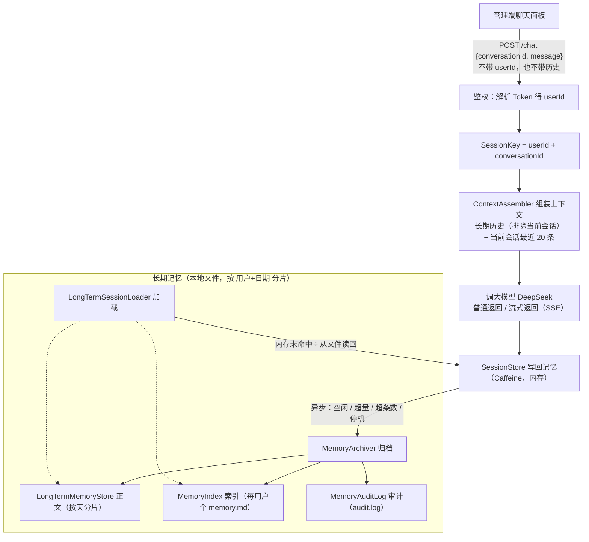
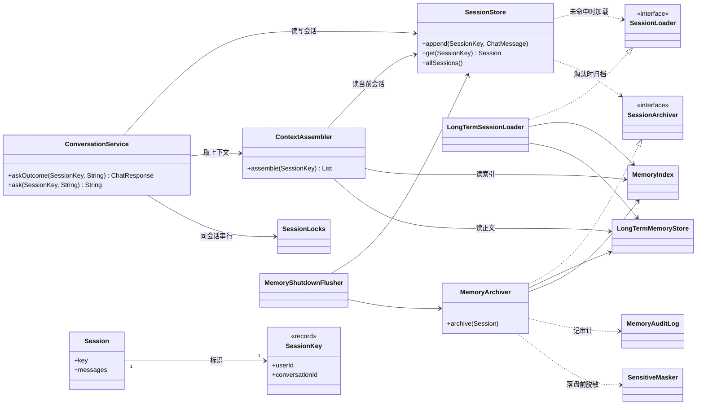
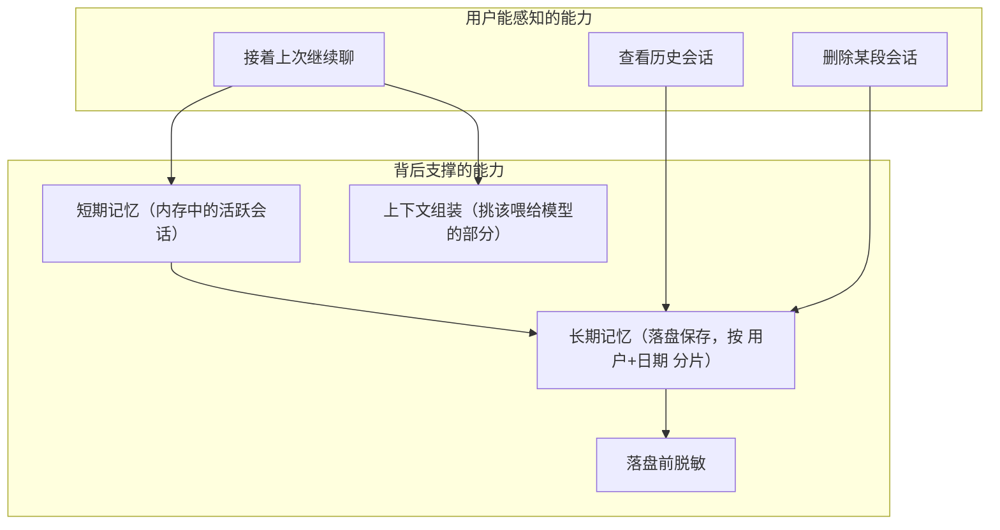
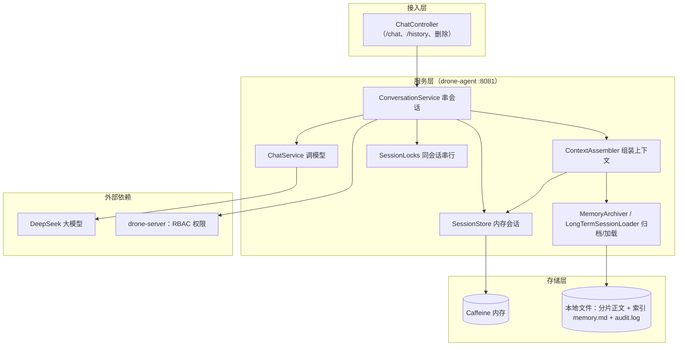
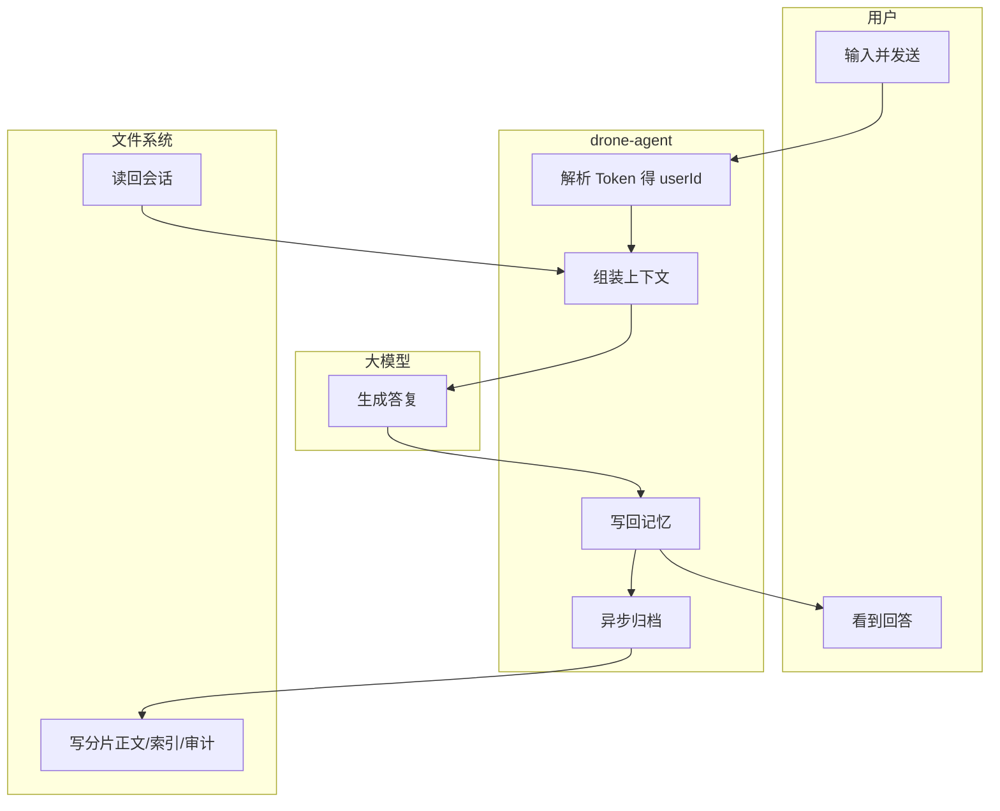
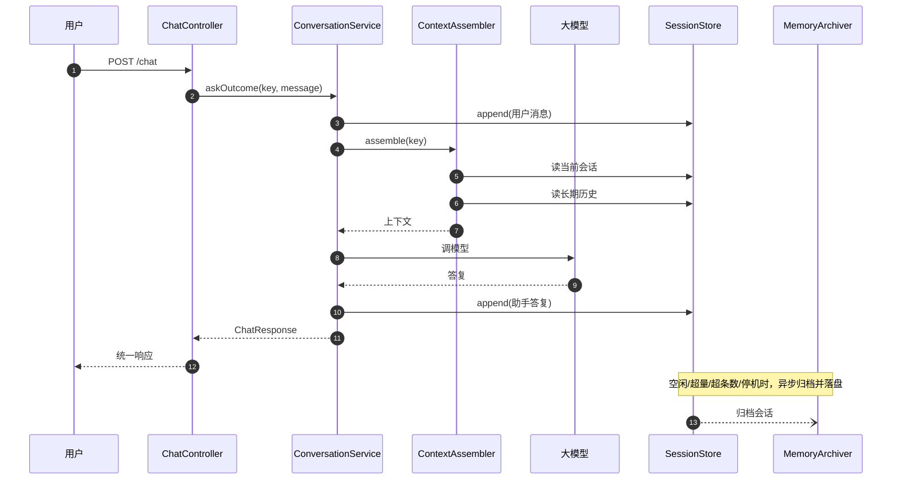
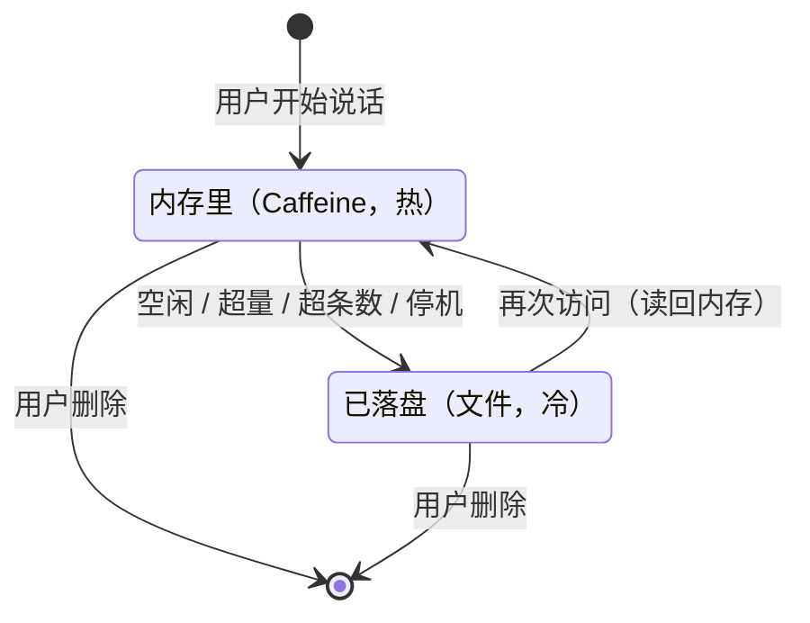

# 智能助手「记忆子系统」总结手册（面向初级工程师）

> 读者定位：刚入行 0～2 年的后端 / 全栈工程师。
> 这份文档有三个用途：**能跟面试官聊业务**、**能跟面试官聊技术细节**、**能把它写进简历**。
>
> 全文分四部分：
> 1. 业务角度——这个功能在做什么
> 2. 技术角度——怎么实现的、为什么这么选、分几步做
> 3. 简历怎么写——模版 + 实例
> 4. 常见面试题——含答题要点
>
> 记号约定：**【事实】** 是代码、配置或日志里查到、可以复现的；**【判断】** 是解释性内容，你可以再验证一句。
> 相关部署与配置以 [`记忆子系统部署说明.md`](./记忆子系统部署说明.md) 为准。

---

## 第一部分 · 业务角度：这个功能到底在做什么

### 1.1 一句话说清它是什么

给无人机管理平台加了一个「智能助手」，它**记得住你和它聊过什么**：
关掉页面再打开、甚至服务器重启，之前的对话内容还在，可以接着聊。

这不是「模型自己有记忆」——大模型本身是**无状态**的，每次调用它都只认你这一次塞进去的内容。
**记忆是我们在应用层做出来的**。

### 1.2 业务流程（用户视角，按时间顺序）

用一个真实场景把它串起来。用户「老王」想问：「我昨天跟你说的那批无人机保养周期是多少？」

**第 1 步：会话从哪来**
老王打开管理端，点右上角「智能助手」图标，右侧滑出聊天面板。
面板第一次打开时，前端生成一个 `conversationId`（会话编号），存在浏览器里。
之后他在这个面板里发的每条消息，都带着**同一个 conversationId**。

> 业务含义：`conversationId` 是「这一段对话」的身份。同一个人可以有多个对话，
> 就像微信里跟同一个人能开好几个聊天窗口。

**第 2 步：发消息，带上上下文**
老王输入问题点发送。后端做三件事：
1. 从**登录令牌（Token）里**取出他是谁（userId）——不是前端传的，是从令牌里解出来的；
2. 把「userId + conversationId」拼成会话标识，去记忆里找他这段对话的历史；
3. 把「系统提示词 + 历史对话 + 这次的新问题」一起发给大模型。

> 业务含义：模型看不到历史就记不住上下文。**我们每次提问都要把历史重新喂给它**，
> 它才能答得上「昨天那批」。

**第 3 步：回答，同时把这一轮问答存下来**
模型返回答案（可能是流式一个字一个字蹦出来，用户体感更快）。
回答结束后，系统把「老王的这句话 + 模型的回答」这一对，追加到这段会话的记忆里。

**第 4 步：对话多了，怎么不撑爆内存**
一段会话不是永远躺在内存里。以下情况会让它**从内存挪到文件**：

| 触发情况 | 业务上的说法 |
|---|---|
| 会话空闲超过 `idle-timeout`（默认 30m）没人说话 | 「这段先放一边，别占内存」 |
| 内存里会话总数超过 `session-max-count`（默认 500） | 「内存满了，把最不活跃的挪走」 |
| 单段会话消息数超过 `max-messages-per-session`（默认 200） | 「这段太长了，归档一下」 |
| 服务优雅停机（重启 / 发版） | 「关机前把没存的全存下来」 |

还有第 5 种是**反向的**：当老王隔了很久又打开某段对话，内存里没了，
系统**从文件把它读回内存**。

> 业务含义：内存是「正在聊的对话」，文件是「全部历史」。这套做法叫**冷热分层**。

**第 5 步：重启之后还在**
服务器半夜发版重启，内存清空。第二天老王打开对话继续问——系统发现内存里没有，
就去文件里把它读回来，**对话内容是连续的**。

**第 6 步：查看和删除**
面板上有「历史」按钮，列出老王的所有会话（标题、时间、消息条数）。
每条会话可以删除。【事实】删除是**真的从文件里删掉**，且删除前会先记一条审计日志。

> 业务含义：用户对自己的数据有删除权。

### 1.3 关键业务规则（以及为什么这么定）

这些是「产品 + 技术一起拍板」的决策，面试时最能体现你懂业务：

1. **长期记忆存原文，不存摘要。**
   【事实】曾考虑过只存模型摘要以省空间，被明确否决：摘要会丢原始信息，用户回头要细节就查不到了。
   → 面试话术：「我们选择存原文，配合按天分片和冷热分层来控制体积，而不是牺牲信息完整性。」

2. **数据不上云，就存服务端文件。**
   【事实】长期记忆落在服务器本地目录，按「用户 → 日期」分片。没有引入 Redis / MySQL 存记忆内容。
   → 【判断】这是「单实例、可控规模」阶段的务实选择，不是最终形态。

3. **落盘前必须脱敏。**
   【事实】写入文件之前会过滤令牌、密码、邮箱、身份证、银行卡、手机号等敏感信息。
   → 业务含义：「记忆存得久」意味着「泄露风险也存得久」，所以写入即脱敏。

4. **会话可以删除，且结构上预留了后续扩展成「多选批量删」的能力。**
   【事实】当前是单条删除。

5. **记忆永久保留（除非用户删）。**
   【事实】没有自动过期清理策略，因此磁盘是单调增长的——这也是监控的重点。

### 1.4 你能跟面试官聊的「业务亮点」

- **痛点 → 方案 → 取舍**三段式：模型无状态 → 应用层做冷热分层的记忆 →
  用文件保原文、用内存保性能、用脱敏保安全。
- **有明确的验收标准**：【事实】这个需求有 19 条验收条件（AC）、18 个开发任务（T），
  说明它不是「随手写的 demo」，是走过需求的。
- **有真实的边界意识**：知道当前是单实例、知道哪里会撑不住、知道下一步怎么扩。

---

## 第二部分 · 技术角度：怎么实现的、为什么这么选、分几步做

### 2.1 整体数据流



### 2.2 类图（读代码时的「地图」）

> 看代码前先看这张图：**谁持有谁、谁调用谁**。带 `<<interface>>` 的是接口，
> 具体的装配顺序以 `config/MemoryConfig.java` 为准（那里是唯一权威）。



### 2.3 技术选型与「为什么」

| 用到的技术 | 为什么选它 | 面试怎么讲 |
|---|---|---|
| **Java 17 + Spring Boot 3.3.3** | 团队主栈，服务治理成熟 | 「和平台其他服务同栈同版本，便于统一运维」 |
| **独立服务 drone-agent** | 助手是独立能力，不想污染主业务服务 | 「独立部署、独立扩容，故障隔离」 |
| **复用 drone-server 的 JWT** | 不为助手再建一套账号体系 | 「同一密钥同一签发方校验令牌，再回查权限码，避免权限两套」 |
| **Caffeine（内存缓存）** | 短期记忆要「快、自动过期、自动淘汰」 | 「本地缓存零网络开销，自带容量淘汰和空闲过期，正合适放热数据」 |
| **本地文件（按用户 + 日期分片）** | 长期记忆持久化，不引入额外中间件 | 「单机阶段用文件最省事，分片后单文件不会无限大」 |
| **SSE 流式输出** | 大模型出字慢，流式体验好 | 「SseEmitter 推增量，前端一个字一个字渲染」 |
| **原子写（临时文件 + rename）** | 文件整体重写中途崩溃不能留半截 | 「先写临时文件再原子改名，保证读到的要么是完整旧的、要么是完整新的」 |

**特别要说清楚的两个「为什么不用」：**

- **为什么不用 Redis 存短期记忆？**
  【判断】当前是**单实例**部署，内存直接放本进程最快，Redis 会多一跳网络 + 多一个要运维的组件。
  等要上多实例了再引入（此时短期记忆需要跨实例共享，见 2.5）。

- **为什么长期记忆不是数据库？**
  【判断】记忆是「长文本 + 低频读写 + 按用户隔离」，正是文件擅长的场景；
  用数据库反而要么大字段、要么拆表，复杂度不划算。

### 2.4 实现步骤（拆成你能讲的 7 步）

**步骤 1：定身份——从 Token 拿 userId，绝不信任前端**
- 前端只传 `{conversationId, message}`，**不传 userId**。
- 后端从 Token 解出 userId；会话标识 = userId + conversationId。
- 【事实】好处是「拿别人的 conversationId 也只会落到自己名下」，
  **越权在结构上就不成立**，不用每个接口再判一次归属。
- 权限码 `agent:chat` 复用 drone-server：【事实】agent 用同一个密钥 + 同一签发方验签，
  再调用 drone-server 的内部接口查权限，结果**缓存 60 秒**。

**步骤 2：短期记忆——用 Caffeine 放在内存里**
- 每个会话在内存里是一个对象：会话标识 + 消息列表 + 起止时间。
- 【事实】三个上限：`session-max-count=500`、`max-messages-per-session=200`、`idle-timeout=30m`。
- 【事实】关键坑：Caffeine 的淘汰回调是**异步**跑的，不是在你调用的那个线程上。
  所以归档逻辑必须线程安全、不能用 ThreadLocal（见 2.5 坑 1）。

**步骤 3：长期记忆——分片存储，双层结构**
- **索引**：每个用户一个 `memory.md`，一行描述一段会话（时间、会话号、条数、标题、正文文件名）。
- **正文**：按「日期 + 会话」分片成 `memory-YYYY-MM-DD.md`，
  超过 `file-max-bytes=2MB` 就滚动到 `-2.md`、`-3.md`。
- 【事实】为什么拆两层？列表页只需要读索引（小、快）；
  只有真正要恢复某段对话时才读正文（大、少读）。
- 【事实】写入 / 删除用原子写（临时文件 + `ATOMIC_MOVE`），避免崩溃留半截正文。

**步骤 4：上下文组装——控制喂给模型的量**
- 【事实】组装顺序：**系统提示词永远第一条** → 长期历史（排除当前会话，避免重复）→ 当前会话最近 20 条。
- 【事实】长期历史还受 `inject-max-turns=10`、`inject-max-chars=8000` 两个预算约束，超了从最早的开始丢。
- 【事实】截断后如果开头是孤立的「助手回复」，会被去掉——否则模型会对着一句没头没尾的话继续接。
- 【判断】为什么要限 20 条 / 10 轮 / 8000 字？因为 token 就是钱和延迟，历史全塞进去成本和延迟都失控。

**步骤 5：归档与恢复——两个方向的搬运**
- 出内存 → 文件：归档器把会话写进正文、更新索引、记审计。
- 文件 → 内存：加载器读索引找到正文文件，读回会话。
- 【事实】归档器带**有界重试**：写失败先入队，队列上限 200 条，每 30 秒批量重试一次，每轮最多处理 50 条。
  （早期版本会在每轮里反复重试同一条，把坏磁盘打到爆，修过。）

**步骤 6：停机不丢数据**
- 【事实】服务优雅停机时，有一个「刷盘器」把内存里还没落盘的会话**同步写出**。
- 【事实】它比归档器**先执行**（停机阶段编号更大先跑），保证还有数据可刷。

**步骤 7：同会话串行化**
- 【事实】同一个会话如果两条消息同时进来，会各读一份历史、各调一次模型、各写回一次 →
  上下文错乱、消息互相覆盖。
- 解决：**每个会话一把信号量**，同会话串行处理，等待超时 30 秒。
- 【事实】为什么用信号量不用锁？因为流式请求的「持有时长」跨越了线程（请求线程发起、异步线程完成），
  普通锁要求同线程加解锁会报错，信号量允许「A 线程拿、B 线程还」。

### 2.5 踩过的真实的坑（面试最加分）

**坑 1：缓存淘汰回调是异步的，我们最初假设它是同步的**
- 现象：【事实】验收条件原本写的是「淘汰前一定已经落盘」，但实测根本做不到。
- 原因：【事实】Caffeine 的淘汰回调跑在公共线程池（`ForkJoinPool.commonPool-worker-*`）上，不是调用方线程。
- 处理：① 把验收条件改成「淘汰后会被异步归档，失败进重试队列」；
  ② 归档器改成线程安全；③ **明令禁止在归档链路里用 ThreadLocal**（否则在别的线程上取不到值）。
- 面试话术：「这个坑让我意识到，**第三方库的『回调』到底是同步还是异步，必须实测，不能看文档想当然**。」

**坑 2：越用越大的表泄漏**
- 【事实】每个会话一把信号量，如果只增不减，跑久了会为每个历史会话留一个对象。
- 处理：**引用计数**，正在使用或等待的线程数归零才移除。
- 【事实】细节：不能一释放就删——否则两个线程可能各自拿到新旧两个不同信号量，互斥就失效了。

**坑 3：日志「看不见」**
- 现象：模型调用、归档、加载这些关键链路一开始**没有日志**，排查只能靠猜。
- 处理：定规范——关键流程「一进一出」必须打日志；异步动作必须标明是异步；
  日志面向**初级工程师**，要能还原调用流程。

### 2.6 测试与验收

- 【事实】后端 **91** 个单测；前端 **16** 个单测（Vitest，只覆盖 agent 相关）。
- 【事实】验证过日志脱敏：原始手机号出现 0 次，脱敏后 `138****8000` 出现。
- 【事实】验证过「两个方向」都出现在日志里（`【内存←文件】` / `【文件←内存】`）。
- 【判断】覆盖率不是重点，**关键路径有测试**是重点：鉴权越权、归档重试、上下文截断、索引去重。

> 【提醒】这条链路目前只做过接口级验证，**没做浏览器端到端验证**。
> 面试若被问到，如实说「接口层验证过，页面级待补」，比吹牛强。

### 2.7 各种视图（Mermaid）

> 同一套代码，换个视角讲：**架构图**看「静态组成」，**泳道图/时序图**看「谁做、谁先谁后」，**状态图**看「生命周期」。
> （流程图见 §2.1、类图见 §2.2；图种介绍见 [`软件工程常用图鉴.md`](./软件工程常用图鉴.md)。）

#### 2.7.1 业务架构图（有什么能力）



#### 2.7.2 技术架构图（有哪些组件、谁依赖谁）



#### 2.7.3 泳道图（每一步谁做）



#### 2.7.4 时序图（谁先谁后）



#### 2.7.5 状态图（会话生命周期）



---

## 第三部分 · 简历怎么写

### 3.1 核心原则

1. **业务一句话 + 技术一句话**。HR 看业务，面试官看技术。
2. **有数字**。数量、阈值、性能，数字让描述可信。
3. **有取舍**。「为什么不用 X」比「用了 X」更能体现深度。
4. **别写「精通」**。写「实现过 / 主导过 / 踩过什么坑」。

### 3.2 项目描述模版（直接套）

```
【项目名称】无人机管理平台 - 智能助手记忆子系统
【角色】核心开发
【规模】后端 91 单测 / 前端 16 单测，覆盖 19 条验收条件
【背景】大模型本身无状态，多轮对话需要由应用层维护上下文记忆
【职责】负责记忆子系统的设计与实现
【技术】Spring Boot 3.3 · Java 17 · Caffeine · 文件分片存储 · SSE · JWT/RBAC
【要点】
  · 冷热分层：会话热数据放 Caffeine，冷数据异步归档到按「用户 + 日期」分片的文件
  · 双层索引：每用户一份索引文件 + 按天分片正文，列表只读索引，恢复才读正文
  · 数据安全：落盘前自动脱敏（令牌 / 密码 / 邮箱 / 身份证 / 银行卡 / 手机号）
  · 并发控制：同会话信号量串行化，避免上下文错乱
  · 健壮性：停机同步刷盘 + 有界重试队列，避免淘汰丢数据
```

### 3.3 简历 Bullet 示例（挑 3～5 条放上去）

**偏业务：**
- 设计并实现无人机平台的 AI 助手**多轮对话记忆**能力，解决大模型无状态导致的「记不住上文」问题，
  支持会话查看与删除。

**偏技术：**
- 采用 **Caffeine + 文件分片**的冷热分层存储：热会话驻留内存，冷会话异步归档为
  「按用户 / 日期」分片文件，避免单文件无限膨胀。
- 实现**双层索引（索引文件 + 正文分片）**，列表查询只读轻量索引，恢复会话时才读正文，降低 I/O。
- 基于**信号量**实现同会话串行化，解决并发消息导致的上下文错乱与覆盖；
  用**引用计数**防止信号量表长跑泄漏。
- 兜底**停机同步刷盘 + 有界重试队列（上限 200 条 / 每 30 秒批量重试 / 每轮 50 条）**，
  避免缓存异步淘汰造成数据丢失。
- 复用平台 **JWT + 权限码**体系，userId 一律从 Token 提取，从结构上杜绝水平越权；
  内部接口调用采用共享密钥 + 常量时间比较。
- 记忆**落盘前自动脱敏**，覆盖令牌、密码、邮箱、身份证、银行卡、手机号等多类敏感信息。

### 3.4 面试自述模版（口述 60 秒版）

> 「这个项目里我负责 AI 助手的记忆子系统。背景是大模型本身没有记忆，多轮对话得我们自己维护。
> 我做了冷热分层：正在聊的会话放 Caffeine 内存，不活跃的异步归档到文件；
> 文件按用户和日期分片，避免单个文件过大；每个用户还维护一份索引，列会话时只读索引。
> 中间踩了几个坑，印象最深的是 Caffeine 的淘汰回调其实是异步跑在公共线程池上的，
> 我们一开始假设它是同步的，导致『淘汰前落盘』这个验收根本做不到；
> 后来改成了异步归档加有界重试，并且停机时会同步刷盘兜底。
> 另外同会话并发我用信号量串行化，因为流式请求跨线程持锁，普通锁会报错。
> 安全上令牌里只取 userId，永远不信任前端传的用户身份。」

---

## 第四部分 · 常见面试题（含答题要点）

### 分类 A · 架构与选型

**Q1：为什么要给记忆做冷热分层？直接全放内存不行吗？**
- 内存有限，进程重启就没了；全放内存跑久了必崩。
- 热数据（正在聊的会话）要快 → 内存；冷数据（历史）要持久 → 文件。
- 关键点：**分层是按访问频率切的，不是按新旧切的**。

**Q2：为什么用 Caffeine，不用 HashMap 自己管？**
- Caffeine 自带**容量淘汰 + 空闲过期 + 并发安全**，自己写容易出 bug。
- 加分：它的淘汰回调是**异步**的，这点要提前知道。

**Q3：长期记忆为什么用文件，不引 Redis / MySQL？**
- 记忆是长文本、低频读写、按用户隔离，文件最合适。
- 当前单实例，引中间件性价比低。
- 加分：说清**这是阶段选择**——多实例化时短期记忆必须迁到共享存储（如 Redis）。

**Q4：为什么把助手做成独立服务？**
- 独立部署、独立扩容、故障隔离；助手挂了不影响主业务。

### 分类 B · 存储与一致性

**Q5：文件为什么按「用户 + 日期」分片？**
- 按用户：天然隔离，检索只读自己目录。
- 按日期：单文件不会无限大；删旧数据方便。
- 双层（索引 + 正文）：列表只读小索引，避免为大文件买单。

**Q6：文件写到一半崩了怎么办？**
- 用**原子写**：先写临时文件，再 rename 覆盖，保证读到的要么是完整旧内容、要么是完整新内容。
- 补充：追加不是原子的（崩溃最多在末尾留半截会话段）；整体重写（删除）才是原子的——这是刻意取舍。

**Q7：怎么保证「内存淘汰了但数据没丢」？**
- 淘汰是异步的，所以不能假设「淘汰那一刻已落盘」。
- 三段兜底：异步归档 + 有界重试队列（失败 30 秒后重试，最多攒 200 条）+ 停机同步刷盘。

**Q8：索引和正文不一致了怎么办？**
- 归档器记录「正文已写、索引待补」的状态，重试时只补索引，不重写正文。

### 分类 C · 并发

**Q9：同一个会话两条消息同时来会怎样？**
- 各读一份历史、各调模型、各写回 → 顺序错乱、消息覆盖。
- 解决：**同会话信号量串行化**。

**Q10：为什么用信号量不用 ReentrantLock？**
- 流式请求的持有时长跨线程（请求线程发起、异步线程结束），
  锁要求同线程加解锁，**跨线程释放会直接报错**；信号量的许可可以「一个线程拿、另一个线程还」。

**Q11：信号量表会不会越用越大？**
- 会。所以用**引用计数**：只有正在使用 / 等待该会话的线程数归零时才移除。
- 加分：说明「不能一释放就删」的原因——否则两个线程可能拿到新旧两个不同信号量，互斥失效。

**Q12：淘汰回调在哪个线程上跑？能用 ThreadLocal 吗？**
- 异步，跑在公共线程池上；**不能用 ThreadLocal**，取不到值。
- 这是本项目反复出现的坑，已写进规范。

### 分类 D · 安全与权限

**Q13：怎么防止 A 用户看到 B 用户的会话？**
- 会话标识 = （Token 里的 userId） + conversationId。
- A 拿 B 的 conversationId 也没用，因为他拼出来的键只能落到自己名下——
  **越权在结构上不成立**，不需要每个接口再鉴权一次。

**Q14：userId 为什么不接受前端传？**
- 前端可控，等于把身份交给攻击者。**身份必须来自令牌**。

**Q15：为什么记忆要脱敏？在哪一步做？**
- 记忆存得久，泄露风险也久。
- 【事实】在**写入文件之前**就脱敏（不是读取时），因为磁盘上的就不该有明文。
- 覆盖令牌、密码、邮箱、身份证、银行卡、手机号等多类；脱敏时保留结构标签（例如「密码：****」）。

**Q16：agent 服务怎么校验主服务的权限码？**
- 同一个 JWT 密钥 + 同一签发方验签；
- 再调 drone-server 的内部接口查权限；
- 内部接口用共享密钥（请求头 `X-Internal-Token`）+ **常量时间比较**（防时序攻击）；
- 查询结果缓存 60 秒。

### 分类 E · 成本与性能

**Q17：喂给模型的历史会不会太多、太贵？**
- 会。所以：长期历史（排除当前会话）+ 当前会话**最近 20 条**，
  长期历史再受 10 轮 / 8000 字预算约束，超长从最早的丢。
- token 就是钱和延迟，必须限流。

**Q18：怎么减少读文件的开销？**
- 列表只读**索引**，不读正文；只有恢复某段会话才读正文。
- 【事实】索引文件每行约 113 字节，正文一次问答一对约 575 字节——
  **用实测数字标定容量阈值**，而不是拍脑袋。

**Q19：有没有测过？测了什么？**
- 【事实】后端 91 个单测、前端 16 个；验证过脱敏（原文 0 次、脱敏形态出现）、
  验证过两个方向的日志。
- 诚实加分：接口层验证过，页面端到端还没做。

### 分类 F · 送命题（答好会亮眼）

**Q20：这套东西多实例部署会怎样？**
- **短期记忆会失效**：用户两条消息落到不同实例，看不到彼此的会话缓存。
- 解法：短期记忆迁到共享存储（Redis），或做会话粘性路由。
- 【事实】架构决策里已经明确记录「当前单实例，多实例需回头改决策」。

**Q21：如果让你重做，你会改什么？**
- 引入共享缓存以支持多实例；
- 记忆正文如果增长很快，考虑加一层数据库元数据；
- 补页面级端到端测试。

**Q22：这个功能最难的在哪？**
- 不是「存下来」，是**「什么时候从内存搬到文件、什么时候搬回来」的时序**——
  异步、并发、崩溃三件事叠在一起。答这个能体现你想过本质。

---

## 附录 · 一页速记（面试前扫一眼）

- **做什么**：给无状态大模型加「记得住上下文」的能力。
- **核心结构**：`SessionKey(userId + conversationId)` → 内存（Caffeine）→ 文件（按用户 + 日期分片）+ 索引 + 审计。
- **两个方向**：冷了就出内存归档；要用了就从文件读回。
- **4 个出口 / 1 个入口**：空闲 / 超量 / 超条数 / 停机 → 出；内存未命中 → 进。
- **三个硬约束**：淘汰回调是异步的 / 归档器要线程安全不能用 ThreadLocal / 同会话用信号量串行化。
- **两个安全点**：身份只从 Token 来；落盘前先脱敏。
- **一个兜底**：停机同步刷盘 + 有界重试。
- **数字速查**：内存会话上限 500 · 空闲 30m · 单会话 200 条 · 单文件 2MB ·
  注入 10 轮 / 8000 字 · 上下文会话内 20 条 · 权限缓存 60s · 重试 200 条 / 30s / 每轮 50 ·
  19 验收 / 18 任务 / 91 + 16 测试。
