# 软件工程常用图鉴（Mermaid）

> 用途：**先认识图**——每种图回答什么问题、什么时候用；每种配一个最小例子。系统级的**部署图**也放在这里。
> 三套子系统各自的图（业务架构图 / 技术架构图 / 流程图 / 泳道图 / 时序图 / 状态图 / 类图）
> 已并进各自手册，索引见本文末尾。
>
> 记号：全部用 **Mermaid** 画（Gitee / GitHub / 飞书打开即渲染）。
> 配套手册：[记忆子系统](./记忆子系统-初级工程师手册.md) · [提示词工程](./提示词工程-初级工程师手册.md) · [工具调用](./工具调用-初级工程师手册.md)。
>
> 【纠字】常有人把「**泳道图**」（swimlane）写成「甬道图」——正确叫**泳道图**，把流程按**角色/泳道**分栏放。

---

## 第一部分 · 图鉴：这些图分别回答什么问题

### 1.1 一表看懂

| 图 | 回答什么问题 | Mermaid 关键字 | 什么时候用 |
|---|---|---|---|
| **业务架构图** | 这套系统为谁提供**哪些能力**？分几块？ | `flowchart`（子图）/ `mindmap` | 立项、向非技术人讲、梳理范围 |
| **技术架构图** | 由哪些**服务/组件**组成？**谁依赖谁**？ | `flowchart`（分层子图）/ `C4Context` | 新人上手、技术评审 |
| **部署图** | 部署在**几个进程/机器**？端口、卷、外部依赖？ | `flowchart` | 上线、排障、容量规划 |
| **流程图** | 一件事按什么**步骤**走？ | `flowchart` | 需求、算法、任一步骤说明 |
| **泳道图** | 跨多个**角色/系统**时，每一步**谁做**？ | `flowchart`（每个角色一个子图） | 跨端 / 跨服务协作 |
| **时序图** | 调用**按时间**谁先谁后？同步还是异步？ | `sequenceDiagram` | 接口联调、排障、讲清来回 |
| **状态图** | 一个东西有哪些**状态**？什么**事件**让它迁移？ | `stateDiagram-v2` | 订单 / 票据 / 会话的生命周期 |
| **类图** | 代码里有哪些**类**？谁**持有/继承/依赖**谁？ | `classDiagram` | 读代码、重构 |
| **ER 图** | **数据表**之间什么关系？ | `erDiagram` | 建库、数据模型 |
| **用例图** | 有哪些**角色**、各自能做**什么**？ | `flowchart` / `mindmap`（Mermaid 无原生） | 需求梳理、验收范围 |
| **甘特图** | **谁在什么时候**做什么、依赖如何？ | `gantt` | 排期、里程碑 |
| **思维导图** | 把一件事**拆成层次结构**？ | `mindmap` | 知识梳理、大纲 |

### 1.2 每个一个最小例子

**业务架构图**（能力分层）：
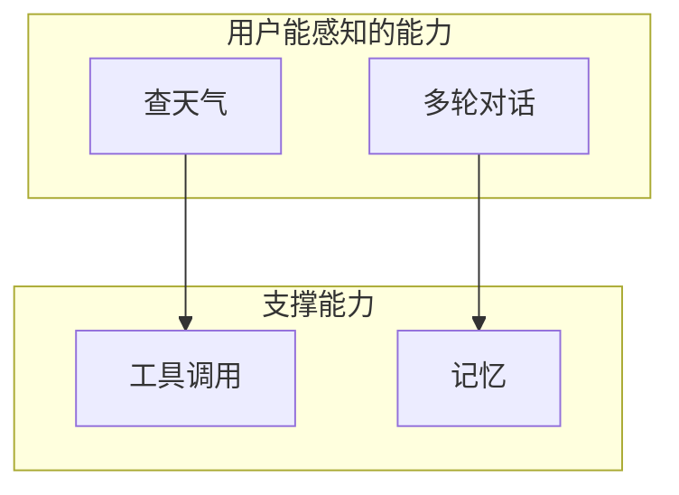

**技术架构图**（分层 + 依赖）：
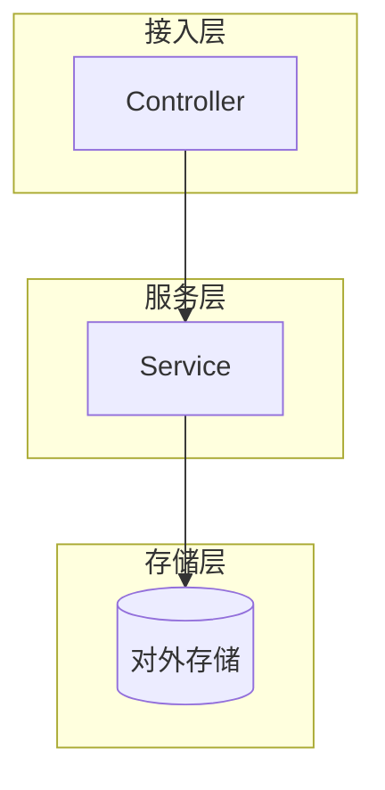

**部署图**（进程 / 端口 / 外部依赖）：
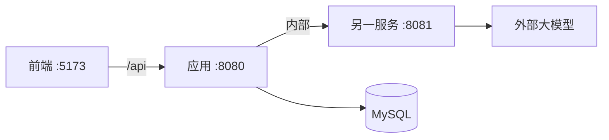

**流程图**（带判断）：
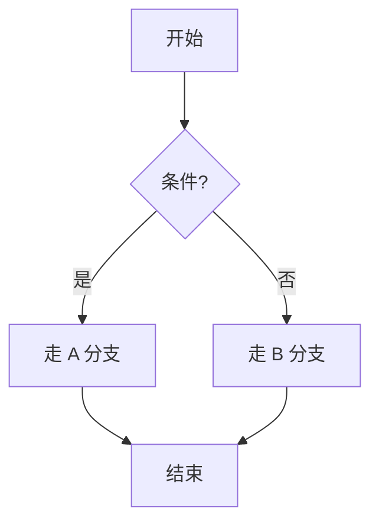

**泳道图**（按角色分栏）：
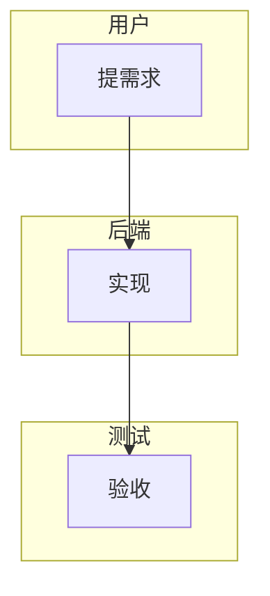

**时序图**：
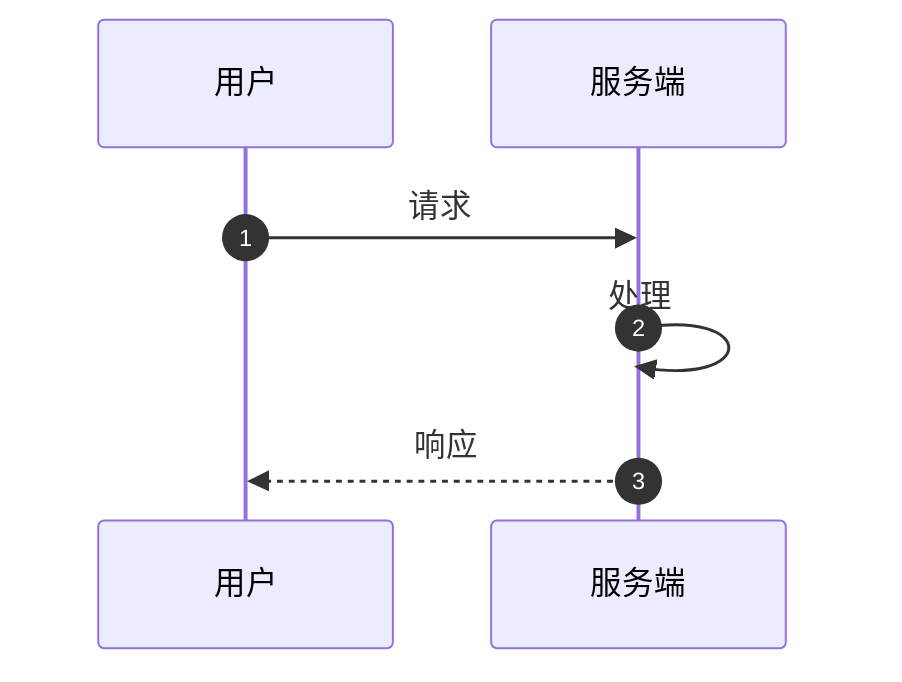

**状态图**：
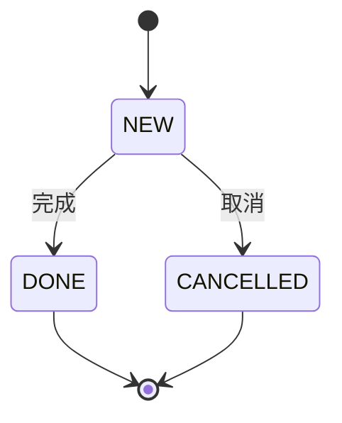

**类图**：
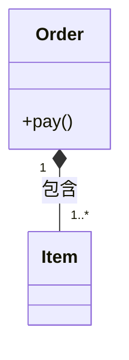

**ER 图**：
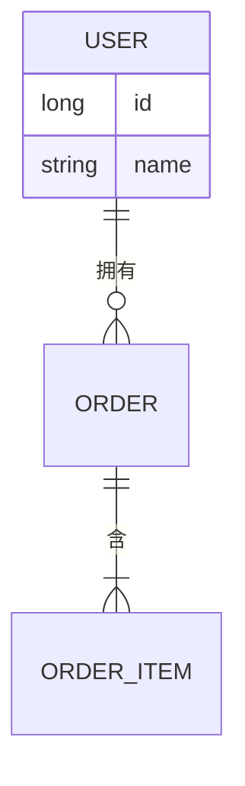

**用例图**（Mermaid 无原生，用流程图近似）：
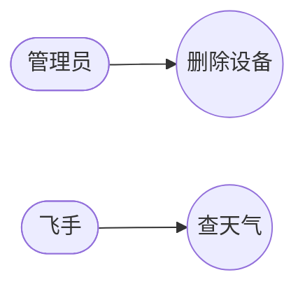

**甘特图**：
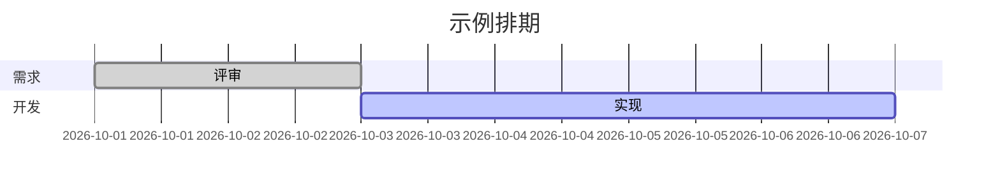

**思维导图**：
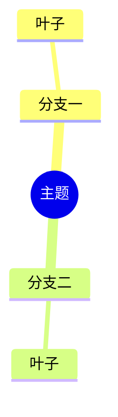

### 1.3 选图口诀

- **「有什么能力」→ 业务架构图**；**「有哪些组件、谁依赖谁」→ 技术架构图**；**「装在哪」→ 部署图**。
- **「一步步怎么走」→ 流程图**；**「谁做哪一步」→ 泳道图**；**「谁先谁后」→ 时序图**。
- **「东西会变成哪些状态」→ 状态图**；**「代码里类怎么连」→ 类图**；**「表怎么连」→ ER 图**。
- 一句话：**架构图看「静态组成」，流程图/时序图看「动态过程」，状态图看「生命周期」。**

---

## 第二部分 · 系统部署图（三套子系统共同所在的一个进程）

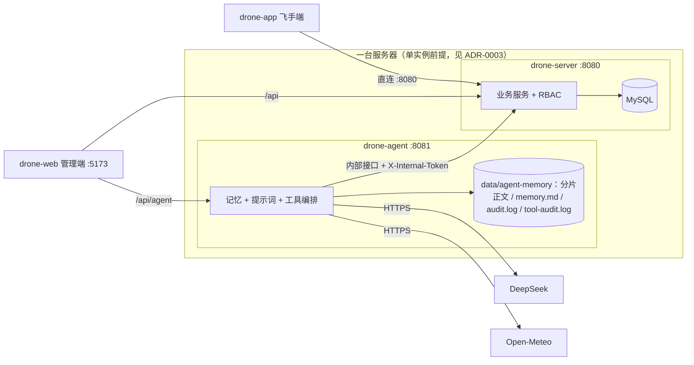

> 【提醒】`drone-agent` 是**有状态**的（内存会话 + 本地文件 + 待确认票据），**只支持单实例**；
> 要上多实例需把短期记忆与待确认票据迁到共享存储（见 `ADR-0003` / `ADR-0005`）。

---

## 附录 · 三套子系统的图在哪

| 子系统 | 业务架构图 | 技术架构图 | 流程图 | 泳道图 | 时序图 | 状态图 | 类图 |
|---|---|---|---|---|---|---|---|
| 记忆 | 手册 §2.7.1 | §2.7.2 | §2.1 | §2.7.3 | §2.7.4 | §2.7.5 | §2.2 |
| 提示词 | 手册 §2.7.1 | §2.7.2 | §2.1 | §2.7.3 | §2.7.4 | §2.7.5 | §2.2 |
| 工具 | 手册 §2.7.1 | §2.7.2 | §2.1 | §2.7.3 | §2.7.4 | §2.7.5 | §2.2 |
| **系统** | - | - | - | - | - | - | 部署图见本文第二部分 |

> 其中「手册」分别指 [`记忆子系统-初级工程师手册.md`](./记忆子系统-初级工程师手册.md)、
> [`提示词工程-初级工程师手册.md`](./提示词工程-初级工程师手册.md)、[`工具调用-初级工程师手册.md`](./工具调用-初级工程师手册.md)。
