# CAS 与乐观锁：从库存扣减讲起

> **这篇是给小白看的**，所以只用一个例子贯穿到底：**库存扣减**。
> 同一个问题，先看它在并发下怎么出事，再看 **Java 里**怎么解决、**数据库里**怎么解决，
> 最后回到我们这个无人机项目里真实用到的地方。
>
> 看完你应该能回答三个问题：
> 1. 为什么 `stock = stock - 1` 两个人一起执行就会少卖一件？
> 2. `compareAndSet`（CAS）到底在比较什么？它凭什么能做到「不可分割」？
> 3. 数据库那句 `UPDATE ... WHERE status = 'dispatched'` 和 Java 的 CAS 是同一个东西吗？

---

## 一、先看一个会出事的例子

### 1.1 场景：只剩 1 件，两个人同时下单

库里有 1 件商品，两个人几乎同时点「下单」。理想结果：**一个人成功，另一个人被告知没货**。

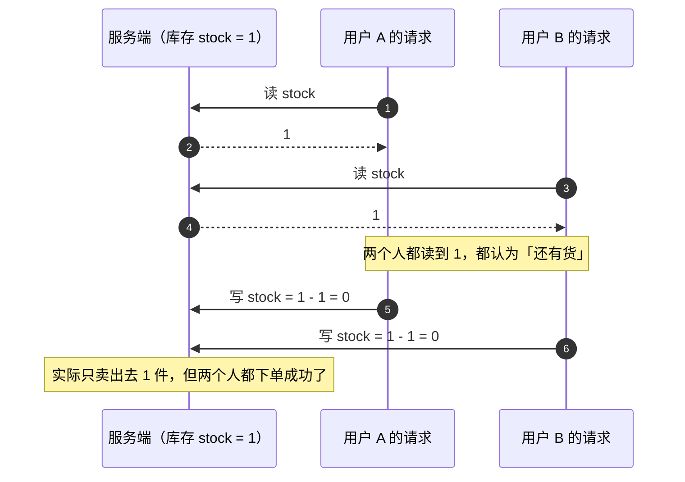

结果：**卖了 2 件，库存写成 0**。少卖的那一件，就是「超卖」。

注意一个反直觉的点：`stock` 最后写的是 `0`，**不是** `-1`。因为两个人算的都是「1 减 1」。
所以超卖不一定会让你在数据里看到负数 —— 它可能安静地把账做错。

### 1.2 根子在哪：`stock = stock - 1` 不是一个「一步」

写在代码里是一行，实际是三步：

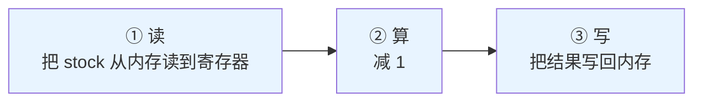

**能被打断的地方，就在这三步之间。** 用户 B 完全可以在 A 的「① 和 ③ 之间」插进来读，
读到的还是旧值。

一句话记住：**只要一个操作是「多步」，它在并发下就有被插队的可能。**
换个说法 —— 它**不是原子的**。

### 1.3 并发问题的三种常见形态

| 名字 | 长什么样 | 库存场景里的表现 |
|---|---|---|
| **丢失更新** | 两个人都读、都写，后写的覆盖前写的 | 上面那个例子：A 的扣减被 B 的覆盖，卖了两件只扣一件 |
| **超卖** | 卖出去的比库存多 | 同一件货被两个人各下了一单 |
| **脏读 / 不可重复读** | 读到还没提交的、或两次读到的值不一样 | 下单时读到 10 件，付款时读到 8 件 |

这三个词经常一起出现，但根子都是同一件事：**多步操作被打断 + 改了的值别人看不见**。
这就要说到下面三个概念。

---

## 二、三个必须先分清的概念

这三个词（原子性、可见性、有序性）是 Java 并发的地基。**不用背定义，用库存去对**。

### 2.1 原子性：一件事要么全做完，要么一点没做

**原子**这个词来自「不可再分」。「读 → 算 → 写」三步就是可以再分的，
所以它不原子；而「一条 CPU 指令」不可再分，所以原子。

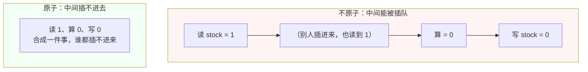

**为什么要有"原子"这个概念**：因为并发问题里有一大半，都源于「我以为是一件事，其实是三件事」。

### 2.2 可见性：一个线程改了，另一个线程看不看得见

这条最反直觉，因为它**不是"慢一拍"的问题，而是"可能一直看不到"**。

先看 Java 的内存模型（JMM）大致长什么样：

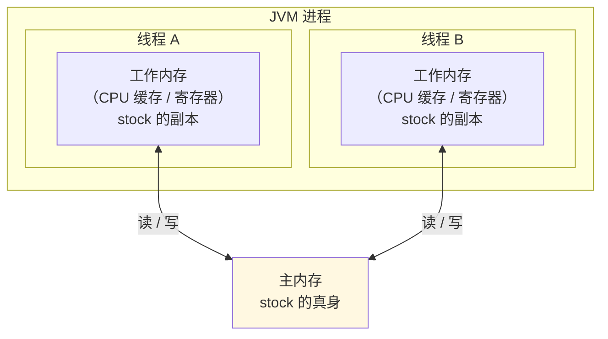

**关键点：线程不是直接读主内存的，而是各自有一份副本。**
于是：

- 线程 A 把 `stock` 改成 0，可能**只改了自己的副本**，没同步回主内存
- 线程 B 读的是**自己的副本**，还是 1

**这就是可见性问题**：改了，但别人看不见。

`volatile` 关键字解决的就是这一条：它保证「我改了立刻写回主内存，别人读也强制去主内存读」。

> ⚠️ **小白最容易踩的坑**：以为 `volatile int stock` 就能解决超卖。
> **不能。** `volatile` 只管「看得见」，不管「不被插队」——
> `stock = stock - 1` 那三步依然可以被打断。
> **可见性 ≠ 原子性**，这是两件事。

### 2.3 有序性（顺带说一句）

编译器和 CPU 为了跑得快，会在**保证单线程结果不变**的前提下，把指令重排。
单线程看不出来，多线程下就会出怪事。

这条对理解 CAS 不是必需的，但你只要记住「**代码写的顺序，不一定是实际执行的顺序**」就够了。

### 2.4 三个概念一起记

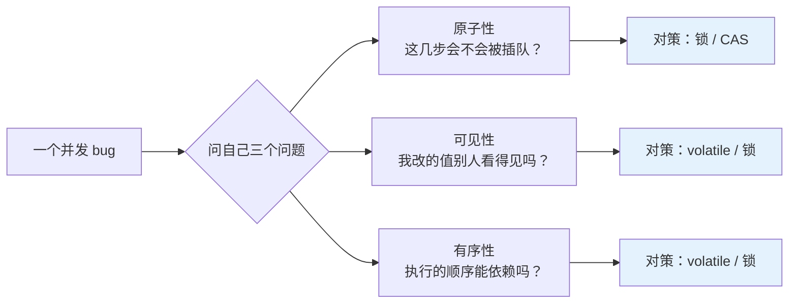

**注意箭头**：锁（含 CAS）能同时解决三条；`volatile` 只能解决后两条。
这就是为什么「保证原子性」比「保证可见性」贵。

---

## 三、锁：悲观与乐观

要解决「三步被打断」，最直接的想法是：**不让别人插队**。怎么做？加锁。

但加锁有两条完全不同的思路。

### 3.1 悲观锁：先锁住，再改

**心态**：「肯定有人跟我抢，我先锁上。」

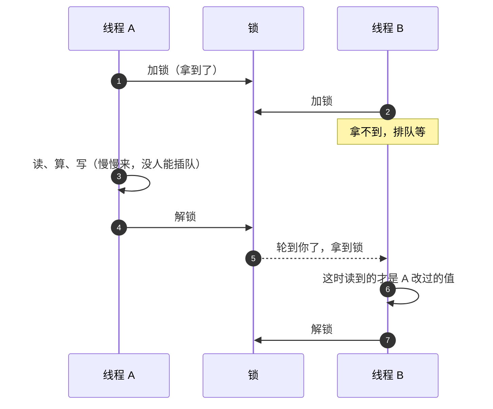

代表实现：

- **Java**：`synchronized`、`ReentrantLock`
- **数据库**：`SELECT ... FOR UPDATE`（把这一行锁住）

**代价**：等待。而且线程被挂起/唤醒本身要花钱（上下文切换）。

> **一个必须记住的边界**：`synchronized` 只锁得住**同一个 JVM 里**的线程。
> 你部署了 3 个实例、前面挂着负载均衡，`synchronized` 对另外两个实例里的线程
> **一点用都没有** —— 它们压根不在一个进程里。
> 这种场景要用「跨进程的锁」，也就是数据库那一层的锁（第六节）。

### 3.2 乐观锁：先改，提交时再检查有没有人改过

**心态**：「大概没人跟我抢，我改完再看一眼；要是被别人改了，我就重来。」

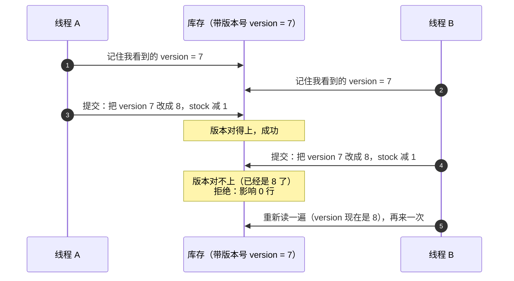

**注意最后一步**：乐观锁失败后**不是报错就完了**，而是「重试」。
这个「失败就重试」的循环，是乐观锁的灵魂，也是它最大的成本来源（冲突多的时候白忙活）。

代表实现：

- **Java**：`AtomicInteger.compareAndSet(...)`（也就是 CAS）
- **数据库**：`UPDATE ... WHERE version = ?` 或 `UPDATE ... WHERE status = '待派发'`

### 3.3 怎么选：一张对照表

| | 悲观锁 | 乐观锁 |
|---|---|---|
| 心态 | 一定会被抢 | 大概不会被抢 |
| 做法 | 先锁住，别人等着 | 先改，提交时检查 |
| 冲突高的时候 | 表现稳定（就是排队慢） | **很惨**：大量重试，白烧 CPU |
| 冲突低的时候 | 白白付出加锁/解锁的代价 | **很划算**：几乎没有额外开销 |
| 会不会阻塞别人 | 会 | 不会（失败方自己重试） |
| 跨进程有效吗 | 数据库的悲观锁有效；`synchronized` 无效 | 数据库的乐观锁有效；AtomicXxx 无效 |
| 适合 | 冲突多、逻辑长、必须一次成 | 冲突少、逻辑短、能重试 |

**一句话判据**：**问「冲突概率高不高」。高就悲观，低就乐观。**
没有哪个"更好"，只有哪个更合适。

---

## 四、CAS 到底是什么

### 4.1 一句话：我认为它还是 A，是的话就改成 B

CAS = **C**ompare **A**nd **S**wap，比较并交换。它由三个值组成：

| 名字 | 含义 | 库存例子里是什么 |
|---|---|---|
| **V** | 内存里**现在**的值 | 现在 stock 是几 |
| **A** | 我**期望**它是几（我上次读到的） | 我以为它是 1 |
| **B** | 我想把它改成几 | 我想改成 0 |

它的语义是一句话：

> **如果内存里的值还是 A，就把它改成 B，并告诉我"成功了"；否则什么都不做，告诉我"失败了"。**

**整件事必须是"一次做完"** —— 判断和修改之间绝对不能被打断。
这就是它和「先读、再判断、再写」的本质区别。

### 4.2 凭什么能做到「不可分割」

因为它**不是用 Java 代码实现的，而是 CPU 的一条指令**。

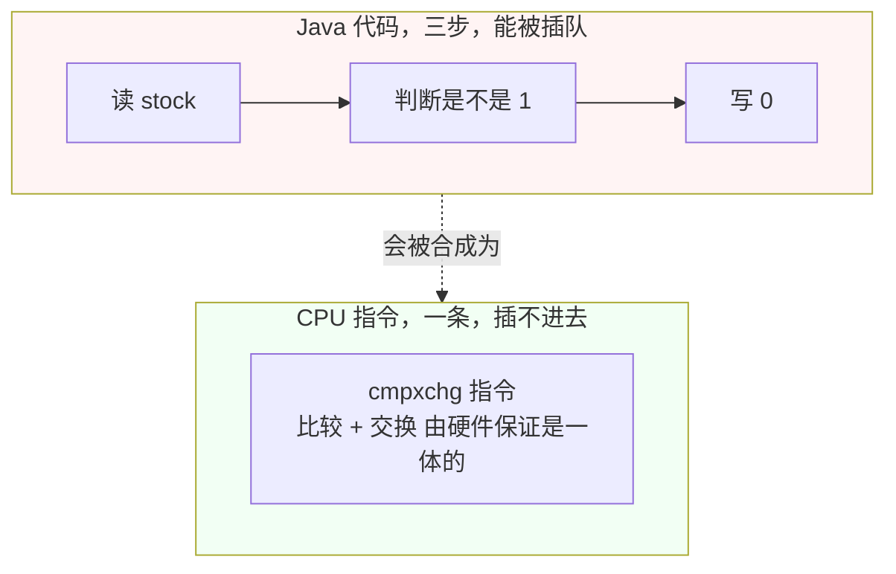

你说的 `compareAndSet` 到了最底层，就是 x86 的 `cmpxchg` 这类指令（或 ARM 的 `ldrex/strex`）。
**硬件层面保证了「比较」和「交换」之间不会有任何东西插进来。**

> **小白最容易误会的一句**：以为「CAS 就是无锁」。
> 更准确的说法是：**CAS 在软件这一层没有锁，但硬件在底层仍然要独占那条缓存行**。
> 所以它不是"没有锁"，而是「把锁的粒度缩小到了 CPU 指令级别、而且不用把线程挂起」。
> 这句话在数据库那一节还会再出现一次。

### 4.3 失败了怎么办：自旋重试

CAS 失败**不是错误**，只是「有人先动手了」。标准做法是：**重新读一遍，再试一次**，直到成功。

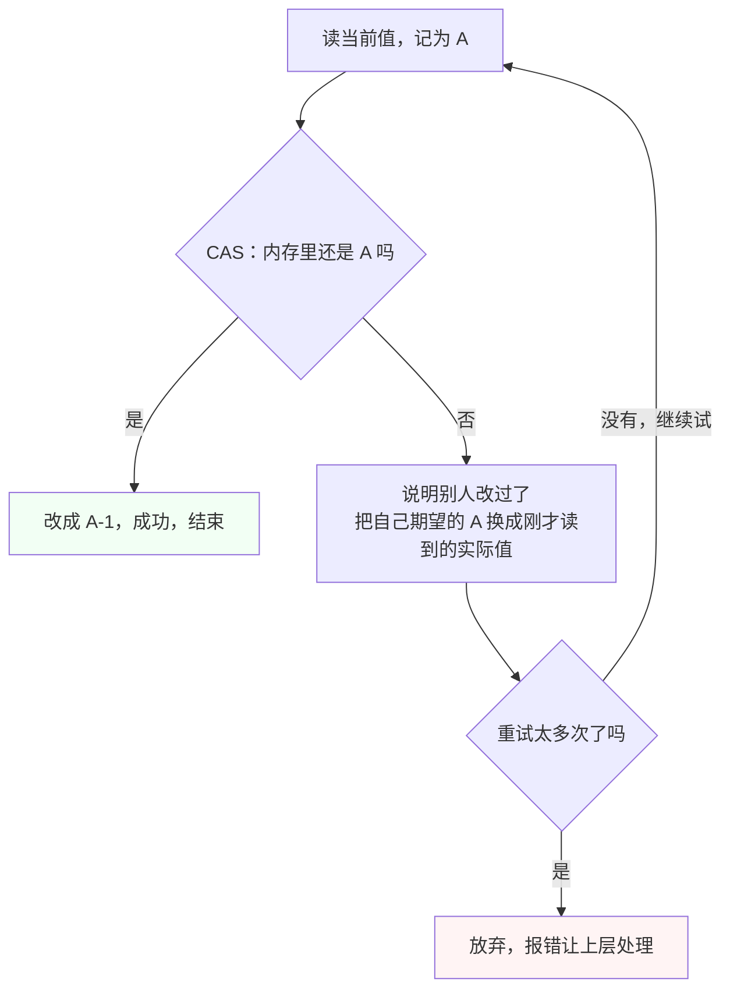

这个过程叫**自旋**（spin，像陀螺一样原地转着等）。

两个线程抢同一个库存的完整过程：

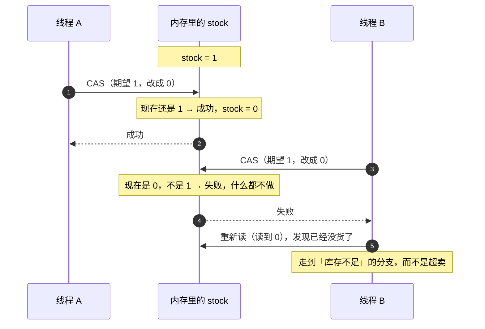

**关键对比**：前面 1.1 节那种写法，B 也会"成功"；而 CAS 让 B **明确地失败**。
**「知道自己失败了」这件事，本身就是最大的价值。**

### 4.4 CAS 的两个代价

**代价一：自旋烧 CPU。**
冲突激烈时，一堆线程在循环里空转，CPU 占用会飘红，而吞吐反而下降。

**代价二：ABA 问题。**

线程 B 在中间把 A 改成了别的值，**又改回了 A**，此时 A 的 CAS 会误以为"没人动过"。

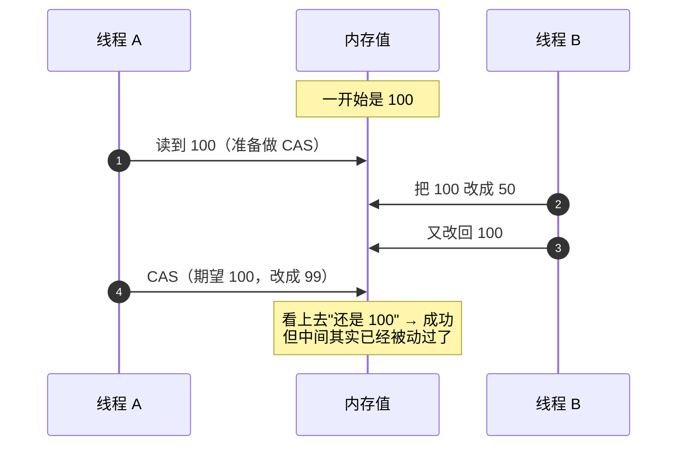

**库存场景里 ABA 通常不致命**（库存就是个数字，改回 100 就是 100）。
但在**链表、栈、账户余额**这类场景里会出大事：

- 你读到头节点是 X（准备把它删掉），中间 X 被弹出又**重新放回来**，
  但此时 X.next 已经变了 —— 你按旧的理解去改，就把链表改坏了

**怎么破**：给值配一个只增不减的「版本号」，比较时连版本一起比。
Java 里就是 `AtomicStampedReference`（带戳的引用）。

---

## 五、Java 里的 CAS

### 5.1 用 AtomicInteger 写库存

```java
import java.util.concurrent.atomic.AtomicInteger;

public class Stock {

    // 用 AtomicInteger 而不是 int —— 它内部就是 CAS
    private final AtomicInteger stock = new AtomicInteger(10);

    /**
     * 扣减库存。
     *
     * @return true 扣成功；false 库存不够
     */
    public boolean deduct() {
        while (true) {
            int current = stock.get();          // ① 读当前值，作为「期望值 A」
            if (current <= 0) {
                return false;                   // 没货了，不用再试
            }
            // ② CAS：如果现在还是 current，就改成 current - 1
            if (stock.compareAndSet(current, current - 1)) {
                return true;                    // 成功了
            }
            // ③ 失败了：说明别的线程刚改过，回到 ① 重新读、重新试
        }
    }
}
```

**把这段代码和 4.3 那张流程图对着看**：`while(true)` + `compareAndSet` 就是那个自旋循环。

**为什么这样就安全了**：`current <= 0` 的判断和 `current - 1` 的写入不是分开两步生效的 ——
判断是基于「我读到的 current」，而写入时 CAS 会再确认一次「现在还是不是 current」。
**只要有人插队，CAS 就失败，我就重来。** 绝不会两个人同时成功。

### 5.2 顺带看一眼 JDK 里现成的

`AtomicInteger.incrementAndGet()` 内部就是这个自旋循环（JDK 8 之后用的是 `IntUnsafe` 的
`getAndAddInt`，同样是 CAS 循环）。所以：

- 想「读-改-写」一个数字：直接用 `incrementAndGet` / `addAndGet` / `getAndSet`
- 想「有条件的改」：才需要自己写 `compareAndSet` 循环

### 5.3 三个坑（小白必看）

**坑一：ABA。** 用 `AtomicStampedReference` 带上版本号。

```java
// 除了值，还带一个 stamp（版本）。两个都要对上才改成功
AtomicStampedReference<Integer> ref = new AtomicStampedReference<>(100, 0);

int[] stampHolder = new int[1];
Integer value = ref.get(stampHolder);      // 拿到值和当前的 stamp
ref.compareAndSet(value, 99, stampHolder[0], stampHolder[0] + 1);
```

**坑二：自旋太久。** 冲突极激烈时别死等，可以用 `LongAdder`（高并发计数专用，
把热点拆成多个格子累加），或者干脆换成锁。

**坑三：只能保证一个变量的原子性。**
`AtomicInteger` 只管它自己那一个数字。你要是需要「扣库存的同时扣积分」两步一起成功，
CAS 帮不了你 —— 那需要**锁**或者**数据库事务**。

---

## 六、数据库里的 CAS（乐观锁）

### 6.1 为什么数据库要另说一套

因为数据库面对的世界更复杂：

| | Java 内存里的 CAS | 数据库的更新 |
|---|---|---|
| 有几个进程在改 | 就一个 JVM | 可能有很多个服务实例 |
| 数据在哪 | 内存，说改就改 | 磁盘 + 缓冲池，要走事务 |
| 一次改几条 | 一个变量 | 可能一批行 |
| 失败了怎么知道 | 返回 false | **看影响行数** |

**最要紧的一条**：数据库里「我改了但它没生效」这件事，
**只有靠"影响行数"才能知道** —— 不像 CAS 会直接返回 false 给你。

### 6.2 写法一：版本号

先给表加一列 `version`：

```sql
-- 建表时带上，或者后加
ALTER TABLE stock ADD COLUMN version int NOT NULL DEFAULT 0;
```

扣减时把版本号一起带上：

```sql
UPDATE stock
SET quantity = quantity - 1,
    version  = version + 1
WHERE id = 1
  AND version = 7;      -- 我读到的是 7，现在还是 7 才允许改
```

两个请求同时来会怎样：

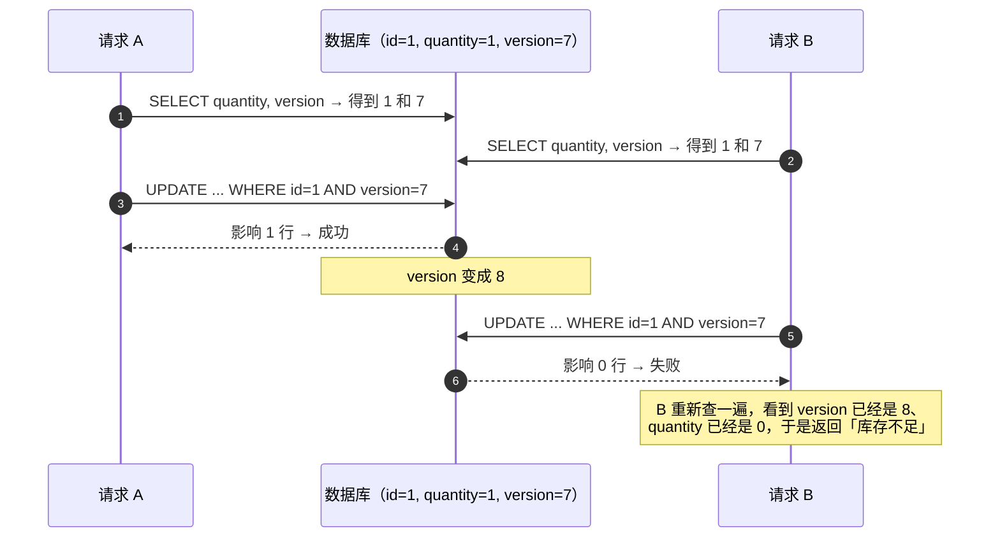

**注意 B 拿到的是「影响 0 行」，不是报错。**
这就是数据库版 CAS 的「比较失败」—— 判断依据是**影响行数**。

### 6.3 写法二：直接比较业务字段（我们项目用的就是这种）

如果业务字段本身就能代表「状态」，就不必额外加 `version` 列 ——
**直接把那个字段当版本用**：

```sql
-- 只有「已派发」的任务才能变成「执行中」
UPDATE task
SET status = 'executing', actual_start_time = NOW()
WHERE id = 42
  AND status = 'dispatched';
```

看这句和上一节的区别：**`AND status = 'dispatched'` 就是那个"期望值"**。

| CAS 的三要素 | 在这句 SQL 里 |
|---|---|
| 内存值 V | 数据库里 `status` 现在的值 |
| 期望值 A | `'dispatched'` |
| 新值 B | `'executing'` |

**语义完全一致**：如果它现在还是「已派发」，就改成「执行中」；否则什么都别做，返回影响 0 行。

**这种写法的两个好处**：

1. 不用加列（`status` 本来就有）
2. 一行 UPDATE 同时表达「检查」和「修改」，**检查和修改之间没有缝**

**代价**：这条路走过的状态就查不出来了（`status` 被覆盖了）。
所以它只适合「当前状态」这种场景，不适合「需要知道改过几次」的场景 ——
那种就得回去用 `version`。

### 6.4 影响 0 行意味着什么

**影响 0 行是一句信息量很大的话，但到底"错在哪"要分情况**：

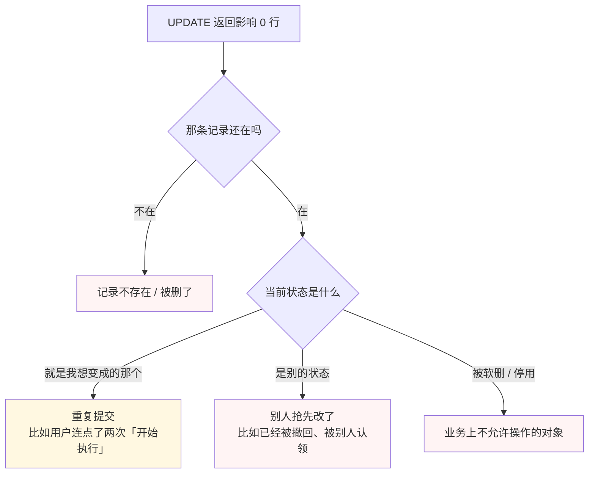

**所以正确的处理不是"一律报错"，而是**：

- **重试**：冲突型（别人抢先）看场景决定要不要重读后重试
- **报错并让用户刷新**：「状态刚刚变了，请刷新后重试」——多数业务场景这个最合适
- **当成成功**：如果是重复提交（幂等场景），第二次应当返回成功而不是报错

> 这段是整篇里最实用的部分之一：**很多「偶发报错」的根因，就是把 0 行一律当成了"失败"**，
> 而它其实可能是「你已经成功过了」。

### 6.5 那一条 UPDATE 凭什么原子？

数据库里的「原子」和 Java 里的 CAS 不是一回事，它靠的是**事务 + 行锁**：

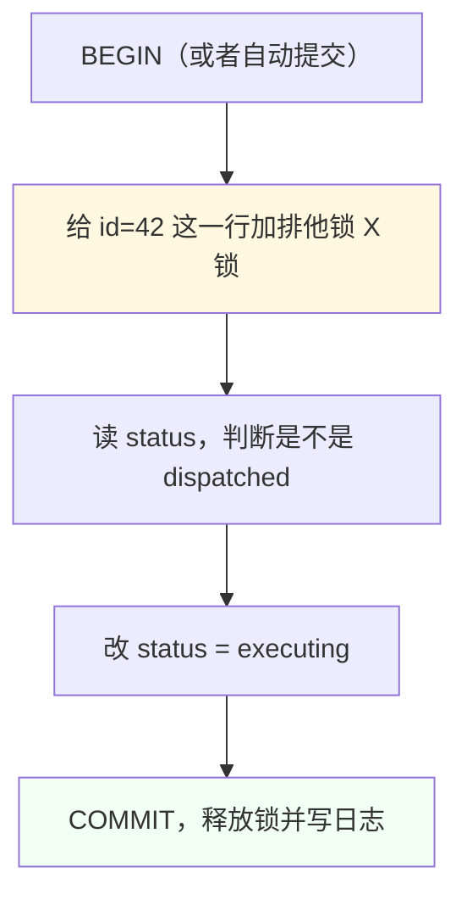

- **行锁**保证同一时刻只有一个事务能改这一行 —— 于是「判断」和「修改」之间插不进别人
- **事务提交**保证要么全成、要么全不成（原子性）
- **WAL 日志**保证就算提交时断电，重启后也能恢复成已提交的样子（持久性）

**注意这里和 4.2 的呼应**：Java 的 CAS 靠 CPU 指令独占缓存行，
数据库的 CAS 靠行锁独占那一行。**两者都是"底层帮我们把最关键的几步焊死"**，
只是焊的手段不同。

> **⚠️ 一个非常容易踩的坑（隔离级别）**：
> 上面这句 UPDATE 是安全的，因为它**先加锁、再读、再改**（"当前读"）。
> 但如果你写成「先 SELECT 查一下，再在 Java 里判断，再 UPDATE」，
> 那么两个事务就可能都读到旧值 —— 这叫**丢失更新**，
> 而这正是第一节 1.1 那个超卖例子的数据库版。
> **规则：判断条件要写进 UPDATE 的 WHERE 里，不要放在 Java 里。**

### 6.6 悲观版：`SELECT ... FOR UPDATE`

如果冲突很激烈，乐观锁会疯狂重试，这时候该换悲观：

```sql
BEGIN;
SELECT quantity FROM stock WHERE id = 1 FOR UPDATE;   -- 把这一行锁住，别人进不来
-- 在 Java 里判断 quantity 够不够
UPDATE stock SET quantity = quantity - 1 WHERE id = 1;
COMMIT;
```

`FOR UPDATE` 给这一行加排他锁，别的请求走到这一句会**阻塞等待**，
直到第一个事务提交或回滚。

**什么时候用它**：

- 冲突很激烈（乐观锁重试到怀疑人生）
- 「判断」的逻辑很复杂，塞不进一句 `AND xxx` 里
- 后面的动作必须和这次判断一起成功（比如还要写别的表）

**代价**：持有锁期间别人只能等；锁的范围和时间没控制好，容易把数据库拖垮。

---

## 七、回到我们的项目

概念讲完了，看它们在这个无人机项目里真实落在哪 —— **全部都是数据库版的 CAS**。

| 位置 | 写法 | 期望值是什么 | 为什么这么做 |
|---|---|---|---|
| `TaskDao.markStarted` | `UPDATE task SET status='executing', actual_start_time=? WHERE id=? AND status='dispatched'` | 状态「已派发」 | 防止「已完成的任务又被开始一次」。返回 0 行就报「状态刚刚变了，请刷新」 |
| `TaskDao.markEvidenceConfirmed` | `... WHERE id=? AND evidence_state <> 'confirmed'` | 依据不是「已证实」 | 让这一步**天然幂等**：同一秒来一百条遥测，只有第一条真的生效 |
| `AlertDao.claim` | `UPDATE task_alert SET status='handling' WHERE id=? AND status='pending'` | 状态「待处理」 | 两个人同时点「认领」，只有一个能成功 —— 防止两人重复处理同一条告警 |
| `AlertDao.insertUnlessOpen` | `INSERT ... SELECT ... WHERE NOT EXISTS (...)` | 「不存在未处理的同类告警」 | **判断和插入在同一条 SQL 里，没有并发窗口**。写成「先查再插」就会漏 |

**为什么全用 CAS，不用 `SELECT ... FOR UPDATE`**：

1. **冲突概率低**：一条任务同一时刻只会有一个管理员/一个飞手在操作，不像秒杀
2. **持锁时间要极短**：告警插入走的是 MQTT 消费线程，**吞吐是这条链路的关键指标**，
   让它去等锁代价太大
3. **失败能说清**：影响 0 行时，能明确告诉用户「状态刚刚变了，请刷新」——
   这比让用户干等 3 秒然后成功，体验更好

> 设计文档里那句「**只有数据库能提供「判断 + 写入」的原子性**」
> （见 `MQTT与设备接入.md` 4.5 节的幂等落库），说的就是这里的第 4 行。

**反过来看一个我们险些写成两步的例子**：告警的抑制规则是
「同一设备同一编码还有未处理的告警时，就不再产生新行」。
这句话**绝不能**写成「先查有没有，没有就插一条」—— MQTT 的消费线程默认就有 2 个，
两个线程可能同时查到「没有未处理的」，然后各插一条，
于是同一个问题留下两条告警（这不是推测，是设计文档 4.4 节记下来的当初的坑）。
所以它被写成了一条 SQL：`INSERT ... SELECT ... WHERE NOT EXISTS (...)`，
判断和插入之间没有窗口。

---

## 八、常见误区

| 误区 | 真相 |
|---|---|
| 「我加了 `@Transactional` 就安全了」 | 不够。默认隔离级别下，**读-判断-写**这种模式照样丢失更新。条件要写进 `WHERE` |
| 「`volatile` 能解决超卖」 | 不能。它只保证可见性，`stock = stock - 1` 那三步仍会被插队 |
| 「CAS 是无锁的」 | 软件层面没有锁，硬件/数据库层面仍然要独占（缓存行 / 行锁） |
| 「乐观锁比悲观锁快」 | 只在**冲突少**的时候快。冲突多时重试的成本会超过等待 |
| 「`synchronized` 能锁住多个实例」 | 不能。它只锁得住同一个 JVM 里的线程 |
| 「影响 0 行 = 一定失败了」 | 也可能是「你已经成功过了」（重复提交），或者记录被删了。要分情况 |
| 「乐观锁不用管重试」 | 不重试的乐观锁只是「会失败」；**失败后怎么办才是设计的一部分** |

---

## 九、一页速查

| 词 | 一句话 |
|---|---|
| **原子性** | 一件事要么全做完，要么一点没做 —— 中间插不进别人 |
| **可见性** | 我改的值，别的线程看得见吗（`volatile` 管这条） |
| **有序性** | 代码写的顺序 ≠ 实际执行顺序 |
| **悲观锁** | 先锁住再改。冲突多就用它 |
| **乐观锁** | 先改，提交时检查有没有人动过。冲突少就用它 |
| **CAS** | 我认为它还是 A，是的话就改成 B；否则什么都不做并告诉我失败 |
| **自旋** | CAS 失败后重新读、再来一次 |
| **ABA** | 值被改走又改回来，CAS 察觉不到。用带版本号的引用破解 |
| **版本号** | 数据库乐观锁的常见做法：`WHERE version = ?` |
| **条件更新** | 把「期望的状态」写进 `WHERE`，用**影响行数**判断成败 —— 我们项目用的就是这种 |
| **当前读** | 带锁的读（`FOR UPDATE` / UPDATE 自带的读），读到的是最新已提交的值 |

**最后一句**：这三个东西是同一件事的三种说法 ——
**「我要么独占，要么确认没人动过，然后才能改」**。
独占 = 悲观锁；确认没人动过 = 乐观锁/CAS。
选哪个，问冲突概率。
