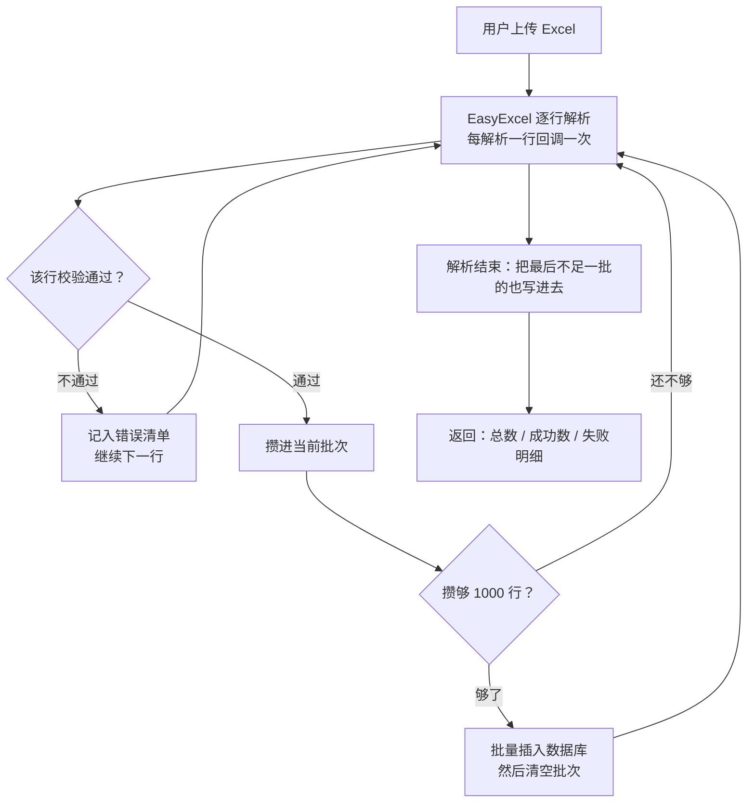
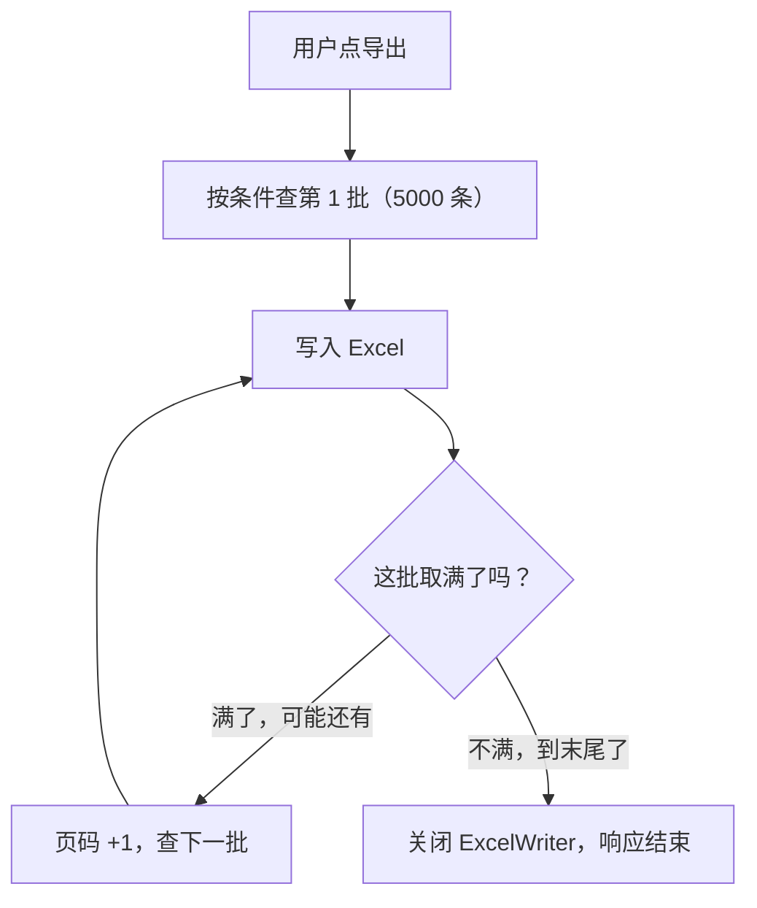
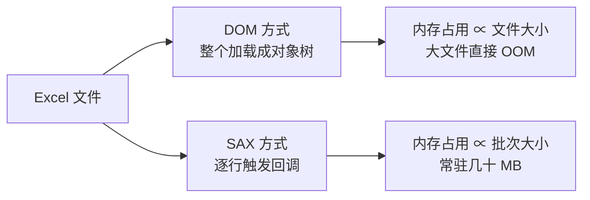
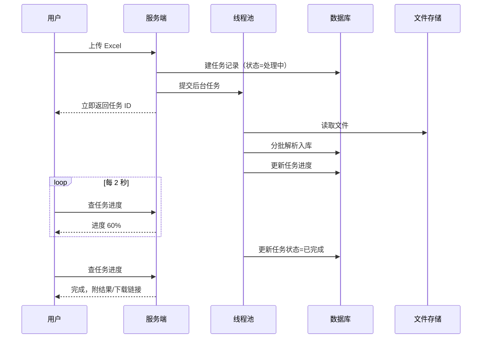
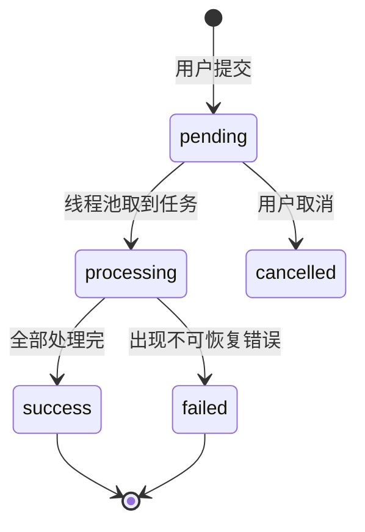

# Excel 导入导出：从几百行到上百万行

> 面向初级工程师的学习文档。
> 讲清楚两件事：**为什么导入导出容易把服务搞挂**，以及**数据量上来之后该怎么演进**。
>
> 配套代码：`UserExcelServiceImpl`、`UserImportListener`、`UserBatchWriter`。

---

## 一、先看本项目的实现

当前是**同步 + 分批流式**，能扛住几十万行，代码也不复杂。

### 导入流程



### 导出流程



### 内存占用

| 环节 | 内存占用 | 与什么有关 |
|---|---|---|
| 导入 | 一个批次（1000 个对象） | 批次大小，**与文件行数无关** |
| 导出 | 一个批次（5000 行） | 批次大小，**与总数据量无关** |

这就是「流式」的含义：数据像水流一样穿过服务，不在内存里堆积。

---

## 二、为什么不能一次性读进内存

初学者最自然的写法是：

```java
// 反面教材
Workbook workbook = new XSSFWorkbook(inputStream);   // 整个文件读进内存
Sheet sheet = workbook.getSheetAt(0);
for (Row row : sheet) { ... }
```

`XSSFWorkbook` 会把**整个 Excel 完整加载成对象树**（类似 XML 的 DOM 解析）：

```
一个单元格 ≈ 一个 Cell 对象 + 一个 String 值 + 样式引用
10 万行 × 10 列 = 100 万个 Cell 对象
光对象头就几十 MB，加上字符串和样式，轻松上 GB
```

结果就是：**`OutOfMemoryError: Java heap space`**。而且这种 OOM 特别讨厌 —— 它发生在解析阶段，你连「是哪个用户的哪个文件」都不知道。

### SAX 是怎么做的

EasyExcel 底层用的是 **SAX 事件模型**：边读边解析，读到一个单元格就发一个事件，处理完就丢弃，**不保留整个文档结构**。



**代价**：SAX 是「只进不退」的，没法回头改前面读过的内容，也不能随机访问某一行。但对导入场景来说完全够用 —— 我们本来就是顺序处理的。

---

## 三、导入的三个关键点

### 3.1 流式解析

实现方式是给 EasyExcel 传一个 `ReadListener`，它每解析完一行就回调 `invoke()`：

```java
public class UserImportListener implements ReadListener<UserImportDTO> {
    @Override
    public void invoke(UserImportDTO row, AnalysisContext context) {
        // 每行回调一次，处理完这行的引用就可以被回收
    }

    @Override
    public void doAfterAllAnalysed(AnalysisContext context) {
        flush();   // 别忘最后这一下
    }
}
```

**一个容易漏的点**：`doAfterAllAnalysed` 里必须再 flush 一次。如果文件正好是 500 行、批次大小是 1000，永远攒不满，不补这一下就一条都不入库。

### 3.2 分批入库

一行一次 `INSERT` 意味着 10 万行就是 10 万次数据库往返。即使每次只要 1ms，也要 100 秒，而且网络开销占大头。

改成批量插入：

```sql
INSERT INTO `user` (username, name, ...) VALUES
(?, ?, ...), (?, ?, ...), ...   -- 一次 1000 行
```

往返次数直接降到千分之一。

**批次大小怎么定**：太小则往返多，太大则内存高、单条 SQL 过长（MySQL 默认 `max_allowed_packet` 是 4MB）。**1000 ~ 5000 是个常见区间**，本项目用的是 1000。

### 3.3 单行失败不中断

这是产品层面的重要设计：**导入 1000 行，不能因为第 3 行账号重复就让另外 997 行白填**。

所以：

- 校验失败的行 → 记进错误清单，继续处理下一行
- 返回结果里带上「第几行、什么原因」

```json
{
  "total": 1000,
  "success": 997,
  "failed": 3,
  "errors": [
    "第 5 行：登录账号已存在：13800001007",
    "第 88 行：角色编码不存在：not-exist-role"
  ]
}
```

用户改完这 3 行重新导一次即可。

---

## 四、导出的三个关键点

### 4.1 分批查询

导出不能 `SELECT * FROM user` 全捞出来 —— 和导入同理，100 万行直接 OOM。

正确做法是**按批取数**：

```java
int page = 1;
while (true) {
    query.setPage(page).setPageSize(5000);
    List<UserExportRow> batch = userDao.selectForExport(query);
    if (batch.isEmpty()) break;

    writer.write(batch, sheet);   // 写完这批就丢掉
    if (batch.size() < 5000) break;
    page++;
}
```

### 4.2 滑动窗口写

EasyExcel 写出时内部用的是「滑动窗口」思路（对应 POI 的 `SXSSFWorkbook`）：**只在内存里保留最近 N 行，更早的行刷到磁盘临时文件**。所以写 100 万行，内存里始终只有 N 行。

### 4.3 深翻页的坑（这个必须知道）

分批查询用的是 `LIMIT offset, size`。**页码越大越慢**：

```sql
SELECT ... FROM user ORDER BY id LIMIT 0, 5000;        -- 很快
SELECT ... FROM user ORDER BY id LIMIT 995000, 5000;   -- 很慢！
```

**为什么**：`OFFSET 995000` 不是「跳过 99.5 万行」这么简单，数据库必须**先查出并丢弃前 99.5 万行**，才能拿到后面那 5000 行。

换句话说，导出 100 万行的总代价是：

```
第 1 批扫 5000 行
第 2 批扫 10000 行
...
第 200 批扫 1000000 行
总计约 1 亿行次扫描   ← 平方级劣化
```

**解决办法：游标查询**（也叫流式查询），一次遍历到底，不重复扫描：

```java
// MyBatis 的 Cursor
@Select("SELECT ... FROM user WHERE ... ORDER BY id")
Cursor<UserExportRow> streamForExport(UserQueryParam param);
```

```java
try (Cursor<UserExportRow> cursor = userDao.streamForExport(param)) {
    for (UserExportRow row : cursor) {
        // 逐行处理，写满一批就 flush 一次
    }
}
```

两个必须注意的点：

1. **MySQL 的流式查询要设置 `fetchSize = Integer.MIN_VALUE`**，否则驱动仍会把结果集全部读到内存，游标就白用了。
2. **流式查询期间，同一个数据库连接不能再执行其他 SQL**（结果集还没读完），所以别在循环里调别的 Dao。

> 本项目当前用的是 `LIMIT` 分批 —— 数据量不大时够用，且逻辑简单。
> 数据上到百万级时，把 `selectForExport` 换成游标查询即可，上层逻辑不用动。

---

## 五、什么时候必须上异步

同步方案有三个硬伤，数据量一大就暴露：

| 问题 | 说明 |
|---|---|
| **网关超时** | Nginx 默认 60 秒、浏览器也可能超时。导入 100 万行要几分钟，请求早断了，但服务端还在傻跑 |
| **重复提交** | 用户等不到响应，以为失败了，又点一次 —— 于是同一批数据导入两遍 |
| **没有进度** | 用户只能盯着转圈，不知道是卡住了还是在跑 |

**触发条件**：单次操作耗时可能超过 30 秒，或数据量在百万级 —— 就该考虑异步了。

---

## 六、异步任务完整方案

### 6.1 整体流程



**核心差别**：上传接口**立即返回**，把重活丢给后台线程。用户拿任务 ID 轮询进度。

### 6.2 任务表设计

```sql
CREATE TABLE `import_task` (
  `id`            bigint       NOT NULL AUTO_INCREMENT,
  `task_no`       varchar(64)  NOT NULL COMMENT '任务编号，返回给前端',
  `type`          varchar(20)  NOT NULL COMMENT 'import / export',
  `status`        varchar(20)  NOT NULL COMMENT 'pending/processing/success/failed',
  `total`         int          DEFAULT 0 COMMENT '总行数',
  `processed`     int          DEFAULT 0 COMMENT '已处理行数（用来算进度）',
  `success_count` int          DEFAULT 0,
  `failed_count`  int          DEFAULT 0,
  `file_path`     varchar(300) DEFAULT NULL COMMENT '导入的源文件 / 导出的结果文件',
  `error_msg`     varchar(500) DEFAULT NULL COMMENT '整体失败时的原因',
  `error_detail`  text         COMMENT '逐行失败明细（JSON）',
  `created_by`    bigint       NOT NULL COMMENT '发起人',
  `create_time`   datetime     DEFAULT CURRENT_TIMESTAMP,
  `finish_time`   datetime     DEFAULT NULL,
  PRIMARY KEY (`id`),
  UNIQUE KEY `uk_task_no` (`task_no`),
  KEY `idx_status` (`status`),
  KEY `idx_create_time` (`create_time`)
) COMMENT '导入导出任务表';
```

**为什么要落库而不是放内存**：服务重启、多实例部署、任务追溯，都要求任务状态能持久化。放 `ConcurrentHashMap` 只能撑起单机演示。

### 6.3 任务状态机



注意 `failed` 和「部分成功」不是一回事：**逐行校验失败不算任务失败**（任务仍是 success，只是 `failed_count > 0`）；只有整体崩了（文件损坏、数据库连不上）才是 `failed`。

### 6.4 线程池配置

**别用 `Executors.newFixedThreadPool()`** —— 它的队列是无界的，任务堆积会吃光内存。手工 `new ThreadPoolExecutor(...)`：

```java
@Bean
public ThreadPoolExecutor importExportExecutor() {
    return new ThreadPoolExecutor(
            2,                                    // 核心线程数：导入导出本就该少并发
            4,                                    // 最大线程数
            60L, TimeUnit.SECONDS,
            new ArrayBlockingQueue<>(20),         // 有界队列，满了就拒绝
            new ThreadFactoryBuilder().setNameFormat("excel-task-%d").build(),
            new ThreadPoolExecutor.AbortPolicy()  // 拒绝时抛异常，让接口明确告知「繁忙」
    );
}
```

**并发数要压得很低**。这类任务是 IO + CPU 双密集，开 10 个线程同时导 10 个大文件，数据库和磁盘都会被拖垮。**宁可排队，不要并发**。

### 6.5 文件存储与清理

- 导入的源文件、导出的结果文件都要落盘（本地临时目录 / OSS）
- **必须有过期清理**：否则磁盘迟早被撑满。常见做法是每天凌晨清理 7 天前的任务文件
- 下载链接用一次性的（带签名、有过期时间的），不要把文件真实路径暴露出去

### 6.6 进度上报

每处理完一批就更新一次：

```java
if (processed % 1000 == 0) {
    taskDao.updateProgress(taskId, processed, successCount, failedCount);
}
```

**别每行都更新** —— 那等于把「写库」的负担翻倍。按批次更新即可。

### 6.7 前端轮询

```ts
async function pollProgress(taskNo: string) {
  const timer = setInterval(async () => {
    const task = await fetchTask(taskNo)
    progress.value = task.total ? Math.floor((task.processed / task.total) * 100) : 0

    if (task.status === 'success' || task.status === 'failed') {
      clearInterval(timer)
      // 处理结束：展示结果或提供下载
    }
  }, 2000)
}
```

**几个要点**：

- 轮询间隔别太短（2 秒足够），否则等于自己 DDoS 自己
- 设最大轮询次数/超时，避免页面开着就一直轮
- 组件卸载时记得 `clearInterval`，否则切页面后还在轮询
- 更优雅的方案是 SSE / WebSocket 推送，但轮询实现简单、够用

### 6.8 异步方案容易踩的坑

| 坑 | 说明 | 应对 |
|---|---|---|
| **重复提交** | 用户连点两次，同一份数据导入两遍 | 前端提交后禁用按钮 + 服务端按文件 hash 去重 |
| **多实例部署** | 任务提交到 A 实例，查询请求打到 B 实例 | 任务状态必须落库/Redis，不能放本机内存 |
| **进程重启丢任务** | 队列里的任务随进程消失 | 启动时扫一遍 `processing` 状态的历史任务，标记为失败或重新入队 |
| **内存队列积压** | 无界队列把内存吃光 | 有界队列 + 拒绝策略 |
| **进度永远不动** | 批次间隔太大，看起来像卡死 | 适当调小批次，或按时间（每 2 秒）上报 |

---

## 七、其他可以优化的方向

**① 用 CSV 替代 Excel**

CSV 是纯文本，解析不需要 POI，内存和 CPU 开销都低一个数量级。缺点是丢样式、多 sheet，且**用 Excel 打开长数字（如手机号）会自动变成科学计数法** —— 导出手机号时要在前面加 `\t` 或用文本格式。

**② 大文件分片上传**

文件超过几十 MB 时，一次上传容易超时或中断。可以切片上传 + 服务端合并（断点续传）。

**③ 数据库侧批量导入**

数据在数据库服务器本地时，`LOAD DATA INFILE` 比走 JDBC 批量插入快一个数量级。但它要求文件在数据库主机上（或开启 `local_infile`），且有安全限制，适合运维脚本而非在线功能。

**④ 导出限流**

导出是「读全量」的操作，对数据库压力不小。可以限制单次导出的最大行数（比如 50 万），超了就走异步任务。

---

## 八、本项目的现状与演进路径

### 现状

| 能力 | 实现 |
|---|---|
| 导入 | 流式解析 + 1000 行一批 + 单行失败不中断 |
| 导出 | 5000 行一批 + 滑动窗口写 |
| 执行方式 | **同步**（上传后等结果） |
| 适用量级 | 几十万行以内 |

### 如果要演进到异步，需要动这些

1. **加任务表**（上面 6.2 的 DDL）
2. **上传接口改造**：接收文件 → 存盘 → 建任务 → 提交线程池 → 立即返回任务号
3. **抽出执行逻辑**：把现在 `importUsers()` 里的处理循环搬到任务执行器里
4. **加进度上报**：每批更新一次任务进度
5. **加查询接口**：`GET /task/{taskNo}` 返回进度与结果
6. **加清理任务**：定时清理过期文件与任务记录
7. **前端改造**：上传后进入轮询，展示进度条，完成后展示结果

**核心逻辑（解析、校验、分批入库）几乎不用改** —— 因为现在的实现已经是「流式 + 分批」，本身就是为了承载大数据量设计的，只是执行方式从「当前请求线程」换成「后台线程」。

---

## 九、面试题

#### Q1. 十万行的 Excel，为什么不能直接读进内存？

`XSSFWorkbook` 之类的实现会把整个文件解析成对象树（DOM 方式），每个单元格都是一个对象。十万行乘以列数就是百万级对象，加上字符串和样式引用，很容易上 GB，直接 `OutOfMemoryError`。

正确做法是用 SAX 事件模型逐行回调，处理完即丢弃，内存占用只与「批次大小」有关。

#### Q2. 流式解析和 DOM 解析有什么区别？

- **DOM**：把整个文档加载成树，可以随机访问任意节点，代价是内存 ∝ 文档大小
- **SAX**：边读边触发事件，只进不退、不能回头，代价是内存 ∝ 批次大小

导入场景本来就是顺序处理，不需要回头，所以 SAX 是正解。

#### Q3. 导入为什么单行失败不能中断整体？

因为用户体验。导入 1000 行时因为第 3 行有问题就整体回滚，用户得从头排查，而且另外 997 行的正确数据也白填了。

通行做法是「部分成功」：合法的入库，失败的记录行号和原因，让用户改完重新导那几行。

#### Q4. 批量插入的批次大小怎么定？

太小 → 数据库往返次数多，性能差；太大 → 单条 SQL 过长（受 `max_allowed_packet` 限制）、内存占用高。

常见区间是 **1000 ~ 5000**。可以通过压测确定：从 500 开始翻倍，直到耗时不再明显下降。

#### Q5. 导出时分页查数据，为什么越翻越慢？

因为 `LIMIT offset, size` 的 `OFFSET` 是「先查出再丢掉」。翻到第 200 批时，数据库要扫过前面 99.5 万行才能拿到最后 5000 行，总代价是平方级。

解决办法是**游标查询**：一次遍历到底，不重复扫描。

#### Q6. MySQL 的游标查询有什么要注意的？

- 必须设 `fetchSize = Integer.MIN_VALUE`，否则驱动仍会把全部结果读进内存
- 结果集读完之前，同一个连接不能再执行其他 SQL（可以先读完再处理，或用另一个连接）
- 不能跨事务边界使用

#### Q7. 什么情况下应该把导入导出改成异步？

三个信号：

1. 耗时可能超过网关超时（常见 30~60 秒）
2. 用户需要看到进度，而不是干等
3. 出现重复提交（用户等不及点了两次）

异步的核心是：**上传后立即返回任务号，后台慢慢跑，前端轮询进度**。

#### Q8. 异步任务的状态应该存哪里？为什么？

**存数据库（或 Redis），不要放内存**。

放内存有三个问题：服务重启任务就没了、多实例部署时任务提交到 A 实例而查询打到 B 实例查不到、无法追溯历史任务。

#### Q9. 异步任务的线程池怎么配置？

- **别用 `Executors` 的快捷方法**：它们的队列是无界的，任务堆积会 OOM
- 手工 `new ThreadPoolExecutor`，用**有界队列 + 拒绝策略**
- 并发数要压低（2~4 个）：这类任务是 IO + CPU 双密集，高并发会把数据库和磁盘拖垮，**宁可排队**

#### Q10. 后台任务写文件，磁盘会不会被撑满？

会。所以**必须有过期清理**：定时删除 N 天前的任务文件与记录。同时下载链接应该是一次性的（带签名、有过期时间），不要把真实文件路径暴露给前端。

#### Q11. 多实例部署时，异步任务方案要注意什么？

- 任务状态必须存到共享存储（DB / Redis），不能是本机内存
- 如果任务执行也放在请求所在的实例，要考虑该实例挂了任务就丢了 —— 可以用「任务表 + 定时扫描待执行任务」代替直接提交线程池，但要注意加锁防止多实例重复执行
- 文件存储也要共享（OSS / NFS），否则 A 实例生成的文件 B 实例读不到

#### Q12. 为什么导出不要每次导出全量？

一是数据库压力（全表扫描），二是内存和文件体积，三是**数据安全** —— 一次把全量数据导走，本身就是数据泄露的高风险操作。

好的做法是：导出复用列表的筛选条件（「先筛选、再导出」），并限制单次导出的最大行数，超了引导走异步任务。

---

## 附：一页速查

```
内存铁律     任何环节都别把全量数据读进内存，占用只跟「批次大小」有关
导入三件套   流式解析（SAX）/ 分批入库（1000~5000）/ 单行失败不中断
导出三件套   分批查询 / 滑动窗口写 / 别忘最后一批
深翻页       LIMIT offset 越大越慢（先查后丢），百万级要换游标查询
游标查询     MyBatis Cursor + fetchSize=Integer.MIN_VALUE，遍历期间别用同连接干别的
异步触发     耗时超网关超时 / 要进度 / 出现重复提交
异步核心     上传即返回任务号 → 线程池后台跑 → 前端轮询进度
任务状态     必须落库或 Redis，不能放内存（重启丢、多实例查不到）
线程池       手工 new，有界队列 + 拒绝策略，并发压到 2~4
别忘清理     任务文件与记录要有过期策略，下载链接一次性
演进成本     解析/校验/分批逻辑不用改，只换执行方式（请求线程 → 后台线程）
```
