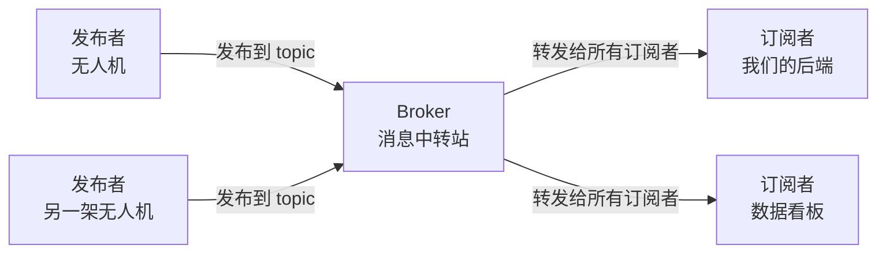
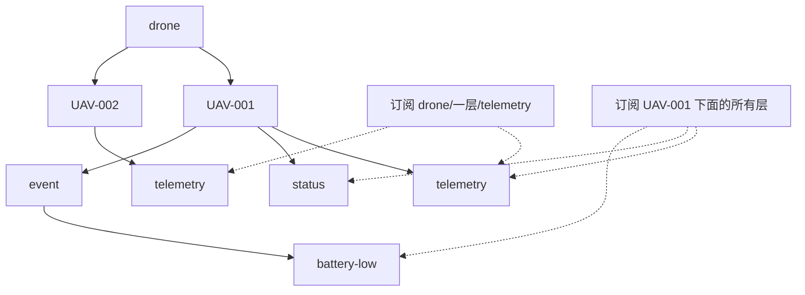
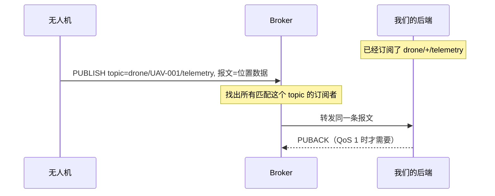
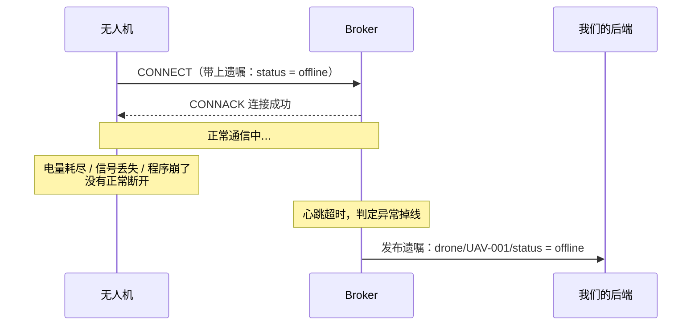
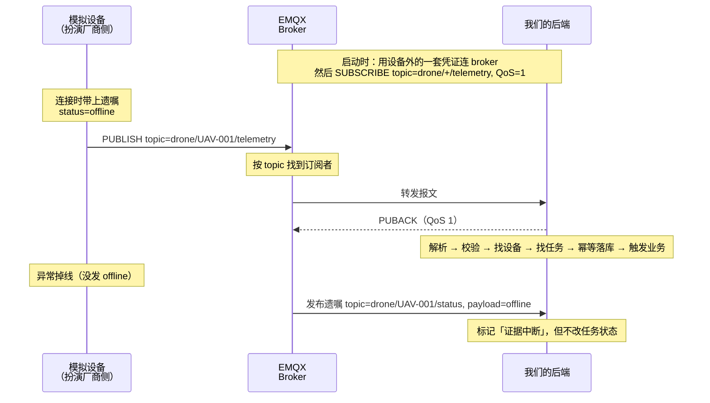
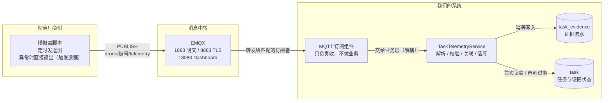
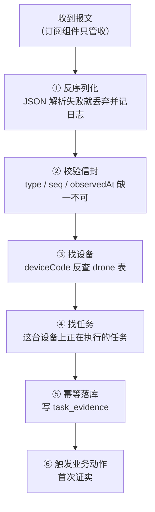
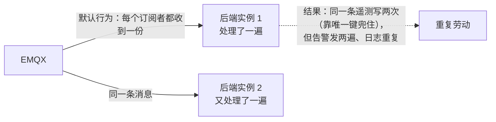

# MQTT 与设备数据接入

> 面向小白的学习型文档。分两半：
>
> **上半是概念**：MQTT 是什么、EMQX 是什么、Topic / 发布 / 订阅分别指什么、
> QoS 与保留消息是干嘛的。这些名字第一次见很容易糊在一起，本文会一个个拆开。
>
> **下半是方案**：给本项目设计一条「设备数据接进来」的链路 ——
> **模拟厂商侧通过 MQTT 发数据，我们的服务端订阅、接收、处理**。
>
> **明确不做的部分**（本方案刻意砍掉，见 4.1）：厂商云的**设备绑定、组织管理、
> 任务创建**这类管理动作全都不接。理由很简单：学习目的是把「数据怎么从设备
> 走到业务表里」这条链路吃透，管理接口只会增加噪音 —— 而且它们各家厂商都不一样，
> 学完也带不走。真正通用的是**数据通道**。
>
> 相关文档：[无人机数据来源.md](./无人机数据来源.md)（数据能从哪来、硬件侧的坑）、
> [任务业务设计.md](./任务业务设计.md)（「状态」与「依据」两个维度的定义）。

---

## 一、MQTT 是什么

### 1.1 一句话与它的来历

**MQTT 是一套「发布 / 订阅」的消息协议，专门为"网络又慢又不稳、设备又小又省电"
的场合设计的。**

它 1999 年诞生于工业场景：给输油管道做遥测 —— 管道边的传感器靠卫星链路传数据，
带宽窄、延迟高、还经常断。HTTP 那种"每次都要重新建立请求、带一大堆头"的方式
在那儿根本跑不动。于是有了 MQTT：**报文头最小只有两个字节**。

今天它成了物联网事实上的标准协议，你家里的智能插座、车间的传感器、
共享单车的锁，背后大概率都是它。

### 1.2 和 HTTP 最本质的区别：中间多了个 broker

这是理解 MQTT 的关键一步。先看 HTTP：


HTTP 是**请求-响应**：客户端主动问，服务端才答。服务端**没法主动找你**
（这正是 `任务通知.md` 里要费劲搞 WebSocket 的原因）。

MQTT 完全不是这个形状：



三个角色：

| 角色 | 干什么 | 在本项目里是谁 |
|---|---|---|
| **发布者（Publisher）** | 往某个 topic 发消息，不关心谁在听 | 无人机（或厂商云） |
| **Broker（消息代理）** | 收下所有消息，按 topic 转发给订阅者 | EMQX |
| **订阅者（Subscriber）** | 声明"我对哪些 topic 感兴趣"，坐等消息送上门 | 我们的后端 |

**关键点：发布者和订阅者互相不知道对方存在。**
无人机不知道有几个系统在听它的数据；我们的后端也不关心数据是由真飞机还是
模拟器发的。两边**只认识 topic 和 broker**。

这个「互不认识」有个正式的名字叫**解耦**，它带来三个直接好处：

- 加一个新消费方（比如数据看板）**不用改无人机一行代码**
- 无人机换成另一个型号、甚至换一个厂商，只要 topic 与报文格式不变，
  我们后端也**不用改**
- 一方挂了不影响另一方：后端重启期间，消息可以留在 broker 里（取决于 QoS 与会话设置）

### 1.3 五个名字容易糊的概念

#### Topic（主题）

**topic 就是一个用斜杠分层级的字符串，用来给消息分类。** 长得像路径：

```
drone/UAV-001/telemetry
drone/UAV-001/event/battery-low
drone/UAV-002/telemetry
```

要记住的几点：

- **层级用 `/` 分隔**，每层叫一个 level（上面就是 3 层）
- **大小写敏感**：`UAV-001` 和 `uav-001` 是两个不同的 topic
- **topic 不需要提前创建**（这点和 Kafka 不一样）。你往一个不存在的 topic 发消息，
  broker 会自动认下它 —— 所以**拼错 topic 不会报错，只会静默地没人收到**，
  这是新手最常见的"发出去没反应"的原因
- **通配符只能用在「订阅」时，不能用在「发布」时**（见下）

#### 通配符：`+` 与 `#`

订阅的时候可以一次订阅一批：

| 写法 | 含义 | 例子 |
|---|---|---|
| `+` | **匹配一层**（任意一层） | `drone/+/telemetry` 能收到 `drone/UAV-001/telemetry`、`drone/UAV-002/telemetry`，但收不到 `drone/UAV-001/event/alert`（层数不对） |
| `#` | **匹配剩下的所有层**，**只能放在最后** | `drone/UAV-001/#` 能收到这架飞机下面的一切 |



> 图里那两个通配符的**真实写法**是：`drone/+/telemetry` 与 `drone/UAV-001/#`。
> 这里刻意没把 `#` 直接写进图里 —— mermaid 的标签里 `#` 是转义符号，
> 写进去可能被当成编码而不是井号，显示成乱码。

**别偷懒用 `drone/#` 订所有**：一是权限没法细粒度控制（一台设备能看全队数据），
二是将来消息类型变多，你会在一个回调里写一堆 `if` 去分辨。

#### 发布（Publish）

发布 = **把一条消息交给 broker，由它转发**。



注意「发布」是**一次性动作**：发完就不管了（除非选了需要确认的 QoS）。
发布者**拿不到"谁收到了"**，也**不知道有没有人订阅** —— 这是有意的解耦设计。

#### 订阅（Subscribe）

订阅 = **向 broker 声明"这类 topic 的消息请给我一份"**。

- 订阅是按 **topic 过滤器（filter）** 建立的，可以带通配符
- 一条订阅对应一个 **QoS**：broker 转发时的保证级别
- 订阅关系**存在 broker 上**，不在发布者那里
- 断线重连后，订阅要不要保留取决于**会话设置**（见 1.4）

#### Broker

**Broker 是 MQTT 里唯一"必须有"的组件。** 它干四件事：

1. 维持成千上万条长连接
2. 收消息、按 topic 找到订阅者、转发
3. 管会话（谁订了什么、离线期间的消息要不要留）
4. 鉴权与授权（谁连得上、谁能发/收哪些 topic）

### 1.4 三个必须知道的机制

#### QoS：消息送达的保证级别

QoS 有 0/1/2 三档，**级别越高越可靠，但代价越大**：

| QoS | 含义 | 代价 | 适用 |
|---|---|---|---|
| **0** | 最多一次。发出去就不管，可能丢 | 最省，只有一帧 | 高频遥测（丢一帧，下一帧马上补上） |
| **1** | 至少一次。一定会到，**但可能重复** | 一次确认往返 | 关键事件（电量告警、起飞/降落） |
| **2** | 恰好一次。不丢也不重 | 两次往返，最贵 | 计费一类"重复了就出错"的场景 |

一句话记住：**QoS 1 会导致重复，所以消费端必须做幂等**（下面 4.6 会用到）。
另外 QoS 是**逐跳**协商的：发布用 QoS 2、订阅用 QoS 0，最终实际效果是**取两者较小**。

#### 保留消息（Retained）

普通消息发出去就没了，**后来的订阅者看不到历史**。保留消息解决这个：

发布时带 `retain` 标记，broker 会**为这个 topic 记住最后一条**，
之后任何新订阅者一连上，**立刻**收到它。

**典型用法是设备状态**：无人机把 `drone/UAV-001/status` 设为保留，
我们后端一启动、一订阅，马上就知道这架飞机当前是在线还是离线，
不用等它下次发心跳 —— **否则可能要干等几分钟**。

#### 遗嘱消息（LWT，Last Will and Testament）

设备在连接时**预先交代一句"如果我异常掉线，请替我发这条消息"**。



**这是"检测设备掉线"的标准手段**：正常情况下设备自己发一条 `offline` 再断开；
异常掉线时由 broker 代发遗嘱。两种都覆盖到，你就不会漏掉"离线"这个事实。

#### 顺带一个坑：clientId 只有一个

每个连接要带一个 clientId。**同一个 clientId 再次连接，broker 会把旧连接踢掉。**
所以多实例部署时，服务端**不能给每个实例配同一个 clientId**，否则它们会互相踢
—— 这会引出 4.7 的共享订阅。

### 1.5 MQTT 5.0 与 3.1.1

- **3.1.1**：用了很多年的事实标准，功能够用，几乎所有设备都支持
- **5.0**：2019 年发布，加了「原因码、会话过期时间、消息过期、共享订阅、
  topic 别名、用户属性」等。如果你的设备与 broker 都支持，建议用 5.0

**具体版本能力与字段以 OASIS 规范和各 broker 的官方文档为准**（本文不逐条抄写）。

---

## 二、EMQX 是什么

### 2.1 它是「一个 broker 的现成实现」

上一节说的 broker，是一个**角色**；EMQX 是扮演这个角色的**具体软件**。

- **开源 MQTT broker**，支持 MQTT 3.1 / 3.1.1 / 5.0
- 用 **Erlang/OTP** 写的 —— 这门语言天生擅长"几十万条轻量并发连接"，
  所以 EMQX 的卖点就是**单集群承载海量连接**
- 提供 **Dashboard**（网页控制台），能直接看连接数、订阅关系、
  手动发消息调试 —— **对学习来说这一条价值最大**
- 内置**认证与授权**（用户名密码、JWT、HTTP 回调、MySQL、Redis 等多种方式）
- 有**规则引擎 / 数据桥接**：能把消息直接转发到数据库、Kafka、HTTP 接口等

### 2.2 三个版本

| 版本 | 说明 |
|---|---|
| EMQX 开源版 | 免费，功能已经足够本项目 |
| EMQX 企业版 | 更多数据集成、安全与运维能力 |
| EMQX Cloud | 托管的，不用自己运维 |

### 2.3 同类软件（知道有这些就行）

| 软件 | 特点 |
|---|---|
| **Mosquitto** | 极轻量，一条命令就能跑，适合本地学习；集群与可视化弱 |
| **HiveMQ** | 商业为主，生态成熟 |
| **VerneMQ** | 同样是 Erlang 系，主打集群 |
| **RabbitMQ / Kafka** | 本职不是 MQTT，通过插件或网关支持，能用但不专 |
| 云厂商 IoT 平台 | 阿里云 IoT、华为 IoTDA、腾讯云 IoT 等内置 broker，省运维但绑平台 |

**本方案选 EMQX**，理由排序：① 有 Dashboard，学习和排查都直观；
② 开源版免费且功能够；③ 以后要集群、要接数据库，它都有现成路径。

> **本机现状提醒**：这台机器上 Docker 一直在用（本项目的 EMQX 与 MySQL
> 都是 Docker 容器），所以走 Docker 那条路就行。
> 但**容器不一定在跑** —— 本机就有两个 EMQX 容器、两个 MySQL 容器抢同一组端口，
> 动手前先 `lsof -nP -iTCP:1883 -sTCP:LISTEN` 看谁占着。
> 具体步骤见 4.11 与 [端到端联调方案.md](./端到端联调方案.md) 的 2.1、2.2。

---

## 三、一张图把概念串起来



这张图里有本方案的全部要素：**发布 / 订阅 / topic / QoS / 遗嘱 / 服务端处理**。
下面把它落成具体设计。

---

## 四、对接方案：模拟厂商 → MQTT → 我们的后端

### 4.1 范围：接什么、不接什么

| | 内容 | 做不做 |
|---|---|---|
| ✅ 做 | 设备（模拟器）通过 MQTT 上报**遥测、事件、状态** | 是 |
| ✅ 做 | 我们后端**订阅、接收、校验、落库** | 是 |
| ✅ 做 | 把遥测**关联到正在执行的任务**，变成「证据」 | 是 |
| ❌ 不做 | 厂商云的**设备绑定**（把设备挂到某个组织下） | 否 |
| ❌ 不做 | 厂商云的**组织管理**（企业、用户、权限） | 否 |
| ❌ 不做 | 通过厂商云**创建任务 / 下发航线** | 否 |
| ❌ 不做 | 厂商云的 HTTP 管理通道 | 否 |

**为什么砍掉这三样**：它们是**厂商特有**的。大疆的绑定流程、道通的、极飞的全不一样，
学完换一家就得重来。而「设备 → broker → 你的服务端」这条**数据通道是通用的** ——
换 broker、换设备型号、换厂商，中间那段都不用改。学习要把力气花在通用的地方。

> 另外这也顺带绕开了一个现实障碍：这几类管理动作都需要**厂商开发者账号 +
> 机型在支持列表里**（见 [无人机数据来源.md](./无人机数据来源.md) 的 2.2）。
> 砍掉它们，本方案**不依赖任何厂商账号就能跑通**。

### 4.2 整体架构



**一条重要的分层原则**：订阅组件**只管收**，收到就丢给业务层，自己不做判断。
这样将来把 EMQX 换成 Mosquitto、把 Paho 客户端换成别的库，
**业务逻辑一行都不用改**。

### 4.3 Topic 设计

```
drone/{设备编号}/telemetry          位置、高度、速度、电量（高频，1 秒 1 条）
drone/{设备编号}/event/{事件类型}    事件，如 battery-low、takeoff、landing
drone/{设备编号}/status             在线状态（保留消息，取值 online / offline）
```

举几个真实的 topic：

```
drone/UAV-001/telemetry
drone/UAV-001/event/battery-low
drone/UAV-001/status
```

四条设计理由：

1. **用设备编号而不是数据库 id**：设备编号（`drone.code`）本来就是业务主键
   （见 `schema.sql` 的 `uk_code`），设备自己知道自己的编号，但不知道你库里的 id。
   让设备报 id 等于逼它记住你的内部实现
2. **中间那层是设备编号，所以用 `+` 就能订全队**：`drone/+/telemetry`
3. **事件再分一层**（`event/事件类型`），以后加新事件类型不用改订阅
4. **状态单独一个 topic 并设为保留**：让新订阅者**立刻**知道在线状态（1.4）

**服务端订阅这三个**：

| 订阅的 topic 过滤 | QoS | 为什么这个 QoS |
|---|---|---|
| `drone/+/telemetry` | **0** | 高频，丢一帧下一帧马上补；QoS 1 的确认往返在这种量级上纯属浪费 |
| `drone/+/event/+` | **1** | 事件不常有，但**丢一条可能就漏掉一次告警**，值得一次确认 |
| `drone/+/status` | **1** | 状态变化少而关键，且用来判断「证据是否中断」 |

### 4.4 报文格式

**统一信封 + 各自的内容体**，这样解析代码只有一套：

```jsonc
{
  "deviceCode": "UAV-001",              // 设备编号，必须与 topic 里的那层一致
  "type": "telemetry",                   // telemetry / event / status
  "observedAt": "2026-09-21T10:00:00+08:00",  // 数据描述的那个时刻（设备说的）
  "seq": 10231,                          // 设备自增序号，用于去重
  "payload": {                           // 内容体，随 type 变化
    "lat": 39.9042,
    "lng": 116.4074,
    "alt": 120.5,
    "speed": 8.2,
    "battery": 76,
    "flightState": "flying"
  }
}
```

**每个字段都有它的作用，不是凑数**：

| 字段 | 为什么必须有 |
|---|---|
| `deviceCode` | 找出是哪个设备。**它必须和 topic 里那层一致** —— 不一致就以 topic 为准并记一条告警，因为 topic 是 broker 校验过权限的（见 4.8），更可信 |
| `type` | 消息类型。有了它，一份回调代码就能处理各种报文。**我们只要求它非空**，取值不设白名单（见下面的注） |
| `observedAt` | **设备说的时间**。与「我们收到的时刻」分开存（见 [任务业务设计.md](./任务业务设计.md) 的「数据模型」一节） |
| `seq` | 去重的必需项（见 4.6）。网络重传、QoS 1 重复投递都会产生重复报文，只有它能区分「重传」和「同一秒内的第二条真实数据」 |
| `payload` | 真正的数据。**单位与坐标系必须写进约定**：经纬度用小数度（不是度×10⁷ 的整数）、高度用米、速度用米/秒、电量用百分比 |

> **信封里的 `type` 和证据表里的 `type` 是两个不同的东西，别混。**
> 信封里的 `type` 是**消息类型**（`position` / `battery` / `takeoff`……），
> 描述「这一段数据是什么」；`task_evidence.type` 是**证据类型**
> （`telemetry` / `flight_log` / `witness` / `manual`），描述「这条依据属于哪一类」。
> 所有从 MQTT 进来的遥测，落库时证据类型一律是 `telemetry`，
> 而它原本的消息类型因为报文原文被完整归档，一直留在 `payload` 里查得到。
>
> **为什么不把信封的 `type` 直接当证据类型**：那样每加一种消息类型
> （电池、姿态、航点……）就会多出一种"证据类型"，去重键也跟着变细，
> 而它们对「这条任务有没有在执行」的证明力是完全一样的 ——
> 证据分类应该由**业务**决定，不该被设备的报文种类牵着走。
>
> **为什么不给 `type` 设白名单**：新机型、新固件随时可能冒出没见过的类型，
> 设了白名单就得后端先发版才能收数据。校验的重心放在「能不能用它做判断」上
> （设备存在、时间可解析、序号在不在），而不是「认不认识这个名字」。
>
> **为什么信封里不放"任务编号"**：设备根本不知道自己在为哪个任务飞 ——
> 那是我们系统内部的事。**由服务端根据「哪台设备 + 哪个任务在执行」来关联**
> （4.5 第 3 步）。让设备传任务号，等于把业务逻辑塞进硬件。

### 4.5 服务端处理链路（六步）



> **另外还有一步，不在这张图里**：**⑦ 告警识别** ——
> 从同一条报文里判断「设备是不是哪里不对劲」（电量低、定位丢失、电机异常……），
> 落到 `task_alert` 表。它和上面六步是**并列的一条支路**：
> 证据回答「这件事发生过吗」，告警回答「哪里不对劲」，两者都留。
> 之所以不画进这张图，是因为它**不受「有没有执行中任务」影响**
> （告警可以不属于任何任务），而上面六步是围着任务转的。
> 设计与实现见 [告警体系设计.md](./告警体系设计.md)。

**每一步的取舍**：

**① 反序列化**：解析失败**直接丢**，不重试、不入库。脏报文留在系统里只会污染数据。

**② 校验信封**：只校验**信封那几层**，不合法的报文一律丢弃并记一条告警。

| 校验项 | 不通过怎么办 | 为什么卡在这里 |
|---|---|---|
| `type` 非空 | 丢弃 | 连这是什么消息都不知道，没有任何处理它的依据 |
| `seq` 存在 | 丢弃 | 它是去重键的一部分。缺了就无法区分「重传」和「新数据」，存进去只会制造永远去不掉的重复 |
| `observedAt` 能解析成时间 | 丢弃 | 它是去重键的另一部分，也是「这条证据描述的是哪一刻」。**不能退而用"我们收到的时刻"顶替** —— 那个时刻每次重投都会变，去重键会直接失效 |

**`observedAt` 要宽容解析**（这段是真实踩过的坑）：时间格式不由我们决定，
不同厂商、不同固件发出来的都不一样。所以按可能性从高到低依次尝试四种写法：

| 写法 | 例子 | 备注 |
|---|---|---|
| `yyyy-MM-dd HH:mm:ss` | `2026-09-21 10:00:00` | 最常见，也是本文推荐的格式 |
| epoch 毫秒 | `1790000000000` | 纯数字，超过 10 位按毫秒算 |
| epoch 秒 | `1790000000` | 纯数字，10 位以内按秒算 |
| 带时区偏移的 ISO | `2026-09-21T10:00:00+08:00` | 换算成本地时区再存，否则「按时间排序」失去意义 |
| 不带偏移的 ISO | `2026-09-21T10:00:00` | 安卓 / JS 生态常见 |

**信封之外一律不校验**：`payload` 里的经纬度范围、电量 0~100 这些**目前不做**。
原因是它是「随 type 变化」的内容体，要校验就得为每种 type 定义一份字段规格 ——
那是另一件事，值得单独做。现在的策略是：**信封用来判断"能不能用"，内容原样归档**。
（将来要做的话，做在"按 type 分发解析"那一层，校验失败的数据落成
`valid = 0` 的行比直接丢更好 —— 至少能回答"设备到底发了什么"。）

**③ 找设备**：`deviceCode` 反查 `drone` 表。

- 查不到怎么办？**丢弃 + 告警，不自动建设备**。两个理由：
  一是自动建会造成拼错一个字母就多出一台假设备；
  二是**这台设备永远不可能被派任务**，所以它的数据永远无法佐证任何事，
  存下来只是让一张"证据表"里混进无主的数据
- 注意用的是 **topic 里那层编号**，不是报文里的 `deviceCode`（见 4.4）

**④ 找任务（这一步是全链路的关键）**：
把「一条遥测」变成「某个任务的证据」，靠的就是这一跳。

- 怎么找：`drone_id = 这台设备` 且 `status = executing` 的任务，
  **取最新开始的那条**（`ORDER BY actual_start_time DESC LIMIT 1`）
- 找不到怎么办？说明这台设备当前没有在执行任务（可能在试飞、可能在维护）。
  **仍然把遥测存下来**（它是客观事实），但 `task_id` 留空，
  不参与任何任务的证据判定
- 找到多条怎么办？正常业务下不该发生。真发生了（比如上一单刚结束、下一单刚开工
  这种极短窗口）**取最近开工的那条，不报错也不告警** ——
  这条遥测本来就无法精确归属，为此丢弃好数据、或者每条消息多发一次
  `COUNT(*)` 查询，都不划算。取舍写在 `TaskDao#selectExecutingByDrone` 上

**⑤ 幂等落库**：写 `task_evidence` 表。
这里必须用**唯一键**挡住重复，而不是靠"我判断一下有没有"：
`device_code + type + observed_at + seq`。

- **为什么必须有 `seq`**：只用前三项的话，同一秒内的两条真实数据会被误判成重复丢掉。
  高频遥测一秒发好几条是完全正常的，所以去重键必须细到能区分它们
- 冲突时**静默忽略**（说明这条已经收过了），并记一条 debug 日志
- 实现上用 `INSERT IGNORE` 而不是"先 SELECT 再 INSERT"：
  **只有数据库能提供「判断 + 写入」的原子性**，应用层先查后插在并发下必然有窗口
- `payload` 存的是**报文原文**，不是我们解析后的字段子集 ——
  信封只声明了我们关心的几个字段，Jackson 解析时会把其它字段丢掉，
  拿它再序列化存进去，等于把证据降级成二手信息

**⑥ 触发业务动作**：这一步才真正让「证据」产生业务价值。

| 触发条件 | 动作 | 现状 |
|---|---|---|
| 该任务第一次收到遥测 | `evidence_state` 从 `declared` 变为 `confirmed`（已证实） | ✅ 已实现 |
| 声明后迟迟收不到遥测 | 定时扫描把 `evidence_state` 标成 `stale`。**绝不自动改任务状态** | ✅ 已实现（扫描式，**刻意不靠**设备发离线上报） |
| 收到设备主动上报的 `status = offline` 或心跳中断 | 记一条 `device.offline` 告警（级别看该设备有没有执行中的任务） | ✅ 已实现（告警）。**`evidence_state` 仍然只由定时扫描决定** —— 「设备离线」和「这条任务没有旁证」不是一回事，见下方说明 |
| 收到 `event/battery-low` | 记一条 `evt.battery.low` 告警，提醒管理员/飞手，同样不改任务状态 | ✅ 已实现 |

> **为什么「设备离线」不顺手把 `evidence_state` 标成 `stale`**：
> 两者看着像同一件事，其实不是。`stale` 说的是「这条任务的**声明**暂时拿不到旁证」，
> 而设备离线可能发生在任务开始之前、也可能发生在任务结束之后（收工了把飞机收进箱子），
> 那时候这条任务的证据一点问题都没有。
> 把「设备状态」直接映射成「证据状态」会在这两种情况下误报。
> 定时扫描看的是**时间窗**（声明超过阈值还没等到任何遥测），那才是这个维度该有的判据。

`declared → confirmed` 用的是**条件更新**（`WHERE evidence_state <> 'confirmed'`），
于是它天然幂等：同一秒来一百条遥测，只有第一条会真的生效。
它同时也是 `stale → confirmed` 的通道 —— **"过期"本来就只是"暂时没等到"**，
真数据来了就该翻回来。

**为什么只标记、不处置**：`stale` 只说"我们没拿到旁证"，
不等于"飞手没飞"（图传断了、机场信号差都会这样）。
系统没有立场据此自动改任务状态、释放资源，只该把"这里对不上"摆出来给人看。
这是证据制里最需要守住的一条边界，展开见
[任务业务设计.md](./任务业务设计.md) 第 10.2 节。

### 4.6 幂等、乱序、时间 —— 三个必须处理的细节

| 问题 | 怎么处理 | 为什么不能省 |
|---|---|---|
| **重复** | 唯一键 `device_code + type + observed_at + seq`，冲突即忽略（`INSERT IGNORE`） | QoS 1 是"至少一次"，重复是**设计内的**，不是异常 |
| **乱序** | 不用 `seq` 排序，一律以 `observed_at` 为准；`seq` 只用来去重 | 网络会乱序到达。`seq` 只是设备本地的计数器，跨设备没有可比性 |
| **时间** | `observed_at`（设备说的）与 `reported_at`（我们收到的）**两个都存** | 设备时钟可能不准、消息可能延迟到达。只留一个就没法判断证据新鲜度 |

**`observed_at + seq` 为什么两个都要进唯一键**，值得单独说清楚 ——
它们是回答两个不同问题的：

- `observed_at` 回答「这条数据说的是哪一刻的事」
- `seq` 回答「在这台设备的数据流里，它是第几条」

只用 `observed_at`：同一秒的第二条数据被当成重复丢掉（**丢真数据**）。
只用 `seq`：设备换了固件、序号从头开始，新的数据会被当成旧的重复丢掉
（也是丢真数据）。两个一起用，才是"这台设备在这一刻的第 N 条"，
既不误杀同秒的数据，也不会被序号重置骗过去。

### 4.7 多实例部署：共享订阅（不然会重复处理）

后端不可能只跑一个实例。但这里有个**很容易踩的坑**：



两个实例各自订阅了 `drone/+/telemetry`，于是**每条消息都被处理两遍**。
唯一键能挡住重复落库，但挡不住重复的告警、重复的外部调用。

**解法是「共享订阅」**：把订阅写成 `$share/组名/topic`，
broker 保证**同一条消息在同一个组里只投给一个成员**：

```
$share/telemetry-group/drone/+/telemetry
```

于是实例 1 和实例 2 都订阅这个，消息被二选一地分发 ——
既做到了水平扩展（并发处理），又不会重复消费。

> 共享订阅的完整语义（不同 QoS 下的分配策略等）**以 EMQX 官方文档为准**。
> 但"多个实例订阅同一个 topic 会各自收到一份"这个默认行为，
> 是所有 MQTT broker 共通的 —— **这一点不搞清，扩容那天必出问题。**

### 4.8 鉴权与授权：设备身份 ≠ 用户身份

这条在 [无人机数据来源.md](./无人机数据来源.md) 的 6.1 已经强调过，落到 MQTT 上是这样：

| 谁连 broker | 用什么凭证 | 能发/收什么 |
|---|---|---|
| **设备**（模拟器扮演） | **设备级**用户名密码（或客户端证书） | 只能 **publish** `drone/{自己的编号}/#` |
| **我们的后端** | 一套**服务端专用**凭证 | 只能 **subscribe** `drone/+/...`，不发布 |

三条硬要求：

1. **绝对不能用飞手的 JWT 当设备凭证**。设备和人是两种身份，两张凭证表要分开
2. **必须配 ACL（授权）**：不限制的话，**任何一台设备都能发布别人的数据**
   —— 伪造 UAV-002 的位置信息轻而易举。ACL 规则就是
   「谁的编号，只能发谁的那层」
3. **凭证不进代码、不进仓库**：走配置或环境变量，
   和 `任务通知.md` 里"小程序 AppSecret 必须走配置"是同一条规矩

### 4.9 后端侧的实现结构

对照实际代码（包 `cn.tedu.drone.task.mqtt` 与 `cn.tedu.drone.task.service.impl`）：

| 组件 | 类 | 职责 | 关键点 |
|---|---|---|---|
| MQTT 客户端 | `TelemetrySubscriber` | 连 broker、订阅、断线重连、优雅停机 | Paho `MqttAsyncClient` + `setAutomaticReconnect(true)`；**每次（重）连成功都要重新订阅**（在 `connectComplete` 里做）—— cleanSession 下重连后 broker 那边订阅关系是空的 |
| 订阅回调 | 同上 `messageArrived` | 解析成对象 → 入队，立刻返回 | **回调里绝不做重活**：它跑在 Paho 的网络线程上，一条慢 SQL 就能让心跳超时、连接被断 |
| 摄入队列 | `TelemetryIngestQueue` | 有界队列 + N 个消费线程 | `ArrayBlockingQueue`（有界是硬要求）；满了 `offer` 失败即丢弃并告警，**不阻塞回调** |
| 业务服务 | `TelemetryIngestServiceImpl` | 六步处理 | 实现 `TelemetryHandler` 接口，与传输层解耦 —— 将来换 broker、或改从厂商云 API 拉，都不用动它 |
| 落库 | `TaskEvidenceDao` / `TaskDao` | 插证据（`INSERT IGNORE`）、抬证据状态（条件更新） | 幂等靠唯一索引与 `WHERE evidence_state <> 'confirmed'`，不靠应用层判断 |
| 定时扫描 | `TaskEvidenceStaleJob` | 声明超时无数据 → 标 `stale` | 只改 `evidence_state`，**绝不改 `status`** |
| 配置 | `MqttProperties`（`drone.mqtt.*`） | broker 地址、凭证、订阅 topic、QoS、clientId 前缀、队列容量、线程数、过期阈值 | 全部走配置；**clientId 每个实例必须唯一** —— 代码在配置的前缀后拼随机后缀，避免多实例互踢 |
| 停机 | `TelemetryIngestQueue.stop()` + `TelemetrySubscriber.stop()` | 优雅关闭 | 先把队列里已收下的消息消费完（最多等 3 秒），再断开连接 |

**为什么强调"回调里不做重活"**：MQTT 客户端的接收是**单线程顺序回调**的。
你在回调里同步写数据库，数据库慢一秒，后面所有消息就都排队等一秒，
broker 那边的缓冲区迟早撑爆。正确做法是回调里只把报文丢进队列，
由业务线程池去消费。

**为什么队列必须有界**：无界队列在消费跟不上时会一直堆内存，
最后 `OutOfMemoryError` 把整个后端打死 —— 一个设备数据接入搞垮整个管理后台，
显然不成比例。所以满了就丢，这叫**背压保护**：
宁可丢设备数据（下一帧马上就来），也不能让服务不可用。

**为什么"连上了但一条消息都收不到"是最常见的坑**：
`setAutomaticReconnect(true)` 只负责**重连**，不负责**重新订阅**。
重连成功后 broker 那边（cleanSession=true 时）已经没有我们的订阅关系了，
必须在 `connectComplete` 回调里再订阅一遍。症状是"日志安静、连接正常、零数据"，
非常难排查 —— 所以那里有一条日志是特意打的。

**关于遗嘱（LWT）**：设备端应该设（掉线时由 broker 代发 `status = offline`），
这样我们才能立刻知道它失联。**我们的订阅端不设** —— 遗嘱是给"别人订我"用的，
一个纯订阅方没人订它的消息，设了也是空写一条 topic。

#### 4.9.1 日志编号对照表（照着日志看流程）

代码里的日志都带 `【MQTT N …】` 前缀，编号就是流程发生的先后顺序。
**初学回调的人照着这张表看一遍真实日志，比读十遍代码有用。**

| 日志前缀 | 什么时候打 | 由谁触发 | 跑在哪个线程 |
|---|---|---|---|
| `【MQTT 0 启动】` | 订阅器开始启动 | Spring 调 `start()` | Spring 启动线程 |
| `【MQTT 1 注册】` | 创建 Paho 客户端 | 我们 | Spring 启动线程 |
| `【MQTT 2 注册】` | `setCallback(this)` | 我们 | 同上 |
| `【MQTT 3 发起】` | `connect()` 请求发出 | 我们 | 同上 |
| `【MQTT 3 回调】` | 这次 `connect()` 成功的结果 | **Paho** | Paho 网络线程 |
| `【MQTT 3 重试】` | 连接失败后安排重试 | 我们 | 同上 |
| `【MQTT 4 回调】` | `connectComplete()` / 连接失败 | **Paho** | Paho 网络线程 |
| `【MQTT 5 发起】` | `subscribe()` 请求发出 | 我们（在 4 里被调用之后） | Paho 网络线程 |
| `【MQTT 6 回调】` | 订阅成功 / 被拒绝 | **Paho** | Paho 网络线程 |
| `【MQTT 7 前置】` | 消费线程已启动（会打在第 0 步之前：队列 Bean 比订阅器先创建） | 我们 | Spring 启动线程 |
| `【MQTT 7 回调】` | `messageArrived()` | **Paho** | Paho 网络线程 |
| `【MQTT 7.1 入队】` | 消息放进队列 | 我们（在 7 里） | Paho 网络线程 |
| `【MQTT 7.2 消费】` | 从队列取出并处理 | 消费线程 | `drone-mqtt-worker-N` |
| `【MQTT 处理 ②~⑥】` | 六步处理（见 4.5） | 消费线程 | `drone-mqtt-worker-N` |
| `【MQTT 处理 ⑦ 告警识别】` | 从这条遥测里识别告警并落库（见 [告警体系设计.md](./告警体系设计.md)） | 消费线程 | `drone-mqtt-worker-N` |
| `【MQTT 8 回调】` | `connectionLost()` | **Paho** | Paho 网络线程 |
| `【MQTT 9 回调】` | `deliveryComplete()` | **Paho**（只订阅不发布，基本不出现） | Paho 网络线程 |
| `【MQTT 10 停机】` | 断开连接 | Spring 调 `stop()` | 停机线程 |

**三个能一眼看出来的事实**：

1. **第 2 步是唯一一处"注册回调"**：就一句 `client.setCallback(this)`，
   之后 `connectComplete` / `connectionLost` / `messageArrived` / `deliveryComplete`
   四个方法都由 Paho 调 —— 代码里搜不到任何一处主动调用它们。
2. **第 3、5 步的"发起"和"回调"是分开的两行，中间隔着时间**：
   异步 API 把请求丢出去就返回，结果要等回调。所以"已发出"不等于"已成功"。
3. **线程名会变**：第 1~3 步是启动线程，第 4 步之后变成 `MQTT Call: xxx`，
   第 7.2 步又变成 `drone-mqtt-worker-N`。这就是"回调在别人的线程上执行"
   和"消息被跨线程交接"的直接证据，也是回调里不能做重活的原因。

> **逐条日志的级别**：第 7、7.1、7.2 与 `处理 ②~⑥` 是 **debug** 级 ——
> 每条遥测都会打，生产环境调到 info 就自动消失。
> 本项目的开发配置本来就是 debug（见 `application.yml`），所以本地能看到全流程。
> 第 0~6、8~10 步是 **info/warn** 级，数量少，任何环境都留着。

**关于 clientId 为什么要拼随机后缀**：MQTT 规定 clientId 在 broker 上全局唯一，
重复时 broker 会**把先连的那个踢掉**（它认为新来的是重连）。
两个实例（或两个人本地开发）用同一个 ID 就会疯狂互踢，
而两边日志都显示"连接正常，偶尔断开"。所以 `drone.mqtt.client-id` 只是**前缀**，
真正的 ID 形如 `drone-server-a1b2c3`。

代价是每次重启都是一个"新客户端"，拿不到「broker 帮我攒着离线消息」的能力
（那需要固定 clientId + `cleanSession=false`）。这个代价可以接受：遥测是时效性数据，
十分钟前的位置对"现在有没有在飞"毫无价值，补收反而会把任务错误地判成「已证实」。

### 4.10 模拟器：怎么扮演"厂商侧"

学习阶段不需要真飞机。写一个脚本（Node、Python、Java 都行）做四件事：

1. 用**设备凭证**连上 EMQX，clientId 用自己的编号（模拟真实设备）
2. **连接时带上遗嘱**：`status = offline`
3. 连上后先发一条 `status = online`（**保留消息**），再按 1 秒 1 条的频率发 `telemetry`
4. 支持三种模拟场景，方便验证不同分支：

| 场景 | 怎么模拟 | 用来验证什么 |
|---|---|---|
| 正常飞行 | 经纬度缓慢变化、电量缓慢下降 | 证据正常落库、任务被标成「已证实」 |
| 电量告警 | 某一刻发 `event/battery-low` | 事件通路 + 告警 |
| **突然掉线** | **直接杀掉进程**（不发 offline） | **遗嘱消息**是否被 broker 代发、我们是否正确标记「证据中断」 |

**第 3 条最容易验证出问题**：如果遗嘱没配好，掉线后我们这边会"一直以为它在飞"。

> **这份描述已经细化成一份完整的行为设计并落地成脚本**：命令行参数、六个场景
> （正常 / 电量告警 / 定位丢失 / 只停发数据不掉线 / 突然掉线触发遗嘱 /
> 设备连发三个问题事件）、报文的三条硬约束、以及「优雅退出与 `kill -9` 必须是两条不同的路」
> （遗嘱要等 keepalive 超时才代发，所以模拟器要把 keepalive 设小才看得见）
> 都写在 [端到端联调方案.md](./端到端联调方案.md) 第三章。
> 脚本在 `tools/drone-simulator/simulator.py`（Python + paho-mqtt），六个场景都实跑过。

### 4.11 本地怎么搭（两条路）

**路线 A：Docker 起 EMQX（推荐，有 Dashboard）**

```
docker run -d --name emqx \
  -p 1883:1883   \   # MQTT 明文
  -p 8083:8083   \   # MQTT over WebSocket
  -p 18083:18083 \   # Dashboard 网页控制台
  emqx/emqx:latest
```

起来后打开 `http://localhost:18083`，默认账号 `admin` / `public`
—— **第一件事就是改掉默认密码**。Dashboard 上能看到连接数、
订阅关系，还能手动往某个 topic 发消息，**调试时极其实用**。

> **端口号与默认账号以 EMQX 官方文档为准**（不同版本可能调整）。

**路线 B：Homebrew 装 Mosquitto（更轻，但没有 Dashboard）**

适合只想跑通链路、不想要 Web 控制台的情况。
代价是排查只能靠命令行（订阅所有 topic 看消息），
且**集群与规则引擎这类能力它没有**。

> **本机现状（已核实）**：EMQX 装在 **Docker** 里，本机有**两个**容器都映射了
> `1883`（`emqx` 用 emqx/emqx:latest、`iot` 用 emqx:5.7）——
> **二选一起一个，别同时起**。`18083` 是 Dashboard。
>
> 写这一段时两个容器**都没在跑**（`iot` 最后一次运行是两个月前，
> `emqx` 今天启动过一次但 11 秒就退了）。**端口状态是会变的，
> 所以别背命令，先查**，具体步骤和踩坑提醒见
> [端到端联调方案.md](./端到端联调方案.md) 的 2.1 与 2.2。
>
> 客户端侧装了两个：**MQTTX**（图形化的收/发工具，用来手工发报文最方便）
> 和后端用的 Paho（Java 库）。
>
> 三条自查命令（不用装任何新东西）：
>
> ```bash
> # 1. broker 在不在听
> lsof -nP -iTCP:1883 -sTCP:LISTEN
> # 2. 订阅端看消息（命令行工具，装过 mosquitto 才有；没有就用 MQTTX）
> mosquitto_sub -h localhost -p 1883 -t 'drone/#' -v
> # 3. 我们自己的端到端用例（broker 不在时会自动跳过而不是失败）
> mvn -o test -Dtest=MqttSubscriberTests
> ```
>
> ⚠️ **本项目当前是匿名连接**（broker 没配用户名密码，`drone.mqtt.username` 留空）。
> 这对本地验证很方便，但**绝不能直接搬到生产** ——
> 没有鉴权意味着任何人都能往你的 topic 上灌假遥测。
> 上线前必须按 4.8 配齐凭证与 ACL，并把 Dashboard 的默认密码改掉。

### 4.12 落地顺序（建议）

前六步已经落地，第七步还没做：

| 步骤 | 做什么 | 验证标准 | 状态 |
|---|---|---|---|
| 1 | 起 broker（EMQX 或 Mosquitto） | Dashboard 或命令行能看到它的端口在听 | ✅ |
| 2 | 写模拟器，往 `drone/UAV-001/telemetry` 发消息 | 用 MQTTX 或 broker 自带的订阅工具能看到消息 | ✅（本地用 MQTTX / 用例里的 Paho publisher 发） |
| 3 | 后端加订阅组件，**先只打印**收到的报文 | 控制台能看到模拟器发的 JSON | ✅ |
| 4 | 加解析、校验、找设备、找任务四步 | 日志能打出「这条遥测属于哪个任务」 | ✅ |
| 5 | 加幂等落库（`task_evidence`） | 让模拟器重发同一条，库里只有一行 | ✅ |
| 6 | 加业务动作（首次证实 / 声明过期扫描） | 飞手点「开始执行」后收到遥测，任务变成「已证实」 | ✅ |
| 7 | 起两个后端实例，验证**共享订阅** | 每条遥测只被处理一次 | ❌ 未做（单实例部署下还看不出问题，但扩容前必须先做） |

**第 3 步的"先只打印"很关键**：先确认链路通了，再加业务逻辑。
不然出了问题是"链路不通"还是"逻辑写错"，你分不清。

**测试与本地开发要记得关掉它**：`drone.mqtt.enabled=false`。

- 单元测试必须关：订阅器会去连 broker，`broker` 没起就刷一堆连接失败日志，
  噪音会盖过真正要看的测试结果；而且「证据过期扫描」定时任务也归这个开关管，
  它跑在独立线程独立事务里，会在测试过程中改开发库的数据
- 不想连 broker 的本地开发也可以关，代价是证据维度永远是 `declared`

真正需要「连 broker 收报文」的只有一条端到端用例（`MqttSubscriberTests`），
它单独开着这个开关，并且 **broker 连不上时自动跳过而不是失败** ——
外部依赖不在就报红，是在冤枉代码。

---

### 4.13 现成的测试报文（照抄即可）

前面几节讲的是「为什么这么设计」，这一节是**动手材料**：
下面每条报文都实际发到本地 broker 上跑过，文档里那些「预期日志」「预期数据」
是照着真实输出写的，不是照着代码推的。

**每条还都有一个对应的自动化用例**，
将来改了逻辑、这里没跟着改，用例会先红：

| 本节 | 对应用例（`DroneServerApplicationTests`） |
|---|---|
| A1 / A2 | `telemetryShouldConfirmEvidenceAndArchiveRawMessage` |
| A3 | `telemetryWithoutExecutingTaskShouldStillBeArchived` |
| B1 | `duplicateTelemetryShouldBeIgnoredByUniqueKey` |
| B2 | `sameSecondWithDifferentSeqShouldBothBeStored` |
| C1~C3 | `telemetryWithUnusableDedupKeyShouldBeDropped` |
| C4 | `telemetryFromUnknownDeviceShouldBeDropped` |
| D | `MqttSubscriberTests.telemetryPublishedToBrokerShouldLandInEvidenceTable`（真连 broker 的那条） |
| E | `telemetryShouldAcceptCommonDeviceTimeFormats` |
| F | `eventAndStatusShouldBeArchivedAsTelemetry` |

> 所以这一节不只是「示例」，它是**同一批行为的另一副面孔**：
> 用例给机器看，报文给人手粘。两边不一致就说明有一边过时了。

#### 4.13.1 发之前先确认两件事

**① 这台设备得先登记在设备档案里**（不然第 ③ 步查不到就会丢数据）：

```sql
SELECT id, code, name, status FROM drone WHERE code = 'UAV-001';
```

**② 想看到「任务被标为已证实」，这台设备上得有一条正在执行的任务**：

```sql
-- 下面报文里的设备编号，就用这里查出来的 drone_code
SELECT t.task_no, t.status, t.evidence_state, d.code AS drone_code
FROM `task` t JOIN `drone` d ON d.id = t.drone_id
WHERE t.status = 'executing';
```

查出来是空的也不要紧 —— 那正好能验证 **A3**（数据照样存下来，只是不参与任何任务的证据判定）。

> ⚠️ **每条报文都要改 `seq`（或改 `observedAt`）再发第二遍。**
> 原样再发一次会被唯一索引挡掉。那不是「没生效」，**那是去重在正常工作**（见 **B1**）。
> 这一条是新手最容易误以为自己发错格式的地方。

#### 4.13.2 A. 正常路径

**A1 首条遥测：把任务从「仅声明」抬到「已证实」**

- 连接：`localhost:1883`，新建消息
- topic：`drone/UAV-001/telemetry`，QoS **0**
- 报文：

```json
{"deviceCode":"UAV-001","type":"position","observedAt":"2026-09-22 14:30:00","seq":1001,
 "payload":{"lng":116.397,"lat":39.908,"alt":120.5,"speed":8.2,"battery":87,"flightState":"flying"}}
```

- 预期日志：`【MQTT 处理 ⑤ 幂等落库】insertIgnore 返回 1，新归档一条证据`，
  紧跟着 `【MQTT 处理 ⑥ 触发业务动作】任务执行证据已证实`
- 预期数据变化：

```sql
SELECT t.task_no, t.evidence_state, t.evidence_type, t.evidence_at
FROM `task` t WHERE t.drone_code = 'UAV-001' AND t.status = 'executing';

SELECT id, task_id, device_code, type, observed_at, seq, LENGTH(payload) AS len
FROM task_evidence WHERE device_code = 'UAV-001';
```

`evidence_state` 从 `declared` 变成 `confirmed`，`evidence_type` 是 `telemetry`，
证据表里多一行、`task_id` 指向那条任务。

> **例外**：如果这条任务是**加证据字段之前就开始的**（迁移脚本没回填），
> 它的 `evidence_state` 是 `none`。那你会看到 `none → confirmed`，
> 而不是 `declared → confirmed` —— 效果一样，只是起点不同。
> 回填语句在 `docs/sql/migration/task_evidence.sql` 的注释里（按约定留给人工执行）。

**A2 报文里带我们不认识的字段（验证「存原文而不是存解析结果」）**

- topic：`drone/UAV-001/telemetry`，QoS **0**
- 报文（注意多出来的 `firmware` 和 `payload` 里的 `rawGps`）：

```json
{"deviceCode":"UAV-001","type":"position","observedAt":"2026-09-22 14:30:01","seq":1002,
 "payload":{"lng":116.398,"lat":39.909,"alt":121.0,"rawGps":"$GPGGA,143001.00,..."},
 "firmware":"v3.2.1"}
```

- 预期：`insertIgnore 返回 1`；证据表里这一行的 `payload` **就是上面这段原文**，
  `firmware` 一个字符都没丢。信封只声明了我们关心的那几个字段，
  Jackson 解析时会把其它字段丢掉 —— 所以落库用的是原文，不是信封（见 4.5 第 ⑤ 步）

**A3 设备没有执行中的任务 → 仅归档，`task_id` 为空**

- 前提：`UAV-002` 已登记，但它手上没有「执行中」的任务
- topic：`drone/UAV-002/telemetry`，QoS **0**
- 报文：

```json
{"deviceCode":"UAV-002","type":"position","observedAt":"2026-09-22 14:30:02","seq":1003,
 "payload":{"lng":116.410,"lat":39.915,"alt":98.0,"battery":64}}
```

- 预期日志：`【MQTT 处理 ⑤ 幂等落库】insertIgnore 返回 1`，然后
  `【MQTT 处理 ④ 找任务】设备数据未关联到执行中的任务，仅归档`
- 预期数据：证据表多一行，**`task_id` 是 NULL**。试飞、转场、维护时设备也在发数据，
  这些是客观事实，值得留痕，只是不参与任何任务的证据判定

#### 4.13.3 B. 去重（最值得亲手试的一组）

**B1 把 A1 那条原样再发一遍 → 被唯一索引挡下**

- topic / QoS / 报文：**和 A1 完全一样**（`seq`、`observedAt` 都不改）
- 预期日志：`【MQTT 处理 ⑤ 幂等落库】insertIgnore 返回 0，撞上唯一索引 = 这条已经在库里了`
- 预期数据：证据表**没有**新增行
- 为什么会重复投递：QoS 1 的语义是「至少一次」，设备重传、broker 重发都会产生重复。
  所以去重是**设计内**的事，不是异常（见 4.6）

**B2 同一秒内的第二条真实数据 → 两条都要留下**

- topic：`drone/UAV-001/telemetry`，QoS **0**
- 报文（`observedAt` 与上一条**相同**，只有 `seq` 不同）：

```json
{"deviceCode":"UAV-001","type":"position","observedAt":"2026-09-22 14:30:01","seq":1004,
 "payload":{"lng":116.399,"lat":39.910,"alt":122.3,"battery":86}}
```

- 预期：`insertIgnore 返回 1`，两条都在
- **这一条就是 `seq` 必须进唯一键的原因**：只用「设备 + 类型 + 时刻」当键，
  B2 会被误判成 B1 那样的重复，**真数据就丢了**。高频遥测一秒发好几条完全正常

#### 4.13.4 C. 会被丢弃的报文（一类一张，验证校验真的在拦）

统一用 `drone/UAV-001/telemetry`（QoS 0），每条换个 `seq`：

| # | 报文 | 预期日志 | 结果 |
|---|---|---|---|
| C1 | `{"deviceCode":"UAV-001","type":"position","observedAt":"2026-09-22 14:31:00","seq":null,"payload":{}}` | `【MQTT 处理 ② 校验信封】报文缺少 seq 字段（去重键必需），已丢弃` | 不落库 |
| C2 | `{"deviceCode":"UAV-001","type":"position","observedAt":"昨天下午","seq":2001,"payload":{}}` | `【MQTT 处理 ② 校验信封】报文的时间无法识别` | 不落库 |
| C3 | `{"deviceCode":"UAV-001","observedAt":"2026-09-22 14:31:02","seq":2002,"payload":{}}` | `【MQTT 处理 ② 校验信封】报文缺少 type 字段，已丢弃` | 不落库 |
| C4 | `{"deviceCode":"UAV-999","type":"position","observedAt":"2026-09-22 14:31:03","seq":2003,"payload":{}}`（发到 `drone/UAV-999/telemetry`） | `【MQTT 处理 ③ 找设备】收到未登记设备的数据，已丢弃` | 不落库 |

**为什么 `seq` 和时间「缺了就整条丢」**：它们都是去重键的组成部分。
时间还有一层原因 —— `observed_at` 是 NOT NULL，退而用「我们收到的时刻」顶替是不行的：
那个时刻每次重投都会变，去重键会直接失效，重投会被当成新数据存进去（见 4.5 第 ② 步）。

**C2 的那条日志会在丢弃时打出原文**，所以「设备到底发了个什么鬼」是查得到的 ——
这也是为什么校验失败要记 warn 而不是静默 return。

#### 4.13.5 D. 设备编号以 topic 为准（不是报文里写的那个）

- topic：`drone/UAV-001/telemetry`，QoS **0** ——注意 topic 里是 **UAV-001**
- 报文：故意把 `deviceCode` 写成**另一台**设备

```json
{"deviceCode":"UAV-005","type":"position","observedAt":"2026-09-22 14:32:00","seq":3001,
 "payload":{"lng":116.420,"lat":39.920,"alt":110.0}}
```

- 预期日志：`设备编号不一致：Topic 里是 UAV-001，报文里是 UAV-005，以 Topic 为准`
- 预期数据：这一行的 `device_code` 是 **UAV-001**
- 为什么以 topic 为准：**topic 那一段是 broker 按 ACL 授权过的**，
  设备改不了；而报文正文谁都能填。不这么做的话，
  谁能发数据谁就能把证据栽到别的设备头上（见 4.8）

#### 4.13.6 E. 设备侧时间的五种写法（都认）

同一台设备、同一个时刻（`2026-09-22 14:30:00 +08:00`），换成五种写法各发一条，
**`observed_at` 应该都落成 `2026-09-22 14:30:00`**（每条 `seq` 不同）：

| # | `observedAt` 写成 | 说明 |
|---|---|---|
| E1 | `"2026-09-22 14:30:00"` | 本文推荐的格式，最常见 |
| E2 | `1790058600000` | epoch 毫秒（纯数字，超过 10 位按毫秒算） |
| E3 | `1790058600` | epoch 秒（纯数字，10 位以内按秒算） |
| E4 | `"2026-09-22T14:30:00"` | 不带时区的 ISO 串，安卓 / JS 生态常见 |
| E5 | `"2026-09-22T14:30:00+08:00"` | 带时区偏移，会换算成本地时区再存 |

核对：

```sql
SELECT seq, DATE_FORMAT(observed_at, '%Y-%m-%d %H:%i:%s') AS 落库时间
FROM task_evidence WHERE device_code = 'UAV-001' ORDER BY seq;
```

**为什么要宽容**：时间格式不由我们决定，不同厂商、不同固件发出来的都不一样，
认不出来的代价是**整条数据被丢**。所以能多认一种就多认一种（见 4.5 第 ② 步）。

#### 4.13.7 F. 另外两个 topic：`event` 与 `status`

这两个 topic 是订阅了的（QoS 1），也**会**被处理成证据，但**没有**按事件类型分发的动作。

**F1 事件报文**，topic：`drone/UAV-001/event/takeoff`，QoS **1**：

```json
{"deviceCode":"UAV-001","type":"takeoff","observedAt":"2026-09-22 14:33:00","seq":4001,
 "payload":{"at":"2026-09-22 14:33:00"}}
```

**F2 状态报文**，topic：`drone/UAV-001/status`，QoS **1**：

```json
{"deviceCode":"UAV-001","type":"status","observedAt":"2026-09-22 14:33:01","seq":4002,
 "payload":{"flightState":"flying","battery":81,"gpsLevel":4}}
```

两条的预期都一样：按证据归档（`task_evidence.type` 记为 `telemetry`），
原始的消息类型 `takeoff` / `status` 因为报文原文被完整归档，一直留在 `payload` 里查得到
（这就是 4.4 里说的「信封的 type 和证据表的 type 是两个东西」）。

**告警侧已经接上了（告警实施步骤第四步）**，与上面两行的「归档」是并列的两件事：

| 报文 | 现在会产生什么告警 |
|---|---|
| `event/takeoff`、`event/land` | **没有** —— 它们是「设备在正常运转」的通报（info 级），不是「哪里不对劲」。原始报文仍在证据里 |
| `event/rth` | `evt.rth`，warning |
| `event/battery-low` | `evt.battery.low`，warning |
| `event/mission-interrupt` | `evt.mission.interrupt`，critical |
| `event/emergency-stop` | `evt.emergency.stop`，critical |
| `status` 且 `flightState=offline` | `device.offline`：设备空闲时 warning，**设备身上有执行中任务时 critical** |
| `status` 且 `flightState=online` | **没有**（同上，通报类） |

**事件类型在 topic 的第 4 层**（`event/{类型}`），不在 payload 里 ——
所以判据是 topic，而不是正文。认不出的事件类型只记一条 debug、不报错
（设备固件可能比服务端新）。清单、级别与「要不要飞手动手」见
[告警体系设计.md](./告警体系设计.md) 第二章。

> **人工上报类 4 条（`man.*`）不走 MQTT** —— 走 HTTP（`POST /task/alert/report`）。
> 这一条要单独记住，因为它是**唯一一类不来自设备**的告警：
> 现场围了一群人不让起飞、客户临时改要求，这些传感器测不到，只有站在那儿的人知道。
> 对应的落库规则也不一样：`source` 是 `app`、**`device_code` 为 NULL**
> （表达「这不是设备说的」）。NULL 还带来一个想要的性质：抑制规则里
> `NULL = NULL` 不成立，于是同一任务上连着报两次同类问题是两条记录，不会被合成一条。
> 详见 [告警体系设计.md](./告警体系设计.md) 2.4 节与第十四章第五步。

> **一个联调时实测到的行为**：保留消息会在后端**每次重启、重新订阅时被重放**。
> 所以「当前处于离线」的设备会在后端启动时各产生一条 `device.offline`。
> 抑制规则（同一设备同一编码还有未处理的就不再产生）让它每台设备最多只有一条，
> 但排查时看到「刚启动就冒出几条离线告警」，原因在这里。

> **还没有做的部分**：`route.deviation`（航线偏离，要拿计划航线比对）、
> `flight.state.changed`（要记住上次状态）。
> 另外 4.5 第 ⑥ 步里「设备离线上报 → 标 `stale`」这一条**刻意不做**，
> 理由就写在那张表下面。

#### 4.13.8 一次全发完能不能自动化

上面这些手粘一轮大概十分钟，够把链路摸熟。想反复跑的话，
**4.10 那个模拟器脚本**才是正路：它能按 1 秒 1 条的频率持续发，
还能模拟「突然掉线」这种手工粘不出来的场景。
本节这些报文的价值是**每条对应一个明确分支**，用来手工验证「我改的这处逻辑对不对」。

---

## 五、常见坑速查表

| 坑 | 症状 | 怎么避 |
|---|---|---|
| topic 拼错 | 发出去了，但没人收到，**也不报错** | topic 不自动校验，先用 broker 的订阅工具确认 |
| 通配符用错位置 | 收不到消息 | `#` 只能在最后，且只能用在订阅、不能用在发布 |
| 多个实例订阅同一 topic | 同一条消息被处理多次 | 用共享订阅 `$share/组名/topic` |
| 所有实例用同一个 clientId | 实例之间互相把对方踢下线 | clientId 必须唯一（服务端用「服务名-实例标识」） |
| 回调里写数据库 | 消息越积越多，最后整条通道卡死 | 回调只入队，处理交给业务线程池 |
| 忘了配遗嘱 | 设备掉线后仍以为它在飞 | 连接时带 LWT，并验证"杀进程"这条路径 |
| 没配 ACL | 任何设备都能伪造别人的数据 | 设备只能发自己编号那一层 |
| 用 QoS 2 传高频遥测 | 吞吐骤降、延迟升高 | 高频用 QoS 0，关键事件用 QoS 1 |
| 没做幂等 | 库里出现重复证据 | 唯一键 `device_code + type + observed_at + seq` |
| 去重键漏了 `seq` | 同一秒的第二条真实数据被当成重复丢掉 | `seq` 必须进唯一键（4.6） |
| 重连后没重新订阅 | 连接正常、日志安静、**一条消息都收不到** | 在 `connectComplete` 里重新订阅 |
| 日志里大量「撞唯一索引（重复投递）」 | 一条消息被处理了两次，但其实只发了一次 | **先查是不是有第二个订阅者**：多实例没配共享订阅（4.7），或者上次的进程/测试 JVM 没退干净还在订阅 —— 这一条实测踩过，排查了半天才发现是残留进程 |
| 指纹式信任 payload 里的编号 | 有人伪造 `deviceCode` 冒充别人 | **以 topic 里的编号为准**（它过了 ACL），不一致就告警 |
| 拿设备时间当可信时间 | 证据新鲜度判断错乱 | `observed_at` 与 `reportedAt` 分开存 |
| broker 默认密码没改 | 被人接管你的消息总线 | Dashboard/管理账号第一件事改密码 |

---

## 六、面试题（面向初级）

**1. MQTT 和 HTTP 最本质的区别是什么？**
HTTP 是请求-响应，只能客户端主动问；MQTT 是发布-订阅，中间有个 broker，
发布者发完就不管，订阅者坐等转发。所以 MQTT 能天然做到「服务端主动推」
和「收发双方互不认识」。

**2. 为什么 MQTT 能省电省带宽？**
报文头最小 2 字节（HTTP 光是头部就几百字节）；一条长连接复用，
不用每次重新握手；还有 QoS 0 这种"发了就不管"的低开销模式。

**3. Topic 和 Kafka 的 topic 有什么区别？**
MQTT 的 topic 是**层级字符串 + 通配符**，不需要预先创建，也没有分区概念；
Kafka 的 topic 要建、有分区与偏移量、消息默认保留。MQTT 是"管道"，Kafka 是"日志"。

**4. QoS 0/1/2 怎么选？**
高频遥测用 0（丢了下一帧补上）；关键事件用 1（可能重复，消费端做幂等）；
重复会出错的场景（计费）才用 2。**别一律用 2**，它要两次往返，代价很大。

**5. 保留消息（retained）解决什么问题？**
让新订阅者**立刻**拿到该 topic 的最后一条消息。典型用法是设备在线状态，
否则新订阅者要等设备下次上报才知道状态。

**6. 遗嘱消息（LWT）有什么用？**
设备连接时预先声明"我异常掉线就替我发这条"。用来检测设备掉线 ——
不然设备突然没电或失联，服务端会一直以为它还活着。

**7. 为什么要 Broker？两台机器直接连不行吗？**
直接连的话，N 个数据源 × M 个消费方就要维护 N×M 条连接，还要自己处理
重连、鉴权、消息缓存。有了 broker，两边各自只连它一条，
**新增一方不用改另一方**。

**8. 多实例部署时要注意什么？**
两点：① clientId 必须唯一，否则实例之间互相踢下线；
② 用共享订阅 `$share/组/主题`，否则每个实例都会收到同一份消息、重复处理。

**9. 为什么设备鉴权和用户鉴权必须分开？**
设备和人是两种身份。用用户 JWT 当设备凭证，等于把系统间的信任边界搞混了：
一个人离职、一个 Token 泄露就会影响设备通道。而且设备需要的是
「只能发自己那层 topic」这种 ACL，用户体系里没有这个概念。

**10. 收到消息后为什么不能直接改任务状态？**
因为消息可能丢、可能重复、可能乱序。而且"收到一条遥测"只说明
"这一刻它在飞"，不代表任务该被标记成什么。业务动作要基于**证据状态的判定**
（首次证实 / 断流告警），而不是"收到一条就改一次"。

---

## 附一：术语表

| 术语 | 说人话 |
|---|---|
| MQTT | 面向物联网的发布-订阅消息协议，报文极小，跑在 TCP 上 |
| Broker | 消息中转站，收下所有消息再按 topic 转发 |
| EMQX | 一个开源的 MQTT broker 实现，Erlang 写的，带网页控制台 |
| Mosquitto | 另一个轻量 broker，适合本地学习 |
| Topic | 用斜杠分层的字符串，用来给消息分类 |
| 通配符 | 订阅时才用的 `+`（一层）与 `#`（剩余所有层） |
| 发布 / 订阅 | 发布=交给 broker 转发；订阅=声明我要哪些 topic |
| QoS | 送达保证级别：0 最多一次 / 1 至少一次 / 2 恰好一次 |
| Retained | 保留消息：broker 记住该 topic 最后一条，新订阅者立刻收到 |
| LWT | 遗嘱消息：设备异常掉线时由 broker 代发的那条 |
| Keep Alive | 心跳间隔，用来判定连接是否还活着 |
| ACL | 授权规则：谁只能发/收哪些 topic |
| 共享订阅 | `$share/组名/topic`，让多个实例**分着收**同一条消息，不重复 |
| clientId | 连接标识；同一个 clientId 再连会把旧连接踢掉 |

## 附二：本文未逐条核实的点

写作时本机无法访问外网文档（WebFetch 被限流），以下内容**属于惯例性描述，
具体取值请以官方文档为准**：

- MQTT 5.0 相对 3.1.1 新增能力的完整清单（本文只列了常见几项）
- EMQX 各版本的默认端口、默认账号、共享订阅的完整语法与分配策略
- Mosquitto 具体版本的能力边界
- 各家云 IoT 平台 broker 的差异

**已经在本地核实过的**（不是抄文档，是实际跑出来的）：

| 结论 | 怎么核实的 |
|---|---|
| 本机 EMQX 的 1883 与 18083 在监听、8083 不在 | `lsof -nP -iTCP:<端口> -sTCP:LISTEN` |
| 连上之后能订到 `drone/+/telemetry` 等三个 Topic | 后端启动日志里三行「已订阅 Topic」 |
| 报文能从 broker 一路走到证据表 | `MqttSubscriberTests`（端到端，真发真收） |
| 默认允许**匿名连接** | 不带用户名密码也能连上（所以文档里标注了"生产必须配凭证"） |

**仍然没核实的**：EMQX 默认账号密码、共享订阅的具体语法与分配策略 ——
第 4.7 节、第 4.11 节里涉及这两处的地方都标了"以官方文档为准"。

建议动手前做两件事：**① 打开 EMQX 官方文档核对端口与账号；
② 先只让一条消息从模拟器走到后端控制台**，再往上加业务逻辑。
