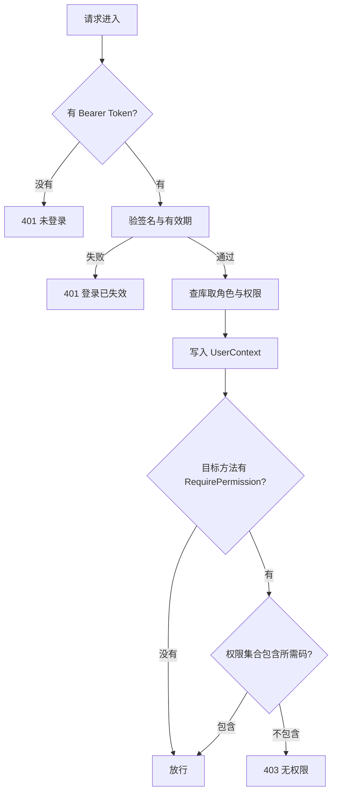

# RBAC 权限设计

> 把 `user` 表上的单值字段 `permission` 改造成标准的「用户 → 角色 → 权限」模型。
> 本文既是设计说明，也是实施清单 —— 第八节的步骤按顺序执行即可。

---

## 一、现状与问题

现在 `user` 表上有一个 `permission` 字段，一个用户只能存一个值：

```
id  username      name  permission
1   13800001001   张伟   pilot
4   13800001004   赵强   maintainer
5   13800001005   刘洋   admin
```

带来三个问题：

1. **一人只能一个身份**。真实业务里「既是机务又兼管理员」很常见，这个模型表达不了。
2. **权限散落在代码里**。想判断能不能删设备，只能写 `if (permission.equals("admin"))` —— 每加一个角色就要改一处代码。
3. **角色能干什么没有集中定义**。`maintainer` 到底能操作哪些接口？翻遍代码才能拼出来。

## 二、设计目标

- 一个人可以挂多个角色（多对多）
- 「角色能做什么」由数据决定，改权限不用改代码
- 接口级校验：每个接口声明自己需要什么权限，拦截器统一核对
- 菜单级联动：前端按同一套权限码控制菜单和按钮的显隐
- 权限变更后**下次请求立即生效**，不需要用户重新登录

## 三、表结构设计

在 `user` 之外新增 4 张表：

| 表 | 作用 | 关系 |
|---|---|---|
| `role` | 角色定义 | — |
| `permission` | 权限点 | — |
| `user_role` | 用户 ↔ 角色 | 多对多 |
| `role_permission` | 角色 ↔ 权限 | 多对多 |


### 关键设计取舍

| 决策 | 选择 | 理由 |
|---|---|---|
| 角色标识 | 用 `code`（如 `admin`）而非中文名 | 代码引用 code，改名不影响代码 |
| 权限标识 | `模块:操作` 格式（如 `staff:add`） | 见名知意，便于代码里字符串引用 |
| 关联表索引 | 联合唯一索引 | 防止同一组合重复授权 |
| 外键约束 | **不加** | 互联网项目惯例：靠应用层保证，避免批量导数据、后续分库分表时被约束卡住 |
| `type` 字段 | 保留但暂只用一个值 `api` | 为将来细化到按钮级留口子 |
| 菜单权限 | **不单独设权限点** | 有该模块的 `list` 权限就能看到菜单，避免维护两套编码 |

建表语句见 `docs/sql/rbac_schema.sql`。

## 四、权限点与角色分配

| 权限编码 | 说明 | admin | maintainer | pilot |
|---|---|:---:|:---:|:---:|
| `staff:list` | 员工查看 | 有 | 有 | — |
| `staff:add` | 员工新增 | 有 | — | — |
| `staff:edit` | 员工编辑 | 有 | — | — |
| `staff:toggle` | 员工启用/禁用 | 有 | — | — |
| `device:list` | 设备查看 | 有 | 有 | 有 |
| `device:detail` | 设备详情 | 有 | 有 | 有 |
| `device:add` | 设备新增 | 有 | 有 | — |
| `device:edit` | 设备编辑 | 有 | 有 | — |

设计意图：**飞手**能看设备但不能改设备档案；**机务**管设备档案；**只有管理员**能动员工账号。

## 五、数据迁移

迁移依据是「`user.permission` 的值恰好等于角色 code」—— 现有 6 条数据的取值是 `pilot` / `maintainer` / `admin`，正好对得上。

> 前提校验：迁移前先跑 `SELECT COUNT(*) FROM user WHERE permission IS NULL;`。
> 这个 JOIN 迁移会**漏掉 permission 为 NULL 的用户**，如果结果不为 0，需要先手工补角色。

脚本见 `docs/sql/rbac_seed.sql`（初始化角色/权限/分配 + 迁移用户角色）和 `docs/sql/rbac_drop_legacy.sql`（备份并删除旧字段）。

## 六、后端改造方案

### 6.1 数据层

放在 `cn.tedu.drone.user` 模块下（都是用户权限相关）：

```
user/dao/RoleDao.java          selectCodesByUserId
user/dao/PermissionDao.java    selectCodesByUserId
resources/mapper/RoleMapper.xml
resources/mapper/PermissionMapper.xml
```

> **实施时的调整**：原计划里的 `RolePO` / `PermissionPO` 没有创建。
> 因为这两个查询只需要返回 `code` 列表（`List<String>`），
> 建了实体类也没有任何调用方，属于死代码。等将来做「角色管理」界面时再补。

关联表**不建 PO** —— 查权限一条关联 SQL 直接出结果，不需要中间对象：

```sql
SELECT DISTINCT p.code
FROM user_role ur
JOIN role r             ON r.id = ur.role_id AND r.status = 1
JOIN role_permission rp ON rp.role_id = r.id
JOIN permission p       ON p.id = rp.permission_id
WHERE ur.user_id = #{userId}
```

注意 `r.status = 1` 这个条件：角色被禁用后，它的权限自动不再生效，不用逐个删关联。

### 6.2 JWT 里放什么

**只放 `sub`(userId) 和 `username`**，角色和权限不进 Token。

- 职责更清晰：Token 只证明「你是谁」，「能干什么」每次查出来
- 权限变更**下次请求立即生效**，不用等 Token 过期
- 代价是每个受保护请求多一次关联查询（当前数据量下是毫秒级，可接受）

### 6.3 LoginUser 扩展

```java
public class LoginUser {
    private Long id;
    private String username;
    private Set<String> roles;        // 角色 code
    private Set<String> permissions;  // 权限 code
}
```

### 6.4 权限注解与拦截器

```java
@Target({ElementType.METHOD, ElementType.TYPE})
@Retention(RetentionPolicy.RUNTIME)
public @interface RequirePermission {
    String[] value();   // 例：@RequirePermission("staff:add")
}
```

`AuthInterceptor.preHandle` 的流程变为：



**401 与 403 的语义要分清**：401 是「你没登录/登录已失效」，403 是「你登录了，但没这个权限」。

之所以能用拦截器做到这一点，是因为 `preHandle` 的 `handler` 参数能拿到 `HandlerMethod`，读得到方法上的注解 —— 这是当初选拦截器而非 Filter 的原因（见 [登录与Token.md](./登录与Token.md)）。

### 6.5 接口返回

`UserVO` 增加 `roles` 与 `permissions` 两个字段，登录响应和 `/user/me` 都返回带权限的用户信息，前端登录后一次拿全。

## 七、前端改造方案

- `auth store` 增加 `hasPermission(code)` / `hasRole(code)`
- `AdminLayout` 侧边栏按 `staff:list` / `device:list` 控制菜单显隐
- `StaffView` / `DeviceView` 的操作按钮按权限显隐（如「新增员工」需要 `staff:add`）

## 八、实施步骤

- [x] **① 建表与迁移**：执行 `docs/sql/rbac_schema.sql` → `rbac_seed.sql` → 校验 → `rbac_drop_legacy.sql`
- [x] **② 数据层**：`RoleDao` / `PermissionDao` + 两个 Mapper XML（PO 暂不建，见 6.1 说明）
- [x] **③ 登录与 /me**：`LoginUser` 扩展，`UserVO` 加字段，登录与 `/me` 查库组装权限
- [x] **④ 鉴权**：`@RequirePermission` 注解 + `AuthInterceptor` 校验，`/user/list` 挂 `staff:list`
- [x] **⑤ 前端**：`hasPermission` + 菜单与按钮显隐

### 验证结果

| 账号 | 角色 | 权限数 | 访问 `/user/list` |
|---|---|:---:|:---:|
| 张伟 13800001001 | pilot | 2 | **403** |
| 赵强 13800001004 | maintainer | 5 | 200 |
| 刘洋 13800001005 | admin | 8 | 200 |

前端菜单按同一套权限码显隐：飞手登录只看到「设备管理」，且不显示「新增设备」按钮；管理员两个菜单与按钮都在。

## 九、注意事项

1. **`DROP COLUMN permission` 不可逆**。执行前用 `CREATE TABLE user_bak AS SELECT * FROM user` 留快照 —— 数据虽然迁走了，但回滚时能救命。

2. **`role` 是 MySQL 8.0 的关键字**，SQL 里必须写成 `` `role` ``，否则报语法错误。

3. **暂不做缓存**。查库方案下，每个受保护请求多一次关联查询。当前 6 用户 / 3 角色 / 8 权限，本地查询毫秒级，没必要上缓存。将来数据量大了再引入 Caffeine 本地缓存 + 权限变更时主动清除，接口层不用改。

4. **角色禁用即刻生效**。`role.status = 0` 后该角色的权限立刻不再参与计算，不需要删除 `role_permission` 里的关联记录。
