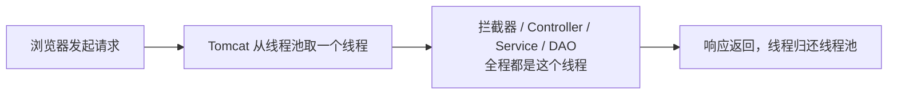
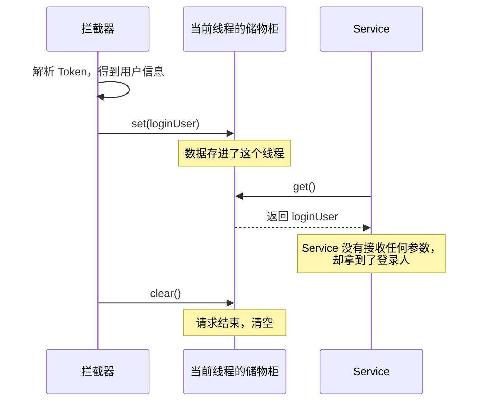
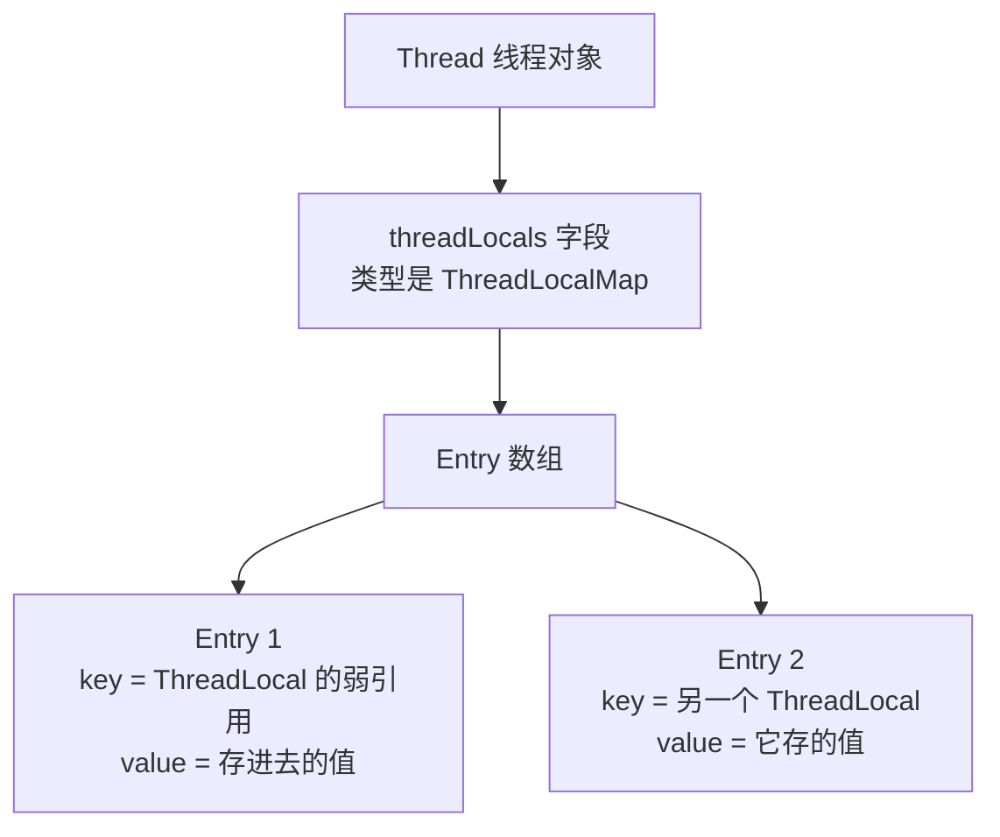
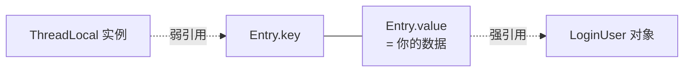

# ThreadLocal 学习笔记：从登录功能说起

> 面向初级工程师。读完你应该能回答：ThreadLocal 是什么、为什么需要它、怎么用、
> 为什么会内存泄漏、哪些框架在用它，以及面试会怎么问。

---

## 一、先看我们项目里的一个真实需求

用户登录后，每个请求都需要知道「**当前操作人是谁**」。

拦截器解析 Token 时已经拿到了用户信息，可 Controller、Service 也想用（比如「查出我自己的资料」）。

**怎么把这份数据从拦截器传到 Service？**

最直接的办法是让每个方法都加参数往下传：

```java
// 不用 ThreadLocal 的话，大概会变成这样
public void doSomething(Long userId, String username, String role) {
    // 想把 loginUser 传给 DAO，就得一层层透传
}
```

这有三个问题：

1. 方法签名被搞脏 —— 很多层根本用不到这个参数，只是「顺路捎带」
2. 加一个字段（比如以后要传角色），从拦截器到 DAO 所有方法签名都要改
3. DAO 层被迫接收它完全不关心的东西

**ThreadLocal 就是来解决这类「同一个请求内跨层传数据」问题的。**

---

## 二、ThreadLocal 是什么

一句话：**每个线程各自一个储物柜。**

```java
ThreadLocal<LoginUser> CURRENT = new ThreadLocal<>();

CURRENT.set(user);   // 把东西放进【当前线程】的柜子
CURRENT.get();       // 从【当前线程】的柜子取东西
CURRENT.remove();    // 清空【当前线程】的柜子
```

**最容易搞错的一点**：

> 数据「存在线程身上，不在 ThreadLocal 对象上」。
> ThreadLocal 只是那把开柜子的钥匙 —— 同一把钥匙，可以开不同线程的柜子。

用表格对照一下：

| 概念 | 类比 |
|---|---|
| 线程 Thread | 储物柜 |
| ThreadLocal 实例 | 一把钥匙 |
| set 进去的值 | 柜子里放的东西 |

所以结论是：**一个 ThreadLocal 实例，被 100 个线程使用，就有 100 份互不相干的数据。**

这是它和「共享变量」最本质的区别 —— 它做的不是共享，而是**隔离**。

---

## 三、它凭什么能解决我们的问题

关键在于 Web 服务器的工作方式：



**一个请求从头到尾由同一个线程处理完** —— 这就是 ThreadLocal 能用的前提。

于是我们可以这样设计：



好处一目了然：**Service 不需要在方法签名里接收登录人，就能直接拿到它。**

---

## 四、在我们项目里的完整生命周期

项目的 `UserContext` 就是对 ThreadLocal 的一层包装：

```java
public final class UserContext {

    private static final ThreadLocal<LoginUser> CURRENT = new ThreadLocal<>();

    public static void set(LoginUser user)  { CURRENT.set(user); }
    public static LoginUser get()           { return CURRENT.get(); }
    public static void clear()              { CURRENT.remove(); }
}
```

四个环节分别发生在：

| 时机 | 位置 | 动作 |
|---|---|---|
| 请求进来、Token 校验通过 | `AuthInterceptor.preHandle` | `set` |
| Controller 要判断「我是谁」 | `UserController.me` | `get` |
| Service 要用登录人 | `UserServiceImpl.getCurrentUser` | `get` |
| 请求处理完毕 | `AuthInterceptor.afterCompletion` | `clear` |

### 真实日志长这样

我们给这三个方法都加了日志，并打印了线程标识。连发两次 `/user/me`，输出是：

```
拦截器 [线程id=23/http-nio-8080-exec-2] Token 校验通过，准备把登录人写入当前线程：GET /user/me
  └─ ThreadLocal.set() [线程id=23/http-nio-8080-exec-2] 存入登录人：13800001001
Controller [线程id=23/http-nio-8080-exec-2] 处理「获取当前登录用户」，从 ThreadLocal 里取登录人
  └─ ThreadLocal.get() [线程id=23/http-nio-8080-exec-2] 取出：13800001001
Controller [线程id=23/http-nio-8080-exec-2] 取到 userId=1，转交 Service 查库
  └─ ThreadLocal.get() [线程id=23/http-nio-8080-exec-2] 取出：13800001001
Service [线程id=23/http-nio-8080-exec-2] 准备按 id=1 查库，此时 ThreadLocal 里仍是 13800001001
拦截器 [线程id=23/http-nio-8080-exec-2] 请求处理结束，清理当前线程：GET /user/me
  └─ ThreadLocal.clear() [线程id=23/http-nio-8080-exec-2] 清空当前线程的口袋

拦截器 [线程id=25/http-nio-8080-exec-4] Token 校验通过，准备把登录人写入当前线程：GET /user/me
  └─ ThreadLocal.set() [线程id=25/http-nio-8080-exec-4] 存入登录人：13800001001
...
```

### 从这几行里能读出四件事

1. **同一次请求，线程标识自始至终一样** —— 第 1 次全是 `线程id=23`。
   线程名 `http-nio-8080-exec-2` 也印证了：Tomcat 把一个请求交给一个线程处理到底。
2. **不同请求换了线程** —— 第 2 次是 `线程id=25`。线程池里的线程干完活就还回去，下一个请求可能由别的线程来接。
3. **`set` 和 `clear` 严格成对** —— 有借有还，这是不串号的关键（下面会讲为什么）。
4. **Service 没有接收登录人这个参数，却拿到了它** —— 这就是 ThreadLocal 的价值。

---

## 五、原理：数据到底存在哪

这是面试最爱问、也最容易答错的地方。

**数据不在 ThreadLocal 对象里，而在 Thread 对象里。**



- 每个 `Thread` 对象内部都有一个 `ThreadLocalMap`（可以理解成专属的 HashMap）
- 它的 **key 是 ThreadLocal 实例本身**，**value 才是你存的数据**
- 所以 `set` 的本质是：**往「当前线程」的 map 里放一条记录**

这就解释了为什么它是「线程隔离」的 —— 因为每个线程的 map 是各自独立的。

也解释了一个常见疑问：

> **一个 ThreadLocal 实例，能被多个线程各存一份不同的值吗？**
>
> 能。因为 key 虽然是同一个 ThreadLocal，但它所属的 map 分属不同线程。

---

## 六、内存泄漏：为什么必须 clear

先看 `ThreadLocalMap` 里 Entry 的引用关系：



- **key 是弱引用**，**value 是强引用**
- 当 ThreadLocal 实例没有其他强引用时，它会被 GC 回收，于是 Entry 的 key 变成 `null`
- 但 **value 仍然被 Entry 强引用着**，回收不掉
- 而 Entry 又挂在 Thread 上，线程池里的线程几乎不会销毁……

结果就是：**一堆 key 为 null、value 却还活着的垃圾数据，越积越多。**

这就是 ThreadLocal 内存泄漏的完整链路。

> 你可能会问：key 为什么设计成弱引用？如果设计成强引用，那 ThreadLocal 实例永远不会被回收，泄漏得更彻底。弱引用至少给了 GC 一个机会。

**规避方式只有一个：用完显式 `remove()`。**

我们项目里，这个动作放在拦截器的 `afterCompletion`：

```java
@Override
public void afterCompletion(HttpServletRequest request, HttpServletResponse response,
                            Object handler, Exception ex) {
    UserContext.clear();   // 这一行不能省
}
```

它顺带还解决了另一个更严重的问题 —— **数据串号（越权）**：

Tomcat 的线程是复用的。假设 A 用户请求结束后没清理，线程回到池子里；
下一个请求恰好复用了这个线程，而它是个不需要登录的公开接口，压根没往柜子里放东西——
那么它一 `get`，读到的就是**上一个用户 A 的身份**。

这种 bug 极其隐蔽：本地测试往往复现不了，上生产才偶发。所以 `clear` 必须写在「一定会执行」的地方，而 `afterCompletion` 无论请求成功还是抛异常都会走到。

---

## 七、几个容易踩的坑

### 坑 1：以为 ThreadLocal 是「线程安全的共享变量」

不是。`synchronized` 是「多个线程抢同一份数据」，ThreadLocal 是「每个线程各有一份」。

- `synchronized` 解决的是 **竞争**
- `ThreadLocal` 解决的是 **隔离**

面试时如果答成「ThreadLocal 用来保证线程安全」，会被追问到答不上来。

### 坑 2：子线程拿不到父线程的值

```java
CURRENT.set(user);
new Thread(() -> {
    CURRENT.get();   // null —— 这是另一个线程，另一个柜子
}).start();
```

如果确实需要传递，有个 `InheritableThreadLocal`，它会在创建子线程时把父线程的值复制过去。

但它在**线程池**下会失效 —— 线程池的线程是复用的，创建时机远早于你 `set` 的时机，复制不到。这也是为什么全链路追踪（traceId 传递）通常不靠它，而是靠专门的方案。

### 坑 3：只在业务代码里 clear

`clear` 的位置要保证「一定会执行」。放在 Controller 里，一旦抛异常就可能走不到；放在拦截器的 `afterCompletion` 里才稳妥。

### 坑 4：把大对象塞进去

既然线程不销毁、value 又回收不掉，那塞进去的对象越大，泄漏越严重。ThreadLocal 适合放**轻量的上下文对象**（比如我们只放了 id、username、role 三个字段）。

---

## 八、哪些常用框架在用 ThreadLocal

这部分是「你为什么必须懂它」的答案 —— 主流框架大量依赖 ThreadLocal 实现「隐式的上下文传递」。

| 框架 | 用途 | 说明 |
|---|---|---|
| **Spring** | `TransactionSynchronizationManager` | 事务上下文。保证同一个事务里的多次 DAO 操作拿到的是**同一个数据库连接** |
| **Spring** | `RequestContextHolder` | 持有当前 `HttpServletRequest`，让你在任意位置拿到请求对象 |
| **Spring MVC** | `LocaleContextHolder` / `TimeZoneContextHolder` | 保存当前请求的语言、时区 |
| **Spring Security** | `SecurityContextHolder` | 保存当前登录用户 —— **和我们的 `UserContext` 干的是同一件事** |
| **MyBatis** | `SqlSessionUtils` / `SqlSessionTemplate` | 把 SqlSession 绑定到线程，保证同一线程内拿到同一个会话 |
| **Logback / Log4j** | `MDC`（Mapped Diagnostic Context） | 往日志里塞 traceId、用户 ID，实现全链路日志串联 |
| **PageHelper** | 分页参数传递 | 你调 `PageHelper.startPage()` 后，紧接着的那条查询会自动分页，靠的就是 ThreadLocal |
| **Shiro** | `SecurityManager` | 保存当前 Subject |
| **Dubbo** | `RpcContext` | 保存一次 RPC 调用的上下文 |
| **Hibernate** | `Session` 绑定 | 保证同一线程内复用同一个 Session |

### 挑两个展开说

**Spring 的事务（最能体现价值）**

一个 `@Transactional` 方法里可能调用好几个 DAO。事务要求这些操作**必须在同一个数据库连接上**，否则事务就不成立。

可 DAO 方法之间并没有互相传连接对象 —— 怎么保证拿到同一个？靠的就是 ThreadLocal：

```
事务开始时：把 Connection 放进 ThreadLocal
中间每次 DAO：从 ThreadLocal 取 Connection（拿到的都是同一个）
事务结束时：提交/回滚，然后 clear
```

有没有发现，这和我们的登录流程结构完全一样？**set → 跨层 get → 最后 clear。**

**Logback 的 MDC（最贴近日常）**

想让每行日志都自动带上 traceId，不用改任何日志代码：

```java
MDC.put("traceId", traceId);   // 请求进来时放进去
// 中间所有 log.info(...) 输出时会自动带上这个 traceId
MDC.clear();                   // 请求结束时清掉
```

这也是 MDC 敢叫「Diagnostic Context」的原因 —— 它就是 ThreadLocal 的典型应用。

### 共同点

你会发现它们都是同一个套路：

> **在请求/事务的入口 set，中间各层直接 get，出口 clear。**

我们的 `UserContext` 正是这个套路的一个最小实例。理解了它，上面这些框架的设计动机都能看懂。

---

## 九、面试题

> 按「概念 → 原理 → 坑 → 实战」排列，答案尽量说人话。

### 基础概念

#### Q1. ThreadLocal 是什么？有什么用？

它是一个「线程专属的储物柜」。每个线程都能往里存自己的数据，互不干扰。

主要用途是**在同一个请求/事务内跨层传递数据**，而不用把参数一层层写进方法签名。典型场景就是保存「当前登录用户」「当前事务的连接」「日志的 traceId」。

#### Q2. ThreadLocal 和 synchronized 有什么区别？

两者解决的问题正好相反：

- `synchronized` 是**让多个线程排队访问同一份数据**（解决竞争）
- `ThreadLocal` 是**让每个线程各有一份数据**（解决隔离）

一个是「大家用同一个，所以要排队」，一个是「各用各的，互不相干」。

所以面试时说「ThreadLocal 用来保证线程安全」是不准确的，应该说「用来隔离线程间的数据」。

#### Q3. ThreadLocal 的数据存在哪里？

**存在 Thread 对象自己身上，不在 ThreadLocal 对象上。**

每个 `Thread` 内部有个 `ThreadLocalMap`，key 是 ThreadLocal 实例，value 是存进去的数据。ThreadLocal 本身只是「钥匙」。

这也是为什么一个 ThreadLocal 实例能被多个线程各存一份不同的值 —— 因为每个线程的 map 是独立的。

### 原理

#### Q4. `set` 和 `get` 的过程是怎样的？

- `set(v)`：拿到当前线程 → 取出它的 `ThreadLocalMap` → 以「当前 ThreadLocal 实例」为 key 存进去
- `get()`：拿到当前线程 → 取出它的 `ThreadLocalMap` → 以「当前 ThreadLocal 实例」为 key 去取

关键点：**两次操作都会先拿到「当前线程」**，所以天然隔离。

#### Q5. ThreadLocalMap 的 key 为什么用弱引用？

为了防止 ThreadLocal 实例本身泄漏。

如果 key 是强引用，那么只要线程活着，map 里的 Entry 就会一直强引用着 ThreadLocal 实例，使它永远无法被回收 —— 泄漏更严重。

用弱引用后，ThreadLocal 实例在外部没有强引用时就能被 GC 回收，Entry 的 key 变成 null（后面靠 `set`/`get`/`remove` 时顺带清理）。

#### Q6. ThreadLocal 为什么会内存泄漏？

链路是这样的：

1. key 是弱引用 → ThreadLocal 实例被回收后，Entry 的 key 变成 null
2. **value 是强引用** → 这个 Entry 的 value 还活着，回收不掉
3. Entry 挂在 Thread 上，而**线程池的线程几乎不会销毁**
4. 于是 key 为 null 的 Entry 越积越多

注意：ThreadLocal 内部在 `set`/`get`/`remove` 时会顺带清理一部分 key 为 null 的 Entry，但这**不是必然及时**的，不能指望它。

#### Q7. 怎么避免内存泄漏？

**用完显式调 `remove()`。**

而且要放在「一定会执行」的位置。我们的项目里放在拦截器的 `afterCompletion`，因为无论请求成功还是抛异常，这个方法都会执行。

### 坑

#### Q8. 为什么说「线程池下必须 remove」？

因为线程池的线程是复用的，处理完一个请求不会销毁。

不清理的话有两个后果：一是 value 回收不掉（内存泄漏），二是更危险的 —— **下一个复用该线程的请求可能读到上一个用户的数据**（数据串号，可能导致越权）。

第二种才是真正要命的，而且极难复现。

#### Q9. 子线程能拿到父线程 ThreadLocal 的值吗？

默认不能。子线程是另一个线程，有自己独立的柜子。

需要传递的话可以用 `InheritableThreadLocal`，它在创建子线程时会把父线程的值复制过去。但**在线程池场景下会失效** —— 线程池的线程早就创建好了，创建时你还没 `set` 呢，自然复制不到。

#### Q10. 那全链路追踪的 traceId 是怎么跨线程传递的？

不用 `InheritableThreadLocal`，因为它在线程池下失效。

主流做法是**显式传递**：把上下文作为参数传给线程池任务（比如用 `TtlRunnable` 包装、或阿里开源的 TransmittableThreadLocal），或者干脆在跨线程的地方手动带上。

### 实战

#### Q11. 你在项目里哪里用过 ThreadLocal？

（拿我们项目当答案）

登录鉴权。拦截器校验 Token 通过后，把用户信息 `set` 进 `UserContext`；Controller 和 Service 就能直接 `get` 到当前登录人，不用在方法签名里层层传递参数。请求结束时在 `afterCompletion` 里 `clear`，防止线程复用导致的数据串号。

#### Q12. 保存登录用户，用 ThreadLocal 和用 Session 有什么区别？

- **Session** 是存在服务端的「会话」，跨请求存在，通常配合 Cookie 使用，解决的是「**下次请求怎么认出你**」
- **ThreadLocal** 只在**一次请求内**有效，解决的是「**这次请求里数据怎么跨层传**」

两者配合使用：Session（或 Token）负责「认出你是谁」，ThreadLocal 负责「在本次请求里把你是谁传给各个层」。

#### Q13. ThreadLocal 里适合放什么？

轻量的上下文对象，比如用户 ID、traceId、语言设置。

不适合放：大对象（泄漏后占用大）、需要跨请求保留的状态（该用 Session/缓存）、以及与「当前线程」无关的数据。

#### Q14. 如果拦截器里忘了 clear，会出现什么现象？

最典型的是**偶发的身份错乱**：A 用户的数据出现在 B 用户的请求里。

因为 Tomcat 线程复用，B 的请求如果恰好落到 A 用过的线程上、而 B 又是走的公开接口（没经过 `set`），那么 B 一 `get` 就读到了 A 的身份。

这种 bug 本地很难复现（取决于线程调度），所以不能靠「测试没发现问题」来判断。

---

## 附：一页速查

```
是什么    每个线程各自的储物柜，用于同一次请求内跨层传数据
数据存哪  Thread 对象的 ThreadLocalMap 里，key 是 ThreadLocal 实例，value 是数据
三大操作  set（放入）/ get（取出）/ remove（清空），都作用于【当前线程】
为什么隔离 每个线程有独立的 map，所以一个 ThreadLocal 能存 N 份数据
内存泄漏  key 弱引用、value 强引用 + 线程池线程不销毁 → value 回收不掉
怎么避免  用完显式 remove()，放在一定会执行的位置（拦截器 afterCompletion）
最大陷阱  忘了 clear 导致线程复用时读到上一个用户的数据（越权）
谁在用    Spring 事务/RequestContextHolder、Spring Security、MyBatis SqlSession、
          Logback MDC、PageHelper、Dubbo RpcContext
固定套路  入口 set → 中间各层 get → 出口 clear
```
