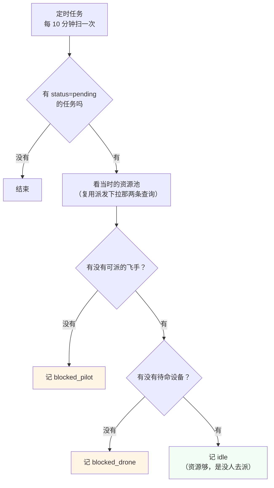
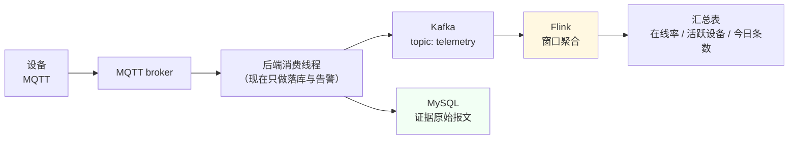

# 业务分析方案：用数据回答「这段时间干得怎么样」

> **这一版是方案，不是实现。** 先把「分析什么、给谁看、怎么算、会不会慢」定下来，
> 再动代码。
>
> 它对应的入口是侧边栏那个占位 —— **已从「数据看板」改名为「业务分析」**
> （2026-09-29）。改名不是文字游戏：它和「数字大屏」只差两个字，
> 而两者回答的是完全不同的问题，混起来会做错东西（见
> `数字大屏方案.md` 第二章之后的对照表）。

---

## 一、先定清楚它和大屏、看板的分工

| | 监控看板 | 数字大屏 | **业务分析（本文档）** |
|---|---|---|---|
| 时间视角 | 此刻 | 此刻 | **一段时间**（今天/本周/本月/自定义） |
| 回答 | 「哪条出问题了，我该处理哪条」 | 「现在整体怎么样」 | 「这段时间干得怎么样，比上个月好了吗」 |
| 交互 | 点、查、跳 | 基本不点，自动刷新轮播 | **选时间段、下钻、导出** |
| 查询形态 | 走索引取一行/一页 | 一条 `COUNT` / `GROUP BY` 出一个数 | 按**时间分组**的聚合 + 对比 |
| 谁看 | 值班/调度 | 值班室电视、会议室 | 管理者（复盘、排班、采购、对上汇报） |

**一句话**：大屏是仪表盘（一眼扫过），业务分析是体检报告（过段时间回头看趋势）。
**两者绝不能合成一页** —— 把趋势图塞进大屏，值班的人反而看不清「现在有没有事」。

---

## 二、要分析的具体数据（第一问）

按「给谁看」分五组。每条都写清**口径**（怎么算）与**来源**（哪张表哪个字段）——
口径不写清，两个人算出来就是两个数，而这种分歧在管理会上最耗时间。

> 现状列里的「❌」指**现在算不出来或算不准**（缺字段/缺关联），不是指「没写代码」。

### 2.1 任务侧（给管理者）

| 指标 | 口径 | 来源 | 粒度 | 现状 |
|---|---|---|---|---|
| 任务量趋势 | 按天/周/月统计新建任务数 | `task.create_time` | 天 | ✅ 能算 |
| 各状态分布 | 按 `status` 分组计数 | `task.status` | 快照 | ✅ 已在大屏上（此刻） |
| **完成率** | 已完成 ÷ **已派发的任务**（不含待派发） | `task.status` | 周/月 | ✅ 已定口径（2026-09-30）：待派发的任务还没轮到资源，算进去会把「没人派活」的锅算到飞手头上。**按区间统计时窗口打在 `actual_end_time` 上**（只看已有结论的活），见 6.2 |
| **按时完成率** | `actual_end_time <= plan_end_time` 的占比 | `task.actual_end_time` / `plan_end_time` | 周/月 | ✅ 能算 |
| **平均执行时长** | `actual_end_time - actual_start_time` 的平均值 | 同上 | 周/月 | ✅ 能算 |
| 超期率 | 执行中且已过计划结束时间的条数 ÷ 执行中总数 | `task.plan_end_time` | 快照 | ✅ 已在大屏上 |
| 按优先级分布 | 各 `priority` 的任务数与完成率 | `task.priority` | 月 | ✅ 能算 |
| 计划 vs 实际的偏差 | 平均(`actual_start_time` − `plan_start_time`) | 同上 | 月 | ✅ 能算（反映排班准不准） |

### 2.2 飞手侧（给班组管理）

| 指标 | 口径 | 来源 | 现状 |
|---|---|---|---|
| 工作量 | 每人：任务数、飞行架次、飞行时长 | `task.pilot_id` + `task_report.flight_*` | ✅ 能算（报告里已有架次与时长） |
| 按时完成率 | 按飞手拆的按时完成比例 | 同上 | ✅ |
| 拒绝率 | 每人的 `refuse` 流水次数 ÷ 派给他的任务数 | `task_log.action='refuse'` | ✅ |
| 声明可信度 | 每人「只有声明、没有设备旁证」的任务占比 | `task.evidence_state='stale'` 或 `'declared'` | ✅ 这是本系统**独有**的一个指标 |
| 打卡覆盖率 | 已打卡航点数 ÷ 计划航点数 | `task_checkin` + 路由快照 | ⚠️ 快照是 JSON，要解析后统计（见 4.3 ③） |
| 报告质量 | 有照片/有飞行日志/写了问题记录的比例 | `task_attachment` + `task_report` | ✅ 能算 |
| 现场问题上报次数 | 每人的 `man.*` 告警条数 | `task_alert`（`source='app'`） | ✅ |

### 2.3 设备侧（给机务）

| 指标 | 口径 | 来源 | 现状 |
|---|---|---|---|
| **利用率** | 飞行时长 ÷ **可飞时长** | `task` + `task_report` | ✅ 口径已定（2026-09-30）：**可飞时长 = 在役天数 × 每日可飞小时（配置，默认 8）**。⚠️ 这是**近似**：设备在维护/充电的那几天也算进分母了，所以算出来会**偏低**（偏保守）。要做准就得有设备状态变更历史 —— 你已拍板不做（见第九章第 7 条），所以先把偏差写在指标说明里 |
| 累计架次与时长趋势 | 按天/月累加 | `drone.flight_count` / `flight_hours` | ⚠️ 只有**累计值**，没有「每天增加了多少」的历史 |
| **故障率** | 每台设备的告警条数 / 每 100 飞行小时 | `task_alert` + `task_report.flight_hours` | ✅ |
| 最常报警的设备 | 按设备分组的告警数排行 | `task_alert.device_code` | ✅ |
| 在线率趋势 | 按天：当天有过数据上报的设备数 ÷ 设备总数 | `task_evidence.observed_at` | ✅ 但**要扫证据表**（性能见第四章） |
| 维护占用 | `drone.status='maintenance'` 的时长占比 | ❌ 状态没有变更历史，只能取当前快照 | ❌ 需要一张状态流水表 |

### 2.4 告警侧（给安全/值班）

| 指标 | 口径 | 来源 | 现状 |
|---|---|---|---|
| 告警量趋势 | 按天/类别/级别分组 | `task_alert.observed_at` | ✅ |
| **平均处理时长（MTTR）** | `handled_at - observed_at` 的平均值 | `task_alert` | ✅ |
| 未处理积压 | 按天看「当天结束时的未处理数」 | 同上 | ⚠️ 需要按天快照，或事后用 `handled_at` 反推 |
| 哪类告警最多 | 按 `alert_code` 排行 | 同上 | ✅ |
| **越界次数** | `zone.breach` / `zone.alt.over` 的条数与趋势 | 同上 | ✅（第四步已产生这两条） |
| 谁处理得最快 | 按 `handled_by` 拆的 MTTR | 同上 | ✅ |

### 2.5 地理与覆盖率（给业务/客户）

| 指标 | 口径 | 来源 | 现状 |
|---|---|---|---|
| 点位覆盖 | 计划要去的点里，实际到过的比例 | 路由快照 + `task_checkin` | ✅ 已落地（6.5）：**到过按打卡算**（偏差 ≤ 100 米）；「点到轨迹的距离」留给**单任务下钻**时再算 —— 一条任务的轨迹算得起，一个月所有任务一起算就要扫证据表了 |
| 航线使用率 | 每条航线被多少任务引用过 | `task.route_id` | ✅ |
| 禁飞区影响面 | 有多少任务命中过禁飞区、命中后是否照飞 | `task_log.note`（软拦留痕）+ `task_alert` | ✅（留痕里有关键词，但不精确 —— 见第八章） |
| 点位/航线/禁飞区的总量变化 | 按时间看新增 | `survey_point.create_time` 等 | ✅ |

### 2.6 数据质量（内部用，但很值钱）

| 指标 | 口径 | 现状 |
|---|---|---|
| 每条任务的平均证据条数 | `task_evidence` 条数 ÷ 任务数 | ✅ |
| **无旁证任务占比** | `evidence_state` 为 `declared`/`stale` 的任务比例 | ✅ 这是「执行依据」那套设计的兑现 |
| 报告按期提交率 | 有 `task_report` 的任务 ÷ 已完成任务 | ✅ |

### 2.7 待派发积压的**归因**：为什么没有派发（2026-09-30 你特别点名要的）

这一条不属于「常规统计」，而是一个**运维诊断**指标。它回答的是管理层最常问的那句话：
**「活攒着没派出去，到底是没人、没设备，还是没人管？」**

**为什么现在答不出来**：`task` 表只有一个 `status='pending'`，
它只说明「还没派」，**不说明为什么**。而「没人/没设备/没人管」这三件事在事后是**无法从数据里推断的**——
因为「当时有没有空闲飞手和设备」是**那一刻的事实**，事后查只能看到现在。

**做法：给待派发的任务定期打「归因点」**（不是事后推断，而是**当时就记下来**）



| 归因 | 判定（用**当时**的资源池，不是现在的） | 它指向的管理动作 |
|---|---|---|
| `blocked_pilot` | 没有「启用 + 有 pilot 角色 + 该时间窗内不冲突」的飞手 | 加人 / 调整排班 / 放宽时间窗 |
| `blocked_drone` | 没有「待命 + 该时间窗内不冲突」的设备 | 采购 / 维修 / 提高设备周转 |
| `blocked_both` | 两者都没有 | 资源整体不足（这时候该看「任务是不是排太满」） |
| `idle` | **资源是够的，但没人点派发** | **管理动作没跟上** —— 这是最该被暴露的一类 |

**落地方案**

| 部件 | 内容 |
|---|---|
| 表 | `task_dispatch_block(task_id, checked_at, reason, pilot_candidates, drone_candidates)` —— `candidates` 记当时的可选数量，便于事后看「差多少」 |
| 定时任务 | 每 10 分钟一次（配置化）；只扫 `status='pending'`；**同一个任务连续多轮同样归因时按间隔存**（比如每小时最多一条），否则一天 144 行 × N 个任务，表会白涨 |
| 判定逻辑 | **直接复用派发时那两条查询**（`selectDispatchablePilots` / `selectDispatchableDrones`）与冲突检查 —— 不另写一套，否则「能派但被判成不能派」 |
| 指标 | ① **待派发积压的时长分布**（有多少任务 pending 超过 1 小时/1 天）；② **归因占比**（blocked_drone 60% / idle 30% / blocked_pilot 10%）；③ **从创建到派发的中位时长**（对「管理是否及时」最直观） |
| 产品价值 | 三个可能的管理结论各有对策：设备不足 → 买/修；飞手不足 → 招/排班；**idle → 定 SLA**（比如「P0 任务 30 分钟内必须派发」），而且这是唯一一条**不需要花钱**就能改善的 |

> ✅ **已落地（2026-09-30，「第二步半」）**
>
> | 落了什么 | 在哪 |
> |---|---|
> | 归因点表 | `docs/sql/migration/task_dispatch_block.sql`（**已在开发库执行**，`schema.sql` 已同步；可重复执行） |
> | 判定 | `task/dispatch/DispatchBlockReason`（四个取值 + `of(候选数, 候选数)` 判定树） |
> | 采样 | `task/service/impl/DispatchBlockServiceImpl`：候选数 = **派发下拉的池子 − 时间窗内冲突的那几个**，两条冲突查询与派发时的校验共用同一份 SQL（上面「判定逻辑」那行说的「不另写一套」） |
> | 定时 | `task/job/TaskDispatchBlockJob`，默认 10 分钟一轮 |
> | 配置 | `drone.task.dispatch-block.enabled / interval-ms / repeat-minutes`（默认 60） |
> | 测试 | `dispatchBlockShouldReport*`（三条归因各一个用例）+ `dispatchBlockReasonShouldMapCandidatesToReason`（判定树）+ 「第二轮静默」断言 |
> | **三个指标 + 页面** | 接口 `GET /analytics/dispatch-block`（权限 `task:list`），实现 `analytics/dao/AnalyticsDao` + `analytics/service/impl/AnalyticsServiceImpl`；页面 `/analytics`（左侧菜单「业务分析」）：两张图（归因占比环图 / 积压时长柱状图）+ 四个数字卡；测试 `analyticsShouldReportDispatchBlockStats`、`analyticsShouldRejectInvalidRange`、`analyticsDispatchBlockShouldBeForbiddenForPilot` |
>
> **三个指标各自的口径（页面上也标着，别混着读）**
>
> | 指标 | 是什么 | 口径 |
> |---|---|---|
> | 归因占比 | 区间内的**历史** | 分母是区间内的归因点；同时给出「有采样的小时数 / 区间总小时数」，覆盖不足时占比要打折看 |
> | 积压时长分布 | **此刻的快照** | 按 `create_time` 到「现在」的时长分三桶（<1 小时 / <1 天 / ≥1 天），不随区间变 |
> | 创建→派发中位时长 | 区间内的**历史** | 只算区间内**被派发过**的任务，取中位数（偶数个取中间两个的平均）；样本数一起给出来，太少别下结论 |
>
> **⚠️ 实跑时才暴露的两个坑，都是「静默」的那种，值得单独记**
>
> 1. **库里有两个时钟。** `task.create_time` / `task_log.create_time` 没在 INSERT 里写，
>    由 mysqld 的 `CURRENT_TIMESTAMP` 填，而这台 mysqld 跑在 **UTC**；
>    `checked_at` / `plan_start_time` 这些是 Java 的 `LocalDateTime` 当**字面量**写进去的（本地时间）。
>    两者差 8 小时。于是「积压时长」这种**求差值**的查询，两边必须同源 ——
>    第一版从 Java 传「现在」进去减 `create_time`，结果**刚创建的任务被判成「等了一天」**
>    （用例当场逮住）。修法是让分桶在 SQL 里算 `NOW() - create_time`，与写它的时钟同一个；
>    逐列的规则写在 `analytics/dao/AnalyticsDao` 的类注释里。
> 2. **`@EnableScheduling` 原先挂在两个带开关的 Job 上**，而它是**全局开关**：
>    `drone.task.auto-release.enabled=false` 一关，那个 Bean 不创建，注解跟着消失，
>    **所有** `@Scheduled` 静默停摆（不报错、日志里也看不出来）。
>    起服务实跑时我正是关着那个开关的，于是「10 分钟一轮」的归因任务一个点都不攒。
>    现在它提到启动类上，每个 Job 只用**自己**的 `@ConditionalOnProperty` 关自己。
>
> **测试时踩到的一点**：候选池是**全局**的（派发下拉里所有人、所有待命设备），
> 所以「一个候选都不剩」只能把整个池子占干；而用例自己现造的飞手/设备会立刻回到池子里 ——
> 三种归因必须**各占一个时间窗**，混在一个窗口里摆会互相破坏前提（第一版就是这么挂的）。
>
> ⚠️ 这条指标的**前提是定时任务一直在跑**：它记的是「历史上任一时点是否被卡住」，
> 所以服务停了就那段时间没数据 —— 统计时要按「有采样的小时数」归一，
> 而不是拿「总小时数」当分母（否则停机一次，归因占比就失真了）。
> 页面上那张「归因采样覆盖」卡片就是为这件事准备的：覆盖率低于 90% 它会变成琥珀色。

> **第一版建议只做 8~10 个**：2.1 的「任务量趋势 / 完成率 / 按时完成率 / 平均执行时长」、
> 2.2 的「工作量 / 声明可信度」、2.3 的「利用率 / 故障率」、2.4 的「告警量趋势 / MTTR」。
> 其余先不做 —— 指标一多，每个都要口径确认，反而一个都上不了线。

---

## 三、给管理平台带来的产品价值（第二问）

### 3.1 对内：把「凭印象管人管设备」变成「拿数说话」

| 今天怎么做事 | 有了分析之后 |
|---|---|
| 「这月任务不少」 —— 具体多少、比上月多还是少，没人说得清 | 任务量趋势一眼可见，增减有据 |
| 排班靠感觉，不知道谁忙谁闲 | 每人工作量与按时完成率摆出来，**该加人还是该换人**有依据 |
| 设备坏了才修，说不清哪台是「老病号」 | 故障率排行 → **哪台该大修、哪台该退役**有了数据 |
| 「飞手说飞了」——只有他的一句话 | **无旁证任务占比**直接暴露「谁总在只声明」；这是本系统最独特的一个指标 |
| 告警处理快不快，全凭值班员自己说 | MTTR 与积压趋势，值班质量可衡量 |
| 客户问「这块区域巡了几次」 | 点位覆盖率与航线使用率，**可以直接给客户看** |

### 3.2 对上/对外：报告从「一段话」变成「一组数 + 一张图」

- 月报/季报不再是「本月完成若干任务」，而是**完成率、按时率、平均时长、告警 MTTR、
  设备利用率**五个抓手数，加上趋势图
- 与 `任务收尾与执行报告.md` 那条线打通后，单任务报告负责「这一单怎么样」，
  业务分析负责「这一段时间怎么样」—— 两者合起来才是能交付给客户的东西

### 3.3 对安全与合规：把「事后追责」变成「事前有据」

- 越界次数趋势：越界在变多还是变少（**这是安全投入是否有效的唯一客观证据**）
- 告警 MTTR：从「有没有人管」到「多久管一次」
- 只声明无旁证的任务占比：**合规检查时最想看的那一栏**

### 3.4 明确它**不**是给谁看的

- **不是给现场的人看的**：飞手在野外要的是「这单怎么飞」（任务地图），
  不是「本月完成率」
- **不是给值班的人看的**：值班要的是「现在哪条出事了」（看板/大屏）
- 所以它**不需要实时**：按天/按周算就够 —— 这一点直接决定了第四章的优化路线
  （可以预聚合，而大屏不行）

---

## 三点五、下钻：从「一个数」走到「那些行」（本系统的定义）

「下钻」这个词在不同产品里意思差得远，所以先说清**我们**指的是什么。

### 3.5.1 定义：只走一层，落到已有的列表页

**下钻 = 从一个数，走到构成它的那些原始行。**

具体到本系统：在分析页上点一下某个数（或某根柱子），**跳到对应的列表页，并带上筛选条件**，
看见「就是这几条」。比如「完成率 100%」点开 → 任务列表，状态=已完成、实际结束时间在所选区间内，
里面正好是那 1 条。

### 3.5.2 三条纪律

1. **只在列表页里「看见」，不在分析页里再画一个表。**
   列表页已经有筛选、分页、详情、权限、导出；分析页再做一个迷你表格，等于把同一件事写两遍 ——
   两处口径一旦不一致，看的人不知道该信哪个。
2. **只走一层。** 数的下面就是行，不做「数 → 另一层聚合 → 行」。
   要多层、按任意维度翻来覆去地看，那是 5.5.2 里说的 **OLAP**（宽表 + 定时同步）该干的活，
   别在 MySQL + 一个分析页上硬撑。
3. **下钻的结果必须能和那个数对上。** 这条其实是第 1 条的验收方式，
   也是第一章那句「每个数字都能在对应的列表页复算出来」的由来 ——
   **对不上就是口径没写清，不是「列表页不够好看」。**

### 3.5.3 每个数下钻到哪（这张表就是「复算」的说明书）

| 分析页上的数 | 落到哪个列表 | 带什么筛选 |
|---|---|---|
| 完成率 / 按时完成率 / 平均执行时长 | 任务管理 | **实际结束时间**区间（窗口本身就把「有结论的活」圈定了：只有完成/失败才有这一列；状态按行看，不用再筛） |
| 任务量趋势（某一天那根柱） | 任务管理 | 创建时间落在那一天 |
| 待派发积压（此刻） | 任务管理 | 状态=待派发 |
| 告警 MTTR / 未处置 | 告警中心 | 状态（已处置 / 待处理）+ **发生时间**区间 |
| 告警趋势（某一天那根柱） | 告警中心 | 发生时间落在那一天 |
| 飞手榜各行 | 任务管理 | 飞手 + 实际结束时间区间 |
| 设备榜各行 | 设备管理 | 设备编号 |
| 证据量 / 活跃设备 | 监控看板 | 该设备那天的遥测（`/task/track`） |

> ⚠️ **它反过来对列表页提了要求**：任务列表与告警中心必须有「按时间筛」。
> 之前两者都没有，所以这一步顺手补上（见 6.5）——
> 否则「完成率」这类按时间口径算出来的数，下钻过去是「全部已完成」，条数对不上。

### 3.5.4 一句话

**分析页负责「看出问题」，列表页负责「找出是哪几条」。**
中间不隔第三层 —— 这就是本系统对下钻的全部定义。

---

## 四、数据的查询性能问题（第三问）

### 4.1 分析查询和现在的查询，根本不是一个东西

| | 现在的查询（列表/看板） | 分析查询 |
|---|---|---|
| 形态 | 走索引取一行、取一页 | **大范围聚合**（按时间分组） |
| 扫描量 | 几行 ~ 几百行 | 可能**全表** |
| 索引 | 现成的索引就是为它建的 | **现成索引基本用不上**（下面有实测） |
| 频率 | 有人点才查 | 有人点才查（但**每次都很重**），加上大屏那种定时轮询 |

### 4.2 我们真正会踩的三个坑（都是实测过的，不是猜的）

**① `task_evidence` 是唯一会无限增长的表**

设备每秒一条遥测：**一台设备一天 86,400 行**，10 台设备一年约 **3 亿行**。


其它表都是「业务动作」级别的量（任务、告警、打卡都是几十几百条），
**只有它跟着时间线性涨**。所以所有性能问题最终都指向它。

**② 现有的索引不是为分析准备的（拿实测说话）**

现在大屏上那条「今日数据条数」的 SQL 是：

```sql
SELECT COUNT(*) FROM task_evidence e WHERE e.observed_at >= ?
```

实测 `EXPLAIN`（开发库，514 行）：

```
type=range  key=idx_device_time  Extra=Using where; Using index for skip scan
```

注意 `Using index for skip scan` —— 这不是好事，是**退而求其次**：
`observed_at` **不是任何索引的首列**（现有两个索引是 `(device_code, type, observed_at, seq)`
与 `(device_code, observed_at)`），所以 MySQL 只能用「跳扫」来凑合。
500 行时它是毫秒级，**上亿行时跳扫会比正经的范围扫描慢一个量级**。

同样的问题还有两条（它们现在**根本没索引可走**）：

| 大屏/分析会用的查询 | 现在走什么 | 该有 |
|---|---|---|
| `task WHERE create_time >= ?`（今日新增） | 全表扫（`create_time` 无索引） | `KEY (create_time)` |
| `task WHERE status='executing' AND plan_end_time < ?`（超期） | 走 `idx_status` 再回表过滤 | `KEY (status, plan_end_time)` |
| `task_alert WHERE observed_at >= ?`（告警趋势） | 全表扫（`observed_at` 无索引） | `KEY (observed_at)` |
| `task_alert WHERE status IN (...) GROUP BY severity` | 有 `idx_status_severity` ✅ | 够用 |
| `task WHERE actual_end_time IS NOT NULL GROUP BY DATE(actual_end_time)` | **对列做函数 → 索引失效**，必然全表扫 | 见下 ③ |

**③ 按天分组会让索引失效**

```sql
GROUP BY DATE(actual_end_time)      -- ❌ 索引失效：对列做了函数
WHERE actual_end_time >= ? AND actual_end_time < ?   -- ✅ 范围能走索引
```

按天/周/月分组时，只要条件写成「区间 + 预先算好的边界」，索引仍然有效。
这是**必须早定下的一条编码约定**（本项目的 mysqld 是 UTC 而应用写本地时间，
边界一律由 Java 传 —— 大屏那边已经这么做了）。

### 4.3 四个层次的优化（按性价比排，每层都写清「什么时候用」）


**① 加索引（现在就做，代价最小）**

```sql
-- 证据表：让「按时间的计数」走正经范围扫描，而不是 skip scan
ALTER TABLE task_evidence ADD KEY idx_observed_at (observed_at);
-- 任务：今日新增 / 趋势
ALTER TABLE task        ADD KEY idx_create_time (create_time);
-- 任务：超期
ALTER TABLE task        ADD KEY idx_status_plan_end (status, plan_end_time);
-- 告警：趋势与 MTTR
ALTER TABLE task_alert  ADD KEY idx_observed_at (observed_at);
```

- **能解决**：单条聚合从「扫全表」变成「扫区间」
- **不能解决**：区间本身很大时（「按天分组看一年」）还是慢 —— 那是 ③ 的事
- 代价：写入略慢、占空间（`task_evidence` 的索引会跟着表一起涨，见 ④）；
  大表加索引要用 `ALGORITHM=INPLACE, LOCK=NONE`（或业务低峰做）
- 触发条件：**现在就加**（4 条 DDL，5 分钟）

**② 短 TTL 缓存（大屏立刻受益，见第五章）**

- 同一份统计在 10~30 秒内只真查一次（Caffeine `expireAfterWrite`）
- **能解决**：多个大屏/多个浏览器同时挂着时的请求放大；
  以及「60 秒档的统计被 3 秒档的定时器顺便拖着查」这类重复
- **不能解决**：第一次查询本身还是慢
- 注意：TTL 要 **≤ 该块的刷新间隔**，否则「大屏每 60 秒刷一次，缓存 90 秒」就永远看到旧值

**③ 预聚合日表（业务分析的主力，也是它比大屏好做的地方）**

业务分析**不需要实时**（按天/按周看），所以可以提前把结果算好：

```
stat_daily(date, metric, dimension, value)   -- 一行一个「某天 + 某维度 + 某指标」的值
```

- 由定时任务（凌晨）算前一天的数，写进 `stat_daily`
- 查询时：历史区间**只扫这张小表**，只有「今天」那一段走实时
- **能解决**：「看一年趋势」这种查询 —— 从扫 3 亿行变成扫 365 行
- 代价（必须写清楚，否则一定会踩）：
  - **数据有延迟**：昨天的数第二天凌晨才有（当天看当天是实时补的）
  - **要能补算**：某天算错了，得能重跑（接口/脚本按日期重算）
  - **口径变更要回填**：指标口径改了，历史数据得整段重算 ——
    所以 `stat_daily` 要**记口径版本**（否则新旧数据混在一张表里，趋势图会突然断层）
  - **时区的「天」按谁算**：按应用本地时间，边界由 Java 传（同 4.2 ③）
- 触发条件：`task_evidence` 超过约 **500 万行**，或趋势查询 P95 超过 **500ms**

**④ 冷热分离 / 归档（等它真涨起来再做）**

- 方案 A：`task_evidence` 按天**分区**（`PARTITION BY RANGE (TO_DAYS(observed_at))`），
  分析查最近 30 天只扫热分区
- 方案 B：把 N 天前的证据**搬到 `task_evidence_archive`**（同结构、无索引），
  主表只留热数据；归档表只在「翻历史」时按任务查
- **能解决**：主表体积与索引体积
- 代价：归档后「按设备查历史」会变慢；迁移期间的代码要能查两张表
- 触发条件：`task_evidence` 超过约 **2000 万行**，或单表超过 **10GB**

### 4.4 怎么确认「真的慢」（不要凭感觉优化）

- 上生产前先 `EXPLAIN` 看一眼 `type` 与 `key` —— **出现 `ALL`（全表）或
  `Using index for skip scan` 就是信号**
- 把 `/dashboard/summary` 与将来的 `/analytics/*` 的**耗时打点到日志**（P50/P95）
- 慢查询日志（`long_query_time = 1`）打开，定期看
- **先测量、再动手**：上面四层的顺序就是按「代价 ÷ 收益」排的，
  跳着做最容易出现「加了一堆索引还是很慢」（那其实是 ③ 的问题）

### 4.5 实测：预聚合把 1 秒的查询压到 40 毫秒（2026-09-30）

上面 4.2 那三个坑原先只有「小数据上的观察」。为了让第三步（预聚合日表）**开工前就有数**，
专门造了一份够大的数据量了一遍 —— 脚本在 `docs/sql/perf/evidence_perf_demo.sql`，可重复执行。

**为什么必须造数据才能量**：开发库的 `task_evidence` 只有 **514 行**，
同一句「按天分组」的查询在它上面跑 **0.07 s**（几乎全是进程启动的时间）——
**快得看不出任何问题**。而这正是 6.1 里那条教训的翻版：**别在小表上判断索引/优化有没有用**。

**造了什么**（`drone_perf_demo` 库，结构与 `drone.task_evidence` 完全一致 —— 否则测出来的差别不算数）：

| 项 | 值 |
|---|---|
| 明细行数 | **1,971,000 行**（365 天 × 10 台设备 × 每天 540 秒，形状像真的作业：每天 08:00 起飞 9 分钟） |
| 时间跨度 | 2025-10-01 08:00 → 2026-09-30 08:08（正好一年，能落进「近一年」的区间） |
| 体积 | 数据 243 MB + 索引 339 MB ≈ **582 MB** |
| 机器条件 | `innodb_buffer_pool_size` 只有 **128 MB**（默认值）→ 装不下整张表，所以下面的数字偏「磁盘型」 |

**两组对比（同一条问题，两种查法）**

| 问题 | 常规（扫明细） | 预聚合（读汇总） | 差 |
|---|---|---|---|
| 每天多少条证据 | **0.58 s**，读 **1,971,000 行** | **0.04 s**，读 **3,650 行** | 端到端 14×；行 IO **540×** |
| 每天多少台设备活跃 | **1.01 s**，读 **1,971,000 行** | **0.04 s**，读 **3,650 行** | 端到端 25×；行 IO **540×** |
| 上面两个问题的答案 | 365 行 | 365 行 | **完全一致**（这才是前提：预聚合不能改答案） |

计划层面也印证了 4.2 的说法：

- 常规那条并不是「全表扫描」——它用上了 `idx_observed_at` 的**覆盖索引范围扫描**，
  但**照样要把 197 万行读出来**再 `Aggregate using temporary table`
  （服务端内部 246 ms 扫描 + 701 ms 聚合完）。
  **所以「有索引」不等于「分析查询快」**：索引省的是「找哪几行」，省不掉「都要读一遍」。
- 「每天几台设备活跃」更贵（服务端内部 1367 ms）：`COUNT(DISTINCT)` 得先
  `Sort: day`（197 万行排一遍）再压临时表 —— 这正是 4.2 里说的「现成索引基本用不上」。
- 预聚合那两条只扫 3650 行，第二条还是 **Covering index scan**（`PRIMARY(day, device_code)` 正好覆盖）。

**预聚合不是不要钱，是把钱挪到没人看的时候花**：
把一整年的明细汇总成 3650 行，**一次性 4.95 s**（这就是凌晨定时任务要付的钱）。
之后无论多少人、刷多少次这个页面，每次都是 40 ms ——
**一次 5 秒的代价，换掉每一次的 0.6~1 秒**。

**顺带定下了第三步 `stat_daily` 的一个关键设计：粒度必须是「天 × 设备」，不能只是「天」**

因为 **`COUNT(DISTINCT)` 不可加**：只存「这天 5 台、明天 5 台」加不出「这两天一共几台」。
存到 (天 × 设备) 这一层，「每天多少条」= `SUM(value)`、「每天多少台活跃」= 这一天有几行 ——
两个问题都能「加」出来。（实现时还额外按天存了一条 `active_devices`，
它同时当「这天算过没有」的标记，见 6.4。）

> ⚠️ 这个演示库**不在开发库里**（`drone_perf_demo`，与 `drone` 完全隔离），
> 因为它要占约 1 GB（这台机器磁盘已用 91%）。看完想删：`DROP DATABASE drone_perf_demo;`
> 想再跑一遍：`mysql -uroot -p < docs/sql/perf/evidence_perf_demo.sql`（约 2 分钟）。

---

## 五、数字大屏也有的 count 性能问题（第四问）

大屏是**为实时而生的**，所以它踩的坑和业务分析不一样：**它不能靠预聚合**。
但它同样有一堆 `COUNT`，而且**每几秒就重来一遍**。

### 5.1 现状盘点（老实说，这是我自己做完的东西）

`/dashboard/summary` 每个块一条聚合 SQL：

| 块 | SQL | 走什么索引 |
|---|---|---|
| `tasks` | `GROUP BY status` + `create_time >= ?` + `status='executing' AND plan_end_time < ?` | `idx_status` ✅ / **全表** ❌ / `idx_status` 再过滤 ⚠️ |
| `alerts` | `GROUP BY severity`（未处理） + `observed_at >= ?` | `idx_status_severity` ✅ / **全表** ❌ |
| `devices` | `GROUP BY status` + `SUM(...)` | 设备表小，无所谓 |
| `evidence` | `COUNT(*) WHERE observed_at >= ?` + `COUNT(DISTINCT device_code)` | **skip scan** ⚠️ |
| `staff` | `GROUP BY state` | 用户表小，无所谓 |
| `geo` | 三个 `COUNT(*)` | 三张表都小 ✅ |

轮询频率（配置项默认值）：

| 档 | 间隔 | 一天请求数 | 谁在用 |
|---|---|---|---|
| 统计 | 60 秒 | **1,440** | `summary` 的全部块 |
| 动态 | 10 秒 | **8,640** | 告警流 |
| 地图 | 3 秒 | **28,800** | `/task/monitor` + 每条任务一次轨迹查询 |

**算一笔账**：一块大屏挂在值班室开一年（夜里也不停刷 —— 这是你 2026-09-29 拍的板），
`summary` 就被调用约 **52 万次**，每次都要扫一遍证据表。
块数没变、频率没变、表却一直在涨 —— 这是**唯一会随数据量变差的东西**。

### 5.2 优化方案（按性价比排，前两条现在就该做）

**① 加索引（与第四章同一批 DDL，5 分钟）**

上面标 ❌ / ⚠️ 的三条查询，加上 `task_evidence(observed_at)`、
`task(create_time)`、`task(status, plan_end_time)`、`task_alert(observed_at)` 之后，
全部从「全表/skip scan」变成「区间扫描」。**这是收益最大的一步，没有之一。**

**② 短 TTL 缓存（挡住重复请求）**

- `summary` 整体缓存 **10 秒**，`/dashboard/recent` 缓存 **5 秒**
  （都 ≤ 各自的刷新间隔，见 4.3 ②的注意事项）
- **它解决的是「放大」**：值班室一块屏 + 会议室一块屏 + 某个人在电脑上打开大屏
  = 同一秒内三次一模一样的查询 → 缓存后只查一次
- 用 Caffeine（Spring 里加一个依赖即可），key 用「调用者权限集合的指纹」——
  ⚠️ **不能只用「无参」当 key**：不同角色拿到的块不同，
  用同一个 key 会让飞手看到管理员的数字（**这是个安全 bug，不只是缓存 bug**）

**③ 大表计数改成「增量 + 定时校准」（不追求秒级精确）**

「今日证据条数」这个数字，**每秒都在变，但屏幕 60 秒才刷一次**，
所以没必要每次去 `COUNT(*)`：

- 方案 A（简单）：把它拆成一个独立的 `GET /dashboard/evidence-count`，
  只在自己的 60 秒档里查一次，不跟着 `summary` 走
- 方案 B（更省）：应用里维护一个**内存计数**，消费线程每存一条证据自增，
  定时（每分钟）与数据库校准一次。偏差最多一分钟 —— 对「设备在不在发数据」这个
  用途完全够（它本来就是看趋势的，不是看精确值的）

**④ 「夜里不停刷」的代价与开关**

- 代价算式：`summary` 1,440 次/天 + 告警流 8,640 次/天 + 地图 28,800 次/天
  ≈ **3.9 万次/天/块屏**，其中大部分发生在没人在的时候
- 你已经拍板「夜里不停刷」，**开关已经备好**（`drone.screen.night-pause-enabled` +
  `night-pause-from/to`）—— 哪天觉得费了，改个值重启即可，不用改代码
- 如果哪天要开，建议时段取「凌晨 2~6 点」：既不误事，又能省掉约 1/6 的请求

**⑤ 观测：先量，再优化**

- 给 `DashboardController` 的三个接口记录耗时（P95 写日志）
- **触发阈值写在配置里**（比如 `summary` P95 > 300ms 就记 warn）——
  不然等有人说「大屏卡」的时候，你已经在扫几千万行了

### 5.3 什么时候必须动手（阈值表）

| 现象 | 说明什么 | 做什么 |
|---|---|---|
| `EXPLAIN` 出现 `ALL` / `skip scan` | 索引不够 | 5.2 ①（现在就做，别等） |
| 一块屏每天近 4 万次请求，且有多块屏 | 请求被放大 | 5.2 ② 缓存 |
| `summary` P95 > 300ms | 单次查询变重 | 5.2 ① ②，再看 ③ |
| `task_evidence` > 500 万行 | 表开始大 | 第四章 ③ 预聚合（分析用）+ ⑤ 考虑分区 |
| `summary` P95 > 1s | 已经影响观感 | ①②③ 一起上；必要时把「今日证据」这种块降级为「每 5 分钟一刷」 |

> **一句话**：大屏的性能问题，**九成靠「索引 + 缓存」就能压住**，剩下那一成
> 是「证据表无限增长」—— 那是**全系统的问题**，要和分析线一起解决（第四章 ③④）。

---

## 五点五、异构存储与流处理：什么时候该换、什么时候不该

前面四层优化（索引 → 缓存 → 预聚合 → 归档）**都是在 MySQL 里解决**。
再往后就只有两条路：**换一种存储做分析**（异构 OLAP），或者
**把统计从「查」改成「算」**（流处理）。这一章把两件事都摊开 ——
包括**什么情况下不该用**，因为这两个都是「用错了比不用更糟」的东西。

### 5.5.1 先给结论：我们**现在**两样都不该上

| 判断依据 | 现在的实际值 | 上 OLAP / 流处理的常见门槛 |
|---|---|---|
| 遥测速率 | 每设备 **1 条/秒**，设备数 **个位数** | 每秒上千条、或设备上百台 |
| `task_evidence` | **514 行**（开发库） | 千万行以上 |
| 分析查询的延迟要求 | 按天/周看，**秒级完全够** | 要亚秒级、要边写边算 |
| 运维人力 | 一个人 + 一台机器 | 有人能维护 Kafka/Flink 集群 |

**一句话**：我们现在的规模，用 MySQL + 索引 + 预聚合就够了；
上 Flink 集群来算「今天飞了几架次」，是**把简单问题复杂化**，
而且会引入一批新的故障面（状态后端、checkpoint、版本兼容、消息积压没人看）。

所以下面两节写的是**演进路线**：什么信号出现时该走哪一步。

### 5.5.2 异构存储（OLAP：ClickHouse / Doris / StarRocks）

**它解决什么**：MySQL 是行存 + B+ 树，天生适合「取一行/一页」，
不适合「扫一列上亿行做聚合」。列存 OLAP 正是为后者生的 ——
同样的查询，从「扫几分钟」变成「毫秒级」。

**两条落地路线**（按代价排）

| 路线 | 怎么做 | 代价 | 什么时候值得 |
|---|---|---|---|
| **A. 宽表 + 定时批量同步**（先走这条） | 每天把「任务 × 飞手 × 设备 × 日期」打平成一张宽表，导出 CSV 再导入 ClickHouse | 低：不引入 CDC，一个定时导出脚本 | 分析要**小时级延迟**就能接受，且只要日/周/月粒度 |
| **B. CDC 实时同步** | `task`/`task_evidence` 的 binlog → Canal/Debezium → Kafka → ClickHouse | 高：多一条链路要维护，还要处理「同步滞后」与重复 | 要**分钟级**看到明细，且已经上了 Kafka |

**同步过去之后，统计长什么样**：
- `stat_daily` 那张预聚合表可以**不要了**（OLAP 直接扫明细也够快）
- 但**不要**把 MySQL 当源、OLAP 当唯一真相：明细原件（`task_evidence` 的报文原文）
  永远留在 MySQL —— 它是**证据**，而证据不该只存在于一个「为查询优化」的库里

> ⚠️ **别为了「看起来架构先进」而上 OLAP**：它带来的是**第二套数据副本**，
> 于是「两边对不上」成了新的日常问题（同步漏了一条、时区差一小时、JSON 解析不一样）。
> 真上之前先问：**MySQL 里那四层优化做完了吗？** 没做完，先做那个。

### 5.5.3 流处理（Kafka + Flink / Spark Streaming）

**它解决什么**：把「统计」从**查询时算**改成**写入时算** ——
数据还在路上就把数加好，查询只剩「取一个数」。

**我们的候选链路**（现在**不上**，只写方案）



| 现在怎么做 | 流处理之后怎么做 | 差别 |
|---|---|---|
| 大屏问一次库 `COUNT(*)` | Flink 按分钟窗口累加，写进一张汇总表；大屏查汇总表（一行） | 大屏不再扫证据表 |
| 在线率 = 「最近 10 分钟有数据的设备数」实时算 | 窗口里直接维护「活跃设备集合」 | 不用扫 |
| 告警 MTTR 靠事后算 | 事件流里 `observed_at → handled_at` 配对累加 | 秒级可见 |

**代价（必须写在方案里，否则上的人会后悔）**
- **运维复杂度跳一个档**：Kafka + Flink + 状态后端 + checkpoint + 监控，
  出问题时「数据不对」的排查面从 1 个系统变成 4 个
- **一致性**：流算出来的数和 MySQL 里的明细**必然有细微差异**（迟到数据、乱序、重复），
  所以「哪个数是真的」要先定规矩（通常：**明细为准，汇总是快照**）
- **它解决的是「查询慢」，不是「存储大」** —— 存储大还是要靠归档/分区

**什么时候才值得上（触发条件，任一满足再看）**
1. 遥测速率 **> 1000 条/秒**（或设备 **> 500 台**）—— 那时 MySQL 的写入与索引维护先撑不住
2. 看板要**秒级**反映「在线率 / 活跃设备」这类**全量**指标，而预聚合的分钟级延迟不能接受
3. 出现了**第二个消费方**且要求不同（比如实时风控、设备健康预测），
   这时候「一条消息多处消费」的价值才显现 —— 现在只有一个消费方

> ⚠️ **顺带说清一条边界**：流处理**不改变**「证据留在 MySQL」这件事。
> 它是**旁路**（镜像一份去算统计），不是把证据搬走 ——
> 证据被追问时要能拿出**原始报文**，那是关系库的活。

### 5.5.4 演进顺序（别跳步）

| 阶段 | 什么信号 | 做什么 |
|---|---|---|
| 现在 | 数据量小、按天看 | MySQL + 索引 + 短 TTL 缓存 + `stat_daily` 预聚合（本文档第零步与第三步） |
| 第二步 | `task_evidence` > 2000 万行 / 单表 > 10GB | 分区或归档（4.3 ④）—— **先榨干 MySQL** |
| 第三步 | 趋势查询还是慢，或要「按任意维度下钻」 | 上 **OLAP**（走 5.5.2 的路线 A：宽表 + 定时批量，代价最低） |
| 第四步 | 速率或实时性到了 5.5.3 的三个触发条件 | 再考虑 **Kafka + Flink**；此时 OLAP 通常已经在位（它正好当 Flink 的落地端） |

---

## 六、分阶段实施建议


| 步骤 | 做什么 | 验收标准 | 成本 |
|---|---|---|---|
| **第零步：索引 + 缓存** ✅ **已完成（2026-09-30）** | 见下方 6.1 | 索引已加（开发库已执行）；缓存同 TTL 内不重算、**且不跨身份复用**（有用例钉住） | 已完成 |
| **第一步：任务与告警概览** ✅ **已完成（2026-09-30）** | 见下方 6.2：`/analytics/overview` + `/analytics` 的上一屏 | 选「本月」出数与图；**每个数字都能在对应的列表页复算出来**（完成率用「实际结束时间 + 状态」就能复算）；实跑核过页面数字与接口一致、四张图都有像素 | 已完成 |
| **第二步：飞手与设备效率** ✅ **已完成（2026-09-30）** | 见下方 6.3：`/analytics/efficiency` + 两个榜单 | 两个榜都列全部在册飞手与设备（0 值行就是「闲」/「一直没飞」）；实跑核过**每一行每一格**与接口一致、按利用率重排也生效 | 已完成 |
| **第二步半：待派发归因** ✅ **已完成（2026-09-30）** | 定时任务给 `pending` 任务打归因点（见 2.7）+ 一张「积压归因」图 | 归因点已在攒（三条归因 + 同因不重记有用例钉住）；`/analytics` 页上两张图 + 四个数字卡已实跑通过（数字与接口一致、图有像素、切区间会重算） | 中：一张表 + 一个定时任务 + 一个只读接口与页面，**判定逻辑复用派发那两条查询** |
| **第三步：预聚合日表** ✅ **已完成（2026-09-30）** | 见下方 6.4：`stat_daily` + 补算任务 + `GET /analytics/evidence` + 页面第四屏 | 历史读汇总表、今天实时补；实跑核过「29 天来自预聚合 + 1 天实时」，且补算算出来的数与手工 SQL 逐日一致（1 / 99 / 414） | 已完成 |
| **第四步：覆盖率、下钻、导出** ✅ **已完成（2026-09-30）** | 见下方 6.5：`/analytics/coverage` + 导出 xlsx + **下钻**（概念见三点五） | 能给客户一份「这个月覆盖了哪些点」的表（页面上 / Excel）；**下钻实测**：点「完成率」跳到任务列表，正好是那几个数（2 条） | 已完成 |

> **为什么第零步是索引 + 缓存**：它 5 分钟就能做完、**和大屏共用**，
> 而且做完之后「第一步到底慢不慢」才测得准 —— 否则你会把索引的问题
> 当成设计的问题，去做一堆没必要的预聚合。

### 6.1 第零步落地记录（2026-09-30）

| 落了什么 | 在哪 |
|---|---|
| 四条索引 | `docs/sql/migration/stats_index.sql`（**已在开发库执行**，`schema.sql` 已同步）：`task_evidence(observed_at)`、`task(create_time)`、`task(status, plan_end_time)`、`task_alert(observed_at)`。脚本写成「先查有没有再加」，可重复执行 |
| 短 TTL 缓存 | `dashboard/cache/TtlCache`（手写 40 行，**没引 Caffeine**：我们只要「一个 key 一个 TTL」，而正确性关键在 key 怎么拼，换库也一样） |
| 缓存接在哪 | `DashboardServiceImpl`：`summary` 10 秒、`recent` 5 秒（可配），**key = 用户 id + 排序后的权限集合** |
| 缓存记账日志 | `dashboard/cache/TtlCache` 自己记账并打日志（2026-09-30 补）：**未命中**记 INFO 并报「业务真算一遍花了多少、接下来多久不用再算」；**过期重算**与未命中分开报（TTL 比刷新间隔短了，只有它看得出来）；**命中**记 DEBUG 并报「省下约多少」；**每 60 秒一条小结**：命中/未命中/过期各几次、命中率、累计省下的时间、当前 key 数。实测：总览未命中 163 ms、命中取值 17 μs（HTTP 从 376 ms 掉到 11 ms）；告警流 45 ms → 3 μs |
| 配置 | `drone.screen.summary-cache-seconds` / `recent-cache-seconds` |

**两条必须记住的**：

1. **缓存的 key 必须带身份**（用户 id + 权限），否则接着管理员之后调用的飞手会命中
   管理员的缓存、**看到全量任务总数** —— 那不是「缓存陈旧」，是**越权**。
   这条有用例专门钉住（`dashboardCacheMustNotLeakAcrossUsers`）。
2. **启动时检查「TTL ≤ 刷新间隔」**：缓存比刷新间隔还长，大屏就会「一直在刷却永远
   看到同一个值」，比不做缓存更糟（看起来像卡住）。配错时启动日志里会有一条 warn。

**⚠️ 一个小表上的教训**：索引加完之后，在**开发库（514 行）**上 `EXPLAIN`
仍然选了旧索引（`idx_device_time` + skip scan）——**这不是没生效**：
`FORCE INDEX (idx_observed_at)` 证明新索引可用，只是数据量太小时优化器认为两条路
代价相当。**别在小表上判断指标索引有没有用**，真正的判据是数据量上来之后
（那时「今天」这个区间只占全表的很小一部分，单列索引的范围扫描才是对的）。


### 6.2 第一步落地记录（2026-09-30）

| 落了什么 | 在哪 |
|---|---|
| 接口 | `GET /analytics/overview`（权限 `task:list`）：任务量趋势、完成率、按时完成率、平均执行时长、告警趋势、MTTR、此刻未处置 |
| 实现 | `analytics/dao/AnalyticsDao`（只读聚合，5 条 SQL）+ `analytics/service/impl/AnalyticsServiceImpl`（口径、补零、横轴） |
| 页面 | `/analytics` 分成两屏：上屏「任务与告警概览」（5 张数字卡 + 两张折线图），下屏「积压归因」（第二步半）。**两屏共用一个时间区间**，默认「本月」 |
| 测试 | `analyticsOverviewShould*`：终态口径、按时率与平均时长、趋势按天补 0、日界平移、飞手 403 |

**口径（这是本次唯一要拍板的地方，已按你选的「结束时间」落地）**

| 指标 | 口径 |
|---|---|
| 完成率 | 完成 ÷（完成 + 失败），窗口打在 `actual_end_time` 上 |
| 按时完成率 | 已完成 **且有计划结束时间** 的任务里，`actual_end_time <= plan_end_time` 的比例 |
| 平均执行时长 | 已完成 **且有实际起止时间** 的任务的 `actual_end_time - actual_start_time` 平均 |
| MTTR | 区间内**发生**（`observed_at`）的告警里，已处置那些的 `handled_at - observed_at` 平均 |

**为什么完成率的分母是「完成 + 失败」，而不是第 1 条拍板那句「已派发的任务（不含待派发）」**：
那句是**此刻快照**的说法；一旦按区间统计，还得再定一个时间基准。选「结束时间」之后 ——
还在飞的没有结论、被撤回的根本没有结束时刻（库里那一列是空的），两者都不进分母；
把它们算成「没完成」等于把管理员撤回的活记在飞手头上。好处是**页面上每个数都能在任务列表里复算**：
按「实际结束时间」筛、再看状态即可。

**⚠️ 「两个时钟」在这里又咬了一次（第三次）**

趋势图要按**天**分桶，而 `task.create_time` 是 mysqld 用自己的时钟（这台是 UTC）填的 ——
直接 `DATE()` 出来的是「mysqld 的那一天」，比操作员的一天早 8 小时开始，整条折线会偏一格。
修法：从库里问出 mysqld 相对 UTC 的偏移（`SELECT TIMESTAMPDIFF(SECOND, UTC_TIMESTAMP(), NOW())`），
与 Java 的时区偏移相减，得到要平移的秒数，交给 SQL 的 `TIMESTAMPADD` —— **不写死 +08:00**
（写死的那份换台机器就会悄悄算错）。告警那条趋势不用平移：`observed_at` 本来就是 Java 写的。
区间端点则是反过来平移（`-shift`）之后与裸列比较，免得在列上套函数把索引弄没。

**这一段的取舍**：`finished` / `failed` 是从 `status` 现算的，没建任何新表、没加新列 ——
第一步要的是「能出数与图」，而 2.1 那些数在 `task` 与 `task_alert` 上直接聚合就够了。
真要慢，第三步的 `stat_daily` 才是答案（那时的判据是实测耗时，不是猜）。

### 6.3 第二步落地记录（2026-09-30）

| 落了什么 | 在哪 |
|---|---|
| 接口 | `GET /analytics/efficiency`（权限 `task:list`）：飞手榜 + 设备榜，一次给全 |
| 实现 | `analytics/dao/AnalyticsDao`（7 条只读聚合）+ `analytics/service/impl/AnalyticsServiceImpl`（口径、排序、在役天数） |
| 页面 | `/analytics` 第三屏：两张表（飞手 12 列 / 设备 11 列），各带一个「按哪列排」的选择器 |
| 配置 | `drone.analytics.flyable-hours-per-day: 8` —— 利用率的分母里有它 |
| 测试 | `analyticsEfficiencyShould*`：工作量与质量、拒绝率、权限 |

**⚠️ 这一屏混了三个时间基准，是刻意的**

| 列 | 基准 | 为什么 |
|---|---|---|
| 工作量 / 按时率 / 架次时长 | `actual_end_time`（有结论的活） | 与第一步的完成率同一个基准，口径能相互印证 |
| 无旁证占比 | `actual_start_time`（开过的活，**含还在飞的**） | 「他说在飞、可没东西能证明」恰恰要在飞行中暴露 —— 只统计结束的活会**正好漏掉它**（开发库里 3 条执行中任务全是 `stale`，按结束时间算这个指标就是 0） |
| 派发 / 拒绝 | `task_log.create_time`（流水时间） | 派发与拒绝是**事件**，发生在那一刻就记在那一刻 |

所以每列都能自己解释自己，但**不要拿两列的数相互除** —— 分母不是一个。这一条写在了页面脚注里。

**⚠️ 拒绝率踩到的坑：拒绝会把 `pilot_id` 清空**

拒绝走的是 `releaseAssignment` → `clearDispatch`，它会把 `pilot_id` / `pilot_name` 一并还原
（任务回待派发、设备回待命）。所以「派给他的次数」如果只按任务**现在**的指派去数，
会得出**拒得越多、分母越小、拒绝率越高**这种怪结论 —— 这正是这个指标最不能有的性质。

修法：分母由两半相加，各按各自的线索认人 ——
**派发**看任务现在的指派飞手，**拒绝**看流水上的 `operator_id`（那一刻就是他在拒）。
拒绝那一半同时记「派过一次」和「拒了一次」。
用例 `analyticsEfficiencyShouldCountRefuseAgainstOffers` 钉住了它：新飞手被派 1 次、拒 1 次 → 100%。

**这一段的取舍**

- **没建任何新表**：利用率与工作量都从 `task_report` 现算（`is_latest = 1`，不然报告的历史版本会被重复累加）。
- **占比用两位小数**（只有利用率与百小时故障率）：它们的分母是「整段可飞时长 / 全部飞行时长」，
  按一位小数会全变成 0.0% —— 那不是精度问题，是这一列直接失去信息。
  开发库实测：UAV-001 本月利用率 0.83%（飞了 2 小时 ÷ 240 小时可飞），车队整体闲置这件事本身就说明问题。
- **在线率趋势与维护占用仍然不做**：前者要扫证据表（性能见第四章），后者缺状态变更历史（已拍板不做）。

### 6.4 第三步落地记录（2026-09-30）

| 落了什么 | 在哪 |
|---|---|
| 表 | `docs/sql/migration/stat_daily.sql`（**已在开发库执行**，可重复执行；`schema.sql` 已同步）：`stat_date / metric / dimension / value / caliber_version`，唯一键 `(stat_date, metric, dimension, caliber_version)` |
| 写与补算 | `analytics/service/impl/StatDailyServiceImpl`：`rebuildDay`（先删后插，幂等）、`rebuildRange`（口径回填）、`ensureUpToDate`（补齐缺的天） |
| 定时 | `analytics/job/StatDailyJob`：每 30 分钟看一次「昨天及以前有没有该算没算的天」（开关 `drone.analytics.stat-daily.enabled`） |
| 读 | `AnalyticsService.evidenceTrend` + `GET /analytics/evidence`：历史读汇总、没算的那几天现场补 |
| 页面 | `/analytics` 第四屏「证据量与在线设备」：柱（条数）+ 线（活跃设备）双轴图 |
| 配置 | `drone.analytics.stat-daily.{enabled, interval-ms, lookback-days, caliber-version}` |
| 测试 | `statDailyShould*`（重算幂等 / 只补缺的天 / 空数据那天也留标记行）+ `evidenceTrendShould*` + 权限 |

**两个设计决定（都不是照抄模板，是想清楚了才这么写的）**

1. **每个指标每天都要留一行，哪怕当天是 0。**
   否则读的时候分不清「这一天任务没跑」和「跑了、那天确实没有数据」——
   前者该实时补算，后者该直接显示 0。分不清就会把「没算」画成「那天是空的」。
   所以 `active_devices` 兼了两个角色：它既是那条线，也是「这天算过没有」的标记
   （`StatMetric.PRESENCE` 就是它）。
2. **不用 cron 定在凌晨，改成每 30 分钟轮询「有没有该算的天」。**
   算一天只要几十毫秒，轮询换来的是：**停机、重启、漏跑都能自愈**（回看 30 天找空洞），
   而且不用维护一个「几点跑」的配置。预聚合只服务按天/周看的分析，
   晚几小时没有任何影响 —— 真正对时效敏感的「今天」，由读的时候实时补。

**口径与两个纪律**

| 项 | 说明 |
|---|---|
| 粒度 | `evidence_count` 写到「天 × 设备」（`dimension` 存设备编号）；`active_devices` 写到「天」（`dimension` 为空串） |
| 只数有效的 | 明细里 `valid = 1` 才算 —— 被推翻的证据不该进趋势 |
| 幂等 | 唯一键 + `INSERT ... ON DUPLICATE KEY UPDATE`，所以重算同一天不会翻倍 |
| 先删后插 | 某天如果有设备不再有数据，光 upsert 会留下「幽灵设备」——重算的第一步是删那天 |
| 口径版本 | 口径改了要 `caliber-version` +1 再 `rebuildRange` 整段重算，否则新旧口径混在一条趋势里会断层 |
| 补算入口 | 定时任务只「补齐」不「重算」；算错某天、或那天之后才补传了数据 → 调 `rebuildDay` |

**实跑验证**

- 起服务后补算任务自动跑了一轮，回看 30 天；`stat_daily` 里算出来的三个有数据的天
  与手工 SQL 逐日一致：**09-22 → 1 条、09-23 → 99 条、09-29 → 414 条**（与明细表的 514 行吻合）。
- 页面/接口上：本月区间「**29 天来自预聚合 + 1 天实时补算**」，
  证据总量 514 条 —— 与直接查明细的结果一致（预聚合不能改答案，这是前提）。
- 空数据的那几天也留下了 `active_devices = 0` 的标记行（这正是上面第 1 条决定的效果）。
- 后端 229 条用例全绿（本步新增 4 条）；前端 `vue-tsc` 与生产构建通过；四屏布局与逐格数字都实跑核过。

**下一步（第四步）现在缺的不多了**：点位覆盖要用「轨迹 vs 计划点」（几何工具都有了），
Excel 导出照 `DeviceController.prepareExcelResponse` 那套写。

### 6.5 第四步落地记录（2026-09-30）

| 落了什么 | 在哪 |
|---|---|
| 覆盖率接口 | `GET /analytics/coverage`：计划航点（任务快照）× 到过（打卡偏差 ≤ 半径）→ 汇总 + 按航线 + **按点位** |
| 判定与汇总 | `analytics/service/impl/CoverageServiceImpl`：复用现成的 `RouteService.parseSnapshot`（快照是 JSON 这件事不再是障碍） |
| 导出 | `GET /analytics/coverage/export`：xlsx 两张表（汇总 + 点位明细），照设备导出的写法（EasyExcel + `prepareExcelResponse`） |
| 页面 | `/analytics` 第五屏「点位覆盖」：4 张卡 + 点位明细表（**没到过的排最前**）+ 导出按钮 |
| 配置 | `drone.analytics.coverage.radius-meters: 100` |

**下钻（概念见三点五）这一步真正做的事**

概念是**定义**，落地是让「跳过去能对上」。所以这一步补的不是一个跳转按钮，而是**列表页缺的那一列筛选**：

| 改了哪 | 得到什么 |
|---|---|
| 任务查询加 `endFrom/endTo`（按 `actual_end_time`）+ 任务列表加日期区间控件 | 「完成率」这类按时间口径算出来的数，点过去条数对得上 |
| 告警查询加 `observedFrom/observedTo`（按 `observed_at`）+ 告警中心加日期控件 | MTTR / 告警趋势同理 |
| 任务查询支持 `pilotId`（列表页没有这项控件，但下钻要用） | 飞手榜某一行点进去 = 他那段时间的活 |
| 分析页的卡片/榜单行可点（`stat--link` / `drill`） | 「看着不对 → 点一下看是哪几条」这条路径打通 |
| 「重置」连下钻带进来的隐形条件一起清 | 否则用户看着筛选项是空的、结果却少，会以为系统坏了 |

**实测（这条是下钻唯一的验收标准）**：点「完成率」→ 落到
`/task?endFrom=2026-09-01 00:00:00&endTo=2026-10-01 00:00:00` → **列表里正好 2 行**，
与概览那个数（完成 2 + 失败 0 = 2）一致。

**覆盖率的口径与边界**

| 项 | 说明 |
|---|---|
| 计划点 | 区间内**已结束**任务的 `route_snapshot` 里的点（快照 = 当时那份航线，之后航线怎么改都不影响历史口径） |
| 到过 | 那条任务那个航点有打卡，且 `deviation_m ≤ 100`（同一航点打卡多次取最近的一次） |
| 合并 | 按**点位 id** 合并（同一航线被多条任务用过、同一点被多条航线用过都并成一行）；航点没关联点位库时退回坐标当键 |
| 没配航线的任务 | 单独计数，不进分母 —— 它的问题不在「没覆盖」而在「没排路线」 |
| **不做** | 「点到轨迹的距离」：要扫证据表，留给单任务下钻（一条任务的轨迹算得起） |
| **不做** | 地图视图：点位明细表已经能回答「还差哪些点」，地图是下一小步（`GeoMap` 现成，只差把点位画上去） |

**实跑验证**：起服务造了一条「本月结束、配了 2 个航点、到过 1 个」的任务 →
接口与页面都是 **覆盖率 50%（1/2）**，涉及 1 条航线、另有 1 条任务没配航线（单独计数）✓；
点位明细里**没到过的那一个排在最前面**，关联了点位库的航点显示出点位名，
没关联的如实显示成「（航点 116.41, 39.92）」而不是假装它是某个点位；
导出的 xlsx 前两字节是 `PK`（真的是个 zip/xlsx）✓。
后端 234 条用例全绿（本步新增 5 条）；前端 `vue-tsc` 与生产构建通过。

**这一步之后，文档第二章那张指标清单全部落地或明确「不做」了。**
剩下的都不是分析的事：报告的读写（报告线）、`task_log.ref_zone_ids`（8.4）、
冷热分流与归档（8.3，等数据量到 2000 万行）。

---

## 七、落地清单（真要开工时按这个走）

**第零步（马上能做的）**

| 文件 | 做什么 |
|---|---|
| `docs/sql/migration/stats_index.sql` | 四条索引：`task_evidence(observed_at)`、`task(create_time)`、`task(status, plan_end_time)`、`task_alert(observed_at)`；`schema.sql` 同步 |
| ~~`pom.xml`~~ | ~~加 Caffeine~~ —— **实际没引**：只要「一个 key 一个 TTL」，手写了 40 行的 `TtlCache`。正确性关键在 key 怎么拼（带身份），换库也一样（见 6.1） |
| `dashboard/service/impl/DashboardServiceImpl` | `summary` / `recent` 加缓存；**key 必须带权限指纹**（见 5.2 ②） |
| `application.yml` | `drone.screen.summary-cache-seconds` / `recent-cache-seconds`（TTL 要 ≤ 对应的刷新间隔，启动时会自检） |

**业务分析本体**

| 文件 | 做什么 |
|---|---|
| `analytics/controller/AnalyticsController` | `GET /analytics/overview`、`/analytics/pilot`、`/analytics/device`、`/analytics/alert`、`/analytics/export` |
| `analytics/service/AnalyticsService(Impl)` | 按区间聚合；走 `stat_daily`（有就用）+ 实时补今天 |
| `analytics/dao/StatDailyDao` + `StatDailyMapper.xml` ✅ **已建** | `stat_daily` 的读写：批量 upsert、按天删（重算的第一步）、按区间读（多指标一次查回）、查已算的天 |
| `analytics/job/StatDailyJob` ✅ **已建** | 原计划「凌晨算前一天」，实际做成**每 30 分钟补齐「昨天及以前缺的天」**：算一天只要几十毫秒，轮询还能顺手把停机漏掉的补回来（理由见 6.4） |
| `docs/sql/migration/stat_daily.sql` ✅ **已建** | 建表（含 `caliber_version` 口径版本，见 4.3 ③）；**粒度按 4.5 的实测定为「天 × 设备」**，实现见 6.4 |
| `docs/sql/perf/evidence_perf_demo.sql` ✅ **已建（演示数据，2026-09-30）** | 造 197 万行遥测证据（一次性库 `drone_perf_demo`，不碰开发库）+ 预聚合表 + 两组对比查询。第三步开工前先拿它把「常规 vs 预聚合」量一遍，见 4.5 |
| `docs/sql/migration/task_dispatch_block.sql` ✅ **已建** | 待派发归因表（见 2.7）：`task_id / checked_at / reason / pilot_candidates / drone_candidates` |
| `task/job/TaskDispatchBlockJob` ✅ **已建**（原计划叫 `analytics/job/DispatchBlockJob`） | 每 10 分钟给 `pending` 任务打归因点；**判定复用 `selectDispatchablePilots` / `selectDispatchableDrones` 与冲突检查**。落在 `task` 包而不是 `analytics`：它读写的全是任务自己的表与资源池，`analytics` 那个包将来只放「只读聚合」 |
| `analytics/controller/AnalyticsController` ✅ **已建**（overview / dispatch-block / efficiency / evidence） | `/analytics/export` 仍待第四步 |
| `analytics/service/AnalyticsService(Impl)` ✅ **已建**（概览 + 归因 + 效率 + 证据趋势） | 按区间聚合；证据趋势已经是「`stat_daily` 有就用、没有就实时补」，其余指标仍是实时算（它们读的表都是业务动作级，不涨） |
| `analytics/dao/AnalyticsDao` + `AnalyticsMapper.xml` ✅ **已建** | 只读聚合查询；**逐列的两个时钟规则写在接口类注释里**（构建 2.7 与第一步时都踩过） |
| `docs/sql/migration/task_log_zone_ids.sql` | `task_log` 加 `ref_zone_ids`（见 8.4）；写流水那两处顺手填 |
| `docs/sql/migration/evidence_archive.sql` | 归档表 + 搬运定时任务（见 8.3）；**搬运前先让查询能跨冷热** |
| `drone-web` 的 `/analytics` 页 ✅ **已建（四屏：概览 + 归因 + 证据趋势 + 效率榜）** | 第一屏「任务与告警概览」：5 张数字卡 + 任务量/告警两张折线图；第二屏「积压归因」：4 张数字卡 + 环图/柱状图；第三屏「证据量与在线设备」：双轴图（柱=条数、线=活跃设备，并标明哪几天来自预聚合）；第四屏「飞手与设备效率」：两张表 + 排序选择器。区间共用一个选择器（本月 / 近 7 / 30 / 90 天）；**导出还没做**。图走的复用件：`components/analytics/ChartBox`（只管 ECharts 生命周期，不管画什么）+ `utils/chart.ts`（从 CSS 变量取色，深/浅主题都能看） |
| 权限 | **复用现有权限码**：管理侧要 `task:list`/`device:list`/`alert:list`；将来若要给飞手看「我的效率」，走 `task:execute` + 只算自己（与大屏 `myTasks` 同一个思路） |

---

## 八、已拍板与将来怎么办（2026-09-30）

### 8.1 已拍板

| # | 问题 | 结论 | 落在哪 |
|---|---|---|---|
| 1 | **完成率的分母** | **已派发的任务**（不含待派发） | 2.1：待派发的还没轮到资源，算进去会把「没人派活」的锅算到飞手头上 |
| 1b | **还要暴露「为什么没有派发」** | **要做** —— 统计飞手不够 / 设备不够 / 管理员没及时派 | **2.7 一节写全了方案，并已落地（2026-09-30）**：定时打归因点 + 一张表 + 复用派发那两条查询 + 三个指标与 `/analytics` 页 |
| 1c | **区间统计时完成率按哪个时间基准** | **按「结束时间」**（2026-09-30 定的）| 见 6.2：只看已经有结论的活（完成 + 失败）；还在飞与被撤回的都不进分母，每笔都能在任务列表按实际结束时间复算 |
| 2 | **设备利用率的分母** | **可飞时长** = 在役天数 × 每日可飞小时（配置，默认 8） | 2.3：注明这是**近似**（维护期也算进分母，结果偏低）；要做准得有状态历史，而你拍板不做（第 7 条）。**已落地（6.3）**：`drone.analytics.flyable-hours-per-day`，区间统计时在役天数取「采购日 → 区间末」的交集 |
| 3 | 飞手看自己的效率 | **暂不看** | 见 8.2 |
| 4 | 对外版（给客户看） | **暂不做** | 见 8.2 |
| 5 | 趋势数据保留多久 | **留一年：一年内是热数据，超过一年的算冷数据** | 见 8.3：`stat_daily` 与 `task_evidence` 的**冷热分流方案** |
| 6 | 禁飞区命中怎么算准 | **做** —— 命中区域 id 单列一栏，别再靠 `task_log.note` 的文字去猜 | 见 8.4 |
| 7 | 设备状态变更历史 | **不做** | 见 8.2（「维护占用率」这个指标暂时算不出来，代价已写在 2.3） |

### 8.2 明确不做的三件，以及将来要做时的方案

**① 飞手看自己的效率（暂不看）**
- 现在的替代：飞手在小程序里已经能看到自己的任务、打卡进度、告警；
  「效率」这类横向对比**先不给**
- 顾虑写在前面：一旦成了排行榜，会影响他**如实上报问题**的意愿 ——
  尤其「只声明无旁证占比」这种指标，被排名之后人会倾向于少报、晚报
- 将来要做：复用大屏那套「只算自己」的思路（`task:execute` + 按 `pilot_id` 过滤），
  先只做**自己的历史趋势**（不与别人比），看一段时间再决定要不要开排行

**② 对外版（暂不做）**
- 顾虑：对外口径要经得起推敲（「完成」到底怎么定义、覆盖率怎么算），
  而我们的口径还在演进；**先把内版跑稳**
- 将来要做：在现有 `/analytics/*` 上加一个「对外视图」——
  只放覆盖图、任务量、完成率三类，且**按客户维度过滤**（需要 `task` 上有客户/项目字段，
  现在没有）→ 所以真要做得先加字段

**③ 设备状态变更历史（不做）**
- 代价：`drone.status` 只有当前值，没有历史，所以「维护占用率」「故障停机时长」
  这类指标**暂时算不出来**（2.3 已标注）
- 将来要做：加一张 `drone_status_log(drone_id, from_status, to_status, changed_at, changed_by)`，
  在改状态的每一处写一条（现在改设备状态的地方只有派发/撤回/开始/结束/手工改这几处）
- ⚠️ **注意它的性质**：流水表**从加的哪天起才有数据**，历史追不回来 ——
  所以「什么时候加」比「加不加」更值得纠结：**越早加越早开始积累**

### 8.3 一年热、其余冷：冷热分流方案（第 5 条的落地）

「留一年」不是一句策略，而是要落成**具体两张表/两个分区**：

| 数据 | 热（1 年内） | 冷（1 年以上） | 怎么转 |
|---|---|---|---|
| `stat_daily`（预聚合日表，每天几行~几百行） | 主表 | **不删也行**（一年也就几万行，留着更省事） | 不转；真要转就按年分表 |
| `task_evidence`（唯一会涨的大表） | 主表（保留一年） | `task_evidence_archive`（同结构、**不建索引**） | 定时任务按天搬（见 4.3 ④）；搬的时候**保留 `task_id` 与 `device_code`**，历史仍可按任务查 |
| `task_alert` / `task_log` / `task_report` | 主表 | 可以长期留（业务动作级，一年也就几万行） | 不动 |
| 附件文件（照片/日志） | 磁盘 | 同上（文件不占行数，但要考虑磁盘容量） | 不动 |

- **查询要能跨冷热**：「按任务看轨迹/证据」这类**点查**要能同时查主表与归档表
  （两次查询合并；或视图 `UNION ALL`）—— 这一步**必须在搬数据之前先做好**，
  否则搬完当天的「历史任务详情」就打不开了
- **冷数据的用途变了**：热数据服务「看板/分析」，冷数据主要服务「**被追问时能翻出来**」
  （审计、事故复盘）→ 所以冷表不需要索引，甚至可以用更省空间的存储

### 8.4 禁飞区命中的精确统计（第 6 条的落地方案）

现在软拦的留痕写在 `task_log.note` 的文字里（「已知晓禁飞区风险：禁飞区「xxx」（起降点）」），
**能看不能算** —— 想统计「命中过几次、哪块区域最常被撞」就得解析中文，那是自找麻烦。

| 改哪 | 怎么改 |
|---|---|
| `task_log` 加一列 | `ref_zone_ids varchar(200)`（逗号分隔的区域 id；命中多个就都记上）。**不改 note** —— 那句话是给人看的，`ref_zone_ids` 是给机器算的 |
| 写的地方 | 创建/派发命中时那两处（`TaskServiceImpl` 里写流水的地方），本来就拿到了 `List<ZoneHitVO>`，顺手把 id 拼进去 |
| 指标 | 命中次数排行（哪块区域最常被撞）、命中后是否照飞（有 `acknowledgedZones` 留痕的比例）、按任务的命中分布 |
| 历史数据 | 加列之前的老流水没有这一列（为 NULL）—— 统计时要能接受「有一段时间无数据」，别把 NULL 当成 0 |

---

## 九、一句话总结

**业务分析的价值不在「有图」，在于「能回答以前只能靠印象回答的问题」** ——
谁忙谁闲、哪台设备是病号、告警处理快不快、有多少任务其实只有一句话（无旁证）。
它不追实时（按天/周算就够），所以**可以用预聚合把性能问题一次性解决**；
而大屏必须实时，只能靠**索引 + 缓存**这两招顶住 ——
**两条线共用第零步那四条 DDL —— 已经做完了（2026-09-30），后面所有关于性能的判断才站得住。**

至于「换数据库」和「上 Flink」：**现在都不该上** ——
我们的规模用 MySQL + 索引 + 预聚合绰绰有余，而它们的代价是**多一套要维护的系统**
和多一个「两边对不上」的日常问题。演进顺序写在 5.5.4：
**先把 MySQL 榨干 → 真大了再归档/分区 → 还是要下钻就上 OLAP → 速率与实时性到了门槛再谈流处理。**
