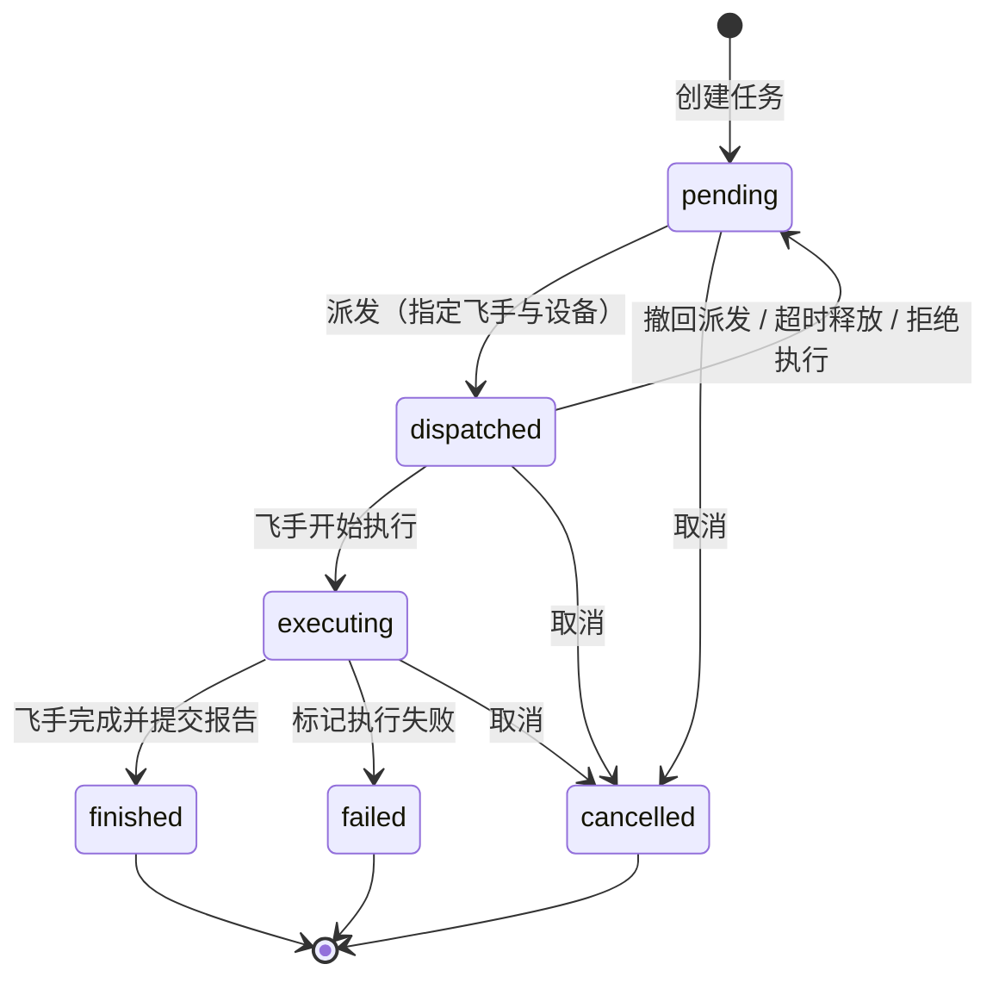
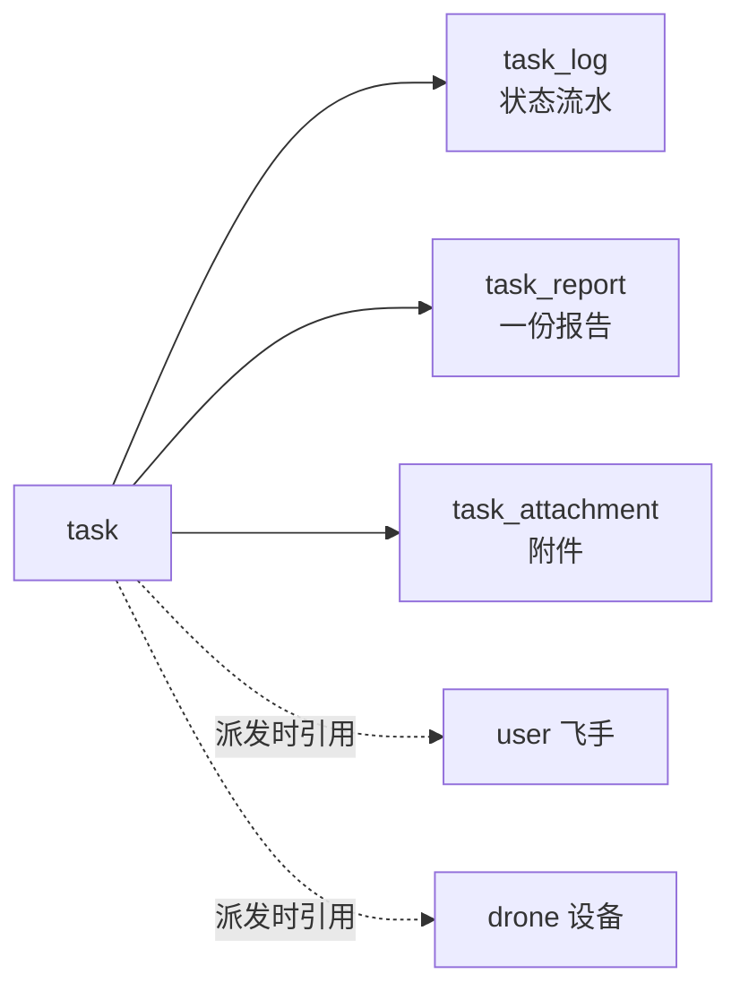
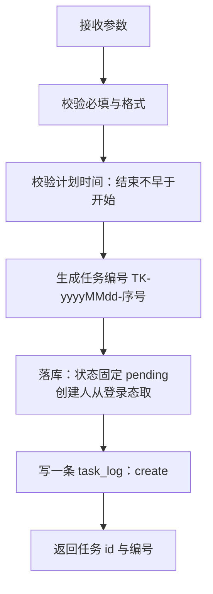
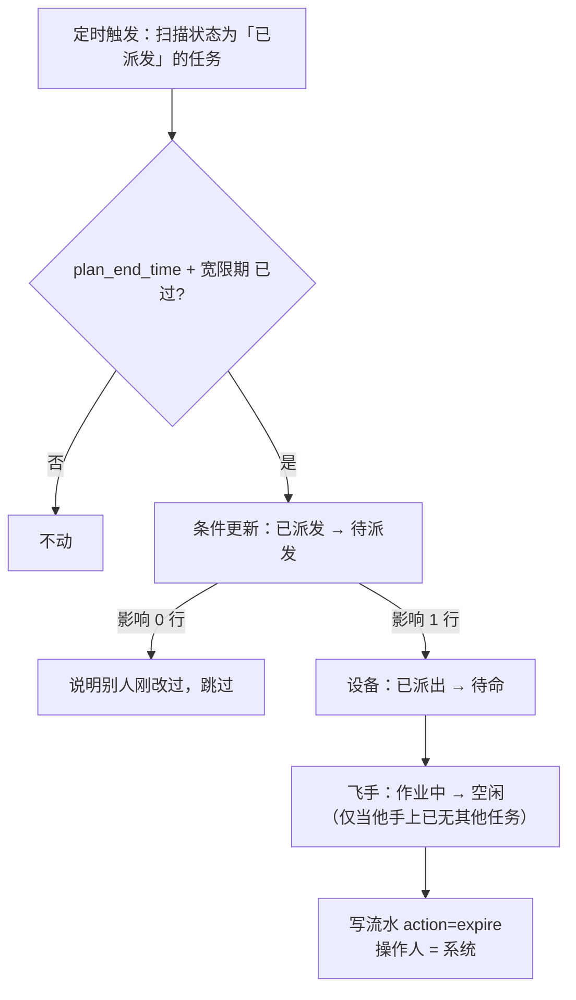
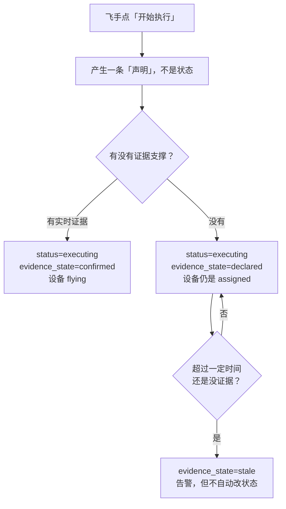
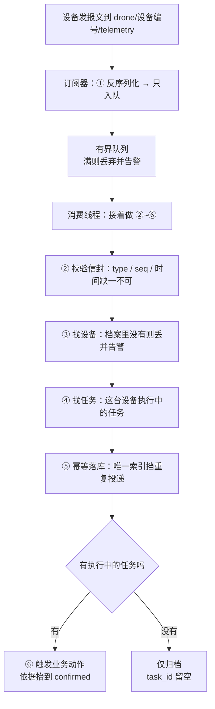

# 任务业务设计

> 把「创建 → 派发 → 执行 → 监控 → 报告」串成一个闭环。
> 本文先界定 MVP 范围与核心流程，再展开「创建任务」的详细设计。
>
> 说明：**不复用库里已有的 `task` 表**（它没有状态流转日志与报告结构，
> 撑不起完整闭环），本次按闭环需求重新设计。

---

## 一、业务闭环长什么样

一条任务从想法到归档，经过五个环节：


**关键设计：创建与派发分成两步。**

创建任务时只回答「**要做什么**」——任务名称、优先级、计划时间、任务内容；
至于「**谁去做、用哪台设备**」，留给派发环节决定。

这么切的好处：

- 管理者可以先把计划排出来，等人和设备空出来再派 —— 现实中这两件事常常是异步的
- 派发失败要重新指派时，不用回头改任务本身
- 职责清楚：创建是「定需求」，派发是「定资源」

---

## 二、MVP 范围

MVP 的目标是**把闭环跑通**，而不是功能齐全。

### 做

| 环节 | MVP 包含 |
|---|---|
| 创建 | 任务名称、优先级、计划起止时间、任务内容描述 |
| 派发 | 指定飞手 + 设备，可撤回重派 |
| 执行 | 飞手查看「我的任务」→ 开始执行 → 完成并填写报告 |
| 监控 | 按状态/优先级/飞手/时间筛选的列表；执行中超时高亮 |
| 报告 | 执行结果（成功/部分成功/失败）、文字总结、问题记录、附件 |

### 不做（明确划出边界）

| 暂时不做 | 原因 |
|---|---|
| 数据大屏 | 见 `数字大屏方案.md`：一屏看清系统在跑什么（任务/设备/告警/人员/地理）。**2026-09-29 已落地第一步**（聚合接口 + 大屏页 + 轮播 + 大屏只读账号与长效凭证） |
| 航线规划与地图 | 见 `地图接入方案.md`：**第一步（任务详情画轨迹）、第二步（点位库 + 航线）、第三步（禁飞区静态校验）已完成**，第四步起（运行时越界检测与告警）还没做。本文件不重复描述那条线 |
| 实时位置追踪 | 依赖设备端上报通道（飞控协议/图传），后端做不了 |
| 自动派单算法 | 先人工指派，等有足够数据再谈调度优化 |
| 甘特图 / 日历视图 | 列表 + 筛选已能满足 MVP 的监控需求 |
| 任务模板 / 周期任务 | 属于效率增强，不影响闭环成立 |

> 划边界比堆功能重要 —— MVP 的验收标准是「一条任务能从头走到尾」，
> 而不是「有多少功能」。

---

## 三、角色与职责

| 角色 | 在任务业务里能做什么 |
|---|---|
| **管理员 admin** | 创建任务、派发/重派、取消、查看全部任务与报告 |
| **飞手 pilot** | 查看派给自己的任务、开始执行、完成并提交报告 |
| **机务 maintainer** | 只读查看（设备异常时会关联到任务，见报警模块）；不参与任务流转 |

---

## 四、任务状态机（核心）

这是整个设计的骨架，接口与权限都围着它转。



**「已派发 → 待派发」这一条箭头其实有三个动作**：撤回派发（管理员反悔）、
超时释放（系统兜底，见「资源占用与释放」一章）、拒绝执行（飞手不接这活）。
结果一样（都回待派发、都释放资源），但原因完全不同，
所以流水里的 `action` 必须分开记 —— 否则看时间轴根本不知道是谁、为什么把活退了回来。

### 状态说明

| 状态 | 含义 | 谁能触发下一步 |
|---|---|---|
| `pending` 待派发 | 任务已创建，还没安排人 | 管理员派发 / 取消 |
| `dispatched` 待执行 | 已指派飞手与设备，等飞手开始 | 飞手开始 / 管理员撤回或取消 |
| `executing` 执行中 | 飞手已开始，正在进行 | 飞手完成或标记失败 / 管理员取消 |
| `finished` 已完成 | 执行结束且报告已提交 | 终态 |
| `failed` 执行失败 | 执行过程中出问题，未能完成 | 终态 |
| `cancelled` 已取消 | 人为终止 | 终态 |

### 三条流转规则

**① 只能按箭头走。** 所有状态变更都经过统一的校验，不允许「从待派发直接跳到已完成」。
实现上把合法流转写成一张表，Service 里查表判断，而不是散落一堆 `if`。

**② 每次流转都留痕。** 谁、什么时候、把状态从什么改成什么、附言是什么 —— 全部写进
`task_log`。事后复盘「这条任务为什么卡了两天」时，这份流水就是答案。

**③ 报告与完成是原子动作。** 飞手点「完成任务」必须同时填报告，两者在同一个事务里落库。
不存在「已完成但没有报告」的中间态 —— 那会让闭环在最后一步断掉。

> 报告与完成合并是 MVP 的简化。将来若要支持「完成后 24 小时内补报告」，
> 把 `finished` 拆成 `finished` + `reported` 两个状态即可，接口层不用动。

---

## 五、表设计

### 5.1 task（任务主表）

```sql
CREATE TABLE `task` (
  `id`                bigint       NOT NULL AUTO_INCREMENT,
  `task_no`           varchar(32)  NOT NULL COMMENT '任务编号，如 TK-20260918-001',
  `task_name`         varchar(100) NOT NULL COMMENT '任务名称',
  `priority`          varchar(10)  NOT NULL DEFAULT 'P2' COMMENT '优先级 P0 紧急 / P1 高 / P2 中 / P3 低',
  `status`            varchar(20)  NOT NULL DEFAULT 'pending' COMMENT '状态，见状态机',
  `plan_start_time`   datetime     DEFAULT NULL COMMENT '计划开始',
  `plan_end_time`     datetime     DEFAULT NULL COMMENT '计划结束',
  `actual_start_time` datetime     DEFAULT NULL COMMENT '实际开始（飞手点开始时写入）',
  `actual_end_time`   datetime     DEFAULT NULL COMMENT '实际结束',
  `drone_id`          bigint       DEFAULT NULL COMMENT '指派的设备，派发时写入',
  `drone_code`        varchar(50)  DEFAULT NULL COMMENT '设备编号冗余',
  `pilot_id`          bigint       DEFAULT NULL COMMENT '指派的飞手，派发时写入',
  `pilot_name`        varchar(50)  DEFAULT NULL COMMENT '飞手姓名冗余',
  `route_info`        text         COMMENT '任务内容 / 航线描述（MVP 存文本）',
  `create_by`         bigint       DEFAULT NULL COMMENT '创建人',
  `create_by_name`    varchar(50)  DEFAULT NULL COMMENT '创建人姓名冗余',
  `create_time`       datetime     DEFAULT CURRENT_TIMESTAMP,
  `update_time`       datetime     DEFAULT CURRENT_TIMESTAMP ON UPDATE CURRENT_TIMESTAMP,
  PRIMARY KEY (`id`),
  UNIQUE KEY `uk_task_no` (`task_no`),
  KEY `idx_status` (`status`),
  KEY `idx_pilot_id` (`pilot_id`),
  KEY `idx_drone_id` (`drone_id`),
  KEY `idx_plan_start_time` (`plan_start_time`)
) COMMENT = '任务主表';
```

**两个刻意的设计：**

- **`pilot_name` / `drone_code` 做冗余**。任务列表要展示飞手和设备名字，
  每次都 join `user`、`drone` 表太重；而且任务归档后，即便人员改名、
  设备报废，任务记录里也应当保留**当时的**名字。
- **索引按查询场景建**。列表页最常用的筛选是状态、飞手、设备、计划时间，
  这四个字段各配一个索引；`task_no` 唯一。

### 5.2 task_log（状态流转日志）

```sql
CREATE TABLE `task_log` (
  `id`            bigint       NOT NULL AUTO_INCREMENT,
  `task_id`       bigint       NOT NULL,
  `action`        varchar(30)  NOT NULL COMMENT 'create/dispatch/withdraw/start/finish/fail/cancel',
  `from_status`   varchar(20)  DEFAULT NULL COMMENT '变更前状态，创建时为 NULL',
  `to_status`     varchar(20)  DEFAULT NULL COMMENT '变更后状态',
  `operator_id`   bigint       DEFAULT NULL,
  `operator_name` varchar(50)  DEFAULT NULL,
  `operator_role` varchar(50)  DEFAULT NULL COMMENT '操作时的角色，便于复盘权限问题',
  `note`          varchar(500) DEFAULT NULL COMMENT '附言，如撤回原因',
  `create_time`   datetime     DEFAULT CURRENT_TIMESTAMP,
  PRIMARY KEY (`id`),
  KEY `idx_task_id` (`task_id`)
) COMMENT = '任务状态流转日志';
```

流水表**只追加、不修改** —— 状态一变就记一条，历史轨迹靠它还原。

### 5.3 task_report（任务报告）

```sql
CREATE TABLE `task_report` (
  `id`               bigint       NOT NULL AUTO_INCREMENT,
  `task_id`          bigint       NOT NULL,
  `result`           varchar(20)  NOT NULL COMMENT 'success 成功 / partial 部分成功 / failed 失败',
  `summary`          text         COMMENT '执行总结',
  `problem_log`      text         COMMENT '遇到的问题与处置',
  `flight_hours`     decimal(6,2) DEFAULT NULL COMMENT '本次飞行时长（小时）',
  `flight_count`     int          DEFAULT NULL COMMENT '本次飞行架次',
  `reporter_id`      bigint       DEFAULT NULL,
  `reporter_name`    varchar(50)  DEFAULT NULL,
  `create_time`      datetime     DEFAULT CURRENT_TIMESTAMP,
  PRIMARY KEY (`id`),
  UNIQUE KEY `uk_task_id` (`task_id`)
) COMMENT = '任务报告（一条任务一份）';
```

`uk_task_id` 唯一索引保证了「一条任务只有一份报告」。

### 5.4 task_attachment（任务附件）

现场照片、飞行日志、视频这些附件单独一张表。

**为什么不蹭库里已有的媒体表**：那类表是围绕「设备媒体库」设计的，
字段和语义都服务于设备；任务附件要记录的是「谁、在什么时候、为什么上传」，
是围绕任务流转的。硬套在一起会让两边都别扭 —— 加一个字段要同时考虑两种场景，
删除任务时还要担心误删设备的素材。**宁可多一张表，也别让两个概念挤在一张表里。**

```sql
CREATE TABLE `task_attachment` (
  `id`             bigint       NOT NULL AUTO_INCREMENT,
  `task_id`        bigint       NOT NULL COMMENT '所属任务',
  `file_name`      varchar(200) NOT NULL COMMENT '原始文件名',
  `file_path`      varchar(500) NOT NULL COMMENT '存储路径',
  `file_type`      varchar(50)  DEFAULT NULL COMMENT 'image 照片 / video 视频 / log 飞行日志 / other',
  `file_size`      bigint       DEFAULT NULL COMMENT '文件大小（字节）',
  `description`    varchar(500) DEFAULT NULL COMMENT '说明',
  `upload_by`      bigint       DEFAULT NULL COMMENT '上传人',
  `upload_by_name` varchar(50)  DEFAULT NULL COMMENT '上传人姓名冗余',
  `create_time`    datetime     DEFAULT CURRENT_TIMESTAMP,
  PRIMARY KEY (`id`),
  KEY `idx_task_id` (`task_id`)
) COMMENT = '任务附件';
```

### 5.5 表关系



---

## 六、接口设计（MVP）

```
POST /task/create        创建任务            task:add
POST /task/dispatch      派发 / 重派任务      task:dispatch
POST /task/withdraw      撤回派发            task:dispatch
POST /task/start         开始执行            task:execute
POST /task/refuse        拒绝执行            task:execute
POST /task/finish        完成并提交报告       task:execute
POST /task/fail          标记执行失败         task:execute
POST /task/cancel        取消任务            task:cancel
GET  /task/list          任务列表（监控）     task:list
GET  /task/{id}          任务详情（含流水与报告） task:list
GET  /task/my            我的任务（飞手）      task:execute
```

**「我的任务」为什么要单独一个接口**：飞手看到的应该是「派给我的任务」，
而不是全量任务列表。用同一个 `/task/list` 加 `pilotId` 参数也能实现，
但那样飞手就能传别人的 id 查别人的任务 —— 水平越权。
所以单独开一个接口，服务端**从登录态里取飞手 id**，不接受前端传入。

**飞手侧的两个动作只认自己的任务**：`/task/start` 与 `/task/refuse` 除了权限码
（`task:execute`），Service 里还会比对「这条任务的 pilot_id 是不是当前登录人」，
不是就返回 **403**。管理员虽然权限齐全也过不去 —— 这两个动作在业务上就是飞手本人的，
要改状态应该走撤回或重新指派。
**拒绝的释放动作与撤回完全一样**（复用同一个 `releaseAssignment`，这是它第三次被复用），
区别只在流水记 `refuse` 而不是 `withdraw`，并且会推送通知给所有能重新指派的人
（通知的设计与技术选型见独立的 [任务通知.md](./任务通知.md)）。

---

## 七、权限点

| 权限码 | 说明 | admin | pilot | maintainer |
|---|---|:---:|:---:|:---:|
| `task:list` | 查看全部任务与报告 | 有 | — | 有 |
| `task:add` | 创建任务 | 有 | — | — |
| `task:dispatch` | 派发 / 撤回 | 有 | — | — |
| `task:execute` | 查看我的任务、开始、完成、提交报告 | — | 有 | — |
| `task:cancel` | 取消任务 | 有 | — | — |

飞手没有 `task:list`：他不需要看别人的任务，看「我的任务」走 `task:execute`。

---

## 八、详细设计：创建任务

### 8.1 输入字段

| 字段 | 必填 | 说明 |
|---|:---:|---|
| `task_name` | ✅ | 任务名称，不超过 100 字 |
| `priority` | ✅ | P0/P1/P2/P3，默认 P2 |
| `plan_start_time` | ✅ | 计划开始时间 |
| `plan_end_time` | ✅ | 计划结束时间，必须晚于开始时间 |
| `route_info` | ❌ | 任务内容 / 航线描述（多行文本）。**选了航线（`route_id`）而这里留空时，服务端自动填一句摘要**（「东线巡检 · 6 个点 · 3.2 公里」）—— 否则用航线建出来的任务在列表上看不出要干什么 |
| `route_id` | ❌ | 引用一条航线模板（见 `地图接入方案.md`）。选了它，创建时会**快照**一份存进 `route_snapshot`，之后模板怎么改都不影响这条任务 |
| `takeoff_lng` / `takeoff_lat` / `takeoff_name` | ❌ | 起降点。**三个要么都给、要么都不给**；坐标传的是 GCJ-02（地图上点的），入库转成 WGS84 |
| `acknowledged_zones` / `zone_reason` | ❌ | 已知晓禁飞区风险（软拦用）。**创建时会拿「航线 + 起降点」做一次静态校验**（见 `地图接入方案.md` 6.3）：命中就拒绝，除非带上「已知晓 = true」+ 一句原因（至少 4 个字）。那段确认会写进流转流水，是事后唯一能证明「系统提示过」的东西。派发时**会再查一遍**（区域可能是任务建完之后才画的） |
| `description` | ❌ | 补充说明 |

**创建时不需要**：飞手、设备（派发时才定）、实际起止时间（执行时才有）、
状态（服务端固定给 `pending`）。

### 8.2 服务端要做的六件事



**① 校验**
- 必填项：任务名称、优先级、计划起止时间
- 优先级必须在 P0~P3 之内 —— 不能让前端传个 `P9` 进来
- 计划结束时间必须 ≥ 开始时间

**② 生成任务编号**

格式 `TK-20260918-001`（前缀 + 日期 + 当日序号）。

这里有个必须注意的点：**不能用「查当天最大编号 +1」再插入** ——
两个人同时创建会算出同一个编号，撞上 `uk_task_no` 唯一索引报错。
正确做法是宁可让数据库挡下来、捕获唯一键冲突后重试一次，
或者用更严格的方案（号段表 / Redis 自增）。

MVP 阶段取「查最大 + 1，冲突则重试一次」的折中，并在代码里写明这是权宜之计。

**③ 创建人不接受前端传**

从 `UserContext` 取当前登录用户 —— 和飞手的「我的任务」同一个道理，
前端传 `createBy` 就等于允许别人冒名创建。

**④ 状态固定**

创建出来的任务**永远是 `pending`**。任何试图在创建时就指定状态的行为都拒绝 ——
状态只能通过流转接口改变。

**⑤ 写流水**

创建成功顺手往 `task_log` 写一条 `action=create`、`from_status=null`、`to_status=pending`。
这样任务详情页的时间轴从创建那一刻就是完整的。

**⑥ 事务**

主表插入与流水写入必须同一个事务 —— 只插了任务没写流水，
时间轴就会缺第一环，而且很难补。

### 8.3 接口契约

```
POST /task/create
权限：task:add

请求：
{
  "taskName": "朝阳区电力巡检",
  "priority": "P1",
  "planStartTime": "2026-09-20 08:00:00",
  "planEndTime": "2026-09-20 12:00:00",
  "routeInfo": "沿朝阳路自西向东巡检 12 基杆塔",
  "description": "注意避开早高峰空域管制"
}

响应：
{
  "state": 200,
  "message": "创建成功",
  "data": { "id": 1, "taskNo": "TK-20260918-001" }
}

失败示例：
{ "state": 500, "message": "计划结束时间不能早于开始时间" }
```

### 8.4 界面（原型）

**入口**：任务管理页右上角「新建任务」按钮（需 `task:add`）。

**表单**：

```
┌─ 新建任务 ─────────────────────────────┐
│ 任务名称   [朝阳区电力巡检          ]   │
│ 优先级     [P1 ▾]                       │
│ 计划时间   [2026-09-20 08:00] ~ [12:00] │
│ 任务内容   ┌───────────────────────┐    │
│            │ 沿朝阳路自西向东巡检… │    │
│            └───────────────────────┘    │
│ 补充说明   [选填                    ]   │
│                                         │
│                       [取消] [创建任务] │
└─────────────────────────────────────────┘
```

创建成功后**不直接跳派发**，而是回到列表并提示「创建成功，可前往派发」——
保持「创建」与「派发」是两件独立的事，与状态机的设计一致。

### 8.5 校验清单（开发与测试对照）

| 场景 | 期望 |
|---|---|
| 任务名称为空 | 「任务名称不能为空」 |
| 优先级传 `P9` | 「优先级只能是 P0~P3」 |
| 结束时间早于开始时间 | 「计划结束时间不能早于开始时间」 |
| 正常创建 | 成功，状态为 `pending`，编号形如 `TK-日期-序号` |
| 创建后查详情 | 时间轴里有第一条 `create` 流水 |
| 创建后查列表 | 状态筛选 `pending` 能查到它 |
| 飞手调用创建接口 | **403**，无 `task:add` 权限 |
| 前端伪造 `createBy` | 被忽略，入库的仍是当前登录人 |

---

## 九、资源占用与释放

> 这一章是②实现到一半时补的。起因是一个必然会发生的问题：
> **派发出去的任务如果一直没人执行，飞手和设备就被永久占住了。**

### 9.1 根因：占用写进了状态，释放却只挂在一个事件上

派发会把三样东西一起改掉：

| 对象 | 变化 |
|---|---|
| `task.status` | `pending` → `dispatched` |
| `drone.status` | `idle` → `assigned`（已派出） |
| `user.state` | `idle` → `busy`（作业中） |

这么改的好处很直观：设备列表一眼能看出哪些机器派出去了，飞手列表能看出谁在忙，
派发下拉只列「待命」的设备，等于从源头挡住了重复派单。

**但代价是：占用变成了「状态」，而状态是没有时间维度的。**
设备一旦是 `assigned`，除非有人把它改回来，它就永远是 `assigned`。
而目前能把它改回来的只有一条路径 —— 管理员点「撤回派发」。

于是：**飞手没露面 → 没人撤回 → 这台设备在派发下拉里永久消失。**

### 9.2 同一个根因漏出的四个口子

| 卡住的场景 | 不处理的后果 | 现在怎么办 |
|---|---|---|
| 派发后一直没人执行 | 设备停在「已派出」、飞手「作业中」，永久 | **本章解决** |
| 开始执行后一直没完成 | 设备「飞行中」、飞手「作业中」，永久 | 交给 ④ 监控，见 9.5 |
| 任务被取消 | 取消完设备还占着（③ 还没做，实现时必须同时释放） | ③ 实现时按 9.6 复用 |
| 设备先被改成「维护中」再撤回 | 释放的 CAS 失败，设备留在「已派出」，界面上看不出来 | 9.6 第 4 条 |

### 9.3 原则

> **每一个「占用」都必须有一个配对的「释放」；
> 并且必须有一条兜底路径，处理「释放事件永远不会来」的情况。**

前两条现在有了（派发 ↔ 撤回），缺的是最后半句 —— 兜底。
「等管理员想起来去撤回」不算兜底，因为不可靠：任务多了以后没人盯得过来。

### 9.4 方案：派发超时自动释放

**判定条件**：任务仍是 `dispatched`，且计划结束时间已经过去超过宽限期。

```
status = 'dispatched'
AND plan_end_time < 现在 - 宽限期（默认 2 小时）
```

**宽限期为什么是 2 小时**：不能一到点就释放。任务延后半小时开工是常事，
可接受的自然延迟总得留一点。2 小时是个拍脑袋的起点，配置化，随时能调。

**释放动作**（与「撤回派发」完全一致的三件事）：

1. 任务回到 `pending`（待派发），指派清空
2. 设备 `assigned` → `idle`
3. 飞手 `busy` → `idle`（**前提是他手上再没有别的任务**，理由见下）

**释放后任务回到「待派发」而不是新增一个终态**，两个理由：

- 复用现有状态机与前端字典，不用加第 7 个状态
- 这条任务只是「这一轮没人执行」，管理员重新派一个人就能接着干 ——
  回待派发正好让它重新进入可派发的队列

> 代价是「待派发」队列里会混着计划时间已经过去的任务。
> 判断一条待派发任务是「还没安排」还是「安排过但超时被释放」，
> 看详情页的流转记录：后者有一条 `expire` 流水。
> 真要区分得更清楚，可以再加一个 `expired` 终态 —— 见 9.8。

**触发方式**：Spring `@Scheduled` 定时扫（默认每 10 分钟一次）。
选定时任务而不是「查列表时顺手释放」，是因为后者的释放时机取决于
「有没有人恰好打开任务页」，本质上还是不可靠。



**三个必须处理好的细节**：

1. **幂等**：用条件更新 `UPDATE task SET ... WHERE id = ? AND status = 'dispatched'`，
   只有影响行数为 1 才继续释放资源。
   否则「定时任务和一个正在点撤回的管理员」会撞车，出现设备被释放两次、
   或者把刚派出去的新任务给释放掉。
   > 这种「把期望的状态写进 `WHERE`、看**影响行数**判断成败」的做法，
   > 就是**乐观锁**（CAS）在数据库里的样子 —— 和 Java 里的 `compareAndSet`、
   > 和「加一列 version」是同一套思路。来龙去脉（为什么要自旋重试、
   > 什么是 ABA、什么时候该改用悲观锁）见
   > [CAS与乐观锁.md](./CAS与乐观锁.md)。
2. **操作人是谁**：定时任务没有登录用户，流水记为
   `operator_id = NULL`、`operator_name = '系统'`、`operator_role = 'system'`。
   时间轴上必须能看出「这不是人干的」，否则事后无从追责。
   > 顺带一个 ThreadLocal 的坑：定时任务跑在调度线程上，
   > `UserContext.get()` 在那个线程里是 `null` —— 这正说明 ThreadLocal
   > 「每个线程一个口袋」，**不是**全局变量。详见 [ThreadLocal学习笔记.md](./ThreadLocal学习笔记.md)。
3. **时间怎么比**：用 Java 传入的 `LocalDateTime.now()` 减宽限期，
   **不要用 SQL 里的 `NOW()`**。原因是这台机器上 mysqld 的时区是 UTC，
   而 `plan_end_time` 存的是应用写入的本地时间，两者差 8 小时，
   用 `NOW()` 比会把所有任务都提前 8 小时判超时。

### 9.5 边界：执行中超时**不**自动释放

`executing` 的任务过了计划结束时间，也可能一直没完成。但这**不**释放资源，原因：

- 任务是不是真卡住了，只有人能判断（是飞手忘了点完成，还是飞机失联了）
- **依据不足不足以断定事情没发生**：自动改状态会让「到底是谁造成的」更难查

所以执行超时属于**监控告警**的范畴，处理方式是「在列表上高亮 + 提醒管理员」，
而不是自动改状态。这条归 ④ 任务监控。

> ⚠️ **这一节的理由后来被修正过。** 最初写的是「设备这时候是真的在飞，
> 改回待命等于谎报」——但「什么叫「任务执行中」」一章说明了「执行中」其实只是飞手的一句**声明**，
> 设备**可能压根没起飞**，那个前提并不成立。
> 结论没变（仍然不自动释放），但理由换成了上面这条，
> 告警的判据也升级为「声明之后迟迟拿不出依据」。详见「什么叫「任务执行中」」一章。

### 9.6 实现要点

1. **把释放逻辑抽成一个方法**（例如 `releaseAssignment(task, action, note)`），
   让「撤回派发」和「超时释放」共用。两者除了流水里的 `action` 与操作人不同，
   释放动作完全一样 —— 抄两遍必然有一处漏掉「清空 drone_code」这种细节。
   以后 ③ 的「取消任务」也是同一套。
2. **状态机新增一个动作** `expire`（超时释放），允许的起始状态是 `dispatched`，
   登记进 `TaskStatusFlow` 的流转表，与 `withdraw` 并列。
   不重用 `withdraw` 是为了让时间轴能区分「人撤的」和「系统超时释放的」。
3. **写流水的操作人改成「取不到登录态就记系统」**：现有 `writeLog` 一律从
   `UserContext` 取，定时任务线程上取到的是 `null`。
   实现上没有加一个「显式传操作人」的重载参数（参数一多容易传错），
   而是让 `writeLog` 在取不到登录人时落到「系统」——语义正好等价：
   <b>人工流转都在拦截器后面，一定登录过；口袋里没人，就说明这不是人干的</b>。
4. **设备被人工改过时不强改**（对应 9.2 表格第 4 行）：
   释放时如果设备已经不是 `assigned`（比如刚被人改成「维护中」），
   CAS 会失败，这时**只记一条服务端 warn 日志，然后继续释放任务与飞手**。
   两个理由：语义上「释放」是取消这次占用，不该覆盖人工设定；
   可见性上设备列表里显示的正是它真实的「维护中」，管理员看得到。
   > 也考虑过把「设备状态未自动恢复，请人工确认」放进接口响应里提示，
   > 但那要改撤回接口的返回结构，而这个场景本身罕见且有别的途径可见，
   > 就没为它动接口形状。
5. **定时任务在测试里要关掉**：`@SpringBootTest` 会加载定时任务，
   而它跑在**独立线程、独立事务**里，会绕过 `@Transactional` 直接改开发库。
   用配置开关（如 `drone.task.auto-release.enabled`）在测试环境关掉，
   测试直接调用释放方法本身来验证逻辑。

### 9.7 校验清单（开发与测试对照）

| 场景 | 期望 |
|---|---|
| 已派发任务，计划结束时间未过 | 不释放，状态与资源都不变 |
| 已派发任务，计划结束时间刚好过但未超宽限期 | 不释放 |
| 已派发任务，超过计划结束时间 + 宽限期 | 任务回 `pending`、设备回 `idle`、飞手回 `idle` |
| 上面这条的流水 | 一条 `expire`：`dispatched → pending`，操作人「系统」 |
| 已派发任务，但飞手手上还有别的任务 | 只释放任务与设备，飞手保持 `busy` |
| 释放逻辑连跑两次 | 第二次不产生任何变化与流水（幂等） |
| 执行中（`executing`）的任务超时 | **不**释放 |
| 待派发 / 已完成 / 已取消的任务超时 | 不释放 |
| 释放前设备被人改成「维护中」 | 任务与飞手照常释放，设备保持「维护中」（不强改人工设定） |

### 9.8 当时也考虑过的两条路

留个记录，免得以后重新纠结：

- **占用不进状态**（设备状态只表示「物理上在干什么」，占用交给任务时间窗判断）。
  理论上最干净：没人执行的任务过了时间窗自然不占用，不需要任何清理逻辑。
  没选是因为它给不了「设备列表一眼看出哪台派出去了」——
  而这是上一轮明确要的效果。
- **占用推迟到「开始执行」才置位**（派发只排班，飞手点开始才置占用）。
  也没选，因为同样是「派发后状态就变」这条需求给不了。
- 还有一个更轻的变体：**不写定时任务，只在任务页放一个「释放占用」按钮**。
  零调度代码，但依赖管理员发现问题 —— 和「等他想起来点撤回」是同一类不可靠，
  只适合当补充手段，不适合当兜底。

---

## 十、什么叫「任务执行中」：声明制与证据制

> 这一章回答一个必须先想清楚的问题：
> **`executing` 这个状态到底在断言什么？**
> 想清楚它，才知道管理员在「执行中」该有什么操作，也才知道「取消」的逆向是什么。
>
> 10.1 ~ 10.6 是**分析与设计**（分析在前、方案在后，读的时候要分清哪段是"现状"），
> 10.7 是**落地进度**，10.8 是**已实施的数据模型**，10.9 是这一章对旧结论的修正。
> 也就是说：这一章现在一半是设计文档、一半是实施记录，
> 但两者的分界线写得很清楚 —— 凡是有"没做 / 仍没敢做"字样的地方，都是还没落地的部分。

### 10.1 先看 `executing` 现在是怎么产生的

飞手在小程序点一下「开始执行」，服务端做三件事：

| 改动 | 值 |
|---|---|
| `task.status` | `dispatched` → `executing` |
| `task.actual_start_time` | 写入当前时间 |
| `drone.status` | `assigned`（已派出）→ `flying`（飞行中） |

**这里没有任何客观依据**：没有遥测、没有飞行日志、没有起飞确认，
系统并不知道飞机是否真的离地了。所以现在这个状态的准确含义是：

> **飞手声称自己开始作业了。**

同理，「已派发」= 管理员声称安排好了；将来的「已完成」= 飞手声称干完了并交了报告。
**整个状态机里唯一的客观事实是时间戳，其余全是人的声明。**
这不是缺陷 —— 没有设备侧数据时只能这样 —— 但必须承认它，
否则会把「声明」当「事实」用，做出错误判断（比如看到「飞行中」就去调度这台设备，
而飞机还停在机库里）。

### 10.2 声明制的三个后果

1. **声明可能过期，但没人能收尾。** 飞手点了开始然后失联或忘了，
   任务永远停在「执行中」、设备永远「飞行中」：撤回被状态机挡住（正确）、
   取消还没实现、超时释放刻意不碰 `executing` —— 三条路都堵着。
2. **9.5 节拒绝自动释放的理由站不住。** 那里写的是「设备这时候是真的在飞，
   改回待命等于谎报」。可既然「执行中」只是飞手的一句话，设备**可能压根没起飞**，
   那「真的在飞」这个前提就不成立。结论（不自动释放）仍然对，但**理由要换**：
   声明过期不等于事实终结，自动改状态会让「到底是谁造成的」更难查。
3. **设备状态也是被推断出来的。** 飞手在去场地的路上就点了「开始执行」，
   设备档案立刻显示「飞行中」—— 档案在说谎。

### 10.3 证据制的核心：把「状态」和「依据」拆成两个维度

声明制的问题是**用一个字段同时表达了两件事**：
「业务推进到哪一步」和「这一步有多少依据」。证据制的做法是把它拆开：



两个维度各管各的：

| 维度 | 回答什么问题 | 取值 |
|---|---|---|
| `task.status` | 业务推进到哪一步 | pending / dispatched / executing / finished / failed / cancelled（**不变**） |
| `task.evidence_state` | 这一步有没有依据、依据强不强 | none / declared 仅声明 / confirmed 已证实 / stale 声明已过期 |

**关键：状态机一个箭头都不改。** 证据制不是在四、状态机那张图上再加节点，
而是给它**加一个正交的维度**。这是这个方案最省事的地方 ——
前端字典、流转表、权限点全都不用动。

### 10.4 什么样的东西才算证据

先做一个最重要的区分：**只有实时证据能支撑「正在执行」，事后证据只能事后核对。**

| 证据类型 | 例子 | 是实时的吗 | 强度 | 获取成本 |
|---|---|---|---|---|
| `telemetry` 实时遥测 | 设备网关或厂商云 API 上报的经纬度/高度/电量 | ✅ 实时 | **强**：能支撑「此刻在飞」 | 高（要设备侧或厂商接口） |
| `flight_log` 飞行日志 | 飞行结束后上传的日志文件（含起止时间、航迹） | ❌ 事后 | 中：只能事后核对，不能支撑「进行中」 | 低（复用附件能力） |
| `witness` 第二人确认 | 机务或另一名飞手确认「我看着它起飞了」 | 半实时 | 中：仍是人的声明，但换了一个人 | 低 |
| `manual` 自行声明 | 飞手自己点的那个按钮 | 半实时 | 弱：就是声明本身 | 零 |

**这些数据具体从哪条链路取**（飞控的 MAVLink 遥测、厂商上云 API、机载伴侣计算机、
飞行日志文件、监管侧的 Remote ID……），以及每种源的字段、单位、工程量与坑，
见独立文档 **[无人机数据来源.md](./无人机数据来源.md)**。本章只定义"证据要满足什么条件"，
那份文档回答"证据从哪拿"。

三条要点：

1. **事后证据撑不起「执行中」。** 日志是飞完才有的，拿它定义进行中的状态，
   等于用结果证明过程 —— 时间上就不成立。
2. **重复的声明依然只是声明。** 飞手端定时上报「我还在飞」看起来很"实时"，
   但它只是把一句声明重复了很多次，并不能证明飞机在天上。
   不过它的失败模式变了：**声明停了是可检测的**（心跳断了就知道），
   而单次声明无法检测 —— 这一点很有价值，后面 10.6 会用到。
3. **小程序不能当实时上报端。** 它切到后台会被系统回收（见
   [任务通知.md](./任务通知.md) 里「App 是开着还是关着」同一件事），所以「让飞手端定时上报位置」
   这条看起来最省事的路，实际上不可靠。要拿实时证据，只能走设备侧或厂商接口。

### 10.5 证据制下，三张状态表怎么对起来

这是这套模型最直观的收益 —— **设备状态的语义天然就吻合**，
`assigned`（已派出）和 `flying`（飞行中）本来就区分了「派好了」和「真的在飞」，
只是我们当初在「声明」那一刻就把它置成了 `flying`：

| task.status | evidence_state | 界面应该显示 | 设备状态 |
|---|---|---|---|
| `dispatched` | `none` | 已派发，等起飞 | `assigned` 已派出 |
| `executing` | `declared` | **执行中 · 仅飞手声明** | `assigned`（**不动**，因为没证据说它飞了） |
| `executing` | `confirmed` | **执行中 · 已证实** | `flying` 飞行中 |
| `executing` | `stale` | **执行中 · 声明已过期**（告警） | 按最后一条证据，没有就仍 `assigned` |

改动只有一处，但很关键：**`flying` 只在拿到证据时才置位**。
于是「设备档案在说谎」这个问题自动消失了。

#### 10.5.1 实现进度：这一列还没跟上

上表最后两列是**目标状态**，截至本文：
**`evidence_state` 这一维已经做了，设备状态那一维刻意没动。**

| 做了什么 | 没做什么 |
|---|---|
| `task` 加 `evidence_state` / `evidence_type` / `evidence_at`，建 `task_evidence` 表 | `drone.status` 仍在飞手点「开始执行」时置 `flying` |
| 「开始执行」写 `declared`；收到设备遥测后抬到 `confirmed` | 没有把 `flying` 改成「只在 `confirmed` 时才置」 |
| 声明超时无数据 → `stale`（只改依据，不动状态） | —— |

没做的那一处，理由不是"来不及"，而是**它会带来一个新的谎言**：
设备状态一旦挂在证据上，**没有设备数据接入的部署**（`drone.mqtt.enabled=false`，
目前所有测试与大多数本地环境都是这样）就永远等不到 `flying` ——
飞手明明在飞，设备档案却一直显示「已派出」。用一个更隐蔽的错误换掉一个明显的错误，
不划算。

所以这里留一个明确的取舍点，等下面两件事之一发生再动：

1. **设备数据成为常态**（真有设备在发遥测，而不是只有模拟器）——
   这时"没有数据"本身就意味着异常，`flying` 挂在证据上才是准确的；
2. 或者反过来，**给不给数据都说得清**：在设备列表上把「已派出」与
   「已派出（无数据佐证）」区分显示，让两种来源的差异对用户可见。

在那之前，诚实的做法是承认：`drone.status` 现在仍然是**声明驱动**的，
它和 `task.evidence_state` 不是同一件事 —— 这也是为什么这两处要分别看，
而不是拿设备状态去反推依据。

### 10.6 证据制换来什么

1. **能检测「声称在干但拿不出依据」。**
   声明后超过阈值仍无证据 → 标 `stale` 并告警。这直接解掉 10.2 的第 1 条：
   原来是「等人觉得好像太久了」，现在是「系统能指出哪几条卡住了」。
   注意仍然是**告警而不是自动改状态** —— 依据不足不等于事情没发生。
2. **取消时能问出该问的问题。**
   有实时证据时，系统有资格在确认框里说「遥测显示这台设备还在飞，
   确认要取消吗？是否已通知飞手返航？」；只有声明时，它只能问
   「飞手说在飞，请先确认实际情况」。**同一个动作，提示的底气完全不同。**
3. **将来接遥测不用改状态机。**
   维度先留好，遥测接进来时只是 `evidence_state` 从 `declared` 变成 `confirmed`，
   四、状态机那张图、接口清单、权限点全都不用动。

### 10.7 代价与落地路径

主要成本在**数据来源，不在后端**。所以分三步走，每步都能独立交付：

**第一步：先把「依据」这层记录上（成本最低，建议先做）—— ✅ 已做**

- `task` 表加两个字段：`evidence_state`（默认 `none`）与 `evidence_type` / `evidence_at`
- 「开始执行」时写 `declared`，`flying` 这一步**暂时不动**（保持现在的行为），
  界面上先如实显示「执行中 · 仅飞手声明」
- 收益：从这一天起，**每条执行中的任务都清楚地标着「依据是飞手自己说的」**，
  不再含糊。这一步几乎不需要新链路

**第二步：加事后证据（飞行日志）—— 未做**

- 飞手完成时上传飞行日志 —— 直接复用 `task_attachment` 的 `log` 类型（表里已有）
- 系统核对「日志里的起止时间」与「声明的 `actual_start_time`」是否吻合，
  对不上就标异常
- 收益：**事后可审计**。能查出「声明了但压根没飞」，
  这是声明制下完全查不出来的东西
- 依赖 ③ 里还没做的「完成并提交报告」—— 没有那个入口，日志就没有上传的地方

**第三步：加实时证据（遥测）—— ✅ 后端链路已做（走自建 MQTT）**

- 落地方案不是去接厂商云，而是**自己拉一条 MQTT 链路**：
  设备（现阶段是模拟器）把遥测发到 broker，后端订阅、校验、去重后落进 `task_evidence`，
  并把任务的依据抬到 `confirmed`。Topic 设计、报文格式、六步处理、幂等与
  背压保护见 **[MQTT与设备接入.md](./MQTT与设备接入.md)**
- 为什么先走自建而不是厂商云：**链路完全可控**，不依赖厂商账号与机型支持，
  也才能在本地把整条链路真跑起来（`docs/无人机数据来源.md` 里对比过五条路的取舍）
- **仍然没敢做的**：把 `flying` 从声明驱动改成证据驱动（见 10.5.1），
  以及在取消执行中任务时给出「确实在飞」的判断 —— 后者要等设备数据成为常态才站得住

### 10.8 数据模型（已实施）

证据是**一串事件**，不是单个字段 —— 和 `task_log` 是同一个道理：
一次飞行可能有多段证据（起飞遥测、中途心跳、结束日志），
只留最新的会丢掉过程。所以：

```sql
-- 证据流水：只追加，不做物理删除（事后可能被推翻，用 valid 标记）
-- 权威定义见 docs/sql/schema.sql，增量脚本见 docs/sql/migration/task_evidence.sql
CREATE TABLE `task_evidence` (
  `id`          bigint      NOT NULL AUTO_INCREMENT,
  `task_id`     bigint      DEFAULT NULL COMMENT '所属任务，为空表示这条数据没有关联到任何任务',
  `device_code` varchar(50) NOT NULL COMMENT '设备编号，对应 drone.code',
  `type`        varchar(20) NOT NULL COMMENT 'telemetry 实时遥测 / flight_log 飞行日志 / witness 第二人确认 / manual 自行声明',
  `source`      varchar(50) DEFAULT NULL COMMENT '来源：device 设备 / app 飞手端 / operator 人工，便于事后追责',
  `attach_id`   bigint      DEFAULT NULL COMMENT '证据是文件时指向 task_attachment（飞行日志走这条）',
  `payload`     text        COMMENT '证据内容，存 JSON 文本',
  `seq`         bigint      DEFAULT NULL COMMENT '设备自增序号，参与唯一键去重',
  `observed_at` datetime    NOT NULL COMMENT '证据描述的那个时刻（≠ 上报时刻，两者要分开）',
  `reported_at` datetime    DEFAULT CURRENT_TIMESTAMP COMMENT '我们收到它的时刻',
  `valid`       tinyint     NOT NULL DEFAULT 1 COMMENT '事后被推翻时置 0，不删行',
  PRIMARY KEY (`id`),
  UNIQUE KEY `uk_evidence_dedup` (`device_code`, `type`, `observed_at`, `seq`),
  KEY `idx_task_id` (`task_id`),
  KEY `idx_device_time` (`device_code`, `observed_at`)
) ENGINE = InnoDB COMMENT = '任务执行证据';
```

四点设计说明：

- `payload` 用 `text` 存 JSON 文本，而不是 MySQL 的 `json` 类型 ——
  后者要配 MyBatis 的 TypeHandler 才能干净映射，MVP 阶段不值得，
  和项目里 `route_info`、`description` 的处理方式一致。
  存进去的是**设备发来的报文原文**，不是我们解析后的子集：
  解析只用来决定「这条数据归谁、算不算重复」，不用来决定「存什么」。
- `observed_at` 与 `reported_at` **必须分开**：前者是证据描述的那个时刻，
  后者是系统收到它的时刻。日志类证据往往是事后补传的，两个时间差很远，
  混成一个字段就没法判断证据的新鲜度。
- **`task_id` 允许为空**（草案里写的是 `NOT NULL`）：
  设备是按自己的节奏发数据的，试飞、转场、维护时也在发。
  要求必须有 `task_id`，就等于要么丢弃这些数据，要么给它们编一个假任务，
  两种都比允许空更糟。
- **唯一键含 `seq`**（草案里没有它，去重键只有 `device_code + type + observed_at`）：
  QoS 1 是「至少一次」，同一条消息可能被投递两次，必须有去重键挡住；
  但只用「设备 + 类型 + 时刻」会把**同一秒内的两条真实数据**
  误判成重复丢掉 —— 高频遥测一秒发好几条是完全正常的。
  加上设备自己的自增序号，既能挡住重传，也能留住同秒的不同数据。

`task` 表上再加**摘要字段**（`evidence_state` / `evidence_type` / `evidence_at`），
是为了列表页不用每次去 join 证据表取最新一条 —— 用一点冗余换查询简单，
和主表冗余 `pilot_name`、`drone_code` 是同一个取舍。

#### 10.8.1 一条遥测是怎么变成证据的



**编号是固定的**：①②③④⑤⑥ 与 [MQTT与设备接入.md](./MQTT与设备接入.md) 第 4.5 节、
以及代码里日志的 `【MQTT 处理 ② 校验信封】` 前缀完全一致。
看到日志能直接对回这张图和那份文档，不用猜这一行属于哪一步。

其中 **① 在订阅器里**（那时才拿到报文的原始字节），**②~⑥ 在消费线程里**（见
`TelemetryIngestServiceImpl`）—— 队列把这两段隔开，正是为了不让写库拖住 MQTT 连接。

每一步「处理不了就丢」而不是抛异常，理由是调用方是消费线程：
一条坏数据不能让整台设备之后的数据都进不来。完整的设计取舍
（为什么回调只入队、为什么队列必须有界、为什么 `observed_at` 认不出就整条丢）
见 **[MQTT与设备接入.md](./MQTT与设备接入.md)** 第 4 章。

### 10.9 这一章和 9.5 的关系

| | 9.5 原来的说法 | 这一章修正为 |
|---|---|---|
| 「执行中超时」为什么不自动释放 | 设备真的在飞，改回待命等于谎报 | **声明过期不等于事实终结**；依据不足不足以断定事情没发生，自动改状态会让责任更难查 |
| 执行超时的处理方式 | 监控告警（④） | 不变，但告警的判据从「计划时间过了」升级为「**声明之后迟迟没有依据**」（`evidence_state = stale`） |

结论没变（不自动释放），但**理由和判据都更准了** ——
而这正是把「状态」和「依据」拆开之后才看得清的。

### 10.10 报告不是证据，但它必须引用证据

任务收尾时会产出一份「执行报告」，很容易被当成一种证据。**它不是**，
边界要划清楚（详细设计见 [任务收尾与执行报告.md](./任务收尾与执行报告.md)）：

| | 证据 | 报告 |
|---|---|---|
| 回答 | 「这件事**发生过**吗」 | 「我们**做完了什么**」 |
| 谁产生 | 设备 / 旁人 / 系统判定 | **飞手**（人对结果的总结与承诺） |
| 能不能改 | **不能**（只追加） | **能**，但要留痕（多版本） |

**为什么不能混**：报告里最关键的那句话是「飞手说干完了」，
而这句话**恰恰是整条链路最需要验证的东西**（见 10.1 节：整个状态机里
唯一的客观事实是时间戳，其余全是人的声明）。
把声明当依据，就是拿问题本身回答这个问题。

**但报告要长在证据上**：报告里最有价值的部分不是飞手写的几行字，
而是系统**自动汇总**出来的客观事实 —— 飞了多久、收到多少条遥测、
时间范围、最低电量、证据状态是「已证实」还是「仅声明」、
期间发生了几条告警、有哪些附件。这部分**不靠飞手填**。

所以结论是：**证据与报告分表、报告引用证据**。报告是「证据 + 人的结论」
装订成的一份交付物。

### 10.11 证据类型词汇表里预留的那两个值，将来用在哪

`EvidenceType` 里定义了四种证据类型，目前**只实现了 `telemetry` 一种**。
另外三种是刻意留的位置，现在能说清各自该用在哪了：

| 类型 | 预留的用途 | 落地时机 |
|---|---|---|
| `telemetry` | 设备实时上报（MQTT） | ✅ 已实现 |
| `flight_log` | 飞行结束后上传的日志文件（含起止时间与航迹） | 随「完成任务」一起做：与 `actual_start_time` 核对，对不上就标异常 |
| `witness` | **第二人确认** | 用于**现场客户签字**：它是「换了一个人的确认」，强度高于飞手自述、低于设备数据 |
| `manual` | 飞手自行声明 | 已经开始用了（「开始执行」写的就是 `declared` 声明） |

**还要新增一个 `photo`**：照片的 **EXIF 里有拍摄时间与 GPS**，
那是**相机芯片生成的第三方旁证** —— 比「飞手说拍了张照」强得多。
把它归到 `flight_log` 会污染「飞行日志」的原意，所以单开一个值
（词汇表本来就是「加一种证据就是填一个常量」的设计）。

### 10.12 「服务对象 + 现场签字」：记下来，暂不做

需求：飞手完成任务时要有**现场客户（业主 / 场地方）确认签字**，
报告要包含客户数据。

**暂缓的理由**：这会在系统里引入一个全新的概念（服务对象），
牵动数据模型、权限、报告字段、前端表单与签字采集，
值得单独一轮做 —— 硬塞进当前这批会把范围撑大、而且大概率猜错。

**记在这里，免得忘**：将来落地时要动的地方、以及为什么签字应该归
`witness` 而不是 `manual`，都写在
[任务收尾与执行报告.md](./任务收尾与执行报告.md) 第九章。

---

## 十一、实施步骤

**当前按两条线分开推进（2026-09-24 定的顺序）**：

| 线 | 范围 | 顺序 |
|---|---|---|
| **告警线** | 识别与落库（✅）、管理端页面与处理闭环（✅）、**通知**、事件类与状态类告警、飞手端 | **先做完** |
| **报告线** | 飞手完成任务、执行报告、附件、照片与飞行日志解析 | 告警线做完之后再做 |

**为什么拆开**：两条线**没有技术依赖** ——
告警读的是设备上报的数据，报告读的是任务收尾时要填的东西，各走各的。
但它们各自都需要「设计 → 实现 → 联调 → 验证」一整轮，
混在一起做的后果是**每次改动都横跨两块，回归范围说不清**。
拆开之后各自能独立收尾、独立验证。

**代价（明知故犯）**：飞手端暂时点不了「完成任务」，**闭环还差最后一环**。
所以「管理员建/派 → 飞手接受/执行 → 完成」这条主线联调，
在报告线做完之前跑不通完整的一遍。
这条代价写在 [任务收尾与执行报告.md](./任务收尾与执行报告.md) 的开头，免得不清楚的人以为漏了。

---

下面按模块列出各步骤的进度：

- [x] **① 创建任务**：建 3 张表 + 创建接口 + 任务列表/详情（能看才能验）+ 前端新建表单
- [x] **② 派发任务**：指派飞手与设备、撤回、状态流转校验、流水、状态联动
  - [x] 补：派发超时自动释放（兜住「派了但没人执行」的资源泄漏，见「资源占用与释放」一章）
- [ ] **③ 执行任务**：我的任务、开始、完成并提交报告（含附件）
  - [x] 「我的任务」接口 `GET /task/my`（权限 `task:execute`，飞手 id **从登录态取**，不接受前端传入）
  - [x] 飞手端小程序（`drone-app/`，uni-app）：登录 + 查看派给自己的任务
  - [x] **开始执行** `POST /task/start`：状态 → 执行中、落下实际开始时间、设备「已派出」→「飞行中」
  - [x] **拒绝执行** `POST /task/refuse`：退回待派发、释放资源（复用 `releaseAssignment`）、
        通知能重新指派的人 —— 管理员可以直接换人重派
  - [x] **执行依据（证据）维度**：`task.evidence_state` + `task_evidence` 表 + 自建 MQTT 遥测接入
        （见第十章、[MQTT与设备接入.md](./MQTT与设备接入.md)）。
        与「执行任务」并列而不是它的子项 —— 它改的是**另一个维度**，
        状态机一个箭头都没动
  - [x] **完成任务** `POST /task/finish` ✅ **已完成（闭环的最后一环补上了）**
        状态 → 已完成、写 `actual_end_time`、设备「飞行中 → 待命」、
        飞手「作业中 → 空闲」（手上没别的活时）、通知能派发的人。
        **一个接口收三条线**（状态 / 资源 / 交付物），不做成「先交报告再点完成」——
        那会造出一个没有任何人需要做决策的中间态。
        ⚠️ 顺序陷阱：先改状态**再**统计飞手还有没有活，
        反过来这条任务会把自己算进去、飞手永远回不到空闲
        → 设计见 [任务收尾与执行报告.md](./任务收尾与执行报告.md)
  - [x] **标记失败** `POST /task/fail` ✅ 已完成
        与完成同一套，只多「必须写原因」。没有这条出口，
        飞手遇到飞机故障只能谎报完成，数据里就分不出「真完成」和「失败了但走完成」
  - [x] **执行报告** ✅ 已完成（含多版本）
        `task_report` 去 `uk_task_id`、加 `version`/`is_latest`（迁移已应用）；
        报告 = 飞手手填（主观）+ 系统自动汇总（客观，每次现算不落库）。
        修订接口 `POST /task/report/revise` 也补上了（原接口清单漏了它），
        **但前端还没给修订入口**
  - [x] **附件（照片 / 飞行日志）** ✅ 上传下载已完成（在告警线第五步提前做的）
        本地磁盘存储 + `StorageService` 接口 + 上传白名单与大小上限 + 下载接口
        （不走静态资源映射）。**照片 EXIF 与飞行日志解析没做** ——
        那才是报告线真正剩下的下一步（见 `任务收尾与执行报告.md` 第四步）
- [ ] **④ 任务监控**：多维度筛选、执行中超时高亮、详情时间轴
  - [x] 多维度筛选（关键字 / 状态 / 优先级 / 飞手）
  - [x] 详情时间轴（详情弹窗里按 `task_log` 渲染流转）
  - [ ] 执行中超时高亮（现在只有「已派发超时自动释放」，那是后端兜底，
        **页面上没有把「执行中超过了计划结束时间」标出来**）
- [ ] **⑤ 任务报告**：报告详情页、报告导出
  - 这项和 ③ 里的「完成并提交报告」其实是**同一件事的两面** ——
    报告先要在「完成」那一步被写进去，页面上才谈得上展示与导出。
    所以它的前置是 ③ 的「完成任务」，见
    [任务收尾与执行报告.md](./任务收尾与执行报告.md)
- [ ] **⑥ 告警体系**：告警类型清单、`task_alert` 表、处理闭环、通知能处理的人
  → 进度见 [告警体系设计.md](./告警体系设计.md) 第十四章的实施步骤
  - [x] 第一步：建表 + 识别 + 落库（遥测类 13 条）
  - [x] 第二步：管理端告警页 + 处理闭环
  - [x] 第三步：通知（新告警推给拥有 `alert:handle` 的人；只推 `warning`/`critical`）
  - [x] 第四步：事件类与状态类告警（`device.offline` 含动态级别；
        事件类 4 条落库、`takeoff`/`land` 两条通报类不落库）
  - [x] 第五步：飞手端（看挂在自己任务上的告警 + 上报现场异常，可带照片）
  - [x] 第六步（可选）：任务详情页的时间窗聚合（按 `task_id` **或**「设备 + 时间窗」，
        见 `告警体系设计.md` 第十四章第六步）
  - [ ] 第七步（可选）：90 天清理任务 —— **已决定暂不做**（2026-09-28：
        现在库里只有 4 条告警，清理任务没有意义）
- [ ] **⑦ 端到端联调**：Python 模拟器 + 自动化端到端用例 + 手工联调手册
  → 进度见 [端到端联调方案.md](./端到端联调方案.md) 第六章的实施步骤
  - [x] 模拟器 `tools/drone-simulator/simulator.py`（六个场景都实跑过）
  - [x] 告警链路的自动化用例（含一条真连 broker 的）
  - [ ] 完整主线的端到端用例（建/派 → 开始 → 上报 → **完成** → 报告）——
        现在这一环通了，可以写了，还没写
  - [ ] 手工联调走一遍全流程 + 把结果记回文档

> **③ 执行任务**已经收尾（开始 / 拒绝 / **完成** / 失败 / 报告 / 附件都通了）——
> 「管理员建派 → 飞手接受执行 → 完成 → 形成报告」这条主线**第一次能整条跑通**。
> ③ 里剩下的只有报告导出之类的边角。
> **⑥ 告警体系**已完成前五步（识别落库、管理端页面与闭环、通知、
> 事件类与状态类告警、飞手端），剩两个可选项（第六、七步）。
> 29 条清单里**有生产者的 22 条**（清单在 2026-09-28 增补了 `zone.breach` / `zone.alt.over`
> 两条空间类，它们还没有生产者，见 `地图接入方案.md` 6.3.3）：
> 遥测类 13 + 状态类 1 + 事件类 4 + 人工上报 4
> （遥测少 `route.deviation`；状态类只做 `device.offline`，
> 事件类只做 4 条问题事件 —— 其余 5 条是「通报类」，刻意不落库，
> 理由见 `告警体系设计.md` 第十四章第四步）。
> **报告线真正剩下的**：照片 EXIF 与飞行日志解析（要加三列 + 解析 + 与任务时间核对）、
> 报告修订的前端入口、对象存储实现。
> **⑦ 端到端联调**里模拟器与告警链路用例已落地；
> 完整主线的用例现在可以写了（最后一环已经通了），但还没写。
> 三份设计文档分别是 `任务收尾与执行报告.md`、`告警体系设计.md`、
> `端到端联调方案.md`，每份末尾都有一份「等你拍板」的开放问题清单。

**①里为什么要带上「列表与详情」**：创建完必须能看到、能点进去验证，
否则「创建成功」只是一句提示，没法确认数据真的对了。

**②实现时补的三点**（设计文档原先只写了「指派飞手与设备」一句话）：
- **资源可用性**：飞手要启用且拥有飞手角色，设备要处于「待命」状态。
  派发是唯一真正占用资源的动作，不在这里把关，这个 step 就退化成一个改字段的表单了。
- **时间窗冲突**：按「计划时间段是否重叠」判断，而不是「有没有未结束的任务」——
  一个飞手下周排两个任务很正常，要挡的是同一时段被派了两件事，设备同理。
  区间重叠是开区间判定（11:00 结束、11:00 开始不算冲突）。
- **状态流转集中成一张表**：见 `TaskStatusFlow`。合法路径写在一处、校验时查表，
  避免散落的 `if` 漏判 —— 比如「已完成的任务又被派发一次」。
