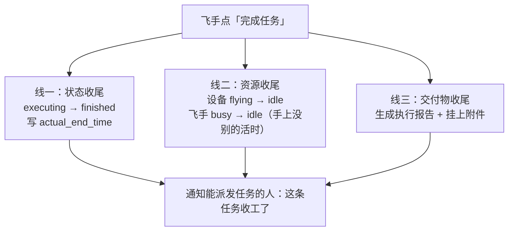
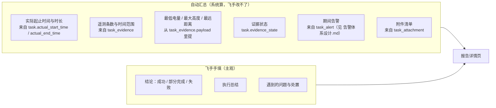

# 任务收尾与执行报告

> ### ✅ 这份文档的设计已经落地（2026-09-24）
>
> 闭环的最后一环补上了 —— 在此之前「任务能完成」只能靠手工改数据库。
>
> | 设计章节 | 实现状态 |
> |---|---|
> | 二、接口设计（`POST /task/finish`） | ✅ 已实现，**一个接口收三条线**（状态 / 资源 / 交付物） |
> | 3.1 `markFinished`（CAS） | ✅ 已实现，照 `markStarted` 的模板 |
> | 3.2/3.3 资源释放与顺序陷阱 | ✅ 已实现（设备回待命；飞手仅在没别的活时才回空闲，有专门测试盯着） |
> | 3.4 通知 `taskSettled` | ✅ 已实现（完成与失败共用，靠 `status`/`result` 区分） |
> | 3.5 `fail` | ✅ 已实现（多一条「必须写原因」） |
> | 五、报告字段（手填 + 自动汇总口径） | ✅ 已实现，汇总每次现算不落库 |
> | 六、多版本 | ✅ 表结构已改并应用；**修订接口也补上了**（见下方缺口说明） |
> | 七、附件与存储 | ✅ 告警线第五步提前做的，报告线直接复用 |
> | 十一 第一步~第三步、第五步前端 | ✅ 已实现（飞手端完成表单 + 管理端报告弹窗） |
> | **十一 第四步：EXIF 与飞行日志解析** | ❌ **仍是下一步** |
> | 十一 第六步（可选）`fail` 按钮、第七步对象存储 | 第六步已随第一步做掉；对象存储未做 |
>
> **实施时补上的一个设计缺口**：第六章**决定**了「报告可修订、多版本留痕」，
> 但第十章接口清单里从来没有列过修订接口 —— 表结构支持多版本，
> 却没有任何路径能产生第 2 版。实现时按 6.2 节那句话
> （「修订只动报告、不动任务状态」）补了 `POST /task/report/revise`：
> 不动任务状态与资源，权限与「看报告」同一条规则。
> **但前端还没有修订入口**（飞手端与管理端都没有）——
> 接口就绪、UI 未做，见下面的「已知的两处没做」。
>
> **已知的两处没做**（2026-09-24 记录，不是忘了）：
>
> 1. **「撤掉一张照片」做不到**：附件挂在**任务**上（`task_attachment.task_id`），
>    不挂在某个报告版本上。所以报告里的附件清单是「这条任务的全部附件」——
>    修订时不传某个附件，它并不会从报告里消失。
>    要支持真正的「撤掉」得让附件能关联到报告版本，那是表结构改动
> 2. **修订没有前端入口**：接口能用（有测试覆盖），但飞手端和管理端都没有
>    「修订报告」的按钮 —— 它现在是给接口调用留的

## 这一篇要解决什么

### 现状：闭环缺了最后一环

你想跑的闭环是「管理员建/派 → 飞手接受/执行 → **完成** → 形成报告」。
摸完代码发现最后一环是空的，而且是**整条链路里唯一完全没有实现的一环**：

| 应该有的东西 | 现状（已逐条核实） |
|---|---|
| 状态机里的 `finish` / `fail` 动作 | **有**：`TaskStatusFlow` 里常量、中文标签、`ALLOWED_FROM`（只允许从 `executing` 出发）都定义好了 |
| 完成任务的接口 | **没有**。`TaskController` 里 9 个接口，飞手侧只有 `start` 与 `refuse` |
| 写 `actual_end_time` 的语句 | **没有任何语句写它**。这一列只出现在 `TaskPO`/`TaskVO` 的字段声明和 `Mapper` 的 SELECT 列清单里 —— 连一条 UPDATE 都没有（种子数据 `data.sql` 里是直接 INSERT 写死的） |
| 报告表 `task_report` | **表建好了、有种子数据、业务代码零引用**（全仓只有两处注释提到它，都不是用它） |
| 附件表 `task_attachment` | 同上，零引用 |
| 两个前端的完成入口 | **都没有**。飞手端只有「开始执行 / 拒绝执行」；管理端只有 新建/派发/撤回/详情 |

所以「任务能完成」这件事，现在是靠**手动改数据库**才做得到的。这一篇把它补上。

### 范围

你已确认：**本批只交设计**；现场客户签字与「服务对象」**暂不做，只记录**
（见第九章）；文件先存本地磁盘，但要补上对象存储的概念与手册（第八章）。

---

## 一、什么叫「完成」：三条线要一起收

「完成任务」不是一个状态字段的变化，而是**三条线同时收尾**。
理解这一点，后面所有设计都是它的推论。



**三条线必须在一个事务里**。任何两条成功、第三条失败，都会留下说不清的状态：

- 状态变了但报告没写 → 「已完成」的任务点进去报告是空的，谁都不知道当时干了什么
- 资源释放了但状态没变 → 设备已经被别人派走了，任务却还挂着「执行中」
- 报告写了但状态没变 → 飞手以为交差了，管理端看还是「执行中」，会被反复催

**与「派发」的对称性**：派发也是三条线一起动
（任务状态 + 设备 `idle → assigned` + 飞手 `idle → busy`，见 `TaskServiceImpl.dispatchTask`）。
一头一尾，形状是一样的。

---

## 二、接口设计：一个接口，不是两个

### 2.1 推荐

```
POST /task/finish          权限：task:execute（飞手），归属校验复用 requireMyTask
body:
{
  "taskId": 234,
  "result": "success",          // success 成功 / partial 部分完成 / failed 失败
  "summary": "按计划完成 12 个点位巡检，未见异常",
  "problemLog": "10:38 图传信号弱，悬停 30 秒后恢复",
  "flightHours": 1.25,
  "flightCount": 1,
  "attachmentIds": [88, 89, 90] // 先调上传接口拿到的 id
}
```

附件**先上传、再提交**：上传是独立接口（`POST /task/attachment`），
拿到 id 后再随完成请求一起提交。这是文件上传的标准做法 ——
大文件传输和业务提交分开，任何一边失败都好重试。

### 2.2 被否决的方案：拆成「先提交报告、再点完成」

看起来更清晰，实际上会造出一个**没有业务含义的中间态**：
任务还是 `executing`，但报告已经提交了。

- 这个中间态在状态机里无处安放（`executing` 的含义是「飞手在飞」，
  而他已经落地在填报告了）
- 它要在权限、界面、通知上都单独安排位置（「报告交了但没完成」要不要通知管理员？）
- 飞手在界面上就是「填完表单点提交」一个动作，拆成两步只是把同一个动作切成两半

**判断依据**：一个中间态值不值得存在，看它**有没有人会在这个状态下做决策**。
「报告已交但任务未完成」这个状态下，没有任何人需要做任何事 —— 那它就不该存在。

### 2.3 校验清单

| 校验 | 不通过怎么办 | 为什么 |
|---|---|---|
| 任务存在 | 报「任务不存在」 | 复用 `requireTask` |
| **是派给我的任务** | 403「这条任务不是派给你的」 | 复用 `requireMyTask`（`TaskServiceImpl` 里已有，飞手水平越权的防线） |
| 状态是 `executing` | 状态机报错 | 复用 `TaskStatusFlow.assertCanTransfer(ACTION_FINISH, status)` |
| `result` 是合法值之一 | 报错 | 白名单校验，和创建任务校验 `priority` 一个套路。**`finish` 只收 `success`/`partial`，`failed` 走 fail 接口**（见 12.1 的规则） |
| `flightHours` 在合理范围 | 报错 | 0 ~ 24 之间；防手滑填 125 |
| `attachmentIds` 都属于这条任务 | 报错 | **防止把别的任务的附件挂到自己的报告上**（这是个真实的越权点） |

**明确「不校验」的两件事**（2026-09-24 拍板）：

| 不校验 | 为什么 |
|---|---|
| **不要求 `evidence_state = confirmed`** | 强制它会把「设备数据链路不通（图传断、机场信号差）」变成「飞手无法收工」—— 用一个更大的问题换一个小问题。<br>正确做法是**在界面上标红提示**「本次执行只有你的声明，没有任何设备数据佐证」，让飞手自己知道要承担什么、让管理员复核时看得见 |
| **不要求必须有照片** | 强制取证质量听起来好，代价是「没拍照就收不了工」。真有需要时按**任务类型**去配（巡检/测绘要，其他不要），而不是做成全局强制 |

> 这两条都不是「懒得做」，而是**把判断权留给业务**：
> 系统只负责如实记录「有没有旁证」，不替业务决定「没有旁证就不许收工」。

---

## 三、状态流转与资源释放

### 3.1 新增一条 CAS 更新的 SQL，照 `markStarted` 的模板写

现有的 `markStarted` 是这样的（`TaskMapper.xml`）：

```sql
UPDATE `task`
SET status = 'executing', actual_start_time = #{actualStartTime}, evidence_state = 'declared'
WHERE id = #{taskId} AND status = 'dispatched'
```

完成要新增一条同样形状的（这是 `TaskMapper.xml` 里的片段，不是能直接执行的 DDL）：

```xml
<update id="markFinished">
    UPDATE `task`
    SET status = 'finished',
        actual_end_time = #{actualEndTime}
    WHERE id = #{taskId}
      AND status = 'executing'
</update>
```

`AND status = 'executing'` 是**比较并交换**（CAS），和 `markStarted` 同一个道理：
万一定时任务或别的流程抢先改了状态，这里会返回 0 行，调用方据此放弃后续的资源释放。

### 3.2 资源释放：**不能用 `clearDispatch`**

`releaseAssignment`（撤回/超时释放/拒绝三处共用）内部调的是 `clearDispatch`，
它会**把 `pilot_id`/`pilot_name`/`drone_id`/`drone_code` 全部置为 NULL**。

**完成绝对不能用它** —— 完成必须**保留**指派关系，原因有两个：

1. 报告要写清「是谁飞的、用哪架飞的」。字段被清空了，报告就成了无主之物
2. 「已完成」的任务列表上要能看到飞手和设备（管理端已经这么展示了）

所以完成走的是**另一条释放路径**：状态和实际结束时间改了，但指派关系留着。

| 资源 | 现在的状态 | 完成后变成 | 用什么方法 |
|---|---|---|---|
| 设备 | `flying` 飞行中 | `idle` 待命 | `deviceService.changeStatusIfMatch(droneId, "flying", "idle")` —— 复用现成的 CAS 方法 |
| 飞手 | `busy` 作业中 | `idle` 空闲（**有条件的**） | 仅当 `taskDao.countActiveByPilot(pilotId) == 0` 时才改，复用 `releaseAssignment` 里的判断 |

### 3.3 ⚠️ 顺序陷阱：先改状态，再统计飞手手上还有没有活

`countActiveByPilot` 的 SQL 是：

```sql
SELECT COUNT(*) FROM `task` WHERE pilot_id = #{pilotId} AND status IN ('dispatched', 'executing')
```

注意它统计的是 `dispatched` 和 `executing`。**如果先统计再改状态，
这条任务自己会被算进去**，`COUNT` 至少是 1，飞手永远回不到空闲。

所以顺序必须是：

1. `markFinished`（状态变 `finished`，这条任务不再是 `executing`）
2. `countActiveByPilot`（此时统计的是**剩下的**活）
3. 为 0 才把飞手改回 `idle`

**这是本次设计里最容易写错的一处**，实施时要有一条专门的测试盯着它
（「飞手只有这一条任务，完成后应回到空闲」）。

### 3.4 通知

新增消息类型 `taskFinished`，推给**拥有 `task:dispatch` 权限的人** ——
和飞手「开始执行」「拒绝执行」时的通知走同一套（`TaskNotifier.notifyDispatchers`）。

报文字段沿用现有通知的「最小信息」原则（`TaskNotifier` 的类注释里写明了）：
`taskId`/`taskNo`/`taskName`/`result`/`pilotName`/`droneCode`/`actualEndTime`。
不发报告正文 —— 前端收到后自己调接口取。

### 3.5 `fail`（标记执行失败）：已定，做（2026-09-24）

`TaskStatusFlow` 里 `ACTION_FAIL` 已经定义好（同样只允许从 `executing` 出发，
中文标签「标记失败」）。它的**资源释放逻辑与完成完全一致**，只多两点：

- 必须填失败原因（`problemLog` 必填，而完成时它可选）
- 状态落 `failed` 而不是 `finished`

**为什么决定做**：成本只是多一个接口 + 一个分支；
没有它，飞手遇到「飞机飞一半故障了」只能**谎报完成**，
数据里就再也分不出「真完成」和「失败了但走完成」——
而这两种情况事后要分开看（前者结算，后者复盘）。

**它同样会写一份报告行**（字段与完成完全一样）。由此带来的
「`result` 与 `status` 重叠」问题，用一条规则消掉 —— 见 12.1 节：
**`result` 只描述作业完成度，不描述任务状态**；
`finish` 只收 `success`/`partial`，`fail` 的 `result` 由后端写死 `failed`。

---

## 四、报告是什么：交付物，不是证据

这条边界必须写在前面，因为它决定了报告的所有设计。

| | 证据 `task_evidence` | 报告 `task_report` |
|---|---|---|
| 回答 | 这件事**发生过**吗 | 我们**做完了什么** |
| 谁产生 | 设备 / 旁人 / 系统判定 | **飞手**（人对结果的总结与承诺） |
| 能不能改 | **不能**（只追加，`valid` 标记推翻） | **能**，但要留痕（见第六章） |
| 客观性 | 客观（第三方旁证） | **主观**（人的结论） |

**为什么不能把报告当证据**：报告是「飞手说干完了」，它**恰恰是我们最需要验证的那句话**
（设计文档 10.1 节讲的「整个状态机里唯一的客观事实是时间戳，其余全是人的声明」）。
把声明当依据，等于用问题本身回答这个问题。

**但报告必须引用证据。** 报告里最有价值的部分不是飞手写的那几行字，
而是**系统自动汇总出来的客观事实**：飞了多久、收到多少条数据、证据状态是
「已证实」还是「仅声明」、期间发生了几条告警。这一部分**不靠飞手填**，
因为填出来的数字没有任何可信度。



---

## 五、报告字段清单

### 5.1 飞手手填的三个字段

| 字段 | 现有列 | 必填 | 说明 |
|---|---|---|---|
| 结论 | `task_report.result` | **是** | `success` / `partial` / `failed`（表注释里已经定好了这三个值） |
| 执行总结 | `task_report.summary` | 建议必填 | 「按计划完成 12 个点位巡检，未见异常」 |
| 遇到的问题与处置 | `task_report.problem_log` | 否 | 与告警、与证据对得上的一句话 |
| 飞行时长 | `task_report.flight_hours` | 否 | **手填，但可自动算出来给个默认值**（见 5.2） |
| 飞行架次 | `task_report.flight_count` | 否 | 同上 |

> `flight_hours` / `flight_count` 现在设计成手填，但**界面上应该预填自动算出来的值**，
> 让飞手确认或修正。完全自动、不给改，遇到「飞了两架次」这种复杂情况就没辙；
> 完全手填，人就会瞎填。**预填 + 可改**是这两者的折中。

### 5.2 自动汇总的字段与计算口径

这些**不进报告表**，是查询时算出来的（避免冗余与不一致）。
实施时按下面的口径写，不要自由发挥：

| 汇总项 | 计算口径 |
|---|---|
| 实际开始 | `task.actual_start_time` |
| 实际结束 | `task.actual_end_time` |
| 飞行时长（小时） | `TIMESTAMPDIFF(SECOND, actual_start_time, actual_end_time) / 3600`，保留 2 位 |
| 遥测条数 | `SELECT COUNT(*) FROM task_evidence WHERE task_id = ? AND valid = 1` |
| 数据时间范围 | `SELECT MIN(observed_at), MAX(observed_at) FROM task_evidence WHERE task_id = ?` |
| 证据状态 | `task.evidence_state`（`none`/`declared`/`confirmed`/`stale`）与 `evidence_type` |
| 最低电量 | `SELECT MIN(JSON_EXTRACT(payload, '$.payload.battery')) FROM task_evidence WHERE task_id = ?` |
| 最大高度 | `SELECT MAX(JSON_EXTRACT(payload, '$.payload.alt')) FROM task_evidence WHERE task_id = ?` |
| 期间告警 | `SELECT COUNT(*) FROM task_alert WHERE task_id = ? OR (device_code = ? AND observed_at BETWEEN ...)` |
| 附件清单 | `SELECT * FROM task_attachment WHERE task_id = ? ORDER BY sort_no, id` |

> ⚠️ **`JSON_EXTRACT` 的路径依赖设备报文的字段约定。**
> `$.payload.battery` 能取到，是因为我们文档里约定的报文信封是
> `{"deviceCode":..., "payload":{"battery":...}}`（见 `MQTT与设备接入.md` 4.4）。
> **换个机型、换个厂商，字段名就得跟着改** —— 所以这几个汇总项要么写成配置
> （`drone.report.battery-path`），要么在实施时明确写死并加注释说明。
> 不要让它静静地散落在 SQL 里。
>
> 另一个代价：`JSON_EXTRACT` 用不上索引，会对那条任务的证据行做一次扫描。
> 单条任务的证据行数是有界的（一次飞行几分钟到几小时），可以接受。

### 5.3 被否决的方案：把汇总值也存进 `task_report`

看起来能省掉每次计算，但会引入**冗余与不一致**：

- 汇总值来自证据，证据是**可以事后追加**的（比如飞行日志事后补传，
  照片事后补交）—— 存下来的汇总值就过时了
- 一旦过时，就要考虑「什么时候重算」，于是又需要一套刷新逻辑
- 而重算一次的开销（一条任务几千行证据）在这个规模下完全可以接受

**结论：能算出来的就不要存。** 存下来只在这两种情况下才值得：
数据量大到算不动，或者源头数据会被删。我们两条都不占。

---

## 六、报告的修订与多版本

### 6.1 现有结构的问题

`task_report` 上有 `UNIQUE KEY uk_task_id (task_id)` —— 表注释写的是
「一个任务最多交一份报告，靠 `uk_task_id` 保证」。

这个约束在**报告一次成型**的前提下是对的。但现实中报告一定会被改：
飞手写错个字、管理员要求补充说明、客户提出「把当时的情况写清楚」。

**而现在的唯一键让「改」变得很难看**：要么 UPDATE 原地覆盖（改了什么、谁改的、
什么时候改的，全都没有痕迹），要么报错说已经交过了。

### 6.2 已定：去唯一键，改成多版本（2026-09-24 拍板）

改动点就这五处（**完整语句见文末「附：DDL 草案汇总」，这里只列要点**）：

| # | 改什么 | 为什么 |
|---|---|---|
| 1 | `DROP INDEX uk_task_id` | 去掉「一任务一报告」的约束，否则改不了 |
| 2 | 加 `version int NOT NULL DEFAULT 1` | 版本号，从 1 开始 |
| 3 | 加 `is_latest tinyint NOT NULL DEFAULT 1` | 谁是当前版本；查报告要带上它 |
| 4 | 加 `UNIQUE KEY uk_task_version (task_id, version)` | 一道保险：同一任务同一版本号不允许重复 |
| 5 | 加 `KEY idx_task_latest (task_id, is_latest)` | 第 3 点的查询靠它走索引 |

（另外补一个 `update_time`，让「什么时候改的」自动有记录。）

> **为什么这里只列要点、不写完整 SQL**：同一份 DDL 在文档里存两份，
> 迟早会「改了一处忘了另一处」，读者也不知道该信哪份。
> **文末的汇总才是唯一权威版本。**
> 这不是空担心：初稿就在这两处各存了一份，而且两处的列注释已经不一致了。

**理由**：报告是要交出去的东西（交给客户、作为结算依据）。
**被改动过必须看得出来** —— 这和证据不可变是同一个价值观：
不是不让你改，而是改了要留痕。多版本是留痕最直白的方式。

**代价**：所有查报告的地方都要带 `is_latest = 1`（`idx_task_latest` 就是为它建的）。
漏了会查出好几条，这个坑不难踩，要在 DAO 的方法名上写明
（比如 `selectLatestByTaskId`，名字里就带 `Latest`）。

### 6.3 什么场景会出现多版本、为什么必须留痕

「多版本」听起来像给自己找麻烦。所以要说清楚：**谁、在什么情况下会去改一份已经交上去的报告**。

| # | 场景 | 多常见 | 改的是什么 |
|---|---|---|---|
| 1 | **飞手发现自己写错了** —— 点位写成「2 个」实际是「12 个」；时长填成 1.25 实际是 2.15；设备编号张冠李戴 | **最常见**。报告是手填的，笔误必然有 | 手填字段 |
| 2 | **管理员复核后要求补充** —— 报告只写了「已完成」，被要求补上「遇到的问题与处置」 | 常见。第一次交的报告往往太简略 | 手填字段 |
| 3 | **结论要改** —— 当初标「成功」，后来发现漏检了 2 个点位，应改成「部分完成」 | 偶尔，但后果最重（涉及结算与责任） | `result` |
| 4 | **客户/业主提出异议后修订** —— 「第 3 个点位的照片不对」，飞手重新整理再交 | 等有了服务对象与现场签字之后会变多 | 手填字段 + 报告依据 |
| 5 | **误操作 / 重复提交** —— 连点两次、提交时网络重试 | 有，但**不该产生新版本**（见下面的判据） | —— |

**为什么必须留痕，而不是原地覆盖**：

1. **报告是交付物，不是内部草稿。** 它要交给客户、作为结算依据 ——
   被改动过必须看得出来。这和证据不可变是**同一个价值观**：
   不是不让你改，而是改了要留痕。
2. **责任可追。** 出问题时能回答「当时交上去的是哪一版、谁改的、什么时候改的」。
   原地覆盖之后，这三个问题**一个都答不上来**。
3. **它是客户签字的前提**（第九章）。签字签的是**某一版** ——
   `version` 让「签的是哪一版」一目了然。没有版本号，签字就等于
   「签了一份之后会被悄悄改掉的东西」，那这个签字没有意义。

**什么算一个新版本（实施时按这个判据写）**：

| 变化 | 算新版本吗 | 为什么 |
|---|---|---|
| 飞手手填的字段（`result` / `summary` / `problem_log` / `flight_hours` / `flight_count`）有变化 | **算** | 这些是「人对结果的承诺」，改了就是换了一个承诺 |
| 提交内容与当前版本**完全一样** | **不算**（幂等忽略） | 连点两次、网络重试很常见，不该因此堆出 v2、v3 |
| **自动汇总**的值变了（遥测条数、最低电量、时间范围……） | **不算** | 这些字段**根本不存进报告表**（5.3 节：能算出来的就不存）。所以证据事后追加不会产生新版本，报告详情页刷新一下就是最新的 |
| 补传了附件（照片 / 飞行日志） | **不算** | 附件属于**任务**（`task_attachment.task_id`），不属于某一版报告 |

> ⚠️ **最后一条有个窟窿，得知道**：附件挂任务不挂版本，所以「签完字之后又补传了一张照片」，
> 那一版报告的附件清单会跟着变，而版本号不变。
> 要堵它，得让版本持有附件快照（比如报告版本上记一串 `attachment_id`）。
> 这一轮先不堵（现在还没有签字功能），但**做客户签字之前必须解决**。

**谁能改（权限）**：这一轮**只允许飞手改自己任务的报告**（`task:execute` + 归属校验，
复用 `requireMyTask`）。管理员只能看。

为什么不给管理员改的权限：报告是**飞手对结果的承诺**，别人替他改会让责任模糊 ——
出了问题分不清「他写的」还是「被改的」。管理员要求补充时，正确的流程是
**告诉飞手、由飞手改**（改完就是新版，留痕）。

> **顺带说明为什么改报告不看任务状态**：任务完成后是**终态**（`finished` 没有出边），
> 而报告要能改。所以修订**只动报告、不动任务状态** ——
> 这也正是版本号长在报告上、而不长在任务上的原因。

### 6.4 被否决的方案

| 方案 | 否决理由 |
|---|---|
| 保持唯一键 + 原地 UPDATE | 改了什么、谁改的、什么时候改的没有任何痕迹。报告是交付物，这不合适 |
| 不改表，改一次往 `task_log` 记一条 | `task_log` 记的是**任务状态流转**（create/dispatch/start/finish），报告修订不是流转的一环。而且 `task_log` 没有结构化内容，存不下「上一版写了什么」 |

---

## 七、附件：照片与飞行日志

### 7.1 照片的价值远不止「证明拍了张照」

这是本次设计里**最值得强调的一点**：照片的 **EXIF 里有拍摄时间和 GPS**，
而这两个东西是**相机芯片生成的**，不是飞手填的、也不是我们能伪造的。

所以照片的证据强度**高于飞手的任何文字说明**：

- 飞手说「我 10:31 到场拍了照」→ 这是声明（`manual`，弱）
- 照片 EXIF 里写着「10:31:02，GPS 116.397,39.908」→ 这是**第三方旁证**

**落到设计上**：照片上传后要**解析 EXIF**，把拍摄时间与 GPS 抠出来，
和任务的 `actual_start_time` / 航线做一致性核对 ——
对不上就在报告上标黄，让人去问为什么。

> 这正是设计文档 10.4 节说的 `flight_log` 强度「中：只能事后核对」
> 的用法。**事后证据撑不起「进行中」，但撑得起「事后审计」**，
> 而收尾与报告恰恰就是事后的事，两者正好对上。

**`EvidenceType` 需要新增一个 `photo`**：现在的词汇表是
`telemetry` / `flight_log` / `witness` / `manual`。照片归到 `flight_log`
会污染「飞行日志」的原意（日志里是航迹与遥测，照片是影像），
而词汇表本来就是「加一种证据就是填一个常量」的设计
（`EvidenceType` 的类注释里写明了这个意图），所以扩展一个值的代价极低。

### 7.2 飞行日志的核对

飞行日志（`.bin`/`.ulg`/厂商私有格式）事后上传，解析出**起止时间与航迹**，
和「飞手声明的时间」核对：

- 起止时间对得上 → 报告里的时长有旁证
- **对不上 → 标异常**。这是声明制完全查不出来的问题：
  声明了但压根没飞（见设计文档 10.7「第二步」）
- 解析失败 → 标 `parse_status = failed`，**不阻塞完成**（日志格式随固件变化，
  解析失败是常态，不能让它变成「无法收工」）

### 7.3 本地磁盘存储方案

| 项 | 方案 | 理由 |
|---|---|---|
| 根目录 | 配置项 `drone.upload.root`（默认 `./data/upload`） | 不写死路径；容器化时挂卷 |
| 目录结构 | `{taskNo}/{yyyyMMdd}/{uuid}.{ext}` | 按任务分目录便于打包与清理；按日期分目录避免单目录下文件过多 |
| 文件名 | **uuid**，不用原始文件名 | 一举三得：① 防重名 ② **防路径穿越**（原始文件名里可能有 `../../`）③ 防中文/空格在 URL 里出问题 |
| 原始文件名 | **只存数据库**（`task_attachment.file_name`） | 用户要看的是原始名，但**绝不能拿它参与拼路径** |
| 类型白名单 | `jpg/jpeg/png/webp/heic`（照片）、`mp4/mov`（视频）、`bin/ulg/txt/log`（日志） | 不白名单的话，上传一个 `.jsp`/`.sh` 就是隐患 |
| 大小上限 | 照片 20MB / 视频 500MB / 日志 200MB | 分类型限制；飞手传的是原图，压太小会影响取证价值 |
| 对外访问 | **走下载接口**，不配静态资源映射 | 见下 |

**⚠️ 一个必踩的坑：Spring Boot 的 multipart 默认限制是单文件 1MB。**
现在 `application.yml` 里**没有任何 `spring.servlet.multipart` 配置**，
所以默认值生效 —— 传一张手机原图（通常 3~8MB）会直接被挡在 Controller 之前，
报一个和业务无关的错。实施时**必须显式配置**：

```yaml
spring:
  servlet:
    multipart:
      max-file-size: 500MB      # 按最大的那类（视频）设
      max-request-size: 520MB
```

更细的「照片 20MB / 视频 500MB」这种分类型限制，要在**业务代码里**判断
（`MultipartFile.getSize()`），因为 multipart 配置是全局的。

**为什么下载走接口而不是静态资源映射**：
`WebMvcConfig` 里现在**没有配置任何 `addResourceHandlers`**。
如果为了下载加一个静态映射，等于「**任何人拿到 URL 就能下载**」——
设备照片、飞行日志是要过权限的。所以用下载接口，
复用项目里已有的二进制响应写法（`DeviceController.exportDevices` 就是这个套路：
`void xxx(HttpServletResponse response)` + `prepareExcelResponse(response, 文件名)`
设置 `Content-Disposition: attachment; filename*=UTF-8''...`）。

```
GET /task/attachment/{id}/download     权限：task:list 或 task:execute
```

实现要点：
- 先查附件记录，校验所属任务对当前用户可见（管理员看全部，飞手只看自己的）
- **路径必须是「根目录 + 数据库里存的相对路径」拼出来的**，
  再用 `Path.normalize()` 后校验「是否还在根目录内」——
  防的是数据库被人塞进 `../../etc/passwd` 这种值
- 用流式写响应（不要 `readAllBytes()` 全读进内存 —— 500MB 的视频会把内存打爆）

### 7.4 `task_attachment` 补列清单

现有列够存基本元信息，但缺几样在「取证 + 将来迁对象存储」时必需的东西：

| 新增列 | 类型 | 为什么需要 | 状态 |
|---|---|---|---|
| `alert_id` | bigint | 附件要么挂任务（本表原始用途），要么挂告警（飞手端现场取证）。**不建第二张表**：「怎么存、怎么校验、怎么下载」完全一样，只有「谁引用它」不同 | ✅ 已加 |
| `sha256` | char(64) | ① 完整性（文件被替换能发现）② 去重（同一个文件重复上传不必存两份）③ 将来迁对象存储时的对账依据 | ✅ 已加 |
| `mime_type` | varchar(100) | 光有扩展名不够（`file_type` 是业务分类，不是 MIME）；下载时要设正确的 `Content-Type` | ✅ 已加 |
| `storage` | varchar(20) | `local` / `oss`。**迁移期两种并存**，靠它决定去哪个存储读 | ✅ 已加 |
| `storage_key` | varchar(500) | 对象存储里的 key，**与 `file_path` 解耦**。存 key 不存 URL（URL 会变、会过期） | ✅ 已加 |
| `sort_no` | int | 展示顺序（报告里照片要有次序，不是按上传时间乱排） | ✅ 已加（当前都是 0，报告线用得上） |
| `exif_time` | datetime | 照片 EXIF 拍摄时间。存下来避免每次重解析；也是 7.1 节「与任务时间核对」的输入 | ⏳ 留给报告线 |
| `exif_gps` | varchar(50) | EXIF 里的 GPS（`lat,lng` 文本）。同上 | ⏳ 留给报告线 |
| `parse_status` | varchar(20) | `pending` / `parsed` / `failed`。照片与日志都要解析，解析是异步的，要有状态可查 | ⏳ 留给报告线 |

> **前三行之外的三列（`exif_*` / `parse_status`）为什么跟着报告线走**：
> 它们服务的是 7.1「照片时间与任务时间核对」和 7.2「飞行日志核对」，
> 而那两件事只在报告上有意义 —— 告警线上的照片对应的时刻就是
> 「飞手什么时候上报的」（`observed_at`），没有可核对的对象。
> 先把列加上、解析不做，等于在表里留三个永远填不上的字段，
> 那不是"预留"，是半成品。**列和解析一起做。**

> **`file_path` 与 `storage_key` 的关系要说清楚**：
> `file_path` 是**本地存储时代的相对路径**，`storage_key` 是**对象存储时代的 key**。
> 迁移期两条都在，`storage` 决定读哪个。等全迁完可以把 `file_path` 停用
> （但**不删列** —— 删列是不可逆的，留着占不了多少空间，却能在出问题时回退）。
>
> 实施时按这个约定落了地：**本地存储时两列写同一个值**（key 就是根目录下的相对路径）。
> 之所以不"只写 file_path"：读的时候要判断"看哪一列"就会变成到处判空，
> 两列同值让规则保持唯一。老数据（加列之前上传的）`storage_key` 可能为空，
> 读取时**回退到 `file_path`**。

---

## 八、对象存储：概念与手册

> 这一节是你要的「对象存储的概念和手册」。先讲概念（面向第一次接触的人），
> 再讲什么时候该换、怎么换。

### 8.1 是什么：三个词先记住

| 词 | 是什么 | 类比 |
|---|---|---|
| **Bucket**（桶） | 一个顶层容器，全局名字唯一 | 一个独立的外接硬盘 |
| **Object**（对象） | 一个文件本体 + 它的元数据 | 一个文件 |
| **Key** | 对象在桶里的名字，**是个字符串，可以带 `/`** | 文件路径，但**只是长得像**（见 8.2） |

常见的对象存储：AWS S3、阿里云 OSS、腾讯云 COS、**MinIO**（开源，可以自己部署）。

### 8.2 和本地文件系统的区别（最容易想错的地方）

| | 本地文件系统 | 对象存储 |
|---|---|---|
| 目录 | 真实存在，可以 `ls` 一个空目录 | **不存在真正的目录**。`a/b/c.jpg` 只是 key 恰好叫这个名字；`a/b/` 下没有文件时，`a/b/` 也不存在 |
| 改名/移动 | `mv` 很快（只改元数据） | **要复制一份新的 + 删掉旧的**（对象是不可变的） |
| 修改文件 | 可以只改中间一段 | **必须整个对象重新上传一遍**（所以大文件分片上传是标配） |
| 访问控制 | 文件权限（属主/读写位） | **桶级别的策略 + 对象的 ACL**；典型做法是**桶私有**，靠**预签名 URL** 临时授权 |
| 一致性 | 强一致 | 现代实现基本都是强一致（早期的「最终一致」问题现在很少见了） |
| 外网分发 | 要自己配 Nginx/CDN | 天然支持，可以直连 CDN |

**两个必须知道的实践**：

1. **桶一定要私有。** 公开的桶等于把公司照片挂在互联网上。
   给用户访问的做法是**后端签发一个几分钟内有效的预签名 URL**，
   浏览器拿这个 URL 直传/直下，不经过后端（省带宽）。
2. **数据库里存 key，不存完整 URL。** URL 会因为域名变更、预签名过期而失效；
   key 是稳定的。要看文件时用 key 现签一个 URL。

### 8.3 什么时候该从本地磁盘换到对象存储

| 信号 | 说明 |
|---|---|
| **后端要跑多个实例** | 本地磁盘方案下，飞手传到 A 实例的文件，从 B 实例下载不到 —— **这是最硬的信号**，多实例部署必须换 |
| 文件量/容量顶到磁盘上限 | 一次任务几 GB，一年下来本地盘放不下 |
| 需要外网直接分发 | 客户要看照片，不想让流量过后端 |
| 要做生命周期管理 | 「3 个月前的原始视频自动转低频存储」这类规则，对象存储自带 |

**现在不换的理由**（也就是选本地方案的理由）：单机部署够用、零外部依赖、
联调链路短。**这个取舍是明确的，不是「先凑合」** —— 换来的是少一个要运维的组件。

### 8.4 MinIO：本地起一个试试（学习用）

```bash
docker run -d --name minio \
  -p 9000:9000 -p 9001:9001 \
  -e MINIO_ROOT_USER=minioadmin \
  -e MINIO_ROOT_PASSWORD=minioadmin \
  -v /你的数据目录:/data \
  minio/minio server /data --console-address ":9001"
```

- `9000` 是 S3 兼容 API 端口（我们的代码连这个）
- `9001` 是网页控制台（浏览器打开，能拖文件、能看到桶）
- 默认账号密码 `minioadmin/minioadmin` —— **和 EMQX 一样，第一件事就是改掉**

> 端口与镜像标签以 MinIO 官方文档为准。本机 Docker 里已有 EMQX 与 MySQL 容器，
> 再起一个 MinIO 不冲突（9000/9001 都没被占用）。

### 8.5 接入方式：抽一个接口，两个实现

**关键设计：业务代码只依赖 `StorageService` 接口，不认识「本地」或「对象存储」。**
这是唯一能让「以后换存储」变成「换一个实现类」而不是「改一遍业务代码」的做法。

```java
// 草案：接口只放最小能力，不要照着 S3 的 API 抄（那会把 S3 的概念泄漏到业务层）
public interface StorageService {
    /** 保存一个文件，返回存储 key（本地实现返回相对路径，对象存储实现返回 object key） */
    String save(String taskNo, String originalName, InputStream in, long size);

    /** 读一个文件（用于下载接口流式写出） */
    InputStream open(String storageKey);

    /** 删除（任务删除或附件被替换时用） */
    void delete(String storageKey);

    /** 可选的直链能力：本地实现返回 null，对象存储实现返回预签名 URL */
    default String presignedUrl(String storageKey, Duration ttl) { return null; }
}
```

两个实现：

| 实现 | 何时生效 | 说明 |
|---|---|---|
| `LocalStorageService` | 默认（`drone.storage.type=local`） | 就是 7.3 节的目录方案 |
| `S3StorageService` | `drone.storage.type=s3` | 用 S3 兼容 SDK，MinIO 与阿里云 OSS 都能连（OSS 有 S3 兼容端点） |

**`presignedUrl` 用默认方法返回 null 是有意的**：本地存储没有「预签名」这个概念，
用 `default` 方法给出一个「不支持」的默认行为，业务层判断 null 后回退到自己的下载接口。
这样加对象存储时**不需要改接口**。

### 8.6 从本地迁到对象存储：步骤

1. **先把接口抽出来**（如果还没抽）。这一步不改行为，只是让代码不再依赖本地路径
2. 加 `storage` / `storage_key` 两列（7.4 节）并部署
3. 写一个**一次性迁移脚本**：遍历 `task_attachment` 里 `storage = 'local'` 的行，
   把文件本体传到桶里（key 就用原来的相对路径，迁移期最好认），
   回填 `storage = 'oss'` 与 `storage_key`
4. **双读切换**：改下载逻辑 —— 读 `storage` 列决定从哪读。
   此时新旧数据并存，都能读到（这就是为什么要留 `storage` 列）
5. 观察一段时间，确认新上传的都进桶了、老数据也能读
6. 清理本地文件（**先备份再删**，删文件是不可逆的）

**每一步都能独立回退**，这是这个顺序的价值。特别是第 4 步之后，
即使对象存储出问题，把配置改回 `local` 就能退回去。

### 8.7 容器化部署的注意事项

- **本地存储**：必须挂卷（`-v 宿主机目录:/app/data/upload`），
  否则容器一重建，所有照片日志全丢。而且**多实例时要挂同一块共享盘**（NFS 之类），
  这也正是 8.3 节说的「多实例就该换对象存储」
- **对象存储**：不需要挂卷，但需要网络可达 + 凭证走**环境变量**注入
  （和 `JWT_SECRET`、MQTT 密码同一条规矩：**凭证不进代码、不进仓库**）
- 备份策略完全不同：本地要备磁盘，对象存储要靠桶的版本控制/跨区域复制

---

## 九、服务对象与现场签字：记录，不设计

按你的要求**本批暂缓**。这里只把需求和将来要动的地方记下来，避免忘掉。

**需求原话**：飞手完成任务时要有「用户确认签字」，这个「用户」是
**作业现场的客户/业主/场地方**；报告要包含**用户数据**。

**为什么暂缓**：这需要在系统里引入一个全新的概念（服务对象），
牵动数据模型、权限、报告字段、前端表单与签字采集，值得单独一轮做。
硬塞进这一批会把范围撑得很大、而且大概率猜错。

**将来落地时要动的地方**（一句话级别，不展开）：

| 要动的 | 说明 |
|---|---|
| 新增「服务对象」概念 | 系统里现在没有这个角色。要考虑一个客户对应多个任务、报告上记单位与联系人 |
| 报告加客户字段 | 报告里的「用户数据」这一半就着落在这里 |
| 签字图片走附件存储 | 复用第七章的 `StorageService`，`file_type` 加一个 `signature` |
| 签字在证据维度里归 `witness` | `EvidenceType` 里已经预留了 `witness`（「第二人确认」）—— 客户签字正是「换了一个人的确认」，强度**高于**飞手自述（`manual`）。这个预留正好用上 |
| 签字与完成的关系 | 要先定：签字是「完成」的前置条件，还是完成后补？客户不在现场时怎么办？（现场作业里这很常见） |

> **一个现在就能做的准备**：报告的多版本设计（第六章）对签字是有利的 ——
> 客户签字后如果报告又被改，`version` 会让「签字的是哪一版」一目了然。
> 这也是我倾向做多版本的原因之一。

---

## 十、接口与权限点清单（草案）

### 10.1 接口

| 方法 | 路径 | 权限 | 谁用 | 状态 |
|---|---|---|---|---|
| POST | `/task/finish` | `task:execute` | 飞手 | ✅ **已实现** |
| POST | `/task/fail` | `task:execute` | 飞手 | ✅ **已实现**（第六步提前做掉） |
| POST | `/task/attachment/upload` | `task:execute` | 飞手（表单要带 `taskId`，校验归属） | ✅ **已实现**（告警线第五步提前做的） |
| GET | `/task/attachment/{id}/download` | `task:list` 或本人 | 管理员 / 飞手 | ✅ **已实现** |
| GET | `/task/report/{taskId}` | `task:list` 或本人 | 报告详情（含自动汇总） | ✅ **已实现** |
| POST | `/task/report/revise` | `task:list` 或本人 | 修订报告（只动报告、不动任务状态） | ✅ **接口已实现**（原清单漏了它，见开头说明；前端暂无入口） |

**权限点全部复用现有的**（`task:execute` / `task:list`），
不像告警那样需要新增 —— 因为「完成自己的任务」「看自己的报告」
本来就属于 `task:execute` 的语义范围。

> 实施时发现的一点：下载附件与看报告这两条的权限都是「`task:list` **或** 本人」，
> 而 `@RequirePermission` 的多个值是「**同时**具备」（AND），表达不了「或」。
> 所以这两个接口都没有用那个注解，只要求登录，谁能看由服务层判 ——
> 判据仍然是权限码本身（`UserContext.get().hasPermission("task:list")`），不是角色名。
> 而且两处**用的是同一个判断方法**，避免出现「能改但不能看」这种怪事。

### 10.2 仍然**不需要**新增权限点的理由

`task:cancel`（任务取消）这个权限点在种子里已经埋好了但代码没用，
说明这个项目允许先埋权限点。而完成/附件/报告这三件事
**都能落在 `task:execute` 与 `task:list` 的语义里**，没必要拆细。
权限点加得越多，配置与授权的负担越大，而这里拆细带不来任何真实收益。

---

## 十一、实施步骤

> **✅ 前五步都做完了**（第三步在告警线第五步提前做的）。
> 现在真正的下一步是**第四步：照片 EXIF 与飞行日志解析**。

- [x] **第一步：`markFinished` + 完成接口** ✅ **已完成**
  新增 DAO 方法 `markFinished`、Service 的 `finishTask`、Controller 的
  `POST /task/finish`；资源释放按 3.2/3.3 的顺序做（设备回待命、
  飞手仅当手上没别的活时才回空闲）；写 `task_log`（action=`finish`）；
  `afterCommit` 推通知。
  **验证结果**：一条 `executing` 任务完成后 → `finished`、`actual_end_time` 有值、
  设备回 `idle`、飞手回 `idle`、**指派关系保留**、报告落库、流水多一条。
  浏览器里也真跑过一遍（飞手端点提交 → 列表变「已完成」）。
  3.5 的 `fail` 一并做掉了。
- [x] **第二步：报告表改造 + 报告读写** ✅ **已完成**
  `task_report` 去唯一键、加 `version`/`is_latest`（6.2 节，**迁移已应用到开发库**）；
  完成接口带上报告字段；新增报告详情接口（含 5.2 节那些自动汇总）。
  另外补了修订接口（见开头说明）。
- [x] **第三步：附件上传与下载** ✅ **已完成（在告警线第五步）**
  **验证结果**：照片能传（专门验了 multipart 上限，Spring 默认 1MB 会挡）、
  下载能拿到同样的字节、**sha256 与磁盘文件实测一致**、
  越界 key 被拦、非本人 403。详见 `告警体系设计.md` 第十四章第五步。
- [ ] **第四步：照片 EXIF 与飞行日志解析** ← **下一步就是它**
  加 `exif_time` / `exif_gps` / `parse_status` 三列；抠 EXIF 时间与 GPS 写进附件行；
  日志解析起止时间；与 `actual_start_time` 核对后标异常。
  **注意**：列和解析要一起做，别只加列（理由见 7.4 的说明）。
- [x] **第五步：前端** ✅ **已完成**
  飞手端「完成任务」表单（结论 / 总结 / 问题 / 时长架次 + 选照片 + 标记失败）；
  管理端「任务报告」弹窗（飞手填的与系统汇总的分开放，
  「只有声明」标黄，附件图片直接显示）。
- [x] **第六步（可选）：`fail` 接口与按钮** ✅ 已随第一步做掉
- [ ] **第七步（可选）：对象存储实现**
  抽 `StorageService` 已经是第三步的事；这一步加 `S3StorageService` + 迁移脚本。

**为什么第一步不带报告与附件**：第一步的目标是**让闭环能跑通**，
而「完成」的核心是状态与资源。报告与附件是往完成上加的交付物，
晚一步做不影响闭环能被验证。反过来先做报告，会出现
「报告能交了但任务不会结束」的怪状态。

> **这次顺序调整的教训**：附件那一步被提前，是因为它在**另一条线**上
> 先被需要了（飞手端现场上报要拍照）。这不是坏事 —— 底层能力只做一遍，
> 两条线都能用。但要记住：**一旦某一步被提前做掉，两边的文档都要改**，
> 否则报告线的实施清单会把已经做完的事再列一遍，而读的人无从判断真假。

---

## 十二、开放问题

### 12.1 已拍板（2026-09-24）

| # | 问题 | 结论 | 落在哪一节 |
|---|---|---|---|
| 1 | 报告能否修订 | **多版本留痕**（去唯一键、加 `version`/`is_latest`）。改过必须看得出来 | 第六章（含 6.3 的场景与判据） |
| 2 | `fail` 做不做 | **做**。不做的话飞手遇到故障只能谎报完成，数据里再也分不出「真完成」和「失败了走完成」 | 3.5 节 |
| 3 | 完成是否强制要有证据 | **不强制**。只读的「仅声明」在界面上标红提示 —— 强制会把「设备数据链路不通」变成「飞手无法收工」 | 3.4 节 |
| 4 | 完成是否强制要有照片 | **不强制**。（巡检/测绘这类要取证的场景，将来可以按任务类型配，但不做成全局强制） | 3.4 节 |

**第 2 条带出一个必须定掉的细节**：`fail` 与 `finish` 都会写一份报告（字段完全一样），
那 `task_report.result` 和 `task.status` 就重叠了 —— 两处都能表达「失败」，很含糊。
所以定一条规则：**`result` 只描述「作业完成度」，不描述「任务状态」**。

| 动作 | 任务状态 | 报告的 `result` | 谁决定 |
|---|---|---|---|
| `POST /task/finish` | `finished` | `success` 或 `partial`，**不让填 `failed`** | 飞手选 |
| `POST /task/fail` | `failed` | 固定 `failed`（前端不传，后端写死） | 后端 |

**判据**：想在结果里填 `failed`，就说明你该走 `fail` 接口而不是 `finish` ——
这样「任务状态」和「报告结论」永远不会互相打架。

### 12.2 仍然开放

| # | 问题 | 选项 | 我的倾向 |
|---|---|---|---|
| 5 | **飞行时长以谁为准？** | 飞手手填 ／ 系统按 `actual_start_time`~`actual_end_time` 算 ／ **预填可改** | 预填可改（5.1 节的折中）：完全自动遇到「飞了两架次」没辙，完全手填人就会瞎填 |
| 6 | **`flight_hours`/`flight_count` 要不要去掉手填？** | 保留手填 ／ 只按自动算 | 保留手填但预填，见上一条 |
| 7 | **附件类型白名单里要不要放 `heic`？** | 放 ／ 不放（要求转 jpg 再传） | 放。iPhone 默认拍 HEIC，不放的话飞手得先转格式，很烦 |
| 8 | **报告对客户可见吗？** | 只在系统内看 ／ 要能导出 PDF 给客户 ／ 要能生成分享链接 | 这一轮只做系统内看；导出与分享列入下一批 |
| 9 | **`man.device.damage` 这类告警要不要自动建维修任务？** | 要 ／ 不要 | 不要，但记下来（和 `告警体系设计.md` 开放问题 5 是同一件事） |
| 10 | **报告版本的附件窟窿怎么堵？**（6.3 节末尾） | 版本记附件快照 ／ 不管 | **做客户签字之前必须解决** —— 否则「签的是哪一版」在附件上不成立 |

---

## 附：DDL 汇总

> **这一节的状态变过一次**：原来是「全部是草案，现在不动数据库」。
> 2026-09-24 做告警线第五步时，附件那一部分**真的执行了**，
> 所以下面分成「已应用」与「仍是草案」两块。权威脚本以
> `docs/sql/migration/` 下的文件为准（`schema.sql` 已同步）。

### ✅ 已应用（2026-09-24）

`docs/sql/migration/task_attachment_columns.sql` 已在开发库上执行：

```sql
-- task_attachment 补列（7.4 节）—— 与草案的差别见下方说明
ALTER TABLE `task_attachment`
  ADD COLUMN `alert_id`    bigint       DEFAULT NULL COMMENT '所属告警，NULL 表示只挂任务（报告线用）',
  ADD COLUMN `sha256`      char(64)     DEFAULT NULL COMMENT '文件内容的 SHA-256（十六进制小写）',
  ADD COLUMN `mime_type`   varchar(100) DEFAULT NULL COMMENT 'MIME 类型，如 image/jpeg',
  ADD COLUMN `storage`     varchar(20)  NOT NULL DEFAULT 'local' COMMENT '存储位置：local / oss',
  ADD COLUMN `storage_key` varchar(500) DEFAULT NULL COMMENT '存储内的 key（相对路径或对象 key）',
  ADD COLUMN `sort_no`     int          NOT NULL DEFAULT 0 COMMENT '展示顺序';
ALTER TABLE `task_attachment` ADD INDEX `idx_alert_id` (`alert_id`);
```

**与原草案的三处差别，都是实施时才看清的**：

1. **多了 `alert_id`** —— 草案里没有。写飞手端时才发现「附件要能挂到告警上」
   （现场上报的取证照片），而为此单开一张 `alert_attachment` 表意味着
   上传校验、下载鉴权、存储抽象都要写两份，差别只有一个字段。
   所以加在这一张表上，`task_id` 保持 NOT NULL（上传总发生在某条任务的上下文里）。
2. **少了 `exif_time` / `exif_gps` / `parse_status`** —— 理由见 7.4：
   EXIF 只在报告上可核对，告警线上的照片没有核对对象。
   列和解析一起做，不先留空列。
3. **少了 `idx_sha256`** —— 暂时没有「按 sha256 查」的场景。
   等真要做去重或对账时再加（加索引比删索引容易，用不上就别占写入成本）。

### ⏳ 仍是草案（报告线）

```sql
-- ① task_report 改多版本（第六章）—— 写好脚本但**尚未执行**
ALTER TABLE `task_report`
  DROP INDEX `uk_task_id`,
  ADD COLUMN `version`     int      NOT NULL DEFAULT 1,
  ADD COLUMN `is_latest`   tinyint  NOT NULL DEFAULT 1,
  ADD COLUMN `update_time` datetime DEFAULT CURRENT_TIMESTAMP ON UPDATE CURRENT_TIMESTAMP,
  ADD UNIQUE KEY `uk_task_version` (`task_id`, `version`),
  ADD KEY `idx_task_latest` (`task_id`, `is_latest`);

-- ② task_attachment 的 EXIF 三列（第四步做解析时一起加）
ALTER TABLE `task_attachment`
  ADD COLUMN `exif_time`    datetime    DEFAULT NULL COMMENT '照片 EXIF 拍摄时间（第三方旁证，见 7.1）',
  ADD COLUMN `exif_gps`     varchar(50) DEFAULT NULL COMMENT '照片 EXIF 里的 GPS，格式 lat,lng',
  ADD COLUMN `parse_status` varchar(20) NOT NULL DEFAULT 'pending' COMMENT '解析状态：pending / parsed / failed';
```

### ✅ 配置（已应用）

```yaml
drone:
  upload:
    root: ./data/upload      # 可用 DRONE_UPLOAD_ROOT 覆盖
spring:
  servlet:
    multipart:
      max-file-size: 500MB   # Spring 默认只有 1MB，不改的话传照片直接失败
      max-request-size: 520MB
```

> 草案里还写过一个 `drone.storage.type: local / s3`。**没有加**：
> 现在只有一个存储实现，用 `StorageService.name()` 让实现自己声明
> 「我是谁」（写进 `task_attachment.storage`）就够，配置项是多余的。
> 等真有第二个实现时再加 —— 那时候它才真的在选边站。

> **`ALTER TABLE ... DROP INDEX` 不可重复执行**（跑第二遍会报
> `Can't DROP 'uk_task_id'; check that column/key exists`）。和
> `task_evidence.sql` 里那条 ALTER 一样，这是正常的，忽略即可 ——
> 但要在脚本注释里写明，免得下一个人以为是执行失败。
> 或者写成「先查 `information_schema` 再决定要不要执行」的幂等脚本（更稳妥）。
