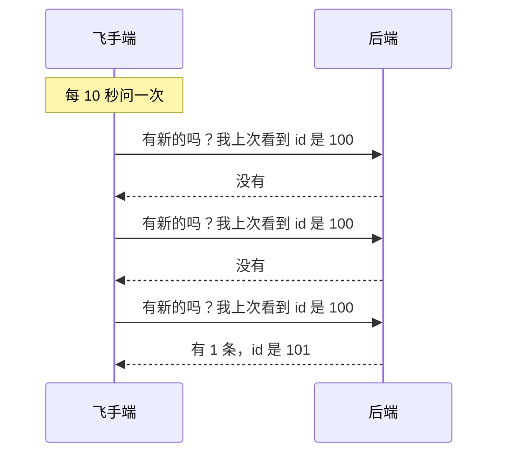
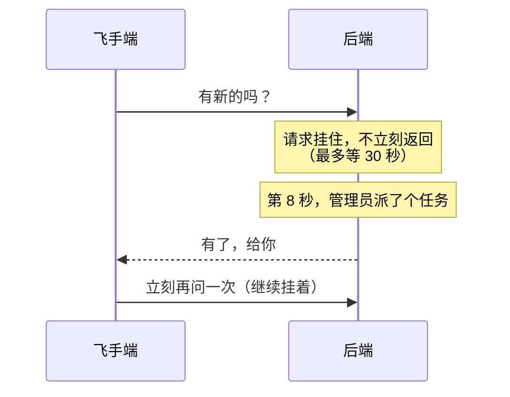
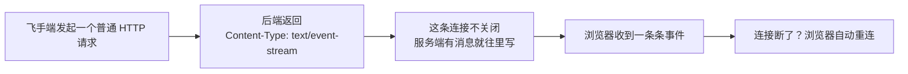
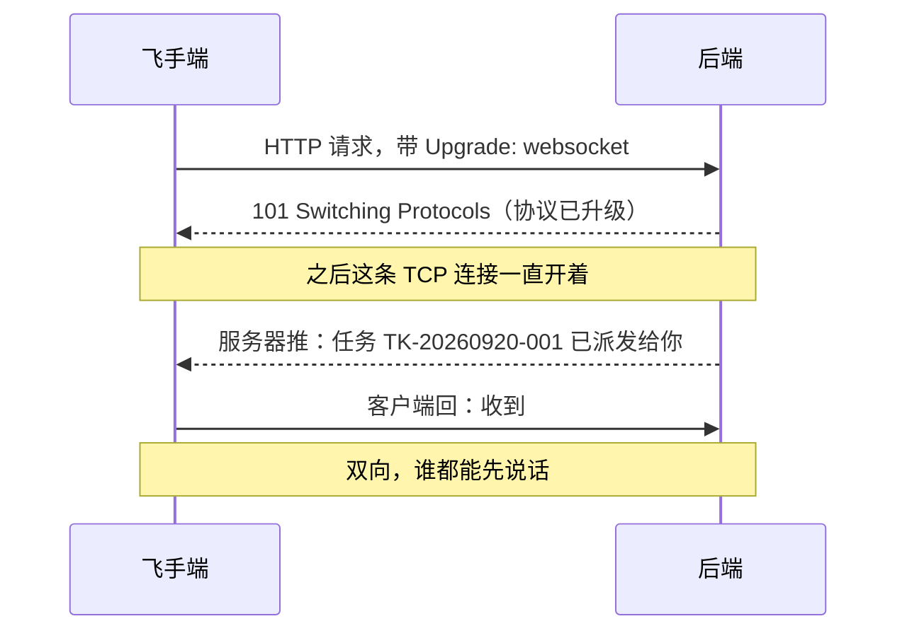
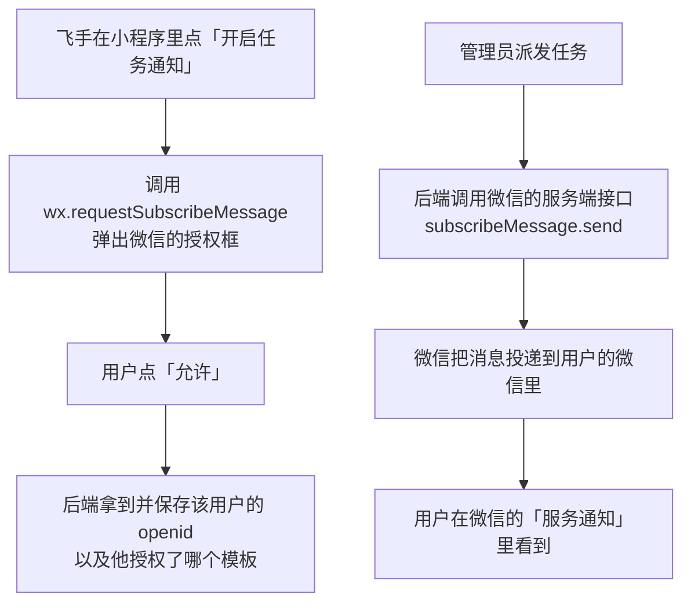
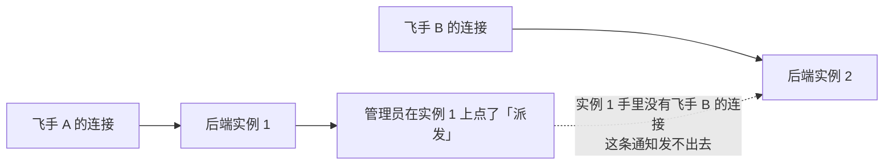

# 任务通知：把「派活了」实时告诉飞手

> 面向小白 / 初级工程师的学习型文档。
> 需求背景：管理员在后台**创建任务**或**派发任务**时，飞手端要能**实时**收到通知。
> 本文讲**技术选型与设计思路**，代码只是示意；**本项目实际落地的部分见文末附录二**
> （截至 2026-09-20，第二章第 2.4 节的 WebSocket 方案已经实现并验证通过）。
>
> 阅读建议：先看第一章（它把问题切成两半，是全文的骨架），再看第二章四种技术，最后看第四章的本项目选型。

---

## 一、先把问题问清楚

### 1.1 场景

```
管理员在后台点「创建任务」或「派发任务」
        ↓
飞手端要「实时」知道 —— 于是要解决：怎么把这件事告诉一个正在用手机的人？
```

### 1.2 最关键的一刀：App 是**开着**还是**关着**

这是全文最重要的一句话：

> **「实时通知」不是一个问题，是两个问题。**
> 页面还开着，有很多办法；**App 已经被用户关掉，办法只剩一条。**

| 情况 | 用户在哪 | 能用的手段 |
|---|---|---|
| **页面开着**（飞手正盯着小程序） | 有一条活着的连接 | 轮询 / 长轮询 / SSE / WebSocket |
| **页面在后台**（切走了但没关） | 连接可能已经被掐断 | 同上，但**不能指望它可靠** |
| **App 关着**（用户退出了） | 完全联系不上 | **只有「微信订阅消息」这一条路** |

**新手最常犯的错**：以为「上一个 WebSocket 就全解决了」。
WebSocket 只在页面活着的时候有效 —— 用户把小程序划掉之后，那条连接早断了，
服务器手里没有任何通道能捅到他的手机。**要叫醒一个关掉的小程序，必须走微信的推送通道（订阅消息）**，这跟咱们自己的后端一点关系都没有。

所以本项目的通知其实是**两条腿**：

- 前台实时 → WebSocket（见 2.4）
- 关掉也能收到 → 订阅消息（见 2.5）

### 1.3 还有一个前提问题：数据以谁为准？

在挑技术之前必须定一条原则，否则后面所有实现都会走歪：

> **推送只负责「快」，不负责「准」。数据永远以查询为准。**

意思是：收到推送之后，前端**仍然要去查一次接口**，而不是把推送的内容直接当数据。
为什么要这样？因为推送一定会丢、会重、会乱：

- 手机切网、进电梯，消息丢了
- 断线重连期间的消息没人收
- 集群下某条消息可能推了两次

把这条原则记住，后面很多设计就顺理成章了（也解释了为什么第五章第 2 条那么重要）。

---

## 二、四种技术，一个一个说

### 2.1 短轮询（Short Polling）

**一句话**：前端每隔几秒问一次「有新的吗？」

**打比方**：每隔 10 分钟去门口看一眼信箱里有没有信。没信就回来，下次再去。



**前端长什么样**（示意，不是本项目的代码）：

```js
setInterval(async () => {
  const res = await fetch(`/api/task/my?sinceId=${lastId}`)
  // 有新数据就更新界面，并推进 lastId
}, 10000)
```

**后端要做什么**：一个普通查询接口就够了。关键是**要能便宜地回答「有没有变化」**——
所以别每次把整张表查出来对比，而是让前端带一个「我上次看到的最大 id / 时间」，
后端只查比它新的：

```sql
-- 思路：只查增量，别全量拉
SELECT * FROM task WHERE pilot_id = ? AND id > ? ORDER BY id
```

**优点**

- 最简单，前端 3 行，后端一个查询接口
- **哪都能跑**：浏览器、小程序、App、甚至 curl，没有任何兼容性问题
- 服务端不用维护任何「连接状态」，无状态、随便扩容
- 出问题最好排查：就是一个普通请求，看日志就行

**缺点**

- **延迟最大等于轮询间隔**：10 秒问一次，最坏情况用户等 10 秒才看到
- **大量空跑**：1000 个飞手、10 秒一次 = 每秒 100 个请求，而 99% 的回答是「没有」
- 间隔调小则更实时但更浪费；调大则更省但更迟钝，**这个矛盾没有解**

**什么时候用它**：数据变化不频繁、对延迟不敏感（分钟级可接受）、想先跑起来。
本项目的通知属于「越快越好但不是秒级刚需」，所以它是一个**完全合格的兜底方案**。

---

### 2.2 长轮询（Long Polling）

**一句话**：还是问，但**服务端不马上回答**——没消息就把请求「挂住」，等到有消息或超时才返回。

**打比方**：你去门口问「有我的信吗」，管理员说「你先站这儿等着，一来信我立刻给你」。
你等到信（或等到被告知「今天先回去吧」），然后再去站着等下一次。



**和短轮询的差别在哪**：请求数大大减少（没消息时不用反复问），延迟接近实时（一有消息立刻回）。

**后端怎么实现**：关键是**别真的占住一个线程在那儿 sleep**。
Java/Spring 提供了异步请求机制：把请求先「放一边」，等有数据了再回填，线程还回去干别的活。

- Spring MVC：`DeferredResult` / `WebAsyncTask`
- 原生 Servlet：异步 Servlet（`AsyncContext`）

> 小白要记住的点：**「挂住请求」不等于「占住线程」**。
> 如果实现成 `Thread.sleep(30000)` 再返回，1000 个客户端就把线程池占光了（Tomcat 默认也就 200 个线程）。
> 这是长轮询最容易写错的地方。

**优点**

- 延迟低、空跑请求少
- **兼容性极好**：本质还是普通 HTTP 请求，浏览器、小程序、老旧代理都支持

**缺点**

- 服务端要维护「哪些请求在等着」以及「消息来了该唤醒谁」——**已经开始有状态了**
- 每个请求有超时，超时后前端要立刻重发（写起来比短轮询麻烦）
- 还是「一问一答」：一次只能等一件消息，消息密集时效率不如 WebSocket
- 多实例部署时，同样会遇到「消息产生在 A 机器，等着的请求在 B 机器」的问题（见 5.4）

**什么时候用它**：想要实时、又不能用 WebSocket 的场景。它是「没有 WebSocket 的年代」的标准解法。

---

### 2.3 SSE（Server-Sent Events）

**一句话**：一条**普通的 HTTP 连接**，服务端往里持续写数据，浏览器自动收。
方向是**单向的：只有服务端 → 客户端**。

**打比方**：你给电台打了个电话，然后**只听不说**。电台有消息就念给你听，一直念，直到你挂断。



响应长这样（就是纯文本，一行行往下streaming）：

```
event: taskAssigned
data: {"taskNo":"TK-20260920-001","taskName":"输电线路巡检"}

event: taskAssigned
data: {"taskNo":"TK-20260920-002","taskName":"光伏板缺陷扫描"}
```

**优点**

- **实现比 WebSocket 简单得多**：没有握手升级、没有新协议，就是一个「不结束的 HTTP 响应」
- **浏览器自带重连**：`EventSource` 断线后会自动重连，还能带上 `Last-Event-ID`，服务端据此补发漏掉的消息
- 走标准 HTTP：现有的鉴权、网关、日志、压缩基本都能复用

**缺点（这几条对本项目很要命）**

- **只能服务端推，客户端想说话得另开请求**。任务通知恰好只需要服务端推，所以这条不算大问题
- **浏览器原生 `EventSource` 不能自定义请求头** —— 也就是说**带不了 `Authorization: Bearer xxx`**。
  变通办法只有：把 token 放 query string（会进日志，有泄漏风险）、或者改用 cookie 鉴权
- HTTP/1.1 下**同一域名能开的连接数有限**（浏览器通常限制为 6 个左右），
  开多个页面/多个标签容易互相挤占（HTTP/2 多路复用可以缓解）
- **微信小程序没有 `EventSource`** —— 这一条直接决定了本项目**不能选 SSE**

> 补充一个进阶事实：小程序里想「收流」并不是完全做不到 ——
> `wx.request` 有 `enableChunked` 之类的分块接收能力，可以自己解析服务端持续下发的数据，
> 相当于「手搓一个 SSE」。
> 但**这是自己实现，不是标准 SSE**：重连、断点续传、消息边界全要自己写。
> 本项目不打算走这条路，写在这里只是让你知道有这条路、以及它不是官方 API。

**什么时候用它**：只需要服务端单向推、目标端是浏览器、又不想引入 WebSocket 的场景。
比如「AI 回答逐字往外蹦」这种经典场景，SSE 是最合适的选择。

---

### 2.4 WebSocket

**一句话**：先借 HTTP 握一次手，然后**升级成一条双向、长活的连接**，双方随时都能主动发。

**打比方**：打电话。接通之后你说一句、我说一句，不用每次都重新拨号。



**和 SSE 的关系**：一句话记住 ——
**只用服务端推就用 SSE（更省事）；需要双向就用 WebSocket（更强大）。**

**优点**

- **真双向**、延迟最低、连接常驻，消息密集时效率最高
- 浏览器、小程序、App 都支持，是**跨端能力最好**的方案
- 小程序里 `wx.connectSocket`（uni-app 里是 `uni.connectSocket`）**支持自定义 header** ——
  这点比浏览器的 `EventSource` 强：**可以直接把 `Authorization: Bearer` 放在握手请求里**，
  正好复用本项目已有的 JWT 体系

**缺点 —— 这些都是「要自己扛」的活**

- **要自己实现心跳与重连**（见 5.3）。不心跳的话，中间的网络设备会把「长时间没动静的连接」掐掉
- **小程序生产环境要求 `wss://`（加密）+ 在微信公众平台配置「socket 合法域名」**。
  开发阶段可以在开发者工具里关掉域名校验，但上线必须配。**具体域名规则与限制以微信官方文档为准**
- **小程序切到后台一段时间后连接会被回收**（时长随系统与基础库版本而异），
  所以「切后台」这个场景不能只靠 WebSocket
- **小程序对同时存在的连接数有上限**（具体数值以官方文档为准），别一个页面开好几条
- **多实例部署要额外处理**：连接挂在哪台机器上是不确定的（见 5.4）
- 浏览器原生 `WebSocket` **不能自定义请求头**（这点和小程序正好相反），
  H5 端要带 token 只能放 query string 或走子协议 —— 所以 H5 调试和真机小程序的鉴权写法**不一样**，要留意

**什么时候用它**：需要真实时、需要双向、或者需要跨端统一。**本项目的前台实时选它。**

---

### 2.5 微信订阅消息（唯一能叫醒「已关闭的小程序」的方式）

**一句话**：让用户**主动授权**，之后**由微信**把消息推到他微信里。这条链路**不经过咱们的后端**。

**打比方**：你办业务时留了手机号并勾选「同意短信通知」。之后快递到了，是**快递公司**给你发短信，
不是办事大厅的柜台在喊你 —— 柜台没这个本事。



**要用它，必须凑齐这些东西**（缺一不可，这也是它最大的成本）

1. 小程序要有**正式的 appid / secret**（测试号不行）。本项目 appid 已填，**secret 还没配**
2. 在微信公众平台**申请消息模板**（消息长什么样受模板字段约束，不能随意写文案）
3. 用户**必须点过授权**（不能偷偷发）
4. 后端要存用户的 **openid** —— 本项目现在的 `user` 表里**没有这个字段**，这是要补的第一件事
5. 后端要能拿到 **access_token**（用 appid + secret 换，有有效期，需要缓存与刷新）

**限制（一定要提前知道）**

- **一次性订阅**：用户授权一次，你只能发**一条**。
  用户可以在授权框上勾「总是保持以上选择」，之后就不再弹框，但**这属于用户的选择，你不能保证**
- **长期订阅**：一般只对特定行业类目开放，普通/个人主体通常拿不到 —— **以微信公众平台的实际类目规则为准**
- 消息内容受模板字段限制，不能当短信随便发
- 有频率与额度限制

**什么时候用它**：只要你的需求是「用户关掉小程序之后还要收到通知」，就**只能**用它。
没有替代方案。

---

## 三、横向对比

| 维度 | 短轮询 | 长轮询 | SSE | WebSocket | 订阅消息 |
|---|---|---|---|---|---|
| 方向 | 客户端问 | 客户端问 | 服务端单向推 | **双向** | 微信平台推给用户 |
| 实时性 | 差（间隔决定） | 好 | 好 | **最好** | 好（但依赖微信） |
| 空跑请求 | 多 | 少 | 无 | 无 | 无 |
| 服务端压力 | 小（无状态） | 中（要挂住请求） | 中（长连接） | 中（长连接） | 极小 |
| 浏览器支持 | ✅ | ✅ | ✅ | ✅ | ❌ 不相关 |
| **微信小程序支持** | ✅ | ✅ | **❌** | ✅ | ✅（唯一能叫醒关掉的 App） |
| 断线重连 | 无所谓 | 要自己写 | **浏览器自带** | 要自己写 | 不需要 |
| 带自定义 Header 鉴权 | ✅ | ✅ | ❌（浏览器） | 小程序 ✅ / 浏览器 ❌ | 不涉及 |
| 实现难度 | ★ | ★★★ | ★★ | ★★★★ | ★★★（坑在平台配置） |
| 多实例部署 | 简单 | 要处理 | 要处理 | **要处理** | 简单 |
| 典型场景 | 后台列表刷新、兜底 | 老系统的实时 | AI 逐字输出、单向推送 | 聊天、协作、**本项目通知** | **关掉 App 后的通知** |

---

## 四、本项目怎么选

### 4.1 现状（决定了选项边界）

| 事实 | 对通知的影响 |
|---|---|
| 飞手端是 **uni-app 微信小程序**（`drone-app/`） | **SSE 直接出局**（小程序没有 `EventSource`） |
| 后端是 Spring Boot，用**拦截器 + JWT** 鉴权，无状态 | WebSocket 要单独做一次握手鉴权，不能直接沿用拦截器 |
| 小程序**已经填好正式 appid**（见 `drone-app/src/manifest.json`） | 订阅消息的「正式 appid」这一项**已经满足**；还差 4 样：**AppSecret**（必须走配置，绝不能进仓库）、消息模板、`user` 表加 `openid`、用户授权入口 |
| `user` 表里**没有 openid** | 订阅消息的前置条件，要补字段与授权入口 |
| 飞手端页面**已经有 `onShow` 重新拉取** | 意味着就算不做任何推送，数据也不会错，**只是不够快** |

最后一行很关键：**现有设计已经保证了正确性**（进页面就查、下拉可刷新），
所以通知功能要解决的是**体验**问题，不是**数据**问题。这决定了它可以分步做，也可以先不做。

### 4.2 建议：三步走，每步都能独立交付

**第一步：先把「准」做扎实（几乎零成本）**

- 什么都不用改，因为 `onShow` 已经在了
- 可以考虑加一个**未读角标**：飞手端底部 tab 上显示「有 N 条新任务」，数据来自一次普通的计数查询（就是短轮询）。
  这一步用**短轮询**就够了 —— 角标晚几秒更新完全无所谓

> 这一步的价值：**让你在没有任何长连接的情况下，需求就已经「基本满足」**。
> 后面两步都是锦上添花。

**第二步：前台实时 —— WebSocket**

为什么是 WebSocket 而不是 SSE：

1. **小程序不支持 SSE**（一票否决，与技术优劣无关）
2. 两端都能用：小程序 `uni.connectSocket` 能带 header 传 token，H5 端调试也能跑
3. 现有 JWT 可以复用（放在握手请求的 header 或 query 里）

要额外做的工作：握手鉴权、连接注册表（记住「哪个用户在哪个连接上」）、心跳、重连、
多实例扇出（见第五章）。

**第三步：关掉也能收到 —— 订阅消息**

平台侧的前置工作比写代码多。好消息是本项目的 **appid 已经填好了**，所以清单变短了：

| 前置条件 | 现状 |
|---|---|
| 正式 appid | ✅ 已填（`drone-app/src/manifest.json`） |
| **AppSecret** | ❌ 要去公众平台取，**必须放配置/环境变量，绝不能提交进仓库** —— 拿到它等于能冒充你的小程序调微信接口 |
| 消息模板 | ❌ 在公众平台申请，拿到 `template_id`；文案受模板字段约束 |
| `user` 表加 `openid` | ❌ 要加字段；用户进来时要能拿到并保存他的 openid |
| 用户授权入口 | ❌ 飞手端要加一个「开启任务通知」的按钮（含用户拒绝时的兜底） |
| access_token 缓存 | ❌ 用 appid + secret 换取，有有效期，要缓存与刷新（别每次发消息都去换） |

**什么时候做第三步**：当「飞手会关掉小程序但仍然需要被通知」成为真实诉求时。
如果实际使用中飞手就是上班时一直开着，第二步已经够了。

### 4.3 一句话总结选型的理由

> **不是 SSE 不好，是这个小程序用不了；
> 不是订阅消息麻烦，是「关掉的 App」只有它能叫醒。**

---

## 五、落地时必须处理的六件事（换哪种技术都躲不掉）

### 5.1 鉴权怎么带

| 技术 | token 怎么带 | 注意 |
|---|---|---|
| 轮询 / 长轮询 | 正常请求头 `Authorization: Bearer xxx` | 和现有接口一样，最省事 |
| SSE（浏览器） | **带不了自定义头** → query 或 cookie | token 进 URL 会进访问日志，谨慎 |
| WebSocket（小程序） | 握手请求的 `header` 里带 | 本项目 H5 端要另想辙（浏览器不能带） |
| WebSocket（浏览器） | query string 或子协议 | 两端写法不一致，容易踩坑 |
| 订阅消息 | 不涉及用户 token | 用的是 appid/secret 换的 access_token |

**WebSocket 握手鉴权的几个要点**：

- 握手是**一次普通 HTTP 请求**，所以能拿到 header / query，也就能校验 JWT
- 校验失败要**明确拒绝握手**（返回 401/403），而不是「先连上再踢」
- 连上之后，服务端要把「用户 id → 连接」登记到一张**连接注册表**里，推消息时靠它找人
- 注意：**连接建立时的用户身份要记住**，后续每条推送都从这里取，别再依赖请求头

### 5.2 消息以谁为准（再强调一次）

> **推送只负责「快」，数据以查询为准。**

所以正确姿势永远是：**收到推送 → 触发一次查询 → 用查询结果刷新界面**。
不要把推送的 payload 直接渲染成界面数据。

好处：丢消息、重复消息、乱序消息都**不会让界面显示错的数据**，最坏只是「晚几秒」。

### 5.3 心跳与断线重连

**为什么需要心跳**：手机进电梯、切 Wi-Fi、NAT 网关回收空闲连接……
连接可能**已经死了但双方都不知道**。心跳就是定期问一句「你还在吗」，问不通就重连。

```
飞手端 ──每 30 秒发一次 ping──▶ 后端
飞手端 ◀──pong──────────────  后端
（连续几次没有 pong → 认定断了 → 重连）
```

**重连要用退避，不要死循环猛试**：
第一次 1 秒后重连，失败就 2 秒、4 秒、8 秒……封顶 30 秒。
否则后端一重启，几千个客户端会在同一瞬间疯狂重连，把它再打挂一次（这叫「惊群」）。

**小程序特有的坑**：切到后台连接会被回收，回到前台要**主动检查连接并重连**，
而不是等第一次发消息失败才发现。

### 5.4 多实例部署（**最容易翻车的坑**）

单机时，所有连接都在同一个进程里，想推给谁就推给谁。**多实例就没这么简单了**：



**成因**：负载均衡把飞手 B 的连接分到了实例 2，但派发请求落到了实例 1，
实例 1 的连接注册表里根本没有 B。

**解法**：引入一个「广播总线」，让所有实例都能收到同一条通知，各自检查「这个人在不在我这儿」：

- **Redis 发布订阅**（最常用，本项目如果加 Redis 也最轻）
- 消息队列（RabbitMQ / Kafka 等，可靠性更高、组件更重）
- 数据库轮询（最土但可行：所有实例都定期查「有没有新通知」，其实就是把轮询搬到服务端内部）

> 单机开发时这个问题**完全不会暴露**，一上多实例就「有的用户收得到、有的收不到」。
> 所以就算现在只有一台机器，设计时也要留出这个位置。

### 5.5 离线补发

用户不在线时产生的通知不能凭空消失。两种做法：

- **只需要「有没有新东西」**：前端记录上次看到的最大 id（或时间），上线时查一次增量 —— 这是**最简单可靠**的做法
- **需要完整的通知历史**：给通知建一张表（谁、什么类型、内容、是否已读、时间），上线时拉未读列表

补发是**兜底**，它保证「不管推送丢没丢，数据都不会错」。这也是 5.2 那条原则的落地方式。

### 5.6 顺序、去重与安全

- **顺序**：推送**不保证**按发生顺序到达。别依赖「先收到派发、后收到撤回」，
  要么带上服务端时间戳自己排序，要么干脆每次推送都触发一次全量查询（见 5.2）
- **去重**：消息带上唯一 id（比如通知表的自增主键），前端按 id 去重，重复收到只处理一次
- **安全**：推送内容**别放敏感信息**。通知里只放「任务编号 + 名称」这类够用的信息，
  详细内容让前端去查接口（又要登录、又走权限校验）。
  另外推送通道（尤其是经过第三方平台的订阅消息）**不适合传输敏感数据**

---

## 六、常见坑速查表

| 坑 | 症状 | 怎么避 |
|---|---|---|
| 以为 WebSocket 能通知关掉的 App | 用户关掉小程序后再也收不到 | 关掉 App 只能靠订阅消息 |
| 长轮询里 `sleep` 占线程 | 几百个客户端就把服务端拖死 | 用 DeferredResult / 异步 Servlet |
| 没有心跳 | 连接「看着还在」其实早断了 | 定心跳 + 超时判定 |
| 重连不退避 | 服务端一重启就被重连风暴打挂 | 指数退避 + 抖动 |
| 多实例下有的用户收不到 | 单机正常，一扩容就随机丢 | Redis 发布订阅做扇出 |
| 把推送内容当数据用 | 丢一条消息界面就少了/错了 | 收到推送后仍去查接口 |
| `EventSource` 里想传 token | 拿不到 header，鉴权失败 | 用 cookie，或改用 WebSocket |
| H5 和真机鉴权写法不一致 | 浏览器里好好的，真机连不上 | 两端分别处理 token 传递方式 |
| 忘了配置合法域名 | 开发者工具正常，真机请求被拒 | 公众平台配 socket 合法域名（生产必须 wss） |
| 订阅消息发不出去 | 报权限/模板错误 | 检查：正式 appid、模板 id、用户是否授权、openid 是否存了 |

---

## 七、面试题（面向初级，答案尽量说人话）

**1. 短轮询和长轮询的区别？**
短轮询是「问完就走，过会儿再来」；长轮询是「问了先别回答，有消息再回答」。
后者请求少、延迟低，但服务端要维护「谁在等」，实现复杂一些。

**2. SSE 和 WebSocket 怎么选？**
只需服务端单向推（如 AI 逐字输出）→ SSE，实现简单、浏览器自带重连。
需要双向通信（如聊天）→ WebSocket。
一句话：**单向用 SSE，双向用 WebSocket。**

**3. 为什么 WebSocket 需要心跳？**
连接可能已经死了但双方不知道（NAT 回收、切网）。
心跳定期探活，发现断了就重连，否则用户会以为「没消息」其实是「连接早没了」。

**4. WebSocket 怎么做鉴权？**
握手那一次是普通 HTTP 请求，可以在 header 或 query 里带 token，服务端校验完再决定是否升级协议。
连上之后把「用户 → 连接」登记起来，后续推送靠这张表找人。

**5. 多实例部署时 WebSocket 推送为什么会丢？**
连接是随机的，可能挂在实例 B，而发通知的请求落在实例 A。
A 手里没有那个用户的连接。解法是加一层广播（Redis 发布订阅 / MQ），让所有实例都能看到这条通知。

**6. 怎么保证「通知不丢」？**
单靠推送保证不了。真正可靠的做法是**推送 + 拉取兜底**：
推送负责及时性，前端上线/进页面时按上次的 id 拉增量，负责完整性。

**7. 推送能不能直接当数据用？**
不建议。推送可能丢、可能重、可能乱序，直接渲染会出现数据错乱。
标准姿势是「收到推送 → 查一次接口 → 用接口结果刷新」。

**8. 长轮询为什么不能用 `Thread.sleep` 实现？**
会把一个线程占住 30 秒。Web 服务器的线程池就这么大（Tomcat 默认 200），
几百个客户端就耗尽了。应该用异步请求，把请求挂起、线程还回去。

**9. 为什么小程序不能用 SSE？**
小程序运行环境里没有 `EventSource` 这个 API，也没有对 `text/event-stream` 的标准处理。
要收流得用分块接收自己解析，属于自己实现，不是标准 SSE。

**10. 订阅消息为什么必须用户先点授权？**
这是微信平台的规则：**不允许开发者主动给用户推消息**，否则就成了垃圾短信。
所以先由用户授权（同意接收某个模板的消息），后端才能按这个授权去发。
而且一次性订阅通常是「授权一次发一条」，长期订阅有类目门槛。

**11. 如果让你设计本项目（飞手端小程序）的任务通知，你怎么选？**
先分清两个场景：
- 页面开着 → WebSocket（小程序支持、能带 header 传 token、可复用 JWT）；
- 关掉了 → 订阅消息（唯一可行）。
另外把**数据可靠性**交给查询（进页面拉增量），推送只当作加速手段。
SSE 因为小程序不支持而排除。

---

## 八、如果动手，从哪一步开始（顺序建议）

> 以下是实施顺序建议，本文不含实现。

1. **先做兜底，不引入任何新组件**：确认飞手端「进页面就拉、下拉可刷新、有未读角标」。
   这一步做完，功能上其实已经能用了
2. **再上 WebSocket（只做「前台实时」）**：握手鉴权 → 连接注册表 → 收到推送触发查询 → 心跳重连
3. **然后处理多实例**：在 2 的基础上加 Redis 发布订阅（就算现在单机，也先留出接口）
4. **最后做订阅消息**：先备齐平台侧条件（**AppSecret 走配置**、模板、`openid` 字段、授权入口），再写发送逻辑

---

## 附：术语表

| 术语 | 说人话 |
|---|---|
| 轮询 | 前端定时问「有新的吗」 |
| 长轮询 | 问完了服务端先不答，有消息再答 |
| SSE | 服务端单向、持续往一个 HTTP 响应里写数据 |
| WebSocket | 一次握手后变成双向长连接 |
| 心跳 | 定期探活，确认连接还活着 |
| 扇出 | 一条消息要发给多个接收者（多实例场景的关键动作） |
| 订阅消息 | 微信平台提供的、用户授权后才能发的推送通道 |
| openid | 微信给「某个用户 + 某个小程序」分配的唯一标识，发订阅消息必须用它 |
| access_token | 后端调微信服务端接口用的凭证，有有效期，要缓存 |

---

> **本文未在本机核实的点**（写作时文档站在外网被拦，无法逐条比对官方原文）：
> - 小程序同时存在的 WebSocket 连接数上限的具体数值
> - 订阅消息对不同主体/类目的开放范围
> - 小程序切到后台后连接被回收的具体时长
>
> 这三处文中都写成了「以微信官方文档为准」。真要做的时候，请以
> [微信开放文档](https://developers.weixin.qq.com/miniprogram/dev/framework/) 为准，
> 并在开发者工具 + 真机上各实测一次。

---

## 附录二：本项目的落地清单

> 第一版 2026-09-20（对应第四章「三步走」的**第二步：前台实时**），
> 2026-09-21 补上「通知管理员」这条反向链路。

### 消息类型与接收方

| type | 什么时候发 | 发给谁 | 前端怎么表现 |
|---|---|---|---|
| `taskDispatched` | 派发任务 | **被指派的飞手** | 弹提示「新任务：xxx」+ 刷新列表 + 自动展开这条 |
| `taskStarted` | 飞手点「开始执行」 | 所有拥有 `task:dispatch` 的人 | 普通通知，6 秒自动消失 |
| `taskRefused` | 飞手点「拒绝执行」 | 同上 | **红色重点样式 + 不自动消失 + 「去重新指派」按钮** |

**为什么拒绝要重点提示**：三类通知里只有它**需要管理员动手** ——
任务已经退回「待派发」，得有人重新指派，否则这条活就悬着。
要是和「开始执行」那种纯告知长得一样，管理员一眨眼就错过了。

**为什么接收方是「拥有 `task:dispatch` 权限的人」**：能被通知的人正好就是
能把任务重新指派出去的人，语义完全对齐。比写死某个管理员账号稳 ——
人员或权限一调整，通知范围自动跟着变。

### 做了什么

| 环节 | 实现 |
|---|---|
| 端点 | `ws://后端/ws/task`（两端都走 Vite 代理的 `/api/ws/task`，代理需开 `ws: true`） |
| 握手鉴权 | `TaskWsHandshakeInterceptor`：校验 JWT，通过后把 userId 放进 session 属性 |
| Token 传递 | 小程序用 `header`（`Authorization: Bearer`）；浏览器（H5 与后台管理端）只能用查询参数 `?token=` |
| 白名单 | `/ws/**` 已加入 `WebMvcConfig` 白名单 —— **必须加**，否则握手先被 MVC 拦成 401 |
| 会话注册表 | `TaskWsSessionRegistry`：`Map<用户id, Set<连接>>`，用并发容器；发送前用 `ConcurrentWebSocketSessionDecorator` 包一层（`sendMessage` 不是线程安全的） |
| 心跳 | 客户端每 30 秒发 `{"type":"ping"}`，服务端回 `pong` |
| 重连 | 两端都是指数退避（1→2→4→8→16→30 秒封顶），连续 5 次失败就停 |
| 推送时机 | **事务提交之后**（`TransactionSynchronizationManager` 的 `afterCommit`），避免「回滚了但消息已发出」 |
| 报文 | `{"type":"...","data":{...},"timestamp":"..."}`；`data` 只放够用来提示的最小信息 |
| 推送失败 | 只记日志、不抛异常：收不到通知不该让业务失败 |

### 触发时机

**派发、开始、拒绝会推送，创建任务不推。**
创建时还没有飞手、也没有需要管理员动手的事，没有通知对象
（见 [任务业务设计.md](./任务业务设计.md) 的「MVP 范围」一节）。要改成「创建时广播给全体飞手」是另一种产品形态
（抢单），不在当前设计里。

### 相关文件

```
后端
  task/ws/TaskWsConfig.java                 端点与拦截器注册
  task/ws/TaskWsHandshakeInterceptor.java   握手鉴权（JWT，header 与 query 两种都认）
  task/ws/TaskWsHandler.java                连接生命周期 + 心跳
  task/ws/TaskWsSessionRegistry.java        会话注册表（推送的「通讯录」）
  task/ws/TaskNotifier.java                 拼报文 + 发送入口（三类消息 + 按权限找接收方）
  task/dao/TaskDao.java                     selectUserIdsByPermission：按权限查接收方
  config/WebMvcConfig.java                  /ws/** 加白名单
  task/service/impl/TaskServiceImpl.java    dispatch / start / refuse 里 afterCommit 触发推送

飞手端小程序（drone-app/）
  utils/socket.ts                           连接 / 心跳 / 退避重连
  pages/task/my.vue                         收到推送后刷新、显示「实时」小标、
                                            「开始执行」「拒绝执行」两个按钮
  config.ts                                 WS 地址（按平台条件编译）
  vite.config.ts                            H5 代理开启 ws: true

后台管理端（drone-web/）
  composables/useTaskSocket.ts              同样的连接/心跳/重连，外加「消息 → 通知对象」的转换
  components/TaskNotificationCenter.vue     右上角通知浮层；拒绝用 .notice--danger 重点样式
  layouts/AdminLayout.vue                   进布局即连、离开即断；顶栏显示「实时通知已连接」
  vite.config.ts                            代理开启 ws: true

测试
  test/.../TaskWebSocketTests.java          8 个用例：无 token / 假 token 被拒、连上即登记、
                                            派发能收到、别人收不到、ping→pong、
                                            拒绝要带上「谁拒的 + 原因」并推给管理员、
                                            开始执行也推给管理员，且都不推给飞手自己
```

### 已知限制（没做的部分）

1. **单机**：会话注册表在进程内存里。多实例部署时，连接在实例 B、推送产生在实例 A 就推不到 ——
   按第五章 5.4 节的做法，需要引入 Redis 发布订阅做扇出。**当前是单机，够用。**
2. **关掉小程序收不到**：这是 WebSocket 的固有限制，只能靠订阅消息解决（第三步，未做）。
3. **`/ws/task` 只校验 token 有效性**，没有像 REST 那样查一次用户的角色与权限。
   目前够用（推送内容不含敏感信息），但如果将来要按权限决定「推哪些消息」，
   这里需要补一次用户校验。
4. **浏览器的 token 在 URL 里**（浏览器限制，只能这样）。生产环境建议给访问日志里的
   `token` 参数打码。
5. **微信真机未验证**：本机没装微信开发者工具（GUI 应用），
   验证方式是「小程序目标编译通过 + 产物检查 + 同一套逻辑在 H5 上端到端跑通」。
   真机/工具里的确认需要你自己跑一次（记得勾「不校验合法域名」）。
