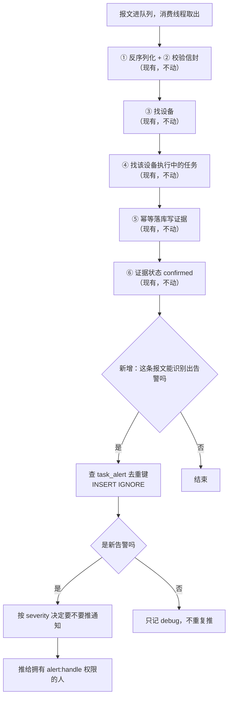
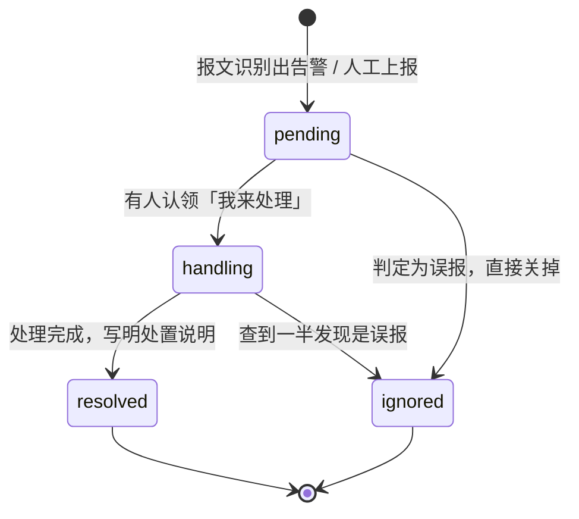
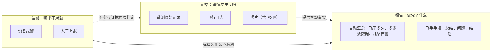

# 告警体系设计

> **这份文档的状态：设计，未实施。**
> 本文只回答「应该怎么设计」，不含任何已落地的代码。
> 数据库脚本、Java、前端都还没动 —— 文中出现的 `task_alert` 表、`alert:*` 权限点
> 都还是**草案**，等方案拍定后进实施批次再改真脚本与库。

## 这一篇要解决什么

### 现状：订阅了告警的通道，却没有告警

MQTT 接入那一轮做完了「设备数据进来」这件事，订阅了三个 topic：

| topic | QoS | 现在怎么处理 |
|---|---|---|
| `drone/+/telemetry` | 0 | 当遥测证据归档 |
| `drone/+/event/+` | 1 | **也当遥测证据归档**（因为按事件类型分发的动作没实现） |
| `drone/+/status` | 1 | **也当遥测证据归档**同上 |

于是出现一个荒唐的结果：设备发一条「电量严重不足」，系统把它当成
「这条任务有旁证的又一条证据」，`evidence_state` 抬到 `confirmed`，
而**没有任何人被告知电量有问题**。

`MQTT与设备接入.md` 的 4.5 第 ⑥ 步表格里把这几行标成了「❌ 未实现」，
4.13.7 也写了「任何来自该设备的报文都会算作这条任务有旁证，
粒度是『设备在说话』，不是『设备说了什么』」。这一篇就是来补这个洞的。

### 目标（你自己给的三句话，我原样记在这里当验收标准）

> 先去分析业务中都有哪些告警数据类型，然后进行落库，让任务有据可依，
> 然后根据告警类型去分析后续的处理流程，包括谁能处理、要不要处理。
> **通知的目的只是要尽快告诉能处理告警的人。**

拆成四件事，本文按这个顺序讲：

1. **有哪些告警** —— 分类清单（第二章）
2. **怎么落库** —— 让任务有据可依（第四章）
3. **谁来处理、要不要处理** —— 处理流程矩阵（第六章）
4. **怎么尽快告诉能处理的人** —— 通知设计（第八章）

另外两件是后来补的（都来自追问）：

5. **有些告警必须飞手在现场动手，怎么办** —— 责任与销账分开（第十二章）
6. **数据留多久、真涨起来了往哪迁** —— 保留期与时序库候选方案（第十三章）

> 第 5 条和第 6 条都不是「功能」，是**边界问题**：
> 前者划清「谁负责」和「谁销账」，后者划清「什么该留在 MySQL、什么该迁走」。
> 边界没划清，后面写代码时一定会糊。

---

## 一、先分清三个词：证据、告警、报告

这三个词在项目里已经都出现了，很容易混。先把边界划死在前面，
后面所有设计都从这里推出来。

| | 回答什么问题 | 能不能改 | 谁产生 | 现有表 |
|---|---|---|---|---|
| **证据** | 「这件事**发生过**吗」 | **不能**（只追加，`valid` 标记推翻） | 设备 / 飞手 / 旁人 | `task_evidence` |
| **告警** | 「哪里**不对劲**」 | **能**（要有人处理、要能关掉） | 设备 / 飞手 / 管理员 | 本文新建 `task_alert` |
| **报告** | 「我们**做完了什么**」 | 能（允许修订，但要留痕） | 飞手 | `task_report` |

**三条推论，都直接影响后面的设计：**

1. **告警不是证据。** 证据是「事情发生过的旁证」，告警是「出了问题、需要人看一眼」。
   两者方向相反：证据用来**证明**，告警用来**提示**。
   把告警塞进证据表，等于让「已证实」这个判断被「设备报警了」污染 ——
   设备报警恰恰说明这次执行**不顺利**，它不该让任务更可信。
2. **告警必须能改状态。** 「有人处理了吗」这个问题必须能回答，
   所以告警不能是一份只追加的流水（这一点在第四章展开，是选表的关键理由）。
3. **告警的归属对象可能是设备，不一定是任务。** 一架飞机在机库里自检时报了
   电池温度高，它不属于任何任务，但这条告警必须记下来、必须有人管。

---

## 二、业务上到底有哪些告警

按**数据从哪来**分成四类。前三类都走 MQTT（设备侧），第四类走 HTTP（人工上报）。

### 2.1 遥测类：从周期性数据里算出来的

设备每 1 秒发一条 `telemetry`，里面是位置、电量、温度这些**连续量**。
「超阈值」这件事**不是设备告诉我们的，是我们自己算的**（这一条很重要，
第三章会展开）。

| 编码 | 名称 | 触发条件（服务端判断） | 严重级别 |
|---|---|---|---|
| `bat.low` | 电量低 | `battery <= 30` | warning |
| `bat.critical` | 电量严重不足 | `battery <= 15` | **critical** |
| `bat.temp.high` | 电池温度偏高 | `batteryTemp >= 55` | warning |
| `bat.temp.critical` | 电池温度过高 | `batteryTemp >= 65` | **critical** |
| `gps.weak` | 定位信号弱 | `gpsLevel <= 2`（或卫星数 < 8） | warning |
| `gps.lost` | 定位丢失 | `gpsLevel == 0` 或定位无效 | **critical** |
| `rc.signal.weak` | 图传/遥控信号弱 | `signal <= 2` | warning |
| `rc.signal.lost` | 图传/遥控信号丢失 | `signal == 0` | **critical** |
| `alt.over` | 超出限高 | 飞行中 `alt > 120` 米 | warning |
| `alt.low` | 低于安全高度 | 飞行中 `alt < 5` 米 | warning |
| `speed.over` | 超速 | `speed > 15` 米/秒 | warning |
| `route.deviation` | 航线偏离 | 当前位置与计划航线偏差 > 阈值 | warning |
| `storage.low` | 存储空间不足 | 可用存储 < 1GB | warning |
| `motor.fault` | 电机异常 | 电机状态非 normal | **critical** |
| `zone.breach` | 进入禁飞区 | 当前位置落在任一启用的禁飞区内（见 `地图接入方案.md` 6.3.3） | **critical** |
| `zone.alt.over` | 禁飞区限高内超高 | 在标了限高的禁飞区内，且高度超过该限高 | warning |

> **最后两条是 2026-09-28 补的**（原本的 27 条里没有「空间违规」这一类）。
> 归入遥测类而不是新开一类，因为它的分工和 `alt.over` 完全一样：
> **设备只报「我在哪、多高」，而「这里不能飞」是拿着禁飞区数据算出来的** ——
> 判据在我们这边。
>
> ✅ **它们已有生产者**（2026-09-29）：判在 `AlertDetector#detectZone` ——
> 每条遥测带 lng/lat 就判一次（复用禁飞区那套几何与生效期筛选），
> 进「完全禁飞」的区出 `zone.breach`、在「限高区」里超高出 `zone.alt.over`。
> 详见 `地图接入方案.md` 6.3.3 与第四步落地记录。
> <br>（当初先把编码定下来、后才做生产者，是为了避免
> 「文档写了 29 条、代码里只有 27 条」这种漂移 —— 这个顺序是对的。）

> 阈值全部写在**配置**里（建议前缀 `drone.alert.*`），不写死在代码里 ——
> 同一个机型在平原和在高原的合理温度阈值不一样，写死了每换一个场景就要改代码。
> 文档里给的是**默认值**，不是标准答案。

### 2.2 状态类：设备在不在、在干什么

走 `drone/{编号}/status`，QoS 1。

| 编码 | 名称 | 触发条件 | 严重级别 |
|---|---|---|---|
| `device.online` | 设备上线 | 收到 `status=online`（保留消息） | info |
| `device.offline` | 设备离线 | 遗嘱 `status=offline` 或心跳超时 | warning 或 **critical** |
| `flight.state.changed` | 飞行状态变化 | `flightState` 变化（如 悬停→返航） | info |

> **`device.offline` 的级别是动态的**，这是本文里唯一一条「级别取决于上下文」的告警：
> - 设备闲着的时候掉线 → `warning`（可能只是关机了）
> - **设备掉线时它身上有「执行中」的任务 → `critical`**（飞机失联了，这是最严重的情况）
>
> 所以级别不能只看报文，要看「这台设备此刻有没有在执行任务」。
> 这一条也解释了为什么告警落库时要顺手记 `task_id` —— 不记，就判不出级别。

### 2.3 事件类：设备主动说「我干了什么」

走 `drone/{编号}/event/{类型}`，QoS 1。与遥测类的本质区别：
**事件是设备判定的，遥测是我们判定的**。

| 编码 | 名称 | 事件类型 | 严重级别 |
|---|---|---|---|
| `evt.takeoff` | 起飞 | `takeoff` | info |
| `evt.land` | 降落 | `land` | info |
| `evt.rth` | 返航 | `rth` | warning |
| `evt.battery.low` | 电量低（设备自己判的） | `battery-low` | warning |
| `evt.mission.interrupt` | 任务中断 | `mission-interrupt` | **critical** |
| `evt.emergency.stop` | 紧急停止 | `emergency-stop` | **critical** |

> `evt.rth` 为什么是 warning 而不是 info：返航本身是**正常操作**（作业完就返航），
> 但**非计划返航**（低电返航、失联返航）是预警信号。区分办法是看返航原因，
> 报文里带上 `reason` 字段；不区分的话就统一按 warning 处理（宁可多看一眼）。
> 这一条列入开放问题。

### 2.4 人工上报类：飞手在现场看到的问题

不走 MQTT，走 HTTP 接口（飞手端小程序提交）。**这类告警的价值很容易被低估**：
设备传感器能测到电量，但测不到「现场围了一群人不让起飞」「磁场干扰」「客户临时改要求」。

| 编码 | 名称 | 谁上报 | 严重级别 |
|---|---|---|---|
| `man.onsite.issue` | 现场异常 | 飞手 | warning |
| `man.device.damage` | 设备损伤 | 飞手 / 机务 | **critical** |
| `man.weather` | 天气突变 | 飞手 | warning |
| `man.customer.issue` | 客户问题 | 飞手 | info |

### 2.5 清单小结

一共 **29 条**：遥测 16 + 状态 3 + 事件 6 + 人工 4。

按默认级别分：

| 级别 | 条数 | 是哪些 |
|---|---|---|
| `critical` | **9** | `bat.critical`、`bat.temp.critical`、`gps.lost`、`rc.signal.lost`、`motor.fault`、`zone.breach`、`evt.mission.interrupt`、`evt.emergency.stop`、`man.device.damage` |
| `warning` | **14** | 其余遥测类 9 条 + `zone.alt.over` + `evt.rth`、`evt.battery.low`、`man.onsite.issue`、`man.weather`（9 + 1 + 4 = 14） |
| `info` | **5** | `device.online`、`flight.state.changed`、`evt.takeoff`、`evt.land`、`man.customer.issue` |
| **随上下文变** | **1** | `device.offline` —— 平时 `warning`，**该设备身上有「执行中」任务时升为 `critical`**（见 2.2） |

> 9 + 14 + 5 + 1 = 29 ✓
>
> **这一节初稿把汇总数字写错了**（写成 critical 9 / warning 12 / info 6），
> 与第二章那四张明细表对不上。是写识别代码时逐条枚举才发现的 ——
> **汇总数字一定要从明细算出来，不能凭印象写**，
> 否则代码照着清单实现、汇总又照着印象写，两边永远对不上。

> ✅ **这份清单已确认（2026-09-23）**，作为实施的依据。
>
> **后续唯一一次增补（2026-09-28）**：加了 `zone.breach` 与 `zone.alt.over`
> 两条空间类（27 → 29）。起因是地图接入要做「运行时越界检测」，
> 而原清单里**没有**能表达「飞进禁飞区」的编码 ——
> 见 `地图接入方案.md` 6.3.3。加的方式完全按下面那两条规矩办的（先改本文档、再改代码）。
> **除这次之外没有增删。**
>
> 也就是说：`alert_code` 的取值范围就是上面这 29 个，
> 阈值全部走配置（`drone.alert.*`）。
>
> **将来要加新告警类型时**记住两条：① 在本文档的清单里先加一行（编码、触发条件、
> 级别、来源都要写全），再动代码；② `severity` 只能取 `info`/`warning`/`critical` 三档，
> 不要往任务那套 `P0~P3` 上靠（理由见第三章）。
> 不在清单里的 `alert_code`，服务端应当拒绝而不是照单全收 ——
> **否则告警表会变成一个没人管得住的口袋**。

---

## 三、严重级别：三档，且刻意不复用任务的 P0~P3

| 级别 | 含义 | 要求 | 通知 |
|---|---|---|---|
| `info` | 只是记录 | 无人需要行动 | **不推** |
| `warning` | 需要有人看一眼 | 建议处理，不强制 | 推 |
| `critical` | 需要有人马上处理 | 建议处理，可能要中止任务 | 推（且要高亮） |

**为什么不复用任务的 `P0~P3`：**

- 任务的优先级回答「**这个活有多重要**」—— 是**计划**属性，创建时定好，一般不改
- 告警的级别回答「**这件事有多急**」—— 是**实时**属性，随现场情况变
- 两者会打架：一个 P3 的低价值任务，飞机在天上电机故障了，
  那个告警是**最高级别**的，跟任务的 P3 没有任何关系。
  用同一套枚举，早晚会出现「这条 P3 的告警到底急不急」这种没人答得上来的问题。

**为什么只留三档：** 档位越多，判定分歧越多。五档制里「warning 和 major 的界限」
会变成每次评审都要吵一遍的问题。三档足够驱动**行为差异**
（不推 / 推 / 推且高亮），而驱动不出行为差异的分档就是装饰。

---

## 四、落库方案：新建 `task_alert`，不往证据表塞

### 4.1 推荐：新建一张表

```sql
-- 草案：进实施批次时写进 docs/sql/migration/，并同步进 schema.sql
CREATE TABLE `task_alert` (
  `id`              bigint       NOT NULL AUTO_INCREMENT,
  `task_id`         bigint       DEFAULT NULL COMMENT '所属任务；为空表示这次告警与任何任务无关（试飞、维护、机库自检）',
  `device_code`     varchar(50)  DEFAULT NULL COMMENT '设备编号；人工上报的告警可能不涉及设备',
  `alert_code`      varchar(50)  NOT NULL COMMENT '告警编码，如 bat.critical（取值见告警体系设计.md）',
  `severity`        varchar(10)  NOT NULL COMMENT 'info / warning / critical',
  `message`         varchar(500) DEFAULT NULL COMMENT '人可读的一句话，列表与推送直接用它，不用前端拼',
  `payload`         text         COMMENT '原始内容（报文原文或人填的表单），存 JSON 文本',
  `source`          varchar(20)  NOT NULL DEFAULT 'device' COMMENT '来源：device 设备 / app 飞手端 / operator 人工',
  `observed_at`     datetime     NOT NULL COMMENT '告警描述的那个时刻（设备说的或人填的）',
  `reported_at`     datetime     DEFAULT CURRENT_TIMESTAMP COMMENT '我们收到的时刻',
  `status`          varchar(20)  NOT NULL DEFAULT 'pending' COMMENT 'pending 待处理 / handling 处理中 / resolved 已处理 / ignored 误报',
  `handled_by`      bigint       DEFAULT NULL COMMENT '处理人 ID',
  `handled_by_name` varchar(50)  DEFAULT NULL COMMENT '处理人姓名冗余',
  `handled_at`      datetime     DEFAULT NULL COMMENT '处理完成时刻',
  `handle_note`     varchar(500) DEFAULT NULL COMMENT '处置说明：做了什么、结论是什么',
  `pilot_action_required` tinyint NOT NULL DEFAULT 0 COMMENT '1 表示这条告警需要飞手在现场动手（见第十二章）',
  `action_hint`     varchar(200) DEFAULT NULL COMMENT '给飞手看的动作提示，如「立即返航并就近降落」',
  PRIMARY KEY (`id`),
  UNIQUE KEY `uk_alert_dedup` (`device_code`, `alert_code`, `observed_at`),
  KEY `idx_task_id` (`task_id`),
  KEY `idx_status_severity` (`status`, `severity`),
  KEY `idx_device_time` (`device_code`, `observed_at`),
  KEY `idx_status_reported` (`status`, `reported_at`)
) ENGINE = InnoDB
  DEFAULT CHARSET = utf8mb4
  COLLATE = utf8mb4_0900_ai_ci COMMENT = '任务/设备告警';
```

> `idx_status_reported` 是为 90 天清理任务建的（条件正是 `status IN (...) AND reported_at < ?`，
> 见 13.3 节）；`idx_status_severity` 是为「还有哪些没处理的 critical」建的。两个都要，
> 因为它们是两种不同的查询。

### 4.2 为什么是这张表，不是拿证据表凑

| 理由 | 展开 |
|---|---|
| **告警有可变状态** | 「有人处理了吗」是告警的核心问题。`task_evidence` 是**只追加的流水**（`TaskEvidenceDao` 的注释里写明了这个价值观：「一个变量的状态不能塞进一份只追加的流水」）。硬塞进去就要在证据表加可变列，那是把两种生命周期完全不同的东西焊在一起 |
| **归属对象不同** | 证据必须挂在设备上（`device_code` NOT NULL）；告警可能既没有任务也没有设备（比如「今天所有设备的电量都异常偏低」这种全局告警）。所以两边的可空性不一样 |
| **查询模式不同** | 证据按**任务**查（时间序，看一条任务的执行过程）；告警按**状态 + 级别**查（「还有哪些没处理的 critical」）。后者的索引需求完全不同，`idx_status_severity` 就是为它建的 |
| **保留期可能不同** | 证据是审计材料，通常要留很久；告警处理完就没那么重要，将来可能只留 90 天。分表才好分别设置清理策略 |

**被否决的替代方案**：复用 `task_evidence`，`type` 新增取值 `alert`。

- 省一张表，代码也能少一套 DAO —— 这是它唯一的优点。
- 但告警的处理状态无处安放。两条路都不好：
  ① 在证据表加 `status`/`handled_by` 等可变列 → 破坏 append-only 语义，
  以后没人说得清「证据表里哪些列是可以改的」；
  ② 再加一张 `task_alert_handle` 专门存处理状态 → **等于还是两张表**，
  却没有一张明确的主表，查询要 join。
- 而且 `EvidenceState` 里已经有 `confirmed`/`stale` 这套语义了，
  再塞进 `alert` 类型的证据，「什么算已证实」会立刻变得含糊 ——
  设备报警说明执行**不顺利**，它凭什么让任务更可信？

### 4.3 去重键：为什么和证据表**不一样**

| | 去重键 | 为什么 |
|---|---|---|
| `task_evidence` | `(device_code, type, observed_at, seq)` | **必须带 `seq`**：同一秒内的两条遥测是两条真实数据，不能丢 |
| `task_alert` | `(device_code, alert_code, observed_at)` | **不带 `seq`**：同一秒内同一种告警来两条，是重复通知，不是两条独立的告警 |

**这个差别是有意的，不是抄漏了**：证据是**采样**（同一个时刻可以有多个不同样本），
告警是**状态判定**（同一个时刻同一种问题就是一个问题）。
QoS 1 会重复投递，告警要的是「去重」而不是「都留下」。

**副作用要写清楚**：`device_code` 允许为空，而 MySQL 的 UNIQUE 索引
**把多个 NULL 当成互不相同**。所以人工上报的告警（没有设备编号）**不会被去重** ——
这恰好是我们想要的：飞手在 1 分钟内报两次「现场有干扰」，那是两次上报，
不该被合成一条。**空值语义正好帮了忙，这是巧合也是好事，但必须在文档里写明**，
否则下一个人会以为是 bug。

### 4.4 持续告警怎么办：分两类，责任方不同

电量低会持续好几分钟。如果不管它，就会**每秒一条告警**。

**初稿在这里搞错了**：原文写的是「设备侧负责限频」，这对
**事件类**成立（设备主动报 `evt.battery.low`，它自己知道该多久报一次），
但对**阈值类根本不成立** —— 设备从来没报过「我电量低了」，
那条告警是**服务端每条遥测算一次**算出来的，而遥测就是每秒一条。
把责任推给设备侧，等于推给一个根本没参与这件事的人。

实测的后果：用模拟器跑 10 秒低电量，库里出现 **11 条告警**
（16~17% 时 4 条 `bat.low`、13~15% 时 7 条 `bat.critical`），全指向同一个问题。
真飞 5 分钟会刷出约 300 条。

#### 规则：只要这个问题还没被处理掉，就不再重复产生

| 情况 | 行为 |
|---|---|
| 同一设备 + 同一编码，**还有未处理**（`pending` / `handling`）的告警 | **不再产生新行** |
| 告警已被 `resolved` / `ignored`，问题**复发** | **重新产生一条**（那是一次新的事件） |
| 完全相同的这一条被重复投递（QoS 1 重投、设备重传） | 唯一键 `uk_alert_dedup` 挡住 |

**这不是「合并」，而是「一条告警本来就代表一个未解决的问题」。**
它是「告警是状态判定、不是采样」这个定位的必然推论：状态没变，就还是同一条问题。

实现上是一条 SQL（`AlertMapper.xml` 的 `insertUnlessOpen`）：

```sql
INSERT IGNORE INTO task_alert (...)
SELECT ... FROM DUAL
WHERE NOT EXISTS (
    SELECT 1 FROM task_alert
    WHERE device_code = ? AND alert_code = ? AND status IN ('pending', 'handling')
);
```

**为什么要写成一条语句**：判断与写入在同一个语句里，没有并发窗口。
如果写成「先 SELECT 数一下、再 INSERT」，两个消费线程
（`drone.mqtt.worker-threads` 默认就是 2）可能同时查到「没有未处理的」，
然后各插一条 —— 又变回重复了。

> **为什么「一条语句」就能保证没有窗口**：数据库在执行它的时候会给相关的行加锁，
> 而「判断」和「写入」都被包在这把锁里，中间插不进别人。
> 这和 Java 里 CAS（`compareAndSet`）靠 CPU 指令保证「比较+交换」不可分割
> 是同一个目的、不同的手段 —— 两者的来龙去脉、以及什么时候该改用悲观锁，
> 见 [CAS与乐观锁.md](./CAS与乐观锁.md)。

**对 `device_code` 为 NULL 的效果**：SQL 里 `NULL = NULL` 不成立，
所以人工上报的告警之间**不会互相抑制**。这恰好是对的：
飞手一分钟内报两次「现场有干扰」是两次上报，不该合成一条。

#### 通知侧的限频：靠「只在新产生时推」

上面抑制的是**落库**。通知还有一层：一条 `pending` 的 `critical` 如果一直挂着，
每来一条遥测都判一次「该推吗」——但同一时刻这个问题只该通知一次。
做法是**按告警 id 而不是按报文**推：只在「新产生了一条告警」时推，
而不是「每识别到一次」都推。**这一条已经落地**（`AlertServiceImpl.raiseForTelemetry`：
`insertUnlessOpen` 返回 0 就不推），详见第十四章第三步 —— 也因此**不需要再叠 60 秒时间窗**。

> **将来要做得更细**（列入 15.2 的开放问题 12）：把持续告警变成一条记录 +
> `first_seen_at`/`last_seen_at`/`repeat_count`，前端显示「已持续 8 分钟」。
> 现在这条规则解决了「刷屏」，但看不出「持续了多久」—— 那需要服务端维护状态。

---

## 五、从报文到告警：在六步链路的哪一步分流

现有的六步处理链路（`MQTT与设备接入.md` 4.5，
以及 `TelemetryIngestServiceImpl` 的 ②~⑥）是给**证据**设计的。
告警要在它上面**分出一条支路**，而且**不能影响原有的证据落库**。



**四个刻意的设计**：

1. **告警是证据之后的独立一步，不是替代。** 一条「电量低」的遥测，
   既归档成证据（它确实是飞行发生的旁证），也生成一条告警。
   两者都留，因为它们回答不同问题。
   <br/>（**这一步已经实现**：`TelemetryIngestServiceImpl` 的第 ⑦ 步，
   日志前缀 `【MQTT 处理 ⑦ 告警识别】`。）
2. **识别告警要靠「同一台设备的连续数据」，不能只看单条报文。**
   `alt.low`（低于安全高度）在起飞和降落时都会命中，只有结合「飞行状态」
   才能判断这算不算异常。所以告警识别需要**看上下文** ——
   实现上建议：读该设备最近 N 秒的证据（`idx_device_time` 这个索引正好是为它准备的），
   而不是只看当前这条。**这是本文里实现复杂度最高的一点，必须留出余量。**
   <br/>（已实现的部分里，`alt.over` / `alt.low` 用报文自带的 `flightState`
   判断「是否在空中」，**不需要查历史**；真正需要历史的
   `route.deviation` 留到后面单独做。）
3. **告警识别不能挡住证据落库。** 顺序上先证据后告警；
   告警识别抛异常了，证据已经存好了，不该受影响（和现在「单条消息处理失败
   只记日志、不杀消费线程」的原则一致）。**已在 `AlertServiceImpl` 里落实**：
   它自己吞掉异常并记 error，且日志里明确说「证据不受影响」。
4. **告警不写 task_log。** `task_log` 记的是**任务的状态流转**
   （create/dispatch/start/finish 这些），告警不是流转的一环。
   挂错地方会让任务时间轴上冒出几十条告警，把真正的流转淹没。

---

## 六、处理流程矩阵：谁能处理、要不要处理、通知谁

**「谁能处理」一律按权限点找人，不写死账号。**
这是项目里已经确立的做法（`TaskNotifier.selectUserIdsByPermission` 就是
「把通知推给拥有 `task:dispatch` 权限的人」，理由写在那里：换人、加人都不用改代码）。

| 级别 | 谁该处理 | 要不要处理 | 通知谁 | 通知时机 |
|---|---|---|---|---|
| `critical` | 拥有 `alert:handle` 的管理员/机务 **+ 该任务的飞手** | **要**（处理前任务不该继续往下走） | 两组人都推 | 立刻推，前端高亮 + 声音提示（飞手端受小程序限制，见 8.3） |
| `warning` | 同上的管理员/机务 | 建议要，不强制 | 只推管理员/机务 | 立刻推；同一设备 30 秒内多条可聚合 |
| `info` | 无人 | **不用** | **不推** | —— |

**为什么 `critical` 也要推给飞手**：飞手就在现场，是唯一能立刻采取行动的人
（返航、降落、中止任务）。只推给坐在办公室的管理员，等于把最该知道的人漏掉了。

**为什么 `info` 一定不推**：`device.online`、`evt.takeoff` 这些每天几十上百条，
推了只会让人对通知脱敏 —— 等到真的 `critical` 来的时候，人已经习惯性忽略了。
**「不推」是为了让「推」还有意义**，这是通知设计里最重要的一条纪律。

**为什么是「建议处理」而不是「强制处理」**：告警说的是「数据看起来不对」，
不是「一定出了问题」（传感器抖动、阈值定得太紧都会误报）。
强制处理会把误报变成负担，人就会开始乱点「已处理」，状态字段随之失去意义。
`critical` 的「要处理」表达在**界面上**（红点高亮、日志提醒），
而不是**卡住业务流程**。

---

## 七、告警闭环：四态状态机



| 状态 | 含义 | 谁改 |
|---|---|---|
| `pending` 待处理 | 刚产生，还没人认领 | 系统写入 |
| `handling` 处理中 | 有人认领了 | 拥有 `alert:handle` 的人 |
| `resolved` 已处理 | 处理完了，必须写 `handle_note` | 同上 |
| `ignored` 误报 | 判定为误报，**也必须写原因** | 同上 |

**三个刻意的设计**：

1. **允许「误报」作为一个正经的终态。** 不给误报一个归宿，人就会用
   「已处理」来关掉它 —— 于是数据里再也分不清「真处理了」和「其实没事」，
   而这两者对**调阈值**有完全不同的价值：误报多说明阈值定得太紧。
2. **`resolved` 必须写处置说明。** 一个没有说明的「已处理」和不处理没有区别，
   事后复盘时仍然是黑盒。
3. **没有「关闭」这个额外的终点。** 闭环就是 `pending → handling → resolved/ignored`。
   再加「关闭」只会让人纠结「resolved 和 closed 有什么区别」——
   这是很多工单系统里典型的无用复杂度。

---

## 八、通知设计

### 8.1 复用现有的推送通道，不新造

项目里已经有 WebSocket 通知：`TaskWsSessionRegistry`（会话登记）
+ `TaskNotifier`（拼报文与推送）。告警直接复用它，只做两件事：

1. **新增消息类型 `alertRaised`**（现有三种：`taskDispatched` / `taskStarted` / `taskRefused`）
2. **新建 `AlertNotifier`，不改 `TaskNotifier`**

**为什么新建一个类而不是往 `TaskNotifier` 里加方法**：`TaskNotifier` 的类注释写的是
「任务通知的发送入口」，它的 `baseTaskData()` 拼的是任务字段
（`taskNo`/`pilotName`/`droneCode`）。告警的报文字段完全不同
（`alertCode`/`severity`/`message`）。混在一起这个类会同时长两套字段逻辑。
两者**共用**的是 `TaskWsSessionRegistry` 与 `ObjectMapper`，那才是该复用的粒度。

### 8.2 报文形状

```jsonc
{
  "type": "alertRaised",
  "data": {
    "alertId": 1024,
    "alertCode": "bat.critical",
    "severity": "critical",
    "message": "UAV-001 电量仅 12%，建议立即返航",
    "deviceCode": "UAV-001",
    "taskId": 234,
    "taskNo": "TK-20260920-001",
    "observedAt": "2026-09-23 10:31:02"
  },
  "timestamp": "2026-09-23T10:31:02.311"
}
```

**沿用「推送只送信、不送数据」的原则**（`TaskNotifier` 的类注释里写明了）：
报文里只放够用来提示的最小信息，前端收到后仍然会去调接口拿完整的告警详情
（那次调用要过登录、过权限校验）。这样推送内容就算被人截获也不值钱。

### 8.3 一个必须说清的局限：小程序不在前台就收不到

WebSocket 推送**只在飞手端小程序处于前台时有效**（切到后台会被系统回收，
`任务通知.md` 里分析过这件事）。所以：

- 管理人端（浏览器）**一直在线**，`critical` 通知能实时到达 —— 这是主要通道
- 飞手端（小程序）只能「大概率实时」—— **`critical` 告警不能只靠推送**
- **兜底**：`critical` 且该任务有执行中任务时，飞手端在下次打开时
  必须能看到红点（靠拉接口，不靠推送）

这一条不是实现细节，是设计约束：**任何「必须送达」的通知，都不能假设推送通道可靠。**

---

## 九、权限点设计

需要新增两个：

| 权限点 | 名称 | 给谁 | 覆盖哪些接口 |
|---|---|---|---|
| `alert:list` | 告警查看 | 管理员、机务 | 告警列表、详情 |
| `alert:handle` | 告警处理 | 管理员、机务 | 认领、标记已处理、标记误报 |

**不加权限点也能跑，但不该省**：告警里会有设备位置、故障详情这类信息，
和「设备管理」是同一级别的敏感度。按权限点控制，跟项目里其他模块一致。

**一个现成的先例**：种子里已经有 `task:cancel`（任务取消）这个权限点，
但代码里**没有任何接口用它** —— 说明这个项目本来就允许「先把权限点埋下、
功能后补」。所以新增 `alert:*` 时不必担心「权限点先建了会不会浪费」。
（顺带说明：`device:detail` 也是同样情况，已埋未用。）

**但要注意**：新增权限点意味着要写 migration 脚本，并给 `admin` 角色授权 ——
**存量角色不会自动获得新权限**。这是 RBAC 的正确行为（新权限默认不给），
但上线时容易漏，要在实施清单里单列一步。

> ✅ **实施时补记的两件事**（2026-09-24）：
>
> 1. **飞手端与附件都没有新增权限点** —— 飞手用的是已有的 `task:execute`，
>    归属由 `requireMyTask` 把关；附件下载那条「有 `task:list` 或本人」放行到服务层判，
>    判据仍是权限码本身。**这一节的「只加两个」在实施后依然成立。**
> 2. **发现一个会让人踩坑的错**：`migration/alert_permission.sql` 的注释写着
>    「新库不用执行本脚本 —— data.sql 里已经包含这两个权限点」，
>    但 **data.sql 里根本没有这两个权限点**。照 `schema.sql` + `data.sql`
>    建出来的新库里一条 `alert:*` 都没有，管理员打不开告警页（403）。
>    已经把两行补进 `data.sql`（admin 那条「拿全部权限」就写在权限插入之后，
>    会自动包含），并把那句错注释更正。
>    **教训**：脚本之间的依赖关系写在注释里，就一定要有人去执行一遍验证 ——
>    这条注释存在了好几天，直到写飞手端时才被撞出来。

---

## 十、界面上要能看到什么

### 10.1 管理端

| 位置 | 内容 | 状态 |
|---|---|---|
| 「告警中心」页 | 列表 + 筛选（级别 / 状态 / 设备 / 关键字）；未处理的排在前面；行内认领、处理、误报 | ✅ 已实现（第二步） |
| 告警详情弹窗 | 比列表多出 `payload` 与完整的处置记录 | ✅ 已实现 |
| 任务详情页 | 区块「本任务期间的告警」—— 按 `task_id` **或** `(device_code, 任务时间窗)` 聚合 | ✅ 已实现（第六步） |
| 设备详情页 | 该设备的未处理告警数 | ❌ 未做 |

**「按任务时间窗聚合」而不是「靠 `task_alert.task_id` 关联」**：
落库时会记 `task_id`（能记就记，判断 `device.offline` 的级别也要用），
但任务详情页展示时**两边都查**。原因：设备上报时如果没有执行中的任务，
`task_id` 是空的；等到管理员事后看这条任务时，这些「当时没主」的告警
其实和这条任务有关。时间窗聚合能把它们捞回来。

### 10.2 飞手端

✅ **已实现（实施步骤第五步，2026-09-24）**。三个入口：

| 位置 | 内容 | 落地时定下的细节 |
|---|---|---|
| 任务卡片 | 「N 条告警」角标；有 `critical` 时红色、否则琥珀色 | 数的是**未处理的**（`pending` + `handling`）。角标回答「有什么要管的」，处理完自己就消失 —— 和告警页「未处理的排前面」是同一个口径 |
| 展开后的清单 | 告警清单（**只读**）；需要他动手的用醒目样式 + 一句「该做什么」 | 展开才拉、拉过就缓存（一页 10 条任务全拉就是 10 次请求，而飞手通常只看一条）。需要动手的那几条左侧有红竖线，并显式写出 `action_hint` |
| 上报入口 | 现场异常上报（4 种人工告警，见 2.4 节）—— 带一段文字说明，**可选拍照** | 选类型 → 写说明（**必填**）→ 问一句「要拍照吗」→ 上传 → 提交。刻意不把「要不要拍照」做成静默选项，否则飞手会以为点了上报就自动带上照片了 |

**飞手端对告警没有任何写操作**（不认领、不关闭、不留备注）：
销账是管理侧的职责，让飞手既能报又能关，等于自己给自己销账。
实现上落成了一条可验证的事实：**告警清单里一个按钮都没有**（用例断言了这一点）。

那「有些告警必须飞手去做」怎么办？**责任和销账分开** ——
飞手该看到「需要你动手」的提示，但**改状态这件事仍然只有管理侧能做**。
具体设计见第十二章。

#### 三个实现时才定下来的事

1. **照片先传、再随上报提交**（两步）。合并成一步的话，上传失败就得把说明重写一遍。
   上传接口是任务级的（`POST /task/attachment/upload`），提交上报时带
   `attachmentIds[]`，服务端校验每个附件都属于这条任务 —— 不校验的话，
   拿到别人的附件 id 就能把别人的证据挂到自己的告警上。
2. **上报不限任务状态**，只校验「这条任务是不是派给我的」。
   飞机落地后才发现机身裂纹也算现场问题，而那时候任务可能已经完成了。
3. **传原图**（`sizeType: original`）。压缩过的照片会丢 EXIF、也看不清细节，
   而取证的价值恰在那上面。代价是手机原图 3~8MB，所以照片的大小上限配到 20MB。

#### 管理侧要能看到它，否则白拍

飞手上报的告警，管理端告警详情里会列出附件并可下载
（`GET /task/attachment/{id}/download`）。
**权限规则是「或」**：有 `task:list` 能下任意任务的（管理侧要看飞手报的证据），
否则必须是这条任务的飞手。因为 `@RequirePermission` 的多个值是「同时具备」（AND），
表达不了「或」，所以这一条放行到服务层判 —— 判据仍然是权限码本身，不是角色名。

---

## 十一、和「让任务有据可依」是什么关系

告警**不是**证据，但它是**任务的记录完整性**的一部分。三者的关系：



**落到报告上的一句话**（实施时的文案参考）：
> 本次任务期间收到遥测 312 条（10:31:02 ~ 10:46:20），证据状态：已证实。
> 期间发生告警 2 条：电池温度偏高 1 条（已处理），图传信号弱 1 条（误报）。

这段话里的数字**全部自动算出来**，不需要飞手填 ——
这正是「报告要包含设备数据」最实在的落地方式。
（报告本身的设计见 [任务收尾与执行报告.md](./任务收尾与执行报告.md)。）

---

## 十二、需要飞手动手的告警：责任与销账分开

### 12.1 问题

飞手端**不做**告警处理（不认领、不关闭），因为「自己报的问题自己关掉」等于没有监督。
但有些告警的**处置责任人本来就该是飞手** —— 电量严重不足要立即返航，
电机故障要马上降落，这些事坐在办公室的管理员做不了，只有现场的人能做。

**这两件事必须分开看**：

| | 谁定 | 能不能改告警状态 |
|---|---|---|
| **处置责任**（该谁动手） | 由 `alert_code` 决定，写在配置里 | 不能 —— 只是显示成待办 |
| **销账**（这条告警算不算完了） | 管理侧（`alert:handle` 权限） | 只有他能改 |

**为什么不让飞手直接销账**：告警的「已处理」意味着「后果已评估、没有遗留问题」。
飞手做完动作不等于问题结束（比如电量低返航了，但为什么电量掉这么快？
可能是电池老化，那是机务的事）。**动作的完成和问题的关闭是两件事**，
混在一起就会让「已处理」这个状态失去意义。

### 12.2 落地方式

**（1）在配置里标出「需要飞手动手」的告警与建议动作**

```yaml
# 草案：与阈值配在一起（drone.alert.*）
drone:
  alert:
    battery-low: 30          # 阈值
    battery-critical: 15
    # 需要飞手动手的告警：key 是 alert_code，值是给他看的动作提示
    pilot-action:
      bat.critical:   立即返航并就近降落
      bat.temp.critical: 立即降落或悬停降温，落地后检查电池
      gps.lost:       切换姿态模式并手动返航
      motor.fault:    立即降落，落地后停飞检查
      evt.emergency.stop: 确认现场安全后再处置
      man.device.damage:  停止作业，保护现场并拍照留证
```

**（2）落库时把它折算成两个字段**

`task_alert` 加两列（DDL 见文末汇总）：

- `pilot_action_required tinyint NOT NULL DEFAULT 0` —— 这条告警要不要飞手动
- `action_hint varchar(200)` —— 给他看的那句话

**为什么不每次查询时现算**：飞手端拉告警列表时如果每次都要查配置表再拼提示，
列表接口就得依赖配置；落库时算一次，读的时候直接取，简单且快。
代价是「改了配置只对新告警生效」—— 这个代价可以接受（提示文案不是关键数据）。

**（3）飞手端只显示，不写回**

拉到的告警里 `pilot_action_required = 1` 的用醒目样式显示 + 显示 `action_hint`。
飞手做完动作**不需要回来点任何按钮** —— 他返航了，设备的 `status` 报文里
`flightState` 会变、`event/rth` 会来，那些**本身就是记录**（而且比他自己勾一个
「已处理」可信得多）。

**（4）谁来关这条告警**

管理侧看到「2 分钟前飞手已返航，电量剩余 9%」之后判定并关闭，写处置说明。
**判断依据是设备数据，不是飞手的一句话** —— 这才是这套设计真正的价值。

### 12.3 被否决的方案

| 方案 | 否决理由 |
|---|---|
| 飞手端也能把告警置为「已处理」 | 自己报的自己关，等于没有监督；何况「做了动作」不等于「问题结束」 |
| 飞手端能认领（置 `handling`） | 认领的含义是「我来负责闭环这件事」，而飞手**没有能力**闭环（他关不了）—— 让他认领是给他一个他做不完的承诺 |
| 让系统按「设备数据恢复」自动关闭 | 想法不错但定义太难：电量回升到多少算恢复？回到了但电池已经鼓包，算不算？**「自动销账」需要非常谨慎的判据**，列入将来的事（见第十五章的开放问题） |

---

## 十三、保留期、清理与容量

### 13.1 90 天保留

**规则：只清理已闭环的告警，未闭环的永远不清理。**

```sql
-- 清理条件（挂在定时任务里，分批执行）
DELETE FROM task_alert
WHERE status IN ('resolved', 'ignored')
  AND reported_at < NOW() - INTERVAL 90 DAY
LIMIT 1000;
```

**「只清已闭环的」是不能省的条件**：一条 `pending` 的告警被清理掉，
等于**问题被静默抹掉**，而且没人会知道曾经有过。所以：

- `pending` / `handling` 的告警**不受保留期影响**（哪怕已经压了两年 ——
  那说明有人一直没处理，这是一个应该被看见的问题，不该被删掉掩盖）
- 要清理的只有「已经有人处置过、留着只是为了备查」的那些

> **这个条件不是想出来的，是量出来的。** 在临时库里用 5000 条铺在最近 200 天测过一次：
> 按年龄该清的 2766 条里，**有 1383 条还没闭环**。
> 也就是说——**如果无条件按时间清理，会静默删掉 1383 个没人处理过的问题。**
> 顺便也确认了执行计划：这条清理语句确实走 `idx_status_reported`，
> 而「查未处理的 critical」那条走 `idx_status_severity`，两个索引各司其职。

### 13.2 定时任务设计

照现有两个定时任务的模式（`TaskAutoReleaseJob`、`TaskEvidenceStaleJob`）：

| 要素 | 设计 | 理由 |
|---|---|---|
| 开关 | `drone.alert.cleanup.enabled`（默认 **false**） | 删除是不可逆的。**默认关着**，要删得有人明确打开 —— 这和「自动释放任务」那种可逆操作不一样 |
| 分批 | 每批 `LIMIT 1000`，循环删到没有了为止 | 一次删几十万行会锁表、拖垮线上 |
| 频率 | 每天凌晨一次（`@Scheduled(cron = ...)`） | 清理不需要实时 |
| **dry-run** | `drone.alert.cleanup.dry-run=true` 时**只统计不删**，把「有多少条会被删」打进日志 | 第一次上线先跑几天 dry-run，看着数字确认无误再真删 |
| 日志 | 每批打一条，最后打汇总（删了多少、剩多少） | 事后能查「这批数据是被清理掉的，不是丢了」 |

> **一句话说明为什么这里比别处谨慎**：任务状态可以改回来、证据可以标记推翻，
> **删掉的行找不回来**。所以这个任务默认关闭 + 必须先 dry-run。

### 13.3 需要的索引

清理的条件是 `status IN (...) AND reported_at < ?`。
现有的 `idx_status_severity (status, severity)` 只能用到 `status` 那一半，
后面的 `reported_at` 要回表过滤。所以 DDL 草案里给 `task_alert` 再加一个：

```sql
KEY `idx_status_reported` (`status`, `reported_at`)
```

### 13.4 顺带说一句：真正会撑爆的不是告警表

你说「如果保留 90 天数据还是过大，可以扩展到分布式的时序数据库」——
这个思路对，但**第一个该迁的不是告警表**。两者的量级差三个数量级：

| | 产生速率 | 一年积累 | 90 天 |
|---|---|---|---|
| 告警 `task_alert` | 假设每架每天 50 条（**已按「一个未解决的问题算一条」计**，见 4.4） | 10 架 → **18 万条** | 约 4.5 万条 |
| 遥测证据 `task_evidence` | 1 秒 1 条，每天飞 2 小时 | 1 架 → **260 万条**；10 架 → **2600 万条** | 10 架 → 约 650 万条 |

告警是**事件型**数据（一天几十条），证据是**度量型**数据（一天几千条每架）。
**所以「数据过大」这个问题会先出在 `task_evidence` 上，而不是告警上。**

这也带出一个更本质的区别，值得先想清楚：

| | 告警 | 遥测证据 |
|---|---|---|
| 数据形状 | **状态型**（有 status，要有人处理、要能改） | **度量型**（只追加，永不修改） |
| 时序库擅长吗 | **不擅长**（时序库是为只追加的度量设计的，改状态很别扭） | **擅长** |
| 该放哪 | 留在 MySQL | 量大到扛不住时再考虑迁 |

**结论**：如果真到了要上时序库的那天，**迁的是遥测证据，不是告警**。
告警表哪怕涨到 100 万行，在 MySQL 里也就是个普通小表。

### 13.5 时序数据库：候选方案（记录，暂不实现）

**先记住它的核心概念**（和关系库完全不同的思路）：

| 概念 | 是什么 | 对应关系库里的 |
|---|---|---|
| measurement | 一类数据，相当于一张表 | table |
| tag | 索引维度，**低基数字符串**（设备编号、告警类型） | 加了索引的列 |
| field | 真正的值，**高基数、随时间变**（温度、电压） | 数值列 |
| timestamp | 每行必有的时间戳，是主键的一部分 | 主键的一列 |
| retention policy | 数据保留多久，**由库自己按时间丢弃** | 自己写清理任务 |
| 连续查询 / 降采样 | 自动把细粒度数据聚合成粗粒度（1 秒 → 1 小时均值） | 自己写定时任务 |

**它和 MySQL 最本质的三个差别**：

1. **写入是按时间顺序批量的**，所以写得极快；代价是**改一行很慢**（这正是
   §13.4 说的「状态型数据不该放进去」的原因）
2. **自带过期丢弃**：保留策略配好，过期数据由库自己扔，不用我们写 §13.1 那个清理任务
3. **自带降采样**：可以自动把「每秒一条」压成「每分钟一条」长期保留 ——
   这对证据表特别有用：**原始数据留 90 天、按分钟聚合的留 3 年**

**候选清单（记录，等真要上再选型）**：

| 候选 | 特点 | 适合场景 |
|---|---|---|
| **TimescaleDB** | PostgreSQL 插件，**能用 SQL**，迁移成本最低 | 已经熟悉 SQL、量级中等（千万~亿级） |
| **InfluxDB** | 最流行的专用时序库，生态好；开源版能力有取舍 | 纯时序场景、愿意学新查询语言 |
| **TDengine** | 国产，物联网场景常用，对「设备 + 测点」模型友好 | 设备数量多、国内部署 |
| **ClickHouse** | 列存 OLAP，聚合查询极快；不是专用时序库 | 更偏「大批量分析」而不是「实时写入」 |

**什么时候才该上**（给个判据，避免拍脑袋）：

- `task_evidence` 单表超过 **5000 万行**，或
- 「按设备 + 时间范围聚合」这类查询**稳定超过 300 毫秒**，且加索引也压不下去，或
- 需要「原始数据留 90 天 + 聚合数据留 3 年」这种**分层保留**

**改造代价**（也是为什么现在不做）：

- 多一个组件要部署、备份、监控、升版本 —— 这是**长期运维成本**，不是一次性的
- 证据写入那条链路要改（现在是一个 MyBatis insert）
- 证据和任务要对账（`task_id` 关联查询会跨两个数据源）
- **最要紧的**：证据表是审计材料，**迁移过程本身不能丢数据**，得有一套
  「双写 → 对账 → 切换」的流程

> **本文只把这条路记下来，不实现。** 现在上时序库属于「为了一个还没出现的问题
> 引入一个长期的运维负担」—— 而按 §13.4 的估算，单机 MySQL 撑到 10 架飞机
> 一年（2600 万行）是没问题的。
>
> 另外，**证据表的保留期本身也还没定**（它和告警不一样：告警处理完就没那么重要，
> 证据是审计材料，通常要留更久）。这是个独立的决定，本文不替你定，
> 只在第十五章的开放问题里挂一条。

---

## 十四、实施步骤（建议顺序）

每一小步都能独立交付、独立验证：

- [x] **第一步：建表 + 只做识别与落库** ✅ 已完成
  - 表：`docs/sql/migration/task_alert.sql`（已应用到开发库），`schema.sql` 同步
  - 词汇表：`AlertCode`（当时 27 条；2026-09-28 增补空间类两条 → 29 条）
  - 阈值与动作提示：`AlertProperties`（`drone.alert.threshold` / `drone.alert.pilot-action`），
    启动时会把生效值打进日志，方便确认「改了配置到底有没有生效」
  - 识别：`AlertDetector`（纯逻辑，不碰数据库）；落库：`AlertService` / `AlertServiceImpl`
  - 挂接：`TelemetryIngestServiceImpl` 的第 ⑦ 步，**在证据之后、且不受「有没有执行中任务」影响**
  - **实现范围**：遥测类当时 14 条里做了 **13 条**；
    `route.deviation`（航线偏离）没做 —— 它要拿到计划航线再和当前位置比对，
    属于「要看上下文」的那一类，留到后面单独做。
    （2026-09-28 之后遥测类变成 16 条，其中最后两条空间类是 2026-09-29 补上的生产者：
    每条遥测判一次禁飞区 → `zone.breach` / `zone.alt.over`，见 `地图接入方案.md` 6.3.3）
  - **持续告警的抑制**（这条是联调时才补上的，初稿漏了）：
    同一设备同一编码只要**还有未处理的告警**就不再重复产生，
    判断与写入在同一条 SQL 里完成。详见 4.4 节
  - **验证**：
    - 11 条用例在 `DroneServerApplicationTests`：阈值边界、两档互斥、缺字段不误报、
      完全相同的一条去重、同一问题持续不重复、处理完可复发、无任务也报、
      高度类要「明确在空中」、一条报文多告警、事件类本轮不参与、词汇表完整性
    - 1 条真连 broker 的用例在 `MqttSubscriberTests`：`battery=10` 的报文经真实
      EMQX 进来后，告警与证据同时落库
    - **用模拟器做过一次人工联调**（`tools/drone-simulator/simulator.py`）：
      `normal` 场景 13 条证据、**零告警**（正常飞行不该报警）；
      `battery-low` 场景从 11 条告警收敛到 2 条（`bat.low` + `bat.critical` 各 1）；
      `gps-loss` 落 1 条 `gps.lost`；`sudden-kill` 后约 8 秒 broker 代发遗嘱
      `status/offline`（订阅端实测收到）
  - **这一步不做**：通知、界面、处理闭环（都在后面几步）
- [x] **第二步：管理端告警页 + 处理闭环** ✅ 已完成
  - 后端：`AlertStatusFlow`（状态机）、`AlertQueryParam` / `AlertVO` / `AlertHandleParam`、
    `AlertDao` + Mapper 的查询与条件更新、`AlertService` / `AlertServiceImpl`、`AlertController`
  - 权限点：`alert:list`（查看）与 `alert:handle`（处理），
    脚本 `docs/sql/migration/alert_permission.sql`（已应用），授给管理员与机务
  - 前端：`drone-web` 新增「告警中心」页（`AlertView.vue` + `api/alert.ts`），
    侧边栏那个「待开发」的占位菜单换成了真入口
  - **排序不是时间倒序**：未处理的在前 → 级别高的在前 → 时间新的在前。
    第一屏要回答「现在有什么要管的」，而不是「最近发生了什么」
  - **验证**：9 条后端用例（认领后收尾、跳过认领被拒、收尾必须写说明、
    误报可从待处理直接做、飞手 403、未登录 401、机务能看、按级别筛选与排序、
    处理不存在的告警）+ **真实浏览器里跑了一遍闭环**
    （待处理 → 认领 → 处理中 → 标记已处理 → 已处理，处置说明入档并在详情里可见）
  - **这一步没做**：任务详情页那个「按时间窗聚合告警」的区块（后来在第六步做了）；
    设备详情页的未处理告警数（仍未做）；告警的处置说明导出（开放问题 11）
- [x] **第三步：通知** ✅ 已完成
  - 后端：`AlertNotifier`（`task/ws/`）、新消息类型 `alertRaised`，
    复用现有的 `TaskWsSessionRegistry`（同一条 WebSocket 连接，不另开通道）
  - **按权限点找人，不写死账号**：查拥有 `alert:handle` 的人，沿用 `TaskNotifier` 已有的做法
  - **只推 `warning` / `critical`**（`AlertSeverity.shouldNotify`）：
    `info` 只入档、不打扰人 —— 通知的目的只是**尽快告诉能处理的人**，不是把每条流水都播一遍
  - **限频这一层改了做法（对初稿的修正）**：初稿写的是「加 60 秒推送限频」，
    实现时发现**不需要时间窗** —— 4.4 节的 `insertUnlessOpen` 已经保证
    「一个未解决的问题只产生一行」，而通知只在**真的插入了一行新告警**时才推；
    持续重复的遥测根本不产生新行，也就不会重复推。
    再叠一个 60 秒定时器不但多余，还会把「10 秒内先报 `bat.low`、再升 `bat.critical`」这种**升级**漏掉
  - **通知失败绝不连累遥测处理**：`AlertNotifier` 内部吞掉所有异常 ——
    推送失败不该让设备数据落不了库
  - **这里没有 `afterCommit`**：遥测处理链路本来就不带事务（插入即提交），
    和任务流转的通知不是一回事，别照抄
  - **验证**：
    - 2 条 WS 用例（`TaskWebSocketTests`）：同一问题只推一次（第二次遥测被抑制、不推）、
      `info` 级不推；该类 10 条用例全绿
    - **真实浏览器里跑了一遍**：模拟器发低电量 → 管理端右上角弹出
      「严重：电量严重不足 / 电量仅 10%（阈值 ≤15%）/ 设备：SIM-001 /
      需飞手：立即返航并就近降落」，点「去处理告警」跳到 `/alert`
    - **双订阅者竞态下只推一次**：两个后端实例收到同一条报文时，
      只有赢得插入的那个会推（另一个被 `insertUnlessOpen` 挡下），行为正确
  - **这一步没做**：60 秒时间窗（如上，判定为不需要）；
    飞手端的告警展示与上报（第五步）
- [x] **第四步：事件类与状态类告警** ✅ 已完成
  - 识别入口从「只认 `telemetry`」改成**按 topic 分流**，四处分支都在 `AlertDetector`
    （仍然不碰数据库）：`telemetry` 走阈值、`status` 走连通性、
    `event/{类型}` 走事件翻译、人工上报不走 MQTT（第五步）
  - **状态类只做 `device.offline`**：
    - 判据是 `status` 报文里 `flightState == offline`。设备正常退出时自己发一条，
      异常掉线时由 broker 代发遗嘱 —— 两条路都覆盖到了
    - **级别随上下文变**：设备空闲 → `warning`（可能只是关机）；
      设备身上有执行中的任务 → `critical`（飞机失联了）。
      这是全清单里唯一一条算出来的级别，所以 `build()` 加了一个带 severity 的重载
    - `device.online` 与 `flight.state.changed` **不落库**，理由见下面那条
  - **事件类 6 条：4 条落库、2 条不落**
    - 落库：`evt.rth`（warning）、`evt.battery.low`（warning）、
      `evt.mission.interrupt`（critical）、`evt.emergency.stop`（critical）
    - 不落库：`evt.takeoff`、`evt.land`
    - **事件类型在 topic 的第 4 层，不在 payload 里**，所以一个不带 payload 的
      `emergency-stop` 照样识别得出来（这也是为什么「payload 不是对象就退出」那一关
      不能拦在事件分支前面）
    - 认不出的类型只记一条 debug，**不落库、也不报错**：设备固件可能比服务端新
  - **「通报类不落库」这个决定请你确认一下**（已列入 15.2 开放问题 13）。
    涉及 `device.online` / `flight.state.changed` / `evt.takeoff` / `evt.land` 四条：
    ① 原始报文已经归档成证据，飞行时间线一条不少；
    ② 每次开机、每个架次都会产生，正是第六章说的会让人对通知脱敏的那一类；
    ③ **决定性的一条**：抑制规则是「同一设备同一编码还有未处理的就不再产生新行」（4.4），
    而 info 级在流程矩阵里是「无人处理」—— 两者叠加，某台设备的第一次「起飞」
    会永久挂在待处理列表里，**并且永远挡住后面所有的「起飞」**。
    编码本身保留在词汇表里（27 条不变），只是暂时没有生产者 ——
    和 `task:cancel` 权限点「已埋未用」是同一回事
  - 新增三条「飞手要动手」提示（配置 `drone.alert.pilot-action`）：
    `evt.rth` / `evt.mission.interrupt` / `evt.emergency.stop`。
    判断标准是「现场只有飞手能立刻做这件事」，不是「严不严重」——
    所以这里既有 critical，也有 warning（返航）
  - 顺手改了个名字：`AlertService.raiseForTelemetry` → `raiseForDeviceMessage`。
    三种 topic 都会走它，名字只说得出遥测会让人以为另外两种没接上
  - **验证**：
    - 6 条新用例在 `DroneServerApplicationTests`：离线 warning（设备空闲）/
      离线 critical（有执行中任务）、通报类（online + takeoff + land）零告警
      但三份证据都在、未知事件类型被忽略、四类事件各自翻译且级别与动作提示正确、
      **事件正文里的 `battery:5` 不触发阈值告警**（证明事件通道不扫 payload）。
      该类 127 条全绿
    - **真连 broker 跑了一遍**（临时设备 `SIM-001`，跑完已清理）：
      `fault` 场景 → `evt.rth`(warning) + `evt.mission.interrupt`(critical)
      + `evt.emergency.stop`(critical) + `device.offline`(warning)；
      `takeoff` / `land` / `online` / 正常遥测**全部零告警**，15 条证据一条不少
    - **遗嘱（LWT）也实测到了**：`sudden-kill` 用 `os._exit(1)` 模拟进程猝死，
      broker 约 2 秒后代发 `status=offline`，后端落成一条 `device.offline`
  - **联调时发现的一个行为，值得记下来：保留消息会在后端每次重启、重新订阅时被重放。**
    于是「当前处于离线」的设备会在后端启动时各产生一条 `device.offline`。
    实测那一次正好撞上开发库里一条还在「执行中」的任务，于是按上下文算出了 `critical` ——
    **逻辑是对的**，但这个行为要知道：
    - 靠 4.4 的抑制规则兜住了：同一台设备最多只有一条**未处理**的离线告警
    - 顺带印证了模拟器注释里的那句话：遗嘱里的 `observedAt` 是**连接时**写死的。
      实测 `observed_at = 10:58:00`（连接时刻）而 `reported_at = 10:58:07`（我们收到的时刻）。
      界面上要显示「什么时候离的线」，得用 `reported_at`
  - **这一步没做**：`route.deviation`（要拿计划航线比对，仍然缺）；
    `flight.state.changed`（要记住「上一次的状态」，属于「要看上下文」，见 `detectStatus` 的注释）；
    人工上报类 4 条（第五步，走 HTTP 不走 MQTT）
- [x] **第五步：飞手端** ✅ 已完成
  - **后端**：
    - `GET /task/alert/list`（`task:execute` + `requireMyTask`）—— 查「我这条任务上的告警」。
      放在任务模块而不是告警模块，是因为判据「这条任务是不是派给我的」住在任务模块；
      换个地方就得把那条规则抄一份
    - `POST /task/alert/report` —— 现场异常上报。**只接受 `MANUAL_CODES` 那 4 条**：
      编码是客户端传的，不校验的话飞手能提交一条 `bat.critical`，
      它和「设备实测到电量 10%」长得一模一样却没有任何数据支撑
    - `POST /task/attachment/upload`、`GET /task/attachment/{id}/download`
    - `/task/my` 补角标 `alertCount` / `criticalAlertCount`（一条 `GROUP BY` 查完整页，不逐条查）
    - `AlertNotifier`：`critical` 且挂了任务时，除 `alert:handle` 的人之外**再推给该任务的飞手**
      —— 这就是第六章矩阵里那一半
  - **人工上报的四条是 `man.*` 第一次有生产者**（在此之前它们只是清单里的编码）。
    落库时 `device_code` 存 **NULL**，表达「这不是设备说的」；顺带带来一个想要的性质：
    抑制规则因为 `NULL = NULL` 不成立而失效，于是**同一任务上连着报两次同类问题是两条记录**
  - **附件与存储这一层是从报告线提前过来的**（因为现场上报要带照片）。
    做了：`StorageService` + 本地实现、`task_attachment` 补 6 列、
    上传白名单与分类型大小上限、下载走接口（不是静态资源映射）、
    `application.yml` 的 multipart 上限。**没做 EXIF 解析**，理由见
    [任务收尾与执行报告.md](./任务收尾与执行报告.md)
  - **前端**（`drone-app` uni-app）：角标、展开后的只读清单、上报流程（选类型 → 说明 →
    可选拍照 → 提交）、`alertRaised` 推送（`critical` 的提示会把 `action_hint` 念出来 ——
    飞手可能正在操作飞机，只会扫一眼通知）
  - **管理端**（`drone-web`）：告警详情里列出附件并可下载。不做这一步，
    飞手拍的照片只有他自己能看到，等于白拍
  - **验证**：
    - 8 条新用例在 `DroneServerApplicationTests`：只看自己任务的告警（别人的 403）、
      上报落库形状（`source=app`、`device_code` 为 NULL）、拒收设备类编码、
      连续上报不合并、角标只数未处理、白名单拒收时不写盘、
      上传下载的三种身份（本人/管理员/别的飞手 403）、路径穿越被拦；
      2 条在 `TaskWebSocketTests`（critical 推给任务飞手、无任务的 critical 不推）。
      全量 **149 条通过**
    - **真在浏览器里跑了一遍**（uni-app 的 H5 端；脚本在
      `~/.cache/drone-tools/pilot-alert-check.mjs`）：角标「5 条告警」且是红的 →
      清单 5 条、**没有任何按钮** → 走完上报（设备损伤 + 说明 + 照片）→
      清单立刻多一条并带上「附件：ui-photo.jpg」与动作提示
    - **落库与磁盘对账**：附件 `alert_id` 指向正确的告警、
      `storage_key` 是 `{taskNo}/{yyyyMMdd}/{uuid}.jpg`、
      **`sha256` 与磁盘文件实测一致**
    - 管理端也真点过一遍：详情里看到「附件 … 1 KB」，点击后文件落到下载目录、内容一致
  - **这一步没做**：人工上报的附件**没有单独视图**（管理端在告警详情里看）；
    飞手端看不到自己照片的缩略图（只显示文件名）—— 他没有「回看刚拍的照片」这个需求，
    真要看得走下载，而小程序端的下载+预览要额外一套权限处理，留到以后
- [x] **第六步（可选）：任务详情页的时间窗聚合区块** ✅ **已完成**
  - 查询口径：`task_id` **或**「设备 + 任务时间窗」两边查。
    只按 `task_id` 会漏掉「设备上报时还没有执行中的任务」那一批
    （飞机先起飞、飞手后点「开始执行」；或设备按计划时间提前开机自检）——
    而它们事后看就是这次任务的事
  - 时间窗取「计划」与「实际」的**并集**（起取较早、止取较晚）：
    只用实际起止会漏掉「实际开始之前」那批（正是要捞的），
    只用计划时间又框不住延后开工。并集偏宽，但这是个**回顾**视图
    （不是待办队列），宁可多给几条让人自己判断，也不要静默漏掉
  - **排序与告警中心刻意不同**：按发生时刻升序。详情页里它是时间线的一部分
    （回顾「什么时候出了什么事」），而告警中心是待办队列（「现在有什么要管的」）
  - **验证**：1 条用例专盯第二种口径 —— 在飞手点「开始执行」之前发一条
    会触发告警的遥测（此刻 `task_id` 为空），断言它出现在任务详情里；
    同时钉住「同设备但窗口之外」与「别的设备」都不许被捞进来。
    浏览器里也真跑过（任务详情弹窗显示「本任务期间的告警 4 条」）
- [ ] **第七步（可选）：90 天清理任务** —— **你已决定暂不做（2026-09-28）**
  默认**关闭**；先开 dry-run 跑几天，看清「每天会删多少」再打开真删（第十三章）。
  **验证**：dry-run 日志里的条数与手工 `SELECT COUNT(*)` 的结果一致。
  暂不做的理由很直接：**现在库里只有 4 条告警**，清理任务没有意义。
  真要做时记得先定「要不要连磁盘上的附件文件一起删」（开放问题 15）。

**为什么第一步只做识别与落库**：告警的阈值和判定逻辑是最容易做错的部分
（第三章说的「要看上下文」就在这一步）。先把数据落对，再让界面和通知去消费它 ——
反过来的话，阈值一改，界面上的历史数据全成了谜。

---

## 十五、开放问题

### 15.1 已拍板（2026-09-23）

前面 1~6 条你都定了，结论如下（写进正文的地方都已在相应章节落实）：

| # | 问题 | 结论 | 落在哪一节 |
|---|---|---|---|
| 1 | 哪些告警必须闭环处理 | **只有 `critical` 必须处理**，其余「建议处理、不强制」 | 第六章 |
| 2 | `evt.rth`（返航）怎么分级 | **先一律 `warning`**；等设备侧报文能带返航原因，再区分计划返航与异常返航 | 2.3 节 |
| 3 | 持续告警要不要合并 | **暂不合并**。改成「**同一问题还有未处理的告警时就不再重复产生**」（服务端抑制，一条 SQL 完成）；处理完再复发会重新报一条。**初稿把限频责任写给设备侧是错的** —— 阈值类告警设备根本没参与 | 4.4 节 |
| 4 | 飞手端要不要能处理告警 | **不做任何处理**（不认领、不关闭、不留备注）；需要他动手的用「责任与销账分开」解决 | 10.2 与第十二章 |
| 5 | 告警要不要能转成任务 | **暂不做**（比如 `man.device.damage` 自动生成维修任务） | 本条 |
| 6 | 告警保留多久 | **90 天**；只清已闭环的，未闭环的永不清理；默认关闭 + 先 dry-run | 第十三章 |
| 7 | 27 条清单 | **照此实施**，不再增删。**2026-09-28 增补一次**：加了 `zone.breach` / `zone.alt.over` 两条空间类（→ 29 条），起因见 `地图接入方案.md` 6.3.3 | 2.5 节 |

> **对第 3 条的提醒**：不合并意味着「电量低持续 5 分钟」会留下约 5 条记录
> （设备侧每分钟重发一次）。如果实际用起来发现一屏几十条同种告警，
> 就该回头改成「合并成一条带 `first_seen`/`last_seen`/`repeat_count`」——
> **判据是「人看不看得过来」，不是「数据库行数」**。

### 15.2 仍然开放

| # | 问题 | 选项 | 我的倾向 |
|---|---|---|---|
| 8 | **告警能不能自动关闭？**（比如电量回升到安全值就自动 `resolved`） | 能 ／ 不能，必须有人确认 | **不能**（至少这一轮）。「自动销账」需要非常谨慎的判据：电量回升了但电池已经鼓包，算不算问题结束？判错了会把该管的事默默关掉 |
| 9 | **证据表 `task_evidence` 保留多久？** | 永久 ／ 原始数据 90 天 + 按分钟聚合 3 年 ／ 与告警同 90 天 | 见 13.4 与 13.5：**它是真正会涨的那张表**，也是将来上时序库时该迁的那张。但它同时是审计材料，通常要留得比告警久 —— 这个决定我不替你下 |
| 10 | **`severity` 被认定为不准时怎么调？** | 改配置阈值 ／ 允许人工改单条告警的级别 | 先只改配置（简单、可追溯）；如果经常需要逐条调，说明阈值体系有问题，该回去看清单而不是给每条开口子 |
| 11 | **告警的处置说明要不要能导出？** | 要（给客户/安监交报告） ／ 不要 | 暂时不要；等报告功能做完，把告警处置并进报告里更自然（见 `任务收尾与执行报告.md`） |
| 12 | **要不要记录「这个问题持续了多久」？** | 要（加 `first_seen_at`/`last_seen_at`/`repeat_count`） ／ 不要 | 现在「未处理就不重复产生」（4.4）解决了刷屏，但看不出**持续时长**。真要加就得让服务端维护状态，值得单独一轮 |
| 13 | **「通报类」四条（`device.online` / `flight.state.changed` / `evt.takeoff` / `evt.land`）要不要落 `task_alert`？** | 落（用 info 级记录一切） ／ **不落，只留证据** | **不落**，第四步已经按这个实现了。三条理由（第三条是决定性的）见第十四章第四步 —— 简言之：它们不是「哪里不对劲」，而且落进去会**永久占住一条无人处理的待处理**，并挡住后面所有的同类通报。若你更想要一个「统一事件流」视图，正确的做法是另开一个视图去查证据表，而不是把通报混进告警队列 |
| 14 | **飞手要不要能在小程序里回看自己拍的照片？** | 要（缩略图 / 大图预览） ／ 不要 | 第五步没做，现在只显示文件名。判断是**他没有这个需求** —— 照片是他刚拍的，他不需要在系统里确认自己拍了什么；要确认的是管理侧，而那一侧已经能看能下。真要做的话，小程序端的下载+预览要额外处理 token（`uni.downloadFile` 的自定义头支持得并不一致），值得单独一轮 |
| 15 | **90 天清理要不要把附件文件也一起删？** | 要（同时删磁盘/对象存储上的文件） ／ 只清数据库记录 | 第七步落到实施时再定。现在是**只清库不删文件**会留下孤儿文件、只删文件不删库会留下坏记录，两边都要一起做才干净 —— 而删除是不可逆的，所以这一条要和 13.2 的 dry-run 一起设计 |

---

## 附：术语速查

| 词 | 一句话 |
|---|---|
| 证据 | 事情发生过的旁证，不可改（`task_evidence`） |
| 告警 | 哪里不对劲、需要人看一眼，可改状态（`task_alert`，本文设计） |
| 报告 | 我们做完了什么，可修订但要留痕（`task_report`） |
| `severity` | 实时紧迫性：info / warning / critical，**与任务的 P0~P3 是两回事** |
| 阈值识别 | 「超阈值」是我们从遥测里算的，不是设备告诉我们的（事件类才是设备说的） |
| 推送限频 | 只在新产生一条告警时推（靠落库时的抑制），持续重复的遥测不重复推 |
| **处置责任** | 「该谁动手」，由 `alert_code` 决定（第十二章）；**不改告警状态** |
| **销账** | 「这条告警算不算完了」，只有管理侧（`alert:handle`）能改；**与处置责任是两件事** |
| dry-run | 只统计不执行。删除类任务第一次上线必须先跑它（13.2 节） |
| 状态型 / 度量型 | 告警是状态型（要改状态），遥测是度量型（只追加）—— 决定了谁该进时序库（13.4 节） |
