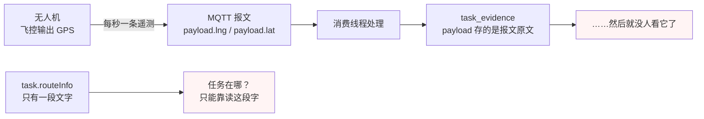
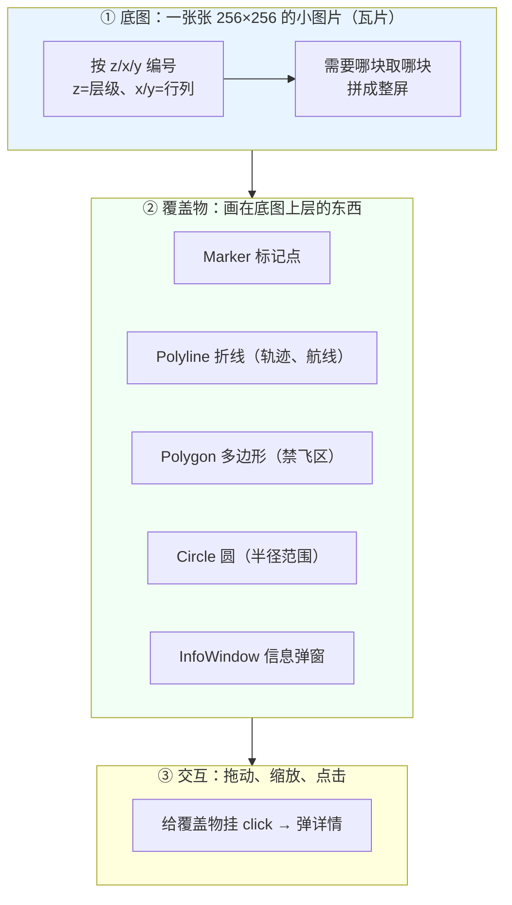
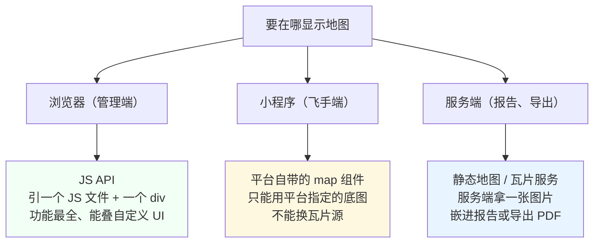
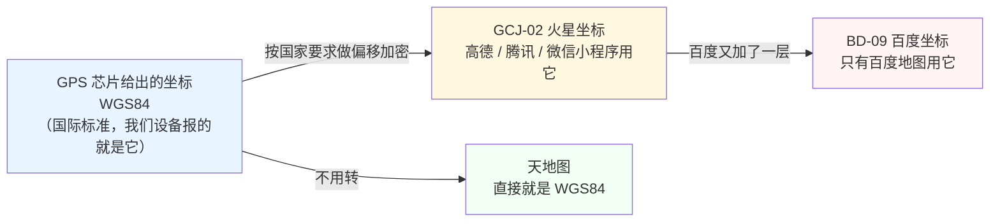
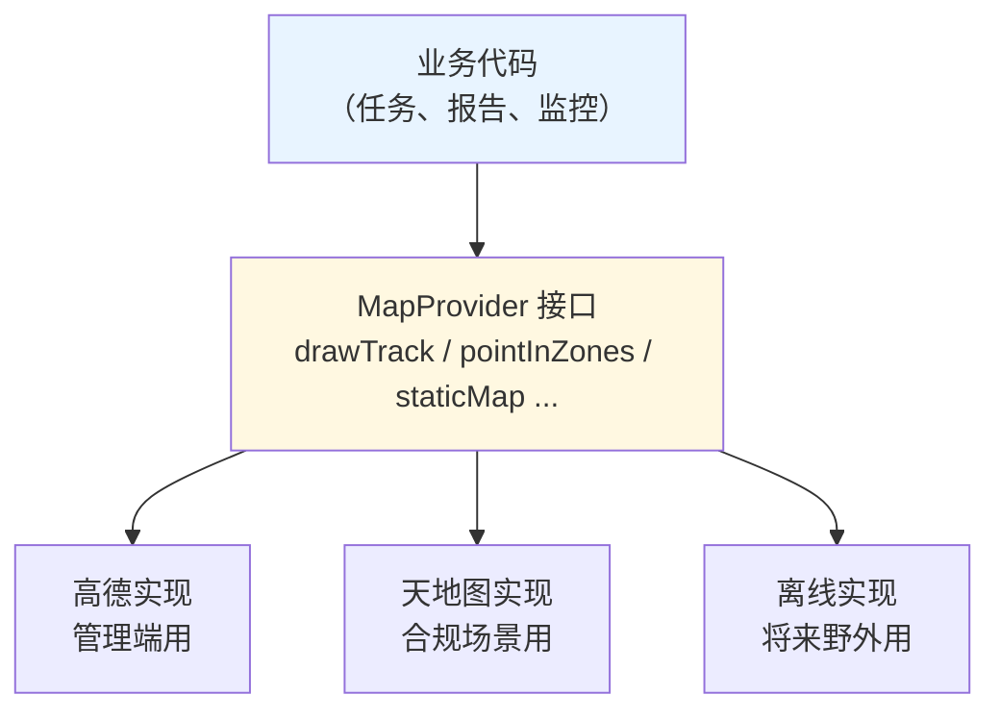
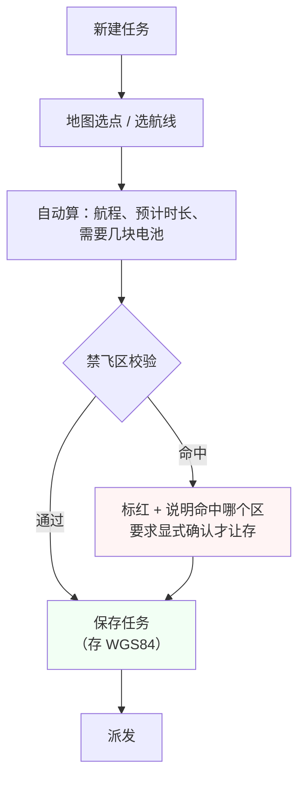
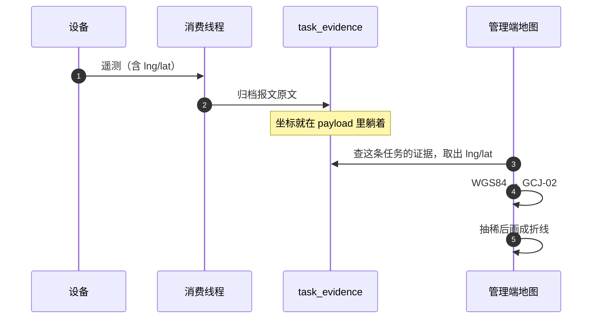
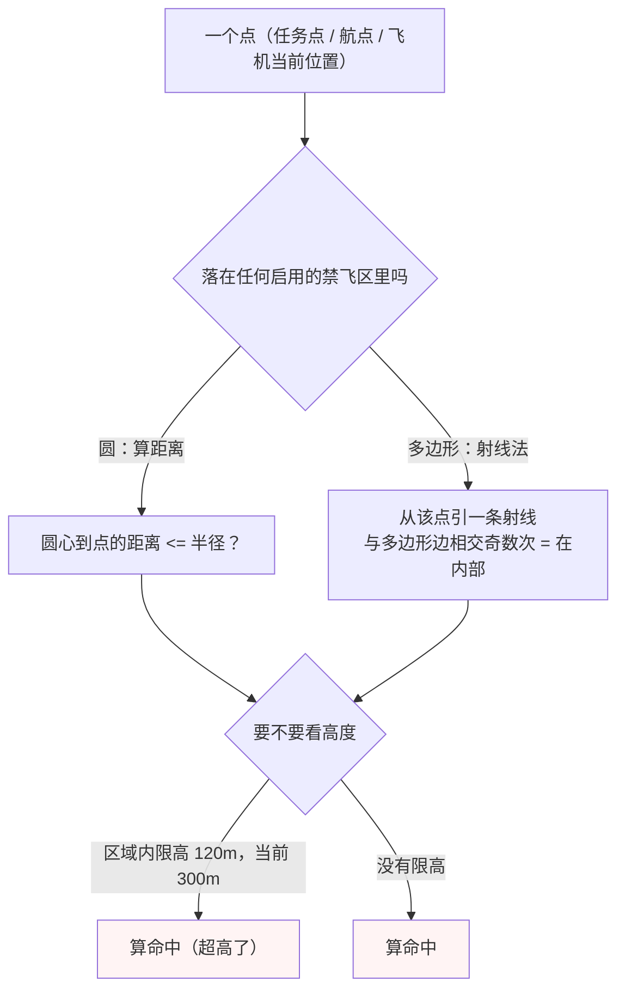
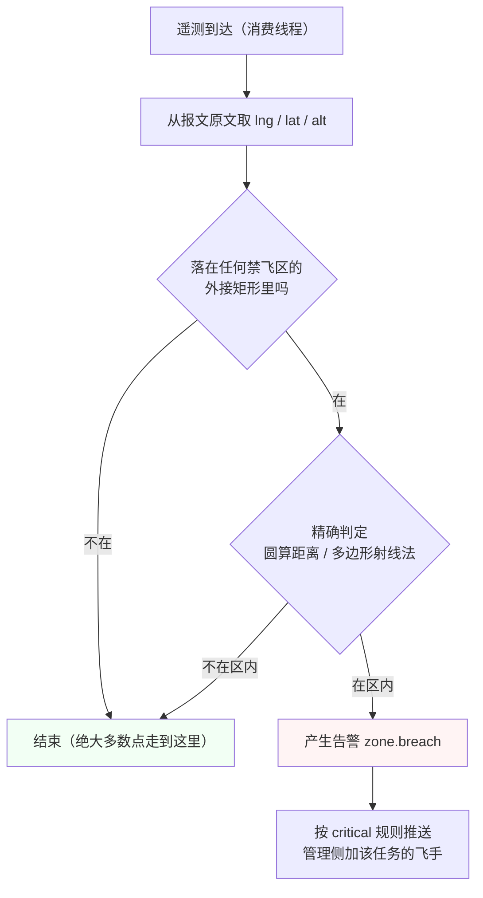
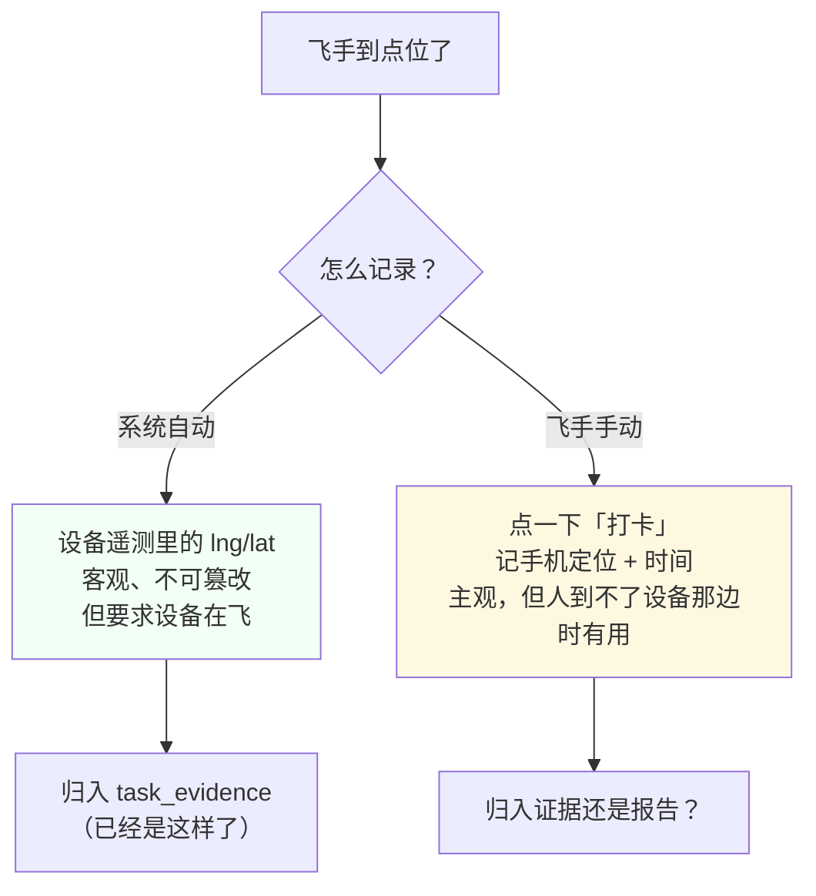

# 地图接入方案：技术选型与业务价值

> 这份文档回答两件事：**技术上怎么接**、**产品上接了有什么用**。
> 面向小白，所以先讲清「地图到底是什么」，再谈选型和功能。
>
> 分四个视角写，你可以只看关心的那节：
> - 第二章：技术角度（地图的构成、三种接入方式、**坐标系这个大坑**）
> - 第三章：国内地图服务商怎么选
> - 第四章：前端的组件与 API（具体到调哪个方法）
> - 第五~七章：**产品价值 + 管理员视角 + 飞手视角**（功能清单与表结构草案）
>
> ⚠️ 文档里的**免费额度、价格、资质要求**都是「量级与方向」，不是承诺 ——
> 这类数字各家的官网都会变，实施前必须去官网核对一遍，**不要照着这份文档拍板预算**。

---

## 一、先看清现状：我们其实已经有坐标了，只是没人用

在谈接入之前，先说一个容易被忽略的事实：



两件事值得记住：

1. **设备一直在报经纬度**，而且被完整存进了证据表的报文原文里
   （`task_evidence.payload` 存的是原始 JSON，不是解析后的字段子集 ——
   这是当初刻意的选择，见 [MQTT与设备接入.md](./MQTT与设备接入.md) 4.5 节）。
   所以**数据是有的**，缺的是「把它取出来、画出来」。
2. **任务本身只有 `routeInfo` 一段文字**（「东南方向 3 公里，沿河道飞」）。
   派发时管理员看到的是一句描述，飞手看到的也是一句描述 ——
   **没有任何一方能看到"到底在哪"**。

> **报告里已经有从证据原文取字段的先例**：自动汇总的「最低电量」就是
> `JSON_EXTRACT(payload, '$.payload.battery')` 算出来的（见 [任务收尾与执行报告.md](./任务收尾与执行报告.md) 5.2 节）。
> 轨迹要取的是同一个位置的两个字段（`$.payload.lng` / `$.payload.lat`）——
> **技术上没有任何新东西，只是把已有的手法用在新字段上。**

---

## 二、技术角度：接入的基本方式

### 2.1 地图到底是什么：瓦片 + 一层能点的东西

很多人以为「地图」是一张很大的图。不是。它是**拼出来的**：



**理解这一层，后面所有选型问题都好判断了**：

- 「能不能换底图」= 能不能自定义瓦片源
- 「卡不卡」= 覆盖物多了（几千个点）就卡，要抽稀或聚合
- 「能不能自己画浮层」= 瓦片之上、覆盖物之下的那一层由谁控制

### 2.2 三种接入方式，对应我们三个端



| 端 | 用什么 | 换底图 | 能力上限 |
|---|---|---|---|
| 管理端（Vue） | JS API（`@amap/amap-jsapi-loader` 之类） | ✅ 能（只要服务商支持） | 最全：轨迹回放、编辑多边形、自定义浮层 |
| 飞手端（uni-app 小程序） | 平台 `<map>` 组件 | ❌ **不能**，只能用平台默认底图（腾讯） | 够用：显示点/线/面 + 定位，但**不能盖自定义 UI**（原生组件层级最高） |
| 服务端 / 报告 | 静态地图 API 或自己拼瓦片 | ✅ | 出一张图片，交互为零 |

> ⚠️ **「小程序换不了底图」这条要在选型前就知道**，它直接决定一个现实问题：
> 如果将来要做**离线地图**（野外没信号），小程序端靠 `<map>` 是做不到的，
> 只能改成 web-view 嵌 H5，或者放弃小程序端的地图。
> 这不是现在要解决的问题，但**选型时不要指望"以后能换"**。

### 2.3 坐标系：这是最容易出事的地方

**同一个地点，在不同的坐标系里是不同的数字**。国内这件事尤其麻烦：



**不转换会怎样**：把 WGS84 的数字直接丢给高德去画，位置会**偏几百米**——
在城市里偏差量级是百米级，山区可能更大。表现出来就是「飞机明明在河边，
地图上画到马路对面的小区里」。**这种错很难被发现**，因为它看起来「差不多对」。

| 我们这侧 | 坐标 | 说明 |
|---|---|---|
| 设备报文 `payload.lng/lat` | **WGS84** | GPS 原始值，国际标准 |
| 数据库里存的 | **WGS84** | 加一个列注释写明，别让人猜 |
| 管理端（高德）显示 | 需要 **GCJ-02** | 出图前转一次 |
| 飞手端（小程序 map） | 需要 **GCJ-02** | 同上 |

**落地的做法（重要）**：

- **库里只存 WGS84**，转换只在**显示层**做 —— 存两份一定会不同步
- 写一个 `CoordinateUtil.wgs84ToGcj02()`，**只在这一处转换**，别到处散落
- 转换算法是公开的（带偏移的迭代公式），**不要自己发明**
- **验证方法**：拿一个已知地点（比如天安门），分别用三种坐标画出来看对不对。
  这类问题不靠单测发现，靠**肉眼看一张图**

> **一个必须说清的业务边界**：GCJ-02 是「加密后的坐标」，把它反算回 WGS84
> 属于灰色地带。所以我们的策略是**单向**：内部一律 WGS84，
> 只在给高德/小程序出图的那一瞬间转成 GCJ-02，**不保存逆变换的结果**。

### 2.4 Key、配额与合规

| 事项 | 要点 |
|---|---|
| Key（密钥） | 每个服务商都要申请；**服务端用的 Key 绝不能出现在前端**（前端只能放「Web 端 Key」，并在控制台绑定域名） |
| 高德的安全密钥 | 高德从某年起要求 Web 端配 `securityJsCode`（或在服务端签名），配漏了地图会直接不出图，报的错还很含糊 |
| 配额 | 免费额度是**按日调用量**算的。地图出图本身很少超，但**地理编码/路径规划/静态图**这些「增值接口」容易超 |
| 商用授权 | 免费额度**不等于可以商用**。上线给客户用之前要确认授权范围（各家政策不同，以官网为准） |
| 审图号 | 地图展示有审图号要求。**天地图**这类官方底图在这件事上最省心 |
| 实名 / 资质 | 多数平台要求实名；部分接口（如高精度定位）要额外资质 |

---

## 三、国内的地图服务商怎么选

### 3.1 主要几家

| 服务商 | 坐标系 | 小程序 | 离线/自建 | 特点与适合场景 |
|---|---|---|---|---|
| **高德** | GCJ-02 | ✅（小程序默认也是腾讯，高德有自己的小程序 SDK） | ❌ | 生态最全、文档与示例最多、JS API 好用。**管理端首选** |
| **百度** | BD-09 | ✅ | ❌ | 老牌、POI 数据强；坐标系又多一层转换，**不是我们的首选** |
| **腾讯** | GCJ-02 | ✅ **微信小程序 `<map>` 的默认底图就是它** | ❌ | 和微信生态结合最紧；飞手端绕不开 |
| **天地图**（国家官方） | **WGS84** | 有 SDK | 有限 | **有审图号、坐标系和我们一致（少一层转换）**，免费额度对政企友好。测绘/合规场景优先 |
| **离线方案**（自建瓦片 / 商业离线包） | 看数据源 | ❌ | ✅ | 野外无信号、涉密项目、或要求数据不出内网时**才考虑**；成本高、要去买地图数据 |

### 3.2 我们的建议：**两家分工 + 抽一层接口**

> **2026-09-28 已定：管理端用高德**（结论与理由见 10.1）。



**为什么一定要抽这一层**：这是本项目已经验证过一次的做法 ——
附件的存储抽了 `StorageService`（本地与对象存储两个实现，业务只依赖接口），
所以换存储不用改业务代码。地图比存储**更容易换**：坐标系不同、配额政策会变、
甚至「某个项目要求用官方底图」，这些都不是技术原因而是业务原因。

**不抽的代价**：把 `new AMap.Map(...)` 直接写进十几个 Vue 组件里，
换一家就是把这十几处全找出来改一遍。

### 3.3 选型对照：我们真正会用到的高频能力

| 能力 | 用在哪 | 高德 | 天地图 | 小程序 |
|---|---|---|---|---|
| 打点（Marker） | 任务位置、监测点、飞机实时位置 | ✅ | ✅ | ✅ |
| 画线（Polyline） | 轨迹回放、航线 | ✅ | ✅ | ✅ |
| 画多边形（Polygon） | 禁飞区 | ✅ | ✅ | ✅ |
| 编辑图形（拖顶点） | 管理员画禁飞区/航线 | ✅ 好 | 一般 | ❌ 小程序上别做 |
| 轨迹回放（按时间播放） | 复盘、报告 | 自己实现（不难） | 自己实现 | 很难做好 |
| 静态地图（出图片） | 报告里嵌图 | ✅ | ✅ | —— |
| **点是否在多边形内** | 禁飞区校验 | 可在服务端算（见 6.3） | 同 | —— |
| 三维 / 倾斜摄影 | 将来（测绘类任务） | 有 | 有基础三维 | ❌ |

---

## 四、前端的组件与 API

### 4.1 管理端（Vue 3 + Element Plus）

**接入方式**：用官方的 JS API 加载器，把地图实例挂在组件里。

```ts
// 只示意「怎么拿实例、怎么放」——具体 API 名以服务商文档为准
import AMapLoader from '@amap/amap-jsapi-loader'

// ⚠️ 用 shallowRef，不要用 ref —— 理由见下面
const map = shallowRef<any>(null)
const mapEl = ref<HTMLElement | null>(null)

onMounted(async () => {
  const AMap = await AMapLoader.load({ key: '前端 Key', version: '2.0' })
  // 实例化时**不要让 Vue 去代理它**
  map.value = new AMap.Map(mapEl.value, { zoom: 13 })
})
```

**三个必须知道的坑**：

| 坑 | 现象 | 怎么避 |
|---|---|---|
| 把地图实例放进 `ref` | 页面卡、偶发报错、内存泄漏 | 用 `shallowRef`，**别让 Vue 深度代理一个第三方大对象** |
| 组件卸载时不销毁 | 来回切页面后实例越来越多，最后卡死 | `onBeforeUnmount` 里 `map.destroy()` |
| 在 `setup` 里直接 new | 容器 div 还没渲染出来，地图初始化失败 | 放 `onMounted`；容器必须有**确定的高度**（否则高度 0 = 什么都不显示） |

**要封装的组件**（建议）：

| 组件 | 干什么 | 用在哪 |
|---|---|---|
| `<MapView>` | 只管底图与生命周期（初始化/销毁/尺寸变化） | 被下面几个复用 |
| `<TrackPlayer>` | 轨迹回放：进度条 + 播放/暂停 + 拖拽 | 任务详情、报告 |
| `<ZoneEditor>` | 画/改禁飞区多边形 | 禁飞区管理 |
| `<RouteEditor>` | 增删排序航点、显示航程与预计时长 | 航线管理 |
| `<LiveMap>` | 实时位置（订阅推送 + 打点更新） | 监控看板 |

### 4.2 飞手端（uni-app 小程序）

**用平台自带的 `<map>` 组件**，配 `uni.getLocation` / `uni.chooseLocation`：

```html
<!-- 示意：标记、轨迹、围栏都用组件的属性画，不用 JS API -->
<map
  :longitude="lng" :latitude="lat" :scale="14"
  :markers="markers" :polyline="polyline" :circles="circles"
  show-location
/>
```

**能力边界（决定了飞手端能做什么）**：

| 能做 | 不能做（要绕道或别做） |
|---|---|
| 显示点位、航线、轨迹、圆形范围 | 画多边形**并让用户拖顶点编辑**（编辑放管理端） |
| 显示自己的实时位置（`show-location`） | 换底图（只能用平台默认的） |
| 点击标记弹平台自带的信息窗 | 在标记上叠自定义富 UI（要 `cover-view`，限制多） |
| 唤起系统地图导航 | 覆盖物几百个以上（会卡，要抽稀/聚合） |

**还要配的东西**（现在**一样都没配**）：

- `manifest.json` 里加**定位权限**（微信小程序还要在公众平台声明「位置信息」用途）
- 隐私协议里写明「采集位置用于任务执行与轨迹记录」——**这是上架审核的硬要求**
- 真机上 `uni.getLocation` 需要用户授权，**被拒绝要有降级方案**（手动打点）

### 4.3 常用 API 速查（按用途）

| 我要做的事 | 管理端（JS API 概念） | 飞手端（小程序） |
|---|---|---|
| 显示一张地图 | `new Map(container, opts)` | `<map>` |
| 标一个点 | `new Marker({ position, icon })` | `markers` 数组 |
| 画一条轨迹 | `new Polyline({ path })` | `polyline` 数组 |
| 画一个区域 | `new Polygon({ path })` | `polygon` 数组（**属性名是单数**） |
| 画一个半径 | `new Circle({ center, radius })` | `circles` 数组 |
| 弹信息框 | `new InfoWindow({ content })` | 组件自带 `bindmarkertap` |
| 拿到当前坐标 | 浏览器定位（精度差） | `uni.getLocation({ type: 'gcj02' })` |
| 选一个位置 | 地图点击回调 | `uni.chooseLocation` |
| 出静态图 | 静态地图 API（服务端调） | —— |

> **小程序 `<map>` 的属性名要注意**：`polyline`/`polygon`/`markers`/`circles`
> 是**数组属性**，不是方法。第一次用的人常去找「addPolyline 方法」——
> 小程序里没有，它就是**声明式**的（你改数组，它重画）。

---

## 五、产品价值：一张地图到底改变了什么

这一章是重点。每一条都按同一个结构说：**没有地图时是什么样 → 有地图后是什么样 → 落到哪个功能**。

### 5.1 任务从「一段文字」变成「一个位置」

| | |
|---|---|
| **没有地图** | 派发时管理员在下拉框里选飞手和设备，任务在哪全靠 `routeInfo` 那段文字。**谁离得近、设备够不够得着，全靠脑子记** |
| **有地图** | 派发弹窗里直接看到：任务点在哪、每台待命设备现在在哪、距离多远。**派错远处设备这种事第一次就有了判据** |
| **落到哪** | 任务创建/派发页的地图选点；设备列表带位置 |

### 5.2 执行过程从「相信他」变成「看得见」

| | |
|---|---|
| **没有地图** | 飞手点了「开始执行」，管理员只能等。任务卡片上写着「执行中」和 `evidence_state=confirmed`（收到过数据），但**不知道飞到哪了、还剩多少** |
| **有地图** | 监控看板上是活的：飞机当前位置、已经飞过的轨迹、离各点位还有多远。**超时高亮从"这个任务超时了"变成"卡在哪个位置了"** |
| **落到哪** | 监控看板（实时位置 + 轨迹）；任务详情的时间轴与轨迹联动 |

> 这一条的意义比看上去大：`evidence_state` 只能证明「设备在说话」，
> 而一张轨迹图能证明「**它确实去了那个地方**」。这是从「有旁证」到「看得见在做」的跨越。

### 5.3 证据与报告从「数字」变成「可交付」

| | |
|---|---|
| **没有地图** | 报告里有「收到 320 条设备数据、最低电量 12%」——**数字对，但客户看不懂**。要证明「我覆盖了这些点位」，只能靠嘴说 |
| **有地图** | 报告里嵌一张**这张任务的轨迹图 + 点位覆盖图**：哪些点位到了、哪些没到、航线什么样。**这就是能交给客户的东西** |
| **落到哪** | 报告详情页的轨迹区块；导出 PDF 时嵌静态地图（服务端出图） |

### 5.4 安全从「事后追责」变成「事前拦下」

| | |
|---|---|
| **没有地图** | 禁飞区、限高这类约束**只存在于人的脑子里和纸质规定里**。飞了不该飞的地方，事后查记录才知道 |
| **有地图** | 禁飞区画在系统里，**派发前就校验**：任务点在禁飞区内 → 直接不让派；航线穿过禁飞区 → 标红并要求确认 |
| **落到哪** | 禁飞区管理（6.3）；派发与创建的校验 |

> **这条的取舍要说清**：系统拦不住飞机真的飞进去（那是飞控的事），
> 它能做的是**让违规变成一件需要刻意为之的事** ——
> 从"没人知道"变成"系统里明明白白标着不让去，他仍然派了"。
> **留痕本身就是价值**，不要指望系统替代飞控。

### 5.5 资产与调度效率

| | |
|---|---|
| **没有地图** | 机库、起降点、常用监测点在系统里**根本不存在**，都在飞手的小本本上。新任务靠"上次那个点在哪来着" |
| **有地图** | 点位库 + 机巢位置可视化。派活时看得见"哪台设备在哪、去哪个点最省"，**排班从看名字变成看距离** |
| **落到哪** | 监测点点位库（6.4）；设备位置展示 |

### 5.6 合规与对外沟通

| 能力 | 价值 |
|---|---|
| 飞行范围图 | 与空域报备材料对照，说明"我们只在这个范围飞" |
| 点位覆盖图 | 给客户看"这次任务覆盖了哪些点"，**比一张表有说服力** |
| 轨迹留存 | 出了争议能拿出"当时到底飞了哪条线" |

---

## 六、管理员视角：会用到地图的功能

### 6.1 创建任务：在地图上把「在哪」定下来



**要做的**：

- 地图上点击选点、或从**点位库**里挑（6.4）
- 选一条**航线模板**（6.5），自动带出航程与预计时长
- 起降点单独标（它是安全相关的：迫降落在哪）
- **禁飞区与限高校验放在保存前**，不是派发时 —— 建的时候就该知道

**`task` 表要补的列**（草案）：

```sql
ALTER TABLE `task`
  -- 引用的航线模板（可空：临时任务可以直接填 routeInfo 文字）
  ADD COLUMN `route_id`     bigint       DEFAULT NULL COMMENT '引用的航线模板 id，可空',
  -- 起降点（安全相关，单独存）
  ADD COLUMN `takeoff_lng`  decimal(10,6) DEFAULT NULL COMMENT '起飞点经度 WGS84',
  ADD COLUMN `takeoff_lat`  decimal(10,6) DEFAULT NULL COMMENT '起飞点纬度 WGS84',
  ADD COLUMN `takeoff_name` varchar(100)  DEFAULT NULL COMMENT '起降点名称';
```

> **为什么经纬度用 `decimal(10,6)` 而不是 `double`**：
> `decimal(10,6)` 是「小数点后固定 6 位」——约 0.1 米精度，够用且**没有浮点误差**。
> `double` 存经纬度会出现 `116.39700000000001` 这种值，比较与去重都难受。
> **精度也要想一下**：6 位小数 ≈ 0.11 米，无人机定位本来就是米级，够了。

### 6.2 任务管理与监控：从列表到看板

| 功能 | 内容 |
|---|---|
| 任务列表 | 每行带一个**小地图缩略图**或至少坐标；筛选条件加「按区域」 |
| 监控看板 | 一个大地图：所有执行中任务的实时位置、轨迹、状态色（正常/告警/超时） |
| 时间轴 × 轨迹联动 | 拖动时间轴 → 地图上的飞机回到那一刻的位置（复盘神器） |
| 超时高亮 | 「执行中且超过计划结束时间」的任务在地图上闪红（现在是列表里没提示） |

**数据从哪来**：轨迹不是新数据源，就是**证据表里已有的 `lng/lat`**。



> ⚠️ **必须抽稀**：一条 10 分钟的任务有 600 个点，一条 2 小时的有 7200 个。
> 全画上去浏览器会卡（小程序更卡）。常见做法是**按距离抽稀**
> （相邻点距离小于 N 米就丢掉）或按时间降采样。
> **这不是优化，是能不能用的问题** —— 实施时第一版就要带上。

### 6.3 禁飞区管理

#### 6.3.1 两个来源

**两个来源要分清**：

| 来源 | 怎么来 | 特点 |
|---|---|---|
| 官方空域 | 官方公布的禁飞区数据（各地的临时管制、机场净空区） | 有权威性，但**数据获取与更新是人工活**；临时管制靠人录 |
| 自定义 | 管理员自己画（厂区、客户场地、涉密区域） | 灵活，是**主要用法** |

**表设计草案**：

```sql
CREATE TABLE `no_fly_zone` (
  `id`             bigint       NOT NULL AUTO_INCREMENT,
  `name`           varchar(100) NOT NULL COMMENT '区域名称',
  `source`         varchar(20)  NOT NULL DEFAULT 'custom' COMMENT 'official 官方空域 / custom 自建',
  `shape`          varchar(20)  NOT NULL DEFAULT 'polygon' COMMENT 'polygon 多边形 / circle 圆',
  -- 多边形顶点或圆心半径。用 JSON 存，不引入空间列：
  -- 顶点数少（几十个），查询是"拿出来在服务端算"，不需要数据库索引
  `geometry`       json         NOT NULL COMMENT 'polygon: [[lng,lat],...]；circle: {lng,lat,radius}',
  `max_alt`        int          DEFAULT NULL COMMENT '区域内限高（米），NULL 表示不限',
  `effective_from` datetime     DEFAULT NULL COMMENT '生效开始，NULL 表示长期',
  `effective_to`   datetime     DEFAULT NULL COMMENT '生效结束',
  `enabled`        tinyint      NOT NULL DEFAULT 1 COMMENT '1 启用 / 0 停用',
  `remark`         varchar(500) DEFAULT NULL,
  `create_by`      bigint       DEFAULT NULL,
  `create_time`    datetime     DEFAULT CURRENT_TIMESTAMP,
  PRIMARY KEY (`id`),
  KEY `idx_enabled` (`enabled`)
) COMMENT = '禁飞区（顶点存 WGS84）';
```

#### 6.3.2 静态校验：创建与派发时拦下

**命中检测怎么做**（这一节的技术核心）：



**三种做法，推荐第一种**：

| 做法 | 说明 | 取舍 |
|---|---|---|
| **服务端算**（推荐） | 把几何取出来，在 Java 里判断（射线法/距离） | 简单、可测、不依赖数据库空间能力；**一条航线也就几十个点** |
| MySQL 空间函数 | `ST_Contains(ST_GeomFromText('POLYGON(...)', 4326), ST_GeomFromText('POINT(lng lat)', 4326))` | 能力强，但**坑不少**：必须指定 SRID 4326、多边形环要闭合、坐标顺序是 `(lng lat)` 不能反。**用之前一定要先在一个临时库上验证一遍** |
| 前端算 | 地图 SDK 自己有点在多边形内的判断 | 只能做**交互提示**，不能当校验依据（前端可被绕过） |

> **航线不只是"点在区内"，还要判「线穿过区」**：
> 起点和终点都在区外，中间那段照样可能穿过去。
> 最简做法：**把航线按固定间隔插值成密集点**，再逐点判断 ——
> 粗糙但够用，而且和「点是否在区内」是同一套代码。

#### 6.3.3 运行时：飞机真的飞进去了怎么办

**先接受一件事：事前拦不住是必然的。** 系统不是飞控 —— 它拦不住一个已经起飞的螺旋桨。
所以事中必须做到「**立刻知道、并且立刻通知到能动手的人**」。

三个层次要一起看：


**事中的链路**：



**四个必须想清楚的点**：

| # | 问题 | 做法 |
|---|---|---|
| ① | 用哪个告警编码？现有 27 条里**没有**「进入禁飞区」这一类 | **要新增**。建议两条：`zone.breach`（critical，飞进了禁飞区）、`zone.alt.over`（warning，在限高区内超高）。这是对「已确认、不再增删」那份清单的**扩展** —— 按项目规矩：**先改 [告警体系设计.md](./告警体系设计.md) 的清单，再改代码** |
| ② | 每条遥测都查一次库？ | **不能**。禁飞区要**缓存进内存**（启动加载 + 定时刷新），判定前先做**外接矩形预筛**，再做精确几何。一条航线几千个点，绝大多数连矩形都进不去 |
| ③ | 停在禁飞区里会不会每秒一条告警？ | 不会。靠现成的抑制规则（`insertUnlessOpen`：同一设备同一编码**还有未处理的就不再产生**）—— 「一直停在里面」只留一条待处理；处理掉之后再进，才会重新报 |
| ④ | 谁该被通知？ | 按现有的 critical 规则：拥有 `alert:handle` 的人 **+ 该任务的飞手**。飞手是唯一能立刻接管的人（与告警线第三步的实现一致，不用另做） |

**事后**：

- 告警里带上**坐标与命中的区域名** → 管理端在地图上能看到那个点（地图化之后）
- 报告里的「期间告警数」自动包含它（不用额外做）
- 任务详情的时间线能看到「什么时候越的界」

> **边界（必须写清楚，否则会有人以为系统能拦飞机）**：
> **系统不拦飞机，只让人立刻知道。**
> 真正的「拦」在飞控侧 —— 无人机厂商的地理围栏（GEO）、或自定义围栏，
> 那是**设备的能力**。我们能做的是三件事：**立刻知道、立刻通知到能动手的人、
> 留下不可抵赖的记录**。
>
> 将来如果接入厂商云 API，可以把禁飞区**下发给设备**，那才是真正的拦。
> 那件事依赖设备厂商的开放能力，先记成开放问题（第十章）。

### 6.4 监测点（点位库）

**它解决什么问题**：巡检任务的点位是**复用的**（这条线路上的 12 个塔，
下个月还要再巡一次）。没有点位库，每次都要重新在地图上点一遍。

| 功能 | 内容 |
|---|---|
| 点位维护 | 名称、编号、坐标、类型（巡检点/起降点/机巢/其他） |
| 批量导入 | 客户给的 Excel（大量点位的常见来源）—— 复用现有的 Excel 导入套路（见 [Excel导入导出.md](./Excel导入导出.md)） |
| 在地图上看 | 按名称/编号搜索、按类型筛选，点一下看详情 |
| 从点位生成航线 | 选几个点位 → 生成一条航线（6.5） |

> **「分组」你已定：暂时不要（2026-09-28）。** 所以表里不建分组字段，
> 列表按名称搜索 + 类型筛选就够。
>
> **将来真要加分组时怎么做**（记在这里，免得到时候重新设计）：
> 加一个 **可空的** `group_name varchar(100)`（不要改成 NOT NULL），
> 老数据留空表示「未分组」；前端多一个筛选下拉。
> **这是一次纯粹的加列** —— 已有的点位、任务、航线都不用动。
> 之所以不改造成独立的 `project` 表：等真出现「按项目算成本」这类需求再说，
> 现在建一张表只会带来一个没人维护的下拉框。

```sql
CREATE TABLE `survey_point` (
  `id`          bigint       NOT NULL AUTO_INCREMENT,
  `code`        varchar(50)  DEFAULT NULL COMMENT '点位编号（客户可能给）',
  `name`        varchar(100) NOT NULL COMMENT '点位名称',
  `lng`         decimal(10,6) NOT NULL COMMENT '经度 WGS84',
  `lat`         decimal(10,6) NOT NULL COMMENT '纬度 WGS84',
  `alt`         decimal(8,2) DEFAULT NULL COMMENT '建议作业高度（米 AGL）',
  `category`    varchar(20)  NOT NULL DEFAULT 'survey' COMMENT 'survey 巡检 / takeoff 起降 / dock 机巢 / other',
  `remark`      varchar(500) DEFAULT NULL,
  `create_by`   bigint       DEFAULT NULL,
  `create_time` datetime     DEFAULT CURRENT_TIMESTAMP,
  PRIMARY KEY (`id`),
  UNIQUE KEY `uk_point_code` (`code`)
) COMMENT = '监测点/点位库（坐标存 WGS84）';
```

> ⚠️ **`uk_point_code` 那行要注意**：`code` 允许为 NULL，而 MySQL 的唯一索引
> **把多个 NULL 视为不同**，所以「不填编号的点位」不会互相冲突 ——
> 这个性质和 `task_alert` 人工上报的 `device_code` 是同一个（见 [告警体系设计.md](./告警体系设计.md) 4.4）。

### 6.5 航线管理

**航线 = 有序的点 + 每个点上的动作**。

| 功能 | 内容 |
|---|---|
| 航线编辑 | 从点位库挑点、或在地图上直接加；拖拽调整顺序；设置每个点的动作（拍照/悬停 N 秒/不动作） |
| 自动计算 | 航程（累加相邻点距离）、预计时长（按巡航速度）、点数 |
| 模板复用 | 一条航线可以被多条任务引用 |
| **改航线要不要影响已派发的任务** | **不要** —— 任务派发时应**快照**一份航线（见下面的取舍） |

```sql
CREATE TABLE `route` (
  `id`          bigint       NOT NULL AUTO_INCREMENT,
  `name`        varchar(100) NOT NULL,
  `description` varchar(500) DEFAULT NULL,
  `point_count` int          NOT NULL DEFAULT 0 COMMENT '冗余：航点数',
  `distance_m`  int          DEFAULT NULL COMMENT '冗余：总航程（米）',
  `create_by`   bigint       DEFAULT NULL,
  `create_time` datetime     DEFAULT CURRENT_TIMESTAMP,
  `update_time` datetime     DEFAULT CURRENT_TIMESTAMP ON UPDATE CURRENT_TIMESTAMP,
  PRIMARY KEY (`id`)
) COMMENT = '航线（模板）';

CREATE TABLE `route_point` (
  `id`             bigint       NOT NULL AUTO_INCREMENT,
  `route_id`       bigint       NOT NULL,
  `seq`            int          NOT NULL COMMENT '顺序，从 1 开始',
  `lng`            decimal(10,6) NOT NULL COMMENT '经度 WGS84',
  `lat`            decimal(10,6) NOT NULL COMMENT '纬度 WGS84',
  `alt`            decimal(8,2) DEFAULT NULL COMMENT '作业高度（米 AGL）',
  `action`         varchar(20)  NOT NULL DEFAULT 'none' COMMENT 'none / photo 拍照 / hover 悬停',
  `hover_seconds`  int          DEFAULT NULL COMMENT '悬停秒数（action=hover 时用）',
  `point_id`       bigint       DEFAULT NULL COMMENT '来自点位库时记下它，方便反查',
  PRIMARY KEY (`id`),
  KEY `idx_route_seq` (`route_id`, `seq`)
) COMMENT = '航线上的点（有序）';
```

> **取舍：航线改了，已派发的任务要不要跟着变？**
> - 跟着变 → 飞手手上的任务会在中途悄悄换掉航线，**是事故级的坑**（他按老航线飞的，事后对不上）
> - 不变（快照）→ 存一份副本，数据多一点，但「这条任务当时飞的是哪条线」永远查得到
>
> **推荐快照**。做法可以是：任务表存 `route_snapshot`（JSON），
> 或者派发时把 `route_point` 复制一份带 `task_id`。**别让模板的修改穿透到历史任务**。
> 这与项目里「报告要留版本」是同一个价值观：**改过必须看得出来**。

---

## 七、飞手视角：执行任务与任务打点

### 7.1 执行任务：任务卡片上的地图

| 功能 | 说明 |
|---|---|
| 我的任务 → 点开看地图 | 任务点位、航线、起降点；**离线也要能看**（见 7.4） |
| 一键导航 | 点起降点 → 唤起系统地图导航（`uni.openLocation`），这是**最高频的实用功能** |
| 实时位置 | `show-location` 显示自己在哪，和任务点位的相对位置一眼可见 |

### 7.2 任务打点：把「我到了」变成有坐标的事实

**「任务打点」有两种，要分清**：



> **手动打卡算不算证据 —— 你已定：只算 `manual`（2026-09-28）。**
>
> 它能证明「飞手说自己在那个位置」，但**不能替代设备数据**。
> 落地上就是：手动打点记 `source=app`、类型记为飞手自述，
> 界面上与设备坐标**区别显示**（和报告里的 `onlyDeclared` 是同一个思路）。
> **别把「飞手点了一下」和「设备报上来的坐标」画成同一种点。**

**要做的功能**：

| 功能 | 数据落在哪 | 说明 |
|---|---|---|
| 到点打卡 | 新表 `task_checkin`（或复用证据表 + `type=manual`） | 记坐标、时刻、偏差（离目标点位多远） |
| 拍照带位置 | 附件 + 坐标 | 照片存 `task_attachment`，坐标写进附件行（`EXIF` 里其实也有，见下） |
| 现场问题带位置 | `task_alert` 加坐标列 | 上报现场异常时带上当前位置（现在只有文字） |
| 偏差提示 | 打卡时算 | 离目标点位 200 米还说"到了" → 提示一下，让他确认 |

> **照片的 EXIF 里本来就有 GPS**（[任务收尾与执行报告.md](./任务收尾与执行报告.md) 7.1 节说过）——
> 这是**比手机定位更强的旁证**（相机芯片生成的）。
> 所以「拍照带位置」有两条来源：手机定位（可伪造）与 EXIF（难伪造）。
> **两条都存，界面上以 EXIF 为准**。这也正是报告线第四步（EXIF 解析）的价值之一。

### 7.3 小程序上的坑（踩过的人都记得）

| 坑 | 现象 | 应对 |
|---|---|---|
| `map` 是**原生组件**，层级最高 | 想在地图上盖自己的浮层 → 盖不住，或者浮层跑到地图下面 | 用 `cover-view` / `cover-image`；别指望普通 `view` |
| 覆盖物多了卡 | 几百个点，滑动掉帧 | 抽稀 + 按当前视野范围只画可见的点 |
| `getLocation` 要授权 | 用户拒绝 → 功能直接不可用 | 必须有降级：手动输入/手动打点；并给出明确的提示话术。**用户拒过一次之后不会再弹**，要给「去设置」的入口（`uni.openSetting`） |
| **没声明定位接口权限** | 报 `the api need to be declared in the requiredPrivateInfos field in app.json`；只声明 `permission.scope.userLocation` 时**连授权弹窗都不出现** | `manifest.json` 的 `mp-weixin` 里两项都要写：`permission.scope.userLocation.desc` + `requiredPrivateInfos: ["getLocation"]`。**第三处在微信公众平台**（开发管理 → 接口设置 → 用户地理位置，2022-07-14 后注册的默认没有），没开通时 `errno 112` —— 那是账号级设置，改代码改不出来 |
| 把失败一律说成「请允许定位权限」 | 用户按提示去授权了，问题其实在别处（没声明、系统定位关着）→ 白折腾 | 按 `errMsg` 分别说清：用户拒绝 / 没声明 scope / 没声明 requiredPrivateInfos / 手机定位总开关 —— 四种的处理方式完全不同 |
| 后台定位受限 | 小程序切后台后拿不到位置 | **别设计依赖后台定位的功能**（和 WebSocket 推送同一个约束，见 [告警体系设计.md](./告警体系设计.md) 8.3） |
| 换不了底图 | 见 2.2 | 决策前就要知道 |

### 7.4 弱网与离线

野外作业的常态是**没信号**。要提前定策略：

| 层次 | 做法 |
|---|---|
| 地图瓦片 | 小程序**换不了底图**，所以「离线地图」在小程序上做不到，只能缓存已看过的瓦片（不可靠） |
| 任务数据 | 出发前把任务、点位、航线**缓存在本地**（`uni.setStorage`），弱网也能看 |
| 打点数据 | **先存本地、联网再补传**（要能容忍重复提交：服务端按「任务+点位+时间」去重） |
| 照片 | 先存本地文件，联网后上传（现在的上传接口是即时的，离线场景要排队） |

---

## 七点五、第一步落地记录（2026-09-28）

第一步做完了，这里记清**实际落在哪**、以及**三处与本文档原计划不一样的地方** ——
文档写了什么就按什么做，但做的时候发现更合适的做法，也要改回文档，不然下次看会困惑。

### 落地清单

| 部件 | 在哪 | 说明 |
|---|---|---|
| 轨迹查询 | `TaskEvidenceMapper.selectTrack` | 从证据的**报文原文**里 JSON_EXTRACT 出 lng/lat（和「最低电量」同一个手法） |
| 抽稀 | `TrackSampler` | 按**距离**（5 米）抽，不按个数；首尾必留；上限 500 点兜底 |
| 坐标转换 | `CoordinateUtil.wgs84ToGcj02` | 与开源实现 wandergis/coordtransform 逐行对齐 |
| 轨迹接口 | `GET /task/{taskId}/track` | 权限 `task:list`；返回里带 `coordinateSystem` 说明坐标是哪种 |
| 地图组件 | `drone-web/src/components/TrackMap.vue` | **所有高德 API 只出现在这一个文件里** |
| 加载器 | `drone-web/src/utils/amap.ts` | 插 script 标签加载（不引 npm 依赖） |
| Key 配置 | **`drone-web/.env.local`**（不进仓库）的 `VITE_AMAP_KEY` / `VITE_AMAP_SECURITY_CODE` | 没配也能跑：那一块显示说明 + **点数照常显示**。`.env.development` 里那两行**保持注释**，别留空值（原因见下面第 ② 条） |

### 三处与本文档原计划不一样的地方

**① 坐标转换落在后端，不是「显示层（前端）」**

2.3 节原来写的是「转换只在显示层做」。实际放在了后端，两个原因：
- **只能有一处实现**：管理端与飞手端是两个工程，前端各有各的实现就是两份代码
- **可测性**（更要紧）：后端有测试框架，能拿公开实现的参考值把转换钉死；
  前端的转换函数没有测试可跑，错了只能靠肉眼看图 —— 而这个问题**恰恰看起来「差不多对」**

所以实际的口径是：**库里存 WGS84；只有「专给地图用的那个接口」在出口处转成 GCJ-02**，
并且在返回里带 `coordinateSystem` 字段说明这件事。
判断依据是这个接口**就是**显示层的一部分（它只服务地图），而不是通用数据接口。

**② `MapProvider` 接口暂缓抽，但把「唯一落脚点」守住了**

3.2 节建议抽一层 `MapProvider`。第一步没抽，理由是：现在只有高德一个实现，
抽接口出来只有一个实现类，是「为假想的将来做设计」。
**但那条真正的目的守住了**：高德 API 只出现在 `TrackMap.vue` + `utils/amap.ts` 两个文件里，
组件外面没人碰 `AMap.*`。等第二个实现真出现（天地图/离线）时再抽，那时才知道接口该长什么样。

**③ 顺手发现一个真坑：`LocalDateTime` 的序列化格式**

`application.yml` 里的 `spring.jackson.date-format` **只对 `java.util.Date` 生效**，
对 `LocalDateTime` 不管用。轨迹点的 `observedAt` 一开始序列化成了带 `T` 的 ISO 串
（`2027-08-26T09:30:00`），而项目里所有别的接口都是空格分隔的 ——
前端按 `slice(0, 16)` 取时间，页面上就会多出一个 `T`。
**这是写测试时对原始字符串才发现的**（只看页面看不出来）。
教训：新 VO 里的 `LocalDateTime` **必须显式写 `@JsonFormat`**。

### 这一步验到了什么、没验到什么

| 验了 | 怎么验的 |
|---|---|
| 轨迹来自证据、按时间升序 | 用例断言点数与首末点的时间 |
| **坐标真的转成了 GCJ-02** | 与公开实现的参考值逐位比对（1e-8 度 ≈ 1 毫米）；并断言偏移量级（北京约 500 米）—— 只看「等于转换函数的结果」不够，忘了转也会等于自己 |
| 密集点会被抽稀、首尾保留 | 200 个相距 0.17 米的点 → 抽成 8 个 |
| 没有坐标的证据不进轨迹；任务不存在明确报错 | 用例覆盖 |
| 权限：飞手（没有 `task:list`）看不了 | 用例断言 403 |
| 页面上的区块与点数 | 真实浏览器：详情里出现「飞行轨迹」，显示「轨迹 92 个点」 |
| **真数据上的偏移量级** | 拿你库里那条任务（92 个点）实测：经度偏移 0.006043（约 530 米），符合北京一带的量级 |

| **没验到** | 为什么 |
|---|---|
| **地图真的画出来了** | 需要高德 Key，本地没有。所以页面上现在显示的是「未配置高德 Key」的说明 —— **这一条要在你填了 Key 之后再看一眼** |

### 填上 Key 之后又踩的三个坑（2026-09-28 当天）

Key 填进去之后地图**没出来**，排查出三个问题，都是环境/时序类的，
值得记下来（它们都不报错，只看页面根本不知道卡在哪）：

**① `watch` 默认在 DOM 更新「之前」跑 → 地图容器还是 null**

轨迹点是接口回来才有的，那一刻模板才刚从「没有数据」切到「有地图容器」这个分支。
而 `watch` 的默认时机是 **DOM 更新之前**，所以回调跑起来时 `container` 还是 null，
初始化静默早退 —— 表现是「地图容器空着、高德脚本**一次都没请求**、控制台**零报错**」。
两个解法要一起用（谁先谁后都不漏）：`watch(..., { flush: 'post' })` + 容器为空时 `await nextTick()` 再试一次。
**通用教训**：凡是「数据到了才渲染容器、然后往容器里塞第三方实例」的组件，
都要想清楚这个时序，否则就是这种「什么都不报的白屏」。

**② Vite 的环境变量优先级：`.env.[mode]` **盖过** `.env.local`**

为了让 Key 不进仓库，把它从 `.env.development` 挪到了 `.env.local`（后者不进 git）。
结果**地图还是不出**——因为我在 `.env.development` 里留了 `VITE_AMAP_KEY=`（空值），
而 Vite 的优先级是 `.env.development` **高于** `.env.local`，
那个空定义把真实值盖掉了。
**正确做法是整行注释掉**（`# VITE_AMAP_KEY=`），而不是留一个空值。

**③ 排查时不要把带 Key 的完整 URL 打进日志**

我在调试脚本里打印了高德脚本的请求 URL，而 URL 里带着 Key ——
它就这么进了终端输出。**Key 这种东西永远不要整串打印**，打域名和状态码就够了。
（这也是为什么 `.env.local` 里那份是「已经暴露过」的，建议在高德控制台**轮换一次**。）

> ⚠️ **你下一步只要做一件事**：去高德开放平台申请一个 **Web 端(JS API)** 的 Key
> （顺带配安全密钥），填进 `.env.development` 的 `VITE_AMAP_KEY` / `VITE_AMAP_SECURITY_CODE`，
> 重启开发服务器。然后打开任务详情，看那条轨迹画出来没有、位置对不对
> —— **这一步的验收标准就是「位置不偏移」，而它只能靠眼睛看**。

---

## 七点六、第二步落地记录（2026-09-28）

第二步是「**点位库 + 航线**」：把「去哪飞」从一句话（`task.route_info`）
变成系统里的数据。做完之后，新建任务时能选一条已有航线、能在图上点出起降点。

### 落地清单

| 部件 | 在哪 | 说明 |
|---|---|---|
| 迁移脚本 | `docs/sql/migration/route_and_point.sql` | 建 `survey_point` / `route` / `route_point`，给 `task` 加 `route_id` / `route_snapshot` / `takeoff_lng` / `takeoff_lat` / `takeoff_name`，授两个权限点。`schema.sql` 与 `data.sql` 已同步（新库直接建全） |
| 点位库 | `cn.tedu.drone.route`（`SurveyPoint*` + `/point/*`） | 列表 / 详情 / 新增 / 编辑 / 删除 / 类型字典。坐标 `decimal(10,6)` |
| 航线 | 同上（`Route*` + `/route/*`） | 航线与它的点共用**一个 DAO**（点不单独对外）；保存 = 主表 + 整份替换航点 |
| 航点顺序 | `RouteService.buildPoints` | **seq 由数组下标生成**，参数里没有 seq；`point_count` / `distance_m` 也是服务端算 |
| 航线快照 | `RouteSnapshot` + `RouteService#snapshotJsonOf` / `fromSnapshot` | 建任务时复制一份存进 `task.route_snapshot`；格式只有一处定义 |
| 任务接航线 | `TaskCreateParam` / `TaskPO` / `TaskVO` / `TaskDetailVO` | 创建时写快照 + 自动填一句 `route_info` 摘要；详情返回 `plannedRoute` |
| 通用地图组件 | `drone-web/src/components/GeoMap.vue` | 画线 + 画点 + **可点选坐标**，所有高德 API 依然只在这一个文件（`TrackMap` 现在是它的包装） |
| 管理端页面 | `views/PointView.vue` / `views/RouteView.vue` | 点位库（列表 + 地图 + 弹窗里点位置）、航线（点位库→加入、地图加点、上下移、每点动作） |
| 建任务表单 | `views/TaskView.vue` | 多了一个「航线」下拉和一个「起降点」地图 |
| 任务详情地图 | `components/TrackMap.vue` | **计划航线画橙色虚线、实际轨迹画蓝色实线**，起降点紫色 |

### 五处与原文档不一样、或者原文档没写的地方

**① 坐标要能「反向」转 —— 这是本步最要紧的一条修正**

原文档 2.3 只写了「库里存 WGS84，出图时转 GCJ-02」。做点位库时才发现：
**点位是人站在 GCJ-02 的地图上点出来的**。只有正向转换的话，
「打开一个点位 → 拖到新位置 → 保存」会让坐标**每次都漂几百米**，
而且漂得看不出来（还是「差不多对」）。

所以补了 `CoordinateUtil.gcj02ToWgs84`，用的是公开实现里同样的**近似反解**
（在加密坐标上算修正量再减回去，与正向共用同一段椭球计算）。
**存储规则一个字没改**（库里只有 WGS84），变的是「图上拾取的坐标入库前要转回去」。
实测往返误差约 `2e-6` 度 ≈ **0.2 米**（用例里的容差取 5e-6）。

**② 点位与航线的接口约定：进出都是 GCJ-02**

读出来直接画、传回去直接存，中间不改坐标系 —— 编辑表单因此不会漂。
两个 VO 都带 `coordinateSystem: "gcj02"` 声明。

**③ 航点整份替换，不做逐点 diff**

改航线 = 删光旧点 + 按新顺序重插。「把第 2 个点拖到第 5 位」在 diff 视角下
是四条记录的 seq 都变了，处理它得不偿失；一条航线几十个点，重插天生就是对的。

**④ `route_point` 自带经纬度，不是只存一个 `point_id`**

航点是**从点位库复制过去的**。好处：删点位不影响任何已有航线（能表达的是
「点被删了」，而不是「航线坏了」），也能放点位库之外的临时点。
代价：改点位库不会同步到航线 —— **这正是想要的**，航线改形状要有人负责。

**⑤ 权限点 `route:list` / `route:edit` 不复用 `task:add`**

机务（maintainer）有 `task:list` 但没有 `task:add`，而**点位维护正是他的活**。
复用任务那边的权限点会把他挡在门外，于是「能不能管点位」变成「能不能建任务」的副作用。

### 这一步验到了什么

| 验了 | 怎么验的 |
|---|---|
| 接口两端是 GCJ-02、**库里是 WGS84** | 直接查库断言「库里的值与传进来的值差 0.005 度 ≈ 500 米」—— 这条专治「忘了转换」：忘了转的话接口照样自洽，只有拿库里的值比才看得出来 |
| 转换往返不漂 | 用例钉住 `wgs84ToGcj02` → `gcj02ToWgs84` 回到原点（容差 5e-6，实测约 2e-6） |
| 点位编号唯一、不填编号可重复 | 同一个 code 被拒；两个不填 code 的都能建（唯一索引把多个 NULL 当不同） |
| 航点顺序与航程 | 3 个点强制 1/2/3；两段各约 995 米 → 总航程落在 1900~2100 米 |
| 输入校验 | 点数 < 2、动作不在白名单、悬停没填秒数、引用不存在的点位、坐标 0,0、类型不在白名单 —— 全部有明确报错 |
| 航线编辑是**整份替换** | 3 个点改成 2 个点后回来是 2 个（如果是追加会是 5 个），且顺序真的换了 |
| **快照真的挡得住模板改动** | 建任务 → 改模板（改名 + 加点）→ **再删掉模板** → 任务详情里的计划航线仍是当时那份（老名字、还是 2 个点） |
| 起降点 | 传 GCJ-02 → 库 WGS84 → 接口回 GCJ-02；只给经度不给纬度被拒 |
| 权限 | 飞手看点位/航线 403；机务与管理员 200（顺带验证迁移脚本真的授了权） |
| **真实浏览器走一遍全流程** | 图上选点建点位（页面拾取值与接口返回值差 0.2 米）→ 从点位库加入 + 图上点一个临时点建航线（seq 1,2）→ 选航线 + 图上点起降点建任务（`route_info` 自动填成「航线名 · 2 个点 · 57 米」）→ 详情图上出现橙色虚线计划航线、紫色起降点、航点序号 |
| 全量回归 | 174 条用例全绿（新增 9 条） |

### 这一步没做（都写进「仍然开放」了）

- **点位批量导入**（客户给 Excel）—— 设计文档 6.4 提过，本步只做了手工建
- 禁飞区校验（第三步）、运行时越界（第四步）、飞手端地图（第五步）
- 建立任务时「现场挑几个点临时凑一条线」—— 现在只支持「选一条已有航线」

---

## 七点七、第三步落地记录（2026-09-28 / 29）

第三步是「**禁飞区（静态）**」：把「这块地方不许飞」变成系统里的数据，
并在**创建任务、派发任务**这两个写操作里拦下撞上它的计划。

### 一句话说清这一步的边界

它**拦不住已经起飞的飞机**。系统不是飞控 —— 它能做的是三件事：
**事前提醒 + 要人签名 + 留下不可抵赖的记录**。
所以这一步交付的不是「一把锁」，而是「一道把风险摆到人面前的关」。
真正的「拦」在飞控侧（厂商的地理围栏），事中的检测与告警是第四步。

### 落地清单

| 部件 | 在哪 | 说明 |
|---|---|---|
| 表 | `no_fly_zone`（`docs/sql/migration/no_fly_zone.sql`） | 与 6.3.1 的草案基本一致，多加了两列：`update_time`（改形状要有痕迹）、`create_by_name`（列表上显示「谁画的」） |
| 几何算法 | `zone/geo/ZoneGeometry` | 射线法判在多边形内、距离判在圆内、**外接矩形预筛**、折线按 50 米插值（判「线穿区」）。纯逻辑，**有自己的单测** |
| 几何存储 | `no_fly_zone.geometry`（json 列） | polygon 存 `[[lng,lat],...]`、circle 存 `{lng,lat,radius}`。**不引入空间列**：`ST_Contains` 要显式 SRID、要闭合环、坐标顺序不能反，三个坑都得记 |
| 后端 | `cn.tedu.drone.zone`（`/zone/*`） | 列表/详情/新增/编辑/停用/删除 + 形状与来源字典 |
| 校验 | `TaskServiceImpl` 的 `zoneCheckInput` / `assertZoneAcceptable` | 起降点 + 航线航点（都带作业高度）+ 整条航线（插值） |
| 预检接口 | `POST /task/zone-check`、`GET /task/{taskId}/zone-check` | **只查不写**，用来把「撞的是哪几块」摆到人面前 |
| 前端 | `views/ZoneView.vue`、`components/ZoneConfirmDialog.vue`、`GeoMap` 的 `zones` | 画区、命中确认弹窗（列区域 + 必填原因） |
| 权限点 | `zone:list` / `zone:edit` | 又拆成独立权限点，不复用 `route:*`：改一条安全控制线和画航线是两件事 |

### 五处需要记住的决定

**① 软拦：命中后必须「明确确认 + 写原因」，而不是硬拦**

硬拦只会逼着人去把禁飞区删掉 —— 那等于把安全控制整个关掉。
现实里确实有必须飞进去的场景（临时管制期间有批文、客户场地当天有作业），
所以规则是：命中 → 拒绝 → 带上「已知晓 + 原因」再来一次就放行。
**原因不是形式主义**：流水里那句「为什么还是建了」是事后唯一能把
「人知情」和「人不知情」分开的东西。原因要求至少 4 个字（「知道了」这种等于没写）。

**② 校验要做两次：创建一次、派发一次**

任务可能是上周建的，而区域是昨天才画的，或者今天 8 点起进入临时管制。
所以派发前**再查一遍**，这两次的结果可以不一样 ——
这也是 `effective_from` / `effective_to` 那两列存在的意义。

**③ 「完全禁飞」与「限高区」用同一个字段表达，所以 NULL 和 0 是两回事**

`max_alt` 为 NULL = 完全禁飞（点在区内就命中）；
填了数字 = 限高区（**只拦高度已知且超过它**的点）。
用 0 表示「不限」会变成「限高 0 米」——比完全禁飞还严。
高度未知的点（起降点、航线插值出来的点）**不判超高**：拿不到高度就说人家超高，是编事实。

**④ 画区不用高德的 MouseTool，改成「在地图上依次点顶点」**

MouseTool 画完要**双击**结束（触控板、小屏上很别扭），改顶点又是一整套
`PolygonEditor` API；而「依次点顶点」和老老实实的选点共用同一套代码，
交互更直白，而且**能在浏览器里自动化验证**（双击那种手势很难驱动）。
圆的画法是「先点圆心，再点圆边上一点」，半径自动算出来、还能手改。

**⑤ 坐标仍然是「进出 GCJ-02、库里 WGS84」，而校验全在 WGS84 上做**

最要紧的一点：`RouteService` 因此有了两个读快照的方法 ——
`fromSnapshot`（转成 GCJ-02，**给地图画**）和 `parseSnapshot`（原样 WGS84，**给判定用**）。
拿 GCJ-02 的坐标去和 WGS84 的禁飞区比，会得到几百米的假偏差，
而且看起来「差不多对」，只是偶尔拦错。

### 这一步验到了什么

| 验了 | 怎么验的 |
|---|---|
| 区域坐标：接口 GCJ-02、库里 WGS84 | 直接查库断言「库里的值与传进来的值差 0.005 度 ≈ 500 米」，并断言方向（是把修正量**减掉**而不是加上去） |
| 射线法（含凹多边形） | 单测：L 形区域的缺口里的点必须判成**外面**，同时断言外接矩形确实包含它 —— 证明「用矩形糊弄」会被这条抓住 |
| 外接矩形绝不「错杀」 | 单测：在区域内外扫 3721 个网格点，凡是真的在区内的点都必须通过预筛 |
| 圆的换算方向 | 单测：纬度 40 度、半径 1000 米的圆，最东边的点必须落在矩形内（忘了乘 `cos` 就会漏掉它） |
| 「线穿区」能被发现 | 单测（插值后必然有采样点在区内）+ 接口用例（两端都在区外、中间横穿的航线确实被拦） |
| 三条命中规则 | 接口用例：完全禁飞必命中；限高区内高度 50 米不命中、300 米命中；横穿时报「航线途经点」 |
| 停用 / 未生效 / 已过期都不算 | 接口用例：三种「不算数」的区域都盖住同一个起降点，命中数为 0 |
| 软拦与留痕 | 接口用例：不确认 → 拒；确认但没写原因 → 拒；确认 + 原因 → 建成，且 `task_log.note` 里有「已知晓禁飞区风险 + 区域名 + 原因」 |
| 派发时再查一次 | 接口用例：任务先建（当时没有区）→ 画上区 → 派发被拦 → 确认后派发成功，留痕在派发那条流水上；**被拦时设备仍是「待命」**（检查发生在占设备之前） |
| 权限 | 飞手看/改禁飞区 403；机务能看（顺带验证迁移脚本真的授了权） |
| 真实浏览器全流程 | 在图上依次点出 4 个顶点画出一个区域 → 建任务时把起降点放在区域内 → 弹出确认（列出「禁飞 起降点落在禁飞区「xxx」内」）→ 写原因 → 建成；流水里读到「创建任务：已知晓禁飞区风险：禁飞区「xxx」（起降点）；原因：…」 |
| 全量回归 | 190 条用例全绿（新增 16 条：10 条几何单测 + 6 条接口用例） |

### 这一步没做（都留在「仍然开放」里）

- **事中的检测与告警**（`zone.breach` / `zone.alt.over` 的生产者）—— 第四步；
  告警编码已经先加进清单了，就是为了那时候不再动词汇表
- **官方空域数据自动同步**：目前全靠人工录入（6.3.1 的第二个来源）；
  没有对接数据源之前，这一条别指望系统自己更新临时管制
- **带洞的多边形 / 多环**：判定逻辑本身不用改，加的是形状取值 + 一段解析
- **把禁飞区下发给设备**：那才是真正的「拦」，依赖厂商云能力

---

## 七点八、第四步落地记录（2026-09-29）

第四步是「**运行时越界检测**」：每一条遥测判一次禁飞区，命中就产生告警。
它和第三步合起来才是一件事的两半 ——
**事前拦计划、事中报事实**。加在一起，才谈得上「飞机真飞进去了，我们立刻知道」。

### 落地清单

| 部件 | 在哪 | 说明 |
|---|---|---|
| 判定 | `AlertDetector#detectZone` | 遥测里带 `lng`/`lat` 就判一次；**复用** `NoFlyZoneService.check` —— 几何、生效期筛选、外接矩形预筛全是第三步那一份 |
| 告警 | `zone.breach`（critical）/ `zone.alt.over`（warning） | 编码早在 2026-09-28 就进了词汇表，这一步补上生产者 |
| 动作提示 | `application.yml` 的 `drone.alert.pilot-action` | 「立即飞离该区域并就近降落」「立即下降到限高以下」 |
| 抑制 | **不用新写** | 现成的 `insertUnlessOpen`（同设备同编码还有未处理的就不再产生）就是它 |
| 推送 | **不用新写** | critical + 有 taskId 的规则已经包含「再推给该任务的飞手」 |
| 模拟器 | `simulator.py --scenario zone-breach` | 朝 `--zone-lng/--zone-lat` 直线飞，`--zone-reach-after` 秒后抵达并停在区内；新增 `--cruise-alt` 用来验限高区。⚠️ 目标点收的是**地图上读到的坐标（GCJ-02）**，模拟器内部换算成 WGS84 去飞 —— 否则用户照着地图填，会飞到区域东边 500 米，然后「参数没错却没报警」 |

### 五处值得记住的地方

**① 判定用的坐标是设备报的 WGS84，不是地图上点出来的 GCJ-02**

这是整条链路上最容易错的一处：区域是管理员在 GCJ-02 的地图上画的（接口约定），
**库里存的是 WGS84**，设备报的也是 WGS84 —— 所以「设备报的原始坐标」和
「库里的区域几何」天然同系，直接判就对。中间要是谁顺手加了一次坐标转换，
判定会偏 500 米，而且看起来「差不多对」，只是偶尔不报或报错地方。

<p>用例是这样钉住它的：区域顶点先按 WGS84 算好、再转成 GCJ-02 传给接口
（不这么做，区域就会画偏，测试反而会「通过」——因为它和代码犯的是同一个错）。

**② 没报位置就不判，更不拿上一次的位置顶替**

拿上一次的位置顶替，会报出一条「它根本没去过的地方」的告警 —— 比不报糟糕得多。

**③ 不加「必须在空中」这个条件（和高度类告警刻意相反）**

`alt.low` 那种必须确认在空中，否则起降阶段必然误报（文件头那条血泪教训）。
而「我在禁飞区里」是一句与高度无关的事实 —— 停在禁飞区里通电待命同样值得提醒一次。
靠抑制规则它最多报一条，不会刷屏。真要改成「只在空中才报」，是一行的事。

**④ 告警文案里的位置用报文里的原始数字**

不转 GCJ-02。这条告警事后要拿去和 `task_evidence` 里的报文原文对账，
两边数字得一模一样，否则「数对不上」会变成一次无谓的排查。

**⑤ ⚠️ 与 6.3.3 的差异：没有做「禁飞区缓存进内存」**

文档当初写的是「启动加载 + 定时刷新」。落地时**没做缓存、每条遥测查一次库**，理由是：

- 这条链路上每条遥测本来就已经有 3~4 次查库（设备、执行中的任务、证据、告警），
  再加一条**小表上的索引查询**不改变量级；
- 缓存的失效时机有三个真实的坑：**事务回滚**（一次失败的编辑会在缓存里留下一个
  并不存在的区域，而它还会拦人）、**多实例**（各存各的，谁都不知道对方改了什么）、
  以及「刚改完还没到刷新点」；
- 外接矩形预筛仍然在做 —— 只是它现在的价值是「少算几何」，不是「少查库」。

等遥测真放大到需要它的时候再加（那时也更有依据：能测出瓶颈到底在哪）。
**判断依据写在这里，而不是悄悄偏离文档。**

### 这一步验到了什么

| 验了 | 怎么验的 |
|---|---|
| 飞进完全禁飞的区域 → `zone.breach` | 用例：构一条执行中的任务 + 盖住它的区域 → 发一条带坐标的遥测 → 库里出现一条告警；级别 critical、`task_id` 指向该任务、`pilot_action_required=1`、动作提示含「飞离」、说明里带区域名与设备报的原始位置 |
| **停在区内只留一条** | 用例：连发三条区内遥测 → 未处理的仍然只有 1 条（靠 `insertUnlessOpen`，不是靠时间窗） |
| 限高区：低于限高不报、超高报 warning | 用例：区内 60 米（限高 120）→ 一条都不报；150 米 → `zone.alt.over`（warning），说明里写清「限高 120 米、实际 150」；且**不会**产生 `zone.breach` |
| 停用的区域不算数 | 用例：区域先停用 → 区内飞行不报；再启用 → 同一个位置立刻报。（后半条不能省 —— 只验「不报」说明不了问题） |
| 区外不报 | 用例：换个远处的坐标 → 告警数不变 |
| **真模拟器端到端** | `simulator.py --scenario zone-breach` 对着自己起的实例跑：设备 1 秒一条遥测飞进区域，库里出现 `zone.breach`（critical/pending/挂在那条执行中的任务上），后端日志里是「进入禁飞区（zone.breach）｜级别=严重｜设备=…｜需飞手=立即飞离该区域并就近降落」；模拟器最后发离线声明时，还顺带产生了 `device.offline`（已有能力，正常） |
| 全量回归 | 193 条用例全绿（新增 3 条运行时用例） |

### 这一步没做

- **通知渠道的扩充**（短信/电话）：现在还是站内 WebSocket + 告警中心列表，
  这是设计文档第十章里「已定的暂缓项」
- **轨迹级的越界回溯**（事后从轨迹里标出「哪一段在区内」）：地图上现在只有告警那一个点，
  要做需要把轨迹与区域求交 —— 和 10.2 第 13 条（计划 vs 实际偏差）是同一套几何，
  一起做才划算
- **把禁飞区下发给设备**：那才是真正的「拦」，依赖厂商云能力（第十章第 10 条）

---

## 七点九、第五步落地记录（2026-09-29）

第五步是「**监控看板 + 飞手端地图与打卡**」：管理侧看得见每一架飞机的现在，
飞手侧看得见自己这条任务的航线、自己的位置，并且能「到点打卡」。

### 落地清单

| 部件 | 在哪 | 说明 |
|---|---|---|
| 看板接口 | `GET /task/monitor` | 只装**执行中**的任务；每条带：谁在飞、现在在哪、最近一小段航迹、计划航线（快照）、起降点、未处理告警数、是否超期 |
| 一次查全 | `TaskEvidenceDao.selectLatestPositions` / `selectRecentTrails` | 用 `ROW_NUMBER() OVER (PARTITION BY task_id ...)` 一条 SQL 拿全部任务的「最新位置」与「最近 N 个点」——逐条查就是 2N 次往返，而看板每 3 秒调一次 |
| 看板页 | `drone-web` 的 `/monitor` | 左列任务（超期/告警配色）、右侧大地图；点一条聚焦，画它的完整轨迹 + 计划航线；3 秒轮询，**页面不可见时不轮询** |
| 打卡接口 | `POST /task/checkin`、`GET /task/{id}/checkins` | 偏差由服务端算；目标点只从**任务自己的航线快照**里取 |
| 打卡表 | `task_checkin` | 按「任务 + 航点 + 时刻」唯一 —— 离线补传重发靠它去重 |
| 飞手端地图 | `drone-app` 的 `pages/task/detail` | 计划航线 + 起降点 + 实际轨迹 + 自己的位置；一键导航（`uni.openLocation`）；按航点打卡 |
| 离线队列 | `drone-app` 的 `utils/checkin-queue` | 没网时打卡先存本地，回页面自动补传；服务端去重，重发安全 |

### 六处值得记住的地方

**① 距离只能由服务端算 —— 客户端手里那套坐标不一定是同一套**

这一版真踩到了：飞手端页面原来在提交前自己算「离目标多远」，用它拿到的手机坐标
去比航线上的点。小程序里两边都是 GCJ-02，没事；可**浏览器给的是 WGS84**，
一算就凭空多出 500 米，于是每次都弹「确定到了吗」。
现在的做法是：客户端先发一次 **`dryRun`（只算不落库）**，服务端算完告诉它 `farAway`，
再由客户端决定要不要问那句。**距离只有一处实现**，重复一份公式的代价就是这次这个坑。

**② 画区/打卡这类「写操作」的目标点，绝不能由客户端给**

打卡的目标航点只按 `seq` 传，坐标由服务端从任务快照里取。
让客户端传目标坐标，他就能对着自己脚下传一个点 —— 偏差永远是 0。

**③ 看板的 payload 要压住**

一条任务的完整轨迹可能有几千个点，乘上任务数会把响应撑爆。
所以看板上每条任务只带**最近 200 个原始点**（抽稀后取 80），
点开某一条时才走 `GET /task/{id}/track` 拿完整的。

**④ `fitKey`：地图什么时候该重新框视野，交给调用方**

看板每 3 秒重画一次，如果每次都 `setFitView`，**用户刚拖动的地图会被每 3 秒拽回去**。
所以 GeoMap 多了一个 `fitKey`：它变了才缩放一次（看板传的是选中的任务 id）。

**⑤ 打卡是「飞手自述」，界面上必须和设备数据分开**

它记的是「他说自己在那个位置」，**不能替代设备数据**。
所以页面上它和轨迹是两块，偏远了标出来、补传的也标出来；
管理端详情里那句脚注写得很直白：要核对他到底到没到，看实际轨迹。

**⑥ 显式声明坐标系（`coordinateSystem`）**

小程序定位给 GCJ-02，浏览器 GPS 给 WGS84。打卡接口让调用方**声明**手里是哪一套，
不传按 GCJ-02。不猜 —— 猜错的表现是位置偏 500 米，而它看起来「差不多对」。

### 这一步验到了什么

| 验了 | 怎么验的 |
|---|---|
| 看板给出位置与航迹 | 用例：执行中任务 + 两条带坐标的遥测 → 看板上有它，`current` 是最后一条、`trail` 两个点；**且已转成 GCJ-02**（与原始 WGS84 差约 500 米） |
| 没有坐标的任务显示「暂无位置」 | 用例：只发不带坐标的遥测 → `current` 为 null、`trail` 为空（而不是画到 0,0） |
| 超期判定 | 用例：计划结束时间在过去且仍在执行 → `overdue=true`，超期分钟数很大 |
| 只装执行中的任务 | 用例：待派发的任务不在看板上；飞手调看板 403 |
| 打卡的偏差与坐标系 | 用例：站在点位旁打卡偏差 100 米上下；**声明 wgs84 并给原始坐标时偏差为 0**（要是又转了一次就会变成 500 米）；返回给前端仍是 GCJ-02 |
| 补传重发只落一条 | 用例：同一条（任务+航点+时刻）提交两次 → 第二次 `duplicated=true`，库里仍只有一条；换一个时刻则是另一次打卡 |
| 打偏/补传要标出来 | 用例：偏 5 公里 → `farAway=true`；打卡时刻在 20 分钟前 → `submittedLate=true` |
| 试算不落库 | 用例：`dryRun: true` → 返回偏差但库里没有新记录、返回里没有 id |
| 越权与坏输入 | 用例：别人的任务 403；没有的航点、缺打卡时刻、任务没有航线、不认识的坐标系取值 —— 全部明确报错且**不落库** |
| 看板页（真浏览器） | `/monitor`：两行执行中任务（含你那条 2228，带「告警 1」角标）；地图渲染出来（容器里的 iframe 954×558）；7 秒内调了 2 次接口（轮询在跑）；点一条后标题变成「实际轨迹 91 个点」并画出计划航线 |
| 飞手端页（真浏览器，H5） | 页面渲染出任务号、进度「打卡 0/2 个点」、起降点、两个航点（带「拍照」「悬停 15 秒」）；站在点位旁打卡 → 「打卡成功，离目标 0 米」，进度变 1/2，接口里 `deviationM=0`、`reporterName=看板验证飞手`；偏 5 公里 → **弹出「确定到了吗」**，取消后库里没有多出记录 |
| 全量回归 | 200 条用例全绿（本步新增 7 条：看板 3 + 打卡 4） |

### 这一步**没验到**的（说清楚）

| 没验到 | 为什么 / 怎么办 |
|---|---|
| **`<map>` 真的画出来了** | `<map>` 是小程序原生组件，H5 预览需要配 H5 地图 key（`manifest.json` 的 `h5.sdkConfigs.maps`），我们没有；所以 H5 里只验了「页面把航线/起降点/轨迹算出来并交给了地图组件」。**要在微信开发者工具里看一眼** |
| **真机定位** | H5 里 `uni.getLocation` 根本不存在（uni 的 H5 实现要配地图 key），所以我给 H5 加了一条 `navigator.geolocation` 的回退分支（声明 wgs84）。小程序那条 `type:'gcj02'` 的分支**没在真机上跑过** |
| **离线补传那条链路** | 用 CDP 模拟断网/拦请求时，用例脚本自己的点击与模拟都不稳（不是页面代码的问题）—— 这条**只在代码层面完成**：入队、去重、`onShow` 补传都写了，`enqueueCheckin` 确实在失败分支里被调用（这条还是靠那个脚本发现的：原来漏了调用）。**建议在微信开发者工具里开飞行模式点一次打卡**，看它是否落到本地队列、联网后是否补上 |
| 轨迹时间轴联动 | 6.2 里那条「拖时间轴看那一刻的位置」没做：它是复盘用的，属于交互上的额外投入，先记在开放问题里 |

---

## 八、分阶段实施建议

**不要一次做完**。地图这块最容易一上来就做「实时监控大屏」，
结果基础数据（点位、航线、坐标转换）都没有，做出来是个空壳。


| 阶段 | 做什么 | 验收标准 | 成本 |
|---|---|---|---|
| **第一步：只展示** ✅ **已完成（2026-09-28）** | 管理端任务详情加地图：该任务轨迹（从证据里取）+ 起点终点 | 打开一条已执行的任务能看到轨迹；坐标不偏移 | **低**：一个查询 + 一个组件，**不动表结构** |
| **第二步：点位库 + 航线** ✅ **已完成（2026-09-28）** | 建两张表 + 管理页 + 创建任务时选点/选航线 | 新建任务时能在地图上选点、能选一条已有航线 | 中：多两个 CRUD 页 |
| **第三步：禁飞区（静态）** ✅ **已完成（2026-09-29）** | 画区 + 创建/派发时校验 + 命中提示 | 把任务点放进一个自建的禁飞区里，保存时被拦下并说明原因 | 中：几何计算 + 交互 |
| **第四步：运行时越界检测** ✅ **已完成（2026-09-29）** | 消费线程里判每一条遥测；命中即告警（见 6.3.3） | 模拟器把飞机"飞进"一个自建的禁飞区，管理端与飞手端各收到一条 `zone.breach` 告警；**同一区域内持续飞行只留一条待处理** | 中：判定 + 告警；**几何复用第三步那一套**（缓存没做，理由见七点八的 ⑤） |
| **第五步：监控 + 飞手端** ✅ **已完成（2026-09-29）** | 实时位置看板；飞手端任务地图与打点 | 管理员能看到执行中任务的当前位置；飞手能在小程序里看到航线并打卡 | 高：涉及小程序与离线缓存。看板用**轮询**（3 秒）而不是把每秒的遥测推给浏览器；离线补传那条链路在浏览器里没验成，见七点九 |

> **为什么第一步是"只展示"**：它**不动任何表结构**，却立刻能验证两件最容易出错的事
> ——「证据里的坐标到底对不对」和「坐标系转换对不对」。
> 这两件没验过就往上叠功能，后面每个功能都建在流沙上。

---

## 九、血泪清单（最容易踩的坑）

| # | 坑 | 后果 | 避法 |
|---|---|---|---|
| 1 | **忘了坐标系转换** | 位置偏几百米，且看起来"差不多对"，极难发现 | 库里只存 WGS84，显示层统一转；拿已知地点肉眼核一遍 |
| 2 | 经纬度用 `double` 存 | `116.39700000000001`，比较与去重都难受 | 用 `decimal(10,6)` |
| 3 | 轨迹不抽稀 | 几千个点画折线，浏览器与小程序都卡 | 第一版就按距离抽稀 |
| 4 | 地图实例放进 Vue `ref` | 卡顿、偶发报错、内存泄漏 | 用 `shallowRef`；`onBeforeUnmount` 里 destroy |
| 5 | 容器没有高度 | 地图不显示，且**不报错** | 容器给确定高度（CSS） |
| 6 | Web 端 Key 配漏安全密钥 | 地图不出图，错误信息含糊 | 按服务商要求配 `securityJsCode` 或服务端签名；服务端 Key 绝不进前端 |
| 7 | 把「飞手手动打点」当设备证据 | 数据里分不清"人说的"和"设备说的" | 手动打点记 `source=app`，界面上区别显示 |
| 8 | 改了航线模板，历史任务跟着变 | 事后查不出"当时飞的是哪条线" | 任务保存航线**快照** |
| 9 | 小程序里想盖自定义浮层 | 浮层被原生组件压住 | 用 `cover-view`；复杂交互放管理端 |
| 10 | 免费额度当商用授权 | 上线后被要求补授权或直接断服 | 上线前确认授权范围（以官网为准） |
| 11 | 运行时越界检测里**每条遥测都去查库** | 消费线程被拖垮，整条设备数据链路变慢 | 禁飞区缓存进内存 + 外接矩形预筛（见 6.3.3 ②） |
| 12 | 新 VO 里的 `LocalDateTime` **没写 `@JsonFormat`** | 序列化成带 `T` 的 ISO 串，前端直接显示出来 | 显式写 `@JsonFormat(pattern = "yyyy-MM-dd HH:mm:ss")` —— `spring.jackson.date-format` 对 `LocalDateTime` **不生效**（第一步真踩到了，见 7.5 节） |
| 13 | 只在浏览器里看页面、不对原始返回字符串做断言 | 格式类问题（多一个 `T`）肉眼看不出来 | 关键字段的格式用测试钉住（第一步就是这么发现的） |
| 14 | **只做正向坐标转换**（库里存 WGS84、出图转 GCJ-02） | 人在地图上点的点位，每次编辑都会漂几百米 —— 因为它本来就是 GCJ-02，存进去时没转回来 | **两个方向都要有**：出图 `wgs84ToGcj02`、入库前 `gcj02ToWgs84`（第二步补的，见 7.6 ①） |
| 15 | 新建模块后忘了在 `@MapperScan` 里加包 | 启动即报 `No qualifying bean of type ...Dao`，但那一行在启动类里，不在模块里，第一眼找不到 | `@MapperScan` 是逐个列包的；加模块时一并补上（`DroneServerApplication`） |
| 16 | 用「容器里有没有 `canvas`」判断高德地图渲染出来了 | 高德 2.0 把地图内容放在容器里的 **`iframe`** 里，容器里没有 canvas —— 判断永远为假，会误判成「地图没出来」 | 判断容器有没有 `amap-container` 类，或者判断 `.geo__map iframe` 是否存在 |
| 17 | 拿 `0,0` 当「用户没选位置」 | 地图没加载好时点确定，会安静地存一个几内亚湾的点位，之后谁也说不清它是哪来的 | 坐标层统一挡掉 `0,0`（`GeoInput.require`）；前端用 `undefined` 而不是 `0` 表示「还没选」 |
| 18 | **外接矩形换算把 `cos(纬度)` 用反** | 矩形比真实范围小 → 圆东西两侧的点被预筛**错杀**。这种错不报错，只是偶尔不拦 | 一米对应的度数：纬度方向 ÷110540，经度方向 ÷(111320×cos(纬度))。纬度越高，同样的米数对应**更大**的度数（第三步真踩到过，单测里专门钉了「纬度 40 度圆最东边的点必须在矩形内」） |
| 19 | 拿**软拦**的判定去做硬拦截（或反过来） | 反了要出事：拿边界未定义的射线法结果去硬拦，会拦掉合法任务；拿「差不多就行」的态度做安全判定，又等于没拦 | 射线法对**正好落在边/顶点上**的点结果是未定义的（浮点比较的性质）——软拦 + 显示区域名让人复核，这个误差可以接受；要做硬拦截就得先处理边界 |
| 20 | 把「完全禁飞」和「限高」压进同一个字段时，用 0 表示「不限」 | 0 变成「限高 0 米」，比完全禁飞还严；而 NULL 才是「没有限高」 | 语义靠 NULL 表达，不靠 0；前端表单上「完全禁飞」是**不传这个字段**，不是传 0（第三步真踩到过） |
| 22 | **判定用的坐标和库里的不是一套**（设备报 WGS84、区域是拿 GCJ-02 画的） | 要么漏报、要么报错地方，偏差 500 米且看着「差不多对」 | 库里只有 WGS84；判定前先确认手里那份是哪一套。第四步用例里特意**先把 WGS84 顶点算出来再转 GCJ-02 传给接口** —— 直接拿设备的坐标当 GCJ-02 传上去，区域会画偏 500 米，而测试会和代码犯同一个错、于是「通过」 |
| 23 | 测试自己用错了坐标系，等于**和代码犯同一个错** | 用例是绿的，线上是错的 —— 这种「测了个寂寞」比没有测试更危险（它会让你以为验过了） | 造数据时把「接口收什么坐标系」写进注释；能断言「库里的值 vs 传进来的值差 500 米」就别只断言「接口返回等于输入」 |
| 24 | 给模拟器加了新判定，却忘了把对应字段打进摘要日志 | 那条告警在日志里成了无头案（模拟器日志里看不出是哪条数据触发的） | 模拟器文件头那条规矩：**摘要日志的字段清单必须覆盖「后端会判告警的所有字段」** —— 禁飞区判定一上，`lng/lat` 就得进 `LOG_FIELDS` |
| 21 | 命中确认只让人点「知道了」 | 事后对账时，流水里那句「为什么还是建了」是唯一能把「人知情」和「人不知情」分开的东西，四个字都不写等于没有 | 原因必填且有最小长度（至少 4 个字），前后端同一套规则 |

---

## 十、拍板与开放问题

### 10.1 已拍板（2026-09-28）

| # | 问题 | 结论 |
|---|---|---|
| 1 | 管理端用哪家底图 | **高德**。但仍按 3.2 抽一层 `MapProvider` —— 换起来才不疼 |
| 2 | 飞手端要不要地图 | **要，但只看不编辑**：看航线、看自己的位置、一键导航。编辑类交互（画区、拖航点）一律放管理端 |
| 3 | 要不要做离线地图 | **不做**。按 7.4 做「数据离线」（任务/点位/航线缓存在本地、打点先存后传），底图放弃 |
| 4 | 手动打点算不算证据 | **只算 `manual`** 弱依据，界面上与设备坐标区别显示（见 7.2） |
| 5 | 禁飞区命中后怎么办 | 创建/派发时**软拦 + 留痕**（6.3.2）；**运行时另做一套检测与告警**（6.3.3，需要新增告警编码） |
| 6 | 航线改动是否影响历史任务 | **快照**。已派发的任务不再受模板改动影响（见 6.5） |
| 7 | 点位库要不要分组 | **暂时不要**。不建分组字段；将来要加就是加一个可空列（见 6.4 的说明） |
| 8 | 要不要做三维 / 倾斜摄影 | **暂时不做** |
| 9 | 要不要把 `zone.breach` / `zone.alt.over` 加进告警清单 | **加**（2026-09-28）。清单 27 → 29 条，`AlertCode` 已同步；两条**暂时没有生产者**，等禁飞区那两步 |
| 10 | 要不要把禁飞区下发给设备（接厂商云 API） | **将来做**。这才是真正意义上的「拦」，依赖厂商开放能力 |

### 10.2 本步（第二步）新增的开放问题

| # | 问题 | 现在的情况 / 我的建议 |
|---|---|---|
| 11 | 点位要不要支持 **Excel 批量导入** | 设计文档 6.4 提过「客户给的 Excel 是大量点位的常见来源」，但本步只做了手工建。**建议下一步顺手做**（复用设备导入那套 `ExcelService` 套路），否则客户给 200 个点就得人肉点 200 次 |
| 12 | 建任务时是「选整条航线」还是也要「现场挑几个点临时凑一条线」 | 现在只支持前者（+ 图上点起降点）。后者要的是「选点 → 排序 → 存成任务专属航线」，本质是在建任务表单里内嵌一个航线编辑器 —— **等你真遇到这种场景再做** |
| 13 | 详情图上要不要算「计划 vs 实际」的偏差（哪几个点没飞到） | 现在两条线叠着看，靠眼睛。要给出「覆盖 5/6 个点、最远偏 43 米」得算点到线段的距离 —— 和第四步的几何算法是同一套，**建议放到第四步一起做** |

### 10.3 本步（第三步）新增的开放问题

| # | 问题 | 现在的情况 / 我的建议 |
|---|---|---|
| 14 | 官方空域数据要不要对接（机场净空区、临时管制） | 现在**全靠人工录入**（`source=official` 只是标了个来源）。真对接要么买数据服务、要么盯当地公告 —— **等你确认真有稳定来源再说**，否则做出来的同步是半成品 |
| 15 | 要不要做「审批流」：命中后不是自己签名，而是提交给领导确认 | 现在的软拦是**同一个人**签字（建任务的人已知晓 + 写原因）。要更严就是「命中后任务进待审批态」——那是流程改造，**等真有合规要求再谈** |
| 16 | 要不要把区域做成「带洞 / 多环」 | 判定代码不用改（射线法对多环逐环判就行），加的是形状取值 + 解析。**遇到「机场净空区里有一小块可以飞」这类需求时再加** |
| 17 | 禁飞区要不要也拦住**飞手端**的动作（比如开始执行时再查一次） | 现在查的是创建与派发。飞手「开始执行」时再查一次成本很低，但那一刻人已经在现场了，**拦住不如提醒** —— 要不要做、做成什么样，等你现场跑过一轮再定 |

### 10.4 仍然开放

**暂时没有了** —— 这一轮能定的都定了。剩下的都是「已定的暂缓项」，
不是待答问题：

| 暂缓项 | 什么时候再看 |
|---|---|
| 服务对象与现场签字 | 见 `任务收尾与执行报告.md` 第九章 |
| 告警 90 天清理任务 | 库里告警真多了再说（现在 4 条） |
| 报告的照片 EXIF 与飞行日志解析 | 报告线唯一剩下的实质项 |
| 报告修订的前端入口 | 接口已就绪、有测试，两端都没按钮 |
| 三维 / 倾斜摄影 | 测绘类任务真提出来时 |
| 离线底图 | 小程序换不了底图，真做要改架构 |
| 点位分组 | 要加就是加一个可空列（见 6.4） |
| 把禁飞区下发给设备 | 接入设备厂商云平台时一起考虑（第 10 条） |

> **下一步该动的是代码**：按第八章的分阶段，第一步「任务详情画轨迹」
> 是成本最低、收益立竿见影的 —— **它不动表结构**，
> 却能把两件最容易出错的事（坐标对不对、坐标系转换对不对）先验掉。
