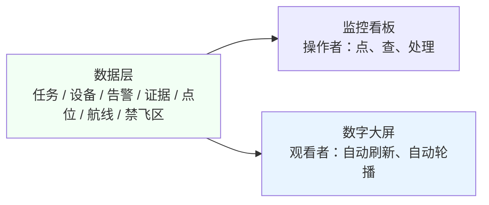
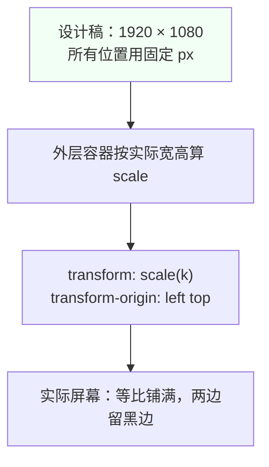

# 数字大屏方案：一屏看清系统在跑什么

> **这一版是方案，不是实现。** 先把「给谁看、看什么、谁不能看、怎么落地」定下来，再动代码。
>
> **2026-09-29 已拍板 7 条**（见第九章）。本文档已按拍板结果写成**可照着写的实现方案** ——
> 每一处不只有结论，还有「改哪个文件、加哪个字段、配置项叫什么」。

---

## 一、先看清现状：数据都有了，缺的是「一屏看全」

我们已经攒了一堆数据，但**没有任何一个地方能把它们放在一起看**：

| 现在有什么 | 在哪个页面 | 缺点 |
|---|---|---|
| 任务列表 | 任务管理 | 是一张表，得自己数 |
| 设备列表 | 设备管理 | 同上 |
| 告警 | 告警中心 | 只看得到告警，看不到「设备总数、在飞几架」 |
| 飞机在哪 | 监控看板 | 只有位置，没有「今天飞了多少架次」 |
| 点位/航线/禁飞区 | 各自的页 | 三个页面来回切 |

**大屏要解决的就是这一件事**：值班室那台电视、会议室那台投影、领导来视察时那块屏 ——
打开就是一个「现在系统在什么状态」的完整画面，不用点、不用切、不用数。

---

## 二、它和已有的「监控看板」不是一回事

这一步很容易被理解成「把 /monitor 放大」，但两者受众不同，做法也不同：

| | 监控看板（已有，`/monitor`） | 数字大屏（本方案） |
|---|---|---|
| 给谁看 | **坐在电脑前操作的人** | **站着看的人**：值班员、来访领导、会议室 |
| 目的 | 「这条任务出问题了，我要去处理」 | 「现在整体怎么样，有没有异常」 |
| 交互 | 点一条任务、看它的轨迹、跳去告警中心 | **基本不点**：自动刷新、自动轮播 |
| 信息密度 | 少而深（一条任务的细节） | 多而浅（二三十个数字 + 几张图） |
| 屏幕 | 普通显示器 | 大屏/电视，**1920×1080**，且没人坐在跟前 |

所以：**大屏不是看板的放大版，而是另一张脸**。两者共用同一套数据与权限，
但布局、刷新节奏、交互方式都要按「没人操作」来设计。



---

## 二点五、三个「看板」到底差在哪（产品角度，别混）

侧边栏现在有三个名字很像的入口，用途完全不同。**其中两个是同一套数据的两种脸，
第三个是另一件事。**

| | **监控看板**（已有，`/monitor`） | **数字大屏**（本方案，`/screen`） | **业务分析**（占位「待开发」，还没有） |
|---|---|---|---|
| 给谁看 | 坐着操作的人（值班/调度） | 站着看的人（值班室电视、会议室、来访领导） | 管理者的**复盘** |
| 回答什么问题 | 「**哪条**任务出问题了，我该处理哪一条」 | 「现在**整体**怎么样，有没有异常」 | 「这**段时间**干得怎么样，比上个月好了吗」 |
| 时间视角 | **此刻** | **此刻**（同一个时刻的一屏） | **一段时间**（今天/本周/本月） |
| 数据密度 | 少而深：一条任务的细节（轨迹、计划航线、告警） | 多而浅：二三十个数字 + 分布图 | 成组的对比：趋势线、排行、完成率 |
| 交互 | 点、查、跳（去告警中心处理） | **基本不点**：自动刷新 + 自动轮播 | 选时间段、下钻 |
| 刷新 | 手动为主（轮询 3 秒） | 自动：3 / 10 / 60 秒三档 | 按需（每次查都是一次历史聚合） |
| 屏幕 | 普通显示器 | 1920×1080 的大屏，且**没人坐在跟前** | 普通显示器 |

**三条结论**：

1. **数字大屏 ≠ 业务分析**，尽管名字曾经都带「看板」。大屏回答的是「**此刻**」，
   业务分析回答的是「**一段时间以来**」。两者的查询形态都不同：
   大屏是「一条 COUNT/GROUP BY 出一个数」，业务分析是「按时间分组的序列」。
   **把它们做成一页，就会出现「大屏上又想塞趋势图」的拉扯** ——
   塞进去之后，值班的人盯着看的东西变多了，反而看不清「现在有没有事」。
2. **数字大屏 与 监控看板 是同一套数据的两种脸**：一个给站着看的、一个给坐着用的。
   共用 `/dashboard/summary`、`/task/monitor` 与同一套权限 ——
   所以「大屏上能看到的东西」和「看板上能看到的东西」天然一致，不会两处对不上。
3. **侧边栏那个占位已经改名为「业务分析 · 待开发」**（2026-09-29）——
   它指的是将来的**业务复盘**（完成率趋势、飞手工作量、区域覆盖、平均时长那类），
   本来叫「数据看板」，和「数字大屏」只差两个字，很容易被当成同一个东西。
   真要做时又是一套「按时间分组的查询 + 可下钻的图表」，与本文档无关。

> 一句话：**监控看板是「手术台」，数字大屏是「仪表盘」，业务分析是「体检报告」。**
> 手术台要看细节、能动手；仪表盘要一眼扫过去知道有没有异常；体检报告是过一段时间回头看趋势。
> 三者都需要，但绝不能合成一块屏。

---

## 三、技术角度

### 3.1 数据从哪来：**先盘点，再决定加什么**

| 大屏上要显示的 | 数据来源 | 现在能用吗 |
|---|---|---|
| 任务总数 / 各状态数 / 今日新增 / 超期数 | `task` 表 | ⚠️ 没有聚合；用 `/task/list` 要按 6 个状态各拉一次 |
| 执行中任务的位置与航迹 | `/task/monitor` | ✅ 现成的（第五步刚做） |
| 未处理告警数 / 按级别分布 | `task_alert` 表 | ⚠️ 同上，要按级别各拉一次 |
| 最近告警滚动列表 | `/alert/list` 按时间倒序第 1 页 | ✅ 够用 |
| 设备总数 / 各状态数 / 累计架次时长 | `drone` 表 | ⚠️ 累计值要拉全表在 Java 里加 |
| 飞手总数 / 在线 / 作业中 | `user` 表 | ⚠️ 同上 |
| 点位 / 航线 / 禁飞区数量 | 三张表 | ⚠️ 三次请求拿三个 `total` |
| 今日证据条数（设备在不在发数据） | `task_evidence` 表 | ❌ 没有接口 |
| 任务按时完成率 | `task` 表 | ❌ 没有接口（要拿计划时间与实际时间比） |

结论：**现有接口能凑出来，但要打十几次请求**，而且每次都是「拉一页数据回来数数」——
PC 上看板还能忍，大屏上（每 10 秒刷一次 × 十几个请求）就是浪费。

### 3.2 第一步是加三个聚合接口（**完整接口设计**）

```
GET /dashboard/summary          一屏要的所有数字（按角色裁剪，见 4.3）
GET /dashboard/recent?limit=20  最近 N 条告警（滚动列表用）
GET /dashboard/config           大屏自己的配置（刷新间隔、轮播，见 3.6）
```

`GET /dashboard/summary` 的响应形状（**没有权限的块直接不出现**，不是 `null` 也不是 0）：

```json
{
  "state": 200,
  "data": {
    "generatedAt": "2026-09-29 14:32:10",
    "tasks":  { "total": 108, "byStatus": { "pending": 12, "dispatched": 5, "executing": 4, "finished": 87 },
                "todayNew": 6, "overdue": 1 },
    "myTasks": { "total": 3, "pending": 1, "doing": 1, "done": 1 },
    "alerts": { "open": 3, "bySeverity": { "critical": 1, "warning": 2 }, "todayNew": 5 },
    "myAlerts": { "open": 0 },
    "devices": { "total": 24, "byStatus": { "idle": 18, "assigned": 0, "flying": 4, "maintenance": 2 },
                 "totalFlights": 1560, "totalHours": "820.5", "onlineRate": 0.96 },
    "staff":  { "total": 12, "idle": 8, "busy": 3, "disabled": 1 },
    "geo":    { "points": 48, "routes": 7, "zones": 3 },
    "evidence": { "today": 8200, "lastHour": 3600 }
  }
}
```

**为什么不是让前端打十几个接口**（三条理由，按重要性排）：

1. **权限要在服务端裁剪**。哪些块这个身份能看，只能服务端说了算 ——
   前端「按权限隐藏卡片」是体验，不是边界（绕过前端直接调接口，一样能拿到别人的数）
2. **一致性**。十几个请求各自返回，会出现「任务总数是 3 秒前的、告警数是 8 秒前的」；
   一个接口一次查完，整屏的数字属于同一时刻
3. **频率**。一个接口每 10 秒一次，十几个接口就是每 10 秒十几个请求

**后端怎么实现**：`DashboardService` 按权限逐块拼，每块**一条聚合 SQL**（不要拉明细回 Java 数）：

| 块 | SQL 形状 | 加在哪个 DAO |
|---|---|---|
| `tasks` | `SELECT status, COUNT(*) FROM task GROUP BY status` + `COUNT(*) WHERE create_time >= #{from}` + `COUNT(*) WHERE status='executing' AND plan_end_time < #{now}`（时间点由 Java 传，避开 mysqld 时区是 UTC 的坑） | `TaskDao.countGroupByStatus` / `countCreatedSince` / `countOverdue` |
| `myTasks` | 同上但 `WHERE pilot_id = #{me}` | 复用上面三个（多一个可空的 `pilotId` 参数） |
| `alerts` | `SELECT severity, COUNT(*) FROM task_alert WHERE status IN ('pending','handling') GROUP BY severity` | `AlertDao.countOpenGroupBySeverity` |
| `myAlerts` | 上面那条 + `JOIN task ON task.id = task_alert.task_id AND task.pilot_id = #{me}`（飞手只能看**自己任务上**的） | 同上，多一个可空 `pilotId` |
| `devices` | `SELECT status, COUNT(*) FROM drone GROUP BY status` + `SELECT COUNT(*), SUM(flight_count), SUM(flight_hours) FROM drone` | `DeviceDao.countGroupByStatus` / `sumFlightStats` |
| `staff` | `SELECT state, COUNT(*) FROM user WHERE status='1' GROUP BY state` | `UserDao.countGroupByState` |
| `geo` | 三张表的 `COUNT(*)` | 三个 DAO 各加一个 `count()`（或复用现成的 `countByCondition` 传空条件） |
| `evidence` | `SELECT COUNT(*) FROM task_evidence WHERE observed_at >= #{from}` | `TaskEvidenceDao.countSince` |

> `onlineRate` 的口径要写死：**最近 N 分钟内有证据的设备数 / 设备总数**（默认 N=10）。
> 「设备在线」这件事我们没有实时心跳表，现有的是「它最后一次报数是什么时候」——
> 口径写在这里，免得两个人算出两个数。

### 3.3 图表用什么：ECharts（按需引入）

`drone-web` 现在只有 axios / element-plus / pinia / vue / vue-router，**没有图表库**。

| 取舍 | 说明 |
|---|---|
| **为什么是它** | 国内文档最全；折线/饼图/仪表盘全有；不需要额外授权 |
| **按需引入（必做）** | `echarts/core` + 只引 `PieChart`/`LineChart` + `CanvasRenderer`。全量引入会让首屏包大几百 KB，而大屏恰恰**打开就要秒出** |
| 为什么不用 Element Plus 自带的 | 它没有图表组件（只有进度条/进度环，做不了「按状态分布」） |
| 实例管理 | 实例用 `shallowRef`（第三方大对象，别让 Vue 深度代理）；`onBeforeUnmount` 里 `dispose()`；尺寸变化用 **`ResizeObserver` 观察容器**（不要监听 `window.resize` —— 大屏可能被嵌在 iframe 里，窗口不变但容器会变） |

### 3.4 尺寸：按 1920×1080 设计 + 整体缩放

**已拍板：本期只按 1920×1080 做。**

| 做法 | 为什么 |
|---|---|
| 布局按 1920×1080 写死（位置用固定 `px`），外层 `transform: scale(k)` 等比缩放 | **布局只有一套**；换到 2560×1440 的屏上自动放大，比例不变 |
| `transform-origin: left top` + 容器居中留黑边 | 非 16:9 的屏宁可留黑边，也不拉伸变形 |
| 字号用 `px`（配合缩放），不用 `rem`/`vw` | 缩放已经解决了适配，两套机制叠在一起字号会算不准 |
| **本期不做**：多分辨率布局、竖屏、DPR 特调 | 拍板「先按 1920×1080」—— 先跑起来，需要再说 |



### 3.5 刷新：分区刷新，各自呼吸

一整屏都 3 秒刷一次，等于每 3 秒重画一遍（大屏机器往往还是低配小主机）：

| 区域 | 数据 | 默认间隔 | 配置项（见 3.6） |
|---|---|---|---|
| 地图上的飞机位置 | 每秒都在变 | **3 秒** | `refreshMapSeconds` |
| 告警流、执行中任务数 | 秒级 | **10 秒** | `refreshLiveSeconds` |
| 各类总数、分布图、累计架次 | 分钟级都不变 | **60 秒** | `refreshStatSeconds` |
| 页面不可见时 | —— | **全部停** | `pauseWhenHidden` |

> **已拍板：夜里不停刷**（`nightPauseEnabled: false`）。开关保留在配置项里，
> 将来觉得费电/费请求，改一个值就生效，不用改代码。

### 3.6 配置项：现在放配置、将来放配置页（**完整清单**）

**已拍板：轮播要做，配置页先不做。** 所以配置项**先落在后端配置文件**里，
但**通过接口给前端** —— 将来做配置页时，只是把「读 yml」换成「读表」，前端一行都不用改。

```yaml
drone:
  screen:
    # ---- 轮播 ----
    carousel-enabled: true                   # 是否自动轮播
    carousel-pages: [overview, map, alerts]  # 轮播哪几屏、按什么顺序
    carousel-seconds: 15                     # 每屏停留秒数
    carousel-pin-on-critical: false          # 有未处理 critical 时停在告警屏（默认关）
    carousel-pin-max-seconds: 300            # 就算 pin 住，最长停多久也强制继续
    # ---- 刷新（三档，见 3.5）----
    refresh-map-seconds: 3
    refresh-live-seconds: 10
    refresh-stat-seconds: 60
    pause-when-hidden: true                  # 页面不可见时停刷
    # ---- 夜间（已拍板：不停刷，开关留着）----
    night-pause-enabled: false
    night-pause-from: "02:00"
    night-pause-to: "06:00"
```

- **后端**：`ScreenProperties`（`@ConfigurationProperties("drone.screen")`，与现有 `AlertProperties` 一个写法）
  + `GET /dashboard/config` 原样返回 —— **前端唯一要知道配置的入口**
- **将来做配置页**：加一张 `screen_config` 表（`id / config_key / config_value / remark`），
  把 `ScreenProperties` 改成「启动时读表、缺项用 yml 默认值」，再加 `POST /dashboard/config`。
  前端的 `GET /dashboard/config` 不变

### 3.7 轮播：**已拍板要做**（完整实现）

轮播的粒度是**「屏」**，不是「卡片」：一屏一个主题，轮转过去。

| 屏 | 内容 | 为什么单独一屏 |
|---|---|---|
| `overview` | 全部数字 + 状态分布图 + 地理资源 | 值班时最常看的一屏 |
| `map` | 大地图（执行中任务的位置与航迹） | 地图要占满才看得清 |
| `alerts` | 未处理告警分布 + 更长的最近告警滚动流 | 出事时盯着这一屏 |

**实现要点（都是大屏特有的坑）**：

1. **只有当前屏在刷新**。轮播到 `map` 时，`overview` 的统计**不再请求** ——
   否则「三屏各刷各的」等于把请求量乘以三，而屏上只看得到一屏
2. **切换时立刻拉一次数据**，不要等下一个刷新周期（否则切过去先看到旧数据/空数据）
3. **计时器只有一份**：用递归 `setTimeout` 而不是 `setInterval` ——
   后者在「切屏 + 刷新」同时发生时会出现两个计时器叠加（轮播越转越快）
4. **手动切屏后重新计时**：人点了一下说明他正在看这一屏，别马上转走
5. `carousel-pin-on-critical: true` 时，只要还有未处理 critical **就不离开告警屏**；
   但必须有兜底：最长停 `carousel-pin-max-seconds`（默认 5 分钟）后强制继续 ——
   否则一条没人处理的 critical 会让大屏**永远**卡在告警屏
6. 底部放**三个小圆点**表示在第几屏（不做可点的标签栏 —— 大屏上没人点）

---

## 四、权限怎么分（本方案的核心）

### 4.1 一个页面、按权限显示卡片 —— 不做两套页面

| 做法 | 取舍 |
|---|---|
| **一个 `/screen` 页面，卡片按「服务端返回了哪些块」显隐**（已定） | 数据聚合、刷新节奏、缩放逻辑只有一份；加一块卡片不用改两处 |
| 管理员一套页面、飞手一套页面 | 两套布局各自维护；「飞手能不能看某个数」一改就要动两处 |

关键：**显隐依据不是「前端猜角色」，而是「服务端返回了哪些块」**。
前端拿到 `summary` 里有哪些 key，就渲染对应卡片；没有的 key 就不渲染。权限只有一处实现。

### 4.2 三档角色看什么（**已按你的拍板更新**）

| 卡片 | 管理员 | 机务 | 飞手 |
|---|---|---|---|
| 任务：总数 / 各状态 / 今日新增 / 超期 | ✅ `task:list` | ✅ `task:list` | ❌ |
| **我的任务**：待办 / 执行中 / 已完成 | —— | —— | ✅ `task:execute`（只算自己的） |
| 地图：执行中任务的位置 | ✅ `task:list` | ✅ `task:list` | ❌ |
| **我这条任务的航线与位置** | —— | —— | ✅ `task:execute`（第五步已做，走 `GET /task/my/{id}/map`） |
| 告警：未处理数 / 级别分布 / 最近列表 | ✅ `alert:list`（全部） | ✅ `alert:list`（全部） | ✅ **只看自己任务上的**（`/task/alert/list`，已是这个口径） |
| 设备：总数 / 各状态 / 累计架次时长 | ✅ `device:list` | ✅ `device:list` | ✅ `device:list`（他本就能看设备） |
| 员工：总数 / 在线 / 作业中 | ✅ `staff:list` | ✅ `staff:list` | ❌ |
| **点位 / 航线 / 禁飞区数量** | ✅ | ✅ | ✅ **已拍板：飞手也看**（见 4.3 的放宽说明） |
| 系统：今日证据条数 | ✅ `task:list` | ✅ | ❌ |

> **机务的有趣之处**：他的权限集合几乎等于管理员（少了 `task:add` 与 `system:*`），
> 所以大屏上他看到的卡片和管理员基本一样 —— 这符合他的职责（管设备、管点位、看告警）。

### 4.3 服务端怎么裁剪（**权限点与块的对应表**）

| 返回的块 | 需要的权限码 | 没有这个权限时 |
|---|---|---|
| `tasks` | `task:list` | **不返回这个 key** |
| `myTasks` | `task:execute` | 不返回 |
| `alerts` | `alert:list` | 不返回 |
| `myAlerts` | `task:execute` | 不返回 |
| `devices` | `device:list` | 不返回 |
| `staff` | `staff:list` | 不返回 |
| `geo` | **登录即可**（已拍板：飞手也看，见下） | —— |
| `evidence` | `task:list` | 不返回 |

**四条纪律**：

1. **不许返回 0 代替「没权限」**。`0` 与「看不到」在界面上是两回事：
   前者让人以为「今天一架次都没飞」，后者才是「你没这个权限」。算不了的块**整个 key 不出现**
2. **飞手的「任务数」口径必须换**。他没有 `task:list`，所以给的不是 `tasks` 而是
   `myTasks`（只统计 `pilot_id = 自己`）。**两个块是不同的 SQL**，名字不同、口径不同，
   才不会有人误用
3. **`geo` 刻意放宽到「登录即可」**（你的拍板）。理由：① 它只是三个数字
   （48 个点位、7 条航线、3 块禁飞区），不是明细，不敏感；② 飞手知道「系统里有几块禁飞区」
   对他有**安全价值**；③ **明细仍然要 `route:list` / `zone:list`** ——
   放宽的只是计数，飞手想看点位/航线的具体内容，走的还是 `GET /task/my/{id}/map`
4. **地图那块单独走 `/task/monitor`**（沿用它的 `task:list` 权限），不做进 `summary` ——
   它的响应重（位置 + 航迹），混进来会让每 10 秒一次的统计顺便拖上一坨几何数据

### 4.4 飞手的「大屏」—— **已拍板：先不做**

飞手平时用的是小程序，在管理端他只有一个设备管理页。本期**不做**飞手专属大屏，
也不改 `homePath` 的角色判定。**将来要做时**，方案已经想好（记在这里，不用重新讨论）：

| 将来可做 | 说明 | 代价 |
|---|---|---|
| A. 管理端按角色给首页 | 飞手在电脑上登录 → 进「我的战况」（复用 `myTasks`/`myAlerts` 两块 + 我这条任务的地图） | 小：一个页面 + 改 `homePath` |
| B. 小程序加「今日概览」 | 飞手在小程序首页顶部看到：今天几单、几单在飞、我的告警 | 中：动小程序首页布局 |

> 顺带记一个现在的小毛病（**本期不做，留个线索**）：`homePath` 是按
> 「staff → device → task → alert」的顺序兜底的，所以**飞手登录管理端会落到「设备管理」**
> （他有 `device:list`）。这不是设计，是兜底顺序的副作用。

### 4.5 大屏自己的凭证：**已拍板：给一个长期 token**（完整实现）

问题回顾：管理端的 axios 拦截器在 401 时会**跳回登录页**，而现有 token 只活 2 小时
（`drone.jwt.expire-hours: 2`）。大屏挂在值班室，没人会去重新登录 ——
**第二天早上来一看，屏停在登录页上**。这是大屏最现实的运维故障。

**实现（五处改动，都在现有文件上）**：

**① 加一个只读角色 `screen`**（新建 `docs/sql/migration/screen_role.sql`，并同步 `schema.sql` / `data.sql`）

```sql
-- 大屏账号只读：能看「统计要用到的那些」，一个写权限都不给
INSERT IGNORE INTO `role` (`code`, `name`, `status`, `remark`) VALUES
  ('screen', '大屏只读', 1, '挂在值班室/会议室的大屏专用账号，只能读');

INSERT IGNORE INTO `role_permission` (`role_id`, `permission_id`)
SELECT r.id, p.id FROM `role` r JOIN `permission` p
WHERE r.code = 'screen'
  AND p.code IN ('task:list', 'device:list', 'alert:list', 'staff:list', 'route:list', 'zone:list');
```

> **为什么必须只读**：大屏那台机器在开放的房间里，token 就存在那台机器的浏览器里 ——
> 谁走过去都能用。给它只读权限，最坏情况是「有人看了数据」，而不是「有人删了任务」。
> 这也是为什么不复用管理员账号：复用等于把整个系统的写权限挂在一台没人看着的电脑上。

**② 长效 token：按角色给不同的有效期**（`JwtProperties` + `JwtUtil` + `UserServiceImpl#login`）

```yaml
drone:
  jwt:
    expire-hours: 2            # 交互式账号（管理端/小程序）：还是 2 小时
    screen-expire-hours: 8760  # 大屏角色：365 天。**只有 screen 角色用这个值**
```

- `JwtProperties` 加 `screenExpireHours`
- `JwtUtil.generateToken(user)` 改成 `generateToken(user, expireHours)`（旧方法保留成便捷重载，
  免得其它调用点全要改）
- `UserServiceImpl#login` 里：**登录成功、查到角色之后**判断 ——
  角色集合含 `screen` → 用 `screenExpireHours`，否则用 `expireHours`
- 为什么不给前端一个「记住我」的开关：**前端能要求的有效期，等于谁都能给自己签一年**。
  有效期只能由服务端按「这个账号是什么」来定

**③ 建大屏账号（运维步骤，写在文档里让部署的人照着做）**

```sql
-- 密码自己改，别用示例的
INSERT INTO `user` (username, name, password, status, state, remark) VALUES
  ('screen', '大屏', '<BCrypt 加密后的密码>', '1', 'idle', '值班室大屏专用，只读');
-- 再把它绑到 screen 角色（写在 user_role 上）
```

> 操作上一句话：**在那台大屏机器上用这个账号登录一次**，token 会存进那台机器的
> `localStorage`，之后一年不用管。换人/换屏时把账号禁用即可（`status='0'`），
> 拦截器会立刻拒绝 —— 和普通账号一样，不用重启服务。
> **到期提醒**：一年后大屏会显示「需要重新登录」的大字（见 ④），届时登录一次即可。

**④ 401 不跳转，改成大字提示**（前端 `src/api/request.ts` + 一个新组件）

现有行为：401 → 清 token → `window.location.href = '/login'`。改成：

```ts
// 伪代码，落在 api/request.ts 的 401 分支里
if (isScreenRoute()) {
  // 大屏：**不跳走**（跳走了就再也没人把它切回来），就地显示大字提示
  screenAuthExpired.value = true   // 一个模块级的响应式标记，ScreenView 监听它
} else {
  window.location.href = '/login'  // 别的页面维持原样
}
```

- `isScreenRoute()`：读 `window.location.pathname.startsWith('/screen')`
  （不用 router 实例 —— 拦截器在 router 之外）
- 大屏页监听到标记后，盖一层「**登录已过期 —— 请在该机器上重新登录**」的大字，
  **并把已显示的数据留在底下**（屏不至于全黑，看到最后一份数据也比什么都没有强）
- 这一条和第八章第 12 条是同一件事：**大屏不能有「需要人点一下才能恢复」的状态**

**⑤ 安全边界（部署时要知道）**

- token 存在那台机器的浏览器里 → **那台机器本身要物理可控**（值班室/会议室，不是公共区域）
- 只读角色 + 一年有效期 = 风险是「长期可读」。要收紧就调小 `screen-expire-hours`
  （比如 720 小时 = 30 天，运维每月登录一次）
- **不要用 URL 参数传 token**（会进浏览器历史、代理日志）；不要把它写进任何仓库里的文件

---

## 五、页面与组件设计

### 5.1 布局（1920×1080）

```
┌──────────────────────────────────────────────────────────────────────┐
│  无人机管理平台 · 运行总览        2026-09-29 14:32:10    [全屏]      │  顶栏 80px
├───────────────┬──────────────────────────────────────┬───────────────┤
│ 任务           │                                      │ 告警           │
│  未派发 12     │            地图                       │  未处理 3      │
│  已派发  5     │   （执行中任务的位置 + 航迹）          │  严重 1        │
│  执行中  4     │                                      │  ─────────    │
│  已完成 87     │                                      │  最近告警滚动  │
│  ─────────    │                                      │  · 电量低 …    │
│  今日新增 6    │                                      │  · 进入禁飞区… │
│  超期    1     │                                      │  · 设备离线…   │
├───────────────┼──────────────────┬───────────────────┼───────────────┤
│ 设备 24        │ 各状态分布（环图）│ 今日证据条数 8.2k │ 点位/航线/区域 │
│  待命 18       │                  │ 设备在线率 96%    │  48 / 7 / 3    │
│  在飞 4        │                  │                  │                │
│  维护 2        │                  │                  │                │
└───────────────┴──────────────────┴───────────────────┴───────────────┘
                                 ● ○ ○        ← 轮播指示（三屏）
```

- 顶栏：平台名 + **实时时钟**（用本机时间，不请求服务端）+ 全屏按钮
- 告警在右上：**最需要被看见的东西放在视觉起点之后的第一眼位置**
- 底部三块：变化最慢的静态统计

### 5.2 组件清单

| 组件 | 内容 | 数据来源 |
|---|---|---|
| `ScreenShell` | 1920×1080 缩放外壳 + 三档刷新调度 + 轮播计时 | `/dashboard/config` |
| `StatCard` | 一个大数字 + 一行小字 | `summary` 的某一块 |
| `StatusDonut` | 状态分布环图（ECharts） | `summary.tasks.byStatus` |
| `AlertFeed` | 最近告警滚动列表（新的一条从上面滑进来） | `/dashboard/recent` |
| `LiveMap` | 执行中任务的位置与航迹 | `/task/monitor`（复用 `GeoMap`） |
| `DataClock` | 实时时钟 | 本机时间 |
| `ScreenExpired` | 「登录已过期」大字覆盖层 | 401 标记（4.5 ④） |

> `LiveMap` 复用现有 `GeoMap`，但 `fitKey` 传一个**固定值** ——
> 否则每次数据刷新都会重新框视野，画面会一跳一跳（第五步踩过这个坑，`GeoMap` 才加了 `fitKey`）。

---

## 六、分阶段实施建议

**不要一次做完整屏。** 大屏最容易在一开始就纠结动效，结果连「有多少任务」都没接上。
四步，每步都能独立上线看效果：


| 步骤 | 做什么 | 验收标准 | 成本 |
|---|---|---|---|
| **第一步：数字** | `/dashboard/summary` + 大屏页的数字与分布图 + 缩放外壳 | 管理员登录一屏看到任务/设备/告警/地理资源的全部数字，**与各自列表页的总数一致** | 低：聚合查询 + 一个页面，不动表 |
| **第二步：动态区** | 中间地图（复用 `/task/monitor`）、右上告警滚动流、时钟、全屏 | 模拟器飞起来 → 大屏上看到飞机在动；产生一条告警 → 几秒内出现在右上 | 中：复用监控看板与告警列表 |
| **第三步：凭证与投放** | `screen` 角色 + 长效 token + 401 大字提示 | 登录一次能撑过原来的 2 小时；到期后屏上显示提示而不是跳登录页 | 低：改 3 个后端文件 + 1 个前端分支 |
| **第四步：轮播** | 三屏轮播 + 指示点 + `GET /dashboard/config` 的配置项生效 | 无人操作时自动轮转；改 `application.yml` 的停留秒数 → 重启后生效 | 低：都是前端的事 |

> **为什么第一步是数字**：它一次就把「权限怎么裁、块怎么返回、缩放怎么做、
> 数字对不对」四件事验完 —— 这是大屏的骨架。先做动效，骨架不对就要连动效一起返工。

---

## 七、落地清单（真要开工时按这个走）

**后端**

| 文件 | 做什么 |
|---|---|
| `docs/sql/migration/screen_role.sql` | 建 `screen` 只读角色 + 授权；`schema.sql`/`data.sql` 同步（新库直接建全） |
| `common/JwtProperties` + `common/JwtUtil` | 加 `screenExpireHours`；`generateToken(user, hours)` |
| `user/service/impl/UserServiceImpl#login` | 角色含 `screen` → 按长效签发 |
| `dashboard/controller/DashboardController` | `GET /dashboard/summary`、`/dashboard/recent`、`/dashboard/config` |
| `dashboard/pojo/DashboardSummaryVO` | 各块用 `@JsonInclude(NON_NULL)`，**没权限的块根本不出现** |
| `dashboard/service/DashboardService(Impl)` | 按权限逐块拼；每块一条聚合 SQL |
| `dashboard/config/ScreenProperties` | `drone.screen.*` 的配置项（见 3.6） |
| 各 DAO | 按 3.2 的表加聚合方法（`countGroupByStatus` 之类），**不拉明细回 Java 数** |
| 权限 | **不加新权限码**：每块复用现有码。加 `dashboard:view` 会让「能不能看大屏」和「能不能看数据」变成两个开关，而它们本就是一件事 |

> **包放哪**：顶层 `cn.tedu.drone.dashboard` —— 大屏是**第六个域**（横跨任务/设备/告警/人员/地理），
> 不属于任何一个模块。放在某个模块下（如 `task.dashboard`）会藏起真实的依赖方向：
> 读起来像「任务模块长出了一块大屏」，而实际是「大屏依赖各模块」。
>
> **它直接读了别人的表（一条刻意的破例）**：注入 8 个模块的 DAO 做只读聚合，
> 而本项目那条规矩是「跨模块走 Service」。破例的理由写在
> `DashboardServiceImpl` 的类注释里（只读、不碰状态；为守形式规则给 6 个 Service
> 各加一个只为大屏存在的统计方法，反而把它们的 API 撑大），
> 以及**什么情况下这个破例不再成立**（一旦大屏开始写别人的表，就必须改回走 Service）。

**前端（drone-web）**

| 文件 | 做什么 |
|---|---|
| `src/api/dashboard.ts` | `fetchSummary()` / `fetchRecent()` / `fetchScreenConfig()` |
| `src/views/ScreenView.vue` | 三屏（overview / map / alerts）+ 轮播 + 三档刷新 |
| `src/components/screen/*` | 5.2 的七个小组件 |
| `src/utils/screen-scale.ts` | 等比缩放 composable（`ResizeObserver`） |
| `src/api/request.ts` | 401 分支：大屏不跳转，置「已过期」标记（4.5 ④） |
| `src/router` + `AdminLayout` | `/screen` 路由（最低门槛 `device:list`）+ 菜单入口 + **全屏按钮** |
| `package.json` | 加 `echarts`（按需引入） |

**文档**：本文件；`任务业务设计.md` 的进度补一句；`地图接入方案.md` 第五章「一屏看全」指向本文档。

---

## 八、血泪清单（大屏最容易踩的坑）

| # | 坑 | 后果 | 避法 |
|---|---|---|---|
| 1 | 用响应式断点做大屏布局 | 每个宽度一套布局，改一处要调四遍 | 1920×1080 写死 + 整体 scale（3.4） |
| 2 | 一整屏一个定时器全量刷新 | 低配小主机卡顿、请求成倍 | 分区刷新（3.5），页面不可见就全停 |
| 3 | 图表实例不 `dispose` | 切几次页面后内存涨、越来越卡 | `shallowRef` + `onBeforeUnmount` dispose |
| 4 | 监听 `window.resize` 重算图表 | 嵌 iframe / 用了 scale 时窗口没变但容器变了，图表还是老尺寸 | `ResizeObserver` 观察容器 |
| 5 | 每次刷新都重画地图视野 | 画面每几秒一跳，像有人在拽地图 | `fitKey` 固定（5.2） |
| 6 | 数字与列表页对不上 | 大屏「任务 100」而列表点进去 98 —— 信任当场崩掉 | 聚合条件与列表**用同一份**；用例断言「大屏的数 == 列表的 total」 |
| 7 | 没权限的块返回 0 | 用户以为「今天没飞」，其实是看不到 | 没权限的 key **不返回**（4.3） |
| 8 | 把权限实现在前端 | 绕过前端就能看到全部数据 | 前端只管显隐；裁剪在服务端 |
| 9 | 时钟每秒请求服务端 | 一秒一个请求，纯浪费 | 时钟用本机时间 |
| 10 | ECharts 全量引入 | 首屏包大几百 KB，而大屏要秒开 | 按需引入（3.3） |
| 11 | 大屏上放可点的交互 | 没人操作，点了也没人看见；还会误触 | 交互只保留全屏按钮（和轮播的手动切屏） |
| 12 | 没给大表加索引就上大屏 | 单条 `COUNT` 从区间扫描退化成全表/skip scan（实测 `task_evidence` 那条就是 skip scan），而它每天被调 1440 次 | 见 `业务分析方案.md` 第四章 4.3 ①：`task_evidence(observed_at)`、`task(create_time)`、`task(status, plan_end_time)`、`task_alert(observed_at)` 四条 DDL，5 分钟，与大屏/分析两条线共用 |
| 12b | **token 过期后跳回登录页** | 第二天早上屏停在登录页 —— 大屏最现实的运维故障 | **已定**：`screen` 只读角色 + 长效 token + 401 就地大字（4.5） |
| 13 | 轮播用 `setInterval` | 切屏+刷新同时发生时计时器叠加，越转越快 | 递归 `setTimeout`，只有一份计时器（3.7） |
| 14 | 轮播时**所有屏都在刷新** | 请求量 ×3，而屏上只看得到一屏 | 只有当前屏请求（3.7） |
| 15 | `carousel-pin-on-critical` 没有兜底 | 一条没人处理的 critical 让大屏永远卡在告警屏 | 最长停 `carousel-pin-max-seconds` 后强制继续（3.7） |
| 16 | 大屏账号复用管理员 | 一台没人看着的电脑上挂着全系统的写权限 | 专用只读角色 `screen`（4.5 ①） |

---

## 九、已拍板与仍然开放

### 9.1 已拍板（2026-09-29）

| # | 问题 | 结论 | 落在哪 |
|---|---|---|---|
| 1 | 大屏的 token | **给一个长期 token** | 4.5：`screen` 只读角色 + `screen-expire-hours: 8760` + 401 就地提示 |
| 2 | 飞手的大屏 | **先不做** | 4.4：将来的 A/B 两案记在文档里 |
| 3 | 屏幕分辨率 | **先按 1920×1080** | 3.4：写死 + 整体 scale，不做多分辨率布局 |
| 4 | 多屏轮播 | **要做**；配置页先不做 | 3.7 实现 + 3.6 配置项（先放 application.yml，接口给前端） |
| 5 | 夜里停刷 | **不停**（开关留着） | 3.6：`night-pause-enabled: false` |
| 6 | 今日/本周/本月切换 | **暂时不做** | 见 9.2 第 4 条 |
| 7 | 飞手看点位/航线/禁飞区数量 | **看** | 4.3：`geo` 块放宽到「登录即可」，**明细**仍要 `route:list`/`zone:list` |

### 9.2 仍然开放

| # | 问题 | 现在怎么处理 |
|---|---|---|
| 1 | 这块屏挂在哪、多大 | 按 1920×1080 做，够用；换屏只影响缩放系数，代码不动 |
| 2 | 大屏账号多久换一次 | 现在一年（`screen-expire-hours: 8760`）。要更严就调小 —— 比如 720 小时，运维每月登录一次 |
| 3 | 要不要做配置页 | 先不做。配置项已列全（3.6），做的时候只改后端读表 + 加一个 `POST /dashboard/config`，前端不动 |
| 4 | 日/周/月切换 | 先不做。将来做的话：`/dashboard/summary?range=today\|week\|month`，把「今天 0 点」换成区间起点；图表另加一条时间序列查询。**成本在查询口径，不在页面** |
| 5 | 大屏要不要显示「所有设备在哪」（不只在飞的任务） | 现在只有执行中任务的位置。要显示全部设备的位置，得先有「设备最后一次上报的位置」这种查询（`task_evidence` 里有坐标，但没有任务关联时 `task_id` 为空）—— 需要时再说 |

---

## 九点五、已落地（2026-09-29）

**第一步（数字）+ 第三步（凭证）+ 第四步（轮播）一起做了**；第二步的动态区
（地图/告警流/时钟/全屏）也在里面。

| 落了什么 | 在哪 |
|---|---|
| 三个接口 | `GET /dashboard/summary`（按权限裁块）、`/dashboard/recent`、`/dashboard/config` |
| 后端包 | 顶层 `cn.tedu.drone.dashboard`（见第七章「包放哪」那条，以及 `DashboardServiceImpl` 里「为什么直接读别人的表」） |
| 大屏页 | `drone-web` 的 `/screen`：三屏（总览 / 在飞位置 / 告警态势）+ 轮播 + 1920×1080 整体缩放 + 三档刷新 |
| 组件 | `components/screen/`：`StatCard` / `StatusDonut` / `AlertFeed` / `DataClock`；地图复用 `GeoMap` |
| 配置 | `drone.screen.*`（11 项，见 3.6），接口给前端 —— 将来做配置页时前端不用改 |
| 凭证 | `screen` 只读角色（迁移脚本已执行）+ 按角色签长效 token（`screen-expire-hours: 8760`）+ 大屏 401 就地大字提示 |
| 依赖 | `echarts`（**按需引入**：Pie/Graphic/Legend/Tooltip + CanvasRenderer） |
| 性能 | ① 四条统计索引（`task_evidence(observed_at)` 等，见 `业务分析方案.md` 6.1，**已在开发库执行**）；② `summary` 10 秒 / `recent` 5 秒的短 TTL 缓存（**key 带用户 + 权限指纹，否则飞手会命中管理员的缓存 = 越权**）；③ 启动时检查「缓存 TTL ≤ 刷新间隔」，配错记 warn；④ **缓存记账日志**（`TtlCache`）：未命中记 INFO 并报「业务真算一遍花了多少」，命中记 DEBUG 并报「省下多少」，每 60 秒一条小结报命中率与累计省下的时间 —— 上缓存值不值，看这一条就够了 |

**验证**
- 后端 204 条用例全绿（本步新增 4 条：按权限裁块、数字与列表 total 一致、配置可读、大屏账号签 365 天 token 且写接口 403）
- 浏览器里真跑过：总览屏渲染出接口给的数字、两块环图各有一个 canvas、
  缩放外壳生效（1920×1080 → `scale(0.7528)`）、**20 秒后轮播从「运行总览」换到「在飞位置」**、控制台无报错

**E2E 抓出来的一个真 bug**（记下来）：环图中间那个「总数」是用 ECharts 的
`graphic` 画的，按需引入时**漏了 `GraphicComponent`** —— 表现是控制台报
「Component graphic is used but not imported」，而**中间的数字不显示**，
其余部分照常渲染，所以肉眼很容易漏掉。这就是「按需引入」的代价：少引一个组件不会白屏，只会少一块。

**没落地**（按拍板）：配置页、飞手专属大屏、日/周/月切换、小程序版概览。

**顺手修的一条既有用例**：`systemRoleListShouldBeAccessibleForAdmin` 与
`saveRoleShouldCreateNewRole` 原来断言「角色一共 3 个 / 4 个」，加了 `screen` 角色就挂了 ——
它们真正想验的是「管理员能看到角色、新增的角色能出现在列表里」，
所以改成断言「包含哪几个编码」，不再数字数（否则每加一个角色都要回来改）。

> **性能那件事在 `业务分析方案.md` 里写得最全**（第四章分析查询、第五章大屏的 COUNT）——
> 两条线共用同一批索引，做完那四条 DDL 再谈别的优化才有意义。

---

## 十、一句话总结

**大屏的价值不在「好看」，在于「不用问人」** ——
值班的人一眼能回答「现在几架在飞、有没有告警、设备在不在发数据」，
而不用翻三个页面、也不用去问飞手。

所以第一步不追求动效，先把**数字对不对、权限裁得对、屏不变形**这三件事做扎实；
而「挂上去就不用管」这件事，靠的是**一个只读账号 + 长效凭证 + 401 不跳走**这三样 ——
它们比任何动效都重要。
