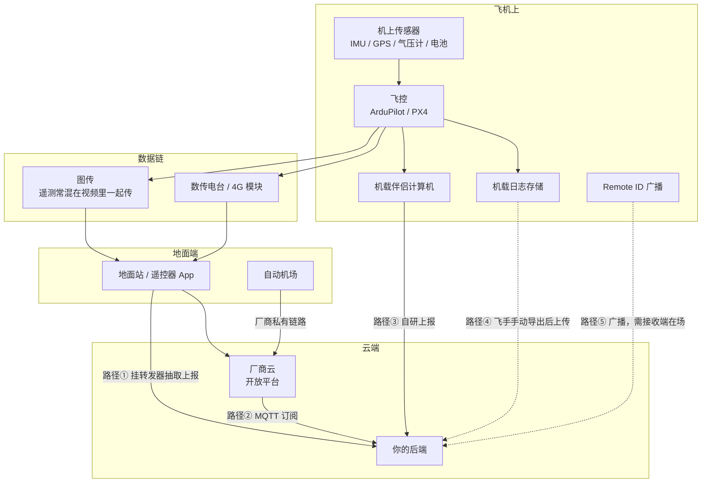
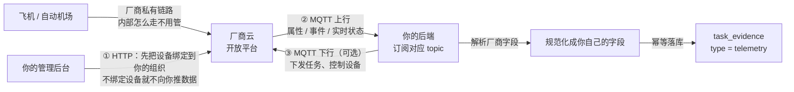
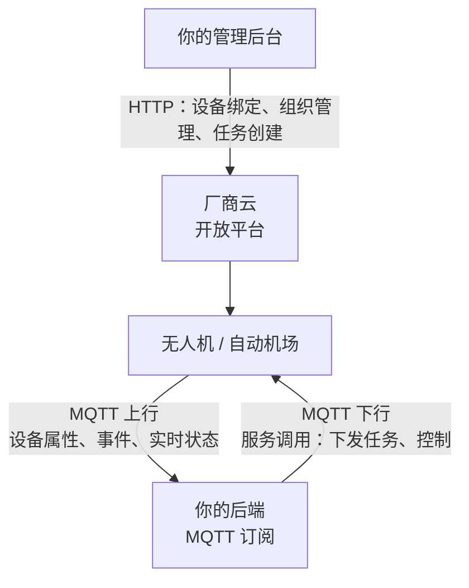
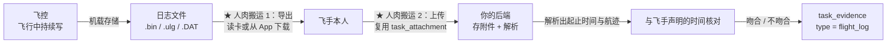

# 无人机数据从哪来：证据来源全景

> 面向小白的学习型文档。
>
> **这份文档解决什么问题**：任务状态里的「执行中」，目前只是飞手自己点出来的一句话 ——
> 系统并没有任何客观东西能证明那架飞机真的在天上。
> 要让它变得可信，就得拿到**客观数据**。所以这份文档回答的是：
> **那些数据从哪来、怎么拿、拿得到什么、要付出什么代价。**
>
> **给你 30 秒的上下文**（没读过别的文档也能看懂）：
> 我们把两件事分开看 ——
>
> - **任务状态**：待派发 / 已派发 / 执行中 / 已完成…… 回答「业务走到哪一步了」
> - **执行依据**：无 / 仅飞手声明 / 已证实…… 回答「这一步凭什么这么说」
>
> 两者是分开的两个维度，所以「执行中 ＋ 仅飞手声明」是一个合法组合，
> 意思是"**飞手说他在飞，但没有任何东西能证明**"。
> 本文件讲的就是：**怎么把「仅飞手声明」升级成「已证实」**，
> 以及每一条升级路径要花多少代价。
>
> 阅读前提：不需要你碰过无人机，但需要接受一个事实 ——
> **数据不是凭空有的，每一层都要有人把它搬下来。**
>
> 相关文档：[任务业务设计.md](./任务业务设计.md)（状态机、以及「状态」与「依据」这套模型的定义）、
> [任务通知.md](./任务通知.md)（数据到手后怎么实时推给别人）。

---

## 一、先看清整条数据链

无人机的能力可以概括成一句话：**会飞的传感器平台**。
它的数据从产生到你手里，要穿过五层：

**这张图决定了你在哪一层插手、就拿到什么粒度：**

| 你在哪接 | 拿到的是 | 自由度的代价 |
|---|---|---|
| 飞控串口 | 原始遥测（粒度最细、频率最高） | 要自己解码、自己回传 |
| 数据链 | 已经打包好的遥测流 | 依赖厂商协议、可能加密 |
| 地面端 App | 厂商整理过的数据 + 航线任务状态 | 受 SDK 能力与授权限制 |
| 厂商云 | 现成的结构化数据（MQTT/HTTP） | 绑定厂商生态、机型受限 |
| 事后日志 | 最完整但**已经飞完** | 不能用于「进行中」 |

**一句话选型原则**：**越靠下越自由、越靠上越省事。**
小团队想在几个月内拿到可用遥测，答案几乎总是「用厂商的上层能力，别去碰飞控」。

---

## 二、五个可接入的位置

先把五条路径摆在一张图上看。**实线是自动的链路，虚线要人参与**，
箭头上的「路径①~⑤」对应下面五节：

**五条路径一眼看全**：

| 路径 | 谁把数据搬到你手里 | 实时性 | 需要动硬件吗 | 需要厂商配合吗 |
|---|---|---|---|---|
| ① 飞控遥测 + 转发器 | 你自己写的转发程序 | 实时 | 不改飞机，只改地面端 | 不需要 |
| ② 厂商上云 API | 厂商云 | 实时 | 不需要 | **需要**（账号 + 机型支持） |
| ③ 机载伴侣计算机 | 你装在飞机上的小电脑 | 实时 | **需要**（装机、供电、配重） | 不需要 |
| ④ 飞行日志文件 | **飞手本人** | 事后 | 不需要 | 不需要 |
| ⑤ Remote ID / 监管 | 第三方，或你自己的接收端 | 实时 | 不需要（但接收端得在场） | 不涉及，但你也控制不了它 |

看这张表要抓住一句话：**前面三条是"机器搬数据"，后两条分别是"人搬"和"别人搬"。**
谁在搬，决定了它能有多实时、以及出了故障该找谁。

> 这里只列"要不要额外条件"；**各维度的完整对比**（字段丰富度、工程量、
> 能支撑哪类证据）在第三章。下面五节，每节都会画一条端到端数据流图，
> 并把每一跳用「逐跳说明表」拆开讲。

### 2.1 飞控遥测：MAVLink（最底层、最通用）

**数据在哪**：飞控（autopilot）的串口上，一直在往外吐。

Pixhawk 这类开源硬件上跑的是 **ArduPilot** 或 **PX4**，两者都用
**MAVLink** 作为对外的遥测与控制协议。你也可以把它理解成"无人机界的串口协议"：
二进制、极省带宽、每条消息带编号（message id），两端按编号约定字段。

**常见消息**（了解这几个就够用）：

| 消息 | 里面有什么 | 用途 |
|---|---|---|
| `HEARTBEAT` | 心跳 + 当前飞行模式 + 是否解锁 | 判断"在不在线""是不是在飞" |
| `GLOBAL_POSITION_INT` | 经纬度、相对/绝对高度、地速 | 航迹、位置类证据 |
| `ATTITUDE` | 姿态角、角速度 | 判断是否真的在空中机动 |
| `BATTERY_STATUS` / `SYS_STATUS` | 电压、电流、剩余电量 | 电量证据、异常告警 |
| `GPS_RAW_INT` | 卫星数、定位质量 | 判断定位是否可信 |

**数据怎么一路走到你手里**（★ 标的是你的接入点）：

**逐跳说明**：

| 跳 | 谁 → 谁 | 承载什么 | 频率 | 这一跳要注意什么 |
|---|---|---|---|---|
| 1 | 传感器 → 飞控 | 内部总线（I2C/SPI/CAN） | 几百 Hz | 飞控内部的事，**你拿不到也不需要** |
| 2 | 飞控 → 数据链 | MAVLink 报文 | 位置 1~10 Hz | **数据起点**：要哪些字段在这里挑 |
| 3 | 数据链 → 地面站 | 无线帧里封装 MAVLink | 同上 | 带宽有限，弱信号时会丢包、降频 |
| 4 | 地面站 → 你的后端 | 你定的协议（HTTP/MQTT） | 你自己采样 | **★ 接入点**：抽字段、转 JSON、带上你的设备编号 |
| 5 | 后端 → 证据表 | SQL | 同上报 | 落库并去重（见第四章 4.1） |

> 这条链路其实是**双向**的：地面站还能往下发指令（起飞、返航、切航线）。
> 但做「执行证据」只关心**上行**那一个方向 —— 你需要的是"它在哪、在不在飞"。

**怎么传到地面**（三条常见路，选一条即可）：
- **数传电台**：433MHz / 915MHz，点对点，几十公里内；稳定但带宽小
- **4G/5G 数传模块**：能上公网，天然适合回传到你自己的服务器；依赖运营商信号
- **WiFi**：只在近场可用，适合调试

**你怎么接**：地面站（QGroundControl、Mission Planner 之类）本来就在收 MAVLink，
你在这条链路上挂一个转发器，把需要的消息抽出来转成 JSON，再上报到自己的后端。
**这是自研路线的标准做法**：不改飞控、不改飞机，只在"地面站之后"加一段。

**代价与坑**：

- **单位不是常识单位**：经纬度常是「度 × 10⁷ 的整数」，高度是毫米，速度是厘米/秒。
  直接当"度"用会得到离谱的结果
- **时间戳不可信**：飞控的时钟可能是"开机后经过的毫秒"，也可能是对过 GPS 的 UTC，
  取决于是哪个字段。**永远同时记下"服务端收到的时刻"**（这一点已经落在字段设计上，见
  [任务业务设计.md](./任务业务设计.md) 的「数据模型草案」一节）
- 坐标系：有的是 WGS84 经纬度，有的是本地 ENU/NED 米。混用会让航迹整体偏移

### 2.2 厂商云 / 开放平台：以大疆上云 API 为例（行业里最现实）

这条路**不碰飞控**：厂商已经把数据整理好放在云上，你去订阅。

大疆的开发者能力大致分四块，选哪个取决于你想在哪一层接：

| 能力 | 跑在哪 | 典型用途 |
|---|---|---|
| Mobile SDK | 手机/平板 App | 自己写一个遥控器 App |
| Onboard SDK | 机载计算机 | 机上做计算、自定义回传（见 2.3） |
| Payload SDK | 负载（云台/挂载） | 自己造一个负载 |
| **上云 API（Cloud API）** | **设备 ↔ 云，基于 MQTT** | **行业机型/机场把遥测与任务状态上报到第三方云** |

**数据怎么一路走到你手里**（端到端）：

**逐跳说明**：

| 跳 | 谁 → 谁 | 承载什么 | 频率 | 这一跳要注意什么 |
|---|---|---|---|---|
| 1 | 飞机/机场 → 厂商云 | 厂商私有链路 | 厂商定 | **这一步与你无关**，是厂商负责的部分 |
| 2 | 你的后台 → 厂商云 | HTTP | 一次性 | **前置动作**：设备没绑定到你的组织，你就收不到数据 |
| 3 | 厂商云 → 你的后端 | MQTT 上行 | 设备变化时推送 | **★ 接入点**：订阅 topic 就能持续收到 |
| 4 | 你的后端 → 证据表 | SQL | 同上报 | 落库并去重 |

对上云 API，把它想成**两条通道**：

- **MQTT 通道**负责**数据与实时性**：设备把「属性（properties）」「事件（events）」
  「实时状态（OSD）」推上去，你订阅对应 topic 就能持续收到
- **HTTP 通道**负责**管理与前置动作**：设备要先绑定到你的组织/租户，才能向你推数据
- topic 是按「设备类型 / 设备 SN / 消息类型」分层的，具体命名以官方文档为准

**能拿到什么**：经纬度、高度、速度、电量、飞行状态、相机状态、机场状态，
以及**任务执行状态**（飞没飞到、航线执行到第几个航点）。
最后这一项对「让执行中变得可信」这件事价值最大 —— 它能提供**实时证据**，
而且是厂商已经帮你解析好的，不用自己去啃二进制。

**代价**：

- **机型受限**：主要覆盖行业机型与自动机场（消费级机型往往不在列）。
  具体支持哪些，以官方「产品支持」页为准
- 需要开发者/企业账号，绑定厂商生态
- topic 与字段随版本演进，要跟官方变更

**官方入口**（请自己核对，本文不逐条抄写其内容）：

- 上云 API 总目录：`https://developer.dji.com/doc/cloud-api-tutorial/cn/`
- 产品支持（机型清单）：`.../cn/overview/product-support.html`
- MQTT topic 定义：`.../cn/api-reference/dock-to-cloud/mqtt/topic-definition.html`
- 设备属性（字段清单示例）：`.../cn/api-reference/dock-to-cloud/mqtt/dock/dock3/properties.html`

> 其他厂商（道通、极飞、纵横等）也各有开放平台或云接口，思路大同小异：
> **能用云的，别去碰硬件。** 本文以大疆为例只是因为它的文档最成体系。
>
> **这条路我们自己能不能先跑通？** 能 —— 但不能真去接厂商云（要账号、要机型支持）。
> 做法是**写一个模拟器扮演厂商侧**，按约定的 topic 与报文往 broker 发数据，
> 我们后端订阅并处理。完整的 MQTT 概念讲解与对接方案见
> [MQTT与设备接入.md](./MQTT与设备接入.md)。

### 2.3 机载伴侣计算机：Onboard SDK / 自研上报（最灵活）

在飞机上挂一块小电脑（树莓派、Jetson 之类），它同时接两根线：

- 一根**串口接飞控** → 直接用 Onboard SDK 或裸读 MAVLink，拿到最原始的遥测
- 一根**4G 接公网** → 自己写上报逻辑，字段、频率、格式全由你定

**数据怎么一路走到你手里**（这条链路最短，因为中间环节全是你自己的）：

**逐跳说明**：

| 跳 | 谁 → 谁 | 承载什么 | 频率 | 这一跳要注意什么 |
|---|---|---|---|---|
| 1 | 飞控 → 伴侣计算机 | MAVLink（串口） | **你说了算** | 可以直接读原始报文，不受厂商限制 |
| 2 | 伴侣计算机 → 公网 | 4G/5G | 你采样后 | **在机上先处理**：全量传太贵，就地抽样/压缩 |
| 3 | → 你的后端 | HTTPS / MQTT | 你定 | **★ 接入点**：格式自己定，但要给设备独立鉴权 |
| 4 | 后端 → 证据表 | SQL | 同上 | 落库并去重 |

**好处**：

- 完全可控，不依赖厂商云，机型不受限
- 能在机上做计算：比如顺便算覆盖面积、跑视觉识别、压缩后再回传
- 时机可控：起飞瞬间就能上报，不用等云端轮询

**代价**：要动硬件（装、供电、配重、走线），要自己做固件升级与远程运维。
**这属于硬件改造项目，不是一个后端接口的事。**

### 2.4 飞行日志文件：事后证据的主力

**数据在哪**：三处常见

| 来源 | 典型格式 | 特点 |
|---|---|---|
| 飞控机载日志 | ArduPilot `.bin`、PX4 `.ulg` | 最全：原始传感器、PID、告警全都在 |
| 遥控器/App 飞行记录 | 厂商私有 `.txt` / `.DAT` | 整理过，字段友好 |
| 机载高频记录 | 厂商私有 `.DAT` | 频率最高、文件最大 |

**数据怎么一路走到你手里**（注意★：这条链路里**唯一的自动环节在最后**）：

**逐跳说明**：

| 跳 | 谁 → 谁 | 承载什么 | 频率 | 这一跳要注意什么 |
|---|---|---|---|---|
| 1 | 飞控 → 机载存储 | 日志文件 | 全程 | 飞的时候就一直写，**这个文件是客观的** |
| 2 | 存储 → 飞手 | **人工导出** | 一次/架次 | **靠人**：飞手得愿意导出、知道怎么导出 |
| 3 | 飞手 → 你的后端 | 小程序上传 | 一次/架次 | **靠人**：复用 `task_attachment`，不用新造上传链路 |
| 4 | 后端 → 解析 → 核对 | 你写的解析器 | 一次/架次 | 与声明时间对不上就标异常 |

**这就是它只能当"事后证据"的根因**：第 2、3 跳是**人工搬运**，
数据到得晚不晚，取决于飞手什么时候想起来上传 —— 不是技术问题，是人的问题。

**特点**：**事后才有**，但信息最全。
**怎么用**（这正是「事后证据」要做的事，见
[任务业务设计.md](./任务业务设计.md) 的「代价与落地路径」一节）：
飞手作业结束后把日志文件上传，系统解析出**起止时间与航迹**，
再和「飞手声明的时间」核对 —— 对不上就标异常。
**这解决的是声明制完全查不出来的问题：声明了但压根没飞。**

**本项目可复用的现成能力**：`task_attachment` 表的 `file_type` 已经支持 `log`，
上传链路不用新造（见 `schema.sql`）。

**坑**：

- 格式随固件版本变化，解析要专门的库（`.bin`/`.ulg` 都有开源解析器，但要有维护预期）
- 文件可能几十 MB，上传要限速、要能断点续传
- **别指望用它支撑「进行中」**：它是结果，不是过程

### 2.5 监管与第三方：Remote ID / UTM / 监管平台

这一类的特点是：**数据不是你的设备产生的，也不受你控制**，但有时非常有用。

- **Remote ID（远程识别）**：法规要求的广播式身份与位置，作用类似航空的应答机。
  因为是**广播**，所以理论上"别人的设备也能被动收到" ——
  也就是说你不需要碰自己的飞机，就可能知道"附近有一架飞机、它在哪"。
  注意：字段与频率都不是为你设计的，**别拿它做业务遥测**
- **各国监管平台**：例如中国的 UOM（民用无人驾驶航空器综合管理平台）承担实名登记、
  空域申请等。这类平台的意义在**合规**，不在实时数据
- **第三方飞行管理/反制设备**：机场、公安等场景有专门的探测设备，属于另一个产业

**数据怎么一路走到你手里**（这条链路你几乎控制不了任何一跳）：

**逐跳说明**：

| 跳 | 谁 → 谁 | 承载什么 | 频率 | 这一跳要注意什么 |
|---|---|---|---|---|
| 1 | 飞机 → 空中 | 无线广播 | 法规要求 | **不受你控制**：字段与频率都不是为你设计的 |
| 2 | 空中 → 接收端 | 无线接收 | 同上 | **必须有接收端在场**，没设备就什么也收不到 |
| 3 | 接收端 → 你的系统 | 第三方接口 | 第三方定 | 依赖别人的可用性 |

用法：拿来做**合规校验**（这台飞机是否实名登记、当前空域是否报备）与**多机协同时的"看见别人"**，而不是当主数据源。

---

## 三、横向对比

| 接入位置 | 实时性 | 字段丰富度 | 工程量 | 依赖 | 能支撑哪类证据 |
|---|---|---|---|---|---|
| 飞控遥测 MAVLink | **实时** | 最全（原始） | **大**（要自己解码+回传） | 数据链 + 地面端改造 | `telemetry` 强 |
| 厂商上云 API | **实时** | 中（厂商整理过） | 中 | 厂商生态 + 支持机型 | `telemetry` 强 |
| 机载伴侣计算机 | **实时** | 可定制 | **大**（动硬件） | 装机与运维 | `telemetry` 强 |
| 飞行日志文件 | 事后 | 最全（含原始数据） | 小（复用附件） | 飞手愿意上传 | `flight_log` 中（只能事后核对） |
| Remote ID / 监管 | 实时 | 少且不可控 | 小 | 法规与设备 | 辅助/合规 |

**看这张表要抓住的一句话**：
**只有前三行能支撑「正在执行」，后两行只能事后或辅助。**
这不是实现问题，是数据产生的时间决定的 ——
依据的分类见 [任务业务设计.md](./任务业务设计.md) 的「什么样的东西才算证据」一节。

---

## 四、拿到数据之后：怎么变成「证据」

数据到手只是原料，要变成上面说的那几类证据，还有四件事必须处理 ——
**这四件和用哪条链路无关，换哪种来源都躲不掉**：

### 4.1 去重与乱序

设备重传、网络抖动、多副本上报都会造成重复与乱序。
**幂等键**建议用「设备 SN + 上报类型 + `observed_at`」，
重复的直接丢弃，而不是靠"消息 id"（那个往往不唯一）。

### 4.2 时间戳：两个时间都要记

- `observed_at`：**数据描述的那个时刻**（设备说的）
- `reported_at`：**系统收到的时刻**（你说的）

设备时钟可能不准，日志类证据往往是事后补传的 —— 两者差很远。
只留一个就判断不了"这份证据新不新鲜"。**这一点已经落在 [任务业务设计.md](./任务业务设计.md) 的「数据模型草案」字段上。**

### 4.3 断流不等于结束

设备离线时遥测会停，但这**不能**推出"任务结束了"。
可能是没信号、可能是电池关机、也可能只是网络抖动。
所以：**证据中断只能产生"证据不足"的告警，不能自动改任务状态** ——
这和 9.5 节「执行超时不自动释放」是同一条原则。

### 4.4 存储量与降采样

算一笔账：位置类遥测 1Hz，一次飞行 30 分钟 = **1800 条/架次**。
一个机队 20 架、每天 3 架次，一年就是 **几千万条**。

所以不要无脑全量落库。常见做法：

- **分层存**：原始高频数据留在设备/厂商云，本地只存**关键点**
  （起飞、降落、异常点、每隔 N 分钟一个点）
- **按需回捞**：要看细节时再去厂商云或日志文件里取
- **冷热分离**：近 30 天在业务库，历史归档

---

## 五、本项目的落地建议

按工程量分三档，**每档都能独立交付**，和 [任务业务设计.md](./任务业务设计.md) 的「代价与落地路径」三档一一对应：

| 档 | 做什么 | 依赖 | 工程量 |
|---|---|---|---|
| **现在** | 只记「依据 = 自行声明」+ 事后日志上传（复用 `task_attachment`） | 无 | **小**：加字段 + 上传解析 |
| **中期** | 接厂商上云 API，拿实时遥测与**任务执行状态** | 开发者账号 + 机型在支持列表内 | **中**：新增一个 MQTT 接入服务 |
| **长期** | 自建 MAVLink 网关或机载伴侣计算机 | 硬件改造 | **大**：另立项目 |

**我的建议：先做「现在」这一档。**
理由不是它更有用，而是**它是所有后续方案的前提**：
不管将来遥测从哪来，你都需要一个地方记录"这条任务的依据是什么、
依据几时到、是谁给的"（也就是 `task_evidence` 那张表）。
表先立起来，将来换数据源只是往里多写几行，业务与前端都不用改。

**中期那一档还有个前置条件容易被忽略**：得先确认你手里的机型**
在不在厂商云的支持列表里**。消费级机型通常不在 ——
这时候"中期"要么换机型，要么直接跳到长期（机载伴侣），
**这个决策靠写代码是解决不了的，得先问采购。**

---

## 六、安全与合规（最容易被跳过，但代价最大）

### 6.1 设备身份 ≠ 用户身份

遥测上报的鉴权，**不能用飞手的 JWT**：
设备是设备，人是人，两者完全不同。正确做法是**两条独立的鉴权链路**：

| 链路 | 谁在请求 | 凭证 |
|---|---|---|
| 用户接口 | 飞手/管理员 | JWT（本项目已有，见 [登录与Token.md](./登录与Token.md)） |
| 设备上报 | 无人机/机场/网关 | **设备级凭证**：MQTT 用户名密码、证书、或设备密钥 |

顺带一提：本项目已经吃过一次"密钥不能进仓库"的教训 ——
小程序的 **AppSecret 必须走配置**（见 [任务通知.md](./任务通知.md)）。
设备密钥是同样的规矩，而且更严重：泄露一台设备的密钥，
等于让别人能往你的系统里灌假遥测。

### 6.2 航迹是敏感数据

一条完整航迹能反推出：作业地点、时间规律、甚至关键设施位置。
所以要提前定清楚：

- **存哪**：能不能出境？要不要存到境内机房
- **谁能看**：飞手能不能看别人的航迹？管理员能不能导出全部
- **要不要脱敏**：对外展示时是否需要模糊化起降点
- **留多久**：原始航迹长期全量保存，是负债不是资产

### 6.3 合规

实名登记、空域申报、Remote ID（视所在地区法规）、数据出境 —— 这些**不是可选项**。
真要做行业应用，这一块通常比技术本身更耗时间。**具体以当地法规与监管平台要求为准。**

---

## 七、常见坑速查表

| 坑 | 症状 | 怎么避 |
|---|---|---|
| 经纬度当"度"用 | 位置偏移到离谱 | 先确认单位（常见是度×10⁷ 的整数） |
| 拿飞控时钟当可信时间 | 航迹时间整体错乱 | 同时存服务端接收时刻，两个字段分开 |
| 坐标系统一 | 航迹整体平移几百米 | 明确是 WGS84 还是本地 ENU/NED |
| 把厂商云当唯一真相 | 厂商改字段就全崩 | 落库时做一层自己的规范化字段 |
| 遥测断流判定任务结束 | 误判完成任务 | 断流只告警，不改状态 |
| 全量存高频遥测 | 一年几千万行、查询变慢 | 分层存 + 关键点 + 冷热分离 |
| 设备密钥写进前端/仓库 | 可被伪造上报 | 设备凭证只在服务端，走配置 |
| 以为消费级机型能接上云 API | 做完发现机型不支持 | **先查产品支持列表，再定方案** |
| 日志解析写死字段顺序 | 固件升级后解析全错 | 用带版本判断的解析库，别手写解析 |

---

## 八、面试题（面向初级）

**1. 无人机飞行数据从哪几个层面可以拿到？**
由下往上：飞控（MAVLink 原始遥测）→ 数据链 → 地面端 App/SDK →
厂商云（MQTT/HTTP）→ 事后日志文件。越往下越自由、越往上越省事。

**2. MAVLink 是什么？**
开源飞控（ArduPilot、PX4）对外的遥测与控制协议。二进制、省带宽、
消息带 id，两端按编号约定字段。常见消息有 HEARTBEAT、GLOBAL_POSITION_INT 等。

**3. 为什么不能直接用飞控上报的时间戳？**
飞控时钟可能是"开机后毫秒"、也可能对过 GPS，来源不一致；
而且日志是事后补传的。所以要同时记录服务端接收时刻，两个时间分开存。

**4. 「遥测断了」能不能判定任务已结束？**
不能。断流可能是没信号、关机或网络抖动，只能产生"证据不足"的告警，
不能自动改任务状态 —— 依据不足不等于事情没发生。

**5. 为什么设备上报不能用用户的 JWT？**
设备和人是两种身份。JWT 代表某个登录用户，而遥测来自设备/网关，
应该用设备级凭证（MQTT 账号、证书、设备密钥），两条鉴权链路分开。

**6. 厂商云的 MQTT 用在哪、HTTP 用在哪？**
MQTT 负责实时数据（属性、事件、状态上行，服务调用下行）；
HTTP 负责管理动作（设备绑定、组织、任务创建）。一个管数据、一个管管理。

**7. 高频遥测怎么存？**
分层：原始高频留在设备或厂商云，本地只存关键点（起降、异常、抽样），
要细节时按需回捞，历史归档做冷热分离。

**8. 飞行日志能在"任务进行中"提供证据吗？**
不能，它是飞行结束后才产生的，只能事后核对。要支撑"正在执行"必须有实时来源。

---

## 附一：术语表

| 术语 | 说人话 |
|---|---|
| 飞控 / autopilot | 飞机上的自动驾驶仪，把传感器数据变成飞行状态并执行控制 |
| MAVLink | 开源飞控对外的遥测与控制协议，二进制、省带宽 |
| 数传 | 把遥测与控制指令在地面与飞机之间传的链路（电台/4G） |
| 图传 | 传视频的链路，很多机型把遥测混在里面一起传 |
| 地面站 | 接收并显示遥测、规划航线的软件（QGroundControl 等） |
| OSD | 实时状态数据（位置、高度、电量那一类） |
| 上云 API | 厂商提供的、让设备把数据推到第三方云的接口（大疆以 MQTT 为主） |
| Remote ID | 法规要求的广播式身份与位置，类似航空应答机 |
| UOM | 中国的无人驾驶航空器综合管理平台，做实名登记、空域申请 |
| 伴侣计算机 | 挂在飞机上的小电脑，用来做机载计算与自定义回传 |

## 附二：本文未逐条核实的点

写作时官方文档站在本机被限流打不开（WebFetch 被拒），以下内容**属于方向性描述，
具体取值与命名请以官方文档为准**：

- 大疆上云 API 的 topic 命名规则、字段清单、鉴权细节与支持机型
- MAVLink 各消息的字段构成与单位（不同版本略有差异）
- Remote ID 的生效范围与各国法规要求
- 各家厂商开放平台的具体能力边界

建议动手前做两件事：**① 打开上面列的官方入口核对一遍；② 用一架真机跑通一条数据链路**
（哪怕只是让一条 HEARTBEAT 到达你的后端）。文档能帮你少走弯路，但替代不了实测。
