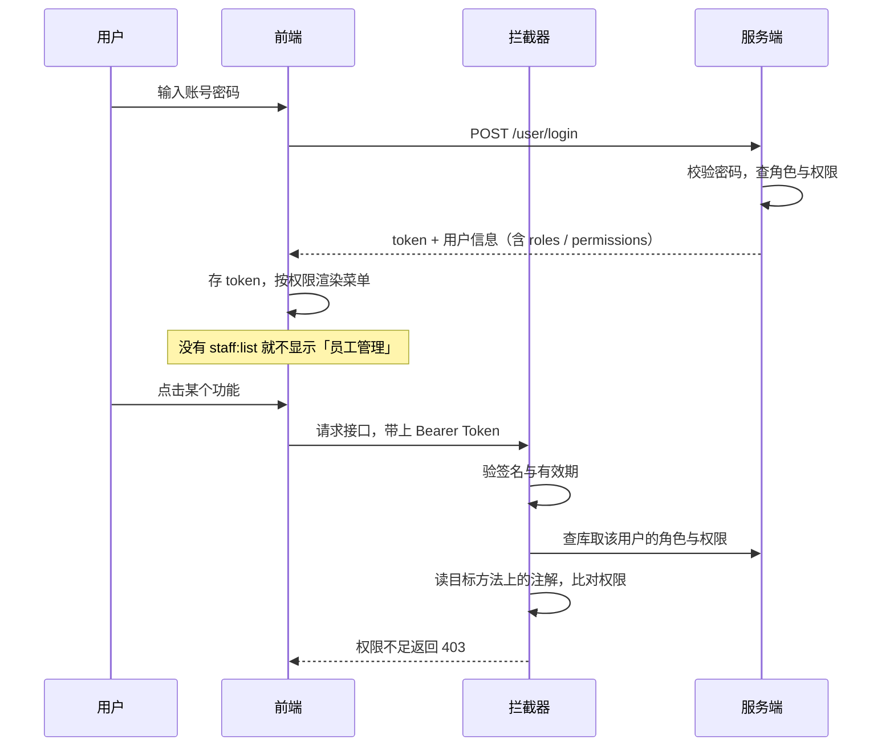
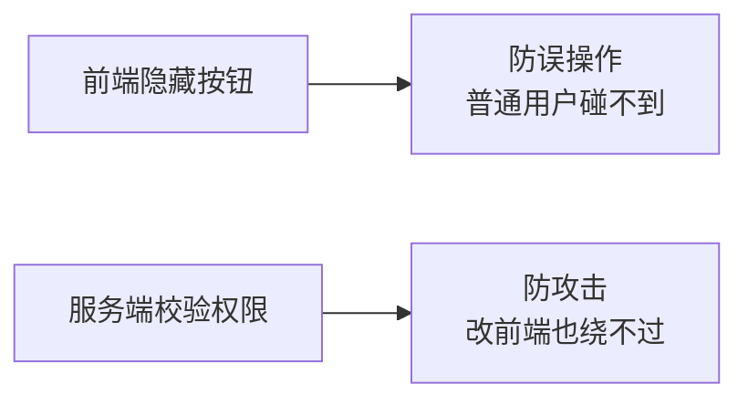
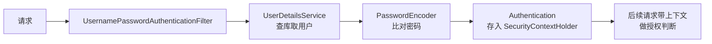

# 权限与安全框架：从「谁能看什么」说起

> 面向初级工程师的学习文档。
> 读完你应该能回答：认证和授权有什么区别、RBAC 是什么、权限该怎么落到代码里、
> 什么是越权、Spring Security 和 Shiro 差在哪。
>
> 配套文档：[RBAC权限设计.md](./RBAC权限设计.md)（本项目的表结构与实施步骤）、[登录与Token.md](./登录与Token.md)（登录与 Token 原理）。

---

## 一、先分清三个词：认证、授权、审计

初学者最容易把这几个概念混着用，面试也常考。

| 概念 | 英文 | 回答的问题 | 对应实现 |
|---|---|---|---|
| **认证** | Authentication | **你是谁？** | 登录、发 Token |
| **授权** | Authorization | **你能做什么？** | 角色、权限校验 |
| **审计** | Audit | **你做了什么？** | 操作日志 |

**顺序很重要**：先认证，后授权。

> 先证明身份，再判断这个身份能干什么 —— 所以未登录是 401，登录了但没权限是 403。

在我们项目里的对应关系：

```
POST /user/login           → 认证：校验账号密码，签发 Token
AuthInterceptor 验签名      → 认证：确认「你是谁」
AuthInterceptor 查权限      → 授权：确认「你能不能干这件事」
log.info("用户退出登录...")  → 审计：留下痕迹
```

---

## 二、权限模型的演进

理解演进过程，比直接背 RBAC 定义有用得多。

### 2.1 第一阶段：硬编码判断

```java
if ("admin".equals(user.getPermission())) {
    // 允许删除设备
}
```

**问题**：改需求就得改代码。产品说「机务也能删设备了」，你得找到所有判断处改一遍、重新发版。

### 2.2 第二阶段：用户身上的单值字段

```sql
-- user 表加一个字段
permission varchar(50)   -- 'admin' / 'pilot' / 'maintainer'
```

这就是我们项目改造**之前**的样子。

**问题**：
- 一人只能一个角色（「既是机务又兼管理员」表达不了）
- 角色能干什么仍然散落在代码里

### 2.3 第三阶段：RBAC

**Role-Based Access Control（基于角色的访问控制）**，是目前最主流的方案。

核心思想：**不要把权限直接给用户，而是给角色，再让用户挂角色。**


好处：**「谁能做什么」变成了数据，不是代码**。

- 给某人升职 → 插一条 `user_role` 记录，不用改代码
- 新增一个岗位 → 新建角色 + 配权限，不用改代码

### 2.4 RBAC 的四个层级

面试常考，但不用背，理解区别就行：

| 级别 | 名称 | 多出来的能力 | 例子 |
|---|---|---|---|
| **RBAC0** | 基础 | 用户、角色、权限三者关联 | **我们项目实现的** |
| **RBAC1** | 角色继承 | 角色之间有上下级，下级继承上级权限 | 部门经理 ⊃ 普通员工 |
| **RBAC2** | 角色约束 | 互斥角色、角色数量上限 | 财务和审计不能同一人担任 |
| **RBAC3** | 统一 | RBAC1 + RBAC2 | — |

> RBAC1 的实现很简单：给 `role` 表加一个 `parent_id`，递归查询时把祖先角色的权限也算进来。

### 2.5 其他模型

| 模型 | 全称 | 判断依据 | 适用场景 |
|---|---|---|---|
| RBAC | 基于角色 | 你是什么角色 | 绝大多数后台系统 |
| **ABAC** | 基于属性 | 你的部门/职级 + 资源属性 + 环境（时间、IP） | 复杂策略，如「只能在工作时间从内网访问」 |
| **数据权限** | — | 数据本身归属谁 | 销售只能看自己的订单 |

**数据权限常被忽略，但业务里到处都是**：

```
功能权限：能不能调「查询订单」这个接口        ← RBAC 管
数据权限：能查到哪些订单（自己的？本部门的？）  ← RBAC 管不了
```

只做 RBAC 的系统，很容易出现「接口有权限、但能看到所有人的数据」的漏洞 —— 这属于下面要说的**水平越权**。

---

## 三、我们项目里的 RBAC（结合登录业务看全链路）

### 3.1 四张表

| 表 | 作用 |
|---|---|
| `role` | 角色定义（code / name / status） |
| `permission` | 权限点（code 形如 `staff:add`） |
| `user_role` | 用户 ↔ 角色 |
| `role_permission` | 角色 ↔ 权限 |

`user` 表上原来那个 `permission` 字段**已经删掉**了 —— 数据迁进 `user_role` 之后就没有存在意义。

### 3.2 完整链路



### 3.3 三个关键设计决策

**① 角色和权限不放进 Token，改为查库**

| 方案 | 优点 | 缺点 |
|---|---|---|
| 写进 Token | 不用查库，最符合无状态 | 改了权限得等 Token 过期才生效 |
| **查库（我们的选择）** | 权限变更**下次请求立即生效** | 每个受保护请求多一次关联查询 |

其实这就是「无状态」和「实时性」的取舍。数据量小的时候，查库的代价可以忽略。

**② 401 和 403 要分清楚**

- **401 未认证**：没登录 / Token 失效 → 前端应该跳登录页
- **403 未授权**：登录了但没这个权限 → 跳登录页没用，应该提示「联系管理员」

我们前端的 axios 拦截器只对 401 做跳转，403 走普通错误提示，就是这个道理。

**③ 权限校验写在拦截器里，用注解声明**

```java
@RequirePermission("staff:add")
@PostMapping("/add")
public JsonResult<Void> add(...) { ... }
```

接口自己声明需要什么权限，拦截器统一核对。加新接口时只多写一行注解，不用改校验逻辑。

### 3.4 前端的角色：只是体验优化

前端按权限隐藏菜单和按钮，**但这不是安全措施**。



只要你打开浏览器控制台改几行代码，被隐藏的按钮就能显示出来。

所以**同一个权限码必须在前后端用两遍**：前端管「看不看得见」，服务端管「能不能做」。我们项目里菜单用 `staff:list`、按钮用 `staff:add`，服务端用同一套码校验，就是这个用意。

---

## 四、越权：权限系统最容易出事的地方

面试高频，实战也最容易踩。越权分两种：

### 4.1 垂直越权（提权）

**低权限用户访问了高权限接口。**

例子：普通用户猜到了管理员的接口地址 `/user/delete?id=1`，直接调用。

**防御**：每个接口都做权限校验 —— 也就是我们的 `@RequirePermission`。绝不能靠「前端不显示按钮」来防。

### 4.2 水平越权（更隐蔽）

**同级用户访问了别人的数据。**

例子：查询订单接口是 `/order/detail?id=100`。用户 A 把自己的订单 id 从 100 改成 101，就看到了用户 B 的订单。两个用户权限完全一样，所以**任何权限校验都拦不住它**。

**防御**：不能只校验「你有没有查订单的权限」，还要校验「这条订单是不是你的」。

```java
// 错误写法：只查了权限，没查归属
Order order = orderDao.selectById(id);
return order;

// 正确写法：连归属一起作为查询条件
Order order = orderDao.selectByIdAndUserId(id, currentUserId);
if (order == null) {
    throw new BusinessException("订单不存在");
}
```

**注意最后那句提示**：不要返回「无权访问该订单」，因为那等于告诉攻击者「这个 id 是存在的」。统一说「不存在」，让他分不清是没数据还是没权限 —— 和登录时统一提示「用户名或密码错误」是同一个思路。

### 4.3 二者的区别

| | 垂直越权 | 水平越权 |
|---|---|---|
| 本质 | 权限不够却访问了 | 权限够，但访问了别人的 |
| 能不能靠 RBAC 拦住 | 能 | **不能** |
| 防御手段 | 接口级权限校验 | 数据归属校验（数据权限） |

---

## 五、其他常见坑

**① 权限码硬编码在代码里**

```java
if (user.hasPermission("staff:add")) { ... }   // 权限码散落在各处
```

这只是把「硬编码角色」换成了「硬编码权限码」。更好的做法是注解声明 + 集中校验，让权限判断只有一处实现。

**② 角色禁用后权限没及时失效**

我们的做法是在查权限的 SQL 里带上 `AND r.status = 1`：

```sql
JOIN `role` r ON r.id = ur.role_id AND r.status = 1
```

这样角色一禁用，它的权限立刻不再参与计算，**不需要去删 `role_permission` 里的关联记录**。

**③ 超级管理员要不要绕过校验**

有些系统给超管开绿灯，代码里到处写 `if (isSuperAdmin) return true`。

不建议 —— 一是超管的操作就没人管了，二是这种判断会散落得到处都是。更干净的做法是**把全部权限直接授予超管角色**，让校验逻辑保持单一。

**④ 权限缓存与实时性**

权限查得频繁，自然会想到加缓存。但缓存的代价是「改了权限要等缓存过期才生效」。

我们目前没加缓存（数据量小，查库毫秒级）。如果将来要加，记得**在权限变更时主动清掉对应缓存**，而不是干等过期。

---

## 六、Java 安全框架扩展

你问的「市面上的 Java 安全框架」，主要是这四个方向。

### 6.1 Spring Security

Spring 全家桶里的安全模块，是目前**企业级项目的默认选择**。

**核心概念**：

| 概念 | 作用 |
|---|---|
| `SecurityFilterChain` | 一串过滤器，请求依次经过它们完成认证与授权 |
| `Authentication` | 认证结果，装着「你是谁、有什么权限」 |
| `SecurityContextHolder` | 存放认证结果的容器（**内部就是 ThreadLocal**） |
| `UserDetailsService` | 你自己实现，告诉框架「怎么根据用户名查出用户」 |
| `GrantedAuthority` | 权限标识，`hasAuthority("staff:add")` 就是比对它 |

**认证流程（简化）**：



**授权方式**：注解式，和我们写的 `@RequirePermission` 思路一致，只是它更完备。

```java
@PreAuthorize("hasAuthority('staff:add')")
public void add(...) { ... }

@PreAuthorize("hasRole('ADMIN')")   // 注意：hasRole 会自动加 ROLE_ 前缀
public void remove(...) { ... }
```

**优点**：功能全（认证、授权、OAuth2、SSO、CSRF、会话管理一应俱全）、社区大、与 Spring Boot 无缝。

**缺点**：**学习曲线陡**。概念多、配置绕，初学者经常卡在「为什么我的请求被拦了半天的 bug 里」。

> 顺带一提：`SecurityContextHolder` 内部用的就是 ThreadLocal —— 和我们项目的 `UserContext` 是一个套路，
> 原理见 [ThreadLocal学习笔记.md](./ThreadLocal学习笔记.md) 的「哪些常用框架在用 ThreadLocal」一节。

### 6.2 Apache Shiro

老牌的轻量安全框架，在 Spring Boot 普及之前非常流行。

**三大核心组件**：

| 组件 | 作用 |
|---|---|
| `Subject` | 当前用户（对开发者友好，API 像 `subject.isPermitted("staff:add")`） |
| `SecurityManager` | 框架的大脑，管理所有安全操作 |
| `Realm` | 数据来源，你自己实现「怎么查用户、怎么查权限」 |

**优点**：概念少、API 直白、上手快，不依赖 Spring。

**缺点**：**更新缓慢**（社区活跃度大不如前）、与 Spring Boot 的集成不如 Spring Security 原生、生态和文档相对陈旧。

**现状**：新项目基本不再选它；老项目里还能见到。

### 6.3 Sa-Token

国产轻量框架，近年在中小项目里挺受欢迎。

**特点**：
- API 极简：`StpUtil.login(id)`、`StpUtil.checkPermission("staff:add")`
- 开箱即用：登录、权限、单点登录、踢人下线、临时令牌都有
- 中文文档友好，对初学者友好

**适合**：中小型项目、想快速把权限跑起来、不想被 Spring Security 的概念绕晕。

### 6.4 三个框架怎么选

| 维度 | Spring Security | Shiro | Sa-Token |
|---|---|---|---|
| 学习曲线 | 陡 | 平缓 | 很平缓 |
| 功能完备度 | 最全 | 基础 | 够用且现代 |
| 与 Spring Boot 集成 | 原生 | 需自行配置 | 简单 |
| 社区活跃度 | 高 | 低 | 中 |
| 适合 | 中大型、标准企业项目 | 老项目维护 | 中小项目、快速开发 |

**一句话建议**：团队大、要求标准 → Spring Security；想快速上手、项目不大 → Sa-Token；老项目改造 → 看它现在用什么。

### 6.5 那我们项目为什么手写拦截器？

因为这是**学习项目**，目的是把原理跑一遍。

用框架的话，`@PreAuthorize` 一贴就完事，但你就不会知道：

- 401 和 403 到底什么时候返回
- 权限为什么要查库、不查库会怎样
- 拦截器和过滤器有什么区别
- ThreadLocal 存的用户信息什么时候清理

自己写一遍 `AuthInterceptor`，这些概念就都落地了。

**如果换成 Spring Security**，我们的代码会变成：

```
① 删掉 AuthInterceptor 和 WebMvcConfig，引入 spring-boot-starter-security
② 写一个 JwtAuthenticationFilter（解析 Token，构造 Authentication 放进上下文）
③ 写一个 UserDetailsService（根据用户名查用户和权限）
④ Controller 上的 @RequirePermission 换成 @PreAuthorize("hasAuthority('staff:add')")
⑤ 配置 SecurityFilterChain（哪些路径免登录、异常怎么处理）
```

核心逻辑（查库取权限、按权限码校验）没变，只是从「自己写」换成「按框架的约定写」。

---

## 七、面试题

> 按「概念 → 模型 → 实战 → 框架」排列。

### 概念

#### Q1. 认证和授权有什么区别？

**认证解决「你是谁」，授权解决「你能做什么」。** 先认证后授权。

落到 HTTP 状态码上：没认证是 **401**，认证了但没权限是 **403**。

#### Q2. 401 和 403 有什么区别？前端该怎么处理？

- **401 Unauthorized**：你没登录，或 Token 已失效 → 前端应该清掉本地凭证、跳登录页
- **403 Forbidden**：你登录了，但你的角色没这个权限 → 跳登录页没用，应该提示「联系管理员」

很多人会把 403 也当成「重新登录」处理，这是错的 —— 用户重新登录一百次，权限还是不够。

#### Q3. 权限校验应该放在哪一层？

放在**统一的入口**，而不是散落在各个业务方法里。

Web 项目里通常是拦截器/过滤器（我们的选择），或者框架提供的注解 + 切面（Spring Security 的 `@PreAuthorize`）。

好处是：新增接口只需声明权限，不用重复写校验逻辑；改校验规则也只改一处。

### 模型

#### Q4. 什么是 RBAC？

**基于角色的访问控制**：不直接给用户分配权限，而是给角色分配权限，用户再挂角色。

`用户 → 角色 → 权限` 三张关系表（外加角色、权限两张主表）。

好处是把「谁能做什么」从代码变成了数据 —— 调整权限不用改代码、不用发版。

#### Q5. RBAC0/1/2/3 分别是什么？

- **RBAC0**：基础模型，用户-角色-权限三者关联
- **RBAC1**：加了**角色继承**（角色有上下级，下级继承上级权限）
- **RBAC2**：加了**角色约束**（互斥角色、数量限制）
- **RBAC3**：RBAC1 + RBAC2

我们项目实现的是 RBAC0，想升级到 RBAC1 只需给 `role` 表加个 `parent_id`。

#### Q6. 为什么不直接把权限分配给用户，非要加一层角色？

三个理由：

1. **好维护**：一百个员工都是飞手，改飞手的权限只改一处，不用改一百条用户权限
2. **贴近业务**：「岗位」是现实存在的概念，表达力更强
3. **避免误配**：权限点通常很多，直接给用户配容易漏、容易多

#### Q7. 一个用户有多个角色，权限怎么合并？

**取并集**。

```
张伟：飞手 + 机务
飞手权限：device:list
机务权限：device:list, device:edit
最终权限：device:list, device:edit
```

所以我们的查询用的是 `DISTINCT`（多个角色可能都有同一个权限，去重）。

### 实战

#### Q8. 前端隐藏了按钮，为什么还要在服务端校验？

因为前端代码在用户手里。打开控制台改几行、或者直接用 Postman 调接口，被隐藏的功能就能被调用。

**前端控制是体验（防误操作），服务端控制才是安全（防攻击）。** 同一套权限码两边都要用。

#### Q9. 什么是水平越权和垂直越权？

- **垂直越权**：低权限用户访问了高权限接口（普通用户调管理员接口）→ 靠接口权限校验防
- **水平越权**：同级用户访问了别人的数据（改 URL 里的 id 看别人的订单）→ **权限校验拦不住**，必须校验数据归属

水平越权更隐蔽，因为攻击者的权限本身是合法的。

#### Q10. 怎么防止水平越权？

把「数据归属」作为查询条件的一部分，而不是查出来再判断：

```java
// 好的写法：查不到就是没有
Order order = orderDao.selectByIdAndUserId(id, currentUserId);

// 差的写法：先查出来，再判断归属（容易漏判、也容易被后续改动破坏）
```

另外提示语要统一说「不存在」，不要说「无权访问」—— 后者会暴露「这个 id 是存在的」。

#### Q11. 权限信息应该写进 JWT 还是查库？

取决于你对**实时性**的要求：

| 方案 | 实时性 | 代价 |
|---|---|---|
| 写进 JWT | 改了权限要等 Token 过期才生效 | 无（最符合无状态） |
| 查库 | 下次请求立即生效 | 每个请求多一次查询 |
| 查库 + 缓存 | 取决于缓存过期时间 | 需处理缓存失效 |

我们选了查库：数据量小，查库代价可忽略，换来权限变更立即生效。

#### Q12. 权限编码怎么设计比较好？

用 `模块:操作` 的格式，如 `staff:add`、`device:list`。

- 见名知意，代码里一眼能看懂
- 便于分组和模糊匹配（如 `device:*` 表示设备模块的全部权限）
- 不要用数字 ID —— 代码里写 `hasPermission(7)` 没人看得懂

#### Q13. 角色被禁用了，之前分配给它的权限怎么处理？

**不用处理。**

在查权限时带上角色状态条件即可：

```sql
JOIN `role` r ON r.id = ur.role_id AND r.status = 1
```

角色一禁用，它的权限自动不再参与计算。这样比「禁用时去删关联记录」更安全 —— 万一将来要恢复角色，权限配置还在。

#### Q14. 超级管理员要不要绕过权限校验？

不建议在代码里到处写 `if (isSuperAdmin) return true`：

1. 超管的操作就没人管了，出了问题无法追溯
2. 这种判断会散落到各处，难以维护

更好的做法是**给超管角色授予全部权限**，让校验逻辑保持单一。新增权限点时记得同步给超管角色。

#### Q15. 权限系统上线后，怎么验证它真的有效？

至少三条：

1. **用低权限账号直接调高权限接口**，确认返回 403（我们的做法：飞手调 `/user/list`）
2. **不带 Token 调受保护接口**，确认返回 401
3. **试着改 URL 里的资源 id**，确认看不到别人的数据（水平越权）

这三条正好对应「未认证」「垂直越权」「水平越权」。

### 框架

#### Q16. Spring Security 的认证流程是怎样的？

简化版：

```
请求 → 各种 Filter → 认证 Filter 提取凭证（用户名密码 / Token）
    → UserDetailsService 查库拿用户
    → PasswordEncoder 比对密码
    → 构造 Authentication 存入 SecurityContextHolder
    → 后续请求从上下文里取「你是谁、有什么权限」
```

`SecurityContextHolder` 内部是 ThreadLocal，所以同一个请求的任意位置都能取到当前用户。

#### Q17. hasRole 和 hasAuthority 有什么区别？

- `hasAuthority("staff:add")` —— 精确匹配权限码，**不会做任何加工**
- `hasRole("ADMIN")` —— 等价于 `hasAuthority("ROLE_ADMIN")`，**框架会自动加 `ROLE_` 前缀**

初学者最常踩的坑：权限存的是 `ADMIN`，却用 `hasRole("ADMIN")` 去匹配（实际在找 `ROLE_ADMIN`），于是怎么都不通过。

#### Q18. Spring Security 和 Shiro 有什么区别？怎么选？

| | Spring Security | Shiro |
|---|---|---|
| 定位 | 功能完备的企业级安全框架 | 轻量易上手 |
| 学习成本 | 高（概念多） | 低 |
| 与 Spring 集成 | 原生 | 需配置 |
| 社区活跃度 | 高 | 低 |
| 现状 | 新项目主流 | 老项目遗留较多 |

**新项目**：Spring Boot 生态优先选 Spring Security；中小项目想省事可以考虑 Sa-Token。
**老项目**：它现在用什么就继续用什么，不值得为了换框架重写安全逻辑。

#### Q19. 用了 Spring Security，还需要自己写权限校验吗？

**认证部分基本不用写**（登录、密码加密、会话管理框架都包了），但**授权部分通常要写两处**：

1. **业务映射**：你实现 `UserDetailsService`，告诉框架「怎么查用户和它的权限」
2. **接口声明**：每个接口上标 `@PreAuthorize("hasAuthority('xxx')")`

框架负责的是「怎么校验」，业务必需回答「谁能干什么」。

#### Q20. 我们项目为什么不用框架，而是手写拦截器？

因为项目目标是**理解原理**。手写一遍能搞明白：

- Token 怎么验、为什么被拒
- 401 和 403 到底什么时候返回
- 权限为什么要查库
- ThreadLocal 存的用户信息什么时候清理

而用框架的话，这些都被封装了 —— 出了问题反而不好排查。

**真实项目里**，如果需求标准（要对接 SSO、要 OAuth2、要细粒度方法级控制），用 Spring Security 更省事；
如果只是「登录 + 几个角色的接口权限」，手写拦截器完全够用，也更好掌控。

---

## 附：一页速查

```
认证 vs 授权   认证=你是谁（401）；授权=你能做什么（403）
RBAC          用户 → 角色 → 权限，权限给角色而不是给用户
RBAC0/1/2/3   基础 / +角色继承 / +角色约束 / 前两者合并
权限码格式     模块:操作，如 staff:add（别用数字 ID）
查 Token 还是查库  要实时性就查库，要多机无状态就写 Token
前端控制       只管「看不看得见」，安全边界永远在服务端
垂直越权       权限不够却访问了        → 接口级权限校验
水平越权       权限够但看了别人的数据  → 数据归属校验（RBAC 拦不住）
角色禁用       查权限时带 status=1 条件，不用删关联记录
超管          不要写 if (isSuperAdmin)，直接授予全部权限
Spring Security  功能最全、学习曲线陡，新项目主流
Shiro            轻量易上手，更新慢，老项目居多
Sa-Token         国产轻量，API 极简，中小项目友好
```
